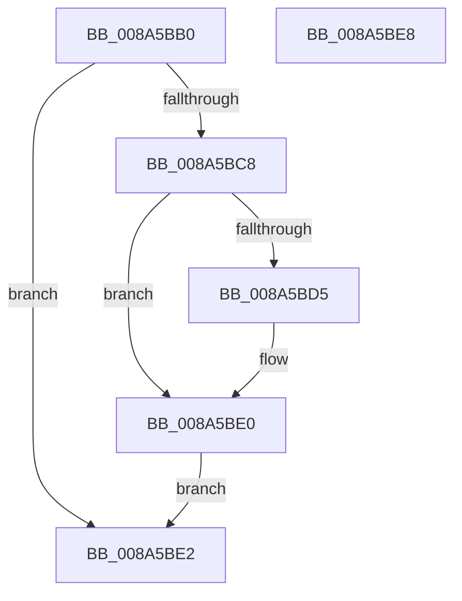

# EtwpQueryProcessOtherInfo

- RVA: `0x008A5BB0`–`0x008A5BE9` (길이 `57` bytes)
- VA: `0x00000001408A5BB0`
- 실행 섹션: `PAGE`
- PDB 이름 있음: `예`; PDB Function 태그: `아니요`
- unwind 정보 RVA: `0x0007F038`
- 디코드: `21`개 명령, `57/57` bytes 표시
- 미해석 바이트: `0` (있으면 어셈블리에 `.byte`로 보존)

> 이 문서는 커널 이미지의 기계어와 PDB 기호를 분석해 생성했습니다. 4번과 5번은 함수 원형과 자료형을 바이너리 사용 방식에서 추정한 C 해석이며 원본 소스 복구 결과는 아닙니다.

## 1. Dependencies

- 직접 호출 지점: **2**; 고유 호출 대상: **2**
- 직접 호출자로 확인된 함수: **4**
- RIP 상대 이미지 참조: **0**

### Outgoing calls
- `0x008A5BBE` → [PsGetProcessSectionBaseAddress](../../text/48/PsGetProcessSectionBaseAddress_function_0048C060.md) (function, `0x0048C060`)
- `0x008A5BCB` → [RtlImageNtHeader](../../text/44/RtlImageNtHeader_function_00443B60.md) (function, `0x00443B60`)

### Direct callers
- [EtwTraceAppStateChange](EtwTraceAppStateChange_function_008A452C.md) at `0x008A472A`
- [EtwQueryProcessTelemetryInfo](EtwQueryProcessTelemetryInfo_function_008A51A0.md) at `0x008A52FF`
- [EtwpBuildProcessEvent](EtwpBuildProcessEvent_function_008A552C.md) at `0x008A56C0`
- [sub_00B413EC](../B4/Unknown_function_00B413EC.md) at `0x00B4146B`

### Static image references
- 디코드된 RIP-relative 메모리 참조가 없습니다.

## 2. Other-region calls and transfers

- 다른 실행 섹션으로 향하는 call: **2**
  - `0x008A5BBE` → [PsGetProcessSectionBaseAddress](../../text/48/PsGetProcessSectionBaseAddress_function_0048C060.md) (`PAGE` → `.text`)
  - `0x008A5BCB` → [RtlImageNtHeader](../../text/44/RtlImageNtHeader_function_00443B60.md) (`PAGE` → `.text`)
- 별도 외부 분기/꼬리 이동을 확인하지 못했습니다.

## 3. Assembly (complete function range)

```asm
008A5BB0  40 53                           push rbx
008A5BB2  48 83 EC 20                     sub rsp, 0x20
008A5BB6  48 8B DA                        mov rbx, rdx
008A5BB9  33 C0                           xor eax, eax
008A5BBB  48 89 02                        mov qword ptr [rdx], rax
008A5BBE  E8 9D 64 BE FF                  call 0x14048c060
008A5BC3  48 85 C0                        test rax, rax
008A5BC6  74 1A                           je 0x1408a5be2
008A5BC8  48 8B C8                        mov rcx, rax
008A5BCB  E8 90 DF B9 FF                  call 0x140443b60
008A5BD0  48 85 C0                        test rax, rax
008A5BD3  74 0B                           je 0x1408a5be0
008A5BD5  8B 48 58                        mov ecx, dword ptr [rax + 0x58]
008A5BD8  89 0B                           mov dword ptr [rbx], ecx
008A5BDA  8B 40 08                        mov eax, dword ptr [rax + 8]
008A5BDD  89 43 04                        mov dword ptr [rbx + 4], eax
008A5BE0  EB 00                           jmp 0x1408a5be2
008A5BE2  48 83 C4 20                     add rsp, 0x20
008A5BE6  5B                              pop rbx
008A5BE7  C3                              ret
008A5BE8  CC                              int3
```

## 4. C-style interpretation (structured pseudocode)

```c
__int64 __fastcall EtwpQueryProcessOtherInfo(__int64 a1, __int64 a2)
{
    __int64 result;
    __int64 v_rsp;

    v_rsp = (v_rsp) - (32);
    result = 0;
    *(unsigned __int64 *)(a2) = 0;
    result = PsGetProcessSectionBaseAddress(a1, a2, a3, a4);
    if (result == 0) goto loc_008A5BE2;
    result = RtlImageNtHeader(result, a2, a3, a4);
    if (result != 0) {
        a1 = *(unsigned int *)(result + 88);
        *(unsigned int *)(a2) = (unsigned int)(a1);
        result = *(unsigned int *)(result + 8);
        *(unsigned int *)(a2 + 4) = (unsigned int)(result);
    }
    goto loc_008A5BE2;
loc_008A5BE2:
    v_rsp = (v_rsp) + (32);
    return result;
}
```

## 5. (Beta) C Style

```c
int64_t EtwpQueryProcessOtherInfo(int64_t Arg1, void *Arg2)
{
    uint8_t *arg2 = (uint8_t *)Arg2;

    int64_t result;
    int64_t local_rsp;

    local_rsp = (local_rsp) - (32);
    result = 0;
    *(uint64_t *)(arg2) = 0;
    result = PsGetProcessSectionBaseAddress(Arg1, Arg2, a3, a4);
    if (result == 0) goto loc_008A5BE2;
    result = RtlImageNtHeader(result, Arg2, a3, a4);
    if (result != 0) {
        Arg1 = *(uint32_t *)(result + 0x58);
        *(uint32_t *)(arg2) = (uint32_t)(Arg1);
        result = *(uint32_t *)(result + 0x8);
        *(uint32_t *)(arg2 + 0x4) = (uint32_t)(result);
    }
    goto loc_008A5BE2;
loc_008A5BE2:
    local_rsp = (local_rsp) + (32);
    return result;
}
```

### 관측된 메모리 오프셋

구조체 형식이 확인되지 않은 접근은 인자 기준의 오프셋으로만 기록했습니다.

| 기준 인자 | 오프셋 표현 | 폭 (bit) | 접근 |
|---|---:|---:|---|
| `Arg2` | `+ 0x0` | `32` | `W` |
| `Arg2` | `+ 0x0` | `64` | `W` |
| `Arg2` | `+ 0x4` | `32` | `W` |

## 6. Execution-region graph

[열기: 2D/3D 그래프와 함수 탐색 컨트롤 패널](../../../control-panel.html?section=page&rva=0x008A5BB0&view=graph)

- 2D 그래프는 위에서 아래로 흐르고, 3D 그래프는 빈 공간을 드래그해 회전합니다. Shift+드래그는 이동, 휠은 확대·축소, 함수 노드 선택은 대상 보고서 이동입니다.

### Static fallback


