# EtwpQueryTokenPackageInfo

- RVA: `0x008A5878`–`0x008A5BAA` (길이 `818` bytes)
- VA: `0x00000001408A5878`
- 실행 섹션: `PAGE`
- PDB 이름 있음: `예`; PDB Function 태그: `아니요`
- unwind 정보 RVA: `0x0007F01C`
- 디코드: `215`개 명령, `818/818` bytes 표시
- 미해석 바이트: `0` (있으면 어셈블리에 `.byte`로 보존)

> 이 문서는 커널 이미지의 기계어와 PDB 기호를 분석해 생성했습니다. 4번과 5번은 함수 원형과 자료형을 바이너리 사용 방식에서 추정한 C 해석이며 원본 소스 복구 결과는 아닙니다.

## 1. Dependencies

- 직접 호출 지점: **8**; 고유 호출 대상: **5**
- 직접 호출자로 확인된 함수: **4**
- RIP 상대 이미지 참조: **3**

### Outgoing calls
- `0x008A58AC` → [SeSecurityAttributePresent](../../text/21/SeSecurityAttributePresent_function_00213660.md) (function, `0x00213660`)
- `0x008A58BD` → [SeSecurityAttributePresent](../../text/21/SeSecurityAttributePresent_function_00213660.md) (function, `0x00213660`)
- `0x008A5930` → [wcschr](../../text/50/wcschr_function_00501A60.md) (function, `0x00501A60`)
- `0x008A59A7` → [RtlStringCchCopyNExW](../../text/43/RtlStringCchCopyNExW_function_00437CB0.md) (function, `0x00437CB0`)
- `0x008A59E2` → [RtlStringCchCopyNExW](../../text/43/RtlStringCchCopyNExW_function_00437CB0.md) (function, `0x00437CB0`)
- `0x008A5AD2` → [RtlStringCchCopyNExW](../../text/43/RtlStringCchCopyNExW_function_00437CB0.md) (function, `0x00437CB0`)
- `0x008A5B0E` → [RtlQueryPackageIdentity](../../text/45/RtlQueryPackageIdentity_function_0045C390.md) (function, `0x0045C390`)
- `0x008A5B91` → [RtlStringExHandleOtherFlagsW](../../text/41/RtlStringExHandleOtherFlagsW_function_0041E3F0.md) (function, `0x0041E3F0`)

### Direct callers
- [EtwTraceAppStateChange](EtwTraceAppStateChange_function_008A452C.md) at `0x008A46E0`
- [EtwQueryProcessTelemetryInfo](EtwQueryProcessTelemetryInfo_function_008A51A0.md) at `0x008A526F`
- [EtwpBuildProcessEvent](EtwpBuildProcessEvent_function_008A552C.md) at `0x008A5608`
- [sub_00B413EC](../B4/Unknown_function_00B413EC.md) at `0x00B41458`

### Static image references
- `0x008A589C` → RVA `0x00B4BEA8` (`PspSysAppIdClaim`; read)
- `0x008A58B1` → RVA `0x00B4BE98` (`PspPackagedAppClaim`; read)
- `0x008A5A21` → RVA `0x00B07620` (` ?? ::NNGAKEGL::`string'`; read)

## 2. Other-region calls and transfers

- 다른 실행 섹션으로 향하는 call: **8**
  - `0x008A58AC` → [SeSecurityAttributePresent](../../text/21/SeSecurityAttributePresent_function_00213660.md) (`PAGE` → `.text`)
  - `0x008A58BD` → [SeSecurityAttributePresent](../../text/21/SeSecurityAttributePresent_function_00213660.md) (`PAGE` → `.text`)
  - `0x008A5930` → [wcschr](../../text/50/wcschr_function_00501A60.md) (`PAGE` → `.text`)
  - `0x008A59A7` → [RtlStringCchCopyNExW](../../text/43/RtlStringCchCopyNExW_function_00437CB0.md) (`PAGE` → `.text`)
  - `0x008A59E2` → [RtlStringCchCopyNExW](../../text/43/RtlStringCchCopyNExW_function_00437CB0.md) (`PAGE` → `.text`)
  - `0x008A5AD2` → [RtlStringCchCopyNExW](../../text/43/RtlStringCchCopyNExW_function_00437CB0.md) (`PAGE` → `.text`)
  - `0x008A5B0E` → [RtlQueryPackageIdentity](../../text/45/RtlQueryPackageIdentity_function_0045C390.md) (`PAGE` → `.text`)
  - `0x008A5B91` → [RtlStringExHandleOtherFlagsW](../../text/41/RtlStringExHandleOtherFlagsW_function_0041E3F0.md) (`PAGE` → `.text`)
- 별도 외부 분기/꼬리 이동을 확인하지 못했습니다.

## 3. Assembly (complete function range)

```asm
008A5878  48 89 5C 24 08                  mov qword ptr [rsp + 8], rbx
008A587D  55                              push rbp
008A587E  56                              push rsi
008A587F  57                              push rdi
008A5880  41 54                           push r12
008A5882  41 55                           push r13
008A5884  41 56                           push r14
008A5886  41 57                           push r15
008A5888  48 8B EC                        mov rbp, rsp
008A588B  48 83 EC 40                     sub rsp, 0x40
008A588F  48 8D 72 08                     lea rsi, [rdx + 8]
008A5893  45 33 ED                        xor r13d, r13d
008A5896  4C 89 2A                        mov qword ptr [rdx], r13
008A5899  48 8B FA                        mov rdi, rdx
008A589C  48 8D 15 05 66 2A 00            lea rdx, [rip + 0x2a6605]
008A58A3  4C 89 2E                        mov qword ptr [rsi], r13
008A58A6  4D 8B F0                        mov r14, r8
008A58A9  4C 8B F9                        mov r15, rcx
008A58AC  E8 AF DD 96 FF                  call 0x140213660
008A58B1  48 8D 15 E0 65 2A 00            lea rdx, [rip + 0x2a65e0]
008A58B8  49 8B CF                        mov rcx, r15
008A58BB  8A D8                           mov bl, al
008A58BD  E8 9E DD 96 FF                  call 0x140213660
008A58C2  44 8A E0                        mov r12b, al
008A58C5  84 DB                           test bl, bl
008A58C7  0F 85 14 02 00 00               jne 0x1408a5ae1
008A58CD  48 8B 07                        mov rax, qword ptr [rdi]
008A58D0  48 8D 4F 18                     lea rcx, [rdi + 0x18]
008A58D4  41 BC 02 00 00 00               mov r12d, 2
008A58DA  48 85 C0                        test rax, rax
008A58DD  75 0A                           jne 0x1408a58e9
008A58DF  4C 89 27                        mov qword ptr [rdi], r12
008A58E2  41 8B C4                        mov eax, r12d
008A58E5  66 44 89 29                     mov word ptr [rcx], r13w
008A58E9  4C 39 2E                        cmp qword ptr [rsi], r13
008A58EC  75 0B                           jne 0x1408a58f9
008A58EE  4C 89 26                        mov qword ptr [rsi], r12
008A58F1  66 44 89 AF 18 01 00 00         mov word ptr [rdi + 0x118], r13w
008A58F9  4C 89 67 10                     mov qword ptr [rdi + 0x10], r12
008A58FD  4C 8D B7 9A 01 00 00            lea r14, [rdi + 0x19a]
008A5904  66 45 89 2E                     mov word ptr [r14], r13w
008A5908  49 3B C4                        cmp rax, r12
008A590B  77 19                           ja 0x1408a5926
008A590D  48 8B 9C 24 80 00 00 00         mov rbx, qword ptr [rsp + 0x80]
008A5915  48 83 C4 40                     add rsp, 0x40
008A5919  41 5F                           pop r15
008A591B  41 5E                           pop r14
008A591D  41 5D                           pop r13
008A591F  41 5C                           pop r12
008A5921  5F                              pop rdi
008A5922  5E                              pop rsi
008A5923  5D                              pop rbp
008A5924  C3                              ret
008A5925  CC                              int3
008A5926  4C 39 26                        cmp qword ptr [rsi], r12
008A5929  76 E2                           jbe 0x1408a590d
008A592B  BA 5F 00 00 00                  mov edx, 0x5f
008A5930  E8 2B C1 C5 FF                  call 0x140501a60
008A5935  4C 8B C8                        mov r9, rax
008A5938  48 85 C0                        test rax, rax
008A593B  74 D0                           je 0x1408a590d
008A593D  48 8B 1F                        mov rbx, qword ptr [rdi]
008A5940  4C 2B CF                        sub r9, rdi
008A5943  49 83 E9 16                     sub r9, 0x16
008A5947  48 D1 EB                        shr rbx, 1
008A594A  BE 01 00 00 00                  mov esi, 1
008A594F  49 D1 F9                        sar r9, 1
008A5952  48 2B DE                        sub rbx, rsi
008A5955  48 83 FB 0D                     cmp rbx, 0xd
008A5959  76 B2                           jbe 0x1408a590d
008A595B  4C 8B 7F 08                     mov r15, qword ptr [rdi + 8]
008A595F  49 D1 EF                        shr r15, 1
008A5962  4C 2B FE                        sub r15, rsi
008A5965  4B 8D 04 0F                     lea rax, [r15 + r9]
008A5969  48 8D 04 45 1E 00 00 00         lea rax, [rax*2 + 0x1e]
008A5971  48 3D 04 01 00 00               cmp rax, 0x104
008A5977  77 94                           ja 0x1408a590d
008A5979  48 8D 45 58                     lea rax, [rbp + 0x58]
008A597D  C7 44 24 30 00 08 00 00         mov dword ptr [rsp + 0x30], 0x800
008A5985  48 89 44 24 28                  mov qword ptr [rsp + 0x28], rax
008A598A  4C 8D 47 18                     lea r8, [rdi + 0x18]
008A598E  48 8D 45 48                     lea rax, [rbp + 0x48]
008A5992  4C 89 6D 48                     mov qword ptr [rbp + 0x48], r13
008A5996  BA 82 00 00 00                  mov edx, 0x82
008A599B  48 89 44 24 20                  mov qword ptr [rsp + 0x20], rax
008A59A0  49 8B CE                        mov rcx, r14
008A59A3  48 89 55 58                     mov qword ptr [rbp + 0x58], rdx
008A59A7  E8 04 23 B9 FF                  call 0x140437cb0
008A59AC  85 C0                           test eax, eax
008A59AE  0F 88 7A 01 00 00               js 0x1408a5b2e
008A59B4  48 8B 55 58                     mov rdx, qword ptr [rbp + 0x58]
008A59B8  48 8D 45 58                     lea rax, [rbp + 0x58]
008A59BC  48 8B 4D 48                     mov rcx, qword ptr [rbp + 0x48]
008A59C0  4C 8D 47 FE                     lea r8, [rdi - 2]
008A59C4  C7 44 24 30 00 08 00 00         mov dword ptr [rsp + 0x30], 0x800
008A59CC  4D 8D 04 58                     lea r8, [r8 + rbx*2]
008A59D0  48 89 44 24 28                  mov qword ptr [rsp + 0x28], rax
008A59D5  44 8D 4E 0C                     lea r9d, [rsi + 0xc]
008A59D9  48 8D 45 48                     lea rax, [rbp + 0x48]
008A59DD  48 89 44 24 20                  mov qword ptr [rsp + 0x20], rax
008A59E2  E8 C9 22 B9 FF                  call 0x140437cb0
008A59E7  85 C0                           test eax, eax
008A59E9  0F 88 3F 01 00 00               js 0x1408a5b2e
008A59EF  48 8B 5D 58                     mov rbx, qword ptr [rbp + 0x58]
008A59F3  48 8D 43 FF                     lea rax, [rbx - 1]
008A59F7  48 3D FE FF FF 7F               cmp rax, 0x7ffffffe
008A59FD  0F 87 26 01 00 00               ja 0x1408a5b29
008A5A03  4C 8B 75 48                     mov r14, qword ptr [rbp + 0x48]
008A5A07  4C 8B C3                        mov r8, rbx
008A5A0A  4C 89 75 48                     mov qword ptr [rbp + 0x48], r14
008A5A0E  4D 8B CE                        mov r9, r14
008A5A11  48 89 5D 58                     mov qword ptr [rbp + 0x58], rbx
008A5A15  48 85 DB                        test rbx, rbx
008A5A18  0F 84 3E 01 00 00               je 0x1408a5b5c
008A5A1E  44 8B C6                        mov r8d, esi
008A5A21  4C 8D 0D F8 1B 26 00            lea r9, [rip + 0x261bf8]
008A5A28  4C 2B C3                        sub r8, rbx
008A5A2B  48 8B D3                        mov rdx, rbx
008A5A2E  4D 2B CE                        sub r9, r14
008A5A31  49 8B CE                        mov rcx, r14
008A5A34  4D 8B D5                        mov r10, r13
008A5A37  49 8D 04 10                     lea rax, [r8 + rdx]
008A5A3B  48 85 C0                        test rax, rax
008A5A3E  74 18                           je 0x1408a5a58
008A5A40  41 0F B7 04 09                  movzx eax, word ptr [r9 + rcx]
008A5A45  66 85 C0                        test ax, ax
008A5A48  74 0E                           je 0x1408a5a58
008A5A4A  66 89 01                        mov word ptr [rcx], ax
008A5A4D  4C 03 D6                        add r10, rsi
008A5A50  49 03 CC                        add rcx, r12
008A5A53  48 2B D6                        sub rdx, rsi
008A5A56  75 DF                           jne 0x1408a5a37
008A5A58  48 85 D2                        test rdx, rdx
008A5A5B  48 8D 41 FE                     lea rax, [rcx - 2]
008A5A5F  4C 8B C3                        mov r8, rbx
008A5A62  48 0F 45 C1                     cmovne rax, rcx
008A5A66  49 8D 4A FF                     lea rcx, [r10 - 1]
008A5A6A  49 0F 45 CA                     cmovne rcx, r10
008A5A6E  66 44 89 28                     mov word ptr [rax], r13w
008A5A72  48 8B C2                        mov rax, rdx
008A5A75  48 F7 D8                        neg rax
008A5A78  4D 8D 0C 4E                     lea r9, [r14 + rcx*2]
008A5A7C  4C 89 4D 48                     mov qword ptr [rbp + 0x48], r9
008A5A80  1B F6                           sbb esi, esi
008A5A82  4C 2B C1                        sub r8, rcx
008A5A85  F7 D6                           not esi
008A5A87  4C 89 45 58                     mov qword ptr [rbp + 0x58], r8
008A5A8B  81 E6 05 00 00 80               and esi, 0x80000005
008A5A91  48 85 D2                        test rdx, rdx
008A5A94  0F 84 D6 00 00 00               je 0x1408a5b70
008A5A9A  4D 8B F1                        mov r14, r9
008A5A9D  49 8B D8                        mov rbx, r8
008A5AA0  85 F6                           test esi, esi
008A5AA2  0F 88 86 00 00 00               js 0x1408a5b2e
008A5AA8  48 8D 45 58                     lea rax, [rbp + 0x58]
008A5AAC  C7 44 24 30 00 08 00 00         mov dword ptr [rsp + 0x30], 0x800
008A5AB4  48 89 44 24 28                  mov qword ptr [rsp + 0x28], rax
008A5AB9  4C 8D 87 18 01 00 00            lea r8, [rdi + 0x118]
008A5AC0  48 8D 45 48                     lea rax, [rbp + 0x48]
008A5AC4  4D 8B CF                        mov r9, r15
008A5AC7  48 8B D3                        mov rdx, rbx
008A5ACA  48 89 44 24 20                  mov qword ptr [rsp + 0x20], rax
008A5ACF  49 8B CE                        mov rcx, r14
008A5AD2  E8 D9 21 B9 FF                  call 0x140437cb0
008A5AD7  85 C0                           test eax, eax
008A5AD9  0F 89 2E FE FF FF               jns 0x1408a590d
008A5ADF  EB 4D                           jmp 0x1408a5b2e
008A5AE1  41 83 0E 01                     or dword ptr [r14], 1
008A5AE5  48 8D 57 18                     lea rdx, [rdi + 0x18]
008A5AE9  4C 8D 8F 18 01 00 00            lea r9, [rdi + 0x118]
008A5AF0  4C 89 6C 24 28                  mov qword ptr [rsp + 0x28], r13
008A5AF5  4C 8B C7                        mov r8, rdi
008A5AF8  48 C7 07 00 01 00 00            mov qword ptr [rdi], 0x100
008A5AFF  49 8B CF                        mov rcx, r15
008A5B02  48 C7 06 82 00 00 00            mov qword ptr [rsi], 0x82
008A5B09  48 89 74 24 20                  mov qword ptr [rsp + 0x20], rsi
008A5B0E  E8 7D 68 BB FF                  call 0x14045c390
008A5B13  85 C0                           test eax, eax
008A5B15  78 39                           js 0x1408a5b50
008A5B17  45 84 E4                        test r12b, r12b
008A5B1A  0F 84 AD FD FF FF               je 0x1408a58cd
008A5B20  41 83 0E 08                     or dword ptr [r14], 8
008A5B24  E9 A4 FD FF FF                  jmp 0x1408a58cd
008A5B29  48 85 DB                        test rbx, rbx
008A5B2C  75 72                           jne 0x1408a5ba0
008A5B2E  4C 89 67 10                     mov qword ptr [rdi + 0x10], r12
008A5B32  66 44 89 AF 9A 01 00 00         mov word ptr [rdi + 0x19a], r13w
008A5B3A  E9 CE FD FF FF                  jmp 0x1408a590d
008A5B3F  81 FE 05 00 00 80               cmp esi, 0x80000005
008A5B45  0F 85 55 FF FF FF               jne 0x1408a5aa0
008A5B4B  E9 4A FF FF FF                  jmp 0x1408a5a9a
008A5B50  4C 89 2E                        mov qword ptr [rsi], r13
008A5B53  48 8D 77 08                     lea rsi, [rdi + 8]
008A5B57  4C 89 2F                        mov qword ptr [rdi], r13
008A5B5A  EB BB                           jmp 0x1408a5b17
008A5B5C  49 8B C6                        mov rax, r14
008A5B5F  48 F7 D8                        neg rax
008A5B62  1B F6                           sbb esi, esi
008A5B64  81 E6 F8 FF FF BF               and esi, 0xbffffff8
008A5B6A  81 C6 0D 00 00 C0               add esi, 0xc000000d
008A5B70  48 85 DB                        test rbx, rbx
008A5B73  74 CA                           je 0x1408a5b3f
008A5B75  48 8D 45 58                     lea rax, [rbp + 0x58]
008A5B79  C7 44 24 28 00 08 00 00         mov dword ptr [rsp + 0x28], 0x800
008A5B81  48 8D 14 1B                     lea rdx, [rbx + rbx]
008A5B85  48 89 44 24 20                  mov qword ptr [rsp + 0x20], rax
008A5B8A  4C 8D 4D 48                     lea r9, [rbp + 0x48]
008A5B8E  49 8B CE                        mov rcx, r14
008A5B91  E8 5A 88 B7 FF                  call 0x14041e3f0
008A5B96  4C 8B 4D 48                     mov r9, qword ptr [rbp + 0x48]
008A5B9A  4C 8B 45 58                     mov r8, qword ptr [rbp + 0x58]
008A5B9E  EB 9F                           jmp 0x1408a5b3f
008A5BA0  48 8B 45 48                     mov rax, qword ptr [rbp + 0x48]
008A5BA4  66 44 89 28                     mov word ptr [rax], r13w
008A5BA8  EB 84                           jmp 0x1408a5b2e
```

## 4. C-style interpretation (structured pseudocode)

```c
__int64 __fastcall EtwpQueryTokenPackageInfo(__int64 a1, __int64 a2, __int64 a3)
{
    __int64 result;
    __int64 v_r10;
    __int64 v_r13;
    __int64 v_r15;
    __int64 v_rbx;
    __int64 v_rsi;
    __int64 v_rsp;
    unsigned __int64 v_stack_p10;
    unsigned __int64 v_stack_p20;
    unsigned __int64 v_stack_p28;
    unsigned int v_stack_p30;
    unsigned __int64 v_stack_p8;

    v_stack_p8 = v_rbx;
    v_rsp = (v_rsp) - (64);
    v_r13 = 0;
    *(unsigned __int64 *)(a2) = 0;
    *(unsigned __int64 *)(a2 + 8) = 0;
    result = SeSecurityAttributePresent(a1, v_rip + 2778629, a3, a4);
    result = SeSecurityAttributePresent(a1, v_rip + 2778592, a3, a4);
    if ((unsigned __int8)((unsigned __int8)(result)) != 0) goto loc_008A5AE1;
loc_008A58CD:
    result = *(unsigned __int64 *)(a2);
    if (*(unsigned __int64 *)(a2) == 0) {
        *(unsigned __int64 *)(a2) = 2;
        result = 2;
        *(unsigned __int16 *)(a2 + 24) = 0;
    }
    if ((*(unsigned __int64 *)(a2 + 8)) == 0) {
        *(unsigned __int64 *)(a2 + 8) = 2;
        *(unsigned __int16 *)(a2 + 280) = 0;
    }
    *(unsigned __int64 *)(a2 + 16) = 2;
    *(unsigned __int16 *)(a2 + 410) = 0;
    if (result > 2) goto loc_008A5926;
loc_008A590D:
    v_rsp = (v_rsp) + (64);
    return result;
loc_008A5926:
    if ((*(unsigned __int64 *)(a2 + 8)) <= 2) goto loc_008A590D;
    result = wcschr(a2 + 24, 95, a3, a4);
    if (result == 0) goto loc_008A590D;
    a4 = (result) - (a2);
    a4 = (a4) - (22);
    v_rbx = (*(unsigned __int64 *)(a2)) >> (1);
    a4 = (a4) >> (1);
    v_rbx = (v_rbx) - (1);
    if (v_rbx <= 13) goto loc_008A590D;
    v_r15 = (*(unsigned __int64 *)(a2 + 8)) >> (1);
    v_r15 = (v_r15) - (1);
    if ((v_r15 + a4 * 1 * 2 + 30) > 260) goto loc_008A590D;
    v_stack_p30 = 0x800ULL;
    v_stack_p28 = v_stack_p20;
    v_stack_p10 = 0;
    v_stack_p20 = v_stack_p10;
    v_stack_p20 = 130;
    result = RtlStringCchCopyNExW(a2 + 410, 130, a2 + 24, a4);
    if (sign_flag) goto loc_008A5B2E;
    v_stack_p30 = 0x800ULL;
    v_stack_p28 = v_stack_p20;
    v_stack_p20 = v_stack_p10;
    result = RtlStringCchCopyNExW(v_stack_p10, v_stack_p20, a2 - 2 + v_rbx * 2, 1 + 12);
    if (sign_flag) goto loc_008A5B2E;
    if ((v_stack_p20 - 1) > 0x7FFFFFFEULL) goto loc_008A5B29;
    v_stack_p10 = v_stack_p10;
    v_stack_p20 = v_stack_p20;
    if (v_stack_p20 == 0) goto loc_008A5B5C;
    a3 = (1) - (v_stack_p20);
    a4 = (v_rip + 2497528) - (v_stack_p10);
loc_008A5A37:
    if (a3 + v_stack_p20 * 1 == 0) goto loc_008A5A58;
    if ((unsigned __int16)(*(unsigned __int16 *)(a4 + v_stack_p10 * 1)) == 0) goto loc_008A5A58;
    *(unsigned __int16 *)(v_stack_p10) = (unsigned __int16)(*(unsigned __int16 *)(a4 + v_stack_p10 * 1));
    v_r10 = (0) + (1);
    a1 = (v_stack_p10) + (2);
    a2 = (v_stack_p20) - (1);
    if (condition_is_not_equal) goto loc_008A5A37;
loc_008A5A58:
    result = a1 - 2;
    if (a2 != 0) { result = a1; }
    a1 = v_r10 - 1;
    if (a2 != 0) { a1 = v_r10; }
    *(unsigned __int16 *)(result) = 0;
    result = -(a2);
    v_stack_p10 = v_stack_p10 + a1 * 2;
    a3 = (v_stack_p20) - (a1);
    v_rsi = (unsigned int)(~(1));
    v_stack_p20 = a3;
    v_rsi = (unsigned int)((v_rsi) & (0x80000005ULL));
    if (a2 == 0) goto loc_008A5B70;
loc_008A5A9A:
loc_008A5AA0:
    if (sign_flag) goto loc_008A5B2E;
    v_stack_p30 = 0x800ULL;
    v_stack_p28 = v_stack_p20;
    v_stack_p20 = v_stack_p10;
    result = RtlStringCchCopyNExW(v_stack_p10 + a1 * 2, a3, a2 + 280, v_r15);
    if (!sign_flag) goto loc_008A590D;
    goto loc_008A5B2E;
loc_008A5AE1:
    v_stack_p28 = 0;
    *(unsigned __int64 *)(a2) = 256;
    *(unsigned __int64 *)(v_rsi) = 130;
    v_stack_p20 = v_rsi;
    result = RtlQueryPackageIdentity(v_r15, a2 + 24, a2, a2 + 280);
    if (sign_flag) goto loc_008A5B50;
loc_008A5B17:
    if (2 == 0) goto loc_008A58CD;
    goto loc_008A58CD;
loc_008A5B29:
    if (a3 != 0) goto loc_008A5BA0;
loc_008A5B2E:
    *(unsigned __int64 *)(a2 + 16) = 2;
    *(unsigned __int16 *)(a2 + 410) = 0;
    goto loc_008A590D;
loc_008A5B3F:
    if (((unsigned int)(v_rsi)) != 0x80000005ULL) goto loc_008A5AA0;
    goto loc_008A5A9A;
loc_008A5B50:
    *(unsigned __int64 *)(v_rsi) = 0;
    *(unsigned __int64 *)(a2) = 0;
    goto loc_008A5B17;
loc_008A5B5C:
    result = -(v_stack_p10 + a1 * 2);
    v_rsi = (unsigned int)((a2 + 8) & (0xBFFFFFF8ULL));
    v_rsi = (unsigned int)((v_rsi) + (0xC000000DULL));
loc_008A5B70:
    if (a3 == 0) goto loc_008A5B3F;
    v_stack_p28 = 0x800ULL;
    v_stack_p20 = v_stack_p20;
    result = RtlStringExHandleOtherFlagsW(v_stack_p10 + a1 * 2, a3 + a3 * 1, a2, v_stack_p10);
    goto loc_008A5B3F;
loc_008A5BA0:
    *(unsigned __int16 *)(v_stack_p10) = 0;
    goto loc_008A5B2E;
}
```

## 5. (Beta) C Style

```c
int64_t EtwpQueryTokenPackageInfo(int64_t Arg1, void *Arg2, void *Arg3)
{
    uint8_t *arg2 = (uint8_t *)Arg2;
    uint8_t *arg3 = (uint8_t *)Arg3;

    int64_t result;
    int64_t local_r10;
    int64_t local_r13;
    int64_t local_r15;
    int64_t local_rbx;
    int64_t local_rsi;
    int64_t local_rsp;
    uint64_t v_stack_p10;
    uint64_t v_stack_p20;
    uint64_t v_stack_p28;
    uint32_t v_stack_p30;
    uint64_t v_stack_p8;

    v_stack_p8 = local_rbx;
    local_rsp = (local_rsp) - (64);
    local_r13 = 0;
    *(uint64_t *)(arg2) = 0;
    *(uint64_t *)(arg2 + 0x8) = 0;
    result = SeSecurityAttributePresent(Arg1, v_rip + 2778629, Arg3, a4);
    result = SeSecurityAttributePresent(Arg1, v_rip + 2778592, Arg3, a4);
    if ((uint8_t)((uint8_t)(result)) != 0) goto loc_008A5AE1;
loc_008A58CD:
    result = *(uint64_t *)(arg2);
    if (*(uint64_t *)(arg2) == 0) {
        *(uint64_t *)(arg2) = 2;
        result = 2;
        *(uint16_t *)(arg2 + 0x18) = 0;
    }
    if ((*(uint64_t *)(arg2 + 0x8)) == 0) {
        *(uint64_t *)(arg2 + 0x8) = 2;
        *(uint16_t *)(arg2 + 0x118) = 0;
    }
    *(uint64_t *)(arg2 + 0x10) = 2;
    *(uint16_t *)(arg2 + 0x19A) = 0;
    if (result > 2) goto loc_008A5926;
loc_008A590D:
    local_rsp = (local_rsp) + (64);
    return result;
loc_008A5926:
    if ((*(uint64_t *)(arg2 + 0x8)) <= 2) goto loc_008A590D;
    result = wcschr(Arg2 + 24, 95, Arg3, a4);
    if (result == 0) goto loc_008A590D;
    a4 = (result) - (Arg2);
    a4 = (a4) - (22);
    local_rbx = (*(uint64_t *)(arg2)) >> (1);
    a4 = (a4) >> (1);
    local_rbx = (local_rbx) - (1);
    if (local_rbx <= 13) goto loc_008A590D;
    local_r15 = (*(uint64_t *)(arg2 + 0x8)) >> (1);
    local_r15 = (local_r15) - (1);
    if ((local_r15 + a4 * 1 * 2 + 30) > 260) goto loc_008A590D;
    v_stack_p30 = 0x800ULL;
    v_stack_p28 = v_stack_p20;
    v_stack_p10 = 0;
    v_stack_p20 = v_stack_p10;
    v_stack_p20 = 130;
    result = RtlStringCchCopyNExW(Arg2 + 410, 130, Arg2 + 24, a4);
    if (sign_flag) goto loc_008A5B2E;
    v_stack_p30 = 0x800ULL;
    v_stack_p28 = v_stack_p20;
    v_stack_p20 = v_stack_p10;
    result = RtlStringCchCopyNExW(v_stack_p10, v_stack_p20, Arg2 - 2 + local_rbx * 2, 1 + 12);
    if (sign_flag) goto loc_008A5B2E;
    if ((v_stack_p20 - 1) > 0x7FFFFFFEULL) goto loc_008A5B29;
    v_stack_p10 = v_stack_p10;
    v_stack_p20 = v_stack_p20;
    if (v_stack_p20 == 0) goto loc_008A5B5C;
    Arg3 = (1) - (v_stack_p20);
    a4 = (v_rip + 2497528) - (v_stack_p10);
loc_008A5A37:
    if (Arg3 + v_stack_p20 * 1 == 0) goto loc_008A5A58;
    if ((uint16_t)(*(uint16_t *)(a4 + v_stack_p10 * 1)) == 0) goto loc_008A5A58;
    *(uint16_t *)(v_stack_p10) = (uint16_t)(*(uint16_t *)(a4 + v_stack_p10 * 1));
    local_r10 = (0) + (1);
    Arg1 = (v_stack_p10) + (2);
    Arg2 = (v_stack_p20) - (1);
    if (condition_is_not_equal) goto loc_008A5A37;
loc_008A5A58:
    result = Arg1 - 2;
    if (Arg2 != NULL) { result = Arg1; }
    Arg1 = local_r10 - 1;
    if (Arg2 != NULL) { Arg1 = local_r10; }
    *(uint16_t *)(result) = 0;
    result = -(Arg2);
    v_stack_p10 = v_stack_p10 + Arg1 * 2;
    Arg3 = (v_stack_p20) - (Arg1);
    local_rsi = (uint32_t)(~(1));
    v_stack_p20 = Arg3;
    local_rsi = (uint32_t)((local_rsi) & (0x80000005ULL));
    if (Arg2 == NULL) goto loc_008A5B70;
loc_008A5A9A:
loc_008A5AA0:
    if (sign_flag) goto loc_008A5B2E;
    v_stack_p30 = 0x800ULL;
    v_stack_p28 = v_stack_p20;
    v_stack_p20 = v_stack_p10;
    result = RtlStringCchCopyNExW(v_stack_p10 + Arg1 * 2, Arg3, Arg2 + 280, local_r15);
    if (!sign_flag) goto loc_008A590D;
    goto loc_008A5B2E;
loc_008A5AE1:
    v_stack_p28 = 0;
    *(uint64_t *)(arg2) = 256;
    *(uint64_t *)(local_rsi) = 130;
    v_stack_p20 = local_rsi;
    result = RtlQueryPackageIdentity(local_r15, Arg2 + 24, Arg2, Arg2 + 280);
    if (sign_flag) goto loc_008A5B50;
loc_008A5B17:
    if (2 == 0) goto loc_008A58CD;
    goto loc_008A58CD;
loc_008A5B29:
    if (Arg3 != NULL) goto loc_008A5BA0;
loc_008A5B2E:
    *(uint64_t *)(arg2 + 0x10) = 2;
    *(uint16_t *)(arg2 + 0x19A) = 0;
    goto loc_008A590D;
loc_008A5B3F:
    if (((uint32_t)(local_rsi)) != 0x80000005ULL) goto loc_008A5AA0;
    goto loc_008A5A9A;
loc_008A5B50:
    *(uint64_t *)(local_rsi) = 0;
    *(uint64_t *)(arg2) = 0;
    goto loc_008A5B17;
loc_008A5B5C:
    result = -(v_stack_p10 + Arg1 * 2);
    local_rsi = (uint32_t)((Arg2 + 8) & (0xBFFFFFF8ULL));
    local_rsi = (uint32_t)((local_rsi) + (0xC000000DULL));
loc_008A5B70:
    if (Arg3 == NULL) goto loc_008A5B3F;
    v_stack_p28 = 0x800ULL;
    v_stack_p20 = v_stack_p20;
    result = RtlStringExHandleOtherFlagsW(v_stack_p10 + Arg1 * 2, Arg3 + Arg3 * 1, Arg2, v_stack_p10);
    goto loc_008A5B3F;
loc_008A5BA0:
    *(uint16_t *)(v_stack_p10) = 0;
    goto loc_008A5B2E;
}
```

### 관측된 메모리 오프셋

구조체 형식이 확인되지 않은 접근은 인자 기준의 오프셋으로만 기록했습니다.

| 기준 인자 | 오프셋 표현 | 폭 (bit) | 접근 |
|---|---:|---:|---|
| `Arg2` | `- 0x2` | `64` | `R` |
| `Arg2` | `+ 0x0` | `16` | `W` |
| `Arg2` | `+ 0x0` | `64` | `R` |
| `Arg2` | `+ 0x0` | `64` | `W` |
| `Arg2` | `+ 0x0 + rbx*2` | `64` | `R` |
| `Arg2` | `+ 0x8` | `64` | `R` |
| `Arg2` | `+ 0x10` | `64` | `W` |
| `Arg2` | `+ 0x18` | `64` | `R` |
| `Arg2` | `+ 0x118` | `16` | `W` |
| `Arg2` | `+ 0x118` | `64` | `R` |
| `Arg2` | `+ 0x19A` | `16` | `W` |
| `Arg2` | `+ 0x19A` | `64` | `R` |
| `Arg3` | `+ 0x0` | `32` | `R/W` |

## 6. Execution-region graph

[열기: 2D/3D 그래프와 함수 탐색 컨트롤 패널](../../../control-panel.html?section=page&rva=0x008A5878&view=graph)

- 2D 그래프는 위에서 아래로 흐르고, 3D 그래프는 빈 공간을 드래그해 회전합니다. Shift+드래그는 이동, 휠은 확대·축소, 함수 노드 선택은 대상 보고서 이동입니다.

### Static fallback

```mermaid
flowchart TD
  bb_008A5878[BB_008A5878]
  bb_008A58CD[BB_008A58CD]
  bb_008A58DF[BB_008A58DF]
  bb_008A58E9[BB_008A58E9]
  bb_008A58EE[BB_008A58EE]
  bb_008A58F9[BB_008A58F9]
  bb_008A590D[BB_008A590D]
  bb_008A5925[BB_008A5925]
  bb_008A5926[BB_008A5926]
  bb_008A592B[BB_008A592B]
  bb_008A593D[BB_008A593D]
  bb_008A595B[BB_008A595B]
  bb_008A5979[BB_008A5979]
  bb_008A59B4[BB_008A59B4]
  bb_008A59EF[BB_008A59EF]
  bb_008A5A03[BB_008A5A03]
  bb_008A5A1E[BB_008A5A1E]
  bb_008A5A37[BB_008A5A37]
  bb_008A5A40[BB_008A5A40]
  bb_008A5A4A[BB_008A5A4A]
  bb_008A5A58[BB_008A5A58]
  bb_008A5A9A[BB_008A5A9A]
  bb_008A5AA0[BB_008A5AA0]
  bb_008A5AA8[BB_008A5AA8]
  bb_008A5ADF[BB_008A5ADF]
  bb_008A5AE1[BB_008A5AE1]
  bb_008A5B17[BB_008A5B17]
  bb_008A5B20[BB_008A5B20]
  bb_008A5B29[BB_008A5B29]
  bb_008A5B2E[BB_008A5B2E]
  bb_008A5B3F[BB_008A5B3F]
  bb_008A5B4B[BB_008A5B4B]
  bb_008A5B50[BB_008A5B50]
  bb_008A5B5C[BB_008A5B5C]
  bb_008A5B70[BB_008A5B70]
  bb_008A5B75[BB_008A5B75]
  bb_008A5BA0[BB_008A5BA0]
  bb_008A5878 -->|branch| bb_008A5AE1
  bb_008A5878 -->|fallthrough| bb_008A58CD
  bb_008A58CD -->|branch| bb_008A58E9
  bb_008A58CD -->|fallthrough| bb_008A58DF
  bb_008A58DF -->|flow| bb_008A58E9
  bb_008A58E9 -->|branch| bb_008A58F9
  bb_008A58E9 -->|fallthrough| bb_008A58EE
  bb_008A58EE -->|flow| bb_008A58F9
  bb_008A58F9 -->|branch| bb_008A5926
  bb_008A58F9 -->|fallthrough| bb_008A590D
  bb_008A5925 -->|flow| bb_008A5926
  bb_008A5926 -->|branch| bb_008A590D
  bb_008A5926 -->|fallthrough| bb_008A592B
  bb_008A592B -->|branch| bb_008A590D
  bb_008A592B -->|fallthrough| bb_008A593D
  bb_008A593D -->|branch| bb_008A590D
  bb_008A593D -->|fallthrough| bb_008A595B
  bb_008A595B -->|branch| bb_008A590D
  bb_008A595B -->|fallthrough| bb_008A5979
  bb_008A5979 -->|branch| bb_008A5B2E
  bb_008A5979 -->|fallthrough| bb_008A59B4
  bb_008A59B4 -->|branch| bb_008A5B2E
  bb_008A59B4 -->|fallthrough| bb_008A59EF
  bb_008A59EF -->|branch| bb_008A5B29
  bb_008A59EF -->|fallthrough| bb_008A5A03
  bb_008A5A03 -->|branch| bb_008A5B5C
  bb_008A5A03 -->|fallthrough| bb_008A5A1E
  bb_008A5A1E -->|flow| bb_008A5A37
  bb_008A5A37 -->|branch| bb_008A5A58
  bb_008A5A37 -->|fallthrough| bb_008A5A40
  bb_008A5A40 -->|branch| bb_008A5A58
  bb_008A5A40 -->|fallthrough| bb_008A5A4A
  bb_008A5A4A -->|branch| bb_008A5A37
  bb_008A5A4A -->|fallthrough| bb_008A5A58
  bb_008A5A58 -->|branch| bb_008A5B70
  bb_008A5A58 -->|fallthrough| bb_008A5A9A
  bb_008A5A9A -->|flow| bb_008A5AA0
  bb_008A5AA0 -->|branch| bb_008A5B2E
  bb_008A5AA0 -->|fallthrough| bb_008A5AA8
  bb_008A5AA8 -->|branch| bb_008A590D
  bb_008A5AA8 -->|fallthrough| bb_008A5ADF
  bb_008A5ADF -->|branch| bb_008A5B2E
  bb_008A5AE1 -->|branch| bb_008A5B50
  bb_008A5AE1 -->|fallthrough| bb_008A5B17
  bb_008A5B17 -->|branch| bb_008A58CD
  bb_008A5B17 -->|fallthrough| bb_008A5B20
  bb_008A5B20 -->|branch| bb_008A58CD
  bb_008A5B29 -->|branch| bb_008A5BA0
  bb_008A5B29 -->|fallthrough| bb_008A5B2E
  bb_008A5B2E -->|branch| bb_008A590D
  bb_008A5B3F -->|branch| bb_008A5AA0
  bb_008A5B3F -->|fallthrough| bb_008A5B4B
  bb_008A5B4B -->|branch| bb_008A5A9A
  bb_008A5B50 -->|branch| bb_008A5B17
  bb_008A5B5C -->|flow| bb_008A5B70
  bb_008A5B70 -->|branch| bb_008A5B3F
  bb_008A5B70 -->|fallthrough| bb_008A5B75
  bb_008A5B75 -->|branch| bb_008A5B3F
  bb_008A5BA0 -->|branch| bb_008A5B2E
```


