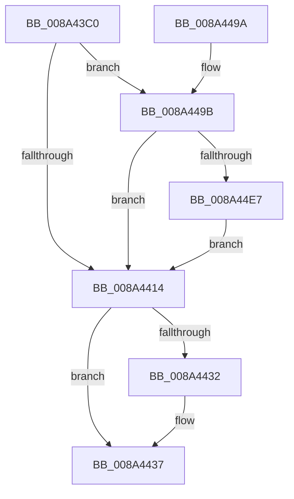

# EtwpSysModuleRunDown

- RVA: `0x008A43C0`–`0x008A4524` (길이 `356` bytes)
- VA: `0x00000001408A43C0`
- 실행 섹션: `PAGE`
- PDB 이름 있음: `예`; PDB Function 태그: `아니요`
- unwind 정보 RVA: `0x0007EF3C`
- 디코드: `79`개 명령, `356/356` bytes 표시
- 미해석 바이트: `0` (있으면 어셈블리에 `.byte`로 보존)

> 이 문서는 커널 이미지의 기계어와 PDB 기호를 분석해 생성했습니다. 4번과 5번은 함수 원형과 자료형을 바이너리 사용 방식에서 추정한 C 해석이며 원본 소스 복구 결과는 아닙니다.

## 1. Dependencies

- 직접 호출 지점: **6**; 고유 호출 대상: **5**
- 직접 호출자로 확인된 함수: **1**
- RIP 상대 이미지 참조: **4**

### Outgoing calls
- `0x008A4402` → [memset](../../text/6C/memset_function_006C6C40.md) (function, `0x006C6C40`)
- `0x008A4470` → [MmEnumerateSystemImages](../../text/4F/MmEnumerateSystemImages_function_004FC7B0.md) (function, `0x004FC7B0`)
- `0x008A447C` → [_security_check_cookie](../../text/6A/_security_check_cookie_function_006AC640.md) (function, `0x006AC640`)
- `0x008A44D1` → [EtwpLogKernelEvent](../../text/25/EtwpLogKernelEvent_function_0025CC00.md) (function, `0x0025CC00`)
- `0x008A44DA` → [HvlQueryConnection](../../text/46/HvlQueryConnection_function_00469C90.md) (function, `0x00469C90`)
- `0x008A451A` → [EtwpLogKernelEvent](../../text/25/EtwpLogKernelEvent_function_0025CC00.md) (function, `0x0025CC00`)

### Direct callers
- [EtwpProcessEnumCallback](EtwpProcessEnumCallback_function_008A5F40.md) at `0x008A612A`
- [EtwpProcessEnumCallback](EtwpProcessEnumCallback_function_008A5F40.md) at `0x008A6228`

### Static image references
- `0x008A43DB` → RVA `0x00E0A740` (`.data`; read)
- `0x008A444F` → RVA `0x00A42420` (`EtwpSystemImageEnumCallback`; read)
- `0x008A4456` → RVA `0x000105E0` (`.rdata`; read)
- `0x008A449E` → RVA `0x00FC6B28` (`ALMOSTRO`; read)

## 2. Other-region calls and transfers

- 다른 실행 섹션으로 향하는 call: **6**
  - `0x008A4402` → [memset](../../text/6C/memset_function_006C6C40.md) (`PAGE` → `.text`)
  - `0x008A4470` → [MmEnumerateSystemImages](../../text/4F/MmEnumerateSystemImages_function_004FC7B0.md) (`PAGE` → `.text`)
  - `0x008A447C` → [_security_check_cookie](../../text/6A/_security_check_cookie_function_006AC640.md) (`PAGE` → `.text`)
  - `0x008A44D1` → [EtwpLogKernelEvent](../../text/25/EtwpLogKernelEvent_function_0025CC00.md) (`PAGE` → `.text`)
  - `0x008A44DA` → [HvlQueryConnection](../../text/46/HvlQueryConnection_function_00469C90.md) (`PAGE` → `.text`)
  - `0x008A451A` → [EtwpLogKernelEvent](../../text/25/EtwpLogKernelEvent_function_0025CC00.md) (`PAGE` → `.text`)
- 별도 외부 분기/꼬리 이동을 확인하지 못했습니다.

## 3. Assembly (complete function range)

```asm
008A43C0  48 8B C4                        mov rax, rsp
008A43C3  48 89 58 10                     mov qword ptr [rax + 0x10], rbx
008A43C7  48 89 70 18                     mov qword ptr [rax + 0x18], rsi
008A43CB  48 89 78 20                     mov qword ptr [rax + 0x20], rdi
008A43CF  55                              push rbp
008A43D0  48 8D 68 A1                     lea rbp, [rax - 0x5f]
008A43D4  48 81 EC E0 00 00 00            sub rsp, 0xe0
008A43DB  48 8B 05 5E 63 56 00            mov rax, qword ptr [rip + 0x56635e]
008A43E2  48 33 C4                        xor rax, rsp
008A43E5  48 89 45 47                     mov qword ptr [rbp + 0x47], rax
008A43E9  33 F6                           xor esi, esi
008A43EB  40 8A FA                        mov dil, dl
008A43EE  48 8B D9                        mov rbx, rcx
008A43F1  89 75 C9                        mov dword ptr [rbp - 0x37], esi
008A43F4  33 D2                           xor edx, edx
008A43F6  66 89 75 CD                     mov word ptr [rbp - 0x33], si
008A43FA  48 8D 4D D7                     lea rcx, [rbp - 0x29]
008A43FE  44 8D 46 40                     lea r8d, [rsi + 0x40]
008A4402  E8 39 28 E2 FF                  call 0x1406c6c40
008A4407  48 89 75 A7                     mov qword ptr [rbp - 0x59], rsi
008A440B  40 84 FF                        test dil, dil
008A440E  0F 84 87 00 00 00               je 0x1408a449b
008A4414  48 89 5D BF                     mov qword ptr [rbp - 0x41], rbx
008A4418  48 8D 45 17                     lea rax, [rbp + 0x17]
008A441C  48 89 45 B7                     mov qword ptr [rbp - 0x49], rax
008A4420  48 8D 45 D7                     lea rax, [rbp - 0x29]
008A4424  48 89 45 AF                     mov qword ptr [rbp - 0x51], rax
008A4428  B8 03 14 00 00                  mov eax, 0x1403
008A442D  40 84 FF                        test dil, dil
008A4430  75 05                           jne 0x1408a4437
008A4432  B8 04 14 00 00                  mov eax, 0x1404
008A4437  66 89 45 C7                     mov word ptr [rbp - 0x39], ax
008A443B  48 8D 55 AF                     lea rdx, [rbp - 0x51]
008A443F  48 8D 45 D7                     lea rax, [rbp - 0x29]
008A4443  48 C7 45 1F 38 00 00 00         mov qword ptr [rbp + 0x1f], 0x38
008A444B  48 89 45 17                     mov qword ptr [rbp + 0x17], rax
008A444F  48 8D 0D CA DF 19 00            lea rcx, [rip + 0x19dfca]
008A4456  48 8D 05 83 C1 76 FF            lea rax, [rip - 0x893e7d]
008A445D  48 C7 45 3F 02 00 00 00         mov qword ptr [rbp + 0x3f], 2
008A4465  0F 57 C0                        xorps xmm0, xmm0
008A4468  48 89 45 37                     mov qword ptr [rbp + 0x37], rax
008A446C  0F 11 45 FF                     movups xmmword ptr [rbp - 1], xmm0
008A4470  E8 3B 83 C5 FF                  call 0x1404fc7b0
008A4475  48 8B 4D 47                     mov rcx, qword ptr [rbp + 0x47]
008A4479  48 33 CC                        xor rcx, rsp
008A447C  E8 BF 81 E0 FF                  call 0x1406ac640
008A4481  4C 8D 9C 24 E0 00 00 00         lea r11, [rsp + 0xe0]
008A4489  49 8B 5B 18                     mov rbx, qword ptr [r11 + 0x18]
008A448D  49 8B 73 20                     mov rsi, qword ptr [r11 + 0x20]
008A4491  49 8B 7B 28                     mov rdi, qword ptr [r11 + 0x28]
008A4495  49 8B E3                        mov rsp, r11
008A4498  5D                              pop rbp
008A4499  C3                              ret
008A449A  CC                              int3
008A449B  44 8B 03                        mov r8d, dword ptr [rbx]
008A449E  48 8D 05 83 26 72 00            lea rax, [rip + 0x722683]
008A44A5  48 8B 93 50 05 00 00            mov rdx, qword ptr [rbx + 0x550]
008A44AC  48 8D 4D 17                     lea rcx, [rbp + 0x17]
008A44B0  C7 44 24 28 02 18 50 00         mov dword ptr [rsp + 0x28], 0x501802
008A44B8  41 B9 01 00 00 00               mov r9d, 1
008A44BE  48 89 45 17                     mov qword ptr [rbp + 0x17], rax
008A44C2  48 C7 45 1F 08 00 00 00         mov qword ptr [rbp + 0x1f], 8
008A44CA  66 C7 44 24 20 21 14            mov word ptr [rsp + 0x20], 0x1421
008A44D1  E8 2A 87 9B FF                  call 0x14025cc00
008A44D6  48 8D 4D A7                     lea rcx, [rbp - 0x59]
008A44DA  E8 B1 57 BC FF                  call 0x140469c90
008A44DF  85 C0                           test eax, eax
008A44E1  0F 85 2D FF FF FF               jne 0x1408a4414
008A44E7  44 8B 03                        mov r8d, dword ptr [rbx]
008A44EA  48 8D 45 A7                     lea rax, [rbp - 0x59]
008A44EE  48 8B 93 50 05 00 00            mov rdx, qword ptr [rbx + 0x550]
008A44F5  48 8D 4D 17                     lea rcx, [rbp + 0x17]
008A44F9  C7 44 24 28 02 18 50 00         mov dword ptr [rsp + 0x28], 0x501802
008A4501  41 B9 01 00 00 00               mov r9d, 1
008A4507  48 89 45 17                     mov qword ptr [rbp + 0x17], rax
008A450B  48 C7 45 1F 08 00 00 00         mov qword ptr [rbp + 0x1f], 8
008A4513  66 C7 44 24 20 22 14            mov word ptr [rsp + 0x20], 0x1422
008A451A  E8 E1 86 9B FF                  call 0x14025cc00
008A451F  E9 F0 FE FF FF                  jmp 0x1408a4414
```

## 4. C-style interpretation (structured pseudocode)

```c
__int64 __fastcall EtwpSysModuleRunDown(__int64 a1, int a2)
{
    __int64 result;
    __int64 v_rsi;
    __int64 v_rsp;
    unsigned __int64 v_stack_m8;
    unsigned int v_stack_mB8;
    unsigned __int16 v_stack_mC0;

    *(unsigned __int64 *)(v_rsp + 16) = v_rbx;
    *(unsigned __int64 *)(v_rsp + 24) = v_rsi;
    *(unsigned __int64 *)(v_rsp + 32) = v_rdi;
    v_rsp = (v_rsp) - (224);
    result = (*(unsigned __int64 *)(v_rip + 5661534)) ^ (v_rsp);
    *(unsigned __int64 *)(v_rsp - 95 + 71) = result;
    v_rsi = 0;
    *(unsigned int *)(v_rsp - 95 - 55) = 0;
    a2 = 0;
    *(unsigned __int16 *)(v_rsp - 95 - 51) = 0;
    result = memset(v_rsp - 95 - 41, a2, v_rsi + 64, a4);
    *(unsigned __int64 *)(v_rsp - 95 - 89) = 0;
    if ((unsigned __int8)((unsigned __int8)(a2)) == 0) goto loc_008A449B;
loc_008A4414:
    *(unsigned __int64 *)(v_rsp - 95 - 65) = a1;
    *(unsigned __int64 *)(v_rsp - 95 - 73) = v_rsp - 95 + 23;
    *(unsigned __int64 *)(v_rsp - 95 - 81) = v_rsp - 95 - 41;
    result = (unsigned int)(0x1403ULL);
    if ((unsigned __int8)((unsigned __int8)(a2)) == 0) {
        result = 0x1404ULL;
    }
    *(unsigned __int16 *)(v_rsp - 95 - 57) = (unsigned __int16)(result);
    *(unsigned __int64 *)(v_rsp - 95 + 31) = 56;
    *(unsigned __int64 *)(v_rsp - 95 + 23) = v_rsp - 95 - 41;
    *(unsigned __int64 *)(v_rsp - 95 + 63) = 2;
    *(unsigned __int64 *)(v_rsp - 95 + 55) = v_rip - 8994429;
    *(unsigned __int64 *)(v_rsp - 95 - 1) = v_xmm0;
    result = MmEnumerateSystemImages(v_rip + 1695690, v_rsp - 95 - 81, v_rsi + 64, a4);
    a1 = (*(unsigned __int64 *)(v_rsp - 95 + 71)) ^ (v_rsp);
    result = _security_check_cookie(a1, v_rsp - 95 - 81, v_rsi + 64, a4);
    return result;
loc_008A449B:
    v_stack_mB8 = 0x501802ULL;
    *(unsigned __int64 *)(v_rsp - 95 + 23) = v_rip + 7480963;
    *(unsigned __int64 *)(v_rsp - 95 + 31) = 8;
    v_stack_mC0 = 0x1421ULL;
    result = EtwpLogKernelEvent(v_rsp - 95 + 23, *(unsigned __int64 *)(*(unsigned __int64 *)(v_stack_m8 + 24) + 1360), (unsigned int)(*(unsigned int *)(*(unsigned __int64 *)(v_stack_m8 + 24))), 1);
    result = HvlQueryConnection(v_rsp - 95 - 89, *(unsigned __int64 *)(*(unsigned __int64 *)(v_stack_m8 + 24) + 1360), (unsigned int)(*(unsigned int *)(*(unsigned __int64 *)(v_stack_m8 + 24))), 1);
    if ((unsigned int)(result) != 0) goto loc_008A4414;
    v_stack_mB8 = 0x501802ULL;
    *(unsigned __int64 *)(v_rsp - 95 + 23) = v_rsp - 95 - 89;
    *(unsigned __int64 *)(v_rsp - 95 + 31) = 8;
    v_stack_mC0 = 0x1422ULL;
    result = EtwpLogKernelEvent(v_rsp - 95 + 23, *(unsigned __int64 *)(*(unsigned __int64 *)(v_stack_m8 + 24) + 1360), (unsigned int)(*(unsigned int *)(*(unsigned __int64 *)(v_stack_m8 + 24))), 1);
    goto loc_008A4414;
}
```

## 5. (Beta) C Style

```c
int64_t EtwpSysModuleRunDown(void *Arg1, int32_t Arg2)
{
    uint8_t *arg1 = (uint8_t *)Arg1;

    int64_t result;
    int64_t local_rsi;
    int64_t local_rsp;
    uint64_t v_stack_m8;
    uint32_t v_stack_mB8;
    uint16_t v_stack_mC0;

    *(uint64_t *)(local_rsp + 0x10) = local_rbx;
    *(uint64_t *)(local_rsp + 0x18) = local_rsi;
    *(uint64_t *)(local_rsp + 0x20) = local_rdi;
    local_rsp = (local_rsp) - (224);
    result = (*(uint64_t *)(v_rip + 0x56635E)) ^ (local_rsp);
    *(uint64_t *)(local_rsp - 0x5F + 0x47) = result;
    local_rsi = 0;
    *(uint32_t *)(local_rsp - 0x5F - 0x37) = 0;
    Arg2 = 0;
    *(uint16_t *)(local_rsp - 0x5F - 0x33) = 0;
    result = memset(local_rsp - 95 - 41, Arg2, local_rsi + 64, a4);
    *(uint64_t *)(local_rsp - 0x5F - 0x59) = 0;
    if ((uint8_t)((uint8_t)(Arg2)) == 0) goto loc_008A449B;
loc_008A4414:
    *(void **)(local_rsp - 0x5F - 0x41) = Arg1;
    *(uint64_t *)(local_rsp - 0x5F - 0x49) = local_rsp - 95 + 23;
    *(uint64_t *)(local_rsp - 0x5F - 0x51) = local_rsp - 95 - 41;
    result = (uint32_t)(0x1403ULL);
    if ((uint8_t)((uint8_t)(Arg2)) == 0) {
        result = 0x1404ULL;
    }
    *(uint16_t *)(local_rsp - 0x5F - 0x39) = (uint16_t)(result);
    *(uint64_t *)(local_rsp - 0x5F + 0x1F) = 56;
    *(uint64_t *)(local_rsp - 0x5F + 0x17) = local_rsp - 95 - 41;
    *(uint64_t *)(local_rsp - 0x5F + 0x3F) = 2;
    *(uint64_t *)(local_rsp - 0x5F + 0x37) = v_rip - 8994429;
    *(uint64_t *)(local_rsp - 0x5F - 0x1) = v_xmm0;
    result = MmEnumerateSystemImages(v_rip + 1695690, local_rsp - 95 - 81, local_rsi + 64, a4);
    Arg1 = (*(uint64_t *)(local_rsp - 0x5F + 0x47)) ^ (local_rsp);
    result = _security_check_cookie(Arg1, local_rsp - 95 - 81, local_rsi + 64, a4);
    return result;
loc_008A449B:
    v_stack_mB8 = 0x501802ULL;
    *(uint64_t *)(local_rsp - 0x5F + 0x17) = v_rip + 7480963;
    *(uint64_t *)(local_rsp - 0x5F + 0x1F) = 8;
    v_stack_mC0 = 0x1421ULL;
    result = EtwpLogKernelEvent(local_rsp - 95 + 23, *(uint64_t *)(*(uint64_t *)(v_stack_m8 + 0x18) + 0x550), (uint32_t)(*(uint32_t *)(*(uint64_t *)(v_stack_m8 + 0x18))), 1);
    result = HvlQueryConnection(local_rsp - 95 - 89, *(uint64_t *)(*(uint64_t *)(v_stack_m8 + 0x18) + 0x550), (uint32_t)(*(uint32_t *)(*(uint64_t *)(v_stack_m8 + 0x18))), 1);
    if ((uint32_t)(result) != 0) goto loc_008A4414;
    v_stack_mB8 = 0x501802ULL;
    *(uint64_t *)(local_rsp - 0x5F + 0x17) = local_rsp - 95 - 89;
    *(uint64_t *)(local_rsp - 0x5F + 0x1F) = 8;
    v_stack_mC0 = 0x1422ULL;
    result = EtwpLogKernelEvent(local_rsp - 95 + 23, *(uint64_t *)(*(uint64_t *)(v_stack_m8 + 0x18) + 0x550), (uint32_t)(*(uint32_t *)(*(uint64_t *)(v_stack_m8 + 0x18))), 1);
    goto loc_008A4414;
}
```

### 관측된 메모리 오프셋

구조체 형식이 확인되지 않은 접근은 인자 기준의 오프셋으로만 기록했습니다.

| 기준 인자 | 오프셋 표현 | 폭 (bit) | 접근 |
|---|---:|---:|---|
| `Arg1` | `+ 0x0` | `32` | `R` |
| `Arg1` | `+ 0x550` | `64` | `R` |

## 6. Execution-region graph

[열기: 2D/3D 그래프와 함수 탐색 컨트롤 패널](../../../control-panel.html?section=page&rva=0x008A43C0&view=graph)

- 2D 그래프는 위에서 아래로 흐르고, 3D 그래프는 빈 공간을 드래그해 회전합니다. Shift+드래그는 이동, 휠은 확대·축소, 함수 노드 선택은 대상 보고서 이동입니다.

### Static fallback


