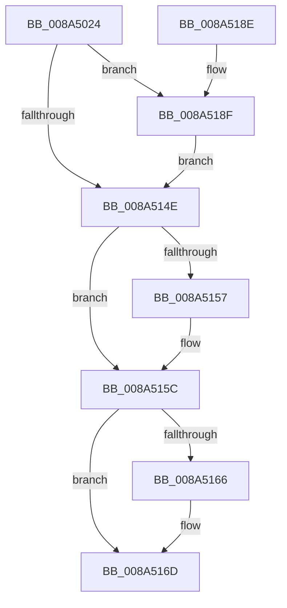

# EtwpTraceProcessRundown

- RVA: `0x008A5024`–`0x008A5198` (길이 `372` bytes)
- VA: `0x00000001408A5024`
- 실행 섹션: `PAGE`
- PDB 이름 있음: `예`; PDB Function 태그: `아니요`
- unwind 정보 RVA: `0x0007EFA8`
- 디코드: `96`개 명령, `372/372` bytes 표시
- 미해석 바이트: `0` (있으면 어셈블리에 `.byte`로 보존)

> 이 문서는 커널 이미지의 기계어와 PDB 기호를 분석해 생성했습니다. 4번과 5번은 함수 원형과 자료형을 바이너리 사용 방식에서 추정한 C 해석이며 원본 소스 복구 결과는 아닙니다.

## 1. Dependencies

- 직접 호출 지점: **7**; 고유 호출 대상: **6**
- 직접 호출자로 확인된 함수: **1**
- RIP 상대 이미지 참조: **1**

### Outgoing calls
- `0x008A507F` → [memset](../../text/6C/memset_function_006C6C40.md) (function, `0x006C6C40`)
- `0x008A5105` → [EtwpBuildProcessEvent](EtwpBuildProcessEvent_function_008A552C.md) (function, `0x008A552C`)
- `0x008A513E` → [EtwpLogKernelEvent](../../text/25/EtwpLogKernelEvent_function_0025CC00.md) (function, `0x0025CC00`)
- `0x008A5157` → [ExFreePool](../../poolcode/B8/ExFreePool_function_00B82850.md) (function, `0x00B82850`)
- `0x008A5168` → [ExFreePoolWithTag](../../poolcode/B8/ExFreePoolWithTag_function_00B82870.md) (function, `0x00B82870`)
- `0x008A5179` → [_security_check_cookie](../../text/6A/_security_check_cookie_function_006AC640.md) (function, `0x006AC640`)
- `0x008A5191` → [ExFreePoolWithTag](../../poolcode/B8/ExFreePoolWithTag_function_00B82870.md) (function, `0x00B82870`)

### Direct callers
- [EtwpProcessEnumCallback](EtwpProcessEnumCallback_function_008A5F40.md) at `0x008A608F`
- [EtwpProcessEnumCallback](EtwpProcessEnumCallback_function_008A5F40.md) at `0x008A6149`
- [EtwpProcessEnumCallback](EtwpProcessEnumCallback_function_008A5F40.md) at `0x008A61DA`

### Static image references
- `0x008A503C` → RVA `0x00E0A740` (`.data`; read)

## 2. Other-region calls and transfers

- 다른 실행 섹션으로 향하는 call: **6**
  - `0x008A507F` → [memset](../../text/6C/memset_function_006C6C40.md) (`PAGE` → `.text`)
  - `0x008A513E` → [EtwpLogKernelEvent](../../text/25/EtwpLogKernelEvent_function_0025CC00.md) (`PAGE` → `.text`)
  - `0x008A5157` → [ExFreePool](../../poolcode/B8/ExFreePool_function_00B82850.md) (`PAGE` → `POOLCODE`)
  - `0x008A5168` → [ExFreePoolWithTag](../../poolcode/B8/ExFreePoolWithTag_function_00B82870.md) (`PAGE` → `POOLCODE`)
  - `0x008A5179` → [_security_check_cookie](../../text/6A/_security_check_cookie_function_006AC640.md) (`PAGE` → `.text`)
  - `0x008A5191` → [ExFreePoolWithTag](../../poolcode/B8/ExFreePoolWithTag_function_00B82870.md) (`PAGE` → `POOLCODE`)
- 별도 외부 분기/꼬리 이동을 확인하지 못했습니다.

## 3. Assembly (complete function range)

```asm
008A5024  40 55                           push rbp
008A5026  53                              push rbx
008A5027  56                              push rsi
008A5028  57                              push rdi
008A5029  41 56                           push r14
008A502B  41 57                           push r15
008A502D  48 8D AC 24 F8 FC FF FF         lea rbp, [rsp - 0x308]
008A5035  48 81 EC 08 04 00 00            sub rsp, 0x408
008A503C  48 8B 05 FD 56 56 00            mov rax, qword ptr [rip + 0x5656fd]
008A5043  48 33 C4                        xor rax, rsp
008A5046  48 89 85 F0 02 00 00            mov qword ptr [rbp + 0x2f0], rax
008A504D  45 33 FF                        xor r15d, r15d
008A5050  41 0F B7 F8                     movzx edi, r8w
008A5054  48 8B F2                        mov rsi, rdx
008A5057  44 89 7C 24 74                  mov dword ptr [rsp + 0x74], r15d
008A505C  48 8B D9                        mov rbx, rcx
008A505F  44 89 7C 24 60                  mov dword ptr [rsp + 0x60], r15d
008A5064  0F 57 C0                        xorps xmm0, xmm0
008A5067  4C 89 7C 24 68                  mov qword ptr [rsp + 0x68], r15
008A506C  33 D2                           xor edx, edx
008A506E  48 8D 4D C0                     lea rcx, [rbp - 0x40]
008A5072  41 B8 A0 02 00 00               mov r8d, 0x2a0
008A5078  4D 8B F1                        mov r14, r9
008A507B  0F 11 45 88                     movups xmmword ptr [rbp - 0x78], xmm0
008A507F  E8 BC 1B E2 FF                  call 0x1406c6c40
008A5084  45 8A 46 41                     mov r8b, byte ptr [r14 + 0x41]
008A5088  4C 8D 4D 98                     lea r9, [rbp - 0x68]
008A508C  33 C0                           xor eax, eax
008A508E  4C 89 7D 80                     mov qword ptr [rbp - 0x80], r15
008A5092  48 89 45 B8                     mov qword ptr [rbp - 0x48], rax
008A5096  0F 57 C0                        xorps xmm0, xmm0
008A5099  49 8B 46 10                     mov rax, qword ptr [r14 + 0x10]
008A509D  0F B7 D7                        movzx edx, di
008A50A0  48 89 44 24 78                  mov qword ptr [rsp + 0x78], rax
008A50A5  48 8B CB                        mov rcx, rbx
008A50A8  41 0F B7 46 18                  movzx eax, word ptr [r14 + 0x18]
008A50AD  66 89 44 24 72                  mov word ptr [rsp + 0x72], ax
008A50B2  48 8D 44 24 68                  lea rax, [rsp + 0x68]
008A50B7  48 89 44 24 50                  mov qword ptr [rsp + 0x50], rax
008A50BC  48 8D 44 24 70                  lea rax, [rsp + 0x70]
008A50C1  48 89 44 24 48                  mov qword ptr [rsp + 0x48], rax
008A50C6  48 8D 45 88                     lea rax, [rbp - 0x78]
008A50CA  48 89 44 24 40                  mov qword ptr [rsp + 0x40], rax
008A50CF  48 8D 45 C0                     lea rax, [rbp - 0x40]
008A50D3  48 89 44 24 38                  mov qword ptr [rsp + 0x38], rax
008A50D8  48 8D 44 24 60                  lea rax, [rsp + 0x60]
008A50DD  48 89 44 24 30                  mov qword ptr [rsp + 0x30], rax
008A50E2  48 8D 85 60 02 00 00            lea rax, [rbp + 0x260]
008A50E9  48 89 44 24 28                  mov qword ptr [rsp + 0x28], rax
008A50EE  48 8D 45 80                     lea rax, [rbp - 0x80]
008A50F2  48 89 44 24 20                  mov qword ptr [rsp + 0x20], rax
008A50F7  0F 11 45 98                     movups xmmword ptr [rbp - 0x68], xmm0
008A50FB  66 44 89 7C 24 70               mov word ptr [rsp + 0x70], r15w
008A5101  0F 11 45 A8                     movups xmmword ptr [rbp - 0x58], xmm0
008A5105  E8 22 04 00 00                  call 0x1408a552c
008A510A  44 8B 4C 24 60                  mov r9d, dword ptr [rsp + 0x60]
008A510F  0F B7 C7                        movzx eax, di
008A5112  44 8B 06                        mov r8d, dword ptr [rsi]
008A5115  B9 27 03 00 00                  mov ecx, 0x327
008A511A  48 8B 96 50 05 00 00            mov rdx, qword ptr [rsi + 0x550]
008A5121  66 2B C1                        sub ax, cx
008A5124  66 F7 D8                        neg ax
008A5127  48 8D 8D 60 02 00 00            lea rcx, [rbp + 0x260]
008A512E  1B C0                           sbb eax, eax
008A5130  05 05 18 60 00                  add eax, 0x601805
008A5135  89 44 24 28                     mov dword ptr [rsp + 0x28], eax
008A5139  66 89 7C 24 20                  mov word ptr [rsp + 0x20], di
008A513E  E8 BD 7A 9B FF                  call 0x14025cc00
008A5143  48 8B 4C 24 78                  mov rcx, qword ptr [rsp + 0x78]
008A5148  49 3B 4E 10                     cmp rcx, qword ptr [r14 + 0x10]
008A514C  75 41                           jne 0x1408a518f
008A514E  48 8B 4D 90                     mov rcx, qword ptr [rbp - 0x70]
008A5152  48 85 C9                        test rcx, rcx
008A5155  74 05                           je 0x1408a515c
008A5157  E8 F4 D6 2D 00                  call 0x140b82850
008A515C  48 8B 4C 24 68                  mov rcx, qword ptr [rsp + 0x68]
008A5161  48 85 C9                        test rcx, rcx
008A5164  74 07                           je 0x1408a516d
008A5166  33 D2                           xor edx, edx
008A5168  E8 03 D7 2D 00                  call 0x140b82870
008A516D  33 C0                           xor eax, eax
008A516F  48 8B 8D F0 02 00 00            mov rcx, qword ptr [rbp + 0x2f0]
008A5176  48 33 CC                        xor rcx, rsp
008A5179  E8 C2 74 E0 FF                  call 0x1406ac640
008A517E  48 81 C4 08 04 00 00            add rsp, 0x408
008A5185  41 5F                           pop r15
008A5187  41 5E                           pop r14
008A5189  5F                              pop rdi
008A518A  5E                              pop rsi
008A518B  5B                              pop rbx
008A518C  5D                              pop rbp
008A518D  C3                              ret
008A518E  CC                              int3
008A518F  33 D2                           xor edx, edx
008A5191  E8 DA D6 2D 00                  call 0x140b82870
008A5196  EB B6                           jmp 0x1408a514e
```

## 4. C-style interpretation (structured pseudocode)

```c
__int64 __fastcall EtwpTraceProcessRundown(__int64 a1, __int64 a2, unsigned __int16 a3, __int64 a4)
{
    __int64 result;
    __int64 v_r15;
    __int64 v_rsp;
    unsigned __int64 v_stack_m338;
    unsigned __int64 v_stack_m378;
    unsigned __int64 v_stack_m380;
    unsigned __int64 v_stack_m390;
    unsigned __int64 v_stack_m3A0;
    unsigned __int64 v_stack_m3A8;
    unsigned __int64 v_stack_m3B0;
    unsigned __int64 v_stack_m3B8;
    unsigned __int64 v_stack_m3C0;
    unsigned int v_stack_m3C4;
    unsigned __int16 v_stack_m3C6;
    unsigned __int64 v_stack_m3C8;
    unsigned __int64 v_stack_m3D0;
    unsigned int v_stack_m3D8;
    unsigned __int64 v_stack_m3E8;
    unsigned __int64 v_stack_m3F0;
    unsigned __int64 v_stack_m3F8;
    unsigned __int64 v_stack_m400;
    unsigned __int64 v_stack_m408;
    unsigned __int64 v_stack_m410;
    unsigned __int64 v_stack_m418;
    unsigned __int64 v_stack_m48;
    unsigned __int64 v_stack_mD8;

    v_rsp = (v_rsp) - (0x408ULL);
    result = (*(unsigned __int64 *)(v_rip + 5658365)) ^ (v_rsp);
    v_stack_m48 = result;
    v_r15 = 0;
    v_stack_m3C4 = 0;
    v_stack_m3D8 = 0;
    v_stack_m3D0 = 0;
    a2 = 0;
    v_stack_m3B0 = v_xmm0;
    result = memset(v_stack_m378, a2, 672, a4);
    result = 0;
    v_stack_m3B8 = 0;
    v_stack_m380 = 0;
    v_stack_m3C0 = *(unsigned __int64 *)(a4 + 16);
    v_stack_m3C6 = (unsigned __int16)(*(unsigned __int16 *)(a4 + 24));
    v_stack_m3E8 = v_stack_m3D0;
    v_stack_m3F0 = v_stack_m3C8;
    v_stack_m3F8 = v_stack_m3B0;
    v_stack_m400 = v_stack_m378;
    v_stack_m408 = v_stack_m3D8;
    v_stack_m410 = v_stack_mD8;
    v_stack_m418 = v_stack_m3B8;
    v_stack_m3A0 = v_xmm0;
    v_stack_m3C8 = 0;
    v_stack_m390 = v_xmm0;
    result = EtwpBuildProcessEvent(a1, a3, *(unsigned __int8 *)(a4 + 65), v_stack_m3A0);
    result = (unsigned __int16)((a3) - (807));
    result = (unsigned __int16)(-(result));
    result = (unsigned int)((result) + (0x601805ULL));
    v_stack_m410 = (unsigned int)(result);
    v_stack_m418 = a3;
    result = EtwpLogKernelEvent(v_stack_mD8, *(unsigned __int64 *)(a2 + 1360), (unsigned int)(*(unsigned int *)(a2)), (unsigned int)(v_stack_m3D8));
    if (v_stack_m3C0 != (*(unsigned __int64 *)(a4 + 16))) goto loc_008A518F;
loc_008A514E:
    if (v_stack_m3A8 != 0) {
        result = ExFreePool(v_stack_m3A8, *(unsigned __int64 *)(a2 + 1360), (unsigned int)(*(unsigned int *)(a2)), (unsigned int)(v_stack_m3D8));
    }
    if (v_stack_m3D0 != 0) {
        a2 = 0;
        result = ExFreePoolWithTag(v_stack_m3D0, a2, (unsigned int)(*(unsigned int *)(a2)), (unsigned int)(v_stack_m3D8));
    }
    result = 0;
    a1 = (v_stack_m48) ^ (v_rsp);
    result = _security_check_cookie(a1, a2, (unsigned int)(*(unsigned int *)(a2)), (unsigned int)(v_stack_m3D8));
    v_rsp = (v_rsp) + (0x408ULL);
    return result;
loc_008A518F:
    a2 = 0;
    result = ExFreePoolWithTag(a1, a2, (unsigned int)(*(unsigned int *)(a2)), (unsigned int)(v_stack_m3D8));
    goto loc_008A514E;
}
```

## 5. (Beta) C Style

```c
int64_t EtwpTraceProcessRundown(int64_t Arg1, void *Arg2, uint16_t Arg3, void *Arg4)
{
    uint8_t *arg2 = (uint8_t *)Arg2;
    uint8_t *arg4 = (uint8_t *)Arg4;

    int64_t result;
    int64_t local_r15;
    int64_t local_rsp;
    uint64_t v_stack_m338;
    uint64_t v_stack_m378;
    uint64_t v_stack_m380;
    uint64_t v_stack_m390;
    uint64_t v_stack_m3A0;
    uint64_t v_stack_m3A8;
    uint64_t v_stack_m3B0;
    uint64_t v_stack_m3B8;
    uint64_t v_stack_m3C0;
    uint32_t v_stack_m3C4;
    uint16_t v_stack_m3C6;
    uint64_t v_stack_m3C8;
    uint64_t v_stack_m3D0;
    uint32_t v_stack_m3D8;
    uint64_t v_stack_m3E8;
    uint64_t v_stack_m3F0;
    uint64_t v_stack_m3F8;
    uint64_t v_stack_m400;
    uint64_t v_stack_m408;
    uint64_t v_stack_m410;
    uint64_t v_stack_m418;
    uint64_t v_stack_m48;
    uint64_t v_stack_mD8;

    local_rsp = (local_rsp) - (0x408ULL);
    result = (*(uint64_t *)(v_rip + 0x5656FD)) ^ (local_rsp);
    v_stack_m48 = result;
    local_r15 = 0;
    v_stack_m3C4 = 0;
    v_stack_m3D8 = 0;
    v_stack_m3D0 = 0;
    Arg2 = 0;
    v_stack_m3B0 = v_xmm0;
    result = memset(v_stack_m378, Arg2, 672, Arg4);
    result = 0;
    v_stack_m3B8 = 0;
    v_stack_m380 = 0;
    v_stack_m3C0 = *(uint64_t *)(arg4 + 0x10);
    v_stack_m3C6 = (uint16_t)(*(uint16_t *)(arg4 + 0x18));
    v_stack_m3E8 = v_stack_m3D0;
    v_stack_m3F0 = v_stack_m3C8;
    v_stack_m3F8 = v_stack_m3B0;
    v_stack_m400 = v_stack_m378;
    v_stack_m408 = v_stack_m3D8;
    v_stack_m410 = v_stack_mD8;
    v_stack_m418 = v_stack_m3B8;
    v_stack_m3A0 = v_xmm0;
    v_stack_m3C8 = 0;
    v_stack_m390 = v_xmm0;
    result = EtwpBuildProcessEvent(Arg1, Arg3, *(uint8_t *)(arg4 + 0x41), v_stack_m3A0);
    result = (uint16_t)((Arg3) - (807));
    result = (uint16_t)(-(result));
    result = (uint32_t)((result) + (0x601805ULL));
    v_stack_m410 = (uint32_t)(result);
    v_stack_m418 = Arg3;
    result = EtwpLogKernelEvent(v_stack_mD8, *(uint64_t *)(arg2 + 0x550), (uint32_t)(*(uint32_t *)(arg2)), (uint32_t)(v_stack_m3D8));
    if (v_stack_m3C0 != (*(uint64_t *)(arg4 + 0x10))) goto loc_008A518F;
loc_008A514E:
    if (v_stack_m3A8 != 0) {
        result = ExFreePool(v_stack_m3A8, *(uint64_t *)(arg2 + 0x550), (uint32_t)(*(uint32_t *)(arg2)), (uint32_t)(v_stack_m3D8));
    }
    if (v_stack_m3D0 != 0) {
        Arg2 = 0;
        result = ExFreePoolWithTag(v_stack_m3D0, Arg2, (uint32_t)(*(uint32_t *)(arg2)), (uint32_t)(v_stack_m3D8));
    }
    result = 0;
    Arg1 = (v_stack_m48) ^ (local_rsp);
    result = _security_check_cookie(Arg1, Arg2, (uint32_t)(*(uint32_t *)(arg2)), (uint32_t)(v_stack_m3D8));
    local_rsp = (local_rsp) + (0x408ULL);
    return result;
loc_008A518F:
    Arg2 = 0;
    result = ExFreePoolWithTag(Arg1, Arg2, (uint32_t)(*(uint32_t *)(arg2)), (uint32_t)(v_stack_m3D8));
    goto loc_008A514E;
}
```

### 관측된 메모리 오프셋

구조체 형식이 확인되지 않은 접근은 인자 기준의 오프셋으로만 기록했습니다.

| 기준 인자 | 오프셋 표현 | 폭 (bit) | 접근 |
|---|---:|---:|---|
| `Arg2` | `+ 0x0` | `32` | `R` |
| `Arg2` | `+ 0x550` | `64` | `R` |
| `Arg4` | `+ 0x10` | `64` | `R` |
| `Arg4` | `+ 0x18` | `16` | `R` |
| `Arg4` | `+ 0x41` | `8` | `R` |

## 6. Execution-region graph

[열기: 2D/3D 그래프와 함수 탐색 컨트롤 패널](../../../control-panel.html?section=page&rva=0x008A5024&view=graph)

- 2D 그래프는 위에서 아래로 흐르고, 3D 그래프는 빈 공간을 드래그해 회전합니다. Shift+드래그는 이동, 휠은 확대·축소, 함수 노드 선택은 대상 보고서 이동입니다.

### Static fallback


