# EtwpWriteAppStateChangeSummary

- RVA: `0x008A4990`–`0x008A4FF2` (길이 `1,634` bytes)
- VA: `0x00000001408A4990`
- 실행 섹션: `PAGE`
- PDB 이름 있음: `예`; PDB Function 태그: `예`
- unwind 정보 RVA: `0x0007EF84`
- 디코드: `326`개 명령, `1,634/1,634` bytes 표시
- 미해석 바이트: `0` (있으면 어셈블리에 `.byte`로 보존)

> 이 문서는 커널 이미지의 기계어와 PDB 기호를 분석해 생성했습니다. 4번과 5번은 함수 원형과 자료형을 바이너리 사용 방식에서 추정한 C 해석이며 원본 소스 복구 결과는 아닙니다.

## 1. Dependencies

- 직접 호출 지점: **6**; 고유 호출 대상: **5**
- 직접 호출자로 확인된 함수: **2**
- RIP 상대 이미지 참조: **7**

### Outgoing calls
- `0x008A4A0E` → [PsGetProcessServerSilo](../../text/44/PsGetProcessServerSilo_function_0044BEE0.md) (function, `0x0044BEE0`)
- `0x008A4A19` → [PsIsHostSilo](../../text/44/PsIsHostSilo_function_00443B30.md) (function, `0x00443B30`)
- `0x008A4E52` → [tlgCreate1Sz_wchar_t](../../text/42/tlgCreate1Sz_wchar_t_function_00426198.md) (function, `0x00426198`)
- `0x008A4E65` → [tlgCreate1Sz_wchar_t](../../text/42/tlgCreate1Sz_wchar_t_function_00426198.md) (function, `0x00426198`)
- `0x008A4F30` → [tlgWriteAgg](../../text/2F/tlgWriteAgg_function_002F0F7C.md) (function, `0x002F0F7C`)
- `0x008A4F3F` → [_security_check_cookie](../../text/6A/_security_check_cookie_function_006AC640.md) (function, `0x006AC640`)

### Direct callers
- [EtwTraceProcess](EtwTraceProcess_function_008A4004.md) at `0x008A413C`
- [EtwTraceAppStateChange](EtwTraceAppStateChange_function_008A452C.md) at `0x008A4770`

### Static image references
- `0x008A49AE` → RVA `0x00E0A740` (`.data`; read)
- `0x008A49C6` → RVA `0x00E091A0` (`.data`; read)
- `0x008A4A25` → RVA `0x00B4BE48` (`PspNullGuid`; read)
- `0x008A4A49` → RVA `0x00002F28` (`.rdata`; read)
- `0x008A4A6E` → RVA `0x00E091B0` (`.data`; read)
- `0x008A4E71` → RVA `0x0005427E` (`.rdata`; read)
- `0x008A4F9E` → RVA `0x00E091B8` (`.data`; read)

## 2. Other-region calls and transfers

- 다른 실행 섹션으로 향하는 call: **6**
  - `0x008A4A0E` → [PsGetProcessServerSilo](../../text/44/PsGetProcessServerSilo_function_0044BEE0.md) (`PAGE` → `.text`)
  - `0x008A4A19` → [PsIsHostSilo](../../text/44/PsIsHostSilo_function_00443B30.md) (`PAGE` → `.text`)
  - `0x008A4E52` → [tlgCreate1Sz_wchar_t](../../text/42/tlgCreate1Sz_wchar_t_function_00426198.md) (`PAGE` → `.text`)
  - `0x008A4E65` → [tlgCreate1Sz_wchar_t](../../text/42/tlgCreate1Sz_wchar_t_function_00426198.md) (`PAGE` → `.text`)
  - `0x008A4F30` → [tlgWriteAgg](../../text/2F/tlgWriteAgg_function_002F0F7C.md) (`PAGE` → `.text`)
  - `0x008A4F3F` → [_security_check_cookie](../../text/6A/_security_check_cookie_function_006AC640.md) (`PAGE` → `.text`)
- 별도 외부 분기/꼬리 이동을 확인하지 못했습니다.

## 3. Assembly (complete function range)

```asm
008A4990  48 89 5C 24 08                  mov qword ptr [rsp + 8], rbx
008A4995  48 89 74 24 10                  mov qword ptr [rsp + 0x10], rsi
008A499A  55                              push rbp
008A499B  41 55                           push r13
008A499D  41 56                           push r14
008A499F  48 8D AC 24 80 FD FF FF         lea rbp, [rsp - 0x280]
008A49A7  48 81 EC 80 03 00 00            sub rsp, 0x380
008A49AE  48 8B 05 8B 5D 56 00            mov rax, qword ptr [rip + 0x565d8b]
008A49B5  48 33 C4                        xor rax, rsp
008A49B8  48 89 85 70 02 00 00            mov qword ptr [rbp + 0x270], rax
008A49BF  33 C0                           xor eax, eax
008A49C1  4C 89 4C 24 30                  mov qword ptr [rsp + 0x30], r9
008A49C6  39 05 D4 47 56 00               cmp dword ptr [rip + 0x5647d4], eax
008A49CC  0F 57 C0                        xorps xmm0, xmm0
008A49CF  49 8B D8                        mov rbx, r8
008A49D2  48 89 54 24 38                  mov qword ptr [rsp + 0x38], rdx
008A49D7  48 8B F1                        mov rsi, rcx
008A49DA  48 89 45 18                     mov qword ptr [rbp + 0x18], rax
008A49DE  0F 11 45 08                     movups xmmword ptr [rbp + 8], xmm0
008A49E2  89 45 20                        mov dword ptr [rbp + 0x20], eax
008A49E5  88 45 24                        mov byte ptr [rbp + 0x24], al
008A49E8  0F 87 99 05 00 00               ja 0x1408a4f87
008A49EE  48 8B 4D 08                     mov rcx, qword ptr [rbp + 8]
008A49F2  44 8B AE 54 05 00 00            mov r13d, dword ptr [rsi + 0x554]
008A49F9  41 8D 85 CB FE FF 3F            lea eax, [r13 + 0x3ffffecb]
008A4A00  A9 FB FF FF FF                  test eax, 0xfffffffb
008A4A05  0F 84 D9 05 00 00               je 0x1408a4fe4
008A4A0B  48 8B CE                        mov rcx, rsi
008A4A0E  E8 CD 74 BA FF                  call 0x14044bee0
008A4A13  48 8B C8                        mov rcx, rax
008A4A16  4C 8B F0                        mov r14, rax
008A4A19  E8 12 F1 B9 FF                  call 0x140443b30
008A4A1E  45 33 D2                        xor r10d, r10d
008A4A21  84 C0                           test al, al
008A4A23  74 09                           je 0x1408a4a2e
008A4A25  48 8D 05 1C 74 2A 00            lea rax, [rip + 0x2a741c]
008A4A2C  EB 0C                           jmp 0x1408a4a3a
008A4A2E  49 8D 86 D0 05 00 00            lea rax, [r14 + 0x5d0]
008A4A35  48 85 C0                        test rax, rax
008A4A38  74 08                           je 0x1408a4a42
008A4A3A  0F 10 00                        movups xmm0, xmmword ptr [rax]
008A4A3D  F3 0F 7F 45 15                  movdqu xmmword ptr [rbp + 0x15], xmm0
008A4A42  48 8B 86 50 03 00 00            mov rax, qword ptr [rsi + 0x350]
008A4A49  48 8D 15 D8 E4 75 FF            lea rdx, [rip - 0x8a1b28]
008A4A50  48 85 C0                        test rax, rax
008A4A53  48 0F 45 D0                     cmovne rdx, rax
008A4A57  83 3D 42 47 56 00 05            cmp dword ptr [rip + 0x564742], 5
008A4A5E  0F 86 D1 04 00 00               jbe 0x1408a4f35
008A4A64  48 B9 00 00 00 00 00 40 00 00   movabs rcx, 0x400000000000
008A4A6E  48 85 0D 3B 47 56 00            test qword ptr [rip + 0x56473b], rcx
008A4A75  0F 85 4B 05 00 00               jne 0x1408a4fc6
008A4A7B  41 8A C2                        mov al, r10b
008A4A7E  84 C0                           test al, al
008A4A80  0F 84 AF 04 00 00               je 0x1408a4f35
008A4A86  48 8B 4C 24 38                  mov rcx, qword ptr [rsp + 0x38]
008A4A8B  49 8B C2                        mov rax, r10
008A4A8E  41 BE 04 00 00 00               mov r14d, 4
008A4A94  48 C7 45 58 08 00 00 00         mov qword ptr [rbp + 0x58], 8
008A4A9C  48 C7 45 68 08 00 00 00         mov qword ptr [rbp + 0x68], 8
008A4AA4  48 C7 45 78 08 00 00 00         mov qword ptr [rbp + 0x78], 8
008A4AAC  44 8A 01                        mov r8b, byte ptr [rcx]
008A4AAF  45 84 C0                        test r8b, r8b
008A4AB2  48 C7 85 88 00 00 00 08 00 00 00  mov qword ptr [rbp + 0x88], 8
008A4ABD  48 C7 85 98 00 00 00 08 00 00 00  mov qword ptr [rbp + 0x98], 8
008A4AC8  0F 94 C0                        sete al
008A4ACB  48 C7 85 A8 00 00 00 08 00 00 00  mov qword ptr [rbp + 0xa8], 8
008A4AD6  48 89 44 24 40                  mov qword ptr [rsp + 0x40], rax
008A4ADB  41 80 F8 01                     cmp r8b, 1
008A4ADF  48 8D 44 24 40                  lea rax, [rsp + 0x40]
008A4AE4  48 C7 85 B8 00 00 00 08 00 00 00  mov qword ptr [rbp + 0xb8], 8
008A4AEF  48 89 45 50                     mov qword ptr [rbp + 0x50], rax
008A4AF3  49 8B C2                        mov rax, r10
008A4AF6  0F 94 C0                        sete al
008A4AF9  48 C7 85 C8 00 00 00 08 00 00 00  mov qword ptr [rbp + 0xc8], 8
008A4B04  48 89 44 24 48                  mov qword ptr [rsp + 0x48], rax
008A4B09  41 80 F8 02                     cmp r8b, 2
008A4B0D  48 8D 44 24 48                  lea rax, [rsp + 0x48]
008A4B12  48 C7 85 D8 00 00 00 08 00 00 00  mov qword ptr [rbp + 0xd8], 8
008A4B1D  48 89 45 60                     mov qword ptr [rbp + 0x60], rax
008A4B21  49 8B C2                        mov rax, r10
008A4B24  0F 94 C0                        sete al
008A4B27  41 80 F8 03                     cmp r8b, 3
008A4B2B  48 89 44 24 50                  mov qword ptr [rsp + 0x50], rax
008A4B30  48 8D 44 24 50                  lea rax, [rsp + 0x50]
008A4B35  48 89 45 70                     mov qword ptr [rbp + 0x70], rax
008A4B39  49 8B C2                        mov rax, r10
008A4B3C  0F 94 C0                        sete al
008A4B3F  45 3A C6                        cmp r8b, r14b
008A4B42  48 89 44 24 58                  mov qword ptr [rsp + 0x58], rax
008A4B47  48 8D 44 24 58                  lea rax, [rsp + 0x58]
008A4B4C  48 89 85 80 00 00 00            mov qword ptr [rbp + 0x80], rax
008A4B53  49 8B C2                        mov rax, r10
008A4B56  0F 94 C0                        sete al
008A4B59  41 80 F8 05                     cmp r8b, 5
008A4B5D  48 89 44 24 60                  mov qword ptr [rsp + 0x60], rax
008A4B62  48 8D 44 24 60                  lea rax, [rsp + 0x60]
008A4B67  48 89 85 90 00 00 00            mov qword ptr [rbp + 0x90], rax
008A4B6E  49 8B C2                        mov rax, r10
008A4B71  0F 94 C0                        sete al
008A4B74  41 80 F8 06                     cmp r8b, 6
008A4B78  48 89 44 24 68                  mov qword ptr [rsp + 0x68], rax
008A4B7D  48 8D 44 24 68                  lea rax, [rsp + 0x68]
008A4B82  48 89 85 A0 00 00 00            mov qword ptr [rbp + 0xa0], rax
008A4B89  49 8B C2                        mov rax, r10
008A4B8C  0F 94 C0                        sete al
008A4B8F  48 89 44 24 70                  mov qword ptr [rsp + 0x70], rax
008A4B94  48 8D 44 24 70                  lea rax, [rsp + 0x70]
008A4B99  48 89 85 B0 00 00 00            mov qword ptr [rbp + 0xb0], rax
008A4BA0  48 8B 41 29                     mov rax, qword ptr [rcx + 0x29]
008A4BA4  48 89 44 24 78                  mov qword ptr [rsp + 0x78], rax
008A4BA9  48 8D 44 24 78                  lea rax, [rsp + 0x78]
008A4BAE  48 89 85 C0 00 00 00            mov qword ptr [rbp + 0xc0], rax
008A4BB5  48 8B 41 31                     mov rax, qword ptr [rcx + 0x31]
008A4BB9  48 89 45 80                     mov qword ptr [rbp - 0x80], rax
008A4BBD  48 8D 45 80                     lea rax, [rbp - 0x80]
008A4BC1  48 89 85 D0 00 00 00            mov qword ptr [rbp + 0xd0], rax
008A4BC8  49 8B C2                        mov rax, r10
008A4BCB  48 85 DB                        test rbx, rbx
008A4BCE  74 0A                           je 0x1408a4bda
008A4BD0  F6 86 FB 05 00 00 07            test byte ptr [rsi + 0x5fb], 7
008A4BD7  0F 95 C0                        setne al
008A4BDA  48 89 45 88                     mov qword ptr [rbp - 0x78], rax
008A4BDE  48 8D 45 88                     lea rax, [rbp - 0x78]
008A4BE2  48 89 85 E0 00 00 00            mov qword ptr [rbp + 0xe0], rax
008A4BE9  49 8B C2                        mov rax, r10
008A4BEC  48 C7 85 E8 00 00 00 08 00 00 00  mov qword ptr [rbp + 0xe8], 8
008A4BF7  48 85 DB                        test rbx, rbx
008A4BFA  74 0A                           je 0x1408a4c06
008A4BFC  F6 86 FB 05 00 00 38            test byte ptr [rsi + 0x5fb], 0x38
008A4C03  0F 95 C0                        setne al
008A4C06  48 89 45 90                     mov qword ptr [rbp - 0x70], rax
008A4C0A  48 8D 45 90                     lea rax, [rbp - 0x70]
008A4C0E  48 89 85 F0 00 00 00            mov qword ptr [rbp + 0xf0], rax
008A4C15  41 8B C2                        mov eax, r10d
008A4C18  48 C7 85 F8 00 00 00 08 00 00 00  mov qword ptr [rbp + 0xf8], 8
008A4C23  48 85 DB                        test rbx, rbx
008A4C26  74 02                           je 0x1408a4c2a
008A4C28  8B 03                           mov eax, dword ptr [rbx]
008A4C2A  48 89 45 98                     mov qword ptr [rbp - 0x68], rax
008A4C2E  48 8D 45 98                     lea rax, [rbp - 0x68]
008A4C32  48 89 85 00 01 00 00            mov qword ptr [rbp + 0x100], rax
008A4C39  49 8B C2                        mov rax, r10
008A4C3C  48 C7 85 08 01 00 00 08 00 00 00  mov qword ptr [rbp + 0x108], 8
008A4C47  48 85 DB                        test rbx, rbx
008A4C4A  74 04                           je 0x1408a4c50
008A4C4C  48 8B 43 04                     mov rax, qword ptr [rbx + 4]
008A4C50  48 89 45 A0                     mov qword ptr [rbp - 0x60], rax
008A4C54  48 8D 45 A0                     lea rax, [rbp - 0x60]
008A4C58  48 89 85 10 01 00 00            mov qword ptr [rbp + 0x110], rax
008A4C5F  49 8B C2                        mov rax, r10
008A4C62  48 C7 85 18 01 00 00 08 00 00 00  mov qword ptr [rbp + 0x118], 8
008A4C6D  48 85 DB                        test rbx, rbx
008A4C70  74 04                           je 0x1408a4c76
008A4C72  48 8B 43 0C                     mov rax, qword ptr [rbx + 0xc]
008A4C76  48 89 45 A8                     mov qword ptr [rbp - 0x58], rax
008A4C7A  48 8D 45 A8                     lea rax, [rbp - 0x58]
008A4C7E  48 89 85 20 01 00 00            mov qword ptr [rbp + 0x120], rax
008A4C85  41 8B C2                        mov eax, r10d
008A4C88  48 C7 85 28 01 00 00 08 00 00 00  mov qword ptr [rbp + 0x128], 8
008A4C93  48 85 DB                        test rbx, rbx
008A4C96  74 03                           je 0x1408a4c9b
008A4C98  8B 43 1C                        mov eax, dword ptr [rbx + 0x1c]
008A4C9B  48 89 45 B0                     mov qword ptr [rbp - 0x50], rax
008A4C9F  48 8D 45 B0                     lea rax, [rbp - 0x50]
008A4CA3  48 89 85 30 01 00 00            mov qword ptr [rbp + 0x130], rax
008A4CAA  41 8B C2                        mov eax, r10d
008A4CAD  48 C7 85 38 01 00 00 08 00 00 00  mov qword ptr [rbp + 0x138], 8
008A4CB8  48 85 DB                        test rbx, rbx
008A4CBB  74 03                           je 0x1408a4cc0
008A4CBD  8B 43 24                        mov eax, dword ptr [rbx + 0x24]
008A4CC0  48 89 45 B8                     mov qword ptr [rbp - 0x48], rax
008A4CC4  48 8D 45 B8                     lea rax, [rbp - 0x48]
008A4CC8  48 89 85 40 01 00 00            mov qword ptr [rbp + 0x140], rax
008A4CCF  41 8B C2                        mov eax, r10d
008A4CD2  48 C7 85 48 01 00 00 08 00 00 00  mov qword ptr [rbp + 0x148], 8
008A4CDD  48 85 DB                        test rbx, rbx
008A4CE0  74 03                           je 0x1408a4ce5
008A4CE2  8B 43 20                        mov eax, dword ptr [rbx + 0x20]
008A4CE5  48 89 45 C0                     mov qword ptr [rbp - 0x40], rax
008A4CE9  48 8D 45 C0                     lea rax, [rbp - 0x40]
008A4CED  48 89 85 50 01 00 00            mov qword ptr [rbp + 0x150], rax
008A4CF4  41 8B C2                        mov eax, r10d
008A4CF7  48 C7 85 58 01 00 00 08 00 00 00  mov qword ptr [rbp + 0x158], 8
008A4D02  48 85 DB                        test rbx, rbx
008A4D05  74 03                           je 0x1408a4d0a
008A4D07  8B 43 28                        mov eax, dword ptr [rbx + 0x28]
008A4D0A  48 89 45 C8                     mov qword ptr [rbp - 0x38], rax
008A4D0E  48 8D 45 C8                     lea rax, [rbp - 0x38]
008A4D12  48 89 85 60 01 00 00            mov qword ptr [rbp + 0x160], rax
008A4D19  49 8B C2                        mov rax, r10
008A4D1C  48 C7 85 68 01 00 00 08 00 00 00  mov qword ptr [rbp + 0x168], 8
008A4D27  48 85 DB                        test rbx, rbx
008A4D2A  74 04                           je 0x1408a4d30
008A4D2C  48 8B 43 14                     mov rax, qword ptr [rbx + 0x14]
008A4D30  48 89 45 D0                     mov qword ptr [rbp - 0x30], rax
008A4D34  48 8D 45 D0                     lea rax, [rbp - 0x30]
008A4D38  48 89 85 70 01 00 00            mov qword ptr [rbp + 0x170], rax
008A4D3F  48 C7 85 78 01 00 00 08 00 00 00  mov qword ptr [rbp + 0x178], 8
008A4D4A  48 85 DB                        test rbx, rbx
008A4D4D  0F 85 0B 02 00 00               jne 0x1408a4f5e
008A4D53  41 8B C2                        mov eax, r10d
008A4D56  48 89 45 D8                     mov qword ptr [rbp - 0x28], rax
008A4D5A  48 8D 45 D8                     lea rax, [rbp - 0x28]
008A4D5E  48 89 85 80 01 00 00            mov qword ptr [rbp + 0x180], rax
008A4D65  49 8B C2                        mov rax, r10
008A4D68  48 C7 85 88 01 00 00 08 00 00 00  mov qword ptr [rbp + 0x188], 8
008A4D73  48 85 DB                        test rbx, rbx
008A4D76  74 06                           je 0x1408a4d7e
008A4D78  45 85 ED                        test r13d, r13d
008A4D7B  0F 94 C0                        sete al
008A4D7E  48 89 45 E0                     mov qword ptr [rbp - 0x20], rax
008A4D82  48 8D 45 E0                     lea rax, [rbp - 0x20]
008A4D86  48 89 85 90 01 00 00            mov qword ptr [rbp + 0x190], rax
008A4D8D  49 8B C2                        mov rax, r10
008A4D90  48 C7 85 98 01 00 00 08 00 00 00  mov qword ptr [rbp + 0x198], 8
008A4D9B  48 85 DB                        test rbx, rbx
008A4D9E  74 07                           je 0x1408a4da7
008A4DA0  41 83 FD 01                     cmp r13d, 1
008A4DA4  0F 94 C0                        sete al
008A4DA7  48 89 45 E8                     mov qword ptr [rbp - 0x18], rax
008A4DAB  48 8D 45 E8                     lea rax, [rbp - 0x18]
008A4DAF  48 89 85 A0 01 00 00            mov qword ptr [rbp + 0x1a0], rax
008A4DB6  48 C7 85 A8 01 00 00 08 00 00 00  mov qword ptr [rbp + 0x1a8], 8
008A4DC1  48 85 DB                        test rbx, rbx
008A4DC4  0F 85 9F 01 00 00               jne 0x1408a4f69
008A4DCA  49 8B C2                        mov rax, r10
008A4DCD  48 89 45 F0                     mov qword ptr [rbp - 0x10], rax
008A4DD1  48 8D 45 F0                     lea rax, [rbp - 0x10]
008A4DD5  48 89 85 B0 01 00 00            mov qword ptr [rbp + 0x1b0], rax
008A4DDC  48 C7 85 B8 01 00 00 08 00 00 00  mov qword ptr [rbp + 0x1b8], 8
008A4DE7  41 80 F8 03                     cmp r8b, 3
008A4DEB  0F 84 8B 01 00 00               je 0x1408a4f7c
008A4DF1  41 8B C2                        mov eax, r10d
008A4DF4  4C 8B 4C 24 30                  mov r9, qword ptr [rsp + 0x30]
008A4DF9  48 8D 8D F0 01 00 00            lea rcx, [rbp + 0x1f0]
008A4E00  48 89 45 F8                     mov qword ptr [rbp - 8], rax
008A4E04  48 8D 45 F8                     lea rax, [rbp - 8]
008A4E08  48 89 85 C0 01 00 00            mov qword ptr [rbp + 0x1c0], rax
008A4E0F  48 8D 85 E8 01 00 00            lea rax, [rbp + 0x1e8]
008A4E16  48 89 85 D0 01 00 00            mov qword ptr [rbp + 0x1d0], rax
008A4E1D  48 8B 42 08                     mov rax, qword ptr [rdx + 8]
008A4E21  48 89 85 E0 01 00 00            mov qword ptr [rbp + 0x1e0], rax
008A4E28  0F B7 02                        movzx eax, word ptr [rdx]
008A4E2B  49 8D 51 18                     lea rdx, [r9 + 0x18]
008A4E2F  89 85 E8 01 00 00               mov dword ptr [rbp + 0x1e8], eax
008A4E35  48 C7 85 C8 01 00 00 08 00 00 00  mov qword ptr [rbp + 0x1c8], 8
008A4E40  48 C7 85 D8 01 00 00 02 00 00 00  mov qword ptr [rbp + 0x1d8], 2
008A4E4B  44 89 95 EC 01 00 00            mov dword ptr [rbp + 0x1ec], r10d
008A4E52  E8 41 13 B8 FF                  call 0x140426198
008A4E57  49 8D 91 18 01 00 00            lea rdx, [r9 + 0x118]
008A4E5E  48 8D 8D 00 02 00 00            lea rcx, [rbp + 0x200]
008A4E65  E8 2E 13 B8 FF                  call 0x140426198
008A4E6A  48 8B 8D C0 02 00 00            mov rcx, qword ptr [rbp + 0x2c0]
008A4E71  48 8D 15 06 F4 7A FF            lea rdx, [rip - 0x850bfa]
008A4E78  41 B9 24 00 00 00               mov r9d, 0x24
008A4E7E  4C 89 B5 18 02 00 00            mov qword ptr [rbp + 0x218], r14
008A4E85  4C 89 B5 28 02 00 00            mov qword ptr [rbp + 0x228], r14
008A4E8C  48 C7 85 38 02 00 00 02 00 00 00  mov qword ptr [rbp + 0x238], 2
008A4E97  8B 01                           mov eax, dword ptr [rcx]
008A4E99  89 44 24 30                     mov dword ptr [rsp + 0x30], eax
008A4E9D  48 8D 44 24 30                  lea rax, [rsp + 0x30]
008A4EA2  48 89 85 10 02 00 00            mov qword ptr [rbp + 0x210], rax
008A4EA9  8B 41 04                        mov eax, dword ptr [rcx + 4]
008A4EAC  48 8B 8D C8 02 00 00            mov rcx, qword ptr [rbp + 0x2c8]
008A4EB3  89 44 24 38                     mov dword ptr [rsp + 0x38], eax
008A4EB7  48 8D 44 24 38                  lea rax, [rsp + 0x38]
008A4EBC  48 89 85 20 02 00 00            mov qword ptr [rbp + 0x220], rax
008A4EC3  48 8D 85 48 02 00 00            lea rax, [rbp + 0x248]
008A4ECA  48 89 85 30 02 00 00            mov qword ptr [rbp + 0x230], rax
008A4ED1  48 8B 41 08                     mov rax, qword ptr [rcx + 8]
008A4ED5  48 89 85 40 02 00 00            mov qword ptr [rbp + 0x240], rax
008A4EDC  0F B7 01                        movzx eax, word ptr [rcx]
008A4EDF  48 8D 0D BA 42 56 00            lea rcx, [rip + 0x5642ba]
008A4EE6  89 85 48 02 00 00               mov dword ptr [rbp + 0x248], eax
008A4EEC  48 8D 45 08                     lea rax, [rbp + 8]
008A4EF0  48 89 85 50 02 00 00            mov qword ptr [rbp + 0x250], rax
008A4EF7  48 8D 45 00                     lea rax, [rbp]
008A4EFB  48 89 85 60 02 00 00            mov qword ptr [rbp + 0x260], rax
008A4F02  48 8D 45 30                     lea rax, [rbp + 0x30]
008A4F06  48 89 44 24 20                  mov qword ptr [rsp + 0x20], rax
008A4F0B  44 89 95 4C 02 00 00            mov dword ptr [rbp + 0x24c], r10d
008A4F12  48 C7 85 58 02 00 00 1D 00 00 00  mov qword ptr [rbp + 0x258], 0x1d
008A4F1D  48 C7 45 00 00 00 00 03         mov qword ptr [rbp], 0x3000000
008A4F25  48 C7 85 68 02 00 00 08 00 00 00  mov qword ptr [rbp + 0x268], 8
008A4F30  E8 47 C0 A4 FF                  call 0x1402f0f7c
008A4F35  48 8B 8D 70 02 00 00            mov rcx, qword ptr [rbp + 0x270]
008A4F3C  48 33 CC                        xor rcx, rsp
008A4F3F  E8 FC 76 E0 FF                  call 0x1406ac640
008A4F44  4C 8D 9C 24 80 03 00 00         lea r11, [rsp + 0x380]
008A4F4C  49 8B 5B 20                     mov rbx, qword ptr [r11 + 0x20]
008A4F50  49 8B 73 28                     mov rsi, qword ptr [r11 + 0x28]
008A4F54  49 8B E3                        mov rsp, r11
008A4F57  41 5E                           pop r14
008A4F59  41 5D                           pop r13
008A4F5B  5D                              pop rbp
008A4F5C  C3                              ret
008A4F5D  CC                              int3
008A4F5E  41 8B C5                        mov eax, r13d
008A4F61  C1 E8 1F                        shr eax, 0x1f
008A4F64  E9 ED FD FF FF                  jmp 0x1408a4d56
008A4F69  0F B6 86 FB 05 00 00            movzx eax, byte ptr [rsi + 0x5fb]
008A4F70  48 C1 E8 06                     shr rax, 6
008A4F74  83 E0 01                        and eax, 1
008A4F77  E9 51 FE FF FF                  jmp 0x1408a4dcd
008A4F7C  8B 86 A8 04 00 00               mov eax, dword ptr [rsi + 0x4a8]
008A4F82  E9 6D FE FF FF                  jmp 0x1408a4df4
008A4F87  48 B9 00 00 00 00 00 20 00 00   movabs rcx, 0x200000000000
008A4F91  48 85 0D 18 42 56 00            test qword ptr [rip + 0x564218], rcx
008A4F98  0F 84 50 FA FF FF               je 0x1408a49ee
008A4F9E  48 8B 05 13 42 56 00            mov rax, qword ptr [rip + 0x564213]
008A4FA5  48 23 C1                        and rax, rcx
008A4FA8  48 3B 05 09 42 56 00            cmp rax, qword ptr [rip + 0x564209]
008A4FAF  0F 85 39 FA FF FF               jne 0x1408a49ee
008A4FB5  48 8B 4D 08                     mov rcx, qword ptr [rbp + 8]
008A4FB9  48 83 C9 01                     or rcx, 1
008A4FBD  48 89 4D 08                     mov qword ptr [rbp + 8], rcx
008A4FC1  E9 2C FA FF FF                  jmp 0x1408a49f2
008A4FC6  48 8B 05 EB 41 56 00            mov rax, qword ptr [rip + 0x5641eb]
008A4FCD  48 23 C1                        and rax, rcx
008A4FD0  48 3B 05 E1 41 56 00            cmp rax, qword ptr [rip + 0x5641e1]
008A4FD7  B0 01                           mov al, 1
008A4FD9  0F 85 9C FA FF FF               jne 0x1408a4a7b
008A4FDF  E9 9A FA FF FF                  jmp 0x1408a4a7e
008A4FE4  48 0F BA E9 08                  bts rcx, 8
008A4FE9  48 89 4D 08                     mov qword ptr [rbp + 8], rcx
008A4FED  E9 19 FA FF FF                  jmp 0x1408a4a0b
```

## 4. C-style interpretation (structured pseudocode)

```c
__int64 __fastcall EtwpWriteAppStateChangeSummary(__int64 a1, __int64 a2, __int64 a3, __int64 a4, __int64 a5, __int64 a6)
{
    __int64 result;
    __int64 v_r10;
    __int64 v_rsp;
    unsigned __int64 v_stack_m100;
    unsigned __int64 v_stack_m108;
    unsigned __int64 v_stack_m110;
    unsigned __int64 v_stack_m118;
    unsigned __int64 v_stack_m120;
    unsigned __int64 v_stack_m128;
    unsigned __int64 v_stack_m130;
    unsigned __int64 v_stack_m138;
    unsigned __int64 v_stack_m140;
    unsigned __int64 v_stack_m148;
    unsigned __int64 v_stack_m150;
    unsigned __int64 v_stack_m158;
    unsigned __int64 v_stack_m160;
    unsigned __int64 v_stack_m168;
    unsigned __int64 v_stack_m170;
    unsigned __int64 v_stack_m178;
    unsigned __int64 v_stack_m18;
    unsigned __int64 v_stack_m180;
    unsigned __int64 v_stack_m188;
    unsigned __int64 v_stack_m190;
    unsigned __int64 v_stack_m198;
    unsigned __int64 v_stack_m1A0;
    unsigned __int64 v_stack_m1A8;
    unsigned __int64 v_stack_m1B0;
    unsigned __int64 v_stack_m1B8;
    unsigned __int64 v_stack_m1C0;
    unsigned __int64 v_stack_m1C8;
    unsigned __int64 v_stack_m1D0;
    unsigned __int64 v_stack_m1D8;
    unsigned __int64 v_stack_m1E0;
    unsigned __int64 v_stack_m1E8;
    unsigned __int64 v_stack_m1F0;
    unsigned __int64 v_stack_m1F8;
    unsigned __int64 v_stack_m200;
    unsigned __int64 v_stack_m208;
    unsigned __int64 v_stack_m210;
    unsigned __int64 v_stack_m218;
    unsigned __int64 v_stack_m220;
    unsigned __int64 v_stack_m228;
    unsigned __int64 v_stack_m230;
    unsigned __int64 v_stack_m238;
    unsigned __int64 v_stack_m240;
    unsigned __int64 v_stack_m248;
    unsigned __int64 v_stack_m268;
    unsigned __int8 v_stack_m274;
    unsigned int v_stack_m278;
    unsigned __int64 v_stack_m28;
    unsigned __int64 v_stack_m280;
    unsigned __int64 v_stack_m283;
    unsigned __int64 v_stack_m290;
    unsigned __int64 v_stack_m298;
    unsigned __int64 v_stack_m2A0;
    unsigned __int64 v_stack_m2A8;
    unsigned __int64 v_stack_m2B0;
    unsigned __int64 v_stack_m2B8;
    unsigned __int64 v_stack_m2C0;
    unsigned __int64 v_stack_m2C8;
    unsigned __int64 v_stack_m2D0;
    unsigned __int64 v_stack_m2D8;
    unsigned __int64 v_stack_m2E0;
    unsigned __int64 v_stack_m2E8;
    unsigned __int64 v_stack_m2F0;
    unsigned __int64 v_stack_m2F8;
    unsigned __int64 v_stack_m30;
    unsigned __int64 v_stack_m300;
    unsigned __int64 v_stack_m308;
    unsigned __int64 v_stack_m310;
    unsigned __int64 v_stack_m318;
    unsigned __int64 v_stack_m320;
    unsigned __int64 v_stack_m328;
    unsigned __int64 v_stack_m330;
    unsigned __int64 v_stack_m338;
    unsigned __int64 v_stack_m340;
    unsigned __int64 v_stack_m348;
    unsigned __int64 v_stack_m350;
    unsigned __int64 v_stack_m358;
    unsigned __int64 v_stack_m360;
    unsigned __int64 v_stack_m368;
    unsigned __int64 v_stack_m378;
    unsigned __int64 v_stack_m38;
    unsigned __int64 v_stack_m40;
    unsigned __int64 v_stack_m48;
    unsigned int v_stack_m4C;
    unsigned __int64 v_stack_m50;
    unsigned __int64 v_stack_m58;
    unsigned __int64 v_stack_m60;
    unsigned __int64 v_stack_m68;
    unsigned __int64 v_stack_m70;
    unsigned __int64 v_stack_m78;
    unsigned __int64 v_stack_m80;
    unsigned __int64 v_stack_m88;
    unsigned __int64 v_stack_m98;
    unsigned __int64 v_stack_mA8;
    unsigned int v_stack_mAC;
    unsigned __int64 v_stack_mB0;
    unsigned __int64 v_stack_mB8;
    unsigned __int64 v_stack_mC0;
    unsigned __int64 v_stack_mC8;
    unsigned __int64 v_stack_mD0;
    unsigned __int64 v_stack_mD8;
    unsigned __int64 v_stack_mE0;
    unsigned __int64 v_stack_mE8;
    unsigned __int64 v_stack_mF0;
    unsigned __int64 v_stack_mF8;
    unsigned __int64 v_stack_p10;
    unsigned __int64 v_stack_p8;

    v_stack_p8 = v_rbx;
    v_stack_p10 = v_rsi;
    v_rsp = (v_rsp) - (896);
    result = (*(unsigned __int64 *)(v_rip + 5660043)) ^ (v_rsp);
    v_stack_m28 = result;
    result = 0;
    v_stack_m368 = a4;
    v_stack_m360 = a2;
    v_stack_m280 = 0;
    v_stack_m290 = v_xmm0;
    v_stack_m278 = 0;
    v_stack_m274 = 0;
    if ((*(unsigned int *)(v_rip + 5654484)) > 0) goto loc_008A4F87;
loc_008A49EE:
loc_008A49F2:
    if ((((unsigned int)((unsigned int)(*(unsigned int *)(a1 + 1364)) + 1073741515)) & (0xFFFFFFFBULL)) == 0) goto loc_008A4FE4;
loc_008A4A0B:
    result = PsGetProcessServerSilo(a1, a2, a3, a4);
    result = PsIsHostSilo(result, a2, a3, a4);
    v_r10 = 0;
    if ((unsigned __int8)(result) == 0) goto loc_008A4A2E;
    goto loc_008A4A3A;
loc_008A4A2E:
    if (result + 1488 != 0) {
        v_stack_m283 = v_xmm0;
    }
    a2 = v_rip - 9050920;
    if (*(unsigned __int64 *)(a1 + 848) != 0) { a2 = *(unsigned __int64 *)(a1 + 848); }
    if ((*(unsigned int *)(v_rip + 5654338)) <= 5) goto loc_008A4F35;
    if (((*(unsigned __int64 *)(v_rip + 5654331)) & (result)) != 0) goto loc_008A4FC6;
loc_008A4A7B:
loc_008A4A7E:
    if (0 == 0) goto loc_008A4F35;
    v_stack_m240 = 8;
    v_stack_m230 = 8;
    v_stack_m220 = 8;
    v_stack_m210 = 8;
    v_stack_m200 = 8;
    result = ((unsigned __int8)(*(unsigned __int8 *)(v_stack_m360)) == 0) ? 1 : 0;
    v_stack_m1F0 = 8;
    v_stack_m358 = result;
    v_stack_m1E0 = 8;
    v_stack_m248 = v_stack_m358;
    result = (((unsigned __int8)(*(unsigned __int8 *)(v_stack_m360))) == 1) ? 1 : 0;
    v_stack_m1D0 = 8;
    v_stack_m350 = result;
    v_stack_m1C0 = 8;
    v_stack_m238 = v_stack_m350;
    result = (((unsigned __int8)(*(unsigned __int8 *)(v_stack_m360))) == 2) ? 1 : 0;
    v_stack_m348 = result;
    v_stack_m228 = v_stack_m348;
    result = (((unsigned __int8)(*(unsigned __int8 *)(v_stack_m360))) == 3) ? 1 : 0;
    v_stack_m340 = result;
    v_stack_m218 = v_stack_m340;
    result = (((unsigned __int8)(*(unsigned __int8 *)(v_stack_m360))) == 4) ? 1 : 0;
    v_stack_m338 = result;
    v_stack_m208 = v_stack_m338;
    result = (((unsigned __int8)(*(unsigned __int8 *)(v_stack_m360))) == 5) ? 1 : 0;
    v_stack_m330 = result;
    v_stack_m1F8 = v_stack_m330;
    result = (((unsigned __int8)(*(unsigned __int8 *)(v_stack_m360))) == 6) ? 1 : 0;
    v_stack_m328 = result;
    v_stack_m1E8 = v_stack_m328;
    v_stack_m320 = *(unsigned __int64 *)(v_stack_m360 + 41);
    v_stack_m1D8 = v_stack_m320;
    v_stack_m318 = *(unsigned __int64 *)(v_stack_m360 + 49);
    v_stack_m1C8 = v_stack_m318;
    result = 0;
    if (a3 != 0) {
        result = (((*(unsigned __int8 *)(a1 + 1531)) & (7)) != 0) ? 1 : 0;
    }
    v_stack_m310 = result;
    v_stack_m1B8 = v_stack_m310;
    v_stack_m1B0 = 8;
    result = 0;
    if (a3 != 0) {
        result = (((*(unsigned __int8 *)(a1 + 1531)) & (56)) != 0) ? 1 : 0;
    }
    v_stack_m308 = result;
    v_stack_m1A8 = v_stack_m308;
    v_stack_m1A0 = 8;
    result = 0;
    if (a3 != 0) {
        result = *(unsigned int *)(a3);
    }
    v_stack_m300 = result;
    v_stack_m198 = v_stack_m300;
    v_stack_m190 = 8;
    result = 0;
    if (a3 != 0) {
        result = *(unsigned __int64 *)(a3 + 4);
    }
    v_stack_m2F8 = result;
    v_stack_m188 = v_stack_m2F8;
    v_stack_m180 = 8;
    result = 0;
    if (a3 != 0) {
        result = *(unsigned __int64 *)(a3 + 12);
    }
    v_stack_m2F0 = result;
    v_stack_m178 = v_stack_m2F0;
    v_stack_m170 = 8;
    result = 0;
    if (a3 != 0) {
        result = *(unsigned int *)(a3 + 28);
    }
    v_stack_m2E8 = result;
    v_stack_m168 = v_stack_m2E8;
    v_stack_m160 = 8;
    result = 0;
    if (a3 != 0) {
        result = *(unsigned int *)(a3 + 36);
    }
    v_stack_m2E0 = result;
    v_stack_m158 = v_stack_m2E0;
    v_stack_m150 = 8;
    result = 0;
    if (a3 != 0) {
        result = *(unsigned int *)(a3 + 32);
    }
    v_stack_m2D8 = result;
    v_stack_m148 = v_stack_m2D8;
    v_stack_m140 = 8;
    result = 0;
    if (a3 != 0) {
        result = *(unsigned int *)(a3 + 40);
    }
    v_stack_m2D0 = result;
    v_stack_m138 = v_stack_m2D0;
    v_stack_m130 = 8;
    result = 0;
    if (a3 != 0) {
        result = *(unsigned __int64 *)(a3 + 20);
    }
    v_stack_m2C8 = result;
    v_stack_m128 = v_stack_m2C8;
    v_stack_m120 = 8;
    if (a3 != 0) goto loc_008A4F5E;
loc_008A4D56:
    v_stack_m2C0 = 0;
    v_stack_m118 = v_stack_m2C0;
    v_stack_m110 = 8;
    result = 0;
    if (a3 != 0) {
        result = ((unsigned int)((unsigned int)(*(unsigned int *)(a1 + 1364))) == 0) ? 1 : 0;
    }
    v_stack_m2B8 = result;
    v_stack_m108 = v_stack_m2B8;
    v_stack_m100 = 8;
    result = 0;
    if (a3 != 0) {
        result = (((unsigned int)((unsigned int)(*(unsigned int *)(a1 + 1364)))) == 1) ? 1 : 0;
    }
    v_stack_m2B0 = result;
    v_stack_mF8 = v_stack_m2B0;
    v_stack_mF0 = 8;
    if (a3 != 0) goto loc_008A4F69;
loc_008A4DCD:
    v_stack_m2A8 = 0;
    v_stack_mE8 = v_stack_m2A8;
    v_stack_mE0 = 8;
    if (((unsigned __int8)(*(unsigned __int8 *)(v_stack_m360))) == 3) goto loc_008A4F7C;
loc_008A4DF4:
    v_stack_m2A0 = 0;
    v_stack_mD8 = v_stack_m2A0;
    v_stack_mC8 = v_stack_mB0;
    v_stack_mB8 = *(unsigned __int64 *)(a2 + 8);
    v_stack_mB0 = (unsigned int)(*(unsigned __int16 *)(a2));
    v_stack_mD0 = 8;
    v_stack_mC0 = 2;
    v_stack_mAC = 0;
    result = tlgCreate1Sz_wchar_t(v_stack_mA8, v_stack_m368 + 24, *(unsigned __int8 *)(v_stack_m360), v_stack_m368);
    result = tlgCreate1Sz_wchar_t(v_stack_m98, v_stack_m368 + 280, *(unsigned __int8 *)(v_stack_m360), v_stack_m368);
    v_stack_m80 = 4;
    v_stack_m70 = 4;
    v_stack_m60 = 2;
    v_stack_m368 = (unsigned int)((unsigned int)(*(unsigned int *)(a5)));
    v_stack_m88 = v_stack_m368;
    v_stack_m360 = (unsigned int)((unsigned int)(*(unsigned int *)(a5 + 4)));
    v_stack_m78 = v_stack_m360;
    v_stack_m68 = v_stack_m50;
    v_stack_m58 = *(unsigned __int64 *)(a6 + 8);
    v_stack_m50 = (unsigned int)(*(unsigned __int16 *)(a6));
    v_stack_m48 = v_stack_m290;
    v_stack_m38 = v_stack_m298;
    v_stack_m378 = v_stack_m268;
    v_stack_m4C = 0;
    v_stack_m40 = 29;
    v_stack_m298 = 0x3000000ULL;
    v_stack_m30 = 8;
    result = tlgWriteAgg(v_rip + 5653178, v_rip - 8719354, *(unsigned __int8 *)(v_stack_m360), 36);
loc_008A4F35:
    a1 = (v_stack_m28) ^ (v_rsp);
    result = _security_check_cookie(a1, v_rip - 8719354, *(unsigned __int8 *)(v_stack_m360), 36);
    return result;
loc_008A4F5E:
    result = (unsigned int)(((unsigned int)((unsigned int)((unsigned int)(*(unsigned int *)(a1 + 1364))))) >> (31));
    goto loc_008A4D56;
loc_008A4F69:
    result = (*(unsigned __int8 *)(*(unsigned __int64 *)(v_stack_m18 + 40) + 1531)) >> (6);
    result = (unsigned int)((result) & (1));
    goto loc_008A4DCD;
loc_008A4F7C:
    goto loc_008A4DF4;
loc_008A4F87:
    if (((*(unsigned __int64 *)(v_rip + 5653016)) & (a1)) == 0) goto loc_008A49EE;
    result = (*(unsigned __int64 *)(v_rip + 5653011)) & (a1);
    if (result != (*(unsigned __int64 *)(v_rip + 5653001))) goto loc_008A49EE;
    a1 = (v_stack_m290) | (1);
    v_stack_m290 = a1;
    goto loc_008A49F2;
loc_008A4FC6:
    result = (*(unsigned __int64 *)(v_rip + 5652971)) & (a1);
    if (result != (*(unsigned __int64 *)(v_rip + 5652961))) goto loc_008A4A7B;
    goto loc_008A4A7E;
loc_008A4FE4:
    v_stack_m290 = a1;
    goto loc_008A4A0B;
}
```

## 5. (Beta) C Style

```c
int64_t EtwpWriteAppStateChangeSummary(void *Arg1, int64_t Arg2, int64_t Arg3, int64_t Arg4, void *Arg5, void *Arg6)
{
    uint8_t *arg1 = (uint8_t *)Arg1;
    uint8_t *arg5 = (uint8_t *)Arg5;
    uint8_t *arg6 = (uint8_t *)Arg6;

    int64_t result;
    int64_t local_r10;
    int64_t local_rsp;
    uint64_t v_stack_m100;
    uint64_t v_stack_m108;
    uint64_t v_stack_m110;
    uint64_t v_stack_m118;
    uint64_t v_stack_m120;
    uint64_t v_stack_m128;
    uint64_t v_stack_m130;
    uint64_t v_stack_m138;
    uint64_t v_stack_m140;
    uint64_t v_stack_m148;
    uint64_t v_stack_m150;
    uint64_t v_stack_m158;
    uint64_t v_stack_m160;
    uint64_t v_stack_m168;
    uint64_t v_stack_m170;
    uint64_t v_stack_m178;
    uint64_t v_stack_m18;
    uint64_t v_stack_m180;
    uint64_t v_stack_m188;
    uint64_t v_stack_m190;
    uint64_t v_stack_m198;
    uint64_t v_stack_m1A0;
    uint64_t v_stack_m1A8;
    uint64_t v_stack_m1B0;
    uint64_t v_stack_m1B8;
    uint64_t v_stack_m1C0;
    uint64_t v_stack_m1C8;
    uint64_t v_stack_m1D0;
    uint64_t v_stack_m1D8;
    uint64_t v_stack_m1E0;
    uint64_t v_stack_m1E8;
    uint64_t v_stack_m1F0;
    uint64_t v_stack_m1F8;
    uint64_t v_stack_m200;
    uint64_t v_stack_m208;
    uint64_t v_stack_m210;
    uint64_t v_stack_m218;
    uint64_t v_stack_m220;
    uint64_t v_stack_m228;
    uint64_t v_stack_m230;
    uint64_t v_stack_m238;
    uint64_t v_stack_m240;
    uint64_t v_stack_m248;
    uint64_t v_stack_m268;
    uint8_t v_stack_m274;
    uint32_t v_stack_m278;
    uint64_t v_stack_m28;
    uint64_t v_stack_m280;
    uint64_t v_stack_m283;
    uint64_t v_stack_m290;
    uint64_t v_stack_m298;
    uint64_t v_stack_m2A0;
    uint64_t v_stack_m2A8;
    uint64_t v_stack_m2B0;
    uint64_t v_stack_m2B8;
    uint64_t v_stack_m2C0;
    uint64_t v_stack_m2C8;
    uint64_t v_stack_m2D0;
    uint64_t v_stack_m2D8;
    uint64_t v_stack_m2E0;
    uint64_t v_stack_m2E8;
    uint64_t v_stack_m2F0;
    uint64_t v_stack_m2F8;
    uint64_t v_stack_m30;
    uint64_t v_stack_m300;
    uint64_t v_stack_m308;
    uint64_t v_stack_m310;
    uint64_t v_stack_m318;
    uint64_t v_stack_m320;
    uint64_t v_stack_m328;
    uint64_t v_stack_m330;
    uint64_t v_stack_m338;
    uint64_t v_stack_m340;
    uint64_t v_stack_m348;
    uint64_t v_stack_m350;
    uint64_t v_stack_m358;
    uint64_t v_stack_m360;
    uint64_t v_stack_m368;
    uint64_t v_stack_m378;
    uint64_t v_stack_m38;
    uint64_t v_stack_m40;
    uint64_t v_stack_m48;
    uint32_t v_stack_m4C;
    uint64_t v_stack_m50;
    uint64_t v_stack_m58;
    uint64_t v_stack_m60;
    uint64_t v_stack_m68;
    uint64_t v_stack_m70;
    uint64_t v_stack_m78;
    uint64_t v_stack_m80;
    uint64_t v_stack_m88;
    uint64_t v_stack_m98;
    uint64_t v_stack_mA8;
    uint32_t v_stack_mAC;
    uint64_t v_stack_mB0;
    uint64_t v_stack_mB8;
    uint64_t v_stack_mC0;
    uint64_t v_stack_mC8;
    uint64_t v_stack_mD0;
    uint64_t v_stack_mD8;
    uint64_t v_stack_mE0;
    uint64_t v_stack_mE8;
    uint64_t v_stack_mF0;
    uint64_t v_stack_mF8;
    uint64_t v_stack_p10;
    uint64_t v_stack_p8;

    v_stack_p8 = local_rbx;
    v_stack_p10 = local_rsi;
    local_rsp = (local_rsp) - (896);
    result = (*(uint64_t *)(v_rip + 0x565D8B)) ^ (local_rsp);
    v_stack_m28 = result;
    result = 0;
    v_stack_m368 = Arg4;
    v_stack_m360 = Arg2;
    v_stack_m280 = 0;
    v_stack_m290 = v_xmm0;
    v_stack_m278 = 0;
    v_stack_m274 = 0;
    if ((*(uint32_t *)(v_rip + 0x5647D4)) > 0) goto loc_008A4F87;
loc_008A49EE:
loc_008A49F2:
    if ((((uint32_t)((uint32_t)(*(uint32_t *)(arg1 + 0x554)) + 1073741515)) & (0xFFFFFFFBULL)) == 0) goto loc_008A4FE4;
loc_008A4A0B:
    result = PsGetProcessServerSilo(Arg1, Arg2, Arg3, Arg4);
    result = PsIsHostSilo(result, Arg2, Arg3, Arg4);
    local_r10 = 0;
    if ((uint8_t)(result) == 0) goto loc_008A4A2E;
    goto loc_008A4A3A;
loc_008A4A2E:
    if (result + 1488 != 0) {
        v_stack_m283 = v_xmm0;
    }
    Arg2 = v_rip - 9050920;
    if (*(uint64_t *)(arg1 + 0x350) != 0) { Arg2 = *(uint64_t *)(arg1 + 0x350); }
    if ((*(uint32_t *)(v_rip + 0x564742)) <= 5) goto loc_008A4F35;
    if (((*(uint64_t *)(v_rip + 0x56473B)) & (result)) != 0) goto loc_008A4FC6;
loc_008A4A7B:
loc_008A4A7E:
    if (0 == 0) goto loc_008A4F35;
    v_stack_m240 = 8;
    v_stack_m230 = 8;
    v_stack_m220 = 8;
    v_stack_m210 = 8;
    v_stack_m200 = 8;
    result = ((uint8_t)(*(uint8_t *)(v_stack_m360)) == 0) ? 1 : 0;
    v_stack_m1F0 = 8;
    v_stack_m358 = result;
    v_stack_m1E0 = 8;
    v_stack_m248 = v_stack_m358;
    result = (((uint8_t)(*(uint8_t *)(v_stack_m360))) == 1) ? 1 : 0;
    v_stack_m1D0 = 8;
    v_stack_m350 = result;
    v_stack_m1C0 = 8;
    v_stack_m238 = v_stack_m350;
    result = (((uint8_t)(*(uint8_t *)(v_stack_m360))) == 2) ? 1 : 0;
    v_stack_m348 = result;
    v_stack_m228 = v_stack_m348;
    result = (((uint8_t)(*(uint8_t *)(v_stack_m360))) == 3) ? 1 : 0;
    v_stack_m340 = result;
    v_stack_m218 = v_stack_m340;
    result = (((uint8_t)(*(uint8_t *)(v_stack_m360))) == 4) ? 1 : 0;
    v_stack_m338 = result;
    v_stack_m208 = v_stack_m338;
    result = (((uint8_t)(*(uint8_t *)(v_stack_m360))) == 5) ? 1 : 0;
    v_stack_m330 = result;
    v_stack_m1F8 = v_stack_m330;
    result = (((uint8_t)(*(uint8_t *)(v_stack_m360))) == 6) ? 1 : 0;
    v_stack_m328 = result;
    v_stack_m1E8 = v_stack_m328;
    v_stack_m320 = *(uint64_t *)(v_stack_m360 + 0x29);
    v_stack_m1D8 = v_stack_m320;
    v_stack_m318 = *(uint64_t *)(v_stack_m360 + 0x31);
    v_stack_m1C8 = v_stack_m318;
    result = 0;
    if (Arg3 != 0) {
        result = (((*(uint8_t *)(arg1 + 0x5FB)) & (7)) != 0) ? 1 : 0;
    }
    v_stack_m310 = result;
    v_stack_m1B8 = v_stack_m310;
    v_stack_m1B0 = 8;
    result = 0;
    if (Arg3 != 0) {
        result = (((*(uint8_t *)(arg1 + 0x5FB)) & (56)) != 0) ? 1 : 0;
    }
    v_stack_m308 = result;
    v_stack_m1A8 = v_stack_m308;
    v_stack_m1A0 = 8;
    result = 0;
    if (Arg3 != 0) {
        result = *(uint32_t *)(Arg3);
    }
    v_stack_m300 = result;
    v_stack_m198 = v_stack_m300;
    v_stack_m190 = 8;
    result = 0;
    if (Arg3 != 0) {
        result = *(uint64_t *)(Arg3 + 0x4);
    }
    v_stack_m2F8 = result;
    v_stack_m188 = v_stack_m2F8;
    v_stack_m180 = 8;
    result = 0;
    if (Arg3 != 0) {
        result = *(uint64_t *)(Arg3 + 0xC);
    }
    v_stack_m2F0 = result;
    v_stack_m178 = v_stack_m2F0;
    v_stack_m170 = 8;
    result = 0;
    if (Arg3 != 0) {
        result = *(uint32_t *)(Arg3 + 0x1C);
    }
    v_stack_m2E8 = result;
    v_stack_m168 = v_stack_m2E8;
    v_stack_m160 = 8;
    result = 0;
    if (Arg3 != 0) {
        result = *(uint32_t *)(Arg3 + 0x24);
    }
    v_stack_m2E0 = result;
    v_stack_m158 = v_stack_m2E0;
    v_stack_m150 = 8;
    result = 0;
    if (Arg3 != 0) {
        result = *(uint32_t *)(Arg3 + 0x20);
    }
    v_stack_m2D8 = result;
    v_stack_m148 = v_stack_m2D8;
    v_stack_m140 = 8;
    result = 0;
    if (Arg3 != 0) {
        result = *(uint32_t *)(Arg3 + 0x28);
    }
    v_stack_m2D0 = result;
    v_stack_m138 = v_stack_m2D0;
    v_stack_m130 = 8;
    result = 0;
    if (Arg3 != 0) {
        result = *(uint64_t *)(Arg3 + 0x14);
    }
    v_stack_m2C8 = result;
    v_stack_m128 = v_stack_m2C8;
    v_stack_m120 = 8;
    if (Arg3 != 0) goto loc_008A4F5E;
loc_008A4D56:
    v_stack_m2C0 = 0;
    v_stack_m118 = v_stack_m2C0;
    v_stack_m110 = 8;
    result = 0;
    if (Arg3 != 0) {
        result = ((uint32_t)((uint32_t)(*(uint32_t *)(arg1 + 0x554))) == 0) ? 1 : 0;
    }
    v_stack_m2B8 = result;
    v_stack_m108 = v_stack_m2B8;
    v_stack_m100 = 8;
    result = 0;
    if (Arg3 != 0) {
        result = (((uint32_t)((uint32_t)(*(uint32_t *)(arg1 + 0x554)))) == 1) ? 1 : 0;
    }
    v_stack_m2B0 = result;
    v_stack_mF8 = v_stack_m2B0;
    v_stack_mF0 = 8;
    if (Arg3 != 0) goto loc_008A4F69;
loc_008A4DCD:
    v_stack_m2A8 = 0;
    v_stack_mE8 = v_stack_m2A8;
    v_stack_mE0 = 8;
    if (((uint8_t)(*(uint8_t *)(v_stack_m360))) == 3) goto loc_008A4F7C;
loc_008A4DF4:
    v_stack_m2A0 = 0;
    v_stack_mD8 = v_stack_m2A0;
    v_stack_mC8 = v_stack_mB0;
    v_stack_mB8 = *(uint64_t *)(Arg2 + 0x8);
    v_stack_mB0 = (uint32_t)(*(uint16_t *)(Arg2));
    v_stack_mD0 = 8;
    v_stack_mC0 = 2;
    v_stack_mAC = 0;
    result = tlgCreate1Sz_wchar_t(v_stack_mA8, v_stack_m368 + 24, *(uint8_t *)(v_stack_m360), v_stack_m368);
    result = tlgCreate1Sz_wchar_t(v_stack_m98, v_stack_m368 + 280, *(uint8_t *)(v_stack_m360), v_stack_m368);
    v_stack_m80 = 4;
    v_stack_m70 = 4;
    v_stack_m60 = 2;
    v_stack_m368 = (uint32_t)((uint32_t)(*(uint32_t *)(arg5)));
    v_stack_m88 = v_stack_m368;
    v_stack_m360 = (uint32_t)((uint32_t)(*(uint32_t *)(arg5 + 0x4)));
    v_stack_m78 = v_stack_m360;
    v_stack_m68 = v_stack_m50;
    v_stack_m58 = *(uint64_t *)(arg6 + 0x8);
    v_stack_m50 = (uint32_t)(*(uint16_t *)(arg6));
    v_stack_m48 = v_stack_m290;
    v_stack_m38 = v_stack_m298;
    v_stack_m378 = v_stack_m268;
    v_stack_m4C = 0;
    v_stack_m40 = 29;
    v_stack_m298 = 0x3000000ULL;
    v_stack_m30 = 8;
    result = tlgWriteAgg(v_rip + 5653178, v_rip - 8719354, *(uint8_t *)(v_stack_m360), 36);
loc_008A4F35:
    Arg1 = (v_stack_m28) ^ (local_rsp);
    result = _security_check_cookie(Arg1, v_rip - 8719354, *(uint8_t *)(v_stack_m360), 36);
    return result;
loc_008A4F5E:
    result = (uint32_t)(((uint32_t)((uint32_t)((uint32_t)(*(uint32_t *)(arg1 + 0x554))))) >> (31));
    goto loc_008A4D56;
loc_008A4F69:
    result = (*(uint8_t *)(*(uint64_t *)(v_stack_m18 + 0x28) + 0x5FB)) >> (6);
    result = (uint32_t)((result) & (1));
    goto loc_008A4DCD;
loc_008A4F7C:
    goto loc_008A4DF4;
loc_008A4F87:
    if (((*(uint64_t *)(v_rip + 0x564218)) & (Arg1)) == 0) goto loc_008A49EE;
    result = (*(uint64_t *)(v_rip + 0x564213)) & (Arg1);
    if (result != (*(uint64_t *)(v_rip + 0x564209))) goto loc_008A49EE;
    Arg1 = (v_stack_m290) | (1);
    v_stack_m290 = Arg1;
    goto loc_008A49F2;
loc_008A4FC6:
    result = (*(uint64_t *)(v_rip + 0x5641EB)) & (Arg1);
    if (result != (*(uint64_t *)(v_rip + 0x5641E1))) goto loc_008A4A7B;
    goto loc_008A4A7E;
loc_008A4FE4:
    v_stack_m290 = Arg1;
    goto loc_008A4A0B;
}
```

### 관측된 메모리 오프셋

구조체 형식이 확인되지 않은 접근은 인자 기준의 오프셋으로만 기록했습니다.

| 기준 인자 | 오프셋 표현 | 폭 (bit) | 접근 |
|---|---:|---:|---|
| `Arg1` | `+ 0x350` | `64` | `R` |
| `Arg1` | `+ 0x4A8` | `32` | `R` |
| `Arg1` | `+ 0x554` | `32` | `R` |
| `Arg1` | `+ 0x5FB` | `8` | `R` |
| `Arg5` | `+ 0x0` | `32` | `R` |
| `Arg5` | `+ 0x4` | `32` | `R` |
| `Arg6` | `+ 0x0` | `16` | `R` |
| `Arg6` | `+ 0x8` | `64` | `R` |

## 6. Execution-region graph

[열기: 2D/3D 그래프와 함수 탐색 컨트롤 패널](../../../control-panel.html?section=page&rva=0x008A4990&view=graph)

- 2D 그래프는 위에서 아래로 흐르고, 3D 그래프는 빈 공간을 드래그해 회전합니다. Shift+드래그는 이동, 휠은 확대·축소, 함수 노드 선택은 대상 보고서 이동입니다.

### Static fallback

```mermaid
flowchart TD
  bb_008A4990[BB_008A4990]
  bb_008A49EE[BB_008A49EE]
  bb_008A49F2[BB_008A49F2]
  bb_008A4A0B[BB_008A4A0B]
  bb_008A4A25[BB_008A4A25]
  bb_008A4A2E[BB_008A4A2E]
  bb_008A4A3A[BB_008A4A3A]
  bb_008A4A42[BB_008A4A42]
  bb_008A4A64[BB_008A4A64]
  bb_008A4A7B[BB_008A4A7B]
  bb_008A4A7E[BB_008A4A7E]
  bb_008A4A86[BB_008A4A86]
  bb_008A4BD0[BB_008A4BD0]
  bb_008A4BDA[BB_008A4BDA]
  bb_008A4BFC[BB_008A4BFC]
  bb_008A4C06[BB_008A4C06]
  bb_008A4C28[BB_008A4C28]
  bb_008A4C2A[BB_008A4C2A]
  bb_008A4C4C[BB_008A4C4C]
  bb_008A4C50[BB_008A4C50]
  bb_008A4C72[BB_008A4C72]
  bb_008A4C76[BB_008A4C76]
  bb_008A4C98[BB_008A4C98]
  bb_008A4C9B[BB_008A4C9B]
  bb_008A4CBD[BB_008A4CBD]
  bb_008A4CC0[BB_008A4CC0]
  bb_008A4CE2[BB_008A4CE2]
  bb_008A4CE5[BB_008A4CE5]
  bb_008A4D07[BB_008A4D07]
  bb_008A4D0A[BB_008A4D0A]
  bb_008A4D2C[BB_008A4D2C]
  bb_008A4D30[BB_008A4D30]
  bb_008A4D53[BB_008A4D53]
  bb_008A4D56[BB_008A4D56]
  bb_008A4D78[BB_008A4D78]
  bb_008A4D7E[BB_008A4D7E]
  bb_008A4DA0[BB_008A4DA0]
  bb_008A4DA7[BB_008A4DA7]
  bb_008A4DCA[BB_008A4DCA]
  bb_008A4DCD[BB_008A4DCD]
  bb_008A4DF1[BB_008A4DF1]
  bb_008A4DF4[BB_008A4DF4]
  bb_008A4F35[BB_008A4F35]
  bb_008A4F5D[BB_008A4F5D]
  bb_008A4F5E[BB_008A4F5E]
  bb_008A4F69[BB_008A4F69]
  bb_008A4F7C[BB_008A4F7C]
  bb_008A4F87[BB_008A4F87]
  bb_008A4F9E[BB_008A4F9E]
  bb_008A4FB5[BB_008A4FB5]
  bb_008A4FC6[BB_008A4FC6]
  bb_008A4FDF[BB_008A4FDF]
  bb_008A4FE4[BB_008A4FE4]
  bb_008A4990 -->|branch| bb_008A4F87
  bb_008A4990 -->|fallthrough| bb_008A49EE
  bb_008A49EE -->|flow| bb_008A49F2
  bb_008A49F2 -->|branch| bb_008A4FE4
  bb_008A49F2 -->|fallthrough| bb_008A4A0B
  bb_008A4A0B -->|branch| bb_008A4A2E
  bb_008A4A0B -->|fallthrough| bb_008A4A25
  bb_008A4A25 -->|branch| bb_008A4A3A
  bb_008A4A2E -->|branch| bb_008A4A42
  bb_008A4A2E -->|fallthrough| bb_008A4A3A
  bb_008A4A3A -->|flow| bb_008A4A42
  bb_008A4A42 -->|branch| bb_008A4F35
  bb_008A4A42 -->|fallthrough| bb_008A4A64
  bb_008A4A64 -->|branch| bb_008A4FC6
  bb_008A4A64 -->|fallthrough| bb_008A4A7B
  bb_008A4A7B -->|flow| bb_008A4A7E
  bb_008A4A7E -->|branch| bb_008A4F35
  bb_008A4A7E -->|fallthrough| bb_008A4A86
  bb_008A4A86 -->|branch| bb_008A4BDA
  bb_008A4A86 -->|fallthrough| bb_008A4BD0
  bb_008A4BD0 -->|flow| bb_008A4BDA
  bb_008A4BDA -->|branch| bb_008A4C06
  bb_008A4BDA -->|fallthrough| bb_008A4BFC
  bb_008A4BFC -->|flow| bb_008A4C06
  bb_008A4C06 -->|branch| bb_008A4C2A
  bb_008A4C06 -->|fallthrough| bb_008A4C28
  bb_008A4C28 -->|flow| bb_008A4C2A
  bb_008A4C2A -->|branch| bb_008A4C50
  bb_008A4C2A -->|fallthrough| bb_008A4C4C
  bb_008A4C4C -->|flow| bb_008A4C50
  bb_008A4C50 -->|branch| bb_008A4C76
  bb_008A4C50 -->|fallthrough| bb_008A4C72
  bb_008A4C72 -->|flow| bb_008A4C76
  bb_008A4C76 -->|branch| bb_008A4C9B
  bb_008A4C76 -->|fallthrough| bb_008A4C98
  bb_008A4C98 -->|flow| bb_008A4C9B
  bb_008A4C9B -->|branch| bb_008A4CC0
  bb_008A4C9B -->|fallthrough| bb_008A4CBD
  bb_008A4CBD -->|flow| bb_008A4CC0
  bb_008A4CC0 -->|branch| bb_008A4CE5
  bb_008A4CC0 -->|fallthrough| bb_008A4CE2
  bb_008A4CE2 -->|flow| bb_008A4CE5
  bb_008A4CE5 -->|branch| bb_008A4D0A
  bb_008A4CE5 -->|fallthrough| bb_008A4D07
  bb_008A4D07 -->|flow| bb_008A4D0A
  bb_008A4D0A -->|branch| bb_008A4D30
  bb_008A4D0A -->|fallthrough| bb_008A4D2C
  bb_008A4D2C -->|flow| bb_008A4D30
  bb_008A4D30 -->|branch| bb_008A4F5E
  bb_008A4D30 -->|fallthrough| bb_008A4D53
  bb_008A4D53 -->|flow| bb_008A4D56
  bb_008A4D56 -->|branch| bb_008A4D7E
  bb_008A4D56 -->|fallthrough| bb_008A4D78
  bb_008A4D78 -->|flow| bb_008A4D7E
  bb_008A4D7E -->|branch| bb_008A4DA7
  bb_008A4D7E -->|fallthrough| bb_008A4DA0
  bb_008A4DA0 -->|flow| bb_008A4DA7
  bb_008A4DA7 -->|branch| bb_008A4F69
  bb_008A4DA7 -->|fallthrough| bb_008A4DCA
  bb_008A4DCA -->|flow| bb_008A4DCD
  bb_008A4DCD -->|branch| bb_008A4F7C
  bb_008A4DCD -->|fallthrough| bb_008A4DF1
  bb_008A4DF1 -->|flow| bb_008A4DF4
  bb_008A4DF4 -->|flow| bb_008A4F35
  bb_008A4F5D -->|flow| bb_008A4F5E
  bb_008A4F5E -->|branch| bb_008A4D56
  bb_008A4F69 -->|branch| bb_008A4DCD
  bb_008A4F7C -->|branch| bb_008A4DF4
  bb_008A4F87 -->|branch| bb_008A49EE
  bb_008A4F87 -->|fallthrough| bb_008A4F9E
  bb_008A4F9E -->|branch| bb_008A49EE
  bb_008A4F9E -->|fallthrough| bb_008A4FB5
  bb_008A4FB5 -->|branch| bb_008A49F2
  bb_008A4FC6 -->|branch| bb_008A4A7B
  bb_008A4FC6 -->|fallthrough| bb_008A4FDF
  bb_008A4FDF -->|branch| bb_008A4A7E
  bb_008A4FE4 -->|branch| bb_008A4A0B
```


