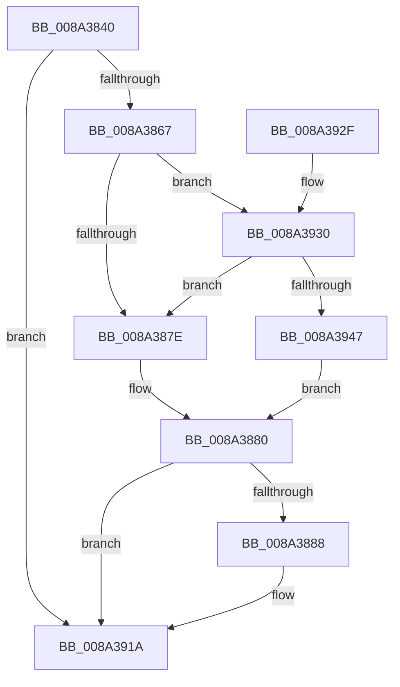

# EtwpWriteAppStateChange

- RVA: `0x008A3840`–`0x008A394E` (길이 `270` bytes)
- VA: `0x00000001408A3840`
- 실행 섹션: `PAGE`
- PDB 이름 있음: `예`; PDB Function 태그: `예`
- unwind 정보 RVA: `0x0007EEB4`
- 디코드: `56`개 명령, `270/270` bytes 표시
- 미해석 바이트: `0` (있으면 어셈블리에 `.byte`로 보존)

> 이 문서는 커널 이미지의 기계어와 PDB 기호를 분석해 생성했습니다. 4번과 5번은 함수 원형과 자료형을 바이너리 사용 방식에서 추정한 C 해석이며 원본 소스 복구 결과는 아닙니다.

## 1. Dependencies

- 직접 호출 지점: **2**; 고유 호출 대상: **2**
- 직접 호출자로 확인된 함수: **2**
- RIP 상대 이미지 참조: **10**

### Outgoing calls
- `0x008A3915` → [EtwWriteTransfer](../../text/41/EtwWriteTransfer_function_0041C830.md) (function, `0x0041C830`)
- `0x008A3921` → [_security_check_cookie](../../text/6A/_security_check_cookie_function_006AC640.md) (function, `0x006AC640`)

### Direct callers
- [EtwTraceProcess](EtwTraceProcess_function_008A4004.md) at `0x008A4102`
- [EtwTraceAppStateChange](EtwTraceAppStateChange_function_008A452C.md) at `0x008A4650`

### Static image references
- `0x008A384C` → RVA `0x00E0A740` (`.data`; read)
- `0x008A385A` → RVA `0x00E091A0` (`.data`; read)
- `0x008A3871` → RVA `0x00E091B0` (`.data`; read)
- `0x008A3888` → RVA `0x00054974` (`.rdata`; read)
- `0x008A389D` → RVA `0x00E091A8` (`.data`; read)
- `0x008A38AC` → RVA `0x00043590` (`.rdata`; read)
- `0x008A38CE` → RVA `0x0005497E` (`.rdata`; read)
- `0x008A38D9` → RVA `0x0005BCFD` (`.rdata`; read)
- `0x008A38FD` → RVA `0x00E091C0` (`.data`; read)
- `0x008A3930` → RVA `0x00E091B8` (`.data`; read)

## 2. Other-region calls and transfers

- 다른 실행 섹션으로 향하는 call: **2**
  - `0x008A3915` → [EtwWriteTransfer](../../text/41/EtwWriteTransfer_function_0041C830.md) (`PAGE` → `.text`)
  - `0x008A3921` → [_security_check_cookie](../../text/6A/_security_check_cookie_function_006AC640.md) (`PAGE` → `.text`)
- 별도 외부 분기/꼬리 이동을 확인하지 못했습니다.

## 3. Assembly (complete function range)

```asm
008A3840  40 55                           push rbp
008A3842  48 8B EC                        mov rbp, rsp
008A3845  48 81 EC 80 00 00 00            sub rsp, 0x80
008A384C  48 8B 05 ED 6E 56 00            mov rax, qword ptr [rip + 0x566eed]
008A3853  48 33 C4                        xor rax, rsp
008A3856  48 89 45 F8                     mov qword ptr [rbp - 8], rax
008A385A  83 3D 3F 59 56 00 05            cmp dword ptr [rip + 0x56593f], 5
008A3861  0F 86 B3 00 00 00               jbe 0x1408a391a
008A3867  49 B8 01 00 00 00 00 20 00 00   movabs r8, 0x200000000001
008A3871  4C 85 05 38 59 56 00            test qword ptr [rip + 0x565938], r8
008A3878  0F 85 B2 00 00 00               jne 0x1408a3930
008A387E  32 C0                           xor al, al
008A3880  84 C0                           test al, al
008A3882  0F 84 92 00 00 00               je 0x1408a391a
008A3888  0F B7 05 E5 10 7B FF            movzx eax, word ptr [rip - 0x84ef1b]
008A388F  48 8D 55 B8                     lea rdx, [rbp - 0x48]
008A3893  83 65 F4 00                     and dword ptr [rbp - 0xc], 0
008A3897  45 33 C9                        xor r9d, r9d
008A389A  89 45 BC                        mov dword ptr [rbp - 0x44], eax
008A389D  48 8B 05 04 59 56 00            mov rax, qword ptr [rip + 0x565904]
008A38A4  48 89 45 C8                     mov qword ptr [rbp - 0x38], rax
008A38A8  48 89 4D E8                     mov qword ptr [rbp - 0x18], rcx
008A38AC  48 8D 0D DD FC 79 FF            lea rcx, [rip - 0x860323]
008A38B3  4C 89 45 C0                     mov qword ptr [rbp - 0x40], r8
008A38B7  45 33 C0                        xor r8d, r8d
008A38BA  C7 45 F0 62 00 00 00            mov dword ptr [rbp - 0x10], 0x62
008A38C1  C7 45 B8 00 00 00 0B            mov dword ptr [rbp - 0x48], 0xb000000
008A38C8  0F B7 00                        movzx eax, word ptr [rax]
008A38CB  89 45 D0                        mov dword ptr [rbp - 0x30], eax
008A38CE  48 8D 05 A9 10 7B FF            lea rax, [rip - 0x84ef57]
008A38D5  48 89 45 D8                     mov qword ptr [rbp - 0x28], rax
008A38D9  48 8D 05 1D 84 7B FF            lea rax, [rip - 0x847be3]
008A38E0  2B C1                           sub eax, ecx
008A38E2  C7 45 D4 02 00 00 00            mov dword ptr [rbp - 0x2c], 2
008A38E9  C7 45 E0 3F 01 00 00            mov dword ptr [rbp - 0x20], 0x13f
008A38F0  C7 45 E4 01 00 00 00            mov dword ptr [rbp - 0x1c], 1
008A38F7  89 45 B0                        mov dword ptr [rbp - 0x50], eax
008A38FA  8B 45 B0                        mov eax, dword ptr [rbp - 0x50]
008A38FD  48 8B 0D BC 58 56 00            mov rcx, qword ptr [rip + 0x5658bc]
008A3904  48 8D 45 C8                     lea rax, [rbp - 0x38]
008A3908  48 89 44 24 28                  mov qword ptr [rsp + 0x28], rax
008A390D  C7 44 24 20 03 00 00 00         mov dword ptr [rsp + 0x20], 3
008A3915  E8 16 8F B7 FF                  call 0x14041c830
008A391A  48 8B 4D F8                     mov rcx, qword ptr [rbp - 8]
008A391E  48 33 CC                        xor rcx, rsp
008A3921  E8 1A 8D E0 FF                  call 0x1406ac640
008A3926  48 81 C4 80 00 00 00            add rsp, 0x80
008A392D  5D                              pop rbp
008A392E  C3                              ret
008A392F  CC                              int3
008A3930  48 8B 05 81 58 56 00            mov rax, qword ptr [rip + 0x565881]
008A3937  49 23 C0                        and rax, r8
008A393A  48 3B 05 77 58 56 00            cmp rax, qword ptr [rip + 0x565877]
008A3941  0F 85 37 FF FF FF               jne 0x1408a387e
008A3947  B0 01                           mov al, 1
008A3949  E9 32 FF FF FF                  jmp 0x1408a3880
```

## 4. C-style interpretation (structured pseudocode)

```c
__int64 __fastcall EtwpWriteAppStateChange(__int64 a1, __int64 a2, __int64 a3, int a4)
{
    __int64 result;
    __int64 v_rsp;
    unsigned __int64 v_stack_m10;
    unsigned int v_stack_m14;
    unsigned int v_stack_m18;
    unsigned __int64 v_stack_m20;
    unsigned int v_stack_m24;
    unsigned int v_stack_m28;
    unsigned __int64 v_stack_m30;
    unsigned int v_stack_m34;
    unsigned int v_stack_m38;
    unsigned __int64 v_stack_m40;
    unsigned __int64 v_stack_m48;
    unsigned int v_stack_m4C;
    unsigned __int64 v_stack_m50;
    unsigned int v_stack_m58;
    unsigned __int64 v_stack_m60;
    unsigned int v_stack_m68;

    v_rsp = (v_rsp) - (128);
    result = (*(unsigned __int64 *)(v_rip + 5664493)) ^ (v_rsp);
    v_stack_m10 = result;
    if ((*(unsigned int *)(v_rip + 5658943)) <= 5) goto loc_008A391A;
    if (((*(unsigned __int64 *)(v_rip + 5658936)) & (a3)) != 0) goto loc_008A3930;
loc_008A387E:
    result = 0;
loc_008A3880:
    if (0 != 0) {
        result = *(unsigned __int16 *)(v_rip - 8711963);
        a2 = v_stack_m50;
        a4 = 0;
        v_stack_m4C = (unsigned int)(result);
        result = *(unsigned __int64 *)(v_rip + 5658884);
        v_stack_m40 = result;
        v_stack_m20 = a1;
        a1 = v_rip - 8782627;
        v_stack_m48 = a3;
        a3 = 0;
        v_stack_m18 = 98;
        v_stack_m50 = 0xB000000ULL;
        result = *(unsigned __int16 *)(result);
        v_stack_m38 = (unsigned int)(result);
        result = v_rip - 8712023;
        v_stack_m30 = result;
        result = v_rip - 8682467;
        result = (unsigned int)((result) - ((unsigned int)(a1)));
        v_stack_m34 = 2;
        v_stack_m28 = 319;
        v_stack_m24 = 1;
        v_stack_m58 = (unsigned int)(result);
        result = v_stack_m58;
        a1 = *(unsigned __int64 *)(v_rip + 5658812);
        result = v_stack_m40;
        v_stack_m60 = result;
        v_stack_m68 = 3;
        result = EtwWriteTransfer(a1, a2, a3, a4);
    }
    a1 = (v_stack_m10) ^ (v_rsp);
    result = _security_check_cookie(a1, a2, a3, a4);
    v_rsp = (v_rsp) + (128);
    return result;
loc_008A3930:
    result = (*(unsigned __int64 *)(v_rip + 5658753)) & (0);
    if (result != (*(unsigned __int64 *)(v_rip + 5658743))) goto loc_008A387E;
    goto loc_008A3880;
}
```

## 5. (Beta) C Style

```c
int64_t EtwpWriteAppStateChange(int64_t Arg1, int64_t Arg2, int64_t Arg3, int32_t Arg4)
{
    int64_t result;
    int64_t local_rsp;
    uint64_t v_stack_m10;
    uint32_t v_stack_m14;
    uint32_t v_stack_m18;
    uint64_t v_stack_m20;
    uint32_t v_stack_m24;
    uint32_t v_stack_m28;
    uint64_t v_stack_m30;
    uint32_t v_stack_m34;
    uint32_t v_stack_m38;
    uint64_t v_stack_m40;
    uint64_t v_stack_m48;
    uint32_t v_stack_m4C;
    uint64_t v_stack_m50;
    uint32_t v_stack_m58;
    uint64_t v_stack_m60;
    uint32_t v_stack_m68;

    local_rsp = (local_rsp) - (128);
    result = (*(uint64_t *)(v_rip + 0x566EED)) ^ (local_rsp);
    v_stack_m10 = result;
    if ((*(uint32_t *)(v_rip + 0x56593F)) <= 5) goto loc_008A391A;
    if (((*(uint64_t *)(v_rip + 0x565938)) & (Arg3)) != 0) goto loc_008A3930;
loc_008A387E:
    result = 0;
loc_008A3880:
    if (0 != 0) {
        result = *(uint16_t *)(v_rip - 0x84EF1B);
        Arg2 = v_stack_m50;
        Arg4 = 0;
        v_stack_m4C = (uint32_t)(result);
        result = *(uint64_t *)(v_rip + 0x565904);
        v_stack_m40 = result;
        v_stack_m20 = Arg1;
        Arg1 = v_rip - 8782627;
        v_stack_m48 = Arg3;
        Arg3 = 0;
        v_stack_m18 = 98;
        v_stack_m50 = 0xB000000ULL;
        result = *(uint16_t *)(result);
        v_stack_m38 = (uint32_t)(result);
        result = v_rip - 8712023;
        v_stack_m30 = result;
        result = v_rip - 8682467;
        result = (uint32_t)((result) - ((uint32_t)(Arg1)));
        v_stack_m34 = 2;
        v_stack_m28 = 319;
        v_stack_m24 = 1;
        v_stack_m58 = (uint32_t)(result);
        result = v_stack_m58;
        Arg1 = *(uint64_t *)(v_rip + 0x5658BC);
        result = v_stack_m40;
        v_stack_m60 = result;
        v_stack_m68 = 3;
        result = EtwWriteTransfer(Arg1, Arg2, Arg3, Arg4);
    }
    Arg1 = (v_stack_m10) ^ (local_rsp);
    result = _security_check_cookie(Arg1, Arg2, Arg3, Arg4);
    local_rsp = (local_rsp) + (128);
    return result;
loc_008A3930:
    result = (*(uint64_t *)(v_rip + 0x565881)) & (0);
    if (result != (*(uint64_t *)(v_rip + 0x565877))) goto loc_008A387E;
    goto loc_008A3880;
}
```

## 6. Execution-region graph

[열기: 2D/3D 그래프와 함수 탐색 컨트롤 패널](../../../control-panel.html?section=page&rva=0x008A3840&view=graph)

- 2D 그래프는 위에서 아래로 흐르고, 3D 그래프는 빈 공간을 드래그해 회전합니다. Shift+드래그는 이동, 휠은 확대·축소, 함수 노드 선택은 대상 보고서 이동입니다.

### Static fallback


