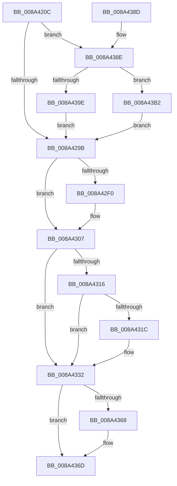

# EtwpWriteProcessEvent

- RVA: `0x008A420C`–`0x008A43BA` (길이 `430` bytes)
- VA: `0x00000001408A420C`
- 실행 섹션: `PAGE`
- PDB 이름 있음: `예`; PDB Function 태그: `예`
- unwind 정보 RVA: `0x0007EF18`
- 디코드: `111`개 명령, `430/430` bytes 표시
- 미해석 바이트: `0` (있으면 어셈블리에 `.byte`로 보존)

> 이 문서는 커널 이미지의 기계어와 PDB 기호를 분석해 생성했습니다. 4번과 5번은 함수 원형과 자료형을 바이너리 사용 방식에서 추정한 C 해석이며 원본 소스 복구 결과는 아닙니다.

## 1. Dependencies

- 직접 호출 지점: **10**; 고유 호출 대상: **10**
- 직접 호출자로 확인된 함수: **1**
- RIP 상대 이미지 참조: **2**

### Outgoing calls
- `0x008A42E6` → [EtwpBuildProcessEvent](EtwpBuildProcessEvent_function_008A552C.md) (function, `0x008A552C`)
- `0x008A42F6` → [KiUnstackDetachProcess](../../text/21/KiUnstackDetachProcess_function_00217D30.md) (function, `0x00217D30`)
- `0x008A4302` → [ExReleaseRundownProtection](../../text/34/ExReleaseRundownProtection_function_00349E80.md) (function, `0x00349E80`)
- `0x008A432D` → [EtwpPsProvTraceProcess](EtwpPsProvTraceProcess_function_008A3954.md) (function, `0x008A3954`)
- `0x008A4335` → [PsGetProcessServerSilo](../../text/44/PsGetProcessServerSilo_function_0044BEE0.md) (function, `0x0044BEE0`)
- `0x008A4359` → [EtwTraceSiloKernelEvent](../../text/22/EtwTraceSiloKernelEvent_function_002242A0.md) (function, `0x002242A0`)
- `0x008A4368` → [ExFreePool](../../poolcode/B8/ExFreePool_function_00B82850.md) (function, `0x00B82850`)
- `0x008A4374` → [_security_check_cookie](../../text/6A/_security_check_cookie_function_006AC640.md) (function, `0x006AC640`)
- `0x008A4395` → [ExAcquireRundownProtection](../../text/21/ExAcquireRundownProtection_function_00216620.md) (function, `0x00216620`)
- `0x008A43A5` → [KeStackAttachProcess](../../text/21/KeStackAttachProcess_function_00216800.md) (function, `0x00216800`)

### Direct callers
- [EtwTraceProcess](EtwTraceProcess_function_008A4004.md) at `0x008A408F`

### Static image references
- `0x008A4228` → RVA `0x00E0A740` (`.data`; read)
- `0x008A4307` → RVA `0x00FC6AA8` (`ALMOSTRO`; read)

## 2. Other-region calls and transfers

- 다른 실행 섹션으로 향하는 call: **8**
  - `0x008A42F6` → [KiUnstackDetachProcess](../../text/21/KiUnstackDetachProcess_function_00217D30.md) (`PAGE` → `.text`)
  - `0x008A4302` → [ExReleaseRundownProtection](../../text/34/ExReleaseRundownProtection_function_00349E80.md) (`PAGE` → `.text`)
  - `0x008A4335` → [PsGetProcessServerSilo](../../text/44/PsGetProcessServerSilo_function_0044BEE0.md) (`PAGE` → `.text`)
  - `0x008A4359` → [EtwTraceSiloKernelEvent](../../text/22/EtwTraceSiloKernelEvent_function_002242A0.md) (`PAGE` → `.text`)
  - `0x008A4368` → [ExFreePool](../../poolcode/B8/ExFreePool_function_00B82850.md) (`PAGE` → `POOLCODE`)
  - `0x008A4374` → [_security_check_cookie](../../text/6A/_security_check_cookie_function_006AC640.md) (`PAGE` → `.text`)
  - `0x008A4395` → [ExAcquireRundownProtection](../../text/21/ExAcquireRundownProtection_function_00216620.md) (`PAGE` → `.text`)
  - `0x008A43A5` → [KeStackAttachProcess](../../text/21/KeStackAttachProcess_function_00216800.md) (`PAGE` → `.text`)
- 별도 외부 분기/꼬리 이동을 확인하지 못했습니다.

## 3. Assembly (complete function range)

```asm
008A420C  40 55                           push rbp
008A420E  53                              push rbx
008A420F  56                              push rsi
008A4210  57                              push rdi
008A4211  41 54                           push r12
008A4213  41 55                           push r13
008A4215  41 56                           push r14
008A4217  41 57                           push r15
008A4219  48 8D AC 24 78 FF FF FF         lea rbp, [rsp - 0x88]
008A4221  48 81 EC 88 01 00 00            sub rsp, 0x188
008A4228  48 8B 05 11 65 56 00            mov rax, qword ptr [rip + 0x566511]
008A422F  48 33 C4                        xor rax, rsp
008A4232  48 89 45 70                     mov qword ptr [rbp + 0x70], rax
008A4236  48 8B 85 F8 00 00 00            mov rax, qword ptr [rbp + 0xf8]
008A423D  0F 57 C0                        xorps xmm0, xmm0
008A4240  83 64 24 60 00                  and dword ptr [rsp + 0x60], 0
008A4245  0F 57 C9                        xorps xmm1, xmm1
008A4248  4C 8B AD F0 00 00 00            mov r13, qword ptr [rbp + 0xf0]
008A424F  45 32 F6                        xor r14b, r14b
008A4252  48 89 44 24 68                  mov qword ptr [rsp + 0x68], rax
008A4257  4D 8B E1                        mov r12, r9
008A425A  33 C0                           xor eax, eax
008A425C  4D 8B F8                        mov r15, r8
008A425F  48 89 45 A0                     mov qword ptr [rbp - 0x60], rax
008A4263  0F B7 FA                        movzx edi, dx
008A4266  0F 11 45 80                     movups xmmword ptr [rbp - 0x80], xmm0
008A426A  48 8B D9                        mov rbx, rcx
008A426D  40 B6 01                        mov sil, 1
008A4270  0F 11 45 90                     movups xmmword ptr [rbp - 0x70], xmm0
008A4274  0F 11 4D A8                     movups xmmword ptr [rbp - 0x58], xmm1
008A4278  0F 11 4D B8                     movups xmmword ptr [rbp - 0x48], xmm1
008A427C  0F 11 4D C8                     movups xmmword ptr [rbp - 0x38], xmm1
008A4280  65 48 8B 04 25 88 01 00 00      mov rax, qword ptr gs:[0x188]
008A4289  0F 11 44 24 70                  movups xmmword ptr [rsp + 0x70], xmm0
008A428E  48 39 88 B8 00 00 00            cmp qword ptr [rax + 0xb8], rcx
008A4295  0F 85 F3 00 00 00               jne 0x1408a438e
008A429B  48 8B 44 24 68                  mov rax, qword ptr [rsp + 0x68]
008A42A0  4C 8D 4D 80                     lea r9, [rbp - 0x80]
008A42A4  48 89 44 24 50                  mov qword ptr [rsp + 0x50], rax
008A42A9  0F 57 C0                        xorps xmm0, xmm0
008A42AC  4C 89 6C 24 48                  mov qword ptr [rsp + 0x48], r13
008A42B1  48 8D 44 24 70                  lea rax, [rsp + 0x70]
008A42B6  48 89 44 24 40                  mov qword ptr [rsp + 0x40], rax
008A42BB  44 8A C6                        mov r8b, sil
008A42BE  4C 89 64 24 38                  mov qword ptr [rsp + 0x38], r12
008A42C3  48 8D 44 24 60                  lea rax, [rsp + 0x60]
008A42C8  48 89 44 24 30                  mov qword ptr [rsp + 0x30], rax
008A42CD  0F B7 D7                        movzx edx, di
008A42D0  48 8D 45 E0                     lea rax, [rbp - 0x20]
008A42D4  48 8B CB                        mov rcx, rbx
008A42D7  48 89 44 24 28                  mov qword ptr [rsp + 0x28], rax
008A42DC  4C 89 7C 24 20                  mov qword ptr [rsp + 0x20], r15
008A42E1  41 0F 11 45 00                  movups xmmword ptr [r13], xmm0
008A42E6  E8 41 12 00 00                  call 0x1408a552c
008A42EB  45 84 F6                        test r14b, r14b
008A42EE  74 17                           je 0x1408a4307
008A42F0  33 D2                           xor edx, edx
008A42F2  48 8D 4D A8                     lea rcx, [rbp - 0x58]
008A42F6  E8 35 3A 97 FF                  call 0x140217d30
008A42FB  48 8D 8B E8 01 00 00            lea rcx, [rbx + 0x1e8]
008A4302  E8 79 5B AA FF                  call 0x140349e80
008A4307  48 8B 05 9A 27 72 00            mov rax, qword ptr [rip + 0x72279a]
008A430E  48 05 CC 12 00 00               add rax, 0x12cc
008A4314  74 1C                           je 0x1408a4332
008A4316  8B 00                           mov eax, dword ptr [rax]
008A4318  A8 01                           test al, 1
008A431A  74 16                           je 0x1408a4332
008A431C  8B 55 A0                        mov edx, dword ptr [rbp - 0x60]
008A431F  4D 8B CF                        mov r9, r15
008A4322  4D 8B C4                        mov r8, r12
008A4325  66 89 7C 24 20                  mov word ptr [rsp + 0x20], di
008A432A  48 8B CB                        mov rcx, rbx
008A432D  E8 22 F6 FF FF                  call 0x1408a3954
008A4332  48 8B CB                        mov rcx, rbx
008A4335  E8 A6 7B BA FF                  call 0x14044bee0
008A433A  44 8B 44 24 60                  mov r8d, dword ptr [rsp + 0x60]
008A433F  48 8D 55 E0                     lea rdx, [rbp - 0x20]
008A4343  48 8B C8                        mov rcx, rax
008A4346  C7 44 24 28 04 19 60 00         mov dword ptr [rsp + 0x28], 0x601904
008A434E  41 B9 01 00 00 00               mov r9d, 1
008A4354  66 89 7C 24 20                  mov word ptr [rsp + 0x20], di
008A4359  E8 42 FF 97 FF                  call 0x1402242a0
008A435E  48 8B 4C 24 78                  mov rcx, qword ptr [rsp + 0x78]
008A4363  48 85 C9                        test rcx, rcx
008A4366  74 05                           je 0x1408a436d
008A4368  E8 E3 E4 2D 00                  call 0x140b82850
008A436D  48 8B 4D 70                     mov rcx, qword ptr [rbp + 0x70]
008A4371  48 33 CC                        xor rcx, rsp
008A4374  E8 C7 82 E0 FF                  call 0x1406ac640
008A4379  48 81 C4 88 01 00 00            add rsp, 0x188
008A4380  41 5F                           pop r15
008A4382  41 5E                           pop r14
008A4384  41 5D                           pop r13
008A4386  41 5C                           pop r12
008A4388  5F                              pop rdi
008A4389  5E                              pop rsi
008A438A  5B                              pop rbx
008A438B  5D                              pop rbp
008A438C  C3                              ret
008A438D  CC                              int3
008A438E  48 81 C1 E8 01 00 00            add rcx, 0x1e8
008A4395  E8 86 22 97 FF                  call 0x140216620
008A439A  84 C0                           test al, al
008A439C  74 14                           je 0x1408a43b2
008A439E  48 8D 55 A8                     lea rdx, [rbp - 0x58]
008A43A2  48 8B CB                        mov rcx, rbx
008A43A5  E8 56 24 97 FF                  call 0x140216800
008A43AA  44 8A F6                        mov r14b, sil
008A43AD  E9 E9 FE FF FF                  jmp 0x1408a429b
008A43B2  40 32 F6                        xor sil, sil
008A43B5  E9 E1 FE FF FF                  jmp 0x1408a429b
```

## 4. C-style interpretation (structured pseudocode)

```c
__int64 __fastcall EtwpWriteProcessEvent(__int64 a1, unsigned __int16 a2, __int64 a3, __int64 a4, __int64 a5, __int64 a6)
{
    __int64 result;
    __int64 v_r14;
    __int64 v_rsi;
    __int64 v_rsp;
    unsigned __int64 v_stack_m100;
    unsigned __int64 v_stack_m110;
    unsigned __int64 v_stack_m120;
    unsigned __int64 v_stack_m128;
    unsigned __int64 v_stack_m138;
    unsigned __int64 v_stack_m148;
    unsigned __int64 v_stack_m150;
    unsigned __int64 v_stack_m158;
    unsigned __int64 v_stack_m160;
    unsigned int v_stack_m168;
    unsigned __int64 v_stack_m178;
    unsigned __int64 v_stack_m180;
    unsigned __int64 v_stack_m188;
    unsigned __int64 v_stack_m190;
    unsigned __int64 v_stack_m198;
    unsigned __int64 v_stack_m1A0;
    unsigned __int64 v_stack_m1A8;
    unsigned __int64 v_stack_m58;
    unsigned __int64 v_stack_mC8;
    unsigned __int64 v_stack_mE8;

    v_rsp = (v_rsp) - (392);
    result = (*(unsigned __int64 *)(v_rip + 5661969)) ^ (v_rsp);
    v_stack_m58 = result;
    v_r14 = 0;
    v_stack_m160 = a6;
    result = 0;
    v_stack_m128 = 0;
    v_stack_m148 = v_xmm0;
    v_stack_m138 = v_xmm0;
    v_stack_m120 = v_xmm1;
    v_stack_m110 = v_xmm1;
    v_stack_m100 = v_xmm1;
    v_stack_m158 = v_xmm0;
    if ((*(unsigned __int64 *)(*(unsigned __int64 *)(gs_base + (0 + 392)) + 184)) != a1) goto loc_008A438E;
loc_008A429B:
    v_stack_m178 = v_stack_m160;
    v_stack_m180 = a5;
    v_stack_m188 = v_stack_m158;
    v_stack_m190 = a4;
    v_stack_m198 = v_stack_m168;
    v_stack_m1A0 = v_stack_mE8;
    v_stack_m1A8 = a3;
    *(unsigned __int64 *)(a5) = v_xmm0;
    result = EtwpBuildProcessEvent(a1, a2, 1, v_stack_m148);
    if (0 != 0) {
        a2 = 0;
        a1 = v_stack_m120;
        result = KiUnstackDetachProcess(a1, a2, 1, v_stack_m148);
        a1 = a1 + 488;
        result = ExReleaseRundownProtection(a1, a2, 1, v_stack_m148);
    }
    result = (*(unsigned __int64 *)(v_rip + 7481242)) + (0x12CCULL);
    if (condition_is_equal) goto loc_008A4332;
    result = (unsigned int)(*(unsigned int *)(result));
    if ((((unsigned __int8)((unsigned int)(*(unsigned int *)(result)))) & (1)) != 0) {
        a2 = v_stack_m128;
        a4 = a3;
        a3 = a4;
        v_stack_m1A8 = a2;
        a1 = a1;
        result = EtwpPsProvTraceProcess(a1, a2, a3, a4);
    }
    result = PsGetProcessServerSilo(a1, a2, a3, a4);
    v_stack_m1A0 = 0x601904ULL;
    v_stack_m1A8 = a2;
    result = EtwTraceSiloKernelEvent(result, v_stack_mE8, (unsigned int)(v_stack_m168), 1);
    if (v_stack_m150 != 0) {
        result = ExFreePool(v_stack_m150, v_stack_mE8, (unsigned int)(v_stack_m168), 1);
    }
    a1 = (v_stack_m58) ^ (v_rsp);
    result = _security_check_cookie(a1, v_stack_mE8, (unsigned int)(v_stack_m168), 1);
    v_rsp = (v_rsp) + (392);
    return result;
loc_008A438E:
    a1 = (a1) + (488);
    result = ExAcquireRundownProtection(a1, v_stack_mE8, (unsigned int)(v_stack_m168), 1);
    if ((unsigned __int8)(result) == 0) goto loc_008A43B2;
    result = KeStackAttachProcess(a1, v_stack_m120, (unsigned int)(v_stack_m168), 1);
    goto loc_008A429B;
loc_008A43B2:
    v_rsi = 0;
    goto loc_008A429B;
}
```

## 5. (Beta) C Style

```c
int64_t EtwpWriteProcessEvent(void *Arg1, uint16_t Arg2, int64_t Arg3, int64_t Arg4, void *Arg5, int64_t Arg6)
{
    uint8_t *arg1 = (uint8_t *)Arg1;
    uint8_t *arg5 = (uint8_t *)Arg5;

    int64_t result;
    int64_t local_r14;
    int64_t local_rsi;
    int64_t local_rsp;
    uint64_t v_stack_m100;
    uint64_t v_stack_m110;
    uint64_t v_stack_m120;
    uint64_t v_stack_m128;
    uint64_t v_stack_m138;
    uint64_t v_stack_m148;
    uint64_t v_stack_m150;
    uint64_t v_stack_m158;
    uint64_t v_stack_m160;
    uint32_t v_stack_m168;
    uint64_t v_stack_m178;
    uint64_t v_stack_m180;
    uint64_t v_stack_m188;
    uint64_t v_stack_m190;
    uint64_t v_stack_m198;
    uint64_t v_stack_m1A0;
    uint64_t v_stack_m1A8;
    uint64_t v_stack_m58;
    uint64_t v_stack_mC8;
    uint64_t v_stack_mE8;

    local_rsp = (local_rsp) - (392);
    result = (*(uint64_t *)(v_rip + 0x566511)) ^ (local_rsp);
    v_stack_m58 = result;
    local_r14 = 0;
    v_stack_m160 = Arg6;
    result = 0;
    v_stack_m128 = 0;
    v_stack_m148 = v_xmm0;
    v_stack_m138 = v_xmm0;
    v_stack_m120 = v_xmm1;
    v_stack_m110 = v_xmm1;
    v_stack_m100 = v_xmm1;
    v_stack_m158 = v_xmm0;
    if ((*(uint64_t *)(*(uint64_t *)(gs_base + (0 + 0x188)) + 0xB8)) != Arg1) goto loc_008A438E;
loc_008A429B:
    v_stack_m178 = v_stack_m160;
    v_stack_m180 = Arg5;
    v_stack_m188 = v_stack_m158;
    v_stack_m190 = Arg4;
    v_stack_m198 = v_stack_m168;
    v_stack_m1A0 = v_stack_mE8;
    v_stack_m1A8 = Arg3;
    *(uint64_t *)(arg5) = v_xmm0;
    result = EtwpBuildProcessEvent(Arg1, Arg2, 1, v_stack_m148);
    if (0 != 0) {
        Arg2 = 0;
        Arg1 = v_stack_m120;
        result = KiUnstackDetachProcess(Arg1, Arg2, 1, v_stack_m148);
        Arg1 = Arg1 + 488;
        result = ExReleaseRundownProtection(Arg1, Arg2, 1, v_stack_m148);
    }
    result = (*(uint64_t *)(v_rip + 0x72279A)) + (0x12CCULL);
    if (condition_is_equal) goto loc_008A4332;
    result = (uint32_t)(*(uint32_t *)(result));
    if ((((uint8_t)((uint32_t)(*(uint32_t *)(result)))) & (1)) != 0) {
        Arg2 = v_stack_m128;
        Arg4 = Arg3;
        Arg3 = Arg4;
        v_stack_m1A8 = Arg2;
        Arg1 = Arg1;
        result = EtwpPsProvTraceProcess(Arg1, Arg2, Arg3, Arg4);
    }
    result = PsGetProcessServerSilo(Arg1, Arg2, Arg3, Arg4);
    v_stack_m1A0 = 0x601904ULL;
    v_stack_m1A8 = Arg2;
    result = EtwTraceSiloKernelEvent(result, v_stack_mE8, (uint32_t)(v_stack_m168), 1);
    if (v_stack_m150 != 0) {
        result = ExFreePool(v_stack_m150, v_stack_mE8, (uint32_t)(v_stack_m168), 1);
    }
    Arg1 = (v_stack_m58) ^ (local_rsp);
    result = _security_check_cookie(Arg1, v_stack_mE8, (uint32_t)(v_stack_m168), 1);
    local_rsp = (local_rsp) + (392);
    return result;
loc_008A438E:
    Arg1 = (Arg1) + (488);
    result = ExAcquireRundownProtection(Arg1, v_stack_mE8, (uint32_t)(v_stack_m168), 1);
    if ((uint8_t)(result) == 0) goto loc_008A43B2;
    result = KeStackAttachProcess(Arg1, v_stack_m120, (uint32_t)(v_stack_m168), 1);
    goto loc_008A429B;
loc_008A43B2:
    local_rsi = 0;
    goto loc_008A429B;
}
```

### 관측된 메모리 오프셋

구조체 형식이 확인되지 않은 접근은 인자 기준의 오프셋으로만 기록했습니다.

| 기준 인자 | 오프셋 표현 | 폭 (bit) | 접근 |
|---|---:|---:|---|
| `Arg1` | `+ 0x1E8` | `64` | `R` |
| `Arg5` | `+ 0x0` | `128` | `R` |

## 6. Execution-region graph

[열기: 2D/3D 그래프와 함수 탐색 컨트롤 패널](../../../control-panel.html?section=page&rva=0x008A420C&view=graph)

- 2D 그래프는 위에서 아래로 흐르고, 3D 그래프는 빈 공간을 드래그해 회전합니다. Shift+드래그는 이동, 휠은 확대·축소, 함수 노드 선택은 대상 보고서 이동입니다.

### Static fallback


