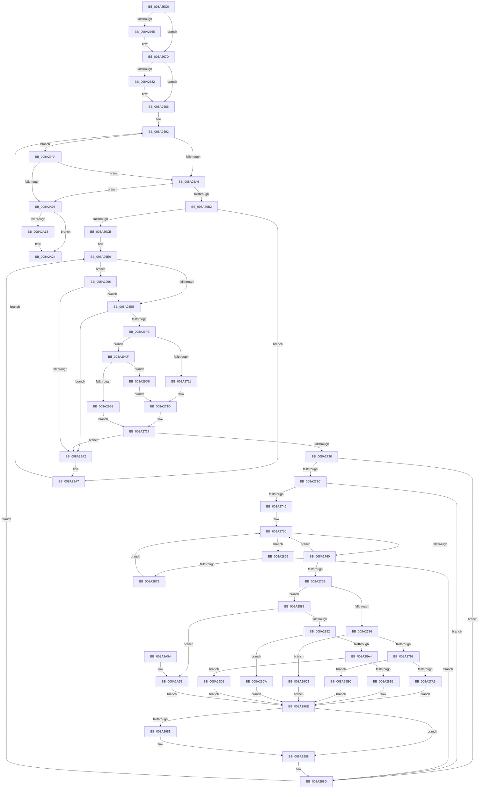

# ExpSnapShotHandleTables

- RVA: `0x008A25C0`–`0x008A2A8E` (길이 `1,230` bytes)
- VA: `0x00000001408A25C0`
- 실행 섹션: `PAGE`
- PDB 이름 있음: `예`; PDB Function 태그: `아니요`
- unwind 정보 RVA: `0x0007ED3C`
- 디코드: `283`개 명령, `1,230/1,230` bytes 표시
- 미해석 바이트: `0` (있으면 어셈블리에 `.byte`로 보존)

> 이 문서는 커널 이미지의 기계어와 PDB 기호를 분석해 생성했습니다. 4번과 5번은 함수 원형과 자료형을 바이너리 사용 방식에서 추정한 C 해석이며 원본 소스 복구 결과는 아닙니다.

## 1. Dependencies

- 직접 호출 지점: **14**; 고유 호출 대상: **12**
- 직접 호출자로 확인된 함수: **2**
- RIP 상대 이미지 참조: **6**

### Outgoing calls
- `0x008A264B` → [KeAbPreAcquire](../../text/21/KeAbPreAcquire_function_00210230.md) (function, `0x00210230`)
- `0x008A2678` → [ExfAcquirePushLockSharedEx](../../text/21/ExfAcquirePushLockSharedEx_function_0021044C.md) (function, `0x0021044C`)
- `0x008A26BE` → [PsLookupProcessByProcessId](PsLookupProcessByProcessId_function_008A2AA0.md) (function, `0x008A2AA0`)
- `0x008A26D0` → [ObfDereferenceObject](../../text/2F/ObfDereferenceObject_function_002F9350.md) (function, `0x002F9350`)
- `0x008A27A8` → [ExGetHandlePointer](../../text/43/ExGetHandlePointer_function_00430C90.md) (function, `0x00430C90`)
- `0x008A27C3` → [ExGetHandleAttributes](../../text/40/ExGetHandleAttributes_function_00409470.md) (function, `0x00409470`)
- `0x008A2878` → [ExpBlockOnLockedHandleEntry](../86/ExpBlockOnLockedHandleEntry_function_00868838.md) (function, `0x00868838`)
- `0x008A28B4` → [ExGetHandlePointer](../../text/43/ExGetHandlePointer_function_00430C90.md) (function, `0x00430C90`)
- `0x008A28D0` → [ExGetHandleAttributes](../../text/40/ExGetHandleAttributes_function_00409470.md) (function, `0x00409470`)
- `0x008A2983` → [ExfUnblockPushLock](../../text/2A/ExfUnblockPushLock_function_002A3FE0.md) (function, `0x002A3FE0`)
- `0x008A2A1F` → [ExfReleasePushLockShared](../../text/26/ExfReleasePushLockShared_function_00263440.md) (function, `0x00263440`)
- `0x008A2A2B` → [KeAbPostRelease](../../text/2E/KeAbPostRelease_function_002E1600.md) (function, `0x002E1600`)
- `0x008A2A35` → [KiLeaveCriticalRegionUnsafe](../../text/25/KiLeaveCriticalRegionUnsafe_function_0025F010.md) (function, `0x0025F010`)
- `0x008A2A82` → [guard_dispatch_icall](../../text/6B/guard_dispatch_icall_function_006BAAD0.md) (function, `0x006BAAD0`)

### Direct callers
- [ObGetHandleInformation](../A8/ObGetHandleInformation_function_00A8FBD8.md) at `0x00A8FC0D`
- [ObGetHandleInformationEx](../A9/ObGetHandleInformationEx_function_00A99A50.md) at `0x00A99A86`

### Static image references
- `0x008A2636` → RVA `0x00FD9BA0` (`PAGEDATA`; read)
- `0x008A2686` → RVA `0x00FD9FC8` (`PAGEDATA`; read)
- `0x008A2772` → RVA `0x009C4CE0` (`ObpCaptureHandleInformation`; read)
- `0x008A27E9` → RVA `0x00FC6E4C` (`ALMOSTRO`; read)
- `0x008A27F3` → RVA `0x00FC7800` (`ALMOSTRO`; read)
- `0x008A2882` → RVA `0x009D80F0` (`ObpCaptureHandleInformationEx`; read)

## 2. Other-region calls and transfers

- 다른 실행 섹션으로 향하는 call: **12**
  - `0x008A264B` → [KeAbPreAcquire](../../text/21/KeAbPreAcquire_function_00210230.md) (`PAGE` → `.text`)
  - `0x008A2678` → [ExfAcquirePushLockSharedEx](../../text/21/ExfAcquirePushLockSharedEx_function_0021044C.md) (`PAGE` → `.text`)
  - `0x008A26D0` → [ObfDereferenceObject](../../text/2F/ObfDereferenceObject_function_002F9350.md) (`PAGE` → `.text`)
  - `0x008A27A8` → [ExGetHandlePointer](../../text/43/ExGetHandlePointer_function_00430C90.md) (`PAGE` → `.text`)
  - `0x008A27C3` → [ExGetHandleAttributes](../../text/40/ExGetHandleAttributes_function_00409470.md) (`PAGE` → `.text`)
  - `0x008A28B4` → [ExGetHandlePointer](../../text/43/ExGetHandlePointer_function_00430C90.md) (`PAGE` → `.text`)
  - `0x008A28D0` → [ExGetHandleAttributes](../../text/40/ExGetHandleAttributes_function_00409470.md) (`PAGE` → `.text`)
  - `0x008A2983` → [ExfUnblockPushLock](../../text/2A/ExfUnblockPushLock_function_002A3FE0.md) (`PAGE` → `.text`)
  - `0x008A2A1F` → [ExfReleasePushLockShared](../../text/26/ExfReleasePushLockShared_function_00263440.md) (`PAGE` → `.text`)
  - `0x008A2A2B` → [KeAbPostRelease](../../text/2E/KeAbPostRelease_function_002E1600.md) (`PAGE` → `.text`)
  - `0x008A2A35` → [KiLeaveCriticalRegionUnsafe](../../text/25/KiLeaveCriticalRegionUnsafe_function_0025F010.md) (`PAGE` → `.text`)
  - `0x008A2A82` → [guard_dispatch_icall](../../text/6B/guard_dispatch_icall_function_006BAAD0.md) (`PAGE` → `.text`)
- 별도 외부 분기/꼬리 이동을 확인하지 못했습니다.

## 3. Assembly (complete function range)

```asm
008A25C0  48 89 5C 24 08                  mov qword ptr [rsp + 8], rbx
008A25C5  44 89 4C 24 20                  mov dword ptr [rsp + 0x20], r9d
008A25CA  89 54 24 10                     mov dword ptr [rsp + 0x10], edx
008A25CE  55                              push rbp
008A25CF  56                              push rsi
008A25D0  57                              push rdi
008A25D1  41 54                           push r12
008A25D3  41 55                           push r13
008A25D5  41 56                           push r14
008A25D7  41 57                           push r15
008A25D9  48 83 EC 60                     sub rsp, 0x60
008A25DD  65 48 8B 2C 25 88 01 00 00      mov rbp, qword ptr gs:[0x188]
008A25E6  45 33 F6                        xor r14d, r14d
008A25E9  0F B6 84 24 C8 00 00 00         movzx eax, byte ptr [rsp + 0xc8]
008A25F1  41 BB 08 00 00 00               mov r11d, 8
008A25F7  4C 8B BC 24 C0 00 00 00         mov r15, qword ptr [rsp + 0xc0]
008A25FF  84 C0                           test al, al
008A2601  4C 8B E9                        mov r13, rcx
008A2604  4C 89 74 24 40                  mov qword ptr [rsp + 0x40], r14
008A2609  45 8B D3                        mov r10d, r11d
008A260C  48 89 6C 24 50                  mov qword ptr [rsp + 0x50], rbp
008A2611  B9 10 00 00 00                  mov ecx, 0x10
008A2616  4D 8B E0                        mov r12, r8
008A2619  44 0F 45 D1                     cmovne r10d, ecx
008A261D  41 8B F6                        mov esi, r14d
008A2620  4D 03 D0                        add r10, r8
008A2623  4C 89 94 24 B0 00 00 00         mov qword ptr [rsp + 0xb0], r10
008A262B  84 C0                           test al, al
008A262D  44 0F 45 D9                     cmovne r11d, ecx
008A2631  33 D2                           xor edx, edx
008A2633  45 89 1F                        mov dword ptr [r15], r11d
008A2636  48 8D 0D 63 75 73 00            lea rcx, [rip + 0x737563]
008A263D  45 89 30                        mov dword ptr [r8], r14d
008A2640  45 33 C0                        xor r8d, r8d
008A2643  66 FF 8D E4 01 00 00            dec word ptr [rbp + 0x1e4]
008A264A  90                              nop
008A264B  E8 E0 DB 96 FF                  call 0x140210230
008A2650  48 8B D8                        mov rbx, rax
008A2653  BA 11 00 00 00                  mov edx, 0x11
008A2658  33 C0                           xor eax, eax
008A265A  F0 48 0F B1 15 3D 75 73 00      lock cmpxchg qword ptr [rip + 0x73753d], rdx
008A2663  74 18                           je 0x1408a267d
008A2665  4C 8D 0D 34 75 73 00            lea r9, [rip + 0x737534]
008A266C  4C 8B C3                        mov r8, rbx
008A266F  33 D2                           xor edx, edx
008A2671  48 8D 0D 28 75 73 00            lea rcx, [rip + 0x737528]
008A2678  E8 CF DD 96 FF                  call 0x14021044c
008A267D  48 85 DB                        test rbx, rbx
008A2680  74 04                           je 0x1408a2686
008A2682  C6 43 0A 01                     mov byte ptr [rbx + 0xa], 1
008A2686  48 8B 3D 3B 79 73 00            mov rdi, qword ptr [rip + 0x73793b]
008A268D  BD 00 00 00 80                  mov ebp, 0x80000000
008A2692  8D 04 2E                        lea eax, [rsi + rbp]
008A2695  48 89 7C 24 48                  mov qword ptr [rsp + 0x48], rdi
008A269A  48 8D 0D 27 79 73 00            lea rcx, [rip + 0x737927]
008A26A1  85 C5                           test ebp, eax
008A26A3  0F 84 51 03 00 00               je 0x1408a29fa
008A26A9  48 3B F9                        cmp rdi, rcx
008A26AC  0F 84 54 03 00 00               je 0x1408a2a06
008A26B2  8B 4F 10                        mov ecx, dword ptr [rdi + 0x10]
008A26B5  4C 8D 77 E8                     lea r14, [rdi - 0x18]
008A26B9  48 8D 54 24 40                  lea rdx, [rsp + 0x40]
008A26BE  E8 DD 03 00 00                  call 0x1408a2aa0
008A26C3  85 C0                           test eax, eax
008A26C5  0F 88 DC 02 00 00               js 0x1408a29a7
008A26CB  48 8B 4C 24 40                  mov rcx, qword ptr [rsp + 0x40]
008A26D0  E8 7B 6C A5 FF                  call 0x1402f9350
008A26D5  33 C9                           xor ecx, ecx
008A26D7  8B D9                           mov ebx, ecx
008A26D9  0F 1F 80 00 00 00 00            nop dword ptr [rax]
008A26E0  8D 04 2E                        lea eax, [rsi + rbp]
008A26E3  85 C5                           test ebp, eax
008A26E5  0F 84 AB 02 00 00               je 0x1408a2996
008A26EB  41 8B 06                        mov eax, dword ptr [r14]
008A26EE  48 8B D3                        mov rdx, rbx
008A26F1  48 83 E2 FC                     and rdx, 0xfffffffffffffffc
008A26F5  48 3B D0                        cmp rdx, rax
008A26F8  0F 83 A4 02 00 00               jae 0x1408a29a2
008A26FE  4D 8B 46 08                     mov r8, qword ptr [r14 + 8]
008A2702  41 8B C0                        mov eax, r8d
008A2705  83 E0 03                        and eax, 3
008A2708  83 F8 01                        cmp eax, 1
008A270B  0F 85 9E 02 00 00               jne 0x1408a29af
008A2711  48 8B C2                        mov rax, rdx
008A2714  48 C1 E8 0A                     shr rax, 0xa
008A2718  49 8B 44 C0 FF                  mov rax, qword ptr [r8 + rax*8 - 1]
008A271D  81 E2 FF 03 00 00               and edx, 0x3ff
008A2723  48 8D 3C 90                     lea rdi, [rax + rdx*4]
008A2727  48 85 FF                        test rdi, rdi
008A272A  0F 84 72 02 00 00               je 0x1408a29a2
008A2730  F7 C3 FC 03 00 00               test ebx, 0x3fc
008A2736  0F 84 51 02 00 00               je 0x1408a298d
008A273C  48 83 3F 00                     cmp qword ptr [rdi], 0
008A2740  0F 84 47 02 00 00               je 0x1408a298d
008A2746  66 66 0F 1F 84 00 00 00 00 00   nop word ptr [rax + rax]
008A2750  0F 0D 0F                        prefetchw byte ptr [rdi]
008A2753  4C 8B 07                        mov r8, qword ptr [rdi]
008A2756  41 F6 C0 01                     test r8b, 1
008A275A  0F 84 09 01 00 00               je 0x1408a2869
008A2760  49 8D 48 FF                     lea rcx, [r8 - 1]
008A2764  49 8B C0                        mov rax, r8
008A2767  F0 48 0F B1 0F                  lock cmpxchg qword ptr [rdi], rcx
008A276C  75 E2                           jne 0x1408a2750
008A276E  41 FF 04 24                     inc dword ptr [r12]
008A2772  48 8D 05 67 25 12 00            lea rax, [rip + 0x122567]
008A2779  41 8B 6E 28                     mov ebp, dword ptr [r14 + 0x28]
008A277D  4C 3B E8                        cmp r13, rax
008A2780  0F 85 FC 00 00 00               jne 0x1408a2882
008A2786  41 8B 07                        mov eax, dword ptr [r15]
008A2789  83 C0 18                        add eax, 0x18
008A278C  41 89 07                        mov dword ptr [r15], eax
008A278F  83 F8 18                        cmp eax, 0x18
008A2792  0F 82 2B 02 00 00               jb 0x1408a29c3
008A2798  39 84 24 B8 00 00 00            cmp dword ptr [rsp + 0xb8], eax
008A279F  0F 82 17 02 00 00               jb 0x1408a29bc
008A27A5  48 8B CF                        mov rcx, rdi
008A27A8  E8 E3 E4 B8 FF                  call 0x140430c90
008A27AD  48 8B F0                        mov rsi, rax
008A27B0  BA 07 00 00 00                  mov edx, 7
008A27B5  48 8B 84 24 B0 00 00 00         mov rax, qword ptr [rsp + 0xb0]
008A27BD  48 8B CF                        mov rcx, rdi
008A27C0  66 89 28                        mov word ptr [rax], bp
008A27C3  E8 A8 6C B6 FF                  call 0x140409470
008A27C8  8B C8                           mov ecx, eax
008A27CA  45 33 C9                        xor r9d, r9d
008A27CD  48 8B 84 24 B0 00 00 00         mov rax, qword ptr [rsp + 0xb0]
008A27D5  88 48 05                        mov byte ptr [rax + 5], cl
008A27D8  48 8B C6                        mov rax, rsi
008A27DB  48 C1 E8 08                     shr rax, 8
008A27DF  0F B6 C8                        movzx ecx, al
008A27E2  0F B6 46 18                     movzx eax, byte ptr [rsi + 0x18]
008A27E6  48 33 C8                        xor rcx, rax
008A27E9  0F B6 05 5C 46 72 00            movzx eax, byte ptr [rip + 0x72465c]
008A27F0  48 33 C8                        xor rcx, rax
008A27F3  48 8D 05 06 50 72 00            lea rax, [rip + 0x725006]
008A27FA  48 8B 04 C8                     mov rax, qword ptr [rax + rcx*8]
008A27FE  0F B6 48 28                     movzx ecx, byte ptr [rax + 0x28]
008A2802  48 8B 84 24 B0 00 00 00         mov rax, qword ptr [rsp + 0xb0]
008A280A  88 48 04                        mov byte ptr [rax + 4], cl
008A280D  41 8B C9                        mov ecx, r9d
008A2810  48 8B 84 24 B0 00 00 00         mov rax, qword ptr [rsp + 0xb0]
008A2818  39 8C 24 A8 00 00 00            cmp dword ptr [rsp + 0xa8], ecx
008A281F  66 89 58 06                     mov word ptr [rax + 6], bx
008A2823  48 8D 46 30                     lea rax, [rsi + 0x30]
008A2827  48 0F 44 C8                     cmove rcx, rax
008A282B  41 8B F1                        mov esi, r9d
008A282E  48 8B 84 24 B0 00 00 00         mov rax, qword ptr [rsp + 0xb0]
008A2836  48 89 48 08                     mov qword ptr [rax + 8], rcx
008A283A  48 8B 84 24 B0 00 00 00         mov rax, qword ptr [rsp + 0xb0]
008A2842  66 44 89 48 02                  mov word ptr [rax + 2], r9w
008A2847  8B 4F 08                        mov ecx, dword ptr [rdi + 8]
008A284A  48 8B 84 24 B0 00 00 00         mov rax, qword ptr [rsp + 0xb0]
008A2852  81 E1 FF FF FF 01               and ecx, 0x1ffffff
008A2858  89 48 10                        mov dword ptr [rax + 0x10], ecx
008A285B  48 83 84 24 B0 00 00 00 18      add qword ptr [rsp + 0xb0], 0x18
008A2864  E9 05 01 00 00                  jmp 0x1408a296e
008A2869  4D 85 C0                        test r8, r8
008A286C  0F 84 1B 01 00 00               je 0x1408a298d
008A2872  48 8B D7                        mov rdx, rdi
008A2875  49 8B CE                        mov rcx, r14
008A2878  E8 BB 5F FC FF                  call 0x140868838
008A287D  E9 CE FE FF FF                  jmp 0x1408a2750
008A2882  48 8D 05 67 58 13 00            lea rax, [rip + 0x135867]
008A2889  4C 3B E8                        cmp r13, rax
008A288C  0F 85 C3 01 00 00               jne 0x1408a2a55
008A2892  41 8B 07                        mov eax, dword ptr [r15]
008A2895  83 C0 28                        add eax, 0x28
008A2898  41 89 07                        mov dword ptr [r15], eax
008A289B  83 F8 28                        cmp eax, 0x28
008A289E  0F 82 26 01 00 00               jb 0x1408a29ca
008A28A4  39 84 24 B8 00 00 00            cmp dword ptr [rsp + 0xb8], eax
008A28AB  0F 82 20 01 00 00               jb 0x1408a29d1
008A28B1  48 8B CF                        mov rcx, rdi
008A28B4  E8 D7 E3 B8 FF                  call 0x140430c90
008A28B9  48 8B F0                        mov rsi, rax
008A28BC  BA 07 00 00 00                  mov edx, 7
008A28C1  48 8B 84 24 B0 00 00 00         mov rax, qword ptr [rsp + 0xb0]
008A28C9  48 8B CF                        mov rcx, rdi
008A28CC  48 89 68 08                     mov qword ptr [rax + 8], rbp
008A28D0  E8 9B 6B B6 FF                  call 0x140409470
008A28D5  0F B6 C8                        movzx ecx, al
008A28D8  33 D2                           xor edx, edx
008A28DA  48 8B 84 24 B0 00 00 00         mov rax, qword ptr [rsp + 0xb0]
008A28E2  89 48 20                        mov dword ptr [rax + 0x20], ecx
008A28E5  48 8B C6                        mov rax, rsi
008A28E8  48 C1 E8 08                     shr rax, 8
008A28EC  0F B6 C8                        movzx ecx, al
008A28EF  0F B6 46 18                     movzx eax, byte ptr [rsi + 0x18]
008A28F3  48 33 C8                        xor rcx, rax
008A28F6  0F B6 05 4F 45 72 00            movzx eax, byte ptr [rip + 0x72454f]
008A28FD  48 33 C8                        xor rcx, rax
008A2900  48 8D 05 F9 4E 72 00            lea rax, [rip + 0x724ef9]
008A2907  48 8B 04 C8                     mov rax, qword ptr [rax + rcx*8]
008A290B  0F B6 48 28                     movzx ecx, byte ptr [rax + 0x28]
008A290F  48 8B 84 24 B0 00 00 00         mov rax, qword ptr [rsp + 0xb0]
008A2917  66 89 48 1E                     mov word ptr [rax + 0x1e], cx
008A291B  8B CA                           mov ecx, edx
008A291D  48 8B 84 24 B0 00 00 00         mov rax, qword ptr [rsp + 0xb0]
008A2925  39 8C 24 A8 00 00 00            cmp dword ptr [rsp + 0xa8], ecx
008A292C  48 89 58 10                     mov qword ptr [rax + 0x10], rbx
008A2930  48 8D 46 30                     lea rax, [rsi + 0x30]
008A2934  48 0F 44 C8                     cmove rcx, rax
008A2938  8B F2                           mov esi, edx
008A293A  48 8B 84 24 B0 00 00 00         mov rax, qword ptr [rsp + 0xb0]
008A2942  48 89 08                        mov qword ptr [rax], rcx
008A2945  48 8B 84 24 B0 00 00 00         mov rax, qword ptr [rsp + 0xb0]
008A294D  66 89 50 1C                     mov word ptr [rax + 0x1c], dx
008A2951  8B 4F 08                        mov ecx, dword ptr [rdi + 8]
008A2954  48 8B 84 24 B0 00 00 00         mov rax, qword ptr [rsp + 0xb0]
008A295C  81 E1 FF FF FF 01               and ecx, 0x1ffffff
008A2962  89 48 18                        mov dword ptr [rax + 0x18], ecx
008A2965  48 83 84 24 B0 00 00 00 28      add qword ptr [rsp + 0xb0], 0x28
008A296E  F0 48 FF 07                     lock inc qword ptr [rdi]
008A2972  49 8D 4E 30                     lea rcx, [r14 + 0x30]
008A2976  F0 83 0C 24 00                  lock or dword ptr [rsp], 0
008A297B  48 83 39 00                     cmp qword ptr [rcx], 0
008A297F  74 07                           je 0x1408a2988
008A2981  33 D2                           xor edx, edx
008A2983  E8 58 16 A0 FF                  call 0x1402a3fe0
008A2988  BD 00 00 00 80                  mov ebp, 0x80000000
008A298D  48 83 C3 04                     add rbx, 4
008A2991  E9 4A FD FF FF                  jmp 0x1408a26e0
008A2996  81 FE 04 00 00 C0               cmp esi, 0xc0000004
008A299C  0F 84 49 FD FF FF               je 0x1408a26eb
008A29A2  48 8B 7C 24 48                  mov rdi, qword ptr [rsp + 0x48]
008A29A7  48 8B 3F                        mov rdi, qword ptr [rdi]
008A29AA  E9 E3 FC FF FF                  jmp 0x1408a2692
008A29AF  85 C0                           test eax, eax
008A29B1  75 25                           jne 0x1408a29d8
008A29B3  49 8D 3C 90                     lea rdi, [r8 + rdx*4]
008A29B7  E9 6B FD FF FF                  jmp 0x1408a2727
008A29BC  BE 04 00 00 C0                  mov esi, 0xc0000004
008A29C1  EB AB                           jmp 0x1408a296e
008A29C3  BE 95 00 00 C0                  mov esi, 0xc0000095
008A29C8  EB A4                           jmp 0x1408a296e
008A29CA  BE 95 00 00 C0                  mov esi, 0xc0000095
008A29CF  EB 9D                           jmp 0x1408a296e
008A29D1  BE 04 00 00 C0                  mov esi, 0xc0000004
008A29D6  EB 96                           jmp 0x1408a296e
008A29D8  48 8B CA                        mov rcx, rdx
008A29DB  48 C1 E9 0A                     shr rcx, 0xa
008A29DF  48 8B C1                        mov rax, rcx
008A29E2  48 C1 E8 09                     shr rax, 9
008A29E6  81 E1 FF 01 00 00               and ecx, 0x1ff
008A29EC  49 8B 44 C0 FE                  mov rax, qword ptr [r8 + rax*8 - 2]
008A29F1  48 8B 04 C8                     mov rax, qword ptr [rax + rcx*8]
008A29F5  E9 23 FD FF FF                  jmp 0x1408a271d
008A29FA  81 FE 04 00 00 C0               cmp esi, 0xc0000004
008A2A00  0F 84 A3 FC FF FF               je 0x1408a26a9
008A2A06  B8 11 00 00 00                  mov eax, 0x11
008A2A0B  33 C9                           xor ecx, ecx
008A2A0D  F0 48 0F B1 0D 8A 71 73 00      lock cmpxchg qword ptr [rip + 0x73718a], rcx
008A2A16  74 0C                           je 0x1408a2a24
008A2A18  48 8D 0D 81 71 73 00            lea rcx, [rip + 0x737181]
008A2A1F  E8 1C 0A 9C FF                  call 0x140263440
008A2A24  48 8D 0D 75 71 73 00            lea rcx, [rip + 0x737175]
008A2A2B  E8 D0 EB A3 FF                  call 0x1402e1600
008A2A30  48 8B 4C 24 50                  mov rcx, qword ptr [rsp + 0x50]
008A2A35  E8 D6 C5 9B FF                  call 0x14025f010
008A2A3A  48 8B 9C 24 A0 00 00 00         mov rbx, qword ptr [rsp + 0xa0]
008A2A42  8B C6                           mov eax, esi
008A2A44  48 83 C4 60                     add rsp, 0x60
008A2A48  41 5F                           pop r15
008A2A4A  41 5E                           pop r14
008A2A4C  41 5D                           pop r13
008A2A4E  41 5C                           pop r12
008A2A50  5F                              pop rdi
008A2A51  5E                              pop rsi
008A2A52  5D                              pop rbp
008A2A53  C3                              ret
008A2A54  CC                              int3
008A2A55  8B 84 24 B8 00 00 00            mov eax, dword ptr [rsp + 0xb8]
008A2A5C  48 8D 94 24 B0 00 00 00         lea rdx, [rsp + 0xb0]
008A2A64  8B 8C 24 A8 00 00 00            mov ecx, dword ptr [rsp + 0xa8]
008A2A6B  4C 8B CF                        mov r9, rdi
008A2A6E  4C 89 7C 24 30                  mov qword ptr [rsp + 0x30], r15
008A2A73  4C 8B C5                        mov r8, rbp
008A2A76  89 44 24 28                     mov dword ptr [rsp + 0x28], eax
008A2A7A  49 8B C5                        mov rax, r13
008A2A7D  48 89 5C 24 20                  mov qword ptr [rsp + 0x20], rbx
008A2A82  E8 49 80 E1 FF                  call 0x1406baad0
008A2A87  8B F0                           mov esi, eax
008A2A89  E9 E0 FE FF FF                  jmp 0x1408a296e
```

## 4. C-style interpretation (structured pseudocode)

```c
__int64 __fastcall ExpSnapShotHandleTables(__int64 a1, int a2, __int64 a3, int a4, __int64 a5, unsigned __int8 a6)
{
    __int64 result;
    __int64 v_r10;
    __int64 v_r11;
    __int64 v_r14;
    __int64 v_rbx;
    __int64 v_rsp;
    unsigned __int64 v_stack_m48;
    unsigned __int64 v_stack_m50;
    unsigned __int64 v_stack_m58;
    unsigned int v_stack_m98;
    unsigned int v_stack_p10;
    unsigned __int64 v_stack_p18;
    unsigned int v_stack_p20;
    unsigned int v_stack_p28;
    unsigned __int64 v_stack_p30;
    unsigned __int64 v_stack_p8;
    unsigned int v_stack_pA8;
    unsigned __int64 v_stack_pB0;
    unsigned int v_stack_pB8;

    v_stack_p8 = v_rbx;
    v_stack_p20 = a4;
    v_stack_p10 = a2;
    v_rsp = (v_rsp) - (96);
    v_r14 = 0;
    v_stack_m58 = 0;
    v_stack_m48 = *(unsigned __int64 *)(gs_base + (0 + 392));
    v_r10 = 8;
    if (a6 != 0) { v_r10 = 16; }
    v_r10 = (v_r10) + (a3);
    v_stack_p18 = v_r10;
    v_r11 = 8;
    if (a6 != 0) { v_r11 = 16; }
    a2 = 0;
    *(unsigned int *)(a5) = (unsigned int)(v_r11);
    *(unsigned int *)(a3) = 0;
    a3 = 0;
    result = KeAbPreAcquire(v_rip + 7566691, a2, a3, a4);
    result = 0;
    if (!(condition_is_equal)) {
        a4 = v_rip + 7566644;
        a3 = 0;
        a2 = 0;
        a1 = v_rip + 7566632;
        result = ExfAcquirePushLockSharedEx(a1, a2, a3, a4);
    }
    if (result != 0) {
        *(unsigned __int8 *)(result + 10) = 1;
    }
loc_008A2692:
    v_stack_m50 = *(unsigned __int64 *)(v_rip + 7567675);
    if ((((unsigned int)((unsigned int)(0x80000000ULL))) & ((unsigned int)(0 + (unsigned int)(0x80000000ULL) * 1))) == 0) goto loc_008A29FA;
loc_008A26A9:
    if ((*(unsigned __int64 *)(v_rip + 7567675)) == (v_rip + 7567655)) goto loc_008A2A06;
    result = PsLookupProcessByProcessId((unsigned int)(*(unsigned int *)(*(unsigned __int64 *)(v_rip + 7567675) + 16)), v_stack_m58, a3, a4);
    if (sign_flag) goto loc_008A29A7;
    result = ObfDereferenceObject(v_stack_m58, v_stack_m58, a3, a4);
    a1 = 0;
loc_008A26E0:
    if ((((unsigned int)((unsigned int)(0x80000000ULL))) & ((unsigned int)(0 + (unsigned int)(0x80000000ULL) * 1))) == 0) goto loc_008A2996;
loc_008A26EB:
    a2 = (0) & (-4);
    if (a2 >= ((unsigned int)(*(unsigned int *)(*(unsigned __int64 *)(v_rip + 7567675) - 24)))) goto loc_008A29A2;
    result = (unsigned int)(((unsigned int)((unsigned int)(*(unsigned __int64 *)(*(unsigned __int64 *)(v_rip + 7567675) - 24 + 8)))) & (3));
    if (((unsigned int)(result)) != 1) goto loc_008A29AF;
    result = (a2) >> (10);
loc_008A271D:
    a2 = (unsigned int)((a2) & (0x3FFULL));
loc_008A2727:
    if (*(unsigned __int64 *)(*(unsigned __int64 *)(*(unsigned __int64 *)(v_rip + 7567675) - 24 + 8) + result * 8 - 1) + a2 * 4 == 0) goto loc_008A29A2;
    if (((0) & (0x3FCULL)) == 0) goto loc_008A298D;
    if ((*(unsigned __int64 *)(*(unsigned __int64 *)(*(unsigned __int64 *)(*(unsigned __int64 *)(v_rip + 7567675) - 24 + 8) + result * 8 - 1) + a2 * 4)) == 0) goto loc_008A298D;
loc_008A2750:
    if ((((unsigned __int8)(*(unsigned __int64 *)(*(unsigned __int64 *)(*(unsigned __int64 *)(*(unsigned __int64 *)(v_rip + 7567675) - 24 + 8) + result * 8 - 1) + a2 * 4))) & (1)) == 0) goto loc_008A2869;
    if ((((unsigned __int8)(*(unsigned __int64 *)(*(unsigned __int64 *)(*(unsigned __int64 *)(*(unsigned __int64 *)(v_rip + 7567675) - 24 + 8) + result * 8 - 1) + a2 * 4))) & (1)) != 0) goto loc_008A2750;
    if (0 != (v_rip + 1189223)) goto loc_008A2882;
    result = (unsigned int)(((unsigned int)(*(unsigned int *)(a5))) + (24));
    *(unsigned int *)(a5) = (unsigned int)(result);
    if (((unsigned int)(result)) < 24) goto loc_008A29C3;
    if (v_stack_p20 < ((unsigned int)(result))) goto loc_008A29BC;
    result = ExGetHandlePointer(*(unsigned __int64 *)(*(unsigned __int64 *)(*(unsigned __int64 *)(v_rip + 7567675) - 24 + 8) + result * 8 - 1) + a2 * 4, a2, *(unsigned __int64 *)(*(unsigned __int64 *)(*(unsigned __int64 *)(*(unsigned __int64 *)(v_rip + 7567675) - 24 + 8) + result * 8 - 1) + a2 * 4), a4);
    *(unsigned __int16 *)(v_stack_p18) = (unsigned __int16)((unsigned int)(*(unsigned int *)(*(unsigned __int64 *)(v_rip + 7567675) - 24 + 40)));
    result = ExGetHandleAttributes(*(unsigned __int64 *)(*(unsigned __int64 *)(*(unsigned __int64 *)(v_rip + 7567675) - 24 + 8) + result * 8 - 1) + a2 * 4, 7, *(unsigned __int64 *)(*(unsigned __int64 *)(*(unsigned __int64 *)(*(unsigned __int64 *)(v_rip + 7567675) - 24 + 8) + result * 8 - 1) + a2 * 4), a4);
    a4 = 0;
    *(unsigned __int8 *)(v_stack_p18 + 5) = (unsigned __int8)((unsigned int)((unsigned int)(result)));
    result = (result) >> (8);
    a1 = ((unsigned __int8)(result)) ^ (*(unsigned __int8 *)(result + 24));
    a1 = (a1) ^ (*(unsigned __int8 *)(v_rip + 7489116));
    *(unsigned __int8 *)(v_stack_p18 + 4) = (unsigned __int8)(*(unsigned __int8 *)(*(unsigned __int64 *)(v_rip + 7491590 + a1 * 8) + 40));
    *(unsigned __int16 *)(v_stack_p18 + 6) = 0;
    a1 = 0;
    if (v_stack_p10 == 0) { a1 = result + 48; }
    *(unsigned __int64 *)(v_stack_p18 + 8) = a1;
    *(unsigned __int16 *)(v_stack_p18 + 2) = 0;
    a1 = (unsigned int)(((unsigned int)(*(unsigned int *)(*(unsigned __int64 *)(*(unsigned __int64 *)(*(unsigned __int64 *)(v_rip + 7567675) - 24 + 8) + result * 8 - 1) + a2 * 4 + 8))) & (0x1FFFFFFULL));
    *(unsigned int *)(v_stack_p18 + 16) = (unsigned int)(a1);
    goto loc_008A296E;
loc_008A2869:
    if (*(unsigned __int64 *)(*(unsigned __int64 *)(*(unsigned __int64 *)(*(unsigned __int64 *)(v_rip + 7567675) - 24 + 8) + result * 8 - 1) + a2 * 4) == 0) goto loc_008A298D;
    result = ExpBlockOnLockedHandleEntry(*(unsigned __int64 *)(v_rip + 7567675) - 24, *(unsigned __int64 *)(*(unsigned __int64 *)(*(unsigned __int64 *)(v_rip + 7567675) - 24 + 8) + result * 8 - 1) + a2 * 4, *(unsigned __int64 *)(*(unsigned __int64 *)(*(unsigned __int64 *)(*(unsigned __int64 *)(v_rip + 7567675) - 24 + 8) + result * 8 - 1) + a2 * 4), a4);
    goto loc_008A2750;
loc_008A2882:
    if (a1 != (v_rip + 1267815)) goto loc_008A2A55;
    result = (unsigned int)(((unsigned int)(*(unsigned int *)(a5))) + (40));
    *(unsigned int *)(a5) = (unsigned int)(result);
    if (((unsigned int)(result)) < 40) goto loc_008A29CA;
    if (v_stack_p20 < ((unsigned int)(result))) goto loc_008A29D1;
    result = ExGetHandlePointer(*(unsigned __int64 *)(*(unsigned __int64 *)(*(unsigned __int64 *)(v_rip + 7567675) - 24 + 8) + result * 8 - 1) + a2 * 4, *(unsigned __int64 *)(*(unsigned __int64 *)(*(unsigned __int64 *)(v_rip + 7567675) - 24 + 8) + result * 8 - 1) + a2 * 4, *(unsigned __int64 *)(*(unsigned __int64 *)(*(unsigned __int64 *)(*(unsigned __int64 *)(v_rip + 7567675) - 24 + 8) + result * 8 - 1) + a2 * 4), a4);
    *(unsigned __int64 *)(v_stack_p18 + 8) = (unsigned int)(*(unsigned int *)(*(unsigned __int64 *)(v_rip + 7567675) - 24 + 40));
    result = ExGetHandleAttributes(*(unsigned __int64 *)(*(unsigned __int64 *)(*(unsigned __int64 *)(v_rip + 7567675) - 24 + 8) + result * 8 - 1) + a2 * 4, 7, *(unsigned __int64 *)(*(unsigned __int64 *)(*(unsigned __int64 *)(*(unsigned __int64 *)(v_rip + 7567675) - 24 + 8) + result * 8 - 1) + a2 * 4), a4);
    a2 = 0;
    *(unsigned int *)(v_stack_p18 + 32) = (unsigned int)((unsigned __int8)(result));
    result = (result) >> (8);
    a1 = ((unsigned __int8)(result)) ^ (*(unsigned __int8 *)(result + 24));
    a1 = (a1) ^ (*(unsigned __int8 *)(v_rip + 7488847));
    *(unsigned __int16 *)(v_stack_p18 + 30) = (unsigned __int16)(*(unsigned __int8 *)(*(unsigned __int64 *)(v_rip + 7491321 + a1 * 8) + 40));
    *(unsigned __int64 *)(v_stack_p18 + 16) = 0;
    a1 = 0;
    if (v_stack_p10 == 0) { a1 = result + 48; }
    *(unsigned __int64 *)(v_stack_p18) = a1;
    *(unsigned __int16 *)(v_stack_p18 + 28) = 0;
    a1 = (unsigned int)(((unsigned int)(*(unsigned int *)(*(unsigned __int64 *)(*(unsigned __int64 *)(*(unsigned __int64 *)(v_rip + 7567675) - 24 + 8) + result * 8 - 1) + a2 * 4 + 8))) & (0x1FFFFFFULL));
    *(unsigned int *)(v_stack_p18 + 24) = (unsigned int)(a1);
loc_008A296E:
    result = v_stack_p18;
    if ((*(unsigned __int64 *)(*(unsigned __int64 *)(v_rip + 7567675) - 24 + 48)) != 0) {
        a2 = 0;
        result = ExfUnblockPushLock(*(unsigned __int64 *)(v_rip + 7567675) - 24 + 48, a2, *(unsigned __int64 *)(*(unsigned __int64 *)(*(unsigned __int64 *)(*(unsigned __int64 *)(v_rip + 7567675) - 24 + 8) + result * 8 - 1) + a2 * 4), a4);
    }
loc_008A298D:
    v_rbx = (0) + (4);
    goto loc_008A26E0;
loc_008A2996:
    if (0 == 0xC0000004ULL) goto loc_008A26EB;
loc_008A29A2:
loc_008A29A7:
    goto loc_008A2692;
loc_008A29AF:
    if ((unsigned int)(result) != 0) goto loc_008A29D8;
    goto loc_008A2727;
loc_008A29BC:
    goto loc_008A296E;
loc_008A29C3:
    goto loc_008A296E;
loc_008A29CA:
    goto loc_008A296E;
loc_008A29D1:
    goto loc_008A296E;
loc_008A29D8:
    a1 = (0) >> (10);
    result = (a1) >> (9);
    a1 = (unsigned int)((a1) & (511));
    goto loc_008A271D;
loc_008A29FA:
    if (((unsigned int)((unsigned int)(0xC0000004ULL))) == 0xC0000004ULL) goto loc_008A26A9;
loc_008A2A06:
    a1 = 0;
    result = 17;
    if (!(condition_is_equal)) {
        a1 = v_rip + 7565697;
        result = ExfReleasePushLockShared(a1, a2, *(unsigned __int64 *)(*(unsigned __int64 *)(*(unsigned __int64 *)(*(unsigned __int64 *)(v_rip + 7567675) - 24 + 8) + result * 8 - 1) + a2 * 4), a4);
    }
    result = KeAbPostRelease(v_rip + 7565685, a2, *(unsigned __int64 *)(*(unsigned __int64 *)(*(unsigned __int64 *)(*(unsigned __int64 *)(v_rip + 7567675) - 24 + 8) + result * 8 - 1) + a2 * 4), a4);
    result = KiLeaveCriticalRegionUnsafe(v_stack_m48, a2, *(unsigned __int64 *)(*(unsigned __int64 *)(*(unsigned __int64 *)(*(unsigned __int64 *)(v_rip + 7567675) - 24 + 8) + result * 8 - 1) + a2 * 4), a4);
    v_rsp = (v_rsp) + (96);
    return (unsigned int)((unsigned int)((unsigned int)(0xC0000004ULL)));
loc_008A2A55:
    v_stack_p30 = a5;
    v_stack_p28 = (unsigned int)((unsigned int)(v_stack_pB8));
    v_stack_p20 = v_stack_p8;
    result = guard_dispatch_icall((unsigned int)(v_stack_pA8), v_stack_pB0, (unsigned int)(0x80000000ULL), *(unsigned __int64 *)(*(unsigned __int64 *)(*(unsigned __int64 *)(*(unsigned __int64 *)(v_rip + 7567675) - 24 + 8) + result * 8 - 1) + a2 * 4) + a2 * 4);
    goto loc_008A296E;
}
```

## 5. (Beta) C Style

```c
int64_t ExpSnapShotHandleTables(int64_t Arg1, int32_t Arg2, void *Arg3, int32_t Arg4, void *Arg5, uint8_t Arg6)
{
    uint8_t *arg3 = (uint8_t *)Arg3;
    uint8_t *arg5 = (uint8_t *)Arg5;

    int64_t result;
    int64_t local_r10;
    int64_t local_r11;
    int64_t local_r14;
    int64_t local_rbx;
    int64_t local_rsp;
    uint64_t v_stack_m48;
    uint64_t v_stack_m50;
    uint64_t v_stack_m58;
    uint32_t v_stack_m98;
    uint32_t v_stack_p10;
    uint64_t v_stack_p18;
    uint32_t v_stack_p20;
    uint32_t v_stack_p28;
    uint64_t v_stack_p30;
    uint64_t v_stack_p8;
    uint32_t v_stack_pA8;
    uint64_t v_stack_pB0;
    uint32_t v_stack_pB8;

    v_stack_p8 = local_rbx;
    v_stack_p20 = Arg4;
    v_stack_p10 = Arg2;
    local_rsp = (local_rsp) - (96);
    local_r14 = 0;
    v_stack_m58 = 0;
    v_stack_m48 = *(uint64_t *)(gs_base + (0 + 0x188));
    local_r10 = 8;
    if (Arg6 != 0) { local_r10 = 16; }
    local_r10 = (local_r10) + (Arg3);
    v_stack_p18 = local_r10;
    local_r11 = 8;
    if (Arg6 != 0) { local_r11 = 16; }
    Arg2 = 0;
    *(uint32_t *)(arg5) = (uint32_t)(local_r11);
    *(uint32_t *)(arg3) = 0;
    Arg3 = 0;
    result = KeAbPreAcquire(v_rip + 7566691, Arg2, Arg3, Arg4);
    result = 0;
    if (!(condition_is_equal)) {
        Arg4 = v_rip + 7566644;
        Arg3 = 0;
        Arg2 = 0;
        Arg1 = v_rip + 7566632;
        result = ExfAcquirePushLockSharedEx(Arg1, Arg2, Arg3, Arg4);
    }
    if (result != 0) {
        *(uint8_t *)(result + 0xA) = 1;
    }
loc_008A2692:
    v_stack_m50 = *(uint64_t *)(v_rip + 0x73793B);
    if ((((uint32_t)((uint32_t)(0x80000000ULL))) & ((uint32_t)(0 + (uint32_t)(0x80000000ULL) * 1))) == 0) goto loc_008A29FA;
loc_008A26A9:
    if ((*(uint64_t *)(v_rip + 0x73793B)) == (v_rip + 7567655)) goto loc_008A2A06;
    result = PsLookupProcessByProcessId((uint32_t)(*(uint32_t *)(*(uint64_t *)(v_rip + 0x73793B) + 0x10)), v_stack_m58, Arg3, Arg4);
    if (sign_flag) goto loc_008A29A7;
    result = ObfDereferenceObject(v_stack_m58, v_stack_m58, Arg3, Arg4);
    Arg1 = 0;
loc_008A26E0:
    if ((((uint32_t)((uint32_t)(0x80000000ULL))) & ((uint32_t)(0 + (uint32_t)(0x80000000ULL) * 1))) == 0) goto loc_008A2996;
loc_008A26EB:
    Arg2 = (0) & (-4);
    if (Arg2 >= ((uint32_t)(*(uint32_t *)(*(uint64_t *)(v_rip + 0x73793B) - 0x18)))) goto loc_008A29A2;
    result = (uint32_t)(((uint32_t)((uint32_t)(*(uint64_t *)(*(uint64_t *)(v_rip + 0x73793B) - 0x18 + 0x8)))) & (3));
    if (((uint32_t)(result)) != 1) goto loc_008A29AF;
    result = (Arg2) >> (10);
loc_008A271D:
    Arg2 = (uint32_t)((Arg2) & (0x3FFULL));
loc_008A2727:
    if (*(uint64_t *)(*(uint64_t *)(*(uint64_t *)(v_rip + 0x73793B) - 0x18 + 0x8) + result * 8 - 0x1) + Arg2 * 4 == 0) goto loc_008A29A2;
    if (((0) & (0x3FCULL)) == 0) goto loc_008A298D;
    if ((*(uint64_t *)(*(uint64_t *)(*(uint64_t *)(*(uint64_t *)(v_rip + 0x73793B) - 0x18 + 0x8) + result * 8 - 0x1) + Arg2 * 4)) == 0) goto loc_008A298D;
loc_008A2750:
    if ((((uint8_t)(*(uint64_t *)(*(uint64_t *)(*(uint64_t *)(*(uint64_t *)(v_rip + 0x73793B) - 0x18 + 0x8) + result * 8 - 0x1) + Arg2 * 4))) & (1)) == 0) goto loc_008A2869;
    if ((((uint8_t)(*(uint64_t *)(*(uint64_t *)(*(uint64_t *)(*(uint64_t *)(v_rip + 0x73793B) - 0x18 + 0x8) + result * 8 - 0x1) + Arg2 * 4))) & (1)) != 0) goto loc_008A2750;
    if (0 != (v_rip + 1189223)) goto loc_008A2882;
    result = (uint32_t)(((uint32_t)(*(uint32_t *)(arg5))) + (24));
    *(uint32_t *)(arg5) = (uint32_t)(result);
    if (((uint32_t)(result)) < 24) goto loc_008A29C3;
    if (v_stack_p20 < ((uint32_t)(result))) goto loc_008A29BC;
    result = ExGetHandlePointer(*(uint64_t *)(*(uint64_t *)(*(uint64_t *)(v_rip + 0x73793B) - 0x18 + 0x8) + result * 8 - 0x1) + Arg2 * 4, Arg2, *(uint64_t *)(*(uint64_t *)(*(uint64_t *)(*(uint64_t *)(v_rip + 0x73793B) - 0x18 + 0x8) + result * 8 - 0x1) + Arg2 * 4), Arg4);
    *(uint16_t *)(v_stack_p18) = (uint16_t)((uint32_t)(*(uint32_t *)(*(uint64_t *)(v_rip + 0x73793B) - 0x18 + 0x28)));
    result = ExGetHandleAttributes(*(uint64_t *)(*(uint64_t *)(*(uint64_t *)(v_rip + 0x73793B) - 0x18 + 0x8) + result * 8 - 0x1) + Arg2 * 4, 7, *(uint64_t *)(*(uint64_t *)(*(uint64_t *)(*(uint64_t *)(v_rip + 0x73793B) - 0x18 + 0x8) + result * 8 - 0x1) + Arg2 * 4), Arg4);
    Arg4 = 0;
    *(uint8_t *)(v_stack_p18 + 0x5) = (uint8_t)((uint32_t)((uint32_t)(result)));
    result = (result) >> (8);
    Arg1 = ((uint8_t)(result)) ^ (*(uint8_t *)(result + 0x18));
    Arg1 = (Arg1) ^ (*(uint8_t *)(v_rip + 0x72465C));
    *(uint8_t *)(v_stack_p18 + 0x4) = (uint8_t)(*(uint8_t *)(*(uint64_t *)(v_rip + 0x725006 + Arg1 * 8) + 0x28));
    *(uint16_t *)(v_stack_p18 + 0x6) = 0;
    Arg1 = 0;
    if (v_stack_p10 == 0) { Arg1 = result + 48; }
    *(uint64_t *)(v_stack_p18 + 0x8) = Arg1;
    *(uint16_t *)(v_stack_p18 + 0x2) = 0;
    Arg1 = (uint32_t)(((uint32_t)(*(uint32_t *)(*(uint64_t *)(*(uint64_t *)(*(uint64_t *)(v_rip + 0x73793B) - 0x18 + 0x8) + result * 8 - 0x1) + Arg2 * 4 + 0x8))) & (0x1FFFFFFULL));
    *(uint32_t *)(v_stack_p18 + 0x10) = (uint32_t)(Arg1);
    goto loc_008A296E;
loc_008A2869:
    if (*(uint64_t *)(*(uint64_t *)(*(uint64_t *)(*(uint64_t *)(v_rip + 0x73793B) - 0x18 + 0x8) + result * 8 - 0x1) + Arg2 * 4) == 0) goto loc_008A298D;
    result = ExpBlockOnLockedHandleEntry(*(uint64_t *)(v_rip + 0x73793B) - 24, *(uint64_t *)(*(uint64_t *)(*(uint64_t *)(v_rip + 0x73793B) - 0x18 + 0x8) + result * 8 - 0x1) + Arg2 * 4, *(uint64_t *)(*(uint64_t *)(*(uint64_t *)(*(uint64_t *)(v_rip + 0x73793B) - 0x18 + 0x8) + result * 8 - 0x1) + Arg2 * 4), Arg4);
    goto loc_008A2750;
loc_008A2882:
    if (Arg1 != (v_rip + 1267815)) goto loc_008A2A55;
    result = (uint32_t)(((uint32_t)(*(uint32_t *)(arg5))) + (40));
    *(uint32_t *)(arg5) = (uint32_t)(result);
    if (((uint32_t)(result)) < 40) goto loc_008A29CA;
    if (v_stack_p20 < ((uint32_t)(result))) goto loc_008A29D1;
    result = ExGetHandlePointer(*(uint64_t *)(*(uint64_t *)(*(uint64_t *)(v_rip + 0x73793B) - 0x18 + 0x8) + result * 8 - 0x1) + Arg2 * 4, *(uint64_t *)(*(uint64_t *)(*(uint64_t *)(v_rip + 0x73793B) - 0x18 + 0x8) + result * 8 - 0x1) + Arg2 * 4, *(uint64_t *)(*(uint64_t *)(*(uint64_t *)(*(uint64_t *)(v_rip + 0x73793B) - 0x18 + 0x8) + result * 8 - 0x1) + Arg2 * 4), Arg4);
    *(uint64_t *)(v_stack_p18 + 0x8) = (uint32_t)(*(uint32_t *)(*(uint64_t *)(v_rip + 0x73793B) - 0x18 + 0x28));
    result = ExGetHandleAttributes(*(uint64_t *)(*(uint64_t *)(*(uint64_t *)(v_rip + 0x73793B) - 0x18 + 0x8) + result * 8 - 0x1) + Arg2 * 4, 7, *(uint64_t *)(*(uint64_t *)(*(uint64_t *)(*(uint64_t *)(v_rip + 0x73793B) - 0x18 + 0x8) + result * 8 - 0x1) + Arg2 * 4), Arg4);
    Arg2 = 0;
    *(uint32_t *)(v_stack_p18 + 0x20) = (uint32_t)((uint8_t)(result));
    result = (result) >> (8);
    Arg1 = ((uint8_t)(result)) ^ (*(uint8_t *)(result + 0x18));
    Arg1 = (Arg1) ^ (*(uint8_t *)(v_rip + 0x72454F));
    *(uint16_t *)(v_stack_p18 + 0x1E) = (uint16_t)(*(uint8_t *)(*(uint64_t *)(v_rip + 0x724EF9 + Arg1 * 8) + 0x28));
    *(uint64_t *)(v_stack_p18 + 0x10) = 0;
    Arg1 = 0;
    if (v_stack_p10 == 0) { Arg1 = result + 48; }
    *(uint64_t *)(v_stack_p18) = Arg1;
    *(uint16_t *)(v_stack_p18 + 0x1C) = 0;
    Arg1 = (uint32_t)(((uint32_t)(*(uint32_t *)(*(uint64_t *)(*(uint64_t *)(*(uint64_t *)(v_rip + 0x73793B) - 0x18 + 0x8) + result * 8 - 0x1) + Arg2 * 4 + 0x8))) & (0x1FFFFFFULL));
    *(uint32_t *)(v_stack_p18 + 0x18) = (uint32_t)(Arg1);
loc_008A296E:
    result = v_stack_p18;
    if ((*(uint64_t *)(*(uint64_t *)(v_rip + 0x73793B) - 0x18 + 0x30)) != 0) {
        Arg2 = 0;
        result = ExfUnblockPushLock(*(uint64_t *)(v_rip + 0x73793B) - 24 + 48, Arg2, *(uint64_t *)(*(uint64_t *)(*(uint64_t *)(*(uint64_t *)(v_rip + 0x73793B) - 0x18 + 0x8) + result * 8 - 0x1) + Arg2 * 4), Arg4);
    }
loc_008A298D:
    local_rbx = (0) + (4);
    goto loc_008A26E0;
loc_008A2996:
    if (0 == 0xC0000004ULL) goto loc_008A26EB;
loc_008A29A2:
loc_008A29A7:
    goto loc_008A2692;
loc_008A29AF:
    if ((uint32_t)(result) != 0) goto loc_008A29D8;
    goto loc_008A2727;
loc_008A29BC:
    goto loc_008A296E;
loc_008A29C3:
    goto loc_008A296E;
loc_008A29CA:
    goto loc_008A296E;
loc_008A29D1:
    goto loc_008A296E;
loc_008A29D8:
    Arg1 = (0) >> (10);
    result = (Arg1) >> (9);
    Arg1 = (uint32_t)((Arg1) & (511));
    goto loc_008A271D;
loc_008A29FA:
    if (((uint32_t)((uint32_t)(0xC0000004ULL))) == 0xC0000004ULL) goto loc_008A26A9;
loc_008A2A06:
    Arg1 = 0;
    result = 17;
    if (!(condition_is_equal)) {
        Arg1 = v_rip + 7565697;
        result = ExfReleasePushLockShared(Arg1, Arg2, *(uint64_t *)(*(uint64_t *)(*(uint64_t *)(*(uint64_t *)(v_rip + 0x73793B) - 0x18 + 0x8) + result * 8 - 0x1) + Arg2 * 4), Arg4);
    }
    result = KeAbPostRelease(v_rip + 7565685, Arg2, *(uint64_t *)(*(uint64_t *)(*(uint64_t *)(*(uint64_t *)(v_rip + 0x73793B) - 0x18 + 0x8) + result * 8 - 0x1) + Arg2 * 4), Arg4);
    result = KiLeaveCriticalRegionUnsafe(v_stack_m48, Arg2, *(uint64_t *)(*(uint64_t *)(*(uint64_t *)(*(uint64_t *)(v_rip + 0x73793B) - 0x18 + 0x8) + result * 8 - 0x1) + Arg2 * 4), Arg4);
    local_rsp = (local_rsp) + (96);
    return (uint32_t)((uint32_t)((uint32_t)(0xC0000004ULL)));
loc_008A2A55:
    v_stack_p30 = Arg5;
    v_stack_p28 = (uint32_t)((uint32_t)(v_stack_pB8));
    v_stack_p20 = v_stack_p8;
    result = guard_dispatch_icall((uint32_t)(v_stack_pA8), v_stack_pB0, (uint32_t)(0x80000000ULL), *(uint64_t *)(*(uint64_t *)(*(uint64_t *)(*(uint64_t *)(v_rip + 0x73793B) - 0x18 + 0x8) + result * 8 - 0x1) + Arg2 * 4) + Arg2 * 4);
    goto loc_008A296E;
}
```

### 관측된 메모리 오프셋

구조체 형식이 확인되지 않은 접근은 인자 기준의 오프셋으로만 기록했습니다.

| 기준 인자 | 오프셋 표현 | 폭 (bit) | 접근 |
|---|---:|---:|---|
| `Arg3` | `+ 0x0` | `32` | `R/W` |
| `Arg3` | `+ 0x0` | `32` | `W` |
| `Arg5` | `+ 0x0` | `32` | `R` |
| `Arg5` | `+ 0x0` | `32` | `W` |

## 6. Execution-region graph

[열기: 2D/3D 그래프와 함수 탐색 컨트롤 패널](../../../control-panel.html?section=page&rva=0x008A25C0&view=graph)

- 2D 그래프는 위에서 아래로 흐르고, 3D 그래프는 빈 공간을 드래그해 회전합니다. Shift+드래그는 이동, 휠은 확대·축소, 함수 노드 선택은 대상 보고서 이동입니다.

### Static fallback


