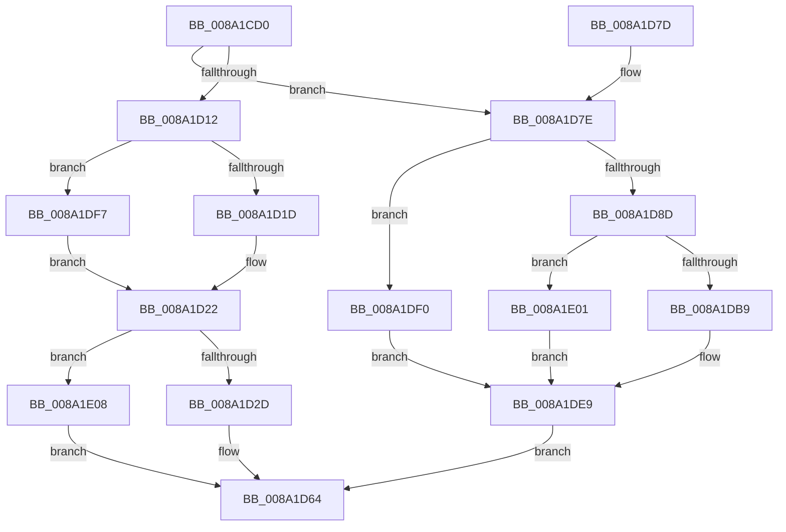

# FsRtlAllocateExtraCreateParameterFromLookasideList

- RVA: `0x008A1CD0`–`0x008A1E1A` (길이 `330` bytes)
- VA: `0x00000001408A1CD0`
- 실행 섹션: `PAGE`
- PDB 이름 있음: `예`; PDB Function 태그: `아니요`
- unwind 정보 RVA: `0x0007EC64`
- 디코드: `91`개 명령, `330/330` bytes 표시
- 미해석 바이트: `0` (있으면 어셈블리에 `.byte`로 보존)

> 이 문서는 커널 이미지의 기계어와 PDB 기호를 분석해 생성했습니다. 4번과 5번은 함수 원형과 자료형을 바이너리 사용 방식에서 추정한 C 해석이며 원본 소스 복구 결과는 아닙니다.

## 1. Dependencies

- 직접 호출 지점: **3**; 고유 호출 대상: **3**
- 직접 호출자로 확인된 함수: **2**
- RIP 상대 이미지 참조: **0**

### Outgoing calls
- `0x008A1D1D` → [ExAllocateFromPagedLookasideList](../../text/3F/ExAllocateFromPagedLookasideList_function_003FB730.md) (function, `0x003FB730`)
- `0x008A1DAF` → [ExAllocatePool2](../../poolcode/B8/ExAllocatePool2_function_00B820F0.md) (function, `0x00B820F0`)
- `0x008A1DF7` → [ExAllocateFromNPagedLookasideList](../../text/38/ExAllocateFromNPagedLookasideList_function_0038E6C0.md) (function, `0x0038E6C0`)

### Direct callers
- [IopSymlinkPropagateToExtensionIfNeeded](IopSymlinkPropagateToExtensionIfNeeded_function_008A1580.md) at `0x008A16D8`
- [IopSymlinkAllocateAndAddECP](IopSymlinkAllocateAndAddECP_function_008A1E20.md) at `0x008A1E7B`

### Static image references
- 디코드된 RIP-relative 메모리 참조가 없습니다.

## 2. Other-region calls and transfers

- 다른 실행 섹션으로 향하는 call: **3**
  - `0x008A1D1D` → [ExAllocateFromPagedLookasideList](../../text/3F/ExAllocateFromPagedLookasideList_function_003FB730.md) (`PAGE` → `.text`)
  - `0x008A1DAF` → [ExAllocatePool2](../../poolcode/B8/ExAllocatePool2_function_00B820F0.md) (`PAGE` → `POOLCODE`)
  - `0x008A1DF7` → [ExAllocateFromNPagedLookasideList](../../text/38/ExAllocateFromNPagedLookasideList_function_0038E6C0.md) (`PAGE` → `.text`)
- 별도 외부 분기/꼬리 이동을 확인하지 못했습니다.

## 3. Assembly (complete function range)

```asm
008A1CD0  48 89 5C 24 08                  mov qword ptr [rsp + 8], rbx
008A1CD5  48 89 6C 24 10                  mov qword ptr [rsp + 0x10], rbp
008A1CDA  48 89 74 24 18                  mov qword ptr [rsp + 0x18], rsi
008A1CDF  57                              push rdi
008A1CE0  41 56                           push r14
008A1CE2  41 57                           push r15
008A1CE4  48 83 EC 20                     sub rsp, 0x20
008A1CE8  48 8B 7C 24 60                  mov rdi, qword ptr [rsp + 0x60]
008A1CED  8D 6A 48                        lea ebp, [rdx + 0x48]
008A1CF0  41 8B D0                        mov edx, r8d
008A1CF3  BE 42 00 00 00                  mov esi, 0x42
008A1CF8  83 E2 02                        and edx, 2
008A1CFB  B8 02 00 00 00                  mov eax, 2
008A1D00  4D 8B F1                        mov r14, r9
008A1D03  4C 8B F9                        mov r15, rcx
008A1D06  44 8B 4F 28                     mov r9d, dword ptr [rdi + 0x28]
008A1D0A  0F 44 F0                        cmove esi, eax
008A1D0D  3B 6F 2C                        cmp ebp, dword ptr [rdi + 0x2c]
008A1D10  77 6C                           ja 0x1408a1d7e
008A1D12  48 8B CF                        mov rcx, rdi
008A1D15  85 D2                           test edx, edx
008A1D17  0F 85 DA 00 00 00               jne 0x1408a1df7
008A1D1D  E8 0E 9A B5 FF                  call 0x1403fb730
008A1D22  33 DB                           xor ebx, ebx
008A1D24  48 85 C0                        test rax, rax
008A1D27  0F 84 DB 00 00 00               je 0x1408a1e08
008A1D2D  48 C7 00 45 63 70 48            mov qword ptr [rax], 0x48706345
008A1D34  48 8D 48 48                     lea rcx, [rax + 0x48]
008A1D38  48 89 58 10                     mov qword ptr [rax + 0x10], rbx
008A1D3C  48 89 58 08                     mov qword ptr [rax + 8], rbx
008A1D40  41 0F 10 07                     movups xmm0, xmmword ptr [r15]
008A1D44  4C 89 70 28                     mov qword ptr [rax + 0x28], r14
008A1D48  89 70 30                        mov dword ptr [rax + 0x30], esi
008A1D4B  0F 11 40 18                     movups xmmword ptr [rax + 0x18], xmm0
008A1D4F  89 68 34                        mov dword ptr [rax + 0x34], ebp
008A1D52  48 89 78 38                     mov qword ptr [rax + 0x38], rdi
008A1D56  48 89 58 40                     mov qword ptr [rax + 0x40], rbx
008A1D5A  48 8B 44 24 68                  mov rax, qword ptr [rsp + 0x68]
008A1D5F  48 89 08                        mov qword ptr [rax], rcx
008A1D62  33 C0                           xor eax, eax
008A1D64  48 8B 5C 24 40                  mov rbx, qword ptr [rsp + 0x40]
008A1D69  48 8B 6C 24 48                  mov rbp, qword ptr [rsp + 0x48]
008A1D6E  48 8B 74 24 50                  mov rsi, qword ptr [rsp + 0x50]
008A1D73  48 83 C4 20                     add rsp, 0x20
008A1D77  41 5F                           pop r15
008A1D79  41 5E                           pop r14
008A1D7B  5F                              pop rdi
008A1D7C  C3                              ret
008A1D7D  CC                              int3
008A1D7E  48 8B 7C 24 68                  mov rdi, qword ptr [rsp + 0x68]
008A1D83  33 DB                           xor ebx, ebx
008A1D85  48 89 1F                        mov qword ptr [rdi], rbx
008A1D88  83 FD 48                        cmp ebp, 0x48
008A1D8B  72 63                           jb 0x1408a1df0
008A1D8D  85 D2                           test edx, edx
008A1D8F  B9 00 01 00 00                  mov ecx, 0x100
008A1D94  B8 40 00 00 00                  mov eax, 0x40
008A1D99  8B D5                           mov edx, ebp
008A1D9B  0F 44 C1                        cmove eax, ecx
008A1D9E  8B C8                           mov ecx, eax
008A1DA0  48 83 C9 01                     or rcx, 1
008A1DA4  41 F6 C0 01                     test r8b, 1
008A1DA8  45 8B C1                        mov r8d, r9d
008A1DAB  48 0F 44 C8                     cmove rcx, rax
008A1DAF  E8 3C 03 2E 00                  call 0x140b820f0
008A1DB4  48 85 C0                        test rax, rax
008A1DB7  74 48                           je 0x1408a1e01
008A1DB9  48 C7 00 45 63 70 48            mov qword ptr [rax], 0x48706345
008A1DC0  48 89 58 10                     mov qword ptr [rax + 0x10], rbx
008A1DC4  48 89 58 08                     mov qword ptr [rax + 8], rbx
008A1DC8  41 0F 10 07                     movups xmm0, xmmword ptr [r15]
008A1DCC  4C 89 70 28                     mov qword ptr [rax + 0x28], r14
008A1DD0  89 70 30                        mov dword ptr [rax + 0x30], esi
008A1DD3  0F 11 40 18                     movups xmmword ptr [rax + 0x18], xmm0
008A1DD7  89 68 34                        mov dword ptr [rax + 0x34], ebp
008A1DDA  48 89 58 38                     mov qword ptr [rax + 0x38], rbx
008A1DDE  48 89 58 40                     mov qword ptr [rax + 0x40], rbx
008A1DE2  48 83 C0 48                     add rax, 0x48
008A1DE6  48 89 07                        mov qword ptr [rdi], rax
008A1DE9  8B C3                           mov eax, ebx
008A1DEB  E9 74 FF FF FF                  jmp 0x1408a1d64
008A1DF0  BB 95 00 00 C0                  mov ebx, 0xc0000095
008A1DF5  EB F2                           jmp 0x1408a1de9
008A1DF7  E8 C4 C8 AE FF                  call 0x14038e6c0
008A1DFC  E9 21 FF FF FF                  jmp 0x1408a1d22
008A1E01  BB 9A 00 00 C0                  mov ebx, 0xc000009a
008A1E06  EB E1                           jmp 0x1408a1de9
008A1E08  48 8B 44 24 68                  mov rax, qword ptr [rsp + 0x68]
008A1E0D  48 89 18                        mov qword ptr [rax], rbx
008A1E10  B8 9A 00 00 C0                  mov eax, 0xc000009a
008A1E15  E9 4A FF FF FF                  jmp 0x1408a1d64
```

## 4. C-style interpretation (structured pseudocode)

```c
__int64 __fastcall FsRtlAllocateExtraCreateParameterFromLookasideList(__int64 a1, __int64 a2, int a3, __int64 a4, __int64 a5, __int64 a6)
{
    __int64 result;
    __int64 v_rbx;
    __int64 v_rsi;
    __int64 v_rsp;
    unsigned __int64 v_stack_p10;
    unsigned __int64 v_stack_p18;
    unsigned __int64 v_stack_p8;

    v_stack_p8 = v_rbx;
    v_stack_p10 = v_rbp;
    v_stack_p18 = v_rsi;
    v_rsp = (v_rsp) - (32);
    a2 = (unsigned int)(((unsigned int)(a3)) & (2));
    v_rsi = 66;
    if (condition_is_equal) { v_rsi = 2; }
    if (((unsigned int)(a2 + 72)) > (*(unsigned int *)(a5 + 44))) goto loc_008A1D7E;
    if ((unsigned int)(a2) != 0) goto loc_008A1DF7;
    result = ExAllocateFromPagedLookasideList(a5, a2, a3, (unsigned int)(*(unsigned int *)(a5 + 40)));
loc_008A1D22:
    v_rbx = 0;
    if (result == 0) goto loc_008A1E08;
    *(unsigned __int64 *)(result) = 0x48706345ULL;
    *(unsigned __int64 *)(result + 16) = 0;
    *(unsigned __int64 *)(result + 8) = 0;
    *(unsigned __int64 *)(result + 40) = a4;
    *(unsigned int *)(result + 48) = (unsigned int)(v_rsi);
    *(unsigned __int64 *)(result + 24) = v_xmm0;
    *(unsigned int *)(result + 52) = (unsigned int)(a2 + 72);
    *(unsigned __int64 *)(result + 56) = a5;
    *(unsigned __int64 *)(result + 64) = 0;
    *(unsigned __int64 *)(a6) = result + 72;
    result = 0;
loc_008A1D64:
    v_rsp = (v_rsp) + (32);
    return result;
loc_008A1D7E:
    v_rbx = 0;
    *(unsigned __int64 *)(a6) = 0;
    if (((unsigned int)(v_stack_p10)) < 72) goto loc_008A1DF0;
    result = 64;
    if ((unsigned int)(a2) == 0) { result = 256; }
    a1 = ((unsigned int)((unsigned int)(result))) | (1);
    if ((((unsigned __int8)(a3)) & (1)) == 0) { a1 = result; }
    result = ExAllocatePool2(a1, (unsigned int)((unsigned int)(v_stack_p10)), (unsigned int)((unsigned int)((unsigned int)(*(unsigned int *)(a5 + 40)))), (unsigned int)(*(unsigned int *)(a5 + 40)));
    if (result == 0) goto loc_008A1E01;
    *(unsigned __int64 *)(result) = 0x48706345ULL;
    *(unsigned __int64 *)(result + 16) = 0;
    *(unsigned __int64 *)(result + 8) = 0;
    *(unsigned __int64 *)(result + 40) = a4;
    *(unsigned int *)(result + 48) = (unsigned int)(v_stack_p18);
    *(unsigned __int64 *)(result + 24) = v_xmm0;
    *(unsigned int *)(result + 52) = (unsigned int)(v_stack_p10);
    *(unsigned __int64 *)(result + 56) = 0;
    *(unsigned __int64 *)(result + 64) = 0;
    result = (result) + (72);
    *(unsigned __int64 *)(a6) = result;
loc_008A1DE9:
    goto loc_008A1D64;
loc_008A1DF0:
    goto loc_008A1DE9;
loc_008A1DF7:
    result = ExAllocateFromNPagedLookasideList(a1, (unsigned int)((unsigned int)(v_stack_p10)), (unsigned int)((unsigned int)((unsigned int)(*(unsigned int *)(a5 + 40)))), (unsigned int)(*(unsigned int *)(a5 + 40)));
    goto loc_008A1D22;
loc_008A1E01:
    goto loc_008A1DE9;
loc_008A1E08:
    *(unsigned __int64 *)(a6) = (unsigned int)(0xC000009AULL);
    goto loc_008A1D64;
}
```

## 5. (Beta) C Style

```c
int64_t FsRtlAllocateExtraCreateParameterFromLookasideList(void *Arg1, void *Arg2, int32_t Arg3, int64_t Arg4, void *Arg5, void *Arg6)
{
    uint8_t *arg1 = (uint8_t *)Arg1;
    uint8_t *arg2 = (uint8_t *)Arg2;
    uint8_t *arg5 = (uint8_t *)Arg5;
    uint8_t *arg6 = (uint8_t *)Arg6;

    int64_t result;
    int64_t local_rbx;
    int64_t local_rsi;
    int64_t local_rsp;
    uint64_t v_stack_p10;
    uint64_t v_stack_p18;
    uint64_t v_stack_p8;

    v_stack_p8 = local_rbx;
    v_stack_p10 = local_rbp;
    v_stack_p18 = local_rsi;
    local_rsp = (local_rsp) - (32);
    Arg2 = (uint32_t)(((uint32_t)(Arg3)) & (2));
    local_rsi = 66;
    if (condition_is_equal) { local_rsi = 2; }
    if (((uint32_t)(Arg2 + 72)) > (*(uint32_t *)(arg5 + 0x2C))) goto loc_008A1D7E;
    if ((uint32_t)(Arg2) != 0) goto loc_008A1DF7;
    result = ExAllocateFromPagedLookasideList(Arg5, Arg2, Arg3, (uint32_t)(*(uint32_t *)(arg5 + 0x28)));
loc_008A1D22:
    local_rbx = 0;
    if (result == 0) goto loc_008A1E08;
    *(uint64_t *)(result) = 0x48706345ULL;
    *(uint64_t *)(result + 0x10) = 0;
    *(uint64_t *)(result + 0x8) = 0;
    *(uint64_t *)(result + 0x28) = Arg4;
    *(uint32_t *)(result + 0x30) = (uint32_t)(local_rsi);
    *(uint64_t *)(result + 0x18) = v_xmm0;
    *(uint32_t *)(result + 0x34) = (uint32_t)(Arg2 + 72);
    *(void **)(result + 0x38) = Arg5;
    *(uint64_t *)(result + 0x40) = 0;
    *(uint64_t *)(arg6) = result + 72;
    result = 0;
loc_008A1D64:
    local_rsp = (local_rsp) + (32);
    return result;
loc_008A1D7E:
    local_rbx = 0;
    *(uint64_t *)(arg6) = 0;
    if (((uint32_t)(v_stack_p10)) < 72) goto loc_008A1DF0;
    result = 64;
    if ((uint32_t)(Arg2) == 0) { result = 256; }
    Arg1 = ((uint32_t)((uint32_t)(result))) | (1);
    if ((((uint8_t)(Arg3)) & (1)) == 0) { Arg1 = result; }
    result = ExAllocatePool2(Arg1, (uint32_t)((uint32_t)(v_stack_p10)), (uint32_t)((uint32_t)((uint32_t)(*(uint32_t *)(arg5 + 0x28)))), (uint32_t)(*(uint32_t *)(arg5 + 0x28)));
    if (result == 0) goto loc_008A1E01;
    *(uint64_t *)(result) = 0x48706345ULL;
    *(uint64_t *)(result + 0x10) = 0;
    *(uint64_t *)(result + 0x8) = 0;
    *(uint64_t *)(result + 0x28) = Arg4;
    *(uint32_t *)(result + 0x30) = (uint32_t)(v_stack_p18);
    *(uint64_t *)(result + 0x18) = v_xmm0;
    *(uint32_t *)(result + 0x34) = (uint32_t)(v_stack_p10);
    *(uint64_t *)(result + 0x38) = 0;
    *(uint64_t *)(result + 0x40) = 0;
    result = (result) + (72);
    *(uint64_t *)(arg6) = result;
loc_008A1DE9:
    goto loc_008A1D64;
loc_008A1DF0:
    goto loc_008A1DE9;
loc_008A1DF7:
    result = ExAllocateFromNPagedLookasideList(Arg1, (uint32_t)((uint32_t)(v_stack_p10)), (uint32_t)((uint32_t)((uint32_t)(*(uint32_t *)(arg5 + 0x28)))), (uint32_t)(*(uint32_t *)(arg5 + 0x28)));
    goto loc_008A1D22;
loc_008A1E01:
    goto loc_008A1DE9;
loc_008A1E08:
    *(uint64_t *)(arg6) = (uint32_t)(0xC000009AULL);
    goto loc_008A1D64;
}
```

### 관측된 메모리 오프셋

구조체 형식이 확인되지 않은 접근은 인자 기준의 오프셋으로만 기록했습니다.

| 기준 인자 | 오프셋 표현 | 폭 (bit) | 접근 |
|---|---:|---:|---|
| `Arg1` | `+ 0x0` | `128` | `R` |
| `Arg2` | `+ 0x48` | `32` | `R` |
| `Arg5` | `+ 0x28` | `32` | `R` |
| `Arg5` | `+ 0x2C` | `32` | `R` |
| `Arg6` | `+ 0x0` | `64` | `W` |

## 6. Execution-region graph

[열기: 2D/3D 그래프와 함수 탐색 컨트롤 패널](../../../control-panel.html?section=page&rva=0x008A1CD0&view=graph)

- 2D 그래프는 위에서 아래로 흐르고, 3D 그래프는 빈 공간을 드래그해 회전합니다. Shift+드래그는 이동, 휠은 확대·축소, 함수 노드 선택은 대상 보고서 이동입니다.

### Static fallback


