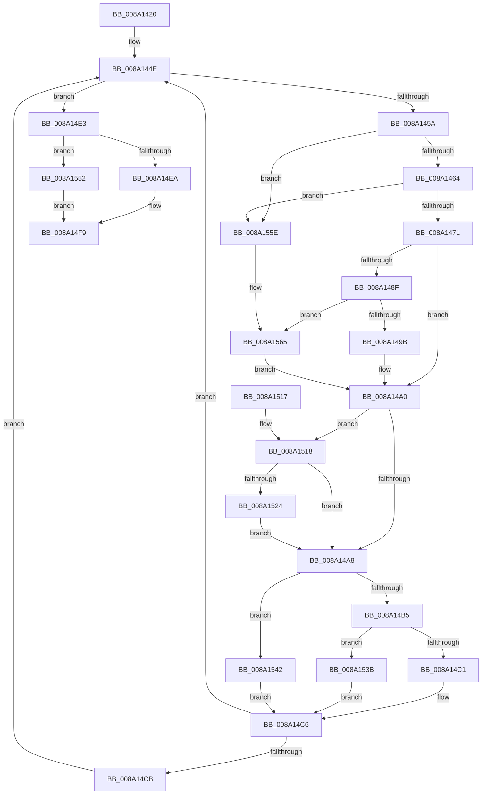

# FsRtlFreeExtraCreateParameterList

- RVA: `0x008A1420`–`0x008A1573` (길이 `339` bytes)
- VA: `0x00000001408A1420`
- 실행 섹션: `PAGE`
- PDB 이름 있음: `예`; PDB Function 태그: `아니요`
- unwind 정보 RVA: `0x0007EBD8`
- 디코드: `91`개 명령, `339/339` bytes 표시
- 미해석 바이트: `0` (있으면 어셈블리에 `.byte`로 보존)

> 이 문서는 커널 이미지의 기계어와 PDB 기호를 분석해 생성했습니다. 4번과 5번은 함수 원형과 자료형을 바이너리 사용 방식에서 추정한 C 해석이며 원본 소스 복구 결과는 아닙니다.

## 1. Dependencies

- 직접 호출 지점: **9**; 고유 호출 대상: **5**
- 직접 호출자로 확인된 함수: **4**
- RIP 상대 이미지 참조: **3**

### Outgoing calls
- `0x008A149B` → [IopSymlinkFreeRelatedMountPointChain](IopSymlinkFreeRelatedMountPointChain_function_008A1828.md) (function, `0x008A1828`)
- `0x008A14C1` → [ExFreeToPagedLookasideList](../../text/38/ExFreeToPagedLookasideList_function_00387D30.md) (function, `0x00387D30`)
- `0x008A14D9` → [guard_dispatch_icall](../../text/6B/guard_dispatch_icall_function_006BAAD0.md) (function, `0x006BAAD0`)
- `0x008A14F4` → [ExFreeToPagedLookasideList](../../text/38/ExFreeToPagedLookasideList_function_00387D30.md) (function, `0x00387D30`)
- `0x008A1531` → [guard_dispatch_icall](../../text/6B/guard_dispatch_icall_function_006BAAD0.md) (function, `0x006BAAD0`)
- `0x008A153B` → [ExFreeToNPagedLookasideList](../../text/38/ExFreeToNPagedLookasideList_function_0038D9D0.md) (function, `0x0038D9D0`)
- `0x008A1548` → [ExFreePoolWithTag](../../poolcode/B8/ExFreePoolWithTag_function_00B82870.md) (function, `0x00B82870`)
- `0x008A1557` → [ExFreePoolWithTag](../../poolcode/B8/ExFreePoolWithTag_function_00B82870.md) (function, `0x00B82870`)
- `0x008A1569` → [guard_dispatch_icall](../../text/6B/guard_dispatch_icall_function_006BAAD0.md) (function, `0x006BAAD0`)

### Direct callers
- [PspCreateUserProcessEcp](PspCreateUserProcessEcp_function_008A2288.md) at `0x008A236F`
- [IopCreateFile](IopCreateFile_function_008AB298.md) at `0x008AB825`
- [IopCreateFile](IopCreateFile_function_008AB298.md) at `0x008ABF96`
- [NtCreateUserProcess](../AE/NtCreateUserProcess_function_00AEA680.md) at `0x00AEB826`
- [sub_00B19BDE](../B1/Unknown_function_00B19BDE.md) at `0x00B19BEA`

### Static image references
- `0x008A143C` → RVA `0x008A2270` (`IopSymlinkCleanupECP`; read)
- `0x008A14CB` → RVA `0x00E65BF0` (`.data`; read)
- `0x008A14ED` → RVA `0x00E11D00` (`.data`; read)

## 2. Other-region calls and transfers

- 다른 실행 섹션으로 향하는 call: **8**
  - `0x008A14C1` → [ExFreeToPagedLookasideList](../../text/38/ExFreeToPagedLookasideList_function_00387D30.md) (`PAGE` → `.text`)
  - `0x008A14D9` → [guard_dispatch_icall](../../text/6B/guard_dispatch_icall_function_006BAAD0.md) (`PAGE` → `.text`)
  - `0x008A14F4` → [ExFreeToPagedLookasideList](../../text/38/ExFreeToPagedLookasideList_function_00387D30.md) (`PAGE` → `.text`)
  - `0x008A1531` → [guard_dispatch_icall](../../text/6B/guard_dispatch_icall_function_006BAAD0.md) (`PAGE` → `.text`)
  - `0x008A153B` → [ExFreeToNPagedLookasideList](../../text/38/ExFreeToNPagedLookasideList_function_0038D9D0.md) (`PAGE` → `.text`)
  - `0x008A1548` → [ExFreePoolWithTag](../../poolcode/B8/ExFreePoolWithTag_function_00B82870.md) (`PAGE` → `POOLCODE`)
  - `0x008A1557` → [ExFreePoolWithTag](../../poolcode/B8/ExFreePoolWithTag_function_00B82870.md) (`PAGE` → `POOLCODE`)
  - `0x008A1569` → [guard_dispatch_icall](../../text/6B/guard_dispatch_icall_function_006BAAD0.md) (`PAGE` → `.text`)
- 별도 외부 분기/꼬리 이동을 확인하지 못했습니다.

## 3. Assembly (complete function range)

```asm
008A1420  48 89 5C 24 20                  mov qword ptr [rsp + 0x20], rbx
008A1425  56                              push rsi
008A1426  41 54                           push r12
008A1428  41 57                           push r15
008A142A  48 83 EC 20                     sub rsp, 0x20
008A142E  48 89 6C 24 40                  mov qword ptr [rsp + 0x40], rbp
008A1433  48 8D 59 08                     lea rbx, [rcx + 8]
008A1437  48 89 7C 24 48                  mov qword ptr [rsp + 0x48], rdi
008A143C  4C 8D 25 2D 0E 00 00            lea r12, [rip + 0xe2d]
008A1443  4C 89 74 24 50                  mov qword ptr [rsp + 0x50], r14
008A1448  48 8B F1                        mov rsi, rcx
008A144B  45 33 FF                        xor r15d, r15d
008A144E  48 8B 03                        mov rax, qword ptr [rbx]
008A1451  48 3B C3                        cmp rax, rbx
008A1454  0F 84 89 00 00 00               je 0x1408a14e3
008A145A  48 39 58 08                     cmp qword ptr [rax + 8], rbx
008A145E  0F 85 FA 00 00 00               jne 0x1408a155e
008A1464  48 8B 08                        mov rcx, qword ptr [rax]
008A1467  48 39 41 08                     cmp qword ptr [rcx + 8], rax
008A146B  0F 85 ED 00 00 00               jne 0x1408a155e
008A1471  48 89 0B                        mov qword ptr [rbx], rcx
008A1474  4C 8D 70 40                     lea r14, [rax + 0x40]
008A1478  48 89 59 08                     mov qword ptr [rcx + 8], rbx
008A147C  49 8B EF                        mov rbp, r15
008A147F  4C 89 78 08                     mov qword ptr [rax + 8], r15
008A1483  4C 89 38                        mov qword ptr [rax], r15
008A1486  49 8B 46 E0                     mov rax, qword ptr [r14 - 0x20]
008A148A  48 85 C0                        test rax, rax
008A148D  74 11                           je 0x1408a14a0
008A148F  49 8B CE                        mov rcx, r14
008A1492  49 3B C4                        cmp rax, r12
008A1495  0F 85 CA 00 00 00               jne 0x1408a1565
008A149B  E8 88 03 00 00                  call 0x1408a1828
008A14A0  41 8B 46 E8                     mov eax, dword ptr [r14 - 0x18]
008A14A4  A8 20                           test al, 0x20
008A14A6  75 70                           jne 0x1408a1518
008A14A8  49 8B 4E F0                     mov rcx, qword ptr [r14 - 0x10]
008A14AC  48 85 C9                        test rcx, rcx
008A14AF  0F 84 8D 00 00 00               je 0x1408a1542
008A14B5  41 8B 46 E8                     mov eax, dword ptr [r14 - 0x18]
008A14B9  49 8D 56 B8                     lea rdx, [r14 - 0x48]
008A14BD  A8 40                           test al, 0x40
008A14BF  75 7A                           jne 0x1408a153b
008A14C1  E8 6A 68 AE FF                  call 0x140387d30
008A14C6  48 85 ED                        test rbp, rbp
008A14C9  74 83                           je 0x1408a144e
008A14CB  48 8B 05 1E 47 5C 00            mov rax, qword ptr [rip + 0x5c471e]
008A14D2  48 8B CD                        mov rcx, rbp
008A14D5  48 8B 40 08                     mov rax, qword ptr [rax + 8]
008A14D9  E8 F2 95 E1 FF                  call 0x1406baad0
008A14DE  E9 6B FF FF FF                  jmp 0x1408a144e
008A14E3  8B 46 04                        mov eax, dword ptr [rsi + 4]
008A14E6  A8 04                           test al, 4
008A14E8  74 68                           je 0x1408a1552
008A14EA  48 8B D6                        mov rdx, rsi
008A14ED  48 8D 0D 0C 08 57 00            lea rcx, [rip + 0x57080c]
008A14F4  E8 37 68 AE FF                  call 0x140387d30
008A14F9  4C 8B 74 24 50                  mov r14, qword ptr [rsp + 0x50]
008A14FE  48 8B 7C 24 48                  mov rdi, qword ptr [rsp + 0x48]
008A1503  48 8B 6C 24 40                  mov rbp, qword ptr [rsp + 0x40]
008A1508  48 8B 5C 24 58                  mov rbx, qword ptr [rsp + 0x58]
008A150D  48 83 C4 20                     add rsp, 0x20
008A1511  41 5F                           pop r15
008A1513  41 5C                           pop r12
008A1515  5E                              pop rsi
008A1516  C3                              ret
008A1517  CC                              int3
008A1518  48 8B 05 D1 46 5C 00            mov rax, qword ptr [rip + 0x5c46d1]
008A151F  48 85 C0                        test rax, rax
008A1522  74 84                           je 0x1408a14a8
008A1524  49 8B 6E F8                     mov rbp, qword ptr [r14 - 8]
008A1528  49 8B D6                        mov rdx, r14
008A152B  48 8B 00                        mov rax, qword ptr [rax]
008A152E  48 8B CD                        mov rcx, rbp
008A1531  E8 9A 95 E1 FF                  call 0x1406baad0
008A1536  E9 6D FF FF FF                  jmp 0x1408a14a8
008A153B  E8 90 C4 AE FF                  call 0x14038d9d0
008A1540  EB 84                           jmp 0x1408a14c6
008A1542  33 D2                           xor edx, edx
008A1544  49 8D 4E B8                     lea rcx, [r14 - 0x48]
008A1548  E8 23 13 2E 00                  call 0x140b82870
008A154D  E9 74 FF FF FF                  jmp 0x1408a14c6
008A1552  33 D2                           xor edx, edx
008A1554  48 8B CE                        mov rcx, rsi
008A1557  E8 14 13 2E 00                  call 0x140b82870
008A155C  EB 9B                           jmp 0x1408a14f9
008A155E  B9 03 00 00 00                  mov ecx, 3
008A1563  CD 29                           int 0x29
008A1565  49 8D 56 D0                     lea rdx, [r14 - 0x30]
008A1569  E8 62 95 E1 FF                  call 0x1406baad0
008A156E  E9 2D FF FF FF                  jmp 0x1408a14a0
```

## 4. C-style interpretation (structured pseudocode)

```c
__int64 __fastcall FsRtlFreeExtraCreateParameterList(__int64 a1)
{
    __int64 result;
    __int64 v_r15;
    __int64 v_rsp;
    unsigned __int64 v_stack_p10;
    unsigned __int64 v_stack_p18;
    unsigned __int64 v_stack_p20;
    unsigned __int64 v_stack_p8;

    v_stack_p20 = v_rbx;
    v_rsp = (v_rsp) - (32);
    v_stack_p8 = v_rbp;
    v_stack_p10 = v_rdi;
    v_stack_p18 = v_r14;
    v_r15 = 0;
loc_008A144E:
    if ((*(unsigned __int64 *)(a1 + 8)) == (a1 + 8)) goto loc_008A14E3;
    if ((*(unsigned __int64 *)(*(unsigned __int64 *)(a1 + 8) + 8)) != (a1 + 8)) goto loc_008A155E;
    if ((*(unsigned __int64 *)(*(unsigned __int64 *)(*(unsigned __int64 *)(a1 + 8)) + 8)) != (*(unsigned __int64 *)(a1 + 8))) goto loc_008A155E;
    *(unsigned __int64 *)(a1 + 8) = *(unsigned __int64 *)(*(unsigned __int64 *)(a1 + 8));
    *(unsigned __int64 *)(*(unsigned __int64 *)(*(unsigned __int64 *)(a1 + 8)) + 8) = a1 + 8;
    *(unsigned __int64 *)(*(unsigned __int64 *)(a1 + 8) + 8) = 0;
    *(unsigned __int64 *)(*(unsigned __int64 *)(a1 + 8)) = 0;
    if (*(unsigned __int64 *)(*(unsigned __int64 *)(a1 + 8) + 64 - 32) == 0) goto loc_008A14A0;
    if ((*(unsigned __int64 *)(*(unsigned __int64 *)(a1 + 8) + 64 - 32)) != (v_rip + 3629)) goto loc_008A1565;
    result = IopSymlinkFreeRelatedMountPointChain(*(unsigned __int64 *)(a1 + 8) + 64, a2, a3, a4);
loc_008A14A0:
    if ((((unsigned __int8)((unsigned int)(*(unsigned int *)(*(unsigned __int64 *)(a1 + 8) + 64 - 24)))) & (32)) != 0) goto loc_008A1518;
loc_008A14A8:
    if (*(unsigned __int64 *)(*(unsigned __int64 *)(a1 + 8) + 64 - 16) == 0) goto loc_008A1542;
    if ((((unsigned __int8)((unsigned int)(*(unsigned int *)(*(unsigned __int64 *)(a1 + 8) + 64 - 24)))) & (64)) != 0) goto loc_008A153B;
    result = ExFreeToPagedLookasideList(*(unsigned __int64 *)(*(unsigned __int64 *)(a1 + 8) + 64 - 16), *(unsigned __int64 *)(a1 + 8) + 64 - 72, a3, a4);
loc_008A14C6:
    if (0 == 0) goto loc_008A144E;
    result = guard_dispatch_icall(0, *(unsigned __int64 *)(a1 + 8) + 64 - 72, a3, a4);
    goto loc_008A144E;
loc_008A14E3:
    if ((((unsigned __int8)((unsigned int)(*(unsigned int *)(a1 + 4)))) & (4)) == 0) goto loc_008A1552;
    result = ExFreeToPagedLookasideList(v_rip + 5703692, a1, a3, a4);
loc_008A14F9:
    v_rsp = (v_rsp) + (32);
    return result;
loc_008A1518:
    if (*(unsigned __int64 *)(v_rip + 6047441) == 0) goto loc_008A14A8;
    result = guard_dispatch_icall(*(unsigned __int64 *)(v_stack_p18 - 8), v_stack_p18, a3, a4);
    goto loc_008A14A8;
loc_008A153B:
    result = ExFreeToNPagedLookasideList(*(unsigned __int64 *)(v_stack_p18 - 8), v_stack_p18, a3, a4);
    goto loc_008A14C6;
loc_008A1542:
    a2 = 0;
    result = ExFreePoolWithTag(v_stack_p18 - 72, a2, a3, a4);
    goto loc_008A14C6;
loc_008A1552:
    a2 = 0;
    result = ExFreePoolWithTag(a1, a2, a3, a4);
    goto loc_008A14F9;
loc_008A155E:
loc_008A1565:
    result = guard_dispatch_icall(3, v_stack_p18 - 48, a3, a4);
    goto loc_008A14A0;
}
```

## 5. (Beta) C Style

```c
int64_t FsRtlFreeExtraCreateParameterList(void *Arg1)
{
    uint8_t *arg1 = (uint8_t *)Arg1;

    int64_t result;
    int64_t local_r15;
    int64_t local_rsp;
    uint64_t v_stack_p10;
    uint64_t v_stack_p18;
    uint64_t v_stack_p20;
    uint64_t v_stack_p8;

    v_stack_p20 = local_rbx;
    local_rsp = (local_rsp) - (32);
    v_stack_p8 = local_rbp;
    v_stack_p10 = local_rdi;
    v_stack_p18 = local_r14;
    local_r15 = 0;
loc_008A144E:
    if ((*(uint64_t *)(arg1 + 0x8)) == (Arg1 + 8)) goto loc_008A14E3;
    if ((*(uint64_t *)(*(uint64_t *)(arg1 + 0x8) + 0x8)) != (Arg1 + 8)) goto loc_008A155E;
    if ((*(uint64_t *)(*(uint64_t *)(*(uint64_t *)(arg1 + 0x8)) + 0x8)) != (*(uint64_t *)(arg1 + 0x8))) goto loc_008A155E;
    *(uint64_t *)(arg1 + 0x8) = *(uint64_t *)(*(uint64_t *)(arg1 + 0x8));
    *(void **)(*(uint64_t *)(*(uint64_t *)(arg1 + 0x8)) + 0x8) = Arg1 + 8;
    *(uint64_t *)(*(uint64_t *)(arg1 + 0x8) + 0x8) = 0;
    *(uint64_t *)(*(uint64_t *)(arg1 + 0x8)) = 0;
    if (*(uint64_t *)(*(uint64_t *)(arg1 + 0x8) + 0x40 - 0x20) == 0) goto loc_008A14A0;
    if ((*(uint64_t *)(*(uint64_t *)(arg1 + 0x8) + 0x40 - 0x20)) != (v_rip + 3629)) goto loc_008A1565;
    result = IopSymlinkFreeRelatedMountPointChain(*(uint64_t *)(arg1 + 0x8) + 64, a2, a3, a4);
loc_008A14A0:
    if ((((uint8_t)((uint32_t)(*(uint32_t *)(*(uint64_t *)(arg1 + 0x8) + 0x40 - 0x18)))) & (32)) != 0) goto loc_008A1518;
loc_008A14A8:
    if (*(uint64_t *)(*(uint64_t *)(arg1 + 0x8) + 0x40 - 0x10) == 0) goto loc_008A1542;
    if ((((uint8_t)((uint32_t)(*(uint32_t *)(*(uint64_t *)(arg1 + 0x8) + 0x40 - 0x18)))) & (64)) != 0) goto loc_008A153B;
    result = ExFreeToPagedLookasideList(*(uint64_t *)(*(uint64_t *)(arg1 + 0x8) + 0x40 - 0x10), *(uint64_t *)(arg1 + 0x8) + 64 - 72, a3, a4);
loc_008A14C6:
    if (0 == 0) goto loc_008A144E;
    result = guard_dispatch_icall(0, *(uint64_t *)(arg1 + 0x8) + 64 - 72, a3, a4);
    goto loc_008A144E;
loc_008A14E3:
    if ((((uint8_t)((uint32_t)(*(uint32_t *)(arg1 + 0x4)))) & (4)) == 0) goto loc_008A1552;
    result = ExFreeToPagedLookasideList(v_rip + 5703692, Arg1, a3, a4);
loc_008A14F9:
    local_rsp = (local_rsp) + (32);
    return result;
loc_008A1518:
    if (*(uint64_t *)(v_rip + 0x5C46D1) == 0) goto loc_008A14A8;
    result = guard_dispatch_icall(*(uint64_t *)(v_stack_p18 - 0x8), v_stack_p18, a3, a4);
    goto loc_008A14A8;
loc_008A153B:
    result = ExFreeToNPagedLookasideList(*(uint64_t *)(v_stack_p18 - 0x8), v_stack_p18, a3, a4);
    goto loc_008A14C6;
loc_008A1542:
    a2 = 0;
    result = ExFreePoolWithTag(v_stack_p18 - 72, a2, a3, a4);
    goto loc_008A14C6;
loc_008A1552:
    a2 = 0;
    result = ExFreePoolWithTag(Arg1, a2, a3, a4);
    goto loc_008A14F9;
loc_008A155E:
loc_008A1565:
    result = guard_dispatch_icall(3, v_stack_p18 - 48, a3, a4);
    goto loc_008A14A0;
}
```

### 관측된 메모리 오프셋

구조체 형식이 확인되지 않은 접근은 인자 기준의 오프셋으로만 기록했습니다.

| 기준 인자 | 오프셋 표현 | 폭 (bit) | 접근 |
|---|---:|---:|---|
| `Arg1` | `+ 0x0` | `64` | `R` |
| `Arg1` | `+ 0x0` | `64` | `W` |
| `Arg1` | `+ 0x4` | `32` | `R` |
| `Arg1` | `+ 0x8` | `64` | `R` |

## 6. Execution-region graph

[열기: 2D/3D 그래프와 함수 탐색 컨트롤 패널](../../../control-panel.html?section=page&rva=0x008A1420&view=graph)

- 2D 그래프는 위에서 아래로 흐르고, 3D 그래프는 빈 공간을 드래그해 회전합니다. Shift+드래그는 이동, 휠은 확대·축소, 함수 노드 선택은 대상 보고서 이동입니다.

### Static fallback


