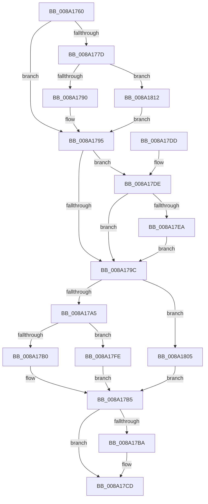

# FsRtlFreeExtraCreateParameter

- RVA: `0x008A1760`–`0x008A1820` (길이 `192` bytes)
- VA: `0x00000001408A1760`
- 실행 섹션: `PAGE`
- PDB 이름 있음: `예`; PDB Function 태그: `아니요`
- unwind 정보 RVA: `0x00065734`
- 디코드: `55`개 명령, `192/192` bytes 표시
- 미해석 바이트: `0` (있으면 어셈블리에 `.byte`로 보존)

> 이 문서는 커널 이미지의 기계어와 PDB 기호를 분석해 생성했습니다. 4번과 5번은 함수 원형과 자료형을 바이너리 사용 방식에서 추정한 C 해석이며 원본 소스 복구 결과는 아닙니다.

## 1. Dependencies

- 직접 호출 지점: **7**; 고유 호출 대상: **5**
- 직접 호출자로 확인된 함수: **9**
- RIP 상대 이미지 참조: **2**

### Outgoing calls
- `0x008A1790` → [IopSymlinkFreeRelatedMountPointChain](IopSymlinkFreeRelatedMountPointChain_function_008A1828.md) (function, `0x008A1828`)
- `0x008A17B0` → [ExFreeToPagedLookasideList](../../text/38/ExFreeToPagedLookasideList_function_00387D30.md) (function, `0x00387D30`)
- `0x008A17C8` → [guard_dispatch_icall](../../text/6B/guard_dispatch_icall_function_006BAAD0.md) (function, `0x006BAAD0`)
- `0x008A17F7` → [guard_dispatch_icall](../../text/6B/guard_dispatch_icall_function_006BAAD0.md) (function, `0x006BAAD0`)
- `0x008A17FE` → [ExFreeToNPagedLookasideList](../../text/38/ExFreeToNPagedLookasideList_function_0038D9D0.md) (function, `0x0038D9D0`)
- `0x008A180B` → [ExFreePoolWithTag](../../poolcode/B8/ExFreePoolWithTag_function_00B82870.md) (function, `0x00B82870`)
- `0x008A1816` → [guard_dispatch_icall](../../text/6B/guard_dispatch_icall_function_006BAAD0.md) (function, `0x006BAAD0`)

### Direct callers
- [sub_0038C58B](../../text/38/Unknown_function_0038C58B.md) at `0x0038C7BD`
- [sub_0041DE4F](../../text/41/Unknown_function_0041DE4F.md) at `0x0041DE97`
- [sub_008A134D](Unknown_function_008A134D.md) at `0x008A13B7`
- [IopSymlinkPropagateToExtensionIfNeeded](IopSymlinkPropagateToExtensionIfNeeded_function_008A1580.md) at `0x008A15E9`
- [IopSymlinkAllocateAndAddECP](IopSymlinkAllocateAndAddECP_function_008A1E20.md) at `0x008A1F0F`
- [IopSymlinkUpdateECP](IopSymlinkUpdateECP_function_008A20CC.md) at `0x008A21F6`
- [IopSymlinkUpdateECP](IopSymlinkUpdateECP_function_008A20CC.md) at `0x008A2208`
- [PspCreateUserProcessEcp](PspCreateUserProcessEcp_function_008A2288.md) at `0x008A23AD`
- [IopCreateFile](IopCreateFile_function_008AB298.md) at `0x008ABF6E`
- [sub_00B39C68](../B3/Unknown_function_00B39C68.md) at `0x00B39EFE`

### Static image references
- `0x008A177D` → RVA `0x008A2270` (`IopSymlinkCleanupECP`; read)
- `0x008A17BA` → RVA `0x00E65BF0` (`.data`; read)

## 2. Other-region calls and transfers

- 다른 실행 섹션으로 향하는 call: **6**
  - `0x008A17B0` → [ExFreeToPagedLookasideList](../../text/38/ExFreeToPagedLookasideList_function_00387D30.md) (`PAGE` → `.text`)
  - `0x008A17C8` → [guard_dispatch_icall](../../text/6B/guard_dispatch_icall_function_006BAAD0.md) (`PAGE` → `.text`)
  - `0x008A17F7` → [guard_dispatch_icall](../../text/6B/guard_dispatch_icall_function_006BAAD0.md) (`PAGE` → `.text`)
  - `0x008A17FE` → [ExFreeToNPagedLookasideList](../../text/38/ExFreeToNPagedLookasideList_function_0038D9D0.md) (`PAGE` → `.text`)
  - `0x008A180B` → [ExFreePoolWithTag](../../poolcode/B8/ExFreePoolWithTag_function_00B82870.md) (`PAGE` → `POOLCODE`)
  - `0x008A1816` → [guard_dispatch_icall](../../text/6B/guard_dispatch_icall_function_006BAAD0.md) (`PAGE` → `.text`)
- 별도 외부 분기/꼬리 이동을 확인하지 못했습니다.

## 3. Assembly (complete function range)

```asm
008A1760  48 89 5C 24 08                  mov qword ptr [rsp + 8], rbx
008A1765  48 89 74 24 10                  mov qword ptr [rsp + 0x10], rsi
008A176A  57                              push rdi
008A176B  48 83 EC 20                     sub rsp, 0x20
008A176F  48 8B 41 E0                     mov rax, qword ptr [rcx - 0x20]
008A1773  33 FF                           xor edi, edi
008A1775  48 8B F1                        mov rsi, rcx
008A1778  48 85 C0                        test rax, rax
008A177B  74 18                           je 0x1408a1795
008A177D  48 8D 0D EC 0A 00 00            lea rcx, [rip + 0xaec]
008A1784  48 3B C1                        cmp rax, rcx
008A1787  48 8B CE                        mov rcx, rsi
008A178A  0F 85 82 00 00 00               jne 0x1408a1812
008A1790  E8 93 00 00 00                  call 0x1408a1828
008A1795  8B 46 E8                        mov eax, dword ptr [rsi - 0x18]
008A1798  A8 20                           test al, 0x20
008A179A  75 42                           jne 0x1408a17de
008A179C  48 8B 4E F0                     mov rcx, qword ptr [rsi - 0x10]
008A17A0  48 85 C9                        test rcx, rcx
008A17A3  74 60                           je 0x1408a1805
008A17A5  8B 46 E8                        mov eax, dword ptr [rsi - 0x18]
008A17A8  48 8D 56 B8                     lea rdx, [rsi - 0x48]
008A17AC  A8 40                           test al, 0x40
008A17AE  75 4E                           jne 0x1408a17fe
008A17B0  E8 7B 65 AE FF                  call 0x140387d30
008A17B5  48 85 FF                        test rdi, rdi
008A17B8  74 13                           je 0x1408a17cd
008A17BA  48 8B 05 2F 44 5C 00            mov rax, qword ptr [rip + 0x5c442f]
008A17C1  48 8B CF                        mov rcx, rdi
008A17C4  48 8B 40 08                     mov rax, qword ptr [rax + 8]
008A17C8  E8 03 93 E1 FF                  call 0x1406baad0
008A17CD  48 8B 5C 24 30                  mov rbx, qword ptr [rsp + 0x30]
008A17D2  48 8B 74 24 38                  mov rsi, qword ptr [rsp + 0x38]
008A17D7  48 83 C4 20                     add rsp, 0x20
008A17DB  5F                              pop rdi
008A17DC  C3                              ret
008A17DD  CC                              int3
008A17DE  48 8B 05 0B 44 5C 00            mov rax, qword ptr [rip + 0x5c440b]
008A17E5  48 85 C0                        test rax, rax
008A17E8  74 B2                           je 0x1408a179c
008A17EA  48 8B 7E F8                     mov rdi, qword ptr [rsi - 8]
008A17EE  48 8B D6                        mov rdx, rsi
008A17F1  48 8B 00                        mov rax, qword ptr [rax]
008A17F4  48 8B CF                        mov rcx, rdi
008A17F7  E8 D4 92 E1 FF                  call 0x1406baad0
008A17FC  EB 9E                           jmp 0x1408a179c
008A17FE  E8 CD C1 AE FF                  call 0x14038d9d0
008A1803  EB B0                           jmp 0x1408a17b5
008A1805  33 D2                           xor edx, edx
008A1807  48 8D 4E B8                     lea rcx, [rsi - 0x48]
008A180B  E8 60 10 2E 00                  call 0x140b82870
008A1810  EB A3                           jmp 0x1408a17b5
008A1812  48 8D 56 D0                     lea rdx, [rsi - 0x30]
008A1816  E8 B5 92 E1 FF                  call 0x1406baad0
008A181B  E9 75 FF FF FF                  jmp 0x1408a1795
```

## 4. C-style interpretation (structured pseudocode)

```c
__int64 __fastcall FsRtlFreeExtraCreateParameter(__int64 a1)
{
    __int64 result;
    __int64 v_rdi;
    __int64 v_rsp;
    unsigned __int64 v_stack_p10;
    unsigned __int64 v_stack_p8;

    v_stack_p8 = v_rbx;
    v_stack_p10 = v_rsi;
    v_rsp = (v_rsp) - (32);
    v_rdi = 0;
    if (*(unsigned __int64 *)(a1 - 32) == 0) goto loc_008A1795;
    if ((*(unsigned __int64 *)(a1 - 32)) != (v_rip + 2796)) goto loc_008A1812;
    result = IopSymlinkFreeRelatedMountPointChain(a1, a2, a3, a4);
loc_008A1795:
    if ((((unsigned __int8)((unsigned int)(*(unsigned int *)(a1 - 24)))) & (32)) != 0) goto loc_008A17DE;
loc_008A179C:
    if (*(unsigned __int64 *)(a1 - 16) == 0) goto loc_008A1805;
    if ((((unsigned __int8)((unsigned int)(*(unsigned int *)(a1 - 24)))) & (64)) != 0) goto loc_008A17FE;
    result = ExFreeToPagedLookasideList(*(unsigned __int64 *)(a1 - 16), a1 - 72, a3, a4);
loc_008A17B5:
    if (0 != 0) {
        result = *(unsigned __int64 *)(v_rip + 6046767);
        a1 = 0;
        result = *(unsigned __int64 *)(result + 8);
        result = guard_dispatch_icall(a1, a1 - 72, a3, a4);
    }
    v_rsp = (v_rsp) + (32);
    return result;
loc_008A17DE:
    if (*(unsigned __int64 *)(v_rip + 6046731) == 0) goto loc_008A179C;
    result = guard_dispatch_icall(*(unsigned __int64 *)(v_stack_p10 - 8), v_stack_p10, a3, a4);
    goto loc_008A179C;
loc_008A17FE:
    result = ExFreeToNPagedLookasideList(*(unsigned __int64 *)(v_stack_p10 - 8), v_stack_p10, a3, a4);
    goto loc_008A17B5;
loc_008A1805:
    a2 = 0;
    result = ExFreePoolWithTag(v_stack_p10 - 72, a2, a3, a4);
    goto loc_008A17B5;
loc_008A1812:
    result = guard_dispatch_icall(v_stack_p10 - 72, v_stack_p10 - 48, a3, a4);
    goto loc_008A1795;
}
```

## 5. (Beta) C Style

```c
int64_t FsRtlFreeExtraCreateParameter(void *Arg1)
{
    uint8_t *arg1 = (uint8_t *)Arg1;

    int64_t result;
    int64_t local_rdi;
    int64_t local_rsp;
    uint64_t v_stack_p10;
    uint64_t v_stack_p8;

    v_stack_p8 = local_rbx;
    v_stack_p10 = local_rsi;
    local_rsp = (local_rsp) - (32);
    local_rdi = 0;
    if (*(uint64_t *)(arg1 - 0x20) == 0) goto loc_008A1795;
    if ((*(uint64_t *)(arg1 - 0x20)) != (v_rip + 2796)) goto loc_008A1812;
    result = IopSymlinkFreeRelatedMountPointChain(Arg1, a2, a3, a4);
loc_008A1795:
    if ((((uint8_t)((uint32_t)(*(uint32_t *)(arg1 - 0x18)))) & (32)) != 0) goto loc_008A17DE;
loc_008A179C:
    if (*(uint64_t *)(arg1 - 0x10) == 0) goto loc_008A1805;
    if ((((uint8_t)((uint32_t)(*(uint32_t *)(arg1 - 0x18)))) & (64)) != 0) goto loc_008A17FE;
    result = ExFreeToPagedLookasideList(*(uint64_t *)(arg1 - 0x10), Arg1 - 72, a3, a4);
loc_008A17B5:
    if (0 != 0) {
        result = *(uint64_t *)(v_rip + 0x5C442F);
        Arg1 = 0;
        result = *(uint64_t *)(result + 0x8);
        result = guard_dispatch_icall(Arg1, Arg1 - 72, a3, a4);
    }
    local_rsp = (local_rsp) + (32);
    return result;
loc_008A17DE:
    if (*(uint64_t *)(v_rip + 0x5C440B) == 0) goto loc_008A179C;
    result = guard_dispatch_icall(*(uint64_t *)(v_stack_p10 - 0x8), v_stack_p10, a3, a4);
    goto loc_008A179C;
loc_008A17FE:
    result = ExFreeToNPagedLookasideList(*(uint64_t *)(v_stack_p10 - 0x8), v_stack_p10, a3, a4);
    goto loc_008A17B5;
loc_008A1805:
    a2 = 0;
    result = ExFreePoolWithTag(v_stack_p10 - 72, a2, a3, a4);
    goto loc_008A17B5;
loc_008A1812:
    result = guard_dispatch_icall(v_stack_p10 - 72, v_stack_p10 - 48, a3, a4);
    goto loc_008A1795;
}
```

### 관측된 메모리 오프셋

구조체 형식이 확인되지 않은 접근은 인자 기준의 오프셋으로만 기록했습니다.

| 기준 인자 | 오프셋 표현 | 폭 (bit) | 접근 |
|---|---:|---:|---|
| `Arg1` | `- 0x48` | `64` | `R` |
| `Arg1` | `- 0x30` | `64` | `R` |
| `Arg1` | `- 0x20` | `64` | `R` |
| `Arg1` | `- 0x18` | `32` | `R` |
| `Arg1` | `- 0x10` | `64` | `R` |
| `Arg1` | `- 0x8` | `64` | `R` |

## 6. Execution-region graph

[열기: 2D/3D 그래프와 함수 탐색 컨트롤 패널](../../../control-panel.html?section=page&rva=0x008A1760&view=graph)

- 2D 그래프는 위에서 아래로 흐르고, 3D 그래프는 빈 공간을 드래그해 회전합니다. Shift+드래그는 이동, 휠은 확대·축소, 함수 노드 선택은 대상 보고서 이동입니다.

### Static fallback


