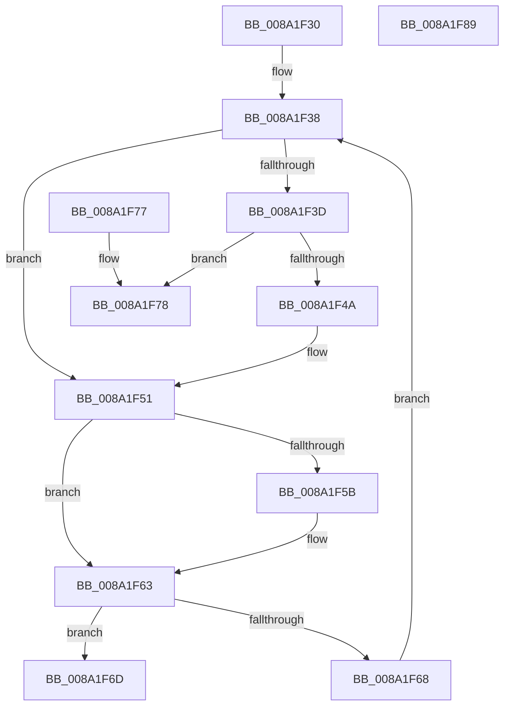

# FsRtlInsertExtraCreateParameter

- RVA: `0x008A1F30`–`0x008A1F8A` (길이 `90` bytes)
- VA: `0x00000001408A1F30`
- 실행 섹션: `PAGE`
- PDB 이름 있음: `예`; PDB Function 태그: `아니요`
- unwind 정보 RVA: `0x000DB714`
- 디코드: `30`개 명령, `90/90` bytes 표시
- 미해석 바이트: `0` (있으면 어셈블리에 `.byte`로 보존)

> 이 문서는 커널 이미지의 기계어와 PDB 기호를 분석해 생성했습니다. 4번과 5번은 함수 원형과 자료형을 바이너리 사용 방식에서 추정한 C 해석이며 원본 소스 복구 결과는 아닙니다.

## 1. Dependencies

- 직접 호출 지점: **0**; 고유 호출 대상: **0**
- 직접 호출자로 확인된 함수: **4**
- RIP 상대 이미지 참조: **0**

### Outgoing calls
- 직접 디코드된 call 명령이 없습니다.

### Direct callers
- [IopSymlinkAllocateAndAddECP](IopSymlinkAllocateAndAddECP_function_008A1E20.md) at `0x008A1E91`
- [PspCreateUserProcessEcp](PspCreateUserProcessEcp_function_008A2288.md) at `0x008A235B`
- [sub_00B19FF6](../B1/Unknown_function_00B19FF6.md) at `0x00B1A37A`
- [sub_00B3BD22](../B3/Unknown_function_00B3BD22.md) at `0x00B3BD7B`

### Static image references
- 디코드된 RIP-relative 메모리 참조가 없습니다.

## 2. Other-region calls and transfers

- 다른 실행 섹션으로 향하는 call: **0**
- 별도 외부 분기/꼬리 이동을 확인하지 못했습니다.

## 3. Assembly (complete function range)

```asm
008A1F30  48 8B 41 08                     mov rax, qword ptr [rcx + 8]
008A1F34  4C 8D 41 08                     lea r8, [rcx + 8]
008A1F38  49 3B C0                        cmp rax, r8
008A1F3B  75 14                           jne 0x1408a1f51
008A1F3D  49 8B 40 08                     mov rax, qword ptr [r8 + 8]
008A1F41  48 83 C2 C0                     add rdx, -0x40
008A1F45  4C 39 00                        cmp qword ptr [rax], r8
008A1F48  74 2E                           je 0x1408a1f78
008A1F4A  B9 03 00 00 00                  mov ecx, 3
008A1F4F  CD 29                           int 0x29
008A1F51  4C 8B 48 10                     mov r9, qword ptr [rax + 0x10]
008A1F55  4C 2B 4A D0                     sub r9, qword ptr [rdx - 0x30]
008A1F59  75 08                           jne 0x1408a1f63
008A1F5B  4C 8B 48 18                     mov r9, qword ptr [rax + 0x18]
008A1F5F  4C 2B 4A D8                     sub r9, qword ptr [rdx - 0x28]
008A1F63  4D 85 C9                        test r9, r9
008A1F66  74 05                           je 0x1408a1f6d
008A1F68  48 8B 00                        mov rax, qword ptr [rax]
008A1F6B  EB CB                           jmp 0x1408a1f38
008A1F6D  83 48 28 04                     or dword ptr [rax + 0x28], 4
008A1F71  B8 0D 00 00 C0                  mov eax, 0xc000000d
008A1F76  C3                              ret
008A1F77  CC                              int3
008A1F78  48 89 42 08                     mov qword ptr [rdx + 8], rax
008A1F7C  4C 89 02                        mov qword ptr [rdx], r8
008A1F7F  48 89 10                        mov qword ptr [rax], rdx
008A1F82  33 C0                           xor eax, eax
008A1F84  49 89 50 08                     mov qword ptr [r8 + 8], rdx
008A1F88  C3                              ret
008A1F89  CC                              int3
```

## 4. C-style interpretation (structured pseudocode)

```c
__int64 __fastcall FsRtlInsertExtraCreateParameter(__int64 a1, __int64 a2)
{
    __int64 result;

loc_008A1F38:
    if ((*(unsigned __int64 *)(a1 + 8)) != (a1 + 8)) goto loc_008A1F51;
    a2 = (a2) + (-64);
    if ((*(unsigned __int64 *)(*(unsigned __int64 *)(a1 + 8 + 8))) == (a1 + 8)) goto loc_008A1F78;
loc_008A1F51:
    a4 = (*(unsigned __int64 *)(*(unsigned __int64 *)(a1 + 8 + 8) + 16)) - (*(unsigned __int64 *)(a2 - 48));
    if (!(condition_is_not_equal)) {
        a4 = *(unsigned __int64 *)(*(unsigned __int64 *)(a1 + 8 + 8) + 24);
        a4 = (a4) - (*(unsigned __int64 *)(a2 - 40));
    }
    if (a4 == 0) goto loc_008A1F6D;
    goto loc_008A1F38;
loc_008A1F6D:
    return (unsigned int)(0xC000000DULL);
loc_008A1F78:
    *(unsigned __int64 *)(a2 + 8) = (unsigned int)(0xC000000DULL);
    *(unsigned __int64 *)(a2) = a1 + 8;
    *(unsigned __int64 *)((unsigned int)(0xC000000DULL)) = a2;
    result = 0;
    *(unsigned __int64 *)(a1 + 8 + 8) = a2;
    return result;
}
```

## 5. (Beta) C Style

```c
int64_t FsRtlInsertExtraCreateParameter(void *Arg1, void *Arg2)
{
    uint8_t *arg1 = (uint8_t *)Arg1;
    uint8_t *arg2 = (uint8_t *)Arg2;

    int64_t result;

loc_008A1F38:
    if ((*(uint64_t *)(arg1 + 0x8)) != (Arg1 + 8)) goto loc_008A1F51;
    Arg2 = (Arg2) + (-64);
    if ((*(uint64_t *)(*(uint64_t *)(arg1 + 0x8 + 0x8))) == (Arg1 + 8)) goto loc_008A1F78;
loc_008A1F51:
    a4 = (*(uint64_t *)(*(uint64_t *)(arg1 + 0x8 + 0x8) + 0x10)) - (*(uint64_t *)(arg2 - 0x30));
    if (!(condition_is_not_equal)) {
        a4 = *(uint64_t *)(*(uint64_t *)(arg1 + 0x8 + 0x8) + 0x18);
        a4 = (a4) - (*(uint64_t *)(arg2 - 0x28));
    }
    if (a4 == 0) goto loc_008A1F6D;
    goto loc_008A1F38;
loc_008A1F6D:
    return (uint32_t)(0xC000000DULL);
loc_008A1F78:
    *(uint64_t *)(arg2 + 0x8) = (uint32_t)(0xC000000DULL);
    *(void **)(arg2) = Arg1 + 8;
    *(void **)((uint32_t)(0xC000000DULL)) = Arg2;
    result = 0;
    *(void **)(arg1 + 0x8 + 0x8) = Arg2;
    return result;
}
```

### 관측된 메모리 오프셋

구조체 형식이 확인되지 않은 접근은 인자 기준의 오프셋으로만 기록했습니다.

| 기준 인자 | 오프셋 표현 | 폭 (bit) | 접근 |
|---|---:|---:|---|
| `Arg1` | `+ 0x8` | `64` | `R` |
| `Arg1` | `+ 0x8` | `64` | `W` |
| `Arg2` | `- 0x30` | `64` | `R` |
| `Arg2` | `- 0x28` | `64` | `R` |
| `Arg2` | `+ 0x0` | `64` | `W` |
| `Arg2` | `+ 0x8` | `64` | `W` |

## 6. Execution-region graph

[열기: 2D/3D 그래프와 함수 탐색 컨트롤 패널](../../../control-panel.html?section=page&rva=0x008A1F30&view=graph)

- 2D 그래프는 위에서 아래로 흐르고, 3D 그래프는 빈 공간을 드래그해 회전합니다. Shift+드래그는 이동, 휠은 확대·축소, 함수 노드 선택은 대상 보고서 이동입니다.

### Static fallback


