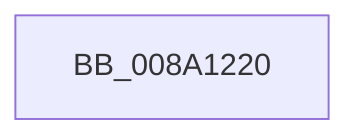

# FsRtlpCleanupEcps

- RVA: `0x008A1220`–`0x008A1237` (길이 `23` bytes)
- VA: `0x00000001408A1220`
- 실행 섹션: `PAGE`
- PDB 이름 있음: `예`; PDB Function 태그: `아니요`
- unwind 정보 RVA: `0x0007EB30`
- 디코드: `6`개 명령, `23/23` bytes 표시
- 미해석 바이트: `0` (있으면 어셈블리에 `.byte`로 보존)

> 이 문서는 커널 이미지의 기계어와 PDB 기호를 분석해 생성했습니다. 4번과 5번은 함수 원형과 자료형을 바이너리 사용 방식에서 추정한 C 해석이며 원본 소스 복구 결과는 아닙니다.

## 1. Dependencies

- 직접 호출 지점: **0**; 고유 호출 대상: **0**
- 직접 호출자로 확인된 함수: **6**
- RIP 상대 이미지 참조: **0**

### Outgoing calls
- 직접 디코드된 call 명령이 없습니다.

### Direct callers
- [NtQueryFullAttributesFile](NtQueryFullAttributesFile_function_008A0D10.md) at `0x008A0EE8`
- [NtQueryAttributesFile](NtQueryAttributesFile_function_008A0FA0.md) at `0x008A116E`
- [IopCleanupExtraCreateParameters](IopCleanupExtraCreateParameters_function_008A11E0.md) at `0x008A11F5`
- [IoQueryInformationByName](IoQueryInformationByName_function_008AE840.md) at `0x008AEA74`
- [NtDeleteFile](../A9/NtDeleteFile_function_00A97B20.md) at `0x00A97C3A`
- [IopFastQueryNetworkAttributes](../AB/IopFastQueryNetworkAttributes_function_00ABDDD0.md) at `0x00ABDEE8`

### Static image references
- 디코드된 RIP-relative 메모리 참조가 없습니다.

## 2. Other-region calls and transfers

- 다른 실행 섹션으로 향하는 call: **0**
- call이 아닌 외부 분기/꼬리 이동: **1**
  - `0x008A1231` → [sub_008A13E2](Unknown_function_008A13E2.md) (`tail-transfer`)

## 3. Assembly (complete function range)

```asm
008A1220  40 57                           push rdi
008A1222  48 83 EC 30                     sub rsp, 0x30
008A1226  8B 41 04                        mov eax, dword ptr [rcx + 4]
008A1229  48 8B F9                        mov rdi, rcx
008A122C  A9 F0 03 00 00                  test eax, 0x3f0
008A1231  0F 85 AB 01 00 00               jne 0x1408a13e2
```

## 4. C-style interpretation (structured pseudocode)

```c
__int64 __fastcall FsRtlpCleanupEcps(__int64 a1)
{
    __int64 v_rsp;

    v_rsp = (v_rsp) - (48);
}
```

## 5. (Beta) C Style

```c
int64_t FsRtlpCleanupEcps(void *Arg1)
{
    uint8_t *arg1 = (uint8_t *)Arg1;

    int64_t local_rsp;

    local_rsp = (local_rsp) - (48);
}
```

### 관측된 메모리 오프셋

구조체 형식이 확인되지 않은 접근은 인자 기준의 오프셋으로만 기록했습니다.

| 기준 인자 | 오프셋 표현 | 폭 (bit) | 접근 |
|---|---:|---:|---|
| `Arg1` | `+ 0x4` | `32` | `R` |

## 6. Execution-region graph

[열기: 2D/3D 그래프와 함수 탐색 컨트롤 패널](../../../control-panel.html?section=page&rva=0x008A1220&view=graph)

- 2D 그래프는 위에서 아래로 흐르고, 3D 그래프는 빈 공간을 드래그해 회전합니다. Shift+드래그는 이동, 휠은 확대·축소, 함수 노드 선택은 대상 보고서 이동입니다.

### Static fallback


