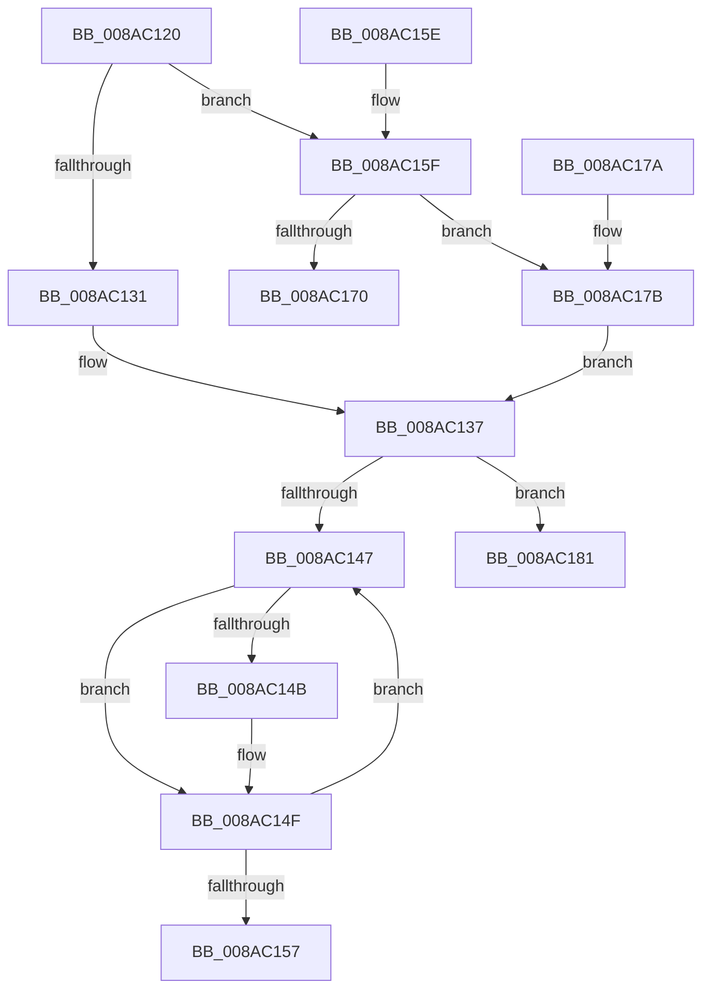

# FsRtlpPrepareExtraCreateParametersForCreate

- RVA: `0x008AC120`–`0x008AC19B` (길이 `123` bytes)
- VA: `0x00000001408AC120`
- 실행 섹션: `PAGE`
- PDB 이름 있음: `예`; PDB Function 태그: `아니요`
- unwind 정보 RVA: `0x0007F744`
- 디코드: `40`개 명령, `123/123` bytes 표시
- 미해석 바이트: `0` (있으면 어셈블리에 `.byte`로 보존)

> 이 문서는 커널 이미지의 기계어와 PDB 기호를 분석해 생성했습니다. 4번과 5번은 함수 원형과 자료형을 바이너리 사용 방식에서 추정한 C 해석이며 원본 소스 복구 결과는 아닙니다.

## 1. Dependencies

- 직접 호출 지점: **1**; 고유 호출 대상: **1**
- 직접 호출자로 확인된 함수: **4**
- RIP 상대 이미지 참조: **0**

### Outgoing calls
- `0x008AC195` → [KeBugCheckEx](../../text/4F/KeBugCheckEx_function_004FD660.md) (function, `0x004FD660`)

### Direct callers
- [IopOpenLinkOrRenameTarget](IopOpenLinkOrRenameTarget_function_008AAC04.md) at `0x008AAD7D`
- [IoQueryInformationByName](IoQueryInformationByName_function_008AE840.md) at `0x008AEAF6`
- [MiOpenHotPatchFile](../AB/MiOpenHotPatchFile_function_00AB5684.md) at `0x00AB57AC`
- [sub_00B19FF6](../B1/Unknown_function_00B19FF6.md) at `0x00B1A397`

### Static image references
- 디코드된 RIP-relative 메모리 참조가 없습니다.

## 2. Other-region calls and transfers

- 다른 실행 섹션으로 향하는 call: **1**
  - `0x008AC195` → [KeBugCheckEx](../../text/4F/KeBugCheckEx_function_004FD660.md) (`PAGE` → `.text`)
- 별도 외부 분기/꼬리 이동을 확인하지 못했습니다.

## 3. Assembly (complete function range)

```asm
008AC120  48 83 EC 38                     sub rsp, 0x38
008AC124  44 8B 41 04                     mov r8d, dword ptr [rcx + 4]
008AC128  4C 8B C9                        mov r9, rcx
008AC12B  41 F6 C0 09                     test r8b, 9
008AC12F  75 2E                           jne 0x1408ac15f
008AC131  B2 01                           mov dl, 1
008AC133  41 83 C8 01                     or r8d, 1
008AC137  44 89 41 04                     mov dword ptr [rcx + 4], r8d
008AC13B  48 83 C1 08                     add rcx, 8
008AC13F  48 8B 01                        mov rax, qword ptr [rcx]
008AC142  48 3B C1                        cmp rax, rcx
008AC145  74 3A                           je 0x1408ac181
008AC147  84 D2                           test dl, dl
008AC149  74 04                           je 0x1408ac14f
008AC14B  83 48 28 01                     or dword ptr [rax + 0x28], 1
008AC14F  48 8B 00                        mov rax, qword ptr [rax]
008AC152  48 3B C1                        cmp rax, rcx
008AC155  75 F0                           jne 0x1408ac147
008AC157  33 C0                           xor eax, eax
008AC159  48 83 C4 38                     add rsp, 0x38
008AC15D  C3                              ret
008AC15E  CC                              int3
008AC15F  41 8B C0                        mov eax, r8d
008AC162  32 D2                           xor dl, dl
008AC164  25 F0 03 00 00                  and eax, 0x3f0
008AC169  3D F0 03 00 00                  cmp eax, 0x3f0
008AC16E  75 0B                           jne 0x1408ac17b
008AC170  B8 2B 04 00 C0                  mov eax, 0xc000042b
008AC175  48 83 C4 38                     add rsp, 0x38
008AC179  C3                              ret
008AC17A  CC                              int3
008AC17B  41 83 C0 10                     add r8d, 0x10
008AC17F  EB B6                           jmp 0x1408ac137
008AC181  4C 89 4C 24 20                  mov qword ptr [rsp + 0x20], r9
008AC186  45 33 C0                        xor r8d, r8d
008AC189  45 33 C9                        xor r9d, r9d
008AC18C  B9 0C 01 00 00                  mov ecx, 0x10c
008AC191  41 8D 51 15                     lea edx, [r9 + 0x15]
008AC195  E8 C6 14 C5 FF                  call 0x1404fd660
008AC19A  CC                              int3
```

## 4. C-style interpretation (structured pseudocode)

```c
__int64 __fastcall FsRtlpPrepareExtraCreateParametersForCreate(__int64 a1)
{
    __int64 result;
    __int64 v_rsp;
    unsigned __int64 v_stack_p58;

    v_rsp = (v_rsp) - (56);
    if ((((unsigned __int8)((unsigned int)(*(unsigned int *)(a1 + 4)))) & (9)) != 0) goto loc_008AC15F;
    a3 = (unsigned int)(((unsigned int)(*(unsigned int *)(a1 + 4))) | (1));
loc_008AC137:
    *(unsigned int *)(a1 + 4) = (unsigned int)(a3);
    a1 = (a1) + (8);
    if ((*(unsigned __int64 *)(a1)) == a1) goto loc_008AC181;
loc_008AC147:
    if (1 != 0) {
    }
    if ((*(unsigned __int64 *)(*(unsigned __int64 *)(a1))) != a1) goto loc_008AC147;
    result = 0;
    v_rsp = (v_rsp) + (56);
    return result;
loc_008AC15F:
    a2 = 0;
    result = (unsigned int)(((unsigned int)((unsigned int)(a3))) & (0x3F0ULL));
    if (((unsigned int)(result)) != 0x3F0ULL) goto loc_008AC17B;
    v_rsp = (v_rsp) + (56);
    return (unsigned int)(0xC000042BULL);
loc_008AC17B:
    a3 = (unsigned int)((a3) + (16));
    goto loc_008AC137;
loc_008AC181:
    v_stack_p58 = a1;
    a3 = 0;
    a4 = 0;
    result = KeBugCheckEx(268, a4 + 21, a3, a4);
    return result;
}
```

## 5. (Beta) C Style

```c
int64_t FsRtlpPrepareExtraCreateParametersForCreate(void *Arg1)
{
    uint8_t *arg1 = (uint8_t *)Arg1;

    int64_t result;
    int64_t local_rsp;
    uint64_t v_stack_p58;

    local_rsp = (local_rsp) - (56);
    if ((((uint8_t)((uint32_t)(*(uint32_t *)(arg1 + 0x4)))) & (9)) != 0) goto loc_008AC15F;
    a3 = (uint32_t)(((uint32_t)(*(uint32_t *)(arg1 + 0x4))) | (1));
loc_008AC137:
    *(uint32_t *)(arg1 + 0x4) = (uint32_t)(a3);
    Arg1 = (Arg1) + (8);
    if ((*(uint64_t *)(arg1)) == Arg1) goto loc_008AC181;
loc_008AC147:
    if (1 != 0) {
    }
    if ((*(uint64_t *)(*(uint64_t *)(arg1))) != Arg1) goto loc_008AC147;
    result = 0;
    local_rsp = (local_rsp) + (56);
    return result;
loc_008AC15F:
    a2 = 0;
    result = (uint32_t)(((uint32_t)((uint32_t)(a3))) & (0x3F0ULL));
    if (((uint32_t)(result)) != 0x3F0ULL) goto loc_008AC17B;
    local_rsp = (local_rsp) + (56);
    return (uint32_t)(0xC000042BULL);
loc_008AC17B:
    a3 = (uint32_t)((a3) + (16));
    goto loc_008AC137;
loc_008AC181:
    v_stack_p58 = Arg1;
    a3 = 0;
    a4 = 0;
    result = KeBugCheckEx(268, a4 + 21, a3, a4);
    return result;
}
```

### 관측된 메모리 오프셋

구조체 형식이 확인되지 않은 접근은 인자 기준의 오프셋으로만 기록했습니다.

| 기준 인자 | 오프셋 표현 | 폭 (bit) | 접근 |
|---|---:|---:|---|
| `Arg1` | `+ 0x0` | `64` | `R` |
| `Arg1` | `+ 0x4` | `32` | `R` |
| `Arg1` | `+ 0x4` | `32` | `W` |

## 6. Execution-region graph

[열기: 2D/3D 그래프와 함수 탐색 컨트롤 패널](../../../control-panel.html?section=page&rva=0x008AC120&view=graph)

- 2D 그래프는 위에서 아래로 흐르고, 3D 그래프는 빈 공간을 드래그해 회전합니다. Shift+드래그는 이동, 휠은 확대·축소, 함수 노드 선택은 대상 보고서 이동입니다.

### Static fallback


