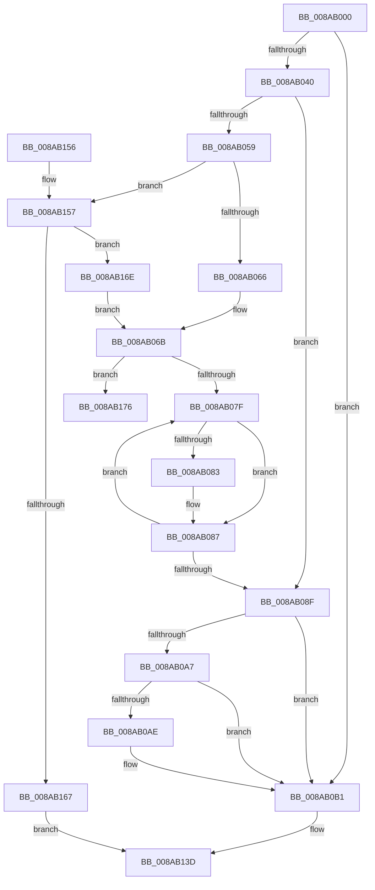

# IoCreateFileEx

- RVA: `0x008AB000`–`0x008AB190` (길이 `400` bytes)
- VA: `0x00000001408AB000`
- 실행 섹션: `PAGE`
- PDB 이름 있음: `예`; PDB Function 태그: `아니요`
- unwind 정보 RVA: `0x0007F684`
- 디코드: `100`개 명령, `400/400` bytes 표시
- 미해석 바이트: `0` (있으면 어셈블리에 `.byte`로 보존)

> 이 문서는 커널 이미지의 기계어와 PDB 기호를 분석해 생성했습니다. 4번과 5번은 함수 원형과 자료형을 바이너리 사용 방식에서 추정한 C 해석이며 원본 소스 복구 결과는 아닙니다.

## 1. Dependencies

- 직접 호출 지점: **2**; 고유 호출 대상: **2**
- 직접 호출자로 확인된 함수: **3**
- RIP 상대 이미지 참조: **0**

### Outgoing calls
- `0x008AB138` → [IopCreateFile](IopCreateFile_function_008AB298.md) (function, `0x008AB298`)
- `0x008AB18A` → [KeBugCheckEx](../../text/4F/KeBugCheckEx_function_004FD660.md) (function, `0x004FD660`)

### Direct callers
- [DifIoCreateFileExWrapper](../../text/62/DifIoCreateFileExWrapper_function_00628E20.md) at `0x00628FD0`
- [IoCreateFileSpecifyDeviceObjectHint](../A6/IoCreateFileSpecifyDeviceObjectHint_function_00A6D4B0.md) at `0x00A6D565`
- [NtCreateUserProcess](../AE/NtCreateUserProcess_function_00AEA680.md) at `0x00AEACA7`
- [NtCreateUserProcess](../AE/NtCreateUserProcess_function_00AEA680.md) at `0x00AEAD18`

### Static image references
- 디코드된 RIP-relative 메모리 참조가 없습니다.

## 2. Other-region calls and transfers

- 다른 실행 섹션으로 향하는 call: **1**
  - `0x008AB18A` → [KeBugCheckEx](../../text/4F/KeBugCheckEx_function_004FD660.md) (`PAGE` → `.text`)
- 별도 외부 분기/꼬리 이동을 확인하지 못했습니다.

## 3. Assembly (complete function range)

```asm
008AB000  48 89 5C 24 08                  mov qword ptr [rsp + 8], rbx
008AB005  48 89 6C 24 10                  mov qword ptr [rsp + 0x10], rbp
008AB00A  48 89 74 24 18                  mov qword ptr [rsp + 0x18], rsi
008AB00F  57                              push rdi
008AB010  48 81 EC 80 00 00 00            sub rsp, 0x80
008AB017  44 8B 9C 24 F8 00 00 00         mov r11d, dword ptr [rsp + 0xf8]
008AB01F  49 8B D9                        mov rbx, r9
008AB022  4C 8B 94 24 00 01 00 00         mov r10, qword ptr [rsp + 0x100]
008AB02A  41 8B C3                        mov eax, r11d
008AB02D  C1 E8 0A                        shr eax, 0xa
008AB030  49 8B F8                        mov rdi, r8
008AB033  83 E0 02                        and eax, 2
008AB036  8B F2                           mov esi, edx
008AB038  48 8B E9                        mov rbp, rcx
008AB03B  4D 85 D2                        test r10, r10
008AB03E  74 71                           je 0x1408ab0b1
008AB040  4D 8B 4A 08                     mov r9, qword ptr [r10 + 8]
008AB044  44 8B C0                        mov r8d, eax
008AB047  41 83 C8 01                     or r8d, 1
008AB04B  49 83 7A 10 00                  cmp qword ptr [r10 + 0x10], 0
008AB050  44 0F 44 C0                     cmove r8d, eax
008AB054  4D 85 C9                        test r9, r9
008AB057  74 36                           je 0x1408ab08f
008AB059  41 8B 49 04                     mov ecx, dword ptr [r9 + 4]
008AB05D  F6 C1 09                        test cl, 9
008AB060  0F 85 F1 00 00 00               jne 0x1408ab157
008AB066  B2 01                           mov dl, 1
008AB068  83 C9 01                        or ecx, 1
008AB06B  41 89 49 04                     mov dword ptr [r9 + 4], ecx
008AB06F  49 8D 49 08                     lea rcx, [r9 + 8]
008AB073  48 8B 01                        mov rax, qword ptr [rcx]
008AB076  48 3B C1                        cmp rax, rcx
008AB079  0F 84 F7 00 00 00               je 0x1408ab176
008AB07F  84 D2                           test dl, dl
008AB081  74 04                           je 0x1408ab087
008AB083  83 48 28 01                     or dword ptr [rax + 0x28], 1
008AB087  48 8B 00                        mov rax, qword ptr [rax]
008AB08A  48 3B C1                        cmp rax, rcx
008AB08D  75 F0                           jne 0x1408ab07f
008AB08F  41 8B C8                        mov ecx, r8d
008AB092  83 C9 04                        or ecx, 4
008AB095  49 83 7A 18 00                  cmp qword ptr [r10 + 0x18], 0
008AB09A  41 0F 44 C8                     cmove ecx, r8d
008AB09E  66 41 83 3A 28                  cmp word ptr [r10], 0x28
008AB0A3  8B C1                           mov eax, ecx
008AB0A5  72 0A                           jb 0x1408ab0b1
008AB0A7  49 83 7A 20 01                  cmp qword ptr [r10 + 0x20], 1
008AB0AC  74 03                           je 0x1408ab0b1
008AB0AE  83 C8 40                        or eax, 0x40
008AB0B1  4C 89 54 24 78                  mov qword ptr [rsp + 0x78], r10
008AB0B6  41 0F BA EB 08                  bts r11d, 8
008AB0BB  89 44 24 70                     mov dword ptr [rsp + 0x70], eax
008AB0BF  4C 8B CB                        mov r9, rbx
008AB0C2  48 8B 84 24 F0 00 00 00         mov rax, qword ptr [rsp + 0xf0]
008AB0CA  4C 8B C7                        mov r8, rdi
008AB0CD  44 89 5C 24 68                  mov dword ptr [rsp + 0x68], r11d
008AB0D2  8B D6                           mov edx, esi
008AB0D4  48 89 44 24 60                  mov qword ptr [rsp + 0x60], rax
008AB0D9  48 8B CD                        mov rcx, rbp
008AB0DC  8B 84 24 E8 00 00 00            mov eax, dword ptr [rsp + 0xe8]
008AB0E3  89 44 24 58                     mov dword ptr [rsp + 0x58], eax
008AB0E7  8B 84 24 E0 00 00 00            mov eax, dword ptr [rsp + 0xe0]
008AB0EE  89 44 24 50                     mov dword ptr [rsp + 0x50], eax
008AB0F2  48 8B 84 24 D8 00 00 00         mov rax, qword ptr [rsp + 0xd8]
008AB0FA  48 89 44 24 48                  mov qword ptr [rsp + 0x48], rax
008AB0FF  8B 84 24 D0 00 00 00            mov eax, dword ptr [rsp + 0xd0]
008AB106  89 44 24 40                     mov dword ptr [rsp + 0x40], eax
008AB10A  8B 84 24 C8 00 00 00            mov eax, dword ptr [rsp + 0xc8]
008AB111  89 44 24 38                     mov dword ptr [rsp + 0x38], eax
008AB115  8B 84 24 C0 00 00 00            mov eax, dword ptr [rsp + 0xc0]
008AB11C  89 44 24 30                     mov dword ptr [rsp + 0x30], eax
008AB120  8B 84 24 B8 00 00 00            mov eax, dword ptr [rsp + 0xb8]
008AB127  89 44 24 28                     mov dword ptr [rsp + 0x28], eax
008AB12B  48 8B 84 24 B0 00 00 00         mov rax, qword ptr [rsp + 0xb0]
008AB133  48 89 44 24 20                  mov qword ptr [rsp + 0x20], rax
008AB138  E8 5B 01 00 00                  call 0x1408ab298
008AB13D  4C 8D 9C 24 80 00 00 00         lea r11, [rsp + 0x80]
008AB145  49 8B 5B 10                     mov rbx, qword ptr [r11 + 0x10]
008AB149  49 8B 6B 18                     mov rbp, qword ptr [r11 + 0x18]
008AB14D  49 8B 73 20                     mov rsi, qword ptr [r11 + 0x20]
008AB151  49 8B E3                        mov rsp, r11
008AB154  5F                              pop rdi
008AB155  C3                              ret
008AB156  CC                              int3
008AB157  8B C1                           mov eax, ecx
008AB159  32 D2                           xor dl, dl
008AB15B  25 F0 03 00 00                  and eax, 0x3f0
008AB160  3D F0 03 00 00                  cmp eax, 0x3f0
008AB165  75 07                           jne 0x1408ab16e
008AB167  B8 2B 04 00 C0                  mov eax, 0xc000042b
008AB16C  EB CF                           jmp 0x1408ab13d
008AB16E  83 C1 10                        add ecx, 0x10
008AB171  E9 F5 FE FF FF                  jmp 0x1408ab06b
008AB176  4C 89 4C 24 20                  mov qword ptr [rsp + 0x20], r9
008AB17B  45 33 C0                        xor r8d, r8d
008AB17E  45 33 C9                        xor r9d, r9d
008AB181  B9 0C 01 00 00                  mov ecx, 0x10c
008AB186  41 8D 51 15                     lea edx, [r9 + 0x15]
008AB18A  E8 D1 24 C5 FF                  call 0x1404fd660
008AB18F  CC                              int3
```

## 4. C-style interpretation (structured pseudocode)

```c
__int64 __fastcall IoCreateFileEx(__int64 a1, int a2, __int64 a3, __int64 a4, __int64 a5, unsigned int a6, unsigned int a7, unsigned int a8, unsigned int a9, __int64 a10, unsigned int a11, unsigned int a12, __int64 a13, unsigned int a14, __int64 a15)
{
    __int64 result;
    __int64 v_rsp;
    unsigned __int64 v_stack_m10;
    unsigned int v_stack_m18;
    unsigned int v_stack_m20;
    unsigned __int64 v_stack_m28;
    unsigned int v_stack_m30;
    unsigned int v_stack_m38;
    unsigned __int64 v_stack_m40;
    unsigned int v_stack_m48;
    unsigned int v_stack_m50;
    unsigned int v_stack_m58;
    unsigned int v_stack_m60;
    unsigned __int64 v_stack_m68;
    unsigned __int64 v_stack_m8;
    unsigned __int64 v_stack_p10;
    unsigned __int64 v_stack_p18;
    unsigned __int64 v_stack_p8;

    v_stack_p8 = v_rbx;
    v_stack_p10 = v_rbp;
    v_stack_p18 = v_rsi;
    v_rsp = (v_rsp) - (128);
    result = (unsigned int)(((unsigned int)((unsigned int)((unsigned int)(a14)))) >> (10));
    result = (unsigned int)((result) & (2));
    if (a15 == 0) goto loc_008AB0B1;
    a3 = (unsigned int)(((unsigned int)((unsigned int)(result))) | (1));
    if ((*(unsigned __int64 *)(a15 + 16)) == 0) { a3 = (unsigned int)(result); }
    if (*(unsigned __int64 *)(a15 + 8) == 0) goto loc_008AB08F;
    if ((((unsigned __int8)((unsigned int)(*(unsigned int *)(*(unsigned __int64 *)(a15 + 8) + 4)))) & (9)) != 0) goto loc_008AB157;
    a1 = (unsigned int)(((unsigned int)(*(unsigned int *)(*(unsigned __int64 *)(a15 + 8) + 4))) | (1));
loc_008AB06B:
    *(unsigned int *)(*(unsigned __int64 *)(a15 + 8) + 4) = (unsigned int)(a1);
    if ((*(unsigned __int64 *)(*(unsigned __int64 *)(a15 + 8) + 8)) == (*(unsigned __int64 *)(a15 + 8) + 8)) goto loc_008AB176;
loc_008AB07F:
    if (1 != 0) {
    }
    if ((*(unsigned __int64 *)(*(unsigned __int64 *)(*(unsigned __int64 *)(a15 + 8) + 8))) != (*(unsigned __int64 *)(a15 + 8) + 8)) goto loc_008AB07F;
loc_008AB08F:
    a1 = (unsigned int)(((unsigned int)((unsigned int)(a3))) | (4));
    if ((*(unsigned __int64 *)(a15 + 24)) == 0) { a1 = (unsigned int)(a3); }
    if ((*(unsigned __int16 *)(a15)) < 40) goto loc_008AB0B1;
    result = (unsigned int)((unsigned int)(a1));
    if ((*(unsigned __int64 *)(a15 + 32)) != 1) {
        result = (unsigned int)(((unsigned int)((unsigned int)(a1))) | (64));
    }
    v_stack_m10 = a15;
    v_stack_m18 = (unsigned int)(result);
    v_stack_m20 = (unsigned int)((unsigned int)(a14));
    v_stack_m28 = a13;
    v_stack_m30 = (unsigned int)((unsigned int)(a12));
    v_stack_m38 = (unsigned int)((unsigned int)(a11));
    v_stack_m40 = a10;
    v_stack_m48 = (unsigned int)((unsigned int)(a9));
    v_stack_m50 = (unsigned int)((unsigned int)(a8));
    v_stack_m58 = (unsigned int)((unsigned int)(a7));
    v_stack_m60 = (unsigned int)((unsigned int)(a6));
    v_stack_m68 = a5;
    result = IopCreateFile(a1, (unsigned int)((unsigned int)((unsigned int)(a2))), a3, a4);
loc_008AB13D:
    return result;
loc_008AB157:
    a2 = 0;
    result = (unsigned int)(((unsigned int)((unsigned int)(a1))) & (0x3F0ULL));
    if (((unsigned int)(result)) != 0x3F0ULL) goto loc_008AB16E;
    goto loc_008AB13D;
loc_008AB16E:
    a1 = (unsigned int)((a1) + (16));
    goto loc_008AB06B;
loc_008AB176:
    v_stack_m60 = a4;
    a3 = 0;
    a4 = 0;
    result = KeBugCheckEx(268, a4 + 21, a3, a4);
    return result;
}
```

## 5. (Beta) C Style

```c
int64_t IoCreateFileEx(int64_t Arg1, int32_t Arg2, int64_t Arg3, int64_t Arg4, int64_t Arg5, uint32_t Arg6, uint32_t Arg7, uint32_t Arg8, uint32_t Arg9, int64_t Arg10, uint32_t Arg11, uint32_t Arg12, int64_t Arg13, uint32_t Arg14, int64_t Arg15)
{
    int64_t result;
    int64_t local_rsp;
    uint64_t v_stack_m10;
    uint32_t v_stack_m18;
    uint32_t v_stack_m20;
    uint64_t v_stack_m28;
    uint32_t v_stack_m30;
    uint32_t v_stack_m38;
    uint64_t v_stack_m40;
    uint32_t v_stack_m48;
    uint32_t v_stack_m50;
    uint32_t v_stack_m58;
    uint32_t v_stack_m60;
    uint64_t v_stack_m68;
    uint64_t v_stack_m8;
    uint64_t v_stack_p10;
    uint64_t v_stack_p18;
    uint64_t v_stack_p8;

    v_stack_p8 = local_rbx;
    v_stack_p10 = local_rbp;
    v_stack_p18 = local_rsi;
    local_rsp = (local_rsp) - (128);
    result = (uint32_t)(((uint32_t)((uint32_t)((uint32_t)(Arg14)))) >> (10));
    result = (uint32_t)((result) & (2));
    if (Arg15 == 0) goto loc_008AB0B1;
    Arg3 = (uint32_t)(((uint32_t)((uint32_t)(result))) | (1));
    if ((*(uint64_t *)(Arg15 + 0x10)) == 0) { Arg3 = (uint32_t)(result); }
    if (*(uint64_t *)(Arg15 + 0x8) == 0) goto loc_008AB08F;
    if ((((uint8_t)((uint32_t)(*(uint32_t *)(*(uint64_t *)(Arg15 + 0x8) + 0x4)))) & (9)) != 0) goto loc_008AB157;
    Arg1 = (uint32_t)(((uint32_t)(*(uint32_t *)(*(uint64_t *)(Arg15 + 0x8) + 0x4))) | (1));
loc_008AB06B:
    *(uint32_t *)(*(uint64_t *)(Arg15 + 0x8) + 0x4) = (uint32_t)(Arg1);
    if ((*(uint64_t *)(*(uint64_t *)(Arg15 + 0x8) + 0x8)) == (*(uint64_t *)(Arg15 + 0x8) + 8)) goto loc_008AB176;
loc_008AB07F:
    if (1 != 0) {
    }
    if ((*(uint64_t *)(*(uint64_t *)(*(uint64_t *)(Arg15 + 0x8) + 0x8))) != (*(uint64_t *)(Arg15 + 0x8) + 8)) goto loc_008AB07F;
loc_008AB08F:
    Arg1 = (uint32_t)(((uint32_t)((uint32_t)(Arg3))) | (4));
    if ((*(uint64_t *)(Arg15 + 0x18)) == 0) { Arg1 = (uint32_t)(Arg3); }
    if ((*(uint16_t *)(Arg15)) < 40) goto loc_008AB0B1;
    result = (uint32_t)((uint32_t)(Arg1));
    if ((*(uint64_t *)(Arg15 + 0x20)) != 1) {
        result = (uint32_t)(((uint32_t)((uint32_t)(Arg1))) | (64));
    }
    v_stack_m10 = Arg15;
    v_stack_m18 = (uint32_t)(result);
    v_stack_m20 = (uint32_t)((uint32_t)(Arg14));
    v_stack_m28 = Arg13;
    v_stack_m30 = (uint32_t)((uint32_t)(Arg12));
    v_stack_m38 = (uint32_t)((uint32_t)(Arg11));
    v_stack_m40 = Arg10;
    v_stack_m48 = (uint32_t)((uint32_t)(Arg9));
    v_stack_m50 = (uint32_t)((uint32_t)(Arg8));
    v_stack_m58 = (uint32_t)((uint32_t)(Arg7));
    v_stack_m60 = (uint32_t)((uint32_t)(Arg6));
    v_stack_m68 = Arg5;
    result = IopCreateFile(Arg1, (uint32_t)((uint32_t)((uint32_t)(Arg2))), Arg3, Arg4);
loc_008AB13D:
    return result;
loc_008AB157:
    Arg2 = 0;
    result = (uint32_t)(((uint32_t)((uint32_t)(Arg1))) & (0x3F0ULL));
    if (((uint32_t)(result)) != 0x3F0ULL) goto loc_008AB16E;
    goto loc_008AB13D;
loc_008AB16E:
    Arg1 = (uint32_t)((Arg1) + (16));
    goto loc_008AB06B;
loc_008AB176:
    v_stack_m60 = Arg4;
    Arg3 = 0;
    Arg4 = 0;
    result = KeBugCheckEx(268, Arg4 + 21, Arg3, Arg4);
    return result;
}
```

## 6. Execution-region graph

[열기: 2D/3D 그래프와 함수 탐색 컨트롤 패널](../../../control-panel.html?section=page&rva=0x008AB000&view=graph)

- 2D 그래프는 위에서 아래로 흐르고, 3D 그래프는 빈 공간을 드래그해 회전합니다. Shift+드래그는 이동, 휠은 확대·축소, 함수 노드 선택은 대상 보고서 이동입니다.

### Static fallback


