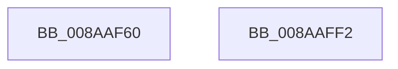

# IoCreateFile

- RVA: `0x008AAF60`–`0x008AAFF3` (길이 `147` bytes)
- VA: `0x00000001408AAF60`
- 실행 섹션: `PAGE`
- PDB 이름 있음: `예`; PDB Function 태그: `아니요`
- unwind 정보 RVA: `0x0007F678`
- 디코드: `28`개 명령, `147/147` bytes 표시
- 미해석 바이트: `0` (있으면 어셈블리에 `.byte`로 보존)

> 이 문서는 커널 이미지의 기계어와 PDB 기호를 분석해 생성했습니다. 4번과 5번은 함수 원형과 자료형을 바이너리 사용 방식에서 추정한 C 해석이며 원본 소스 복구 결과는 아닙니다.

## 1. Dependencies

- 직접 호출 지점: **1**; 고유 호출 대상: **1**
- 직접 호출자로 확인된 함수: **2**
- RIP 상대 이미지 참조: **0**

### Outgoing calls
- `0x008AAFE5` → [IopCreateFile](IopCreateFile_function_008AB298.md) (function, `0x008AB298`)

### Direct callers
- [DifIoCreateFileWrapper](../../text/62/DifIoCreateFileWrapper_function_006292C0.md) at `0x00629459`
- [IopInitCrashDumpRegCallback](../../init/C2/IopInitCrashDumpRegCallback_function_00C2CC80.md) at `0x00C2CD6A`

### Static image references
- 디코드된 RIP-relative 메모리 참조가 없습니다.

## 2. Other-region calls and transfers

- 다른 실행 섹션으로 향하는 call: **0**
- 별도 외부 분기/꼬리 이동을 확인하지 못했습니다.

## 3. Assembly (complete function range)

```asm
008AAF60  4C 8B DC                        mov r11, rsp
008AAF63  48 81 EC 88 00 00 00            sub rsp, 0x88
008AAF6A  49 83 63 F0 00                  and qword ptr [r11 - 0x10], 0
008AAF6F  83 64 24 70 00                  and dword ptr [rsp + 0x70], 0
008AAF74  8B 84 24 F8 00 00 00            mov eax, dword ptr [rsp + 0xf8]
008AAF7B  89 44 24 68                     mov dword ptr [rsp + 0x68], eax
008AAF7F  48 8B 84 24 F0 00 00 00         mov rax, qword ptr [rsp + 0xf0]
008AAF87  49 89 43 D8                     mov qword ptr [r11 - 0x28], rax
008AAF8B  8B 84 24 E8 00 00 00            mov eax, dword ptr [rsp + 0xe8]
008AAF92  89 44 24 58                     mov dword ptr [rsp + 0x58], eax
008AAF96  8B 84 24 E0 00 00 00            mov eax, dword ptr [rsp + 0xe0]
008AAF9D  89 44 24 50                     mov dword ptr [rsp + 0x50], eax
008AAFA1  48 8B 84 24 D8 00 00 00         mov rax, qword ptr [rsp + 0xd8]
008AAFA9  49 89 43 C0                     mov qword ptr [r11 - 0x40], rax
008AAFAD  8B 84 24 D0 00 00 00            mov eax, dword ptr [rsp + 0xd0]
008AAFB4  89 44 24 40                     mov dword ptr [rsp + 0x40], eax
008AAFB8  8B 84 24 C8 00 00 00            mov eax, dword ptr [rsp + 0xc8]
008AAFBF  89 44 24 38                     mov dword ptr [rsp + 0x38], eax
008AAFC3  8B 84 24 C0 00 00 00            mov eax, dword ptr [rsp + 0xc0]
008AAFCA  89 44 24 30                     mov dword ptr [rsp + 0x30], eax
008AAFCE  8B 84 24 B8 00 00 00            mov eax, dword ptr [rsp + 0xb8]
008AAFD5  89 44 24 28                     mov dword ptr [rsp + 0x28], eax
008AAFD9  48 8B 84 24 B0 00 00 00         mov rax, qword ptr [rsp + 0xb0]
008AAFE1  49 89 43 98                     mov qword ptr [r11 - 0x68], rax
008AAFE5  E8 AE 02 00 00                  call 0x1408ab298
008AAFEA  48 81 C4 88 00 00 00            add rsp, 0x88
008AAFF1  C3                              ret
008AAFF2  CC                              int3
```

## 4. C-style interpretation (structured pseudocode)

```c
__int64 __fastcall IoCreateFile(__int64 a1, __int64 a2, __int64 a3, __int64 a4, __int64 a5, unsigned int a6, unsigned int a7, unsigned int a8, unsigned int a9, __int64 a10, unsigned int a11, unsigned int a12, __int64 a13, unsigned int a14)
{
    __int64 result;
    __int64 v_rsp;
    unsigned int v_stack_m18;
    unsigned int v_stack_m20;
    unsigned int v_stack_m30;
    unsigned int v_stack_m38;
    unsigned int v_stack_m48;
    unsigned int v_stack_m50;
    unsigned int v_stack_m58;
    unsigned int v_stack_m60;

    v_rsp = (v_rsp) - (136);
    v_stack_m20 = (unsigned int)((unsigned int)(a14));
    *(unsigned __int64 *)(v_rsp - 40) = a13;
    v_stack_m30 = (unsigned int)((unsigned int)(a12));
    v_stack_m38 = (unsigned int)((unsigned int)(a11));
    *(unsigned __int64 *)(v_rsp - 64) = a10;
    v_stack_m48 = (unsigned int)((unsigned int)(a9));
    v_stack_m50 = (unsigned int)((unsigned int)(a8));
    v_stack_m58 = (unsigned int)((unsigned int)(a7));
    v_stack_m60 = (unsigned int)((unsigned int)(a6));
    *(unsigned __int64 *)(v_rsp - 104) = a5;
    result = IopCreateFile(a1, a2, a3, a4);
    v_rsp = (v_rsp) + (136);
    return result;
}
```

## 5. (Beta) C Style

```c
int64_t IoCreateFile(int64_t Arg1, int64_t Arg2, int64_t Arg3, int64_t Arg4, int64_t Arg5, uint32_t Arg6, uint32_t Arg7, uint32_t Arg8, uint32_t Arg9, int64_t Arg10, uint32_t Arg11, uint32_t Arg12, int64_t Arg13, uint32_t Arg14)
{
    int64_t result;
    int64_t local_rsp;
    uint32_t v_stack_m18;
    uint32_t v_stack_m20;
    uint32_t v_stack_m30;
    uint32_t v_stack_m38;
    uint32_t v_stack_m48;
    uint32_t v_stack_m50;
    uint32_t v_stack_m58;
    uint32_t v_stack_m60;

    local_rsp = (local_rsp) - (136);
    v_stack_m20 = (uint32_t)((uint32_t)(Arg14));
    *(uint64_t *)(local_rsp - 0x28) = Arg13;
    v_stack_m30 = (uint32_t)((uint32_t)(Arg12));
    v_stack_m38 = (uint32_t)((uint32_t)(Arg11));
    *(uint64_t *)(local_rsp - 0x40) = Arg10;
    v_stack_m48 = (uint32_t)((uint32_t)(Arg9));
    v_stack_m50 = (uint32_t)((uint32_t)(Arg8));
    v_stack_m58 = (uint32_t)((uint32_t)(Arg7));
    v_stack_m60 = (uint32_t)((uint32_t)(Arg6));
    *(uint64_t *)(local_rsp - 0x68) = Arg5;
    result = IopCreateFile(Arg1, Arg2, Arg3, Arg4);
    local_rsp = (local_rsp) + (136);
    return result;
}
```

## 6. Execution-region graph

[열기: 2D/3D 그래프와 함수 탐색 컨트롤 패널](../../../control-panel.html?section=page&rva=0x008AAF60&view=graph)

- 2D 그래프는 위에서 아래로 흐르고, 3D 그래프는 빈 공간을 드래그해 회전합니다. Shift+드래그는 이동, 휠은 확대·축소, 함수 노드 선택은 대상 보고서 이동입니다.

### Static fallback


