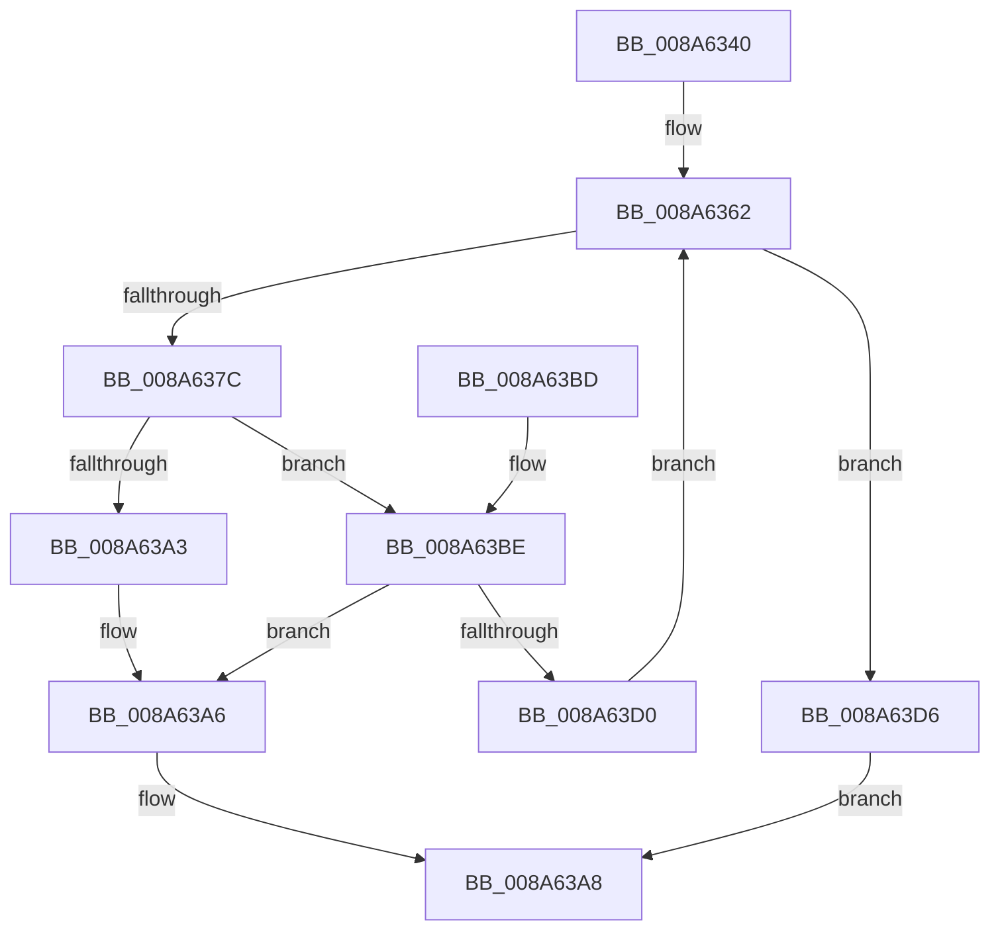

# IoQueryFileDosDeviceName

- RVA: `0x008A6340`–`0x008A63DD` (길이 `157` bytes)
- VA: `0x00000001408A6340`
- 실행 섹션: `PAGE`
- PDB 이름 있음: `예`; PDB Function 태그: `아니요`
- unwind 정보 RVA: `0x0007F0E0`
- 디코드: `46`개 명령, `157/157` bytes 표시
- 미해석 바이트: `0` (있으면 어셈블리에 `.byte`로 보존)

> 이 문서는 커널 이미지의 기계어와 PDB 기호를 분석해 생성했습니다. 4번과 5번은 함수 원형과 자료형을 바이너리 사용 방식에서 추정한 C 해석이며 원본 소스 복구 결과는 아닙니다.

## 1. Dependencies

- 직접 호출 지점: **3**; 고유 호출 대상: **3**
- 직접 호출자로 확인된 함수: **4**
- RIP 상대 이미지 참조: **0**

### Outgoing calls
- `0x008A636F` → [ExAllocatePool2](../../poolcode/B8/ExAllocatePool2_function_00B820F0.md) (function, `0x00B820F0`)
- `0x008A6398` → [IopQueryNameInternal](IopQueryNameInternal_function_008A6770.md) (function, `0x008A6770`)
- `0x008A63C3` → [ExFreePoolWithTag](../../poolcode/B8/ExFreePoolWithTag_function_00B82870.md) (function, `0x00B82870`)

### Direct callers
- [CcMmLogLostDelayedWriteError](../../text/4C/CcMmLogLostDelayedWriteError_function_004C6C60.md) at `0x004C6C89`
- [EtwpGetDriverDataDosPath](../../text/4D/EtwpGetDriverDataDosPath_function_004DDF10.md) at `0x004DDFFE`
- [PiDrvDbQuerySystemPathWin32](../74/PiDrvDbQuerySystemPathWin32_function_007421F4.md) at `0x00742313`
- [NtQueryInformationProcess](../9A/NtQueryInformationProcess_function_009AA250.md) at `0x009AB709`

### Static image references
- 디코드된 RIP-relative 메모리 참조가 없습니다.

## 2. Other-region calls and transfers

- 다른 실행 섹션으로 향하는 call: **2**
  - `0x008A636F` → [ExAllocatePool2](../../poolcode/B8/ExAllocatePool2_function_00B820F0.md) (`PAGE` → `POOLCODE`)
  - `0x008A63C3` → [ExFreePoolWithTag](../../poolcode/B8/ExFreePoolWithTag_function_00B82870.md) (`PAGE` → `POOLCODE`)
- 별도 외부 분기/꼬리 이동을 확인하지 못했습니다.

## 3. Assembly (complete function range)

```asm
008A6340  48 8B C4                        mov rax, rsp
008A6343  48 89 58 08                     mov qword ptr [rax + 8], rbx
008A6347  48 89 68 10                     mov qword ptr [rax + 0x10], rbp
008A634B  48 89 70 20                     mov qword ptr [rax + 0x20], rsi
008A634F  57                              push rdi
008A6350  48 83 EC 40                     sub rsp, 0x40
008A6354  BB D0 00 00 00                  mov ebx, 0xd0
008A6359  48 8B F2                        mov rsi, rdx
008A635C  89 58 18                        mov dword ptr [rax + 0x18], ebx
008A635F  48 8B E9                        mov rbp, rcx
008A6362  8B D3                           mov edx, ebx
008A6364  B9 00 01 00 00                  mov ecx, 0x100
008A6369  41 B8 49 6F 44 6E               mov r8d, 0x6e446f49
008A636F  E8 7C BD 2D 00                  call 0x140b820f0
008A6374  48 8B F8                        mov rdi, rax
008A6377  48 85 C0                        test rax, rax
008A637A  74 5A                           je 0x1408a63d6
008A637C  48 8D 44 24 60                  lea rax, [rsp + 0x60]
008A6381  C6 44 24 30 00                  mov byte ptr [rsp + 0x30], 0
008A6386  48 89 44 24 28                  mov qword ptr [rsp + 0x28], rax
008A638B  4C 8B CF                        mov r9, rdi
008A638E  41 B0 01                        mov r8b, 1
008A6391  89 5C 24 20                     mov dword ptr [rsp + 0x20], ebx
008A6395  48 8B CD                        mov rcx, rbp
008A6398  E8 D3 03 00 00                  call 0x1408a6770
008A639D  8B D8                           mov ebx, eax
008A639F  85 C0                           test eax, eax
008A63A1  75 1B                           jne 0x1408a63be
008A63A3  48 89 3E                        mov qword ptr [rsi], rdi
008A63A6  8B C3                           mov eax, ebx
008A63A8  48 8B 5C 24 50                  mov rbx, qword ptr [rsp + 0x50]
008A63AD  48 8B 6C 24 58                  mov rbp, qword ptr [rsp + 0x58]
008A63B2  48 8B 74 24 68                  mov rsi, qword ptr [rsp + 0x68]
008A63B7  48 83 C4 40                     add rsp, 0x40
008A63BB  5F                              pop rdi
008A63BC  C3                              ret
008A63BD  CC                              int3
008A63BE  33 D2                           xor edx, edx
008A63C0  48 8B CF                        mov rcx, rdi
008A63C3  E8 A8 C4 2D 00                  call 0x140b82870
008A63C8  81 FB 05 00 00 80               cmp ebx, 0x80000005
008A63CE  75 D6                           jne 0x1408a63a6
008A63D0  8B 5C 24 60                     mov ebx, dword ptr [rsp + 0x60]
008A63D4  EB 8C                           jmp 0x1408a6362
008A63D6  B8 9A 00 00 C0                  mov eax, 0xc000009a
008A63DB  EB CB                           jmp 0x1408a63a8
```

## 4. C-style interpretation (structured pseudocode)

```c
__int64 __fastcall IoQueryFileDosDeviceName(__int64 a1, __int64 a2)
{
    __int64 result;
    __int64 v_rsp;
    unsigned __int8 v_stack_m18;
    unsigned __int64 v_stack_m20;
    unsigned int v_stack_m28;
    unsigned __int64 v_stack_p10;
    unsigned __int64 v_stack_p18;
    unsigned __int64 v_stack_p20;
    unsigned int v_stack_p60;
    unsigned __int64 v_stack_p8;

    *(unsigned __int64 *)(v_rsp + 8) = v_rbx;
    *(unsigned __int64 *)(v_rsp + 16) = v_rbp;
    *(unsigned __int64 *)(v_rsp + 32) = v_rsi;
    v_rsp = (v_rsp) - (64);
    *(unsigned int *)(v_rsp + 24) = 208;
loc_008A6362:
    result = ExAllocatePool2(256, 208, (unsigned int)(0x6E446F49ULL), a4);
    if (result == 0) goto loc_008A63D6;
    v_stack_m18 = 0;
    v_stack_m20 = v_stack_p18;
    v_stack_m28 = 208;
    result = IopQueryNameInternal(a1, 208, 1, result);
    if ((unsigned int)(result) != 0) goto loc_008A63BE;
    *(unsigned __int64 *)(a2) = result;
loc_008A63A6:
loc_008A63A8:
    v_rsp = (v_rsp) + (64);
    return (unsigned int)((unsigned int)((unsigned int)((unsigned int)(result))));
loc_008A63BE:
    a2 = 0;
    result = ExFreePoolWithTag(result, a2, 1, result);
    if (((unsigned int)(v_stack_p8)) != 0x80000005ULL) goto loc_008A63A6;
    goto loc_008A6362;
loc_008A63D6:
    goto loc_008A63A8;
}
```

## 5. (Beta) C Style

```c
int64_t IoQueryFileDosDeviceName(int64_t Arg1, void *Arg2)
{
    uint8_t *arg2 = (uint8_t *)Arg2;

    int64_t result;
    int64_t local_rsp;
    uint8_t v_stack_m18;
    uint64_t v_stack_m20;
    uint32_t v_stack_m28;
    uint64_t v_stack_p10;
    uint64_t v_stack_p18;
    uint64_t v_stack_p20;
    uint32_t v_stack_p60;
    uint64_t v_stack_p8;

    *(uint64_t *)(local_rsp + 0x8) = local_rbx;
    *(uint64_t *)(local_rsp + 0x10) = local_rbp;
    *(uint64_t *)(local_rsp + 0x20) = local_rsi;
    local_rsp = (local_rsp) - (64);
    *(uint32_t *)(local_rsp + 0x18) = 208;
loc_008A6362:
    result = ExAllocatePool2(256, 208, (uint32_t)(0x6E446F49ULL), a4);
    if (result == 0) goto loc_008A63D6;
    v_stack_m18 = 0;
    v_stack_m20 = v_stack_p18;
    v_stack_m28 = 208;
    result = IopQueryNameInternal(Arg1, 208, 1, result);
    if ((uint32_t)(result) != 0) goto loc_008A63BE;
    *(uint64_t *)(arg2) = result;
loc_008A63A6:
loc_008A63A8:
    local_rsp = (local_rsp) + (64);
    return (uint32_t)((uint32_t)((uint32_t)((uint32_t)(result))));
loc_008A63BE:
    Arg2 = 0;
    result = ExFreePoolWithTag(result, Arg2, 1, result);
    if (((uint32_t)(v_stack_p8)) != 0x80000005ULL) goto loc_008A63A6;
    goto loc_008A6362;
loc_008A63D6:
    goto loc_008A63A8;
}
```

### 관측된 메모리 오프셋

구조체 형식이 확인되지 않은 접근은 인자 기준의 오프셋으로만 기록했습니다.

| 기준 인자 | 오프셋 표현 | 폭 (bit) | 접근 |
|---|---:|---:|---|
| `Arg2` | `+ 0x0` | `64` | `W` |

## 6. Execution-region graph

[열기: 2D/3D 그래프와 함수 탐색 컨트롤 패널](../../../control-panel.html?section=page&rva=0x008A6340&view=graph)

- 2D 그래프는 위에서 아래로 흐르고, 3D 그래프는 빈 공간을 드래그해 회전합니다. Shift+드래그는 이동, 휠은 확대·축소, 함수 노드 선택은 대상 보고서 이동입니다.

### Static fallback


