# IoQueryInformationByName

- RVA: `0x008AE840`–`0x008AEBDB` (길이 `923` bytes)
- VA: `0x00000001408AE840`
- 실행 섹션: `PAGE`
- PDB 이름 있음: `예`; PDB Function 태그: `아니요`
- unwind 정보 RVA: `0x0007F9EC`
- 디코드: `190`개 명령, `923/923` bytes 표시
- 미해석 바이트: `0` (있으면 어셈블리에 `.byte`로 보존)

> 이 문서는 커널 이미지의 기계어와 PDB 기호를 분석해 생성했습니다. 4번과 5번은 함수 원형과 자료형을 바이너리 사용 방식에서 추정한 C 해석이며 원본 소스 복구 결과는 아닙니다.

## 1. Dependencies

- 직접 호출 지점: **12**; 고유 호출 대상: **10**
- 직접 호출자로 확인된 함수: **1**
- RIP 상대 이미지 참조: **2**

### Outgoing calls
- `0x008AE892` → [memset](../../text/6C/memset_function_006C6C40.md) (function, `0x006C6C40`)
- `0x008AE8E3` → [IopValidateQueryInformationParameters](IopValidateQueryInformationParameters_function_008AE440.md) (function, `0x008AE440`)
- `0x008AE925` → [memset](../../text/6C/memset_function_006C6C40.md) (function, `0x006C6C40`)
- `0x008AE9E2` → [PsGetCurrentSilo](../../text/40/PsGetCurrentSilo_function_004094A0.md) (function, `0x004094A0`)
- `0x008AEA60` → [ObOpenObjectByNameEx](../89/ObOpenObjectByNameEx_function_0089A8A0.md) (function, `0x0089A8A0`)
- `0x008AEA74` → [FsRtlpCleanupEcps](FsRtlpCleanupEcps_function_008A1220.md) (function, `0x008A1220`)
- `0x008AEAD4` → [_security_check_cookie](../../text/6A/_security_check_cookie_function_006AC640.md) (function, `0x006AC640`)
- `0x008AEAF6` → [FsRtlpPrepareExtraCreateParametersForCreate](FsRtlpPrepareExtraCreateParametersForCreate_function_008AC120.md) (function, `0x008AC120`)
- `0x008AEB32` → [memcpy](../../text/6C/memcpy_function_006C6840.md) (function, `0x006C6840`)
- `0x008AEB52` → [ExAllocatePool2](../../poolcode/B8/ExAllocatePool2_function_00B820F0.md) (function, `0x00B820F0`)
- `0x008AEB84` → [memcpy](../../text/6C/memcpy_function_006C6840.md) (function, `0x006C6840`)
- `0x008AEBA1` → [ExFreePoolWithTag](../../poolcode/B8/ExFreePoolWithTag_function_00B82870.md) (function, `0x00B82870`)

### Direct callers
- [NtQueryInformationByName](NtQueryInformationByName_function_008AE810.md) at `0x008AE827`

### Static image references
- `0x008AE853` → RVA `0x00E0A740` (`.data`; read)
- `0x008AEA54` → RVA `0x00FC6AE0` (`ALMOSTRO`; read)

## 2. Other-region calls and transfers

- 다른 실행 섹션으로 향하는 call: **8**
  - `0x008AE892` → [memset](../../text/6C/memset_function_006C6C40.md) (`PAGE` → `.text`)
  - `0x008AE925` → [memset](../../text/6C/memset_function_006C6C40.md) (`PAGE` → `.text`)
  - `0x008AE9E2` → [PsGetCurrentSilo](../../text/40/PsGetCurrentSilo_function_004094A0.md) (`PAGE` → `.text`)
  - `0x008AEAD4` → [_security_check_cookie](../../text/6A/_security_check_cookie_function_006AC640.md) (`PAGE` → `.text`)
  - `0x008AEB32` → [memcpy](../../text/6C/memcpy_function_006C6840.md) (`PAGE` → `.text`)
  - `0x008AEB52` → [ExAllocatePool2](../../poolcode/B8/ExAllocatePool2_function_00B820F0.md) (`PAGE` → `POOLCODE`)
  - `0x008AEB84` → [memcpy](../../text/6C/memcpy_function_006C6840.md) (`PAGE` → `.text`)
  - `0x008AEBA1` → [ExFreePoolWithTag](../../poolcode/B8/ExFreePoolWithTag_function_00B82870.md) (`PAGE` → `POOLCODE`)
- 별도 외부 분기/꼬리 이동을 확인하지 못했습니다.

## 3. Assembly (complete function range)

```asm
008AE840  40 53                           push rbx
008AE842  56                              push rsi
008AE843  57                              push rdi
008AE844  41 54                           push r12
008AE846  41 55                           push r13
008AE848  41 56                           push r14
008AE84A  41 57                           push r15
008AE84C  48 81 EC 70 02 00 00            sub rsp, 0x270
008AE853  48 8B 05 E6 BE 55 00            mov rax, qword ptr [rip + 0x55bee6]
008AE85A  48 33 C4                        xor rax, rsp
008AE85D  48 89 84 24 60 02 00 00         mov qword ptr [rsp + 0x260], rax
008AE865  44 89 4C 24 40                  mov dword ptr [rsp + 0x40], r9d
008AE86A  4D 8B F0                        mov r14, r8
008AE86D  4C 8B FA                        mov r15, rdx
008AE870  48 89 4C 24 48                  mov qword ptr [rsp + 0x48], rcx
008AE875  48 89 54 24 50                  mov qword ptr [rsp + 0x50], rdx
008AE87A  48 8B BC 24 E0 02 00 00         mov rdi, qword ptr [rsp + 0x2e0]
008AE882  33 D2                           xor edx, edx
008AE884  41 B8 10 01 00 00               mov r8d, 0x110
008AE88A  48 8D 8C 24 50 01 00 00         lea rcx, [rsp + 0x150]
008AE892  E8 A9 83 E1 FF                  call 0x1406c6c40
008AE897  33 DB                           xor ebx, ebx
008AE899  44 8A E3                        mov r12b, bl
008AE89C  65 48 8B 04 25 88 01 00 00      mov rax, qword ptr gs:[0x188]
008AE8A5  F7 84 24 D8 02 00 00 00 01 00 00  test dword ptr [rsp + 0x2d8], 0x100
008AE8B0  44 8B EB                        mov r13d, ebx
008AE8B3  0F B6 80 32 02 00 00            movzx eax, byte ptr [rax + 0x232]
008AE8BA  44 0F 44 E8                     cmove r13d, eax
008AE8BE  65 48 8B 14 25 88 01 00 00      mov rdx, qword ptr gs:[0x188]
008AE8C7  8B B4 24 D0 02 00 00            mov esi, dword ptr [rsp + 0x2d0]
008AE8CE  89 74 24 28                     mov dword ptr [rsp + 0x28], esi
008AE8D2  8B 44 24 40                     mov eax, dword ptr [rsp + 0x40]
008AE8D6  89 44 24 20                     mov dword ptr [rsp + 0x20], eax
008AE8DA  4D 8B CE                        mov r9, r14
008AE8DD  4D 8B C7                        mov r8, r15
008AE8E0  41 8A CD                        mov cl, r13b
008AE8E3  E8 58 FB FF FF                  call 0x1408ae440
008AE8E8  85 C0                           test eax, eax
008AE8EA  0F 88 D9 01 00 00               js 0x1408aeac9
008AE8F0  45 84 ED                        test r13b, r13b
008AE8F3  75 09                           jne 0x1408ae8fe
008AE8F5  83 FE 4B                        cmp esi, 0x4b
008AE8F8  0F 84 AD 02 00 00               je 0x1408aebab
008AE8FE  8D 46 BC                        lea eax, [rsi - 0x44]
008AE901  83 F8 09                        cmp eax, 9
008AE904  0F 87 C7 02 00 00               ja 0x1408aebd1
008AE90A  B9 0D 02 00 00                  mov ecx, 0x20d
008AE90F  0F A3 C1                        bt ecx, eax
008AE912  0F 83 B9 02 00 00               jae 0x1408aebd1
008AE918  33 D2                           xor edx, edx
008AE91A  41 B8 E0 00 00 00               mov r8d, 0xe0
008AE920  48 8D 4C 24 60                  lea rcx, [rsp + 0x60]
008AE925  E8 16 83 E1 FF                  call 0x1406c6c40
008AE92A  C7 44 24 60 08 00 E0 00         mov dword ptr [rsp + 0x60], 0xe00008
008AE932  B8 07 00 00 00                  mov eax, 7
008AE937  66 89 84 24 A6 00 00 00         mov word ptr [rsp + 0xa6], ax
008AE93F  C7 84 24 B8 00 00 00 01 00 00 00  mov dword ptr [rsp + 0xb8], 1
008AE94A  C7 84 24 A0 00 00 00 00 40 20 00  mov dword ptr [rsp + 0xa0], 0x204000
008AE955  C6 84 24 E9 00 00 00 01         mov byte ptr [rsp + 0xe9], 1
008AE95D  C6 84 24 30 01 00 00 01         mov byte ptr [rsp + 0x130], 1
008AE965  48 8D 84 24 50 01 00 00         lea rax, [rsp + 0x150]
008AE96D  48 89 84 24 F0 00 00 00         mov qword ptr [rsp + 0xf0], rax
008AE975  48 8B 44 24 48                  mov rax, qword ptr [rsp + 0x48]
008AE97A  48 89 84 24 90 00 00 00         mov qword ptr [rsp + 0x90], rax
008AE982  C7 84 24 F8 00 00 00 20 00 00 00  mov dword ptr [rsp + 0xf8], 0x20
008AE98D  89 B4 24 28 01 00 00            mov dword ptr [rsp + 0x128], esi
008AE994  8B 74 24 40                     mov esi, dword ptr [rsp + 0x40]
008AE998  89 B4 24 2C 01 00 00            mov dword ptr [rsp + 0x12c], esi
008AE99F  0F 57 C0                        xorps xmm0, xmm0
008AE9A2  0F 11 84 24 00 01 00 00         movups xmmword ptr [rsp + 0x100], xmm0
008AE9AA  0F 11 84 24 10 01 00 00         movups xmmword ptr [rsp + 0x110], xmm0
008AE9B2  BA 28 00 00 00                  mov edx, 0x28
008AE9B7  66 89 94 24 00 01 00 00         mov word ptr [rsp + 0x100], dx
008AE9BF  8D 42 D9                        lea eax, [rdx - 0x27]
008AE9C2  48 89 84 24 20 01 00 00         mov qword ptr [rsp + 0x120], rax
008AE9CA  45 84 E4                        test r12b, r12b
008AE9CD  0F 85 E5 01 00 00               jne 0x1408aebb8
008AE9D3  48 85 FF                        test rdi, rdi
008AE9D6  0F 85 11 01 00 00               jne 0x1408aeaed
008AE9DC  48 83 F8 01                     cmp rax, 1
008AE9E0  75 0D                           jne 0x1408ae9ef
008AE9E2  E8 B9 AA B5 FF                  call 0x1404094a0
008AE9E7  48 89 84 24 20 01 00 00         mov qword ptr [rsp + 0x120], rax
008AE9EF  48 B8 FF FF FE FF FF 7F 00 00   movabs rax, 0x7ffffffeffff
008AE9F9  4C 3B F0                        cmp r14, rax
008AE9FC  0F 86 42 01 00 00               jbe 0x1408aeb44
008AEA02  4C 89 B4 24 D0 00 00 00         mov qword ptr [rsp + 0xd0], r14
008AEA0A  65 48 8B 04 25 88 01 00 00      mov rax, qword ptr gs:[0x188]
008AEA13  48 FF 80 90 03 00 00            inc qword ptr [rax + 0x390]
008AEA1A  65 FF 04 25 E4 2E 00 00         inc dword ptr gs:[0x2ee4]
008AEA22  48 8D 84 24 40 01 00 00         lea rax, [rsp + 0x140]
008AEA2A  48 89 44 24 38                  mov qword ptr [rsp + 0x38], rax
008AEA2F  48 8B 84 24 20 01 00 00         mov rax, qword ptr [rsp + 0x120]
008AEA37  48 89 44 24 30                  mov qword ptr [rsp + 0x30], rax
008AEA3C  48 8D 44 24 60                  lea rax, [rsp + 0x60]
008AEA41  48 89 44 24 28                  mov qword ptr [rsp + 0x28], rax
008AEA46  C7 44 24 20 80 00 00 00         mov dword ptr [rsp + 0x20], 0x80
008AEA4E  45 33 C9                        xor r9d, r9d
008AEA51  45 8A C5                        mov r8b, r13b
008AEA54  48 8B 15 85 80 71 00            mov rdx, qword ptr [rip + 0x718085]
008AEA5B  48 8B 4C 24 48                  mov rcx, qword ptr [rsp + 0x48]
008AEA60  E8 3B BE FE FF                  call 0x14089a8a0
008AEA65  8B F8                           mov edi, eax
008AEA67  48 8B 8C 24 08 01 00 00         mov rcx, qword ptr [rsp + 0x108]
008AEA6F  48 85 C9                        test rcx, rcx
008AEA72  74 1B                           je 0x1408aea8f
008AEA74  E8 A7 27 FF FF                  call 0x1408a1220
008AEA79  48 8B 8C 24 08 01 00 00         mov rcx, qword ptr [rsp + 0x108]
008AEA81  84 C0                           test al, al
008AEA83  48 0F 45 CB                     cmovne rcx, rbx
008AEA87  48 89 8C 24 08 01 00 00         mov qword ptr [rsp + 0x108], rcx
008AEA8F  81 BC 24 80 00 00 00 51 02 AA BE  cmp dword ptr [rsp + 0x80], 0xbeaa0251
008AEA9A  0F 44 7C 24 70                  cmove edi, dword ptr [rsp + 0x70]
008AEA9F  48 8B B4 24 D0 00 00 00         mov rsi, qword ptr [rsp + 0xd0]
008AEAA7  4C 3B F6                        cmp r14, rsi
008AEAAA  0F 85 C2 00 00 00               jne 0x1408aeb72
008AEAB0  41 89 3F                        mov dword ptr [r15], edi
008AEAB3  85 FF                           test edi, edi
008AEAB5  0F 49 9C 24 2C 01 00 00         cmovns ebx, dword ptr [rsp + 0x12c]
008AEABD  8B C3                           mov eax, ebx
008AEABF  49 89 47 08                     mov qword ptr [r15 + 8], rax
008AEAC3  EB 02                           jmp 0x1408aeac7
008AEAC5  8B F8                           mov edi, eax
008AEAC7  8B C7                           mov eax, edi
008AEAC9  48 8B 8C 24 60 02 00 00         mov rcx, qword ptr [rsp + 0x260]
008AEAD1  48 33 CC                        xor rcx, rsp
008AEAD4  E8 67 DB DF FF                  call 0x1406ac640
008AEAD9  48 81 C4 70 02 00 00            add rsp, 0x270
008AEAE0  41 5F                           pop r15
008AEAE2  41 5E                           pop r14
008AEAE4  41 5D                           pop r13
008AEAE6  41 5C                           pop r12
008AEAE8  5F                              pop rdi
008AEAE9  5E                              pop rsi
008AEAEA  5B                              pop rbx
008AEAEB  C3                              ret
008AEAEC  CC                              int3
008AEAED  48 8B 4F 08                     mov rcx, qword ptr [rdi + 8]
008AEAF1  48 85 C9                        test rcx, rcx
008AEAF4  74 0E                           je 0x1408aeb04
008AEAF6  E8 25 D6 FF FF                  call 0x1408ac120
008AEAFB  85 C0                           test eax, eax
008AEAFD  78 CA                           js 0x1408aeac9
008AEAFF  BA 28 00 00 00                  mov edx, 0x28
008AEB04  48 39 5F 10                     cmp qword ptr [rdi + 0x10], rbx
008AEB08  74 08                           je 0x1408aeb12
008AEB0A  83 8C 24 F8 00 00 00 01         or dword ptr [rsp + 0xf8], 1
008AEB12  48 39 5F 18                     cmp qword ptr [rdi + 0x18], rbx
008AEB16  0F 85 A8 00 00 00               jne 0x1408aebc4
008AEB1C  4C 0F BF 07                     movsx r8, word ptr [rdi]
008AEB20  4C 3B C2                        cmp r8, rdx
008AEB23  4C 0F 47 C2                     cmova r8, rdx
008AEB27  48 8B D7                        mov rdx, rdi
008AEB2A  48 8D 8C 24 00 01 00 00         lea rcx, [rsp + 0x100]
008AEB32  E8 09 7D E1 FF                  call 0x1406c6840
008AEB37  48 8B 84 24 20 01 00 00         mov rax, qword ptr [rsp + 0x120]
008AEB3F  E9 98 FE FF FF                  jmp 0x1408ae9dc
008AEB44  48 8B D6                        mov rdx, rsi
008AEB47  B9 41 00 00 00                  mov ecx, 0x41
008AEB4C  41 B8 49 6F 20 20               mov r8d, 0x20206f49
008AEB52  E8 99 35 2D 00                  call 0x140b820f0
008AEB57  48 89 84 24 D0 00 00 00         mov qword ptr [rsp + 0xd0], rax
008AEB5F  48 85 C0                        test rax, rax
008AEB62  0F 85 A2 FE FF FF               jne 0x1408aea0a
008AEB68  B8 9A 00 00 C0                  mov eax, 0xc000009a
008AEB6D  E9 57 FF FF FF                  jmp 0x1408aeac9
008AEB72  85 FF                           test edi, edi
008AEB74  78 26                           js 0x1408aeb9c
008AEB76  44 8B 84 24 2C 01 00 00         mov r8d, dword ptr [rsp + 0x12c]
008AEB7E  48 8B D6                        mov rdx, rsi
008AEB81  49 8B CE                        mov rcx, r14
008AEB84  E8 B7 7C E1 FF                  call 0x1406c6840
008AEB89  EB 11                           jmp 0x1408aeb9c
008AEB8B  8B F8                           mov edi, eax
008AEB8D  33 DB                           xor ebx, ebx
008AEB8F  48 8B B4 24 D0 00 00 00         mov rsi, qword ptr [rsp + 0xd0]
008AEB97  4C 8B 7C 24 50                  mov r15, qword ptr [rsp + 0x50]
008AEB9C  33 D2                           xor edx, edx
008AEB9E  48 8B CE                        mov rcx, rsi
008AEBA1  E8 CA 3C 2D 00                  call 0x140b82870
008AEBA6  E9 05 FF FF FF                  jmp 0x1408aeab0
008AEBAB  BE 47 00 00 00                  mov esi, 0x47
008AEBB0  41 B4 01                        mov r12b, 1
008AEBB3  E9 46 FD FF FF                  jmp 0x1408ae8fe
008AEBB8  09 84 24 B4 00 00 00            or dword ptr [rsp + 0xb4], eax
008AEBBF  E9 0F FE FF FF                  jmp 0x1408ae9d3
008AEBC4  83 8C 24 F8 00 00 00 04         or dword ptr [rsp + 0xf8], 4
008AEBCC  E9 4B FF FF FF                  jmp 0x1408aeb1c
008AEBD1  B8 0D 00 00 C0                  mov eax, 0xc000000d
008AEBD6  E9 EE FE FF FF                  jmp 0x1408aeac9
```

## 4. C-style interpretation (structured pseudocode)

```c
__int64 __fastcall IoQueryInformationByName(__int64 a1, __int64 a2, __int64 a3, int a4, unsigned int a5, unsigned int a6, __int64 a7)
{
    __int64 result;
    __int64 v_r13;
    __int64 v_rbx;
    __int64 v_rdi;
    __int64 v_rsp;
    unsigned __int64 v_stack_m158;
    unsigned __int64 v_stack_m168;
    unsigned __int8 v_stack_m178;
    unsigned int v_stack_m17C;
    unsigned int v_stack_m180;
    unsigned __int64 v_stack_m188;
    unsigned __int64 v_stack_m198;
    unsigned __int64 v_stack_m1A0;
    unsigned __int64 v_stack_m1A8;
    unsigned int v_stack_m1B0;
    unsigned __int64 v_stack_m1B8;
    unsigned __int8 v_stack_m1BF;
    unsigned __int64 v_stack_m1D8;
    unsigned int v_stack_m1F0;
    unsigned __int16 v_stack_m202;
    unsigned int v_stack_m208;
    unsigned __int64 v_stack_m218;
    unsigned int v_stack_m228;
    unsigned int v_stack_m238;
    unsigned __int64 v_stack_m248;
    unsigned __int64 v_stack_m258;
    unsigned __int64 v_stack_m260;
    unsigned int v_stack_m268;
    unsigned __int64 v_stack_m270;
    unsigned __int64 v_stack_m278;
    unsigned int v_stack_m280;
    unsigned int v_stack_m288;
    unsigned __int64 v_stack_m48;
    unsigned __int64 v_stack_p100;
    unsigned __int64 v_stack_p120;
    unsigned int v_stack_p12C;
    unsigned __int64 v_stack_p50;
    unsigned int v_stack_pB4;
    unsigned __int64 v_stack_pD0;
    unsigned int v_stack_pF8;

    v_rsp = (v_rsp) - (624);
    result = (*(unsigned __int64 *)(v_rip + 5619430)) ^ (v_rsp);
    v_stack_m48 = result;
    v_stack_m268 = a4;
    v_stack_m260 = a1;
    v_stack_m258 = a2;
    a2 = 0;
    result = memset(v_stack_m158, a2, 272, a4);
    v_rbx = 0;
    v_r13 = 0;
    if (((a6) & (256)) == 0) { v_r13 = (unsigned int)(*(unsigned __int8 *)(*(unsigned __int64 *)(gs_base + (0 + 392)) + 562)); }
    v_stack_m280 = (unsigned int)((unsigned int)(a5));
    v_stack_m288 = (unsigned int)((unsigned int)(v_stack_m268));
    result = IopValidateQueryInformationParameters((unsigned __int8)(v_r13), *(unsigned __int64 *)(gs_base + (0 + 392)), 0, a3);
    if (sign_flag) goto loc_008AEAC9;
    if ((unsigned __int8)(v_r13) != 0) goto loc_008AE8FE;
    if (((unsigned int)((unsigned int)(a5))) == 75) goto loc_008AEBAB;
loc_008AE8FE:
    if (((unsigned int)((unsigned int)(a5) - 68)) > 9) goto loc_008AEBD1;
    if (((unsigned int)((unsigned int)(a5) - 68)) >= 9) goto loc_008AEBD1;
    a2 = 0;
    result = memset(v_stack_m248, a2, 224, a3);
    v_stack_m248 = 0xE00008ULL;
    v_stack_m202 = 7;
    v_stack_m1F0 = 1;
    v_stack_m208 = 0x204000ULL;
    v_stack_m1BF = 1;
    v_stack_m178 = 1;
    v_stack_m1B8 = v_stack_m158;
    v_stack_m218 = v_stack_m260;
    v_stack_m1B0 = 32;
    v_stack_m180 = (unsigned int)((unsigned int)(a5));
    v_stack_m17C = (unsigned int)((unsigned int)(v_stack_m268));
    v_stack_m1A8 = v_xmm0;
    v_stack_m198 = v_xmm0;
    v_stack_m1A8 = 40;
    v_stack_m188 = 40 - 39;
    if (0 != 0) goto loc_008AEBB8;
loc_008AE9D3:
    if (a7 != 0) goto loc_008AEAED;
loc_008AE9DC:
    result = 40 - 39;
    if ((40 - 39) == 1) {
        result = PsGetCurrentSilo(v_stack_m248, 40, 224, a3);
        v_stack_m188 = result;
    }
    if (a3 <= result) goto loc_008AEB44;
    v_stack_m1D8 = a3;
loc_008AEA0A:
    v_stack_m270 = v_stack_m168;
    v_stack_m278 = v_stack_m188;
    v_stack_m280 = v_stack_m248;
    v_stack_m288 = 128;
    a4 = 0;
    result = ObOpenObjectByNameEx(v_stack_m260, *(unsigned __int64 *)(v_rip + 7438469), (unsigned __int8)(v_r13), a4);
    if (v_stack_m1A0 != 0) {
        result = FsRtlpCleanupEcps(v_stack_m1A0, *(unsigned __int64 *)(v_rip + 7438469), (unsigned __int8)(v_r13), a4);
        a1 = v_stack_m1A0;
        if ((unsigned __int8)(result) != 0) { a1 = 0; }
        v_stack_m1A0 = a1;
    }
    v_rdi = (unsigned int)((unsigned int)(result));
    if (v_stack_m228 == 0xBEAA0251ULL) { v_rdi = v_stack_m238; }
    if (a3 != v_stack_m1D8) goto loc_008AEB72;
loc_008AEAB0:
    *(unsigned int *)(a2) = (unsigned int)(v_rdi);
    if (!sign_flag) { v_rbx = v_stack_m17C; }
    *(unsigned __int64 *)(a2 + 8) = (unsigned int)((unsigned int)(v_rbx));
    goto loc_008AEAC7;
loc_008AEAC7:
loc_008AEAC9:
    a1 = (v_stack_m48) ^ (v_rsp);
    result = _security_check_cookie(a1, *(unsigned __int64 *)(v_rip + 7438469), (unsigned __int8)(v_r13), a4);
    v_rsp = (v_rsp) + (624);
    return result;
loc_008AEAED:
    if (*(unsigned __int64 *)(v_rdi + 8) == 0) goto loc_008AEB04;
    result = FsRtlpPrepareExtraCreateParametersForCreate(*(unsigned __int64 *)(v_rdi + 8), *(unsigned __int64 *)(v_rip + 7438469), (unsigned __int8)(v_r13), a4);
    if (sign_flag) goto loc_008AEAC9;
loc_008AEB04:
    if ((*(unsigned __int64 *)(v_rdi + 16)) != v_rbx) {
    }
    if ((*(unsigned __int64 *)(v_rdi + 24)) != v_rbx) goto loc_008AEBC4;
loc_008AEB1C:
    a3 = (__int16)(*(unsigned __int16 *)(v_rdi));
    if (((__int16)(*(unsigned __int16 *)(v_rdi))) > 40) { a3 = 40; }
    result = memcpy(v_stack_p100, v_rdi, a3, a4);
    goto loc_008AE9DC;
loc_008AEB44:
    result = ExAllocatePool2(65, v_stack_m1D8, (unsigned int)(0x20206F49ULL), a4);
    v_stack_pD0 = result;
    if (result != 0) goto loc_008AEA0A;
    goto loc_008AEAC9;
loc_008AEB72:
    if (sign_flag) goto loc_008AEB9C;
    result = memcpy(a3, v_stack_m1D8, (unsigned int)(v_stack_p12C), a4);
    goto loc_008AEB9C;
loc_008AEB9C:
    a2 = 0;
    result = ExFreePoolWithTag(v_stack_m1D8, a2, (unsigned int)(v_stack_p12C), a4);
    goto loc_008AEAB0;
loc_008AEBAB:
    goto loc_008AE8FE;
loc_008AEBB8:
    goto loc_008AE9D3;
loc_008AEBC4:
    goto loc_008AEB1C;
loc_008AEBD1:
    goto loc_008AEAC9;
}
```

## 5. (Beta) C Style

```c
int64_t IoQueryInformationByName(int64_t Arg1, void *Arg2, int64_t Arg3, int32_t Arg4, uint32_t Arg5, uint32_t Arg6, int64_t Arg7)
{
    uint8_t *arg2 = (uint8_t *)Arg2;

    int64_t result;
    int64_t local_r13;
    int64_t local_rbx;
    int64_t local_rdi;
    int64_t local_rsp;
    uint64_t v_stack_m158;
    uint64_t v_stack_m168;
    uint8_t v_stack_m178;
    uint32_t v_stack_m17C;
    uint32_t v_stack_m180;
    uint64_t v_stack_m188;
    uint64_t v_stack_m198;
    uint64_t v_stack_m1A0;
    uint64_t v_stack_m1A8;
    uint32_t v_stack_m1B0;
    uint64_t v_stack_m1B8;
    uint8_t v_stack_m1BF;
    uint64_t v_stack_m1D8;
    uint32_t v_stack_m1F0;
    uint16_t v_stack_m202;
    uint32_t v_stack_m208;
    uint64_t v_stack_m218;
    uint32_t v_stack_m228;
    uint32_t v_stack_m238;
    uint64_t v_stack_m248;
    uint64_t v_stack_m258;
    uint64_t v_stack_m260;
    uint32_t v_stack_m268;
    uint64_t v_stack_m270;
    uint64_t v_stack_m278;
    uint32_t v_stack_m280;
    uint32_t v_stack_m288;
    uint64_t v_stack_m48;
    uint64_t v_stack_p100;
    uint64_t v_stack_p120;
    uint32_t v_stack_p12C;
    uint64_t v_stack_p50;
    uint32_t v_stack_pB4;
    uint64_t v_stack_pD0;
    uint32_t v_stack_pF8;

    local_rsp = (local_rsp) - (624);
    result = (*(uint64_t *)(v_rip + 0x55BEE6)) ^ (local_rsp);
    v_stack_m48 = result;
    v_stack_m268 = Arg4;
    v_stack_m260 = Arg1;
    v_stack_m258 = Arg2;
    Arg2 = 0;
    result = memset(v_stack_m158, Arg2, 272, Arg4);
    local_rbx = 0;
    local_r13 = 0;
    if (((Arg6) & (256)) == 0) { local_r13 = (uint32_t)(*(uint8_t *)(*(uint64_t *)(gs_base + (0 + 0x188)) + 0x232)); }
    v_stack_m280 = (uint32_t)((uint32_t)(Arg5));
    v_stack_m288 = (uint32_t)((uint32_t)(v_stack_m268));
    result = IopValidateQueryInformationParameters((uint8_t)(local_r13), *(uint64_t *)(gs_base + (0 + 0x188)), 0, Arg3);
    if (sign_flag) goto loc_008AEAC9;
    if ((uint8_t)(local_r13) != 0) goto loc_008AE8FE;
    if (((uint32_t)((uint32_t)(Arg5))) == 75) goto loc_008AEBAB;
loc_008AE8FE:
    if (((uint32_t)((uint32_t)(Arg5) - 68)) > 9) goto loc_008AEBD1;
    if (((uint32_t)((uint32_t)(Arg5) - 68)) >= 9) goto loc_008AEBD1;
    Arg2 = 0;
    result = memset(v_stack_m248, Arg2, 224, Arg3);
    v_stack_m248 = 0xE00008ULL;
    v_stack_m202 = 7;
    v_stack_m1F0 = 1;
    v_stack_m208 = 0x204000ULL;
    v_stack_m1BF = 1;
    v_stack_m178 = 1;
    v_stack_m1B8 = v_stack_m158;
    v_stack_m218 = v_stack_m260;
    v_stack_m1B0 = 32;
    v_stack_m180 = (uint32_t)((uint32_t)(Arg5));
    v_stack_m17C = (uint32_t)((uint32_t)(v_stack_m268));
    v_stack_m1A8 = v_xmm0;
    v_stack_m198 = v_xmm0;
    v_stack_m1A8 = 40;
    v_stack_m188 = 40 - 39;
    if (0 != 0) goto loc_008AEBB8;
loc_008AE9D3:
    if (Arg7 != 0) goto loc_008AEAED;
loc_008AE9DC:
    result = 40 - 39;
    if ((40 - 39) == 1) {
        result = PsGetCurrentSilo(v_stack_m248, 40, 224, Arg3);
        v_stack_m188 = result;
    }
    if (Arg3 <= result) goto loc_008AEB44;
    v_stack_m1D8 = Arg3;
loc_008AEA0A:
    v_stack_m270 = v_stack_m168;
    v_stack_m278 = v_stack_m188;
    v_stack_m280 = v_stack_m248;
    v_stack_m288 = 128;
    Arg4 = 0;
    result = ObOpenObjectByNameEx(v_stack_m260, *(uint64_t *)(v_rip + 0x718085), (uint8_t)(local_r13), Arg4);
    if (v_stack_m1A0 != 0) {
        result = FsRtlpCleanupEcps(v_stack_m1A0, *(uint64_t *)(v_rip + 0x718085), (uint8_t)(local_r13), Arg4);
        Arg1 = v_stack_m1A0;
        if ((uint8_t)(result) != 0) { Arg1 = 0; }
        v_stack_m1A0 = Arg1;
    }
    local_rdi = (uint32_t)((uint32_t)(result));
    if (v_stack_m228 == 0xBEAA0251ULL) { local_rdi = v_stack_m238; }
    if (Arg3 != v_stack_m1D8) goto loc_008AEB72;
loc_008AEAB0:
    *(uint32_t *)(arg2) = (uint32_t)(local_rdi);
    if (!sign_flag) { local_rbx = v_stack_m17C; }
    *(uint64_t *)(arg2 + 0x8) = (uint32_t)((uint32_t)(local_rbx));
    goto loc_008AEAC7;
loc_008AEAC7:
loc_008AEAC9:
    Arg1 = (v_stack_m48) ^ (local_rsp);
    result = _security_check_cookie(Arg1, *(uint64_t *)(v_rip + 0x718085), (uint8_t)(local_r13), Arg4);
    local_rsp = (local_rsp) + (624);
    return result;
loc_008AEAED:
    if (*(uint64_t *)(local_rdi + 0x8) == 0) goto loc_008AEB04;
    result = FsRtlpPrepareExtraCreateParametersForCreate(*(uint64_t *)(local_rdi + 0x8), *(uint64_t *)(v_rip + 0x718085), (uint8_t)(local_r13), Arg4);
    if (sign_flag) goto loc_008AEAC9;
loc_008AEB04:
    if ((*(uint64_t *)(local_rdi + 0x10)) != local_rbx) {
    }
    if ((*(uint64_t *)(local_rdi + 0x18)) != local_rbx) goto loc_008AEBC4;
loc_008AEB1C:
    Arg3 = (int16_t)(*(uint16_t *)(local_rdi));
    if (((int16_t)(*(uint16_t *)(local_rdi))) > 40) { Arg3 = 40; }
    result = memcpy(v_stack_p100, local_rdi, Arg3, Arg4);
    goto loc_008AE9DC;
loc_008AEB44:
    result = ExAllocatePool2(65, v_stack_m1D8, (uint32_t)(0x20206F49ULL), Arg4);
    v_stack_pD0 = result;
    if (result != 0) goto loc_008AEA0A;
    goto loc_008AEAC9;
loc_008AEB72:
    if (sign_flag) goto loc_008AEB9C;
    result = memcpy(Arg3, v_stack_m1D8, (uint32_t)(v_stack_p12C), Arg4);
    goto loc_008AEB9C;
loc_008AEB9C:
    Arg2 = 0;
    result = ExFreePoolWithTag(v_stack_m1D8, Arg2, (uint32_t)(v_stack_p12C), Arg4);
    goto loc_008AEAB0;
loc_008AEBAB:
    goto loc_008AE8FE;
loc_008AEBB8:
    goto loc_008AE9D3;
loc_008AEBC4:
    goto loc_008AEB1C;
loc_008AEBD1:
    goto loc_008AEAC9;
}
```

### 관측된 메모리 오프셋

구조체 형식이 확인되지 않은 접근은 인자 기준의 오프셋으로만 기록했습니다.

| 기준 인자 | 오프셋 표현 | 폭 (bit) | 접근 |
|---|---:|---:|---|
| `Arg2` | `+ 0x0` | `32` | `W` |
| `Arg2` | `+ 0x8` | `64` | `W` |

## 6. Execution-region graph

[열기: 2D/3D 그래프와 함수 탐색 컨트롤 패널](../../../control-panel.html?section=page&rva=0x008AE840&view=graph)

- 2D 그래프는 위에서 아래로 흐르고, 3D 그래프는 빈 공간을 드래그해 회전합니다. Shift+드래그는 이동, 휠은 확대·축소, 함수 노드 선택은 대상 보고서 이동입니다.

### Static fallback

```mermaid
flowchart TD
  bb_008AE840[BB_008AE840]
  bb_008AE8F0[BB_008AE8F0]
  bb_008AE8F5[BB_008AE8F5]
  bb_008AE8FE[BB_008AE8FE]
  bb_008AE90A[BB_008AE90A]
  bb_008AE918[BB_008AE918]
  bb_008AE9D3[BB_008AE9D3]
  bb_008AE9DC[BB_008AE9DC]
  bb_008AE9E2[BB_008AE9E2]
  bb_008AE9EF[BB_008AE9EF]
  bb_008AEA02[BB_008AEA02]
  bb_008AEA0A[BB_008AEA0A]
  bb_008AEA74[BB_008AEA74]
  bb_008AEA8F[BB_008AEA8F]
  bb_008AEAB0[BB_008AEAB0]
  bb_008AEAC5[BB_008AEAC5]
  bb_008AEAC7[BB_008AEAC7]
  bb_008AEAC9[BB_008AEAC9]
  bb_008AEAEC[BB_008AEAEC]
  bb_008AEAED[BB_008AEAED]
  bb_008AEAF6[BB_008AEAF6]
  bb_008AEAFF[BB_008AEAFF]
  bb_008AEB04[BB_008AEB04]
  bb_008AEB0A[BB_008AEB0A]
  bb_008AEB12[BB_008AEB12]
  bb_008AEB1C[BB_008AEB1C]
  bb_008AEB44[BB_008AEB44]
  bb_008AEB68[BB_008AEB68]
  bb_008AEB72[BB_008AEB72]
  bb_008AEB76[BB_008AEB76]
  bb_008AEB8B[BB_008AEB8B]
  bb_008AEB9C[BB_008AEB9C]
  bb_008AEBAB[BB_008AEBAB]
  bb_008AEBB8[BB_008AEBB8]
  bb_008AEBC4[BB_008AEBC4]
  bb_008AEBD1[BB_008AEBD1]
  bb_008AE840 -->|branch| bb_008AEAC9
  bb_008AE840 -->|fallthrough| bb_008AE8F0
  bb_008AE8F0 -->|branch| bb_008AE8FE
  bb_008AE8F0 -->|fallthrough| bb_008AE8F5
  bb_008AE8F5 -->|branch| bb_008AEBAB
  bb_008AE8F5 -->|fallthrough| bb_008AE8FE
  bb_008AE8FE -->|branch| bb_008AEBD1
  bb_008AE8FE -->|fallthrough| bb_008AE90A
  bb_008AE90A -->|branch| bb_008AEBD1
  bb_008AE90A -->|fallthrough| bb_008AE918
  bb_008AE918 -->|branch| bb_008AEBB8
  bb_008AE918 -->|fallthrough| bb_008AE9D3
  bb_008AE9D3 -->|branch| bb_008AEAED
  bb_008AE9D3 -->|fallthrough| bb_008AE9DC
  bb_008AE9DC -->|branch| bb_008AE9EF
  bb_008AE9DC -->|fallthrough| bb_008AE9E2
  bb_008AE9E2 -->|flow| bb_008AE9EF
  bb_008AE9EF -->|branch| bb_008AEB44
  bb_008AE9EF -->|fallthrough| bb_008AEA02
  bb_008AEA02 -->|flow| bb_008AEA0A
  bb_008AEA0A -->|branch| bb_008AEA8F
  bb_008AEA0A -->|fallthrough| bb_008AEA74
  bb_008AEA74 -->|flow| bb_008AEA8F
  bb_008AEA8F -->|branch| bb_008AEB72
  bb_008AEA8F -->|fallthrough| bb_008AEAB0
  bb_008AEAB0 -->|branch| bb_008AEAC7
  bb_008AEAC5 -->|flow| bb_008AEAC7
  bb_008AEAC7 -->|flow| bb_008AEAC9
  bb_008AEAEC -->|flow| bb_008AEAED
  bb_008AEAED -->|branch| bb_008AEB04
  bb_008AEAED -->|fallthrough| bb_008AEAF6
  bb_008AEAF6 -->|branch| bb_008AEAC9
  bb_008AEAF6 -->|fallthrough| bb_008AEAFF
  bb_008AEAFF -->|flow| bb_008AEB04
  bb_008AEB04 -->|branch| bb_008AEB12
  bb_008AEB04 -->|fallthrough| bb_008AEB0A
  bb_008AEB0A -->|flow| bb_008AEB12
  bb_008AEB12 -->|branch| bb_008AEBC4
  bb_008AEB12 -->|fallthrough| bb_008AEB1C
  bb_008AEB1C -->|branch| bb_008AE9DC
  bb_008AEB44 -->|branch| bb_008AEA0A
  bb_008AEB44 -->|fallthrough| bb_008AEB68
  bb_008AEB68 -->|branch| bb_008AEAC9
  bb_008AEB72 -->|branch| bb_008AEB9C
  bb_008AEB72 -->|fallthrough| bb_008AEB76
  bb_008AEB76 -->|branch| bb_008AEB9C
  bb_008AEB8B -->|flow| bb_008AEB9C
  bb_008AEB9C -->|branch| bb_008AEAB0
  bb_008AEBAB -->|branch| bb_008AE8FE
  bb_008AEBB8 -->|branch| bb_008AE9D3
  bb_008AEBC4 -->|branch| bb_008AEB1C
  bb_008AEBD1 -->|branch| bb_008AEAC9
```


