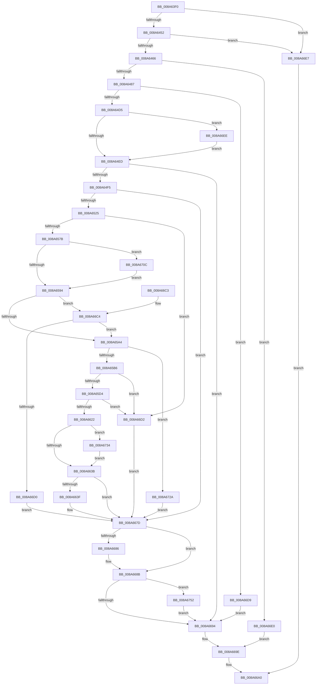

# IoVolumeDeviceToDosName

- RVA: `0x008A63F0`–`0x008A6761` (길이 `881` bytes)
- VA: `0x00000001408A63F0`
- 실행 섹션: `PAGE`
- PDB 이름 있음: `예`; PDB Function 태그: `아니요`
- unwind 정보 RVA: `0x0007F0F8`
- 디코드: `220`개 명령, `881/881` bytes 표시
- 미해석 바이트: `0` (있으면 어셈블리에 `.byte`로 보존)

> 이 문서는 커널 이미지의 기계어와 PDB 기호를 분석해 생성했습니다. 4번과 5번은 함수 원형과 자료형을 바이너리 사용 방식에서 추정한 C 해석이며 원본 소스 복구 결과는 아닙니다.

## 1. Dependencies

- 직접 호출 지점: **21**; 고유 호출 대상: **11**
- 직접 호출자로 확인된 함수: **3**
- RIP 상대 이미지 참조: **2**

### Outgoing calls
- `0x008A6476` → [ExAllocatePool2](../../poolcode/B8/ExAllocatePool2_function_00B820F0.md) (function, `0x00B820F0`)
- `0x008A6490` → [KeInitializeEvent](../../text/40/KeInitializeEvent_function_0040DD10.md) (function, `0x0040DD10`)
- `0x008A64C7` → [IoBuildDeviceIoControlRequest](../../text/20/IoBuildDeviceIoControlRequest_function_00204FD0.md) (function, `0x00204FD0`)
- `0x008A64DB` → [IofCallDriver](../../text/29/IofCallDriver_function_0029B4B0.md) (function, `0x0029B4B0`)
- `0x008A6500` → [RtlInitUnicodeString](../../text/42/RtlInitUnicodeString_function_0042A780.md) (function, `0x0042A780`)
- `0x008A6516` → [IoGetDeviceObjectPointer](../95/IoGetDeviceObjectPointer_function_00953220.md) (function, `0x00953220`)
- `0x008A652E` → [KeInitializeEvent](../../text/40/KeInitializeEvent_function_0040DD10.md) (function, `0x0040DD10`)
- `0x008A656D` → [IoBuildDeviceIoControlRequest](../../text/20/IoBuildDeviceIoControlRequest_function_00204FD0.md) (function, `0x00204FD0`)
- `0x008A6582` → [IofCallDriver](../../text/29/IofCallDriver_function_0029B4B0.md) (function, `0x0029B4B0`)
- `0x008A65C3` → [ExAllocatePool2](../../poolcode/B8/ExAllocatePool2_function_00B820F0.md) (function, `0x00B820F0`)
- `0x008A65DD` → [KeInitializeEvent](../../text/40/KeInitializeEvent_function_0040DD10.md) (function, `0x0040DD10`)
- `0x008A6614` → [IoBuildDeviceIoControlRequest](../../text/20/IoBuildDeviceIoControlRequest_function_00204FD0.md) (function, `0x00204FD0`)
- `0x008A6629` → [IofCallDriver](../../text/29/IofCallDriver_function_0029B4B0.md) (function, `0x0029B4B0`)
- `0x008A6662` → [memcpy](../../text/6C/memcpy_function_006C6840.md) (function, `0x006C6840`)
- `0x008A6686` → [ObfDereferenceObject](../../text/2F/ObfDereferenceObject_function_002F9350.md) (function, `0x002F9350`)
- `0x008A6699` → [ExFreePoolWithTag](../../poolcode/B8/ExFreePoolWithTag_function_00B82870.md) (function, `0x00B82870`)
- `0x008A66A7` → [_security_check_cookie](../../text/6A/_security_check_cookie_function_006AC640.md) (function, `0x006AC640`)
- `0x008A66FF` → [KeWaitForSingleObject](../../text/20/KeWaitForSingleObject_function_0020E6B0.md) (function, `0x0020E6B0`)
- `0x008A671D` → [KeWaitForSingleObject](../../text/20/KeWaitForSingleObject_function_0020E6B0.md) (function, `0x0020E6B0`)
- `0x008A6745` → [KeWaitForSingleObject](../../text/20/KeWaitForSingleObject_function_0020E6B0.md) (function, `0x0020E6B0`)
- `0x008A6757` → [ExFreePoolWithTag](../../poolcode/B8/ExFreePoolWithTag_function_00B82870.md) (function, `0x00B82870`)

### Direct callers
- [IopValidateJunctionTarget](../71/IopValidateJunctionTarget_function_0071C808.md) at `0x0071CA85`
- [IopQueryNameInternal](IopQueryNameInternal_function_008A6770.md) at `0x008A6C20`
- [IopMountVolume](../A3/IopMountVolume_function_00A329D0.md) at `0x00A32F3E`

### Static image references
- `0x008A6408` → RVA `0x00E0A740` (`.data`; read)
- `0x008A64F5` → RVA `0x00AFCF90` (` ?? ::NNGAKEGL::`string'`; read)

## 2. Other-region calls and transfers

- 다른 실행 섹션으로 향하는 call: **20**
  - `0x008A6476` → [ExAllocatePool2](../../poolcode/B8/ExAllocatePool2_function_00B820F0.md) (`PAGE` → `POOLCODE`)
  - `0x008A6490` → [KeInitializeEvent](../../text/40/KeInitializeEvent_function_0040DD10.md) (`PAGE` → `.text`)
  - `0x008A64C7` → [IoBuildDeviceIoControlRequest](../../text/20/IoBuildDeviceIoControlRequest_function_00204FD0.md) (`PAGE` → `.text`)
  - `0x008A64DB` → [IofCallDriver](../../text/29/IofCallDriver_function_0029B4B0.md) (`PAGE` → `.text`)
  - `0x008A6500` → [RtlInitUnicodeString](../../text/42/RtlInitUnicodeString_function_0042A780.md) (`PAGE` → `.text`)
  - `0x008A652E` → [KeInitializeEvent](../../text/40/KeInitializeEvent_function_0040DD10.md) (`PAGE` → `.text`)
  - `0x008A656D` → [IoBuildDeviceIoControlRequest](../../text/20/IoBuildDeviceIoControlRequest_function_00204FD0.md) (`PAGE` → `.text`)
  - `0x008A6582` → [IofCallDriver](../../text/29/IofCallDriver_function_0029B4B0.md) (`PAGE` → `.text`)
  - `0x008A65C3` → [ExAllocatePool2](../../poolcode/B8/ExAllocatePool2_function_00B820F0.md) (`PAGE` → `POOLCODE`)
  - `0x008A65DD` → [KeInitializeEvent](../../text/40/KeInitializeEvent_function_0040DD10.md) (`PAGE` → `.text`)
  - `0x008A6614` → [IoBuildDeviceIoControlRequest](../../text/20/IoBuildDeviceIoControlRequest_function_00204FD0.md) (`PAGE` → `.text`)
  - `0x008A6629` → [IofCallDriver](../../text/29/IofCallDriver_function_0029B4B0.md) (`PAGE` → `.text`)
  - `0x008A6662` → [memcpy](../../text/6C/memcpy_function_006C6840.md) (`PAGE` → `.text`)
  - `0x008A6686` → [ObfDereferenceObject](../../text/2F/ObfDereferenceObject_function_002F9350.md) (`PAGE` → `.text`)
  - `0x008A6699` → [ExFreePoolWithTag](../../poolcode/B8/ExFreePoolWithTag_function_00B82870.md) (`PAGE` → `POOLCODE`)
  - `0x008A66A7` → [_security_check_cookie](../../text/6A/_security_check_cookie_function_006AC640.md) (`PAGE` → `.text`)
  - `0x008A66FF` → [KeWaitForSingleObject](../../text/20/KeWaitForSingleObject_function_0020E6B0.md) (`PAGE` → `.text`)
  - `0x008A671D` → [KeWaitForSingleObject](../../text/20/KeWaitForSingleObject_function_0020E6B0.md) (`PAGE` → `.text`)
  - `0x008A6745` → [KeWaitForSingleObject](../../text/20/KeWaitForSingleObject_function_0020E6B0.md) (`PAGE` → `.text`)
  - `0x008A6757` → [ExFreePoolWithTag](../../poolcode/B8/ExFreePoolWithTag_function_00B82870.md) (`PAGE` → `POOLCODE`)
- 별도 외부 분기/꼬리 이동을 확인하지 못했습니다.

## 3. Assembly (complete function range)

```asm
008A63F0  48 89 5C 24 18                  mov qword ptr [rsp + 0x18], rbx
008A63F5  55                              push rbp
008A63F6  56                              push rsi
008A63F7  57                              push rdi
008A63F8  41 54                           push r12
008A63FA  41 56                           push r14
008A63FC  48 8D 6C 24 C9                  lea rbp, [rsp - 0x37]
008A6401  48 81 EC B0 00 00 00            sub rsp, 0xb0
008A6408  48 8B 05 31 43 56 00            mov rax, qword ptr [rip + 0x564331]
008A640F  48 33 C4                        xor rax, rsp
008A6412  48 89 45 27                     mov qword ptr [rbp + 0x27], rax
008A6416  45 33 E4                        xor r12d, r12d
008A6419  33 C0                           xor eax, eax
008A641B  0F 57 C0                        xorps xmm0, xmm0
008A641E  48 89 45 EF                     mov qword ptr [rbp - 0x11], rax
008A6422  8B 41 48                        mov eax, dword ptr [rcx + 0x48]
008A6425  0F 57 C9                        xorps xmm1, xmm1
008A6428  4C 89 65 D7                     mov qword ptr [rbp - 0x29], r12
008A642C  4C 8B F2                        mov r14, rdx
008A642F  4C 89 65 1F                     mov qword ptr [rbp + 0x1f], r12
008A6433  48 8B D9                        mov rbx, rcx
008A6436  4C 89 65 07                     mov qword ptr [rbp + 7], r12
008A643A  41 8B FC                        mov edi, r12d
008A643D  0F 11 45 DF                     movups xmmword ptr [rbp - 0x21], xmm0
008A6441  0F 11 45 F7                     movups xmmword ptr [rbp - 9], xmm0
008A6445  0F 11 4D 0F                     movups xmmword ptr [rbp + 0xf], xmm1
008A6449  83 F8 24                        cmp eax, 0x24
008A644C  0F 87 95 02 00 00               ja 0x1408a66e7
008A6452  48 B9 84 00 00 80 10 00 00 00   movabs rcx, 0x1080000084
008A645C  48 0F A3 C1                     bt rcx, rax
008A6460  0F 83 81 02 00 00               jae 0x1408a66e7
008A6466  BA 00 02 00 00                  mov edx, 0x200
008A646B  B9 00 01 00 00                  mov ecx, 0x100
008A6470  41 B8 44 32 64 20               mov r8d, 0x20643244
008A6476  E8 75 BC 2D 00                  call 0x140b820f0
008A647B  48 8B F0                        mov rsi, rax
008A647E  48 85 C0                        test rax, rax
008A6481  0F 84 59 02 00 00               je 0x1408a66e0
008A6487  45 33 C0                        xor r8d, r8d
008A648A  48 8D 4D DF                     lea rcx, [rbp - 0x21]
008A648E  33 D2                           xor edx, edx
008A6490  E8 7B 78 B6 FF                  call 0x14040dd10
008A6495  48 8D 45 F7                     lea rax, [rbp - 9]
008A6499  45 33 C9                        xor r9d, r9d
008A649C  48 89 44 24 40                  mov qword ptr [rsp + 0x40], rax
008A64A1  45 33 C0                        xor r8d, r8d
008A64A4  48 8D 45 DF                     lea rax, [rbp - 0x21]
008A64A8  48 8B D3                        mov rdx, rbx
008A64AB  48 89 44 24 38                  mov qword ptr [rsp + 0x38], rax
008A64B0  B9 08 00 4D 00                  mov ecx, 0x4d0008
008A64B5  44 88 64 24 30                  mov byte ptr [rsp + 0x30], r12b
008A64BA  C7 44 24 28 00 02 00 00         mov dword ptr [rsp + 0x28], 0x200
008A64C2  48 89 74 24 20                  mov qword ptr [rsp + 0x20], rsi
008A64C7  E8 04 EB 95 FF                  call 0x140204fd0
008A64CC  48 85 C0                        test rax, rax
008A64CF  0F 84 04 02 00 00               je 0x1408a66d9
008A64D5  48 8B D0                        mov rdx, rax
008A64D8  48 8B CB                        mov rcx, rbx
008A64DB  E8 D0 4F 9F FF                  call 0x14029b4b0
008A64E0  8B D8                           mov ebx, eax
008A64E2  3D 03 01 00 00                  cmp eax, 0x103
008A64E7  0F 84 01 02 00 00               je 0x1408a66ee
008A64ED  85 DB                           test ebx, ebx
008A64EF  0F 88 9F 01 00 00               js 0x1408a6694
008A64F5  48 8D 15 94 6A 25 00            lea rdx, [rip + 0x256a94]
008A64FC  48 8D 4D 0F                     lea rcx, [rbp + 0xf]
008A6500  E8 7B 42 B8 FF                  call 0x14042a780
008A6505  4C 8D 4D D7                     lea r9, [rbp - 0x29]
008A6509  BA 80 00 00 00                  mov edx, 0x80
008A650E  4C 8D 45 07                     lea r8, [rbp + 7]
008A6512  48 8D 4D 0F                     lea rcx, [rbp + 0xf]
008A6516  E8 05 CD 0A 00                  call 0x140953220
008A651B  8B D8                           mov ebx, eax
008A651D  85 C0                           test eax, eax
008A651F  0F 88 58 01 00 00               js 0x1408a667d
008A6525  45 33 C0                        xor r8d, r8d
008A6528  48 8D 4D DF                     lea rcx, [rbp - 0x21]
008A652C  33 D2                           xor edx, edx
008A652E  E8 DD 77 B6 FF                  call 0x14040dd10
008A6533  48 8B 55 D7                     mov rdx, qword ptr [rbp - 0x29]
008A6537  48 8D 45 F7                     lea rax, [rbp - 9]
008A653B  48 89 44 24 40                  mov qword ptr [rsp + 0x40], rax
008A6540  41 B9 00 02 00 00               mov r9d, 0x200
008A6546  48 8D 45 DF                     lea rax, [rbp - 0x21]
008A654A  4C 8B C6                        mov r8, rsi
008A654D  48 89 44 24 38                  mov qword ptr [rsp + 0x38], rax
008A6552  B9 30 00 6D 00                  mov ecx, 0x6d0030
008A6557  44 88 64 24 30                  mov byte ptr [rsp + 0x30], r12b
008A655C  48 8D 45 1F                     lea rax, [rbp + 0x1f]
008A6560  C7 44 24 28 08 00 00 00         mov dword ptr [rsp + 0x28], 8
008A6568  48 89 44 24 20                  mov qword ptr [rsp + 0x20], rax
008A656D  E8 5E EA 95 FF                  call 0x140204fd0
008A6572  48 85 C0                        test rax, rax
008A6575  0F 84 57 01 00 00               je 0x1408a66d2
008A657B  48 8B 4D D7                     mov rcx, qword ptr [rbp - 0x29]
008A657F  48 8B D0                        mov rdx, rax
008A6582  E8 29 4F 9F FF                  call 0x14029b4b0
008A6587  8B D8                           mov ebx, eax
008A6589  3D 03 01 00 00                  cmp eax, 0x103
008A658E  0F 84 78 01 00 00               je 0x1408a670c
008A6594  B9 00 00 00 80                  mov ecx, 0x80000000
008A6599  8D 04 0B                        lea eax, [rbx + rcx]
008A659C  85 C1                           test ecx, eax
008A659E  0F 84 20 01 00 00               je 0x1408a66c4
008A65A4  8B 5D 1F                        mov ebx, dword ptr [rbp + 0x1f]
008A65A7  83 C3 08                        add ebx, 8
008A65AA  81 FB FF FF 00 00               cmp ebx, 0xffff
008A65B0  0F 87 74 01 00 00               ja 0x1408a672a
008A65B6  8B D3                           mov edx, ebx
008A65B8  B9 00 01 00 00                  mov ecx, 0x100
008A65BD  41 B8 44 32 64 20               mov r8d, 0x20643244
008A65C3  E8 28 BB 2D 00                  call 0x140b820f0
008A65C8  48 8B F8                        mov rdi, rax
008A65CB  48 85 C0                        test rax, rax
008A65CE  0F 84 FE 00 00 00               je 0x1408a66d2
008A65D4  45 33 C0                        xor r8d, r8d
008A65D7  48 8D 4D DF                     lea rcx, [rbp - 0x21]
008A65DB  33 D2                           xor edx, edx
008A65DD  E8 2E 77 B6 FF                  call 0x14040dd10
008A65E2  48 8B 55 D7                     mov rdx, qword ptr [rbp - 0x29]
008A65E6  48 8D 45 F7                     lea rax, [rbp - 9]
008A65EA  48 89 44 24 40                  mov qword ptr [rsp + 0x40], rax
008A65EF  41 B9 00 02 00 00               mov r9d, 0x200
008A65F5  48 8D 45 DF                     lea rax, [rbp - 0x21]
008A65F9  4C 8B C6                        mov r8, rsi
008A65FC  48 89 44 24 38                  mov qword ptr [rsp + 0x38], rax
008A6601  B9 30 00 6D 00                  mov ecx, 0x6d0030
008A6606  44 88 64 24 30                  mov byte ptr [rsp + 0x30], r12b
008A660B  89 5C 24 28                     mov dword ptr [rsp + 0x28], ebx
008A660F  48 89 7C 24 20                  mov qword ptr [rsp + 0x20], rdi
008A6614  E8 B7 E9 95 FF                  call 0x140204fd0
008A6619  48 85 C0                        test rax, rax
008A661C  0F 84 B0 00 00 00               je 0x1408a66d2
008A6622  48 8B 4D D7                     mov rcx, qword ptr [rbp - 0x29]
008A6626  48 8B D0                        mov rdx, rax
008A6629  E8 82 4E 9F FF                  call 0x14029b4b0
008A662E  8B D8                           mov ebx, eax
008A6630  3D 03 01 00 00                  cmp eax, 0x103
008A6635  0F 84 F9 00 00 00               je 0x1408a6734
008A663B  85 DB                           test ebx, ebx
008A663D  78 3E                           js 0x1408a667d
008A663F  0F B7 07                        movzx eax, word ptr [rdi]
008A6642  48 8D 57 04                     lea rdx, [rdi + 4]
008A6646  66 83 E8 04                     sub ax, 4
008A664A  49 89 7E 08                     mov qword ptr [r14 + 8], rdi
008A664E  44 0F B7 C0                     movzx r8d, ax
008A6652  48 8B CF                        mov rcx, rdi
008A6655  66 45 89 06                     mov word ptr [r14], r8w
008A6659  41 8D 40 02                     lea eax, [r8 + 2]
008A665D  66 41 89 46 02                  mov word ptr [r14 + 2], ax
008A6662  E8 D9 01 E2 FF                  call 0x1406c6840
008A6667  41 0F B7 0E                     movzx ecx, word ptr [r14]
008A666B  49 8B FC                        mov rdi, r12
008A666E  49 8B 46 08                     mov rax, qword ptr [r14 + 8]
008A6672  41 8B DC                        mov ebx, r12d
008A6675  48 D1 E9                        shr rcx, 1
008A6678  66 44 89 24 48                  mov word ptr [rax + rcx*2], r12w
008A667D  48 8B 4D 07                     mov rcx, qword ptr [rbp + 7]
008A6681  48 85 C9                        test rcx, rcx
008A6684  74 05                           je 0x1408a668b
008A6686  E8 C5 2C A5 FF                  call 0x1402f9350
008A668B  48 85 FF                        test rdi, rdi
008A668E  0F 85 BE 00 00 00               jne 0x1408a6752
008A6694  33 D2                           xor edx, edx
008A6696  48 8B CE                        mov rcx, rsi
008A6699  E8 D2 C1 2D 00                  call 0x140b82870
008A669E  8B C3                           mov eax, ebx
008A66A0  48 8B 4D 27                     mov rcx, qword ptr [rbp + 0x27]
008A66A4  48 33 CC                        xor rcx, rsp
008A66A7  E8 94 5F E0 FF                  call 0x1406ac640
008A66AC  48 8B 9C 24 F0 00 00 00         mov rbx, qword ptr [rsp + 0xf0]
008A66B4  48 81 C4 B0 00 00 00            add rsp, 0xb0
008A66BB  41 5E                           pop r14
008A66BD  41 5C                           pop r12
008A66BF  5F                              pop rdi
008A66C0  5E                              pop rsi
008A66C1  5D                              pop rbp
008A66C2  C3                              ret
008A66C3  CC                              int3
008A66C4  81 FB 05 00 00 80               cmp ebx, 0x80000005
008A66CA  0F 84 D4 FE FF FF               je 0x1408a65a4
008A66D0  EB AB                           jmp 0x1408a667d
008A66D2  BB 9A 00 00 C0                  mov ebx, 0xc000009a
008A66D7  EB A4                           jmp 0x1408a667d
008A66D9  BB 9A 00 00 C0                  mov ebx, 0xc000009a
008A66DE  EB B4                           jmp 0x1408a6694
008A66E0  BB 9A 00 00 C0                  mov ebx, 0xc000009a
008A66E5  EB B7                           jmp 0x1408a669e
008A66E7  B8 0D 00 00 C0                  mov eax, 0xc000000d
008A66EC  EB B2                           jmp 0x1408a66a0
008A66EE  45 33 C9                        xor r9d, r9d
008A66F1  4C 89 64 24 20                  mov qword ptr [rsp + 0x20], r12
008A66F6  45 33 C0                        xor r8d, r8d
008A66F9  48 8D 4D DF                     lea rcx, [rbp - 0x21]
008A66FD  33 D2                           xor edx, edx
008A66FF  E8 AC 7F 96 FF                  call 0x14020e6b0
008A6704  8B 5D F7                        mov ebx, dword ptr [rbp - 9]
008A6707  E9 E1 FD FF FF                  jmp 0x1408a64ed
008A670C  45 33 C9                        xor r9d, r9d
008A670F  4C 89 64 24 20                  mov qword ptr [rsp + 0x20], r12
008A6714  45 33 C0                        xor r8d, r8d
008A6717  48 8D 4D DF                     lea rcx, [rbp - 0x21]
008A671B  33 D2                           xor edx, edx
008A671D  E8 8E 7F 96 FF                  call 0x14020e6b0
008A6722  8B 5D F7                        mov ebx, dword ptr [rbp - 9]
008A6725  E9 6A FE FF FF                  jmp 0x1408a6594
008A672A  BB 06 02 00 C0                  mov ebx, 0xc0000206
008A672F  E9 49 FF FF FF                  jmp 0x1408a667d
008A6734  45 33 C9                        xor r9d, r9d
008A6737  4C 89 64 24 20                  mov qword ptr [rsp + 0x20], r12
008A673C  45 33 C0                        xor r8d, r8d
008A673F  48 8D 4D DF                     lea rcx, [rbp - 0x21]
008A6743  33 D2                           xor edx, edx
008A6745  E8 66 7F 96 FF                  call 0x14020e6b0
008A674A  8B 5D F7                        mov ebx, dword ptr [rbp - 9]
008A674D  E9 E9 FE FF FF                  jmp 0x1408a663b
008A6752  33 D2                           xor edx, edx
008A6754  48 8B CF                        mov rcx, rdi
008A6757  E8 14 C1 2D 00                  call 0x140b82870
008A675C  E9 33 FF FF FF                  jmp 0x1408a6694
```

## 4. C-style interpretation (structured pseudocode)

```c
__int64 __fastcall IoVolumeDeviceToDosName(__int64 a1, __int64 a2, __int64 a3, int a4)
{
    __int64 result;
    __int64 v_r12;
    __int64 v_rbx;
    __int64 v_rdi;
    __int64 v_rsp;
    unsigned __int64 v_stack_m38;
    unsigned __int64 v_stack_m40;
    unsigned __int64 v_stack_m50;
    unsigned __int64 v_stack_m58;
    unsigned __int64 v_stack_m5F;
    unsigned __int64 v_stack_m68;
    unsigned __int64 v_stack_m70;
    unsigned __int64 v_stack_m80;
    unsigned __int64 v_stack_m88;
    unsigned __int64 v_stack_m98;
    unsigned __int64 v_stack_mA0;
    unsigned __int8 v_stack_mA8;
    unsigned int v_stack_mB0;
    unsigned __int64 v_stack_mB8;
    unsigned __int64 v_stack_p18;
    unsigned __int64 v_stack_p20;

    v_stack_p18 = v_rbx;
    v_rsp = (v_rsp) - (176);
    result = (*(unsigned __int64 *)(v_rip + 5653297)) ^ (v_rsp);
    v_stack_m38 = result;
    v_r12 = 0;
    result = 0;
    v_stack_m70 = 0;
    v_stack_m88 = 0;
    v_stack_m40 = 0;
    v_stack_m58 = 0;
    v_stack_m80 = v_xmm0;
    v_stack_m68 = v_xmm0;
    v_stack_m50 = v_xmm1;
    if (((unsigned int)((unsigned int)(*(unsigned int *)(a1 + 72)))) > 36) goto loc_008A66E7;
    if (((unsigned int)((unsigned int)(*(unsigned int *)(a1 + 72)))) >= 36) goto loc_008A66E7;
    result = ExAllocatePool2(256, 512, (unsigned int)(0x20643244ULL), a4);
    if (result == 0) goto loc_008A66E0;
    a3 = 0;
    a2 = 0;
    result = KeInitializeEvent(v_stack_m80, a2, a3, a4);
    a4 = 0;
    v_stack_m98 = v_stack_m68;
    a3 = 0;
    v_stack_mA0 = v_stack_m80;
    v_stack_mA8 = 0;
    v_stack_mB0 = 512;
    v_stack_mB8 = result;
    result = IoBuildDeviceIoControlRequest((unsigned int)(0x4D0008ULL), a1, a3, a4);
    if (result == 0) goto loc_008A66D9;
    result = IofCallDriver(a1, result, a3, a4);
    if (((unsigned int)(result)) == 259) goto loc_008A66EE;
loc_008A64ED:
    if (sign_flag) goto loc_008A6694;
    result = RtlInitUnicodeString(v_stack_m50, v_rip + 2452116, a3, a4);
    result = IoGetDeviceObjectPointer(v_stack_m50, 128, v_stack_m58, v_stack_m88);
    if (sign_flag) goto loc_008A667D;
    a3 = 0;
    a2 = 0;
    result = KeInitializeEvent(v_stack_m80, a2, a3, v_stack_m88);
    v_stack_m98 = v_stack_m68;
    v_stack_mA0 = v_stack_m80;
    v_stack_mA8 = 0;
    v_stack_mB0 = 8;
    v_stack_mB8 = v_stack_m40;
    result = IoBuildDeviceIoControlRequest((unsigned int)(0x6D0030ULL), v_stack_m88, result, 512);
    if (result == 0) goto loc_008A66D2;
    result = IofCallDriver(v_stack_m88, result, result, 512);
    if (((unsigned int)(result)) == 259) goto loc_008A670C;
loc_008A6594:
    if ((((unsigned int)((unsigned int)(0x80000000ULL))) & ((unsigned int)((unsigned int)((unsigned int)(result)) + (unsigned int)(0x80000000ULL) * 1))) == 0) goto loc_008A66C4;
loc_008A65A4:
    v_rbx = (unsigned int)(((unsigned int)(v_stack_m40)) + (8));
    if (((unsigned int)(v_rbx)) > 0xFFFFULL) goto loc_008A672A;
    result = ExAllocatePool2(256, (unsigned int)((unsigned int)(v_rbx)), (unsigned int)(0x20643244ULL), 512);
    if (result == 0) goto loc_008A66D2;
    a3 = 0;
    a2 = 0;
    result = KeInitializeEvent(v_stack_m80, a2, a3, 512);
    v_stack_m98 = v_stack_m68;
    v_stack_mA0 = v_stack_m80;
    v_stack_mA8 = 0;
    v_stack_mB0 = (unsigned int)(v_rbx);
    v_stack_mB8 = result;
    result = IoBuildDeviceIoControlRequest((unsigned int)(0x6D0030ULL), v_stack_m88, result, 512);
    if (result == 0) goto loc_008A66D2;
    result = IofCallDriver(v_stack_m88, result, result, 512);
    if (((unsigned int)(result)) == 259) goto loc_008A6734;
loc_008A663B:
    v_rbx = (unsigned int)((unsigned int)(result));
    v_rdi = result;
    if (!(sign_flag)) {
        result = *(unsigned __int16 *)(result);
        a2 = result + 4;
        result = (unsigned __int16)((result) - (4));
        *(unsigned __int64 *)(a2 + 8) = result;
        a3 = (unsigned __int16)(result);
        a1 = result;
        *(unsigned __int16 *)(a2) = (unsigned __int16)(a3);
        result = a3 + 2;
        *(unsigned __int16 *)(a2 + 2) = (unsigned __int16)(result);
        result = memcpy(a1, a2, a3, 512);
        a1 = *(unsigned __int16 *)(a2);
        v_rdi = 0;
        result = *(unsigned __int64 *)(a2 + 8);
        v_rbx = 0;
        a1 = (a1) >> (1);
        *(unsigned __int16 *)(result + a1 * 2) = 0;
    }
    if (v_stack_m58 != 0) {
        result = ObfDereferenceObject(v_stack_m58, a2, a3, 512);
    }
    if (v_rdi != 0) goto loc_008A6752;
loc_008A6694:
    a2 = 0;
    result = ExFreePoolWithTag(result, a2, a3, 512);
loc_008A669E:
loc_008A66A0:
    a1 = (v_stack_m38) ^ (v_rsp);
    result = _security_check_cookie(a1, a2, a3, 512);
    v_rsp = (v_rsp) + (176);
    return result;
loc_008A66C4:
    if (((unsigned int)(v_stack_p18)) == 0x80000005ULL) goto loc_008A65A4;
    goto loc_008A667D;
loc_008A66D2:
    goto loc_008A667D;
loc_008A66D9:
    goto loc_008A6694;
loc_008A66E0:
    goto loc_008A669E;
loc_008A66E7:
    goto loc_008A66A0;
loc_008A66EE:
    a4 = 0;
    v_stack_p20 = 0;
    a3 = 0;
    a2 = 0;
    result = KeWaitForSingleObject(v_stack_m80, a2, a3, a4);
    goto loc_008A64ED;
loc_008A670C:
    a4 = 0;
    v_stack_p20 = 0;
    a3 = 0;
    a2 = 0;
    result = KeWaitForSingleObject(v_stack_m80, a2, a3, a4);
    goto loc_008A6594;
loc_008A672A:
    goto loc_008A667D;
loc_008A6734:
    a4 = 0;
    v_stack_p20 = 0;
    a3 = 0;
    a2 = 0;
    result = KeWaitForSingleObject(v_stack_m80, a2, a3, a4);
    goto loc_008A663B;
loc_008A6752:
    a2 = 0;
    result = ExFreePoolWithTag(v_rdi, a2, a3, a4);
    goto loc_008A6694;
}
```

## 5. (Beta) C Style

```c
int64_t IoVolumeDeviceToDosName(void *Arg1, void *Arg2, int64_t Arg3, int32_t Arg4)
{
    uint8_t *arg1 = (uint8_t *)Arg1;
    uint8_t *arg2 = (uint8_t *)Arg2;

    int64_t result;
    int64_t local_r12;
    int64_t local_rbx;
    int64_t local_rdi;
    int64_t local_rsp;
    uint64_t v_stack_m38;
    uint64_t v_stack_m40;
    uint64_t v_stack_m50;
    uint64_t v_stack_m58;
    uint64_t v_stack_m5F;
    uint64_t v_stack_m68;
    uint64_t v_stack_m70;
    uint64_t v_stack_m80;
    uint64_t v_stack_m88;
    uint64_t v_stack_m98;
    uint64_t v_stack_mA0;
    uint8_t v_stack_mA8;
    uint32_t v_stack_mB0;
    uint64_t v_stack_mB8;
    uint64_t v_stack_p18;
    uint64_t v_stack_p20;

    v_stack_p18 = local_rbx;
    local_rsp = (local_rsp) - (176);
    result = (*(uint64_t *)(v_rip + 0x564331)) ^ (local_rsp);
    v_stack_m38 = result;
    local_r12 = 0;
    result = 0;
    v_stack_m70 = 0;
    v_stack_m88 = 0;
    v_stack_m40 = 0;
    v_stack_m58 = 0;
    v_stack_m80 = v_xmm0;
    v_stack_m68 = v_xmm0;
    v_stack_m50 = v_xmm1;
    if (((uint32_t)((uint32_t)(*(uint32_t *)(arg1 + 0x48)))) > 36) goto loc_008A66E7;
    if (((uint32_t)((uint32_t)(*(uint32_t *)(arg1 + 0x48)))) >= 36) goto loc_008A66E7;
    result = ExAllocatePool2(256, 512, (uint32_t)(0x20643244ULL), Arg4);
    if (result == 0) goto loc_008A66E0;
    Arg3 = 0;
    Arg2 = 0;
    result = KeInitializeEvent(v_stack_m80, Arg2, Arg3, Arg4);
    Arg4 = 0;
    v_stack_m98 = v_stack_m68;
    Arg3 = 0;
    v_stack_mA0 = v_stack_m80;
    v_stack_mA8 = 0;
    v_stack_mB0 = 512;
    v_stack_mB8 = result;
    result = IoBuildDeviceIoControlRequest((uint32_t)(0x4D0008ULL), Arg1, Arg3, Arg4);
    if (result == 0) goto loc_008A66D9;
    result = IofCallDriver(Arg1, result, Arg3, Arg4);
    if (((uint32_t)(result)) == 259) goto loc_008A66EE;
loc_008A64ED:
    if (sign_flag) goto loc_008A6694;
    result = RtlInitUnicodeString(v_stack_m50, v_rip + 2452116, Arg3, Arg4);
    result = IoGetDeviceObjectPointer(v_stack_m50, 128, v_stack_m58, v_stack_m88);
    if (sign_flag) goto loc_008A667D;
    Arg3 = 0;
    Arg2 = 0;
    result = KeInitializeEvent(v_stack_m80, Arg2, Arg3, v_stack_m88);
    v_stack_m98 = v_stack_m68;
    v_stack_mA0 = v_stack_m80;
    v_stack_mA8 = 0;
    v_stack_mB0 = 8;
    v_stack_mB8 = v_stack_m40;
    result = IoBuildDeviceIoControlRequest((uint32_t)(0x6D0030ULL), v_stack_m88, result, 512);
    if (result == 0) goto loc_008A66D2;
    result = IofCallDriver(v_stack_m88, result, result, 512);
    if (((uint32_t)(result)) == 259) goto loc_008A670C;
loc_008A6594:
    if ((((uint32_t)((uint32_t)(0x80000000ULL))) & ((uint32_t)((uint32_t)((uint32_t)(result)) + (uint32_t)(0x80000000ULL) * 1))) == 0) goto loc_008A66C4;
loc_008A65A4:
    local_rbx = (uint32_t)(((uint32_t)(v_stack_m40)) + (8));
    if (((uint32_t)(local_rbx)) > 0xFFFFULL) goto loc_008A672A;
    result = ExAllocatePool2(256, (uint32_t)((uint32_t)(local_rbx)), (uint32_t)(0x20643244ULL), 512);
    if (result == 0) goto loc_008A66D2;
    Arg3 = 0;
    Arg2 = 0;
    result = KeInitializeEvent(v_stack_m80, Arg2, Arg3, 512);
    v_stack_m98 = v_stack_m68;
    v_stack_mA0 = v_stack_m80;
    v_stack_mA8 = 0;
    v_stack_mB0 = (uint32_t)(local_rbx);
    v_stack_mB8 = result;
    result = IoBuildDeviceIoControlRequest((uint32_t)(0x6D0030ULL), v_stack_m88, result, 512);
    if (result == 0) goto loc_008A66D2;
    result = IofCallDriver(v_stack_m88, result, result, 512);
    if (((uint32_t)(result)) == 259) goto loc_008A6734;
loc_008A663B:
    local_rbx = (uint32_t)((uint32_t)(result));
    local_rdi = result;
    if (!(sign_flag)) {
        result = *(uint16_t *)(result);
        Arg2 = result + 4;
        result = (uint16_t)((result) - (4));
        *(uint64_t *)(arg2 + 0x8) = result;
        Arg3 = (uint16_t)(result);
        Arg1 = result;
        *(uint16_t *)(arg2) = (uint16_t)(Arg3);
        result = Arg3 + 2;
        *(uint16_t *)(arg2 + 0x2) = (uint16_t)(result);
        result = memcpy(Arg1, Arg2, Arg3, 512);
        Arg1 = *(uint16_t *)(arg2);
        local_rdi = 0;
        result = *(uint64_t *)(arg2 + 0x8);
        local_rbx = 0;
        Arg1 = (Arg1) >> (1);
        *(uint16_t *)(result + arg1 * 2) = 0;
    }
    if (v_stack_m58 != 0) {
        result = ObfDereferenceObject(v_stack_m58, Arg2, Arg3, 512);
    }
    if (local_rdi != 0) goto loc_008A6752;
loc_008A6694:
    Arg2 = 0;
    result = ExFreePoolWithTag(result, Arg2, Arg3, 512);
loc_008A669E:
loc_008A66A0:
    Arg1 = (v_stack_m38) ^ (local_rsp);
    result = _security_check_cookie(Arg1, Arg2, Arg3, 512);
    local_rsp = (local_rsp) + (176);
    return result;
loc_008A66C4:
    if (((uint32_t)(v_stack_p18)) == 0x80000005ULL) goto loc_008A65A4;
    goto loc_008A667D;
loc_008A66D2:
    goto loc_008A667D;
loc_008A66D9:
    goto loc_008A6694;
loc_008A66E0:
    goto loc_008A669E;
loc_008A66E7:
    goto loc_008A66A0;
loc_008A66EE:
    Arg4 = 0;
    v_stack_p20 = 0;
    Arg3 = 0;
    Arg2 = 0;
    result = KeWaitForSingleObject(v_stack_m80, Arg2, Arg3, Arg4);
    goto loc_008A64ED;
loc_008A670C:
    Arg4 = 0;
    v_stack_p20 = 0;
    Arg3 = 0;
    Arg2 = 0;
    result = KeWaitForSingleObject(v_stack_m80, Arg2, Arg3, Arg4);
    goto loc_008A6594;
loc_008A672A:
    goto loc_008A667D;
loc_008A6734:
    Arg4 = 0;
    v_stack_p20 = 0;
    Arg3 = 0;
    Arg2 = 0;
    result = KeWaitForSingleObject(v_stack_m80, Arg2, Arg3, Arg4);
    goto loc_008A663B;
loc_008A6752:
    Arg2 = 0;
    result = ExFreePoolWithTag(local_rdi, Arg2, Arg3, Arg4);
    goto loc_008A6694;
}
```

### 관측된 메모리 오프셋

구조체 형식이 확인되지 않은 접근은 인자 기준의 오프셋으로만 기록했습니다.

| 기준 인자 | 오프셋 표현 | 폭 (bit) | 접근 |
|---|---:|---:|---|
| `Arg1` | `+ 0x48` | `32` | `R` |
| `Arg2` | `+ 0x0` | `16` | `R` |
| `Arg2` | `+ 0x0` | `16` | `W` |
| `Arg2` | `+ 0x2` | `16` | `W` |
| `Arg2` | `+ 0x8` | `64` | `R` |
| `Arg2` | `+ 0x8` | `64` | `W` |

## 6. Execution-region graph

[열기: 2D/3D 그래프와 함수 탐색 컨트롤 패널](../../../control-panel.html?section=page&rva=0x008A63F0&view=graph)

- 2D 그래프는 위에서 아래로 흐르고, 3D 그래프는 빈 공간을 드래그해 회전합니다. Shift+드래그는 이동, 휠은 확대·축소, 함수 노드 선택은 대상 보고서 이동입니다.

### Static fallback


