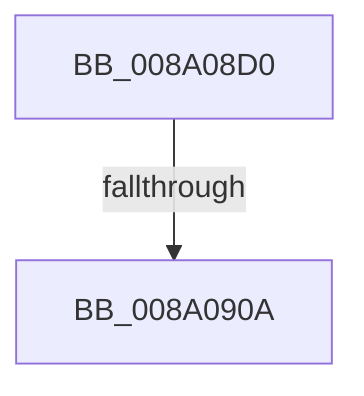

# IopCheckBackupRestorePrivilege

- RVA: `0x008A08D0`–`0x008A0916` (길이 `70` bytes)
- VA: `0x00000001408A08D0`
- 실행 섹션: `PAGE`
- PDB 이름 있음: `예`; PDB Function 태그: `아니요`
- unwind 정보 RVA: `0x0007E88C`
- 디코드: `18`개 명령, `70/70` bytes 표시
- 미해석 바이트: `0` (있으면 어셈블리에 `.byte`로 보존)

> 이 문서는 커널 이미지의 기계어와 PDB 기호를 분석해 생성했습니다. 4번과 5번은 함수 원형과 자료형을 바이너리 사용 방식에서 추정한 C 해석이며 원본 소스 복구 결과는 아닙니다.

## 1. Dependencies

- 직접 호출 지점: **0**; 고유 호출 대상: **0**
- 직접 호출자로 확인된 함수: **1**
- RIP 상대 이미지 참조: **1**

### Outgoing calls
- 직접 디코드된 call 명령이 없습니다.

### Direct callers
- [IopParseDevice](../89/IopParseDevice_function_0089E510.md) at `0x0089E7BD`

### Static image references
- `0x008A08DE` → RVA `0x00E0A740` (`.data`; read)

## 2. Other-region calls and transfers

- 다른 실행 섹션으로 향하는 call: **0**
- call이 아닌 외부 분기/꼬리 이동: **2**
  - `0x008A0904` → [sub_008A0A68](Unknown_function_008A0A68.md) (`tail-transfer`)
  - `0x008A0910` → [sub_008A0A68](Unknown_function_008A0A68.md) (`tail-transfer`)

## 3. Assembly (complete function range)

```asm
008A08D0  4C 8B DC                        mov r11, rsp
008A08D3  53                              push rbx
008A08D4  56                              push rsi
008A08D5  41 56                           push r14
008A08D7  48 81 EC 80 00 00 00            sub rsp, 0x80
008A08DE  48 8B 05 5B 9E 56 00            mov rax, qword ptr [rip + 0x569e5b]
008A08E5  48 33 C4                        xor rax, rsp
008A08E8  48 89 44 24 50                  mov qword ptr [rsp + 0x50], rax
008A08ED  48 8B F2                        mov rsi, rdx
008A08F0  44 88 44 24 30                  mov byte ptr [rsp + 0x30], r8b
008A08F5  32 D2                           xor dl, dl
008A08F7  48 8B D9                        mov rbx, rcx
008A08FA  8B 49 0C                        mov ecx, dword ptr [rcx + 0xc]
008A08FD  45 32 F6                        xor r14b, r14b
008A0900  0F BA E1 08                     bt ecx, 8
008A0904  0F 82 5E 01 00 00               jb 0x1408a0a68
008A090A  F7 06 00 40 00 00               test dword ptr [rsi], 0x4000
008A0910  0F 84 52 01 00 00               je 0x1408a0a68
```

## 4. C-style interpretation (structured pseudocode)

```c
__int64 __fastcall IopCheckBackupRestorePrivilege(__int64 a1, __int64 a2, unsigned __int8 a3)
{
    __int64 result;
    __int64 v_r14;
    __int64 v_rsp;
    unsigned __int64 v_stack_m48;
    unsigned __int8 v_stack_m68;

    v_rsp = (v_rsp) - (128);
    result = (*(unsigned __int64 *)(v_rip + 5676635)) ^ (v_rsp);
    v_stack_m48 = result;
    v_stack_m68 = a3;
    a2 = 0;
    v_r14 = 0;
}
```

## 5. (Beta) C Style

```c
int64_t IopCheckBackupRestorePrivilege(void *Arg1, void *Arg2, uint8_t Arg3)
{
    uint8_t *arg1 = (uint8_t *)Arg1;
    uint8_t *arg2 = (uint8_t *)Arg2;

    int64_t result;
    int64_t local_r14;
    int64_t local_rsp;
    uint64_t v_stack_m48;
    uint8_t v_stack_m68;

    local_rsp = (local_rsp) - (128);
    result = (*(uint64_t *)(v_rip + 0x569E5B)) ^ (local_rsp);
    v_stack_m48 = result;
    v_stack_m68 = Arg3;
    Arg2 = 0;
    local_r14 = 0;
}
```

### 관측된 메모리 오프셋

구조체 형식이 확인되지 않은 접근은 인자 기준의 오프셋으로만 기록했습니다.

| 기준 인자 | 오프셋 표현 | 폭 (bit) | 접근 |
|---|---:|---:|---|
| `Arg1` | `+ 0xC` | `32` | `R` |
| `Arg2` | `+ 0x0` | `32` | `R` |

## 6. Execution-region graph

[열기: 2D/3D 그래프와 함수 탐색 컨트롤 패널](../../../control-panel.html?section=page&rva=0x008A08D0&view=graph)

- 2D 그래프는 위에서 아래로 흐르고, 3D 그래프는 빈 공간을 드래그해 회전합니다. Shift+드래그는 이동, 휠은 확대·축소, 함수 노드 선택은 대상 보고서 이동입니다.

### Static fallback


