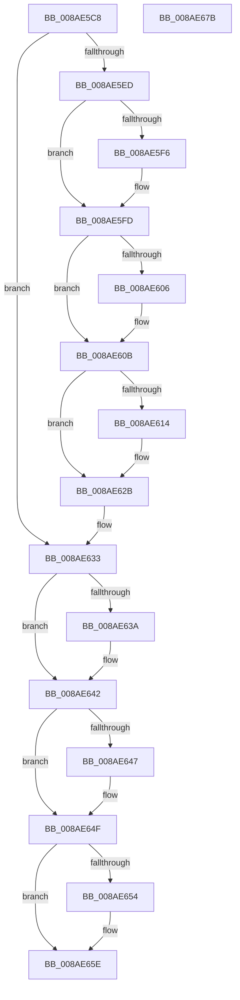

# IopExceptionCleanupEx

- RVA: `0x008AE5C8`–`0x008AE67C` (길이 `180` bytes)
- VA: `0x00000001408AE5C8`
- 실행 섹션: `PAGE`
- PDB 이름 있음: `예`; PDB Function 태그: `아니요`
- unwind 정보 RVA: `0x0005C954`
- 디코드: `51`개 명령, `180/180` bytes 표시
- 미해석 바이트: `0` (있으면 어셈블리에 `.byte`로 보존)

> 이 문서는 커널 이미지의 기계어와 PDB 기호를 분석해 생성했습니다. 4번과 5번은 함수 원형과 자료형을 바이너리 사용 방식에서 추정한 C 해석이며 원본 소스 복구 결과는 아닙니다.

## 1. Dependencies

- 직접 호출 지점: **8**; 고유 호출 대상: **6**
- 직접 호출자로 확인된 함수: **21**
- RIP 상대 이미지 참조: **0**

### Outgoing calls
- `0x008AE5F8` → [ExFreePoolWithTag](../../poolcode/B8/ExFreePoolWithTag_function_00B82870.md) (function, `0x00B82870`)
- `0x008AE606` → [IoFreeMdl](../../text/29/IoFreeMdl_function_0029EA80.md) (function, `0x0029EA80`)
- `0x008AE621` → [ObfDereferenceObjectWithTag](../../text/2F/ObfDereferenceObjectWithTag_function_002F78E0.md) (function, `0x002F78E0`)
- `0x008AE62E` → [IoFreeIrp](../../text/24/IoFreeIrp_function_0024DF70.md) (function, `0x0024DF70`)
- `0x008AE63D` → [IopReleaseFileObjectLock](../../text/25/IopReleaseFileObjectLock_function_00250A90.md) (function, `0x00250A90`)
- `0x008AE64A` → [ObfDereferenceObject](../../text/2F/ObfDereferenceObject_function_002F9350.md) (function, `0x002F9350`)
- `0x008AE659` → [ExFreePoolWithTag](../../poolcode/B8/ExFreePoolWithTag_function_00B82870.md) (function, `0x00B82870`)
- `0x008AE661` → [ObfDereferenceObject](../../text/2F/ObfDereferenceObject_function_002F9350.md) (function, `0x002F9350`)

### Direct callers
- [NtSetInformationFile](../../text/29/NtSetInformationFile_function_0029C5E0.md) at `0x0029CC71`
- [IopAllocateAndPopulateWriteIrp](../../text/40/IopAllocateAndPopulateWriteIrp_function_004011F4.md) at `0x00401552`
- [IopFreeCopyObjectsFromDataBuffer](../../text/4C/IopFreeCopyObjectsFromDataBuffer_function_004C201C.md) at `0x004C20A5`
- [IopSetEaOrQuotaInformationFile](../71/IopSetEaOrQuotaInformationFile_function_0071BD70.md) at `0x0071C0AC`
- [IopSetEaOrQuotaInformationFile](../71/IopSetEaOrQuotaInformationFile_function_0071BD70.md) at `0x0071C142`
- [NtQueryQuotaInformationFile](../72/NtQueryQuotaInformationFile_function_00720FE0.md) at `0x00721575`
- [NtQueryQuotaInformationFile](../72/NtQueryQuotaInformationFile_function_00720FE0.md) at `0x00721649`
- [NtSetVolumeInformationFile](../72/NtSetVolumeInformationFile_function_00721750.md) at `0x00721B4D`
- [NtSetVolumeInformationFile](../72/NtSetVolumeInformationFile_function_00721750.md) at `0x00721C67`
- [NtQueryEaFile](NtQueryEaFile_function_008AC1B0.md) at `0x008AC841`
- [NtQueryVolumeInformationFile](NtQueryVolumeInformationFile_function_008AC8C0.md) at `0x008ACE27`
- [NtQueryInformationFile](NtQueryInformationFile_function_008AD630.md) at `0x008ADFE3`
- [IopReadFile](IopReadFile_function_008AEFF0.md) at `0x008AF8F4`
- [IopXxxControlFile](../8E/IopXxxControlFile_function_008E9AD0.md) at `0x008EA3CE`
- [IopXxxControlFile](../8E/IopXxxControlFile_function_008E9AD0.md) at `0x008EAA92`
- [IopXxxControlFile](../8E/IopXxxControlFile_function_008E9AD0.md) at `0x008EB133`
- [BuildQueryDirectoryIrp](../8E/BuildQueryDirectoryIrp_function_008EC770.md) at `0x008ECEE2`
- [NtLockFile](../9D/NtLockFile_function_009D86D0.md) at `0x009D8C73`
- [NtUnlockFile](../9E/NtUnlockFile_function_009E5DA0.md) at `0x009E613A`
- [NtNotifyChangeDirectoryFileEx](../A1/NtNotifyChangeDirectoryFileEx_function_00A1DEA0.md) at `0x00A1E2C2`
- [IopReadFileScatter](../AA/IopReadFileScatter_function_00AA5D78.md) at `0x00AA60D3`
- [IopWriteFileGather](../AA/IopWriteFileGather_function_00AAA95C.md) at `0x00AAAFFC`
- [sub_00B1A404](../B1/Unknown_function_00B1A404.md) at `0x00B1A49A`
- [sub_00B1D822](../B1/Unknown_function_00B1D822.md) at `0x00B1D88C`
- [sub_00B3738C](../B3/Unknown_function_00B3738C.md) at `0x00B3740C`
- [sub_00B41AB2](../B4/Unknown_function_00B41AB2.md) at `0x00B41B57`
- [sub_00B41AB2](../B4/Unknown_function_00B41AB2.md) at `0x00B41C05`

### Static image references
- 디코드된 RIP-relative 메모리 참조가 없습니다.

## 2. Other-region calls and transfers

- 다른 실행 섹션으로 향하는 call: **8**
  - `0x008AE5F8` → [ExFreePoolWithTag](../../poolcode/B8/ExFreePoolWithTag_function_00B82870.md) (`PAGE` → `POOLCODE`)
  - `0x008AE606` → [IoFreeMdl](../../text/29/IoFreeMdl_function_0029EA80.md) (`PAGE` → `.text`)
  - `0x008AE621` → [ObfDereferenceObjectWithTag](../../text/2F/ObfDereferenceObjectWithTag_function_002F78E0.md) (`PAGE` → `.text`)
  - `0x008AE62E` → [IoFreeIrp](../../text/24/IoFreeIrp_function_0024DF70.md) (`PAGE` → `.text`)
  - `0x008AE63D` → [IopReleaseFileObjectLock](../../text/25/IopReleaseFileObjectLock_function_00250A90.md) (`PAGE` → `.text`)
  - `0x008AE64A` → [ObfDereferenceObject](../../text/2F/ObfDereferenceObject_function_002F9350.md) (`PAGE` → `.text`)
  - `0x008AE659` → [ExFreePoolWithTag](../../poolcode/B8/ExFreePoolWithTag_function_00B82870.md) (`PAGE` → `POOLCODE`)
  - `0x008AE661` → [ObfDereferenceObject](../../text/2F/ObfDereferenceObject_function_002F9350.md) (`PAGE` → `.text`)
- 별도 외부 분기/꼬리 이동을 확인하지 못했습니다.

## 3. Assembly (complete function range)

```asm
008AE5C8  48 89 5C 24 08                  mov qword ptr [rsp + 8], rbx
008AE5CD  48 89 6C 24 10                  mov qword ptr [rsp + 0x10], rbp
008AE5D2  48 89 74 24 18                  mov qword ptr [rsp + 0x18], rsi
008AE5D7  57                              push rdi
008AE5D8  48 83 EC 20                     sub rsp, 0x20
008AE5DC  49 8B F9                        mov rdi, r9
008AE5DF  49 8B E8                        mov rbp, r8
008AE5E2  48 8B DA                        mov rbx, rdx
008AE5E5  48 8B F1                        mov rsi, rcx
008AE5E8  48 85 D2                        test rdx, rdx
008AE5EB  74 46                           je 0x1408ae633
008AE5ED  48 8B 4A 18                     mov rcx, qword ptr [rdx + 0x18]
008AE5F1  48 85 C9                        test rcx, rcx
008AE5F4  74 07                           je 0x1408ae5fd
008AE5F6  33 D2                           xor edx, edx
008AE5F8  E8 73 42 2D 00                  call 0x140b82870
008AE5FD  48 8B 4B 08                     mov rcx, qword ptr [rbx + 8]
008AE601  48 85 C9                        test rcx, rcx
008AE604  74 05                           je 0x1408ae60b
008AE606  E8 75 04 9F FF                  call 0x14029ea80
008AE60B  F7 43 10 00 00 20 00            test dword ptr [rbx + 0x10], 0x200000
008AE612  74 17                           je 0x1408ae62b
008AE614  48 8B 4B 60                     mov rcx, qword ptr [rbx + 0x60]
008AE618  BA 49 6F 52 49                  mov edx, 0x49526f49
008AE61D  48 83 E1 F8                     and rcx, 0xfffffffffffffff8
008AE621  E8 BA 92 A4 FF                  call 0x1402f78e0
008AE626  0F BA 73 10 15                  btr dword ptr [rbx + 0x10], 0x15
008AE62B  48 8B CB                        mov rcx, rbx
008AE62E  E8 3D F9 99 FF                  call 0x14024df70
008AE633  80 7C 24 50 00                  cmp byte ptr [rsp + 0x50], 0
008AE638  74 08                           je 0x1408ae642
008AE63A  48 8B CE                        mov rcx, rsi
008AE63D  E8 4E 24 9A FF                  call 0x140250a90
008AE642  48 85 ED                        test rbp, rbp
008AE645  74 08                           je 0x1408ae64f
008AE647  48 8B CD                        mov rcx, rbp
008AE64A  E8 01 AD A4 FF                  call 0x1402f9350
008AE64F  48 85 FF                        test rdi, rdi
008AE652  74 0A                           je 0x1408ae65e
008AE654  33 D2                           xor edx, edx
008AE656  48 8B CF                        mov rcx, rdi
008AE659  E8 12 42 2D 00                  call 0x140b82870
008AE65E  48 8B CE                        mov rcx, rsi
008AE661  E8 EA AC A4 FF                  call 0x1402f9350
008AE666  48 8B 5C 24 30                  mov rbx, qword ptr [rsp + 0x30]
008AE66B  48 8B 6C 24 38                  mov rbp, qword ptr [rsp + 0x38]
008AE670  48 8B 74 24 40                  mov rsi, qword ptr [rsp + 0x40]
008AE675  48 83 C4 20                     add rsp, 0x20
008AE679  5F                              pop rdi
008AE67A  C3                              ret
008AE67B  CC                              int3
```

## 4. C-style interpretation (structured pseudocode)

```c
__int64 __fastcall IopExceptionCleanupEx(__int64 a1, __int64 a2, __int64 a3, __int64 a4, unsigned __int8 a5)
{
    __int64 result;
    __int64 v_rsp;
    unsigned __int64 v_stack_p10;
    unsigned __int64 v_stack_p18;
    unsigned __int64 v_stack_p8;

    v_stack_p8 = v_rbx;
    v_stack_p10 = v_rbp;
    v_stack_p18 = v_rsi;
    v_rsp = (v_rsp) - (32);
    if (a2 == 0) goto loc_008AE633;
    if (*(unsigned __int64 *)(a2 + 24) != 0) {
        a2 = 0;
        result = ExFreePoolWithTag(*(unsigned __int64 *)(a2 + 24), a2, a3, a4);
    }
    if (*(unsigned __int64 *)(a2 + 8) != 0) {
        result = IoFreeMdl(*(unsigned __int64 *)(a2 + 8), a2, a3, a4);
    }
    if (((*(unsigned int *)(a2 + 16)) & (0x200000ULL)) != 0) {
        a1 = *(unsigned __int64 *)(a2 + 96);
        a2 = 0x49526F49ULL;
        a1 = (a1) & (-8);
        result = ObfDereferenceObjectWithTag(a1, a2, a3, a4);
    }
    result = IoFreeIrp(a2, a2, a3, a4);
loc_008AE633:
    if (a5 != 0) {
        a1 = a1;
        result = IopReleaseFileObjectLock(a1, a2, a3, a4);
    }
    if (a3 != 0) {
        a1 = a3;
        result = ObfDereferenceObject(a1, a2, a3, a4);
    }
    if (a4 != 0) {
        a2 = 0;
        a1 = a4;
        result = ExFreePoolWithTag(a1, a2, a3, a4);
    }
    result = ObfDereferenceObject(a1, a2, a3, a4);
    v_rsp = (v_rsp) + (32);
    return result;
}
```

## 5. (Beta) C Style

```c
int64_t IopExceptionCleanupEx(int64_t Arg1, void *Arg2, int64_t Arg3, int64_t Arg4, uint8_t Arg5)
{
    uint8_t *arg2 = (uint8_t *)Arg2;

    int64_t result;
    int64_t local_rsp;
    uint64_t v_stack_p10;
    uint64_t v_stack_p18;
    uint64_t v_stack_p8;

    v_stack_p8 = local_rbx;
    v_stack_p10 = local_rbp;
    v_stack_p18 = local_rsi;
    local_rsp = (local_rsp) - (32);
    if (Arg2 == NULL) goto loc_008AE633;
    if (*(uint64_t *)(arg2 + 0x18) != 0) {
        Arg2 = 0;
        result = ExFreePoolWithTag(*(uint64_t *)(arg2 + 0x18), Arg2, Arg3, Arg4);
    }
    if (*(uint64_t *)(arg2 + 0x8) != 0) {
        result = IoFreeMdl(*(uint64_t *)(arg2 + 0x8), Arg2, Arg3, Arg4);
    }
    if (((*(uint32_t *)(arg2 + 0x10)) & (0x200000ULL)) != 0) {
        Arg1 = *(uint64_t *)(arg2 + 0x60);
        Arg2 = 0x49526F49ULL;
        Arg1 = (Arg1) & (-8);
        result = ObfDereferenceObjectWithTag(Arg1, Arg2, Arg3, Arg4);
    }
    result = IoFreeIrp(Arg2, Arg2, Arg3, Arg4);
loc_008AE633:
    if (Arg5 != 0) {
        Arg1 = Arg1;
        result = IopReleaseFileObjectLock(Arg1, Arg2, Arg3, Arg4);
    }
    if (Arg3 != 0) {
        Arg1 = Arg3;
        result = ObfDereferenceObject(Arg1, Arg2, Arg3, Arg4);
    }
    if (Arg4 != 0) {
        Arg2 = 0;
        Arg1 = Arg4;
        result = ExFreePoolWithTag(Arg1, Arg2, Arg3, Arg4);
    }
    result = ObfDereferenceObject(Arg1, Arg2, Arg3, Arg4);
    local_rsp = (local_rsp) + (32);
    return result;
}
```

### 관측된 메모리 오프셋

구조체 형식이 확인되지 않은 접근은 인자 기준의 오프셋으로만 기록했습니다.

| 기준 인자 | 오프셋 표현 | 폭 (bit) | 접근 |
|---|---:|---:|---|
| `Arg2` | `+ 0x8` | `64` | `R` |
| `Arg2` | `+ 0x10` | `32` | `R` |
| `Arg2` | `+ 0x10` | `32` | `R/W` |
| `Arg2` | `+ 0x60` | `64` | `R` |

## 6. Execution-region graph

[열기: 2D/3D 그래프와 함수 탐색 컨트롤 패널](../../../control-panel.html?section=page&rva=0x008AE5C8&view=graph)

- 2D 그래프는 위에서 아래로 흐르고, 3D 그래프는 빈 공간을 드래그해 회전합니다. Shift+드래그는 이동, 휠은 확대·축소, 함수 노드 선택은 대상 보고서 이동입니다.

### Static fallback


