# IopFlushBuffersFile

- RVA: `0x008ACFA4`–`0x008AD383` (길이 `991` bytes)
- VA: `0x00000001408ACFA4`
- 실행 섹션: `PAGE`
- PDB 이름 있음: `예`; PDB Function 태그: `아니요`
- unwind 정보 RVA: `0x0007F850`
- 디코드: `237`개 명령, `991/991` bytes 표시
- 미해석 바이트: `0` (있으면 어셈블리에 `.byte`로 보존)

> 이 문서는 커널 이미지의 기계어와 PDB 기호를 분석해 생성했습니다. 4번과 5번은 함수 원형과 자료형을 바이너리 사용 방식에서 추정한 C 해석이며 원본 소스 복구 결과는 아닙니다.

## 1. Dependencies

- 직접 호출 지점: **14**; 고유 호출 대상: **14**
- 직접 호출자로 확인된 함수: **2**
- RIP 상대 이미지 참조: **0**

### Outgoing calls
- `0x008AD0CE` → [KeAbPreAcquire](../../text/21/KeAbPreAcquire_function_00210230.md) (function, `0x00210230`)
- `0x008AD0F4` → [ObfReferenceObject](../../text/20/ObfReferenceObject_function_0020FA20.md) (function, `0x0020FA20`)
- `0x008AD116` → [IopResetEvent](../../text/29/IopResetEvent_function_0029D5F0.md) (function, `0x0029D5F0`)
- `0x008AD11E` → [IoGetRelatedDeviceObject](../../text/29/IoGetRelatedDeviceObject_function_0029B120.md) (function, `0x0029B120`)
- `0x008AD12F` → [IopAllocateIrpExReturn](../../text/20/IopAllocateIrpExReturn_function_00207720.md) (function, `0x00207720`)
- `0x008AD1DF` → [IopSynchronousServiceTail](../8E/IopSynchronousServiceTail_function_008EB440.md) (function, `0x008EB440`)
- `0x008AD23C` → [ExAllocatePool2](../../poolcode/B8/ExAllocatePool2_function_00B820F0.md) (function, `0x00B820F0`)
- `0x008AD257` → [KeInitializeEvent](../../text/40/KeInitializeEvent_function_0040DD10.md) (function, `0x0040DD10`)
- `0x008AD27A` → [ObfReferenceObjectWithTag](../../text/21/ObfReferenceObjectWithTag_function_00210710.md) (function, `0x00210710`)
- `0x008AD2E1` → [IopSynchronousApiServiceTail](IopSynchronousApiServiceTail_function_008ACE3C.md) (function, `0x008ACE3C`)
- `0x008AD31A` → [IopWaitAndAcquireFileObjectLock](IopWaitAndAcquireFileObjectLock_function_008AE6D8.md) (function, `0x008AE6D8`)
- `0x008AD32E` → [ObfDereferenceObject](../../text/2F/ObfDereferenceObject_function_002F9350.md) (function, `0x002F9350`)
- `0x008AD36F` → [ExFreePoolWithTag](../../poolcode/B8/ExFreePoolWithTag_function_00B82870.md) (function, `0x00B82870`)
- `0x008AD37C` → [IopReleaseFileObjectLock](../../text/25/IopReleaseFileObjectLock_function_00250A90.md) (function, `0x00250A90`)

### Direct callers
- [IopIoRingDispatchFlush](../71/IopIoRingDispatchFlush_function_0071FA2C.md) at `0x0071FAC8`
- [NtFlushBuffersFileEx](NtFlushBuffersFileEx_function_008ACF10.md) at `0x008ACF87`

### Static image references
- 디코드된 RIP-relative 메모리 참조가 없습니다.

## 2. Other-region calls and transfers

- 다른 실행 섹션으로 향하는 call: **11**
  - `0x008AD0CE` → [KeAbPreAcquire](../../text/21/KeAbPreAcquire_function_00210230.md) (`PAGE` → `.text`)
  - `0x008AD0F4` → [ObfReferenceObject](../../text/20/ObfReferenceObject_function_0020FA20.md) (`PAGE` → `.text`)
  - `0x008AD116` → [IopResetEvent](../../text/29/IopResetEvent_function_0029D5F0.md) (`PAGE` → `.text`)
  - `0x008AD11E` → [IoGetRelatedDeviceObject](../../text/29/IoGetRelatedDeviceObject_function_0029B120.md) (`PAGE` → `.text`)
  - `0x008AD12F` → [IopAllocateIrpExReturn](../../text/20/IopAllocateIrpExReturn_function_00207720.md) (`PAGE` → `.text`)
  - `0x008AD23C` → [ExAllocatePool2](../../poolcode/B8/ExAllocatePool2_function_00B820F0.md) (`PAGE` → `POOLCODE`)
  - `0x008AD257` → [KeInitializeEvent](../../text/40/KeInitializeEvent_function_0040DD10.md) (`PAGE` → `.text`)
  - `0x008AD27A` → [ObfReferenceObjectWithTag](../../text/21/ObfReferenceObjectWithTag_function_00210710.md) (`PAGE` → `.text`)
  - `0x008AD32E` → [ObfDereferenceObject](../../text/2F/ObfDereferenceObject_function_002F9350.md) (`PAGE` → `.text`)
  - `0x008AD36F` → [ExFreePoolWithTag](../../poolcode/B8/ExFreePoolWithTag_function_00B82870.md) (`PAGE` → `POOLCODE`)
  - `0x008AD37C` → [IopReleaseFileObjectLock](../../text/25/IopReleaseFileObjectLock_function_00250A90.md) (`PAGE` → `.text`)
- 별도 외부 분기/꼬리 이동을 확인하지 못했습니다.

## 3. Assembly (complete function range)

```asm
008ACFA4  48 8B C4                        mov rax, rsp
008ACFA7  48 89 70 10                     mov qword ptr [rax + 0x10], rsi
008ACFAB  48 89 48 08                     mov qword ptr [rax + 8], rcx
008ACFAF  57                              push rdi
008ACFB0  41 54                           push r12
008ACFB2  41 55                           push r13
008ACFB4  41 56                           push r14
008ACFB6  41 57                           push r15
008ACFB8  48 83 EC 70                     sub rsp, 0x70
008ACFBC  44 8B EA                        mov r13d, edx
008ACFBF  48 8B F1                        mov rsi, rcx
008ACFC2  0F 57 C0                        xorps xmm0, xmm0
008ACFC5  0F 11 40 C0                     movups xmmword ptr [rax - 0x40], xmm0
008ACFC9  45 33 E4                        xor r12d, r12d
008ACFCC  4C 89 64 24 48                  mov qword ptr [rsp + 0x48], r12
008ACFD1  45 32 D2                        xor r10b, r10b
008ACFD4  44 88 94 24 B0 00 00 00         mov byte ptr [rsp + 0xb0], r10b
008ACFDC  44 21 60 AC                     and dword ptr [rax - 0x54], r12d
008ACFE0  4D 85 C0                        test r8, r8
008ACFE3  0F 85 62 03 00 00               jne 0x1408ad34b
008ACFE9  45 85 C9                        test r9d, r9d
008ACFEC  0F 85 59 03 00 00               jne 0x1408ad34b
008ACFF2  4C 8B BC 24 C8 00 00 00         mov r15, qword ptr [rsp + 0xc8]
008ACFFA  48 8B 94 24 D8 00 00 00         mov rdx, qword ptr [rsp + 0xd8]
008AD002  4D 85 FF                        test r15, r15
008AD005  0F 85 3B 03 00 00               jne 0x1408ad346
008AD00B  48 85 D2                        test rdx, rdx
008AD00E  0F 84 37 03 00 00               je 0x1408ad34b
008AD014  65 48 8B 04 25 88 01 00 00      mov rax, qword ptr gs:[0x188]
008AD01D  48 89 44 24 50                  mov qword ptr [rsp + 0x50], rax
008AD022  44 8A B0 32 02 00 00            mov r14b, byte ptr [rax + 0x232]
008AD029  44 88 74 24 41                  mov byte ptr [rsp + 0x41], r14b
008AD02E  8B 41 50                        mov eax, dword ptr [rcx + 0x50]
008AD031  A8 02                           test al, 2
008AD033  0F 84 28 02 00 00               je 0x1408ad261
008AD039  4D 85 FF                        test r15, r15
008AD03C  0F 85 1F 02 00 00               jne 0x1408ad261
008AD042  41 B0 01                        mov r8b, 1
008AD045  44 88 44 24 40                  mov byte ptr [rsp + 0x40], r8b
008AD04A  45 84 F6                        test r14b, r14b
008AD04D  74 35                           je 0x1408ad084
008AD04F  4D 85 FF                        test r15, r15
008AD052  75 30                           jne 0x1408ad084
008AD054  48 B9 00 00 FF FF FF 7F 00 00   movabs rcx, 0x7fffffff0000
008AD05E  48 3B D1                        cmp rdx, rcx
008AD061  48 0F 42 CA                     cmovb rcx, rdx
008AD065  8B 01                           mov eax, dword ptr [rcx]
008AD067  89 01                           mov dword ptr [rcx], eax
008AD069  EB 19                           jmp 0x1408ad084
008AD06B  48 8B B4 24 A0 00 00 00         mov rsi, qword ptr [rsp + 0xa0]
008AD073  8B 7C 24 44                     mov edi, dword ptr [rsp + 0x44]
008AD077  4C 8B 64 24 48                  mov r12, qword ptr [rsp + 0x48]
008AD07C  45 8A F4                        mov r14b, r12b
008AD07F  E9 77 01 00 00                  jmp 0x1408ad1fb
008AD084  8B 7E 50                        mov edi, dword ptr [rsi + 0x50]
008AD087  8B C7                           mov eax, edi
008AD089  C1 E8 05                        shr eax, 5
008AD08C  F7 D0                           not eax
008AD08E  83 E0 04                        and eax, 4
008AD091  83 C8 02                        or eax, 2
008AD094  84 84 24 C0 00 00 00            test byte ptr [rsp + 0xc0], al
008AD09B  0F 84 59 02 00 00               je 0x1408ad2fa
008AD0A1  45 84 C0                        test r8b, r8b
008AD0A4  0F 84 7C 01 00 00               je 0x1408ad226
008AD0AA  C1 EF 02                        shr edi, 2
008AD0AD  40 80 E7 01                     and dil, 1
008AD0B1  65 48 8B 04 25 88 01 00 00      mov rax, qword ptr gs:[0x188]
008AD0BA  66 FF 88 E4 01 00 00            dec word ptr [rax + 0x1e4]
008AD0C1  90                              nop
008AD0C2  48 8D 8E 80 00 00 00            lea rcx, [rsi + 0x80]
008AD0C9  45 33 C0                        xor r8d, r8d
008AD0CC  33 D2                           xor edx, edx
008AD0CE  E8 5D 31 96 FF                  call 0x140210230
008AD0D3  C6 44 24 42 00                  mov byte ptr [rsp + 0x42], 0
008AD0D8  B9 01 00 00 00                  mov ecx, 1
008AD0DD  87 4E 74                        xchg dword ptr [rsi + 0x74], ecx
008AD0E0  85 C9                           test ecx, ecx
008AD0E2  0F 85 1C 02 00 00               jne 0x1408ad304
008AD0E8  48 85 C0                        test rax, rax
008AD0EB  74 04                           je 0x1408ad0f1
008AD0ED  C6 40 0A 01                     mov byte ptr [rax + 0xa], 1
008AD0F1  48 8B CE                        mov rcx, rsi
008AD0F4  E8 27 29 96 FF                  call 0x14020fa20
008AD0F9  33 FF                           xor edi, edi
008AD0FB  80 7C 24 42 00                  cmp byte ptr [rsp + 0x42], 0
008AD100  0F 85 ED 00 00 00               jne 0x1408ad1f3
008AD106  C6 84 24 B0 00 00 00 01         mov byte ptr [rsp + 0xb0], 1
008AD10E  4D 85 FF                        test r15, r15
008AD111  75 08                           jne 0x1408ad11b
008AD113  48 8B CE                        mov rcx, rsi
008AD116  E8 D5 04 9F FF                  call 0x14029d5f0
008AD11B  48 8B CE                        mov rcx, rsi
008AD11E  E8 FD DF 9E FF                  call 0x14029b120
008AD123  48 8B F8                        mov rdi, rax
008AD126  45 33 C0                        xor r8d, r8d
008AD129  8A 50 4C                        mov dl, byte ptr [rax + 0x4c]
008AD12C  48 8B C8                        mov rcx, rax
008AD12F  E8 EC A5 95 FF                  call 0x140207720
008AD134  4C 8B F0                        mov r14, rax
008AD137  48 85 C0                        test rax, rax
008AD13A  0F 84 B0 01 00 00               je 0x1408ad2f0
008AD140  48 89 B0 C0 00 00 00            mov qword ptr [rax + 0xc0], rsi
008AD147  48 8B 44 24 50                  mov rax, qword ptr [rsp + 0x50]
008AD14C  49 89 86 98 00 00 00            mov qword ptr [r14 + 0x98], rax
008AD153  8A 54 24 41                     mov dl, byte ptr [rsp + 0x41]
008AD157  41 88 56 40                     mov byte ptr [r14 + 0x40], dl
008AD15B  41 83 66 10 00                  and dword ptr [r14 + 0x10], 0
008AD160  4D 85 FF                        test r15, r15
008AD163  0F 85 09 01 00 00               jne 0x1408ad272
008AD169  8A 4C 24 40                     mov cl, byte ptr [rsp + 0x40]
008AD16D  84 C9                           test cl, cl
008AD16F  0F 84 29 01 00 00               je 0x1408ad29e
008AD175  4D 21 7E 50                     and qword ptr [r14 + 0x50], r15
008AD179  48 8B 84 24 D8 00 00 00         mov rax, qword ptr [rsp + 0xd8]
008AD181  49 89 46 48                     mov qword ptr [r14 + 0x48], rax
008AD185  49 83 66 58 00                  and qword ptr [r14 + 0x58], 0
008AD18A  49 8B 86 B8 00 00 00            mov rax, qword ptr [r14 + 0xb8]
008AD191  C6 40 B8 09                     mov byte ptr [rax - 0x48], 9
008AD195  48 89 70 E8                     mov qword ptr [rax - 0x18], rsi
008AD199  41 F6 C5 01                     test r13b, 1
008AD19D  0F 85 C6 00 00 00               jne 0x1408ad269
008AD1A3  41 F6 C5 02                     test r13b, 2
008AD1A7  0F 85 AB 01 00 00               jne 0x1408ad358
008AD1AD  41 F6 C5 04                     test r13b, 4
008AD1B1  0F 85 AA 01 00 00               jne 0x1408ad361
008AD1B7  41 C0 ED 03                     shr r13b, 3
008AD1BB  41 80 E5 01                     and r13b, 1
008AD1BF  44 88 68 B9                     mov byte ptr [rax - 0x47], r13b
008AD1C3  C7 44 24 30 02 00 00 00         mov dword ptr [rsp + 0x30], 2
008AD1CB  88 4C 24 28                     mov byte ptr [rsp + 0x28], cl
008AD1CF  88 54 24 20                     mov byte ptr [rsp + 0x20], dl
008AD1D3  45 33 C9                        xor r9d, r9d
008AD1D6  4C 8B C6                        mov r8, rsi
008AD1D9  49 8B D6                        mov rdx, r14
008AD1DC  48 8B CF                        mov rcx, rdi
008AD1DF  E8 5C E2 03 00                  call 0x1408eb440
008AD1E4  8B F8                           mov edi, eax
008AD1E6  33 F6                           xor esi, esi
008AD1E8  40 38 74 24 40                  cmp byte ptr [rsp + 0x40], sil
008AD1ED  0F 84 C1 00 00 00               je 0x1408ad2b4
008AD1F3  44 8A B4 24 B0 00 00 00         mov r14b, byte ptr [rsp + 0xb0]
008AD1FB  4D 85 E4                        test r12, r12
008AD1FE  0F 85 66 01 00 00               jne 0x1408ad36a
008AD204  48 85 F6                        test rsi, rsi
008AD207  0F 85 19 01 00 00               jne 0x1408ad326
008AD20D  8B C7                           mov eax, edi
008AD20F  48 8B B4 24 A8 00 00 00         mov rsi, qword ptr [rsp + 0xa8]
008AD217  48 83 C4 70                     add rsp, 0x70
008AD21B  41 5F                           pop r15
008AD21D  41 5E                           pop r14
008AD21F  41 5D                           pop r13
008AD221  41 5C                           pop r12
008AD223  5F                              pop rdi
008AD224  C3                              ret
008AD225  CC                              int3
008AD226  4D 85 FF                        test r15, r15
008AD229  0F 85 EC FE FF FF               jne 0x1408ad11b
008AD22F  41 8D 57 18                     lea edx, [r15 + 0x18]
008AD233  8D 4A 28                        lea ecx, [rdx + 0x28]
008AD236  41 B8 49 6F 45 76               mov r8d, 0x76456f49
008AD23C  E8 AF 4E 2D 00                  call 0x140b820f0
008AD241  4C 8B E0                        mov r12, rax
008AD244  48 85 C0                        test rax, rax
008AD247  0F 84 A3 00 00 00               je 0x1408ad2f0
008AD24D  45 33 C0                        xor r8d, r8d
008AD250  41 8D 57 01                     lea edx, [r15 + 1]
008AD254  48 8B C8                        mov rcx, rax
008AD257  E8 B4 0A B6 FF                  call 0x14040dd10
008AD25C  E9 AD FE FF FF                  jmp 0x1408ad10e
008AD261  45 32 C0                        xor r8b, r8b
008AD264  E9 DC FD FF FF                  jmp 0x1408ad045
008AD269  C6 40 B9 02                     mov byte ptr [rax - 0x47], 2
008AD26D  E9 51 FF FF FF                  jmp 0x1408ad1c3
008AD272  BA 49 6F 52 49                  mov edx, 0x49526f49
008AD277  49 8B CF                        mov rcx, r15
008AD27A  E8 91 34 96 FF                  call 0x140210710
008AD27F  41 0F BA 6E 10 15               bts dword ptr [r14 + 0x10], 0x15
008AD285  4D 89 7E 60                     mov qword ptr [r14 + 0x60], r15
008AD289  8A 4C 24 40                     mov cl, byte ptr [rsp + 0x40]
008AD28D  8A 54 24 41                     mov dl, byte ptr [rsp + 0x41]
008AD291  48 8B 84 24 D0 00 00 00         mov rax, qword ptr [rsp + 0xd0]
008AD299  E9 E3 FE FF FF                  jmp 0x1408ad181
008AD29E  4D 89 66 50                     mov qword ptr [r14 + 0x50], r12
008AD2A2  41 C7 46 10 04 00 00 00         mov dword ptr [r14 + 0x10], 4
008AD2AA  48 8D 44 24 58                  lea rax, [rsp + 0x58]
008AD2AF  E9 CD FE FF FF                  jmp 0x1408ad181
008AD2B4  4D 85 FF                        test r15, r15
008AD2B7  0F 85 36 FF FF FF               jne 0x1408ad1f3
008AD2BD  48 8B 84 24 D8 00 00 00         mov rax, qword ptr [rsp + 0xd8]
008AD2C5  48 89 44 24 28                  mov qword ptr [rsp + 0x28], rax
008AD2CA  48 8D 44 24 58                  lea rax, [rsp + 0x58]
008AD2CF  48 89 44 24 20                  mov qword ptr [rsp + 0x20], rax
008AD2D4  44 8A 4C 24 41                  mov r9b, byte ptr [rsp + 0x41]
008AD2D9  4D 8B C6                        mov r8, r14
008AD2DC  49 8B D4                        mov rdx, r12
008AD2DF  8B CF                           mov ecx, edi
008AD2E1  E8 56 FB FF FF                  call 0x1408ace3c
008AD2E6  8B F8                           mov edi, eax
008AD2E8  45 33 E4                        xor r12d, r12d
008AD2EB  E9 03 FF FF FF                  jmp 0x1408ad1f3
008AD2F0  BF 9A 00 00 C0                  mov edi, 0xc000009a
008AD2F5  E9 F9 FE FF FF                  jmp 0x1408ad1f3
008AD2FA  BF 22 00 00 C0                  mov edi, 0xc0000022
008AD2FF  E9 EF FE FF FF                  jmp 0x1408ad1f3
008AD304  48 8D 4C 24 42                  lea rcx, [rsp + 0x42]
008AD309  48 89 4C 24 20                  mov qword ptr [rsp + 0x20], rcx
008AD30E  4C 8B C8                        mov r9, rax
008AD311  44 8A C7                        mov r8b, dil
008AD314  41 8A D6                        mov dl, r14b
008AD317  48 8B CE                        mov rcx, rsi
008AD31A  E8 B9 13 00 00                  call 0x1408ae6d8
008AD31F  8B F8                           mov edi, eax
008AD321  E9 D5 FD FF FF                  jmp 0x1408ad0fb
008AD326  45 84 F6                        test r14b, r14b
008AD329  75 4E                           jne 0x1408ad379
008AD32B  48 8B CE                        mov rcx, rsi
008AD32E  E8 1D C0 A4 FF                  call 0x1402f9350
008AD333  E9 D5 FE FF FF                  jmp 0x1408ad20d
008AD338  4D 85 FF                        test r15, r15
008AD33B  0F 85 D3 FC FF FF               jne 0x1408ad014
008AD341  E9 C5 FC FF FF                  jmp 0x1408ad00b
008AD346  48 85 D2                        test rdx, rdx
008AD349  74 ED                           je 0x1408ad338
008AD34B  BF 0D 00 00 C0                  mov edi, 0xc000000d
008AD350  45 8A F2                        mov r14b, r10b
008AD353  E9 A3 FE FF FF                  jmp 0x1408ad1fb
008AD358  C6 40 B9 03                     mov byte ptr [rax - 0x47], 3
008AD35C  E9 62 FE FF FF                  jmp 0x1408ad1c3
008AD361  C6 40 B9 04                     mov byte ptr [rax - 0x47], 4
008AD365  E9 59 FE FF FF                  jmp 0x1408ad1c3
008AD36A  33 D2                           xor edx, edx
008AD36C  49 8B CC                        mov rcx, r12
008AD36F  E8 FC 54 2D 00                  call 0x140b82870
008AD374  E9 8B FE FF FF                  jmp 0x1408ad204
008AD379  48 8B CE                        mov rcx, rsi
008AD37C  E8 0F 37 9A FF                  call 0x140250a90
008AD381  EB A8                           jmp 0x1408ad32b
```

## 4. C-style interpretation (structured pseudocode)

```c
__int64 __fastcall IopFlushBuffersFile(__int64 a1, int a2, __int64 a3, int a4, __int64 a5, __int64 a6, __int64 a7, __int64 a8)
{
    __int64 result;
    __int64 v_r10;
    __int64 v_r12;
    __int64 v_r13;
    __int64 v_rdi;
    __int64 v_rsi;
    __int64 v_rsp;
    unsigned __int64 v_stack_m48;
    unsigned __int64 v_stack_m50;
    unsigned int v_stack_m54;
    unsigned __int8 v_stack_m56;
    unsigned __int8 v_stack_m57;
    unsigned __int8 v_stack_m58;
    unsigned int v_stack_m68;
    unsigned __int8 v_stack_m70;
    unsigned __int8 v_stack_m78;
    unsigned __int64 v_stack_p10;
    unsigned __int8 v_stack_p18;
    unsigned __int64 v_stack_p20;
    unsigned __int8 v_stack_p28;
    unsigned __int8 v_stack_p40;
    unsigned __int8 v_stack_p41;
    unsigned __int64 v_stack_p42;
    unsigned __int64 v_stack_p58;
    unsigned __int64 v_stack_p8;

    *(unsigned __int64 *)(v_rsp + 16) = v_rsi;
    *(unsigned __int64 *)(v_rsp + 8) = a1;
    v_rsp = (v_rsp) - (112);
    *(unsigned __int64 *)(v_rsp - 64) = v_xmm0;
    v_r12 = 0;
    v_stack_m50 = 0;
    v_r10 = 0;
    v_stack_p18 = 0;
    if (a3 != 0) goto loc_008AD34B;
    if (a4 != 0) goto loc_008AD34B;
    if (a6 != 0) goto loc_008AD346;
loc_008AD00B:
    if (a8 == 0) goto loc_008AD34B;
loc_008AD014:
    v_stack_m48 = *(unsigned __int64 *)(gs_base + (0 + 392));
    v_stack_m57 = (unsigned __int8)(*(unsigned __int8 *)(*(unsigned __int64 *)(gs_base + (0 + 392)) + 562));
    if ((((unsigned __int8)((unsigned int)(*(unsigned int *)(a1 + 80)))) & (2)) == 0) goto loc_008AD261;
    if (a6 != 0) goto loc_008AD261;
loc_008AD045:
    v_stack_m58 = 1;
    if ((unsigned __int8)(*(unsigned __int8 *)(*(unsigned __int64 *)(gs_base + (0 + 392)) + 562)) == 0) goto loc_008AD084;
    if (a6 != 0) goto loc_008AD084;
    if (a8 < a1) { a1 = a8; }
    *(unsigned int *)(a1) = (unsigned int)((unsigned int)(*(unsigned int *)(a1)));
    goto loc_008AD084;
loc_008AD084:
    result = (unsigned int)(((unsigned int)((unsigned int)((unsigned int)(*(unsigned int *)(a1 + 80))))) >> (5));
    result = (unsigned int)(~(result));
    result = (unsigned int)((result) & (4));
    result = (unsigned int)((result) | (2));
    if (((v_stack_p28) & ((unsigned __int8)(result))) == 0) goto loc_008AD2FA;
    if (1 == 0) goto loc_008AD226;
    v_rdi = (unsigned int)(((unsigned int)(*(unsigned int *)(a1 + 80))) >> (2));
    v_rdi = (unsigned __int8)((v_rdi) & (1));
    a3 = 0;
    a2 = 0;
    result = KeAbPreAcquire(a1 + 128, a2, a3, a4);
    v_stack_m56 = 0;
    if (1 != 0) goto loc_008AD304;
    if (result != 0) {
        *(unsigned __int8 *)(result + 10) = 1;
    }
    result = ObfReferenceObject(a1, a2, a3, a4);
    v_rdi = 0;
loc_008AD0FB:
    if (v_stack_m56 != 0) goto loc_008AD1F3;
    v_stack_p18 = 1;
loc_008AD10E:
    if (a6 == 0) {
        a1 = a1;
        result = IopResetEvent(a1, a2, a3, a4);
    }
    result = IoGetRelatedDeviceObject(a1, a2, a3, a4);
    a3 = 0;
    result = IopAllocateIrpExReturn(result, *(unsigned __int8 *)(result + 76), a3, a4);
    if (result == 0) goto loc_008AD2F0;
    *(unsigned __int64 *)(result + 192) = a1;
    *(unsigned __int64 *)(result + 152) = v_stack_m48;
    *(unsigned __int8 *)(result + 64) = (unsigned __int8)(v_stack_m57);
    if (a6 != 0) goto loc_008AD272;
    if ((unsigned __int8)(v_stack_m58) == 0) goto loc_008AD29E;
loc_008AD181:
    *(unsigned __int64 *)(result + 72) = a8;
    *(unsigned __int8 *)(*(unsigned __int64 *)(result + 184) - 72) = 9;
    *(unsigned __int64 *)(*(unsigned __int64 *)(result + 184) - 24) = a1;
    if ((((unsigned __int8)((unsigned int)(a2))) & (1)) != 0) goto loc_008AD269;
    if ((((unsigned __int8)((unsigned int)(a2))) & (2)) != 0) goto loc_008AD358;
    if ((((unsigned __int8)((unsigned int)(a2))) & (4)) != 0) goto loc_008AD361;
    v_r13 = (unsigned __int8)(((unsigned int)(a2)) >> (3));
    v_r13 = (unsigned __int8)((v_r13) & (1));
    *(unsigned __int8 *)(*(unsigned __int64 *)(result + 184) - 71) = (unsigned __int8)(v_r13);
loc_008AD1C3:
    v_stack_m68 = 2;
    v_stack_m70 = (unsigned __int8)(v_stack_m58);
    v_stack_m78 = (unsigned __int8)(v_stack_m57);
    a4 = 0;
    result = IopSynchronousServiceTail(result, result, a1, a4);
    v_rsi = 0;
    if (v_stack_m58 == 0) goto loc_008AD2B4;
loc_008AD1F3:
loc_008AD1FB:
    if (0 != 0) goto loc_008AD36A;
loc_008AD204:
    if (0 != 0) goto loc_008AD326;
loc_008AD20D:
    v_rsp = (v_rsp) + (112);
    return (unsigned int)((unsigned int)((unsigned int)((unsigned int)(result))));
loc_008AD226:
    if (a6 != 0) goto loc_008AD11B;
    result = ExAllocatePool2(a6 + 24 + 40, a6 + 24, (unsigned int)(0x76456F49ULL), a4);
    if (result == 0) goto loc_008AD2F0;
    a3 = 0;
    result = KeInitializeEvent(result, a6 + 1, a3, a4);
    goto loc_008AD10E;
loc_008AD261:
    a3 = 0;
    goto loc_008AD045;
loc_008AD269:
    *(unsigned __int8 *)(result - 71) = 2;
    goto loc_008AD1C3;
loc_008AD272:
    result = ObfReferenceObjectWithTag(a6, (unsigned int)(0x49526F49ULL), a3, a4);
    *(unsigned __int64 *)(v_stack_p18 + 96) = a6;
    goto loc_008AD181;
loc_008AD29E:
    *(unsigned __int64 *)(v_stack_p18 + 80) = result;
    *(unsigned int *)(v_stack_p18 + 16) = 4;
    goto loc_008AD181;
loc_008AD2B4:
    if (a6 != 0) goto loc_008AD1F3;
    v_stack_p28 = a8;
    v_stack_p20 = v_stack_p58;
    result = IopSynchronousApiServiceTail((unsigned int)((unsigned int)((unsigned int)((unsigned int)(result)))), result, v_stack_p18, v_stack_p41);
    v_r12 = 0;
    goto loc_008AD1F3;
loc_008AD2F0:
    goto loc_008AD1F3;
loc_008AD2FA:
    goto loc_008AD1F3;
loc_008AD304:
    v_stack_p20 = v_stack_p42;
    result = IopWaitAndAcquireFileObjectLock(v_stack_p10, (unsigned __int8)(v_stack_p18), (unsigned __int8)((unsigned int)(0xC0000022ULL)), result);
    goto loc_008AD0FB;
loc_008AD326:
    if ((unsigned __int8)(v_stack_p18) != 0) goto loc_008AD379;
loc_008AD32B:
    result = ObfDereferenceObject(v_stack_p10, (unsigned __int8)(v_stack_p18), (unsigned __int8)((unsigned int)(0xC0000022ULL)), result);
    goto loc_008AD20D;
loc_008AD338:
    if (a6 != 0) goto loc_008AD014;
    goto loc_008AD00B;
loc_008AD346:
    if ((unsigned __int8)(v_stack_p18) == 0) goto loc_008AD338;
loc_008AD34B:
    goto loc_008AD1FB;
loc_008AD358:
    *(unsigned __int8 *)(result - 71) = 3;
    goto loc_008AD1C3;
loc_008AD361:
    *(unsigned __int8 *)(result - 71) = 4;
    goto loc_008AD1C3;
loc_008AD36A:
    a2 = 0;
    result = ExFreePoolWithTag(0, a2, (unsigned __int8)((unsigned int)(0xC0000022ULL)), result);
    goto loc_008AD204;
loc_008AD379:
    result = IopReleaseFileObjectLock(v_stack_p10, a2, (unsigned __int8)((unsigned int)(0xC0000022ULL)), result);
    goto loc_008AD32B;
}
```

## 5. (Beta) C Style

```c
int64_t IopFlushBuffersFile(void *Arg1, int32_t Arg2, int64_t Arg3, int32_t Arg4, uint64_t Arg5, int64_t Arg6, int64_t Arg7, int64_t Arg8)
{
    uint8_t *arg1 = (uint8_t *)Arg1;

    int64_t result;
    int64_t local_r10;
    int64_t local_r12;
    int64_t local_r13;
    int64_t local_rdi;
    int64_t local_rsi;
    int64_t local_rsp;
    uint64_t v_stack_m48;
    uint64_t v_stack_m50;
    uint32_t v_stack_m54;
    uint8_t v_stack_m56;
    uint8_t v_stack_m57;
    uint8_t v_stack_m58;
    uint32_t v_stack_m68;
    uint8_t v_stack_m70;
    uint8_t v_stack_m78;
    uint64_t v_stack_p10;
    uint8_t v_stack_p18;
    uint64_t v_stack_p20;
    uint8_t v_stack_p28;
    uint8_t v_stack_p40;
    uint8_t v_stack_p41;
    uint64_t v_stack_p42;
    uint64_t v_stack_p58;
    uint64_t v_stack_p8;

    *(uint64_t *)(local_rsp + 0x10) = local_rsi;
    *(void **)(local_rsp + 0x8) = Arg1;
    local_rsp = (local_rsp) - (112);
    *(uint64_t *)(local_rsp - 0x40) = v_xmm0;
    local_r12 = 0;
    v_stack_m50 = 0;
    local_r10 = 0;
    v_stack_p18 = 0;
    if (Arg3 != 0) goto loc_008AD34B;
    if (Arg4 != 0) goto loc_008AD34B;
    if (Arg6 != 0) goto loc_008AD346;
loc_008AD00B:
    if (Arg8 == 0) goto loc_008AD34B;
loc_008AD014:
    v_stack_m48 = *(uint64_t *)(gs_base + (0 + 0x188));
    v_stack_m57 = (uint8_t)(*(uint8_t *)(*(uint64_t *)(gs_base + (0 + 0x188)) + 0x232));
    if ((((uint8_t)((uint32_t)(*(uint32_t *)(arg1 + 0x50)))) & (2)) == 0) goto loc_008AD261;
    if (Arg6 != 0) goto loc_008AD261;
loc_008AD045:
    v_stack_m58 = 1;
    if ((uint8_t)(*(uint8_t *)(*(uint64_t *)(gs_base + (0 + 0x188)) + 0x232)) == 0) goto loc_008AD084;
    if (Arg6 != 0) goto loc_008AD084;
    if (Arg8 < Arg1) { Arg1 = Arg8; }
    *(uint32_t *)(arg1) = (uint32_t)((uint32_t)(*(uint32_t *)(arg1)));
    goto loc_008AD084;
loc_008AD084:
    result = (uint32_t)(((uint32_t)((uint32_t)((uint32_t)(*(uint32_t *)(arg1 + 0x50))))) >> (5));
    result = (uint32_t)(~(result));
    result = (uint32_t)((result) & (4));
    result = (uint32_t)((result) | (2));
    if (((v_stack_p28) & ((uint8_t)(result))) == 0) goto loc_008AD2FA;
    if (1 == 0) goto loc_008AD226;
    local_rdi = (uint32_t)(((uint32_t)(*(uint32_t *)(arg1 + 0x50))) >> (2));
    local_rdi = (uint8_t)((local_rdi) & (1));
    Arg3 = 0;
    Arg2 = 0;
    result = KeAbPreAcquire(Arg1 + 128, Arg2, Arg3, Arg4);
    v_stack_m56 = 0;
    if (1 != 0) goto loc_008AD304;
    if (result != 0) {
        *(uint8_t *)(result + 0xA) = 1;
    }
    result = ObfReferenceObject(Arg1, Arg2, Arg3, Arg4);
    local_rdi = 0;
loc_008AD0FB:
    if (v_stack_m56 != 0) goto loc_008AD1F3;
    v_stack_p18 = 1;
loc_008AD10E:
    if (Arg6 == 0) {
        Arg1 = Arg1;
        result = IopResetEvent(Arg1, Arg2, Arg3, Arg4);
    }
    result = IoGetRelatedDeviceObject(Arg1, Arg2, Arg3, Arg4);
    Arg3 = 0;
    result = IopAllocateIrpExReturn(result, *(uint8_t *)(result + 0x4C), Arg3, Arg4);
    if (result == 0) goto loc_008AD2F0;
    *(void **)(result + 0xC0) = Arg1;
    *(uint64_t *)(result + 0x98) = v_stack_m48;
    *(uint8_t *)(result + 0x40) = (uint8_t)(v_stack_m57);
    if (Arg6 != 0) goto loc_008AD272;
    if ((uint8_t)(v_stack_m58) == 0) goto loc_008AD29E;
loc_008AD181:
    *(uint64_t *)(result + 0x48) = Arg8;
    *(uint8_t *)(*(uint64_t *)(result + 0xB8) - 0x48) = 9;
    *(void **)(*(uint64_t *)(result + 0xB8) - 0x18) = Arg1;
    if ((((uint8_t)((uint32_t)(Arg2))) & (1)) != 0) goto loc_008AD269;
    if ((((uint8_t)((uint32_t)(Arg2))) & (2)) != 0) goto loc_008AD358;
    if ((((uint8_t)((uint32_t)(Arg2))) & (4)) != 0) goto loc_008AD361;
    local_r13 = (uint8_t)(((uint32_t)(Arg2)) >> (3));
    local_r13 = (uint8_t)((local_r13) & (1));
    *(uint8_t *)(*(uint64_t *)(result + 0xB8) - 0x47) = (uint8_t)(local_r13);
loc_008AD1C3:
    v_stack_m68 = 2;
    v_stack_m70 = (uint8_t)(v_stack_m58);
    v_stack_m78 = (uint8_t)(v_stack_m57);
    Arg4 = 0;
    result = IopSynchronousServiceTail(result, result, Arg1, Arg4);
    local_rsi = 0;
    if (v_stack_m58 == 0) goto loc_008AD2B4;
loc_008AD1F3:
loc_008AD1FB:
    if (0 != 0) goto loc_008AD36A;
loc_008AD204:
    if (0 != 0) goto loc_008AD326;
loc_008AD20D:
    local_rsp = (local_rsp) + (112);
    return (uint32_t)((uint32_t)((uint32_t)((uint32_t)(result))));
loc_008AD226:
    if (Arg6 != 0) goto loc_008AD11B;
    result = ExAllocatePool2(Arg6 + 24 + 40, Arg6 + 24, (uint32_t)(0x76456F49ULL), Arg4);
    if (result == 0) goto loc_008AD2F0;
    Arg3 = 0;
    result = KeInitializeEvent(result, Arg6 + 1, Arg3, Arg4);
    goto loc_008AD10E;
loc_008AD261:
    Arg3 = 0;
    goto loc_008AD045;
loc_008AD269:
    *(uint8_t *)(result - 0x47) = 2;
    goto loc_008AD1C3;
loc_008AD272:
    result = ObfReferenceObjectWithTag(Arg6, (uint32_t)(0x49526F49ULL), Arg3, Arg4);
    *(uint64_t *)(v_stack_p18 + 0x60) = Arg6;
    goto loc_008AD181;
loc_008AD29E:
    *(uint64_t *)(v_stack_p18 + 0x50) = result;
    *(uint32_t *)(v_stack_p18 + 0x10) = 4;
    goto loc_008AD181;
loc_008AD2B4:
    if (Arg6 != 0) goto loc_008AD1F3;
    v_stack_p28 = Arg8;
    v_stack_p20 = v_stack_p58;
    result = IopSynchronousApiServiceTail((uint32_t)((uint32_t)((uint32_t)((uint32_t)(result)))), result, v_stack_p18, v_stack_p41);
    local_r12 = 0;
    goto loc_008AD1F3;
loc_008AD2F0:
    goto loc_008AD1F3;
loc_008AD2FA:
    goto loc_008AD1F3;
loc_008AD304:
    v_stack_p20 = v_stack_p42;
    result = IopWaitAndAcquireFileObjectLock(v_stack_p10, (uint8_t)(v_stack_p18), (uint8_t)((uint32_t)(0xC0000022ULL)), result);
    goto loc_008AD0FB;
loc_008AD326:
    if ((uint8_t)(v_stack_p18) != 0) goto loc_008AD379;
loc_008AD32B:
    result = ObfDereferenceObject(v_stack_p10, (uint8_t)(v_stack_p18), (uint8_t)((uint32_t)(0xC0000022ULL)), result);
    goto loc_008AD20D;
loc_008AD338:
    if (Arg6 != 0) goto loc_008AD014;
    goto loc_008AD00B;
loc_008AD346:
    if ((uint8_t)(v_stack_p18) == 0) goto loc_008AD338;
loc_008AD34B:
    goto loc_008AD1FB;
loc_008AD358:
    *(uint8_t *)(result - 0x47) = 3;
    goto loc_008AD1C3;
loc_008AD361:
    *(uint8_t *)(result - 0x47) = 4;
    goto loc_008AD1C3;
loc_008AD36A:
    Arg2 = 0;
    result = ExFreePoolWithTag(0, Arg2, (uint8_t)((uint32_t)(0xC0000022ULL)), result);
    goto loc_008AD204;
loc_008AD379:
    result = IopReleaseFileObjectLock(v_stack_p10, Arg2, (uint8_t)((uint32_t)(0xC0000022ULL)), result);
    goto loc_008AD32B;
}
```

### 관측된 메모리 오프셋

구조체 형식이 확인되지 않은 접근은 인자 기준의 오프셋으로만 기록했습니다.

| 기준 인자 | 오프셋 표현 | 폭 (bit) | 접근 |
|---|---:|---:|---|
| `Arg1` | `+ 0x50` | `32` | `R` |
| `Arg1` | `+ 0x74` | `32` | `R/W` |
| `Arg1` | `+ 0x80` | `64` | `R` |

## 6. Execution-region graph

[열기: 2D/3D 그래프와 함수 탐색 컨트롤 패널](../../../control-panel.html?section=page&rva=0x008ACFA4&view=graph)

- 2D 그래프는 위에서 아래로 흐르고, 3D 그래프는 빈 공간을 드래그해 회전합니다. Shift+드래그는 이동, 휠은 확대·축소, 함수 노드 선택은 대상 보고서 이동입니다.

### Static fallback

```mermaid
flowchart TD
  bb_008ACFA4[BB_008ACFA4]
  bb_008ACFE9[BB_008ACFE9]
  bb_008ACFF2[BB_008ACFF2]
  bb_008AD00B[BB_008AD00B]
  bb_008AD014[BB_008AD014]
  bb_008AD039[BB_008AD039]
  bb_008AD042[BB_008AD042]
  bb_008AD045[BB_008AD045]
  bb_008AD04F[BB_008AD04F]
  bb_008AD054[BB_008AD054]
  bb_008AD06B[BB_008AD06B]
  bb_008AD084[BB_008AD084]
  bb_008AD0A1[BB_008AD0A1]
  bb_008AD0AA[BB_008AD0AA]
  bb_008AD0E8[BB_008AD0E8]
  bb_008AD0ED[BB_008AD0ED]
  bb_008AD0F1[BB_008AD0F1]
  bb_008AD0FB[BB_008AD0FB]
  bb_008AD106[BB_008AD106]
  bb_008AD10E[BB_008AD10E]
  bb_008AD113[BB_008AD113]
  bb_008AD11B[BB_008AD11B]
  bb_008AD140[BB_008AD140]
  bb_008AD169[BB_008AD169]
  bb_008AD175[BB_008AD175]
  bb_008AD181[BB_008AD181]
  bb_008AD1A3[BB_008AD1A3]
  bb_008AD1AD[BB_008AD1AD]
  bb_008AD1B7[BB_008AD1B7]
  bb_008AD1C3[BB_008AD1C3]
  bb_008AD1F3[BB_008AD1F3]
  bb_008AD1FB[BB_008AD1FB]
  bb_008AD204[BB_008AD204]
  bb_008AD20D[BB_008AD20D]
  bb_008AD225[BB_008AD225]
  bb_008AD226[BB_008AD226]
  bb_008AD22F[BB_008AD22F]
  bb_008AD24D[BB_008AD24D]
  bb_008AD261[BB_008AD261]
  bb_008AD269[BB_008AD269]
  bb_008AD272[BB_008AD272]
  bb_008AD29E[BB_008AD29E]
  bb_008AD2B4[BB_008AD2B4]
  bb_008AD2BD[BB_008AD2BD]
  bb_008AD2F0[BB_008AD2F0]
  bb_008AD2FA[BB_008AD2FA]
  bb_008AD304[BB_008AD304]
  bb_008AD326[BB_008AD326]
  bb_008AD32B[BB_008AD32B]
  bb_008AD338[BB_008AD338]
  bb_008AD341[BB_008AD341]
  bb_008AD346[BB_008AD346]
  bb_008AD34B[BB_008AD34B]
  bb_008AD358[BB_008AD358]
  bb_008AD361[BB_008AD361]
  bb_008AD36A[BB_008AD36A]
  bb_008AD379[BB_008AD379]
  bb_008ACFA4 -->|branch| bb_008AD34B
  bb_008ACFA4 -->|fallthrough| bb_008ACFE9
  bb_008ACFE9 -->|branch| bb_008AD34B
  bb_008ACFE9 -->|fallthrough| bb_008ACFF2
  bb_008ACFF2 -->|branch| bb_008AD346
  bb_008ACFF2 -->|fallthrough| bb_008AD00B
  bb_008AD00B -->|branch| bb_008AD34B
  bb_008AD00B -->|fallthrough| bb_008AD014
  bb_008AD014 -->|branch| bb_008AD261
  bb_008AD014 -->|fallthrough| bb_008AD039
  bb_008AD039 -->|branch| bb_008AD261
  bb_008AD039 -->|fallthrough| bb_008AD042
  bb_008AD042 -->|flow| bb_008AD045
  bb_008AD045 -->|branch| bb_008AD084
  bb_008AD045 -->|fallthrough| bb_008AD04F
  bb_008AD04F -->|branch| bb_008AD084
  bb_008AD04F -->|fallthrough| bb_008AD054
  bb_008AD054 -->|branch| bb_008AD084
  bb_008AD06B -->|branch| bb_008AD1FB
  bb_008AD084 -->|branch| bb_008AD2FA
  bb_008AD084 -->|fallthrough| bb_008AD0A1
  bb_008AD0A1 -->|branch| bb_008AD226
  bb_008AD0A1 -->|fallthrough| bb_008AD0AA
  bb_008AD0AA -->|branch| bb_008AD304
  bb_008AD0AA -->|fallthrough| bb_008AD0E8
  bb_008AD0E8 -->|branch| bb_008AD0F1
  bb_008AD0E8 -->|fallthrough| bb_008AD0ED
  bb_008AD0ED -->|flow| bb_008AD0F1
  bb_008AD0F1 -->|flow| bb_008AD0FB
  bb_008AD0FB -->|branch| bb_008AD1F3
  bb_008AD0FB -->|fallthrough| bb_008AD106
  bb_008AD106 -->|flow| bb_008AD10E
  bb_008AD10E -->|branch| bb_008AD11B
  bb_008AD10E -->|fallthrough| bb_008AD113
  bb_008AD113 -->|flow| bb_008AD11B
  bb_008AD11B -->|branch| bb_008AD2F0
  bb_008AD11B -->|fallthrough| bb_008AD140
  bb_008AD140 -->|branch| bb_008AD272
  bb_008AD140 -->|fallthrough| bb_008AD169
  bb_008AD169 -->|branch| bb_008AD29E
  bb_008AD169 -->|fallthrough| bb_008AD175
  bb_008AD175 -->|flow| bb_008AD181
  bb_008AD181 -->|branch| bb_008AD269
  bb_008AD181 -->|fallthrough| bb_008AD1A3
  bb_008AD1A3 -->|branch| bb_008AD358
  bb_008AD1A3 -->|fallthrough| bb_008AD1AD
  bb_008AD1AD -->|branch| bb_008AD361
  bb_008AD1AD -->|fallthrough| bb_008AD1B7
  bb_008AD1B7 -->|flow| bb_008AD1C3
  bb_008AD1C3 -->|branch| bb_008AD2B4
  bb_008AD1C3 -->|fallthrough| bb_008AD1F3
  bb_008AD1F3 -->|flow| bb_008AD1FB
  bb_008AD1FB -->|branch| bb_008AD36A
  bb_008AD1FB -->|fallthrough| bb_008AD204
  bb_008AD204 -->|branch| bb_008AD326
  bb_008AD204 -->|fallthrough| bb_008AD20D
  bb_008AD225 -->|flow| bb_008AD226
  bb_008AD226 -->|branch| bb_008AD11B
  bb_008AD226 -->|fallthrough| bb_008AD22F
  bb_008AD22F -->|branch| bb_008AD2F0
  bb_008AD22F -->|fallthrough| bb_008AD24D
  bb_008AD24D -->|branch| bb_008AD10E
  bb_008AD261 -->|branch| bb_008AD045
  bb_008AD269 -->|branch| bb_008AD1C3
  bb_008AD272 -->|branch| bb_008AD181
  bb_008AD29E -->|branch| bb_008AD181
  bb_008AD2B4 -->|branch| bb_008AD1F3
  bb_008AD2B4 -->|fallthrough| bb_008AD2BD
  bb_008AD2BD -->|branch| bb_008AD1F3
  bb_008AD2F0 -->|branch| bb_008AD1F3
  bb_008AD2FA -->|branch| bb_008AD1F3
  bb_008AD304 -->|branch| bb_008AD0FB
  bb_008AD326 -->|branch| bb_008AD379
  bb_008AD326 -->|fallthrough| bb_008AD32B
  bb_008AD32B -->|branch| bb_008AD20D
  bb_008AD338 -->|branch| bb_008AD014
  bb_008AD338 -->|fallthrough| bb_008AD341
  bb_008AD341 -->|branch| bb_008AD00B
  bb_008AD346 -->|branch| bb_008AD338
  bb_008AD346 -->|fallthrough| bb_008AD34B
  bb_008AD34B -->|branch| bb_008AD1FB
  bb_008AD358 -->|branch| bb_008AD1C3
  bb_008AD361 -->|branch| bb_008AD1C3
  bb_008AD36A -->|branch| bb_008AD204
  bb_008AD379 -->|branch| bb_008AD32B
```


