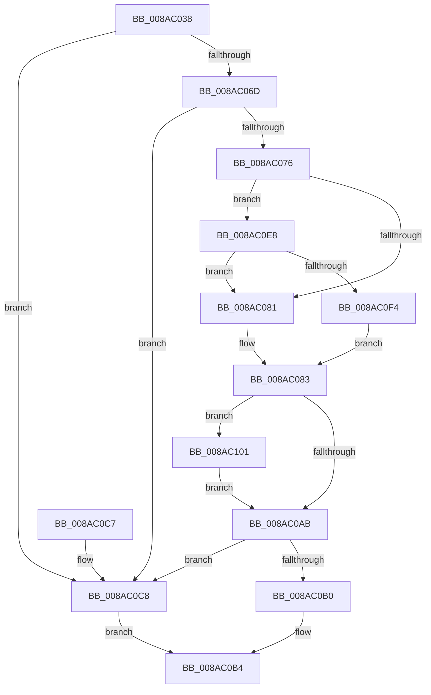

# IopGetBasicInformationFile

- RVA: `0x008AC038`–`0x008AC10E` (길이 `214` bytes)
- VA: `0x00000001408AC038`
- 실행 섹션: `PAGE`
- PDB 이름 있음: `예`; PDB Function 태그: `아니요`
- unwind 정보 RVA: `0x0007F72C`
- 디코드: `66`개 명령, `214/214` bytes 표시
- 미해석 바이트: `0` (있으면 어셈블리에 `.byte`로 보존)

> 이 문서는 커널 이미지의 기계어와 PDB 기호를 분석해 생성했습니다. 4번과 5번은 함수 원형과 자료형을 바이너리 사용 방식에서 추정한 C 해석이며 원본 소스 복구 결과는 아닙니다.

## 1. Dependencies

- 직접 호출 지점: **6**; 고유 호출 대상: **6**
- 직접 호출자로 확인된 함수: **1**
- RIP 상대 이미지 참조: **1**

### Outgoing calls
- `0x008AC058` → [IoGetRelatedDeviceObject](../../text/29/IoGetRelatedDeviceObject_function_0029B120.md) (function, `0x0029B120`)
- `0x008AC09E` → [guard_dispatch_icall](../../text/6B/guard_dispatch_icall_function_006BAAD0.md) (function, `0x006BAAD0`)
- `0x008AC0E1` → [IopGetFileInformation](IopGetFileInformation_function_008AD4D0.md) (function, `0x008AD4D0`)
- `0x008AC0EB` → [MmIsDriverVerifying](../../text/4A/MmIsDriverVerifying_function_004A8770.md) (function, `0x004A8770`)
- `0x008AC0F7` → [VfFastIoSnapState](../../pagevrfy/BB/VfFastIoSnapState_function_00BB97BC.md) (function, `0x00BB97BC`)
- `0x008AC107` → [VfFastIoCheckState](../../pagevrfy/BB/VfFastIoCheckState_function_00BB9440.md) (function, `0x00BB9440`)

### Direct callers
- [IopOpenLinkOrRenameTarget](IopOpenLinkOrRenameTarget_function_008AAC04.md) at `0x008AAC90`

### Static image references
- `0x008AC076` → RVA `0x00F04A20` (`.data`; read)

## 2. Other-region calls and transfers

- 다른 실행 섹션으로 향하는 call: **5**
  - `0x008AC058` → [IoGetRelatedDeviceObject](../../text/29/IoGetRelatedDeviceObject_function_0029B120.md) (`PAGE` → `.text`)
  - `0x008AC09E` → [guard_dispatch_icall](../../text/6B/guard_dispatch_icall_function_006BAAD0.md) (`PAGE` → `.text`)
  - `0x008AC0EB` → [MmIsDriverVerifying](../../text/4A/MmIsDriverVerifying_function_004A8770.md) (`PAGE` → `.text`)
  - `0x008AC0F7` → [VfFastIoSnapState](../../pagevrfy/BB/VfFastIoSnapState_function_00BB97BC.md) (`PAGE` → `PAGEVRFY`)
  - `0x008AC107` → [VfFastIoCheckState](../../pagevrfy/BB/VfFastIoCheckState_function_00BB9440.md) (`PAGE` → `PAGEVRFY`)
- 별도 외부 분기/꼬리 이동을 확인하지 못했습니다.

## 3. Assembly (complete function range)

```asm
008AC038  48 89 5C 24 08                  mov qword ptr [rsp + 8], rbx
008AC03D  48 89 6C 24 10                  mov qword ptr [rsp + 0x10], rbp
008AC042  56                              push rsi
008AC043  57                              push rdi
008AC044  41 56                           push r14
008AC046  48 83 EC 40                     sub rsp, 0x40
008AC04A  0F 57 C0                        xorps xmm0, xmm0
008AC04D  4C 8B F2                        mov r14, rdx
008AC050  0F 11 44 24 30                  movups xmmword ptr [rsp + 0x30], xmm0
008AC055  48 8B F1                        mov rsi, rcx
008AC058  E8 C3 F0 9E FF                  call 0x14029b120
008AC05D  48 8B E8                        mov rbp, rax
008AC060  48 8B 58 08                     mov rbx, qword ptr [rax + 8]
008AC064  48 8B 7B 50                     mov rdi, qword ptr [rbx + 0x50]
008AC068  48 85 FF                        test rdi, rdi
008AC06B  74 5B                           je 0x1408ac0c8
008AC06D  48 8B 7F 20                     mov rdi, qword ptr [rdi + 0x20]
008AC071  48 85 FF                        test rdi, rdi
008AC074  74 52                           je 0x1408ac0c8
008AC076  8B 15 A4 89 65 00               mov edx, dword ptr [rip + 0x6589a4]
008AC07C  F6 C2 10                        test dl, 0x10
008AC07F  75 67                           jne 0x1408ac0e8
008AC081  33 DB                           xor ebx, ebx
008AC083  8B 56 50                        mov edx, dword ptr [rsi + 0x50]
008AC086  4C 8D 4C 24 30                  lea r9, [rsp + 0x30]
008AC08B  D1 EA                           shr edx, 1
008AC08D  4D 8B C6                        mov r8, r14
008AC090  80 E2 01                        and dl, 1
008AC093  48 89 6C 24 20                  mov qword ptr [rsp + 0x20], rbp
008AC098  48 8B CE                        mov rcx, rsi
008AC09B  48 8B C7                        mov rax, rdi
008AC09E  E8 2D EA E0 FF                  call 0x1406baad0
008AC0A3  40 8A E8                        mov bpl, al
008AC0A6  48 85 DB                        test rbx, rbx
008AC0A9  75 56                           jne 0x1408ac101
008AC0AB  40 84 ED                        test bpl, bpl
008AC0AE  74 18                           je 0x1408ac0c8
008AC0B0  8B 44 24 30                     mov eax, dword ptr [rsp + 0x30]
008AC0B4  48 8B 5C 24 60                  mov rbx, qword ptr [rsp + 0x60]
008AC0B9  48 8B 6C 24 68                  mov rbp, qword ptr [rsp + 0x68]
008AC0BE  48 83 C4 40                     add rsp, 0x40
008AC0C2  41 5E                           pop r14
008AC0C4  5F                              pop rdi
008AC0C5  5E                              pop rsi
008AC0C6  C3                              ret
008AC0C7  CC                              int3
008AC0C8  BA 28 00 00 00                  mov edx, 0x28
008AC0CD  48 8D 44 24 70                  lea rax, [rsp + 0x70]
008AC0D2  4D 8B CE                        mov r9, r14
008AC0D5  48 89 44 24 20                  mov qword ptr [rsp + 0x20], rax
008AC0DA  48 8B CE                        mov rcx, rsi
008AC0DD  44 8D 42 DC                     lea r8d, [rdx - 0x24]
008AC0E1  E8 EA 13 00 00                  call 0x1408ad4d0
008AC0E6  EB CC                           jmp 0x1408ac0b4
008AC0E8  48 8B CB                        mov rcx, rbx
008AC0EB  E8 80 C6 BF FF                  call 0x1404a8770
008AC0F0  85 C0                           test eax, eax
008AC0F2  74 8D                           je 0x1408ac081
008AC0F4  48 8B CB                        mov rcx, rbx
008AC0F7  E8 C0 D6 30 00                  call 0x140bb97bc
008AC0FC  48 8B D8                        mov rbx, rax
008AC0FF  EB 82                           jmp 0x1408ac083
008AC101  48 8B D7                        mov rdx, rdi
008AC104  48 8B CB                        mov rcx, rbx
008AC107  E8 34 D3 30 00                  call 0x140bb9440
008AC10C  EB 9D                           jmp 0x1408ac0ab
```

## 4. C-style interpretation (structured pseudocode)

```c
__int64 __fastcall IopGetBasicInformationFile(__int64 a1, __int64 a2)
{
    __int64 result;
    __int64 v_rbx;
    __int64 v_rsp;
    unsigned __int64 v_stack_m28;
    unsigned __int64 v_stack_m38;
    unsigned __int64 v_stack_p10;
    unsigned __int64 v_stack_p20;
    unsigned __int64 v_stack_p70;
    unsigned __int64 v_stack_p8;

    v_stack_p8 = v_rbx;
    v_stack_p10 = v_rbp;
    v_rsp = (v_rsp) - (64);
    v_stack_m28 = v_xmm0;
    result = IoGetRelatedDeviceObject(a1, a2, a3, a4);
    if (*(unsigned __int64 *)(*(unsigned __int64 *)(result + 8) + 80) == 0) goto loc_008AC0C8;
    if (*(unsigned __int64 *)(*(unsigned __int64 *)(*(unsigned __int64 *)(result + 8) + 80) + 32) == 0) goto loc_008AC0C8;
    if ((((unsigned __int8)((unsigned int)(*(unsigned int *)(v_rip + 6654372)))) & (16)) != 0) goto loc_008AC0E8;
loc_008AC081:
    v_rbx = 0;
loc_008AC083:
    a2 = (unsigned int)(((unsigned int)(*(unsigned int *)(a1 + 80))) >> (1));
    a2 = (unsigned __int8)((a2) & (1));
    v_stack_m38 = result;
    result = guard_dispatch_icall(a1, a2, a2, v_stack_m28);
    if (0 != 0) goto loc_008AC101;
loc_008AC0AB:
    if ((unsigned __int8)((unsigned __int8)(result)) == 0) goto loc_008AC0C8;
loc_008AC0B4:
    v_rsp = (v_rsp) + (64);
    return (unsigned int)(v_stack_m28);
loc_008AC0C8:
    v_stack_p20 = v_stack_p70;
    result = IopGetFileInformation(a1, 40, 40 - 36, a2);
    goto loc_008AC0B4;
loc_008AC0E8:
    result = MmIsDriverVerifying(v_stack_p8, 40, 40 - 36, a2);
    if ((unsigned int)(result) == 0) goto loc_008AC081;
    result = VfFastIoSnapState(v_stack_p8, 40, 40 - 36, a2);
    goto loc_008AC083;
loc_008AC101:
    result = VfFastIoCheckState(result, *(unsigned __int64 *)(*(unsigned __int64 *)(*(unsigned __int64 *)(result + 8) + 80) + 32), 40 - 36, a2);
    goto loc_008AC0AB;
}
```

## 5. (Beta) C Style

```c
int64_t IopGetBasicInformationFile(void *Arg1, int64_t Arg2)
{
    uint8_t *arg1 = (uint8_t *)Arg1;

    int64_t result;
    int64_t local_rbx;
    int64_t local_rsp;
    uint64_t v_stack_m28;
    uint64_t v_stack_m38;
    uint64_t v_stack_p10;
    uint64_t v_stack_p20;
    uint64_t v_stack_p70;
    uint64_t v_stack_p8;

    v_stack_p8 = local_rbx;
    v_stack_p10 = local_rbp;
    local_rsp = (local_rsp) - (64);
    v_stack_m28 = v_xmm0;
    result = IoGetRelatedDeviceObject(Arg1, Arg2, a3, a4);
    if (*(uint64_t *)(*(uint64_t *)(result + 0x8) + 0x50) == 0) goto loc_008AC0C8;
    if (*(uint64_t *)(*(uint64_t *)(*(uint64_t *)(result + 0x8) + 0x50) + 0x20) == 0) goto loc_008AC0C8;
    if ((((uint8_t)((uint32_t)(*(uint32_t *)(v_rip + 0x6589A4)))) & (16)) != 0) goto loc_008AC0E8;
loc_008AC081:
    local_rbx = 0;
loc_008AC083:
    Arg2 = (uint32_t)(((uint32_t)(*(uint32_t *)(arg1 + 0x50))) >> (1));
    Arg2 = (uint8_t)((Arg2) & (1));
    v_stack_m38 = result;
    result = guard_dispatch_icall(Arg1, Arg2, Arg2, v_stack_m28);
    if (0 != 0) goto loc_008AC101;
loc_008AC0AB:
    if ((uint8_t)((uint8_t)(result)) == 0) goto loc_008AC0C8;
loc_008AC0B4:
    local_rsp = (local_rsp) + (64);
    return (uint32_t)(v_stack_m28);
loc_008AC0C8:
    v_stack_p20 = v_stack_p70;
    result = IopGetFileInformation(Arg1, 40, 40 - 36, Arg2);
    goto loc_008AC0B4;
loc_008AC0E8:
    result = MmIsDriverVerifying(v_stack_p8, 40, 40 - 36, Arg2);
    if ((uint32_t)(result) == 0) goto loc_008AC081;
    result = VfFastIoSnapState(v_stack_p8, 40, 40 - 36, Arg2);
    goto loc_008AC083;
loc_008AC101:
    result = VfFastIoCheckState(result, *(uint64_t *)(*(uint64_t *)(*(uint64_t *)(result + 0x8) + 0x50) + 0x20), 40 - 36, Arg2);
    goto loc_008AC0AB;
}
```

### 관측된 메모리 오프셋

구조체 형식이 확인되지 않은 접근은 인자 기준의 오프셋으로만 기록했습니다.

| 기준 인자 | 오프셋 표현 | 폭 (bit) | 접근 |
|---|---:|---:|---|
| `Arg1` | `+ 0x50` | `32` | `R` |

## 6. Execution-region graph

[열기: 2D/3D 그래프와 함수 탐색 컨트롤 패널](../../../control-panel.html?section=page&rva=0x008AC038&view=graph)

- 2D 그래프는 위에서 아래로 흐르고, 3D 그래프는 빈 공간을 드래그해 회전합니다. Shift+드래그는 이동, 휠은 확대·축소, 함수 노드 선택은 대상 보고서 이동입니다.

### Static fallback


