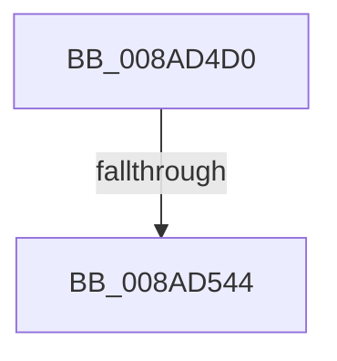

# IopGetFileInformation

- RVA: `0x008AD4D0`–`0x008AD582` (길이 `178` bytes)
- VA: `0x00000001408AD4D0`
- 실행 섹션: `PAGE`
- PDB 이름 있음: `예`; PDB Function 태그: `아니요`
- unwind 정보 RVA: `0x0007F8B0`
- 디코드: `42`개 명령, `178/178` bytes 표시
- 미해석 바이트: `0` (있으면 어셈블리에 `.byte`로 보존)

> 이 문서는 커널 이미지의 기계어와 PDB 기호를 분석해 생성했습니다. 4번과 5번은 함수 원형과 자료형을 바이너리 사용 방식에서 추정한 C 해석이며 원본 소스 복구 결과는 아닙니다.

## 1. Dependencies

- 직접 호출 지점: **4**; 고유 호출 대상: **4**
- 직접 호출자로 확인된 함수: **3**
- RIP 상대 이미지 참조: **0**

### Outgoing calls
- `0x008AD508` → [ObfReferenceObject](../../text/20/ObfReferenceObject_function_0020FA20.md) (function, `0x0020FA20`)
- `0x008AD519` → [KeInitializeEvent](../../text/40/KeInitializeEvent_function_0040DD10.md) (function, `0x0040DD10`)
- `0x008AD521` → [IoGetRelatedDeviceObject](../../text/29/IoGetRelatedDeviceObject_function_0029B120.md) (function, `0x0029B120`)
- `0x008AD533` → [IopAllocateIrpExReturn](../../text/20/IopAllocateIrpExReturn_function_00207720.md) (function, `0x00207720`)

### Direct callers
- [IopGetRelatedFileName](../71/IopGetRelatedFileName_function_0071B4A0.md) at `0x0071B5A8`
- [IopGetBasicInformationFile](IopGetBasicInformationFile_function_008AC038.md) at `0x008AC0E1`
- [sub_00B39C68](../B3/Unknown_function_00B39C68.md) at `0x00B39D34`

### Static image references
- 디코드된 RIP-relative 메모리 참조가 없습니다.

## 2. Other-region calls and transfers

- 다른 실행 섹션으로 향하는 call: **4**
  - `0x008AD508` → [ObfReferenceObject](../../text/20/ObfReferenceObject_function_0020FA20.md) (`PAGE` → `.text`)
  - `0x008AD519` → [KeInitializeEvent](../../text/40/KeInitializeEvent_function_0040DD10.md) (`PAGE` → `.text`)
  - `0x008AD521` → [IoGetRelatedDeviceObject](../../text/29/IoGetRelatedDeviceObject_function_0029B120.md) (`PAGE` → `.text`)
  - `0x008AD533` → [IopAllocateIrpExReturn](../../text/20/IopAllocateIrpExReturn_function_00207720.md) (`PAGE` → `.text`)
- call이 아닌 외부 분기/꼬리 이동: **1**
  - `0x008AD53E` → [sub_008AD5F5 + 0x1B](Unknown_function_008AD5F5.md) (`tail-transfer`)

## 3. Assembly (complete function range)

```asm
008AD4D0  48 89 5C 24 10                  mov qword ptr [rsp + 0x10], rbx
008AD4D5  48 89 6C 24 18                  mov qword ptr [rsp + 0x18], rbp
008AD4DA  48 89 74 24 20                  mov qword ptr [rsp + 0x20], rsi
008AD4DF  57                              push rdi
008AD4E0  41 56                           push r14
008AD4E2  41 57                           push r15
008AD4E4  48 83 EC 60                     sub rsp, 0x60
008AD4E8  0F 57 C0                        xorps xmm0, xmm0
008AD4EB  33 C0                           xor eax, eax
008AD4ED  0F 11 44 24 40                  movups xmmword ptr [rsp + 0x40], xmm0
008AD4F2  48 89 44 24 50                  mov qword ptr [rsp + 0x50], rax
008AD4F7  49 8B E9                        mov rbp, r9
008AD4FA  0F 11 44 24 30                  movups xmmword ptr [rsp + 0x30], xmm0
008AD4FF  45 8B F0                        mov r14d, r8d
008AD502  44 8B FA                        mov r15d, edx
008AD505  48 8B F9                        mov rdi, rcx
008AD508  E8 13 25 96 FF                  call 0x14020fa20
008AD50D  45 33 C0                        xor r8d, r8d
008AD510  48 8D 4C 24 40                  lea rcx, [rsp + 0x40]
008AD515  41 8D 50 01                     lea edx, [r8 + 1]
008AD519  E8 F2 07 B6 FF                  call 0x14040dd10
008AD51E  48 8B CF                        mov rcx, rdi
008AD521  E8 FA DB 9E FF                  call 0x14029b120
008AD526  45 33 C0                        xor r8d, r8d
008AD529  48 8B C8                        mov rcx, rax
008AD52C  48 8B F0                        mov rsi, rax
008AD52F  0F B6 50 4C                     movzx edx, byte ptr [rax + 0x4c]
008AD533  E8 E8 A1 95 FF                  call 0x140207720
008AD538  48 8B D8                        mov rbx, rax
008AD53B  48 85 C0                        test rax, rax
008AD53E  0F 84 CC 00 00 00               je 0x1408ad610
008AD544  48 89 B8 C0 00 00 00            mov qword ptr [rax + 0xc0], rdi
008AD54B  48 8B CB                        mov rcx, rbx
008AD54E  65 48 8B 04 25 88 01 00 00      mov rax, qword ptr gs:[0x188]
008AD557  48 89 83 98 00 00 00            mov qword ptr [rbx + 0x98], rax
008AD55E  48 8D 44 24 40                  lea rax, [rsp + 0x40]
008AD563  48 89 43 50                     mov qword ptr [rbx + 0x50], rax
008AD567  48 8D 44 24 30                  lea rax, [rsp + 0x30]
008AD56C  48 89 43 48                     mov qword ptr [rbx + 0x48], rax
008AD570  48 8B 83 B8 00 00 00            mov rax, qword ptr [rbx + 0xb8]
008AD577  C7 43 10 04 10 00 00            mov dword ptr [rbx + 0x10], 0x1004
008AD57E  C6 43 40 00                     mov byte ptr [rbx + 0x40], 0
```

## 4. C-style interpretation (structured pseudocode)

```c
__int64 __fastcall IopGetFileInformation(__int64 a1, int a2, int a3, __int64 a4)
{
    __int64 result;
    __int64 v_rsp;
    unsigned __int64 v_stack_m28;
    unsigned __int64 v_stack_m38;
    unsigned __int64 v_stack_m48;
    unsigned __int64 v_stack_p10;
    unsigned __int64 v_stack_p18;
    unsigned __int64 v_stack_p20;

    v_stack_p10 = v_rbx;
    v_stack_p18 = v_rbp;
    v_stack_p20 = v_rsi;
    v_rsp = (v_rsp) - (96);
    result = 0;
    v_stack_m38 = v_xmm0;
    v_stack_m28 = 0;
    v_stack_m48 = v_xmm0;
    result = ObfReferenceObject(a1, a2, a3, a4);
    a3 = 0;
    result = KeInitializeEvent(v_stack_m38, a3 + 1, a3, a4);
    result = IoGetRelatedDeviceObject(a1, a3 + 1, a3, a4);
    a3 = 0;
    result = IopAllocateIrpExReturn(result, *(unsigned __int8 *)(result + 76), a3, a4);
    *(unsigned __int64 *)(result + 192) = a1;
    *(unsigned __int64 *)(result + 152) = *(unsigned __int64 *)(gs_base + (0 + 392));
    *(unsigned __int64 *)(result + 80) = v_stack_m38;
    *(unsigned __int64 *)(result + 72) = v_stack_m48;
    *(unsigned int *)(result + 16) = 0x1004ULL;
    *(unsigned __int8 *)(result + 64) = 0;
    return *(unsigned __int64 *)(result + 184);
}
```

## 5. (Beta) C Style

```c
int64_t IopGetFileInformation(int64_t Arg1, int32_t Arg2, int32_t Arg3, int64_t Arg4)
{
    int64_t result;
    int64_t local_rsp;
    uint64_t v_stack_m28;
    uint64_t v_stack_m38;
    uint64_t v_stack_m48;
    uint64_t v_stack_p10;
    uint64_t v_stack_p18;
    uint64_t v_stack_p20;

    v_stack_p10 = local_rbx;
    v_stack_p18 = local_rbp;
    v_stack_p20 = local_rsi;
    local_rsp = (local_rsp) - (96);
    result = 0;
    v_stack_m38 = v_xmm0;
    v_stack_m28 = 0;
    v_stack_m48 = v_xmm0;
    result = ObfReferenceObject(Arg1, Arg2, Arg3, Arg4);
    Arg3 = 0;
    result = KeInitializeEvent(v_stack_m38, Arg3 + 1, Arg3, Arg4);
    result = IoGetRelatedDeviceObject(Arg1, Arg3 + 1, Arg3, Arg4);
    Arg3 = 0;
    result = IopAllocateIrpExReturn(result, *(uint8_t *)(result + 0x4C), Arg3, Arg4);
    *(uint64_t *)(result + 0xC0) = Arg1;
    *(uint64_t *)(result + 0x98) = *(uint64_t *)(gs_base + (0 + 0x188));
    *(uint64_t *)(result + 0x50) = v_stack_m38;
    *(uint64_t *)(result + 0x48) = v_stack_m48;
    *(uint32_t *)(result + 0x10) = 0x1004ULL;
    *(uint8_t *)(result + 0x40) = 0;
    return *(uint64_t *)(result + 0xB8);
}
```

## 6. Execution-region graph

[열기: 2D/3D 그래프와 함수 탐색 컨트롤 패널](../../../control-panel.html?section=page&rva=0x008AD4D0&view=graph)

- 2D 그래프는 위에서 아래로 흐르고, 3D 그래프는 빈 공간을 드래그해 회전합니다. Shift+드래그는 이동, 휠은 확대·축소, 함수 노드 선택은 대상 보고서 이동입니다.

### Static fallback


