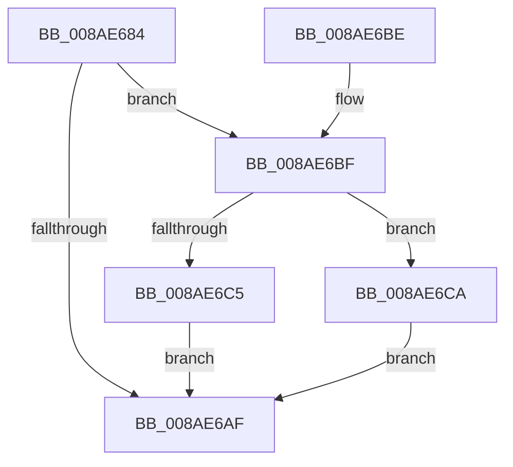

# IopGetModeInformation

- RVA: `0x008AE684`–`0x008AE6CF` (길이 `75` bytes)
- VA: `0x00000001408AE684`
- 실행 섹션: `PAGE`
- PDB 이름 있음: `예`; PDB Function 태그: `아니요`
- unwind 정보 RVA: `0x000DB714`
- 디코드: `26`개 명령, `75/75` bytes 표시
- 미해석 바이트: `0` (있으면 어셈블리에 `.byte`로 보존)

> 이 문서는 커널 이미지의 기계어와 PDB 기호를 분석해 생성했습니다. 4번과 5번은 함수 원형과 자료형을 바이너리 사용 방식에서 추정한 C 해석이며 원본 소스 복구 결과는 아닙니다.

## 1. Dependencies

- 직접 호출 지점: **0**; 고유 호출 대상: **0**
- 직접 호출자로 확인된 함수: **1**
- RIP 상대 이미지 참조: **0**

### Outgoing calls
- 직접 디코드된 call 명령이 없습니다.

### Direct callers
- [NtQueryInformationFile](NtQueryInformationFile_function_008AD630.md) at `0x008AE09A`

### Static image references
- 디코드된 RIP-relative 메모리 참조가 없습니다.

## 2. Other-region calls and transfers

- 다른 실행 섹션으로 향하는 call: **0**
- 별도 외부 분기/꼬리 이동을 확인하지 못했습니다.

## 3. Assembly (complete function range)

```asm
008AE684  44 8B 41 50                     mov r8d, dword ptr [rcx + 0x50]
008AE688  41 8B C8                        mov ecx, r8d
008AE68B  C1 E9 03                        shr ecx, 3
008AE68E  83 E1 02                        and ecx, 2
008AE691  8B D1                           mov edx, ecx
008AE693  83 CA 04                        or edx, 4
008AE696  41 F6 C0 20                     test r8b, 0x20
008AE69A  0F 44 D1                        cmove edx, ecx
008AE69D  8B CA                           mov ecx, edx
008AE69F  83 C9 08                        or ecx, 8
008AE6A2  41 F6 C0 08                     test r8b, 8
008AE6A6  0F 44 CA                        cmove ecx, edx
008AE6A9  41 F6 C0 02                     test r8b, 2
008AE6AD  75 10                           jne 0x1408ae6bf
008AE6AF  8B C1                           mov eax, ecx
008AE6B1  0F BA E8 0C                     bts eax, 0xc
008AE6B5  41 0F BA E0 10                  bt r8d, 0x10
008AE6BA  0F 43 C1                        cmovae eax, ecx
008AE6BD  C3                              ret
008AE6BE  CC                              int3
008AE6BF  41 F6 C0 04                     test r8b, 4
008AE6C3  75 05                           jne 0x1408ae6ca
008AE6C5  83 C9 20                        or ecx, 0x20
008AE6C8  EB E5                           jmp 0x1408ae6af
008AE6CA  83 C9 10                        or ecx, 0x10
008AE6CD  EB E0                           jmp 0x1408ae6af
```

## 4. C-style interpretation (structured pseudocode)

```c
__int64 __fastcall IopGetModeInformation(__int64 a1)
{
    __int64 result;

    a1 = (unsigned int)(((unsigned int)((unsigned int)((unsigned int)(*(unsigned int *)(a1 + 80))))) >> (3));
    a1 = (unsigned int)((a1) & (2));
    a2 = (unsigned int)(((unsigned int)((unsigned int)(a1))) | (4));
    if ((((unsigned __int8)((unsigned int)(*(unsigned int *)(a1 + 80)))) & (32)) == 0) { a2 = (unsigned int)(a1); }
    a1 = (unsigned int)(((unsigned int)((unsigned int)(a2))) | (8));
    if ((((unsigned __int8)((unsigned int)(*(unsigned int *)(a1 + 80)))) & (8)) == 0) { a1 = (unsigned int)(a2); }
    if ((((unsigned __int8)((unsigned int)(*(unsigned int *)(a1 + 80)))) & (2)) != 0) goto loc_008AE6BF;
loc_008AE6AF:
    result = (unsigned int)((unsigned int)(a1));
    if (condition_is_above_or_equal) { result = (unsigned int)(a1); }
    return result;
loc_008AE6BF:
    if ((((unsigned __int8)((unsigned int)(*(unsigned int *)(a1 + 80)))) & (4)) != 0) goto loc_008AE6CA;
    a1 = (unsigned int)((a1) | (32));
    goto loc_008AE6AF;
loc_008AE6CA:
    a1 = (unsigned int)((a1) | (16));
    goto loc_008AE6AF;
}
```

## 5. (Beta) C Style

```c
int64_t IopGetModeInformation(void *Arg1)
{
    uint8_t *arg1 = (uint8_t *)Arg1;

    int64_t result;

    Arg1 = (uint32_t)(((uint32_t)((uint32_t)((uint32_t)(*(uint32_t *)(arg1 + 0x50))))) >> (3));
    Arg1 = (uint32_t)((Arg1) & (2));
    a2 = (uint32_t)(((uint32_t)((uint32_t)(Arg1))) | (4));
    if ((((uint8_t)((uint32_t)(*(uint32_t *)(arg1 + 0x50)))) & (32)) == 0) { a2 = (uint32_t)(Arg1); }
    Arg1 = (uint32_t)(((uint32_t)((uint32_t)(a2))) | (8));
    if ((((uint8_t)((uint32_t)(*(uint32_t *)(arg1 + 0x50)))) & (8)) == 0) { Arg1 = (uint32_t)(a2); }
    if ((((uint8_t)((uint32_t)(*(uint32_t *)(arg1 + 0x50)))) & (2)) != 0) goto loc_008AE6BF;
loc_008AE6AF:
    result = (uint32_t)((uint32_t)(Arg1));
    if (condition_is_above_or_equal) { result = (uint32_t)(Arg1); }
    return result;
loc_008AE6BF:
    if ((((uint8_t)((uint32_t)(*(uint32_t *)(arg1 + 0x50)))) & (4)) != 0) goto loc_008AE6CA;
    Arg1 = (uint32_t)((Arg1) | (32));
    goto loc_008AE6AF;
loc_008AE6CA:
    Arg1 = (uint32_t)((Arg1) | (16));
    goto loc_008AE6AF;
}
```

### 관측된 메모리 오프셋

구조체 형식이 확인되지 않은 접근은 인자 기준의 오프셋으로만 기록했습니다.

| 기준 인자 | 오프셋 표현 | 폭 (bit) | 접근 |
|---|---:|---:|---|
| `Arg1` | `+ 0x50` | `32` | `R` |

## 6. Execution-region graph

[열기: 2D/3D 그래프와 함수 탐색 컨트롤 패널](../../../control-panel.html?section=page&rva=0x008AE684&view=graph)

- 2D 그래프는 위에서 아래로 흐르고, 3D 그래프는 빈 공간을 드래그해 회전합니다. Shift+드래그는 이동, 휠은 확대·축소, 함수 노드 선택은 대상 보고서 이동입니다.

### Static fallback


