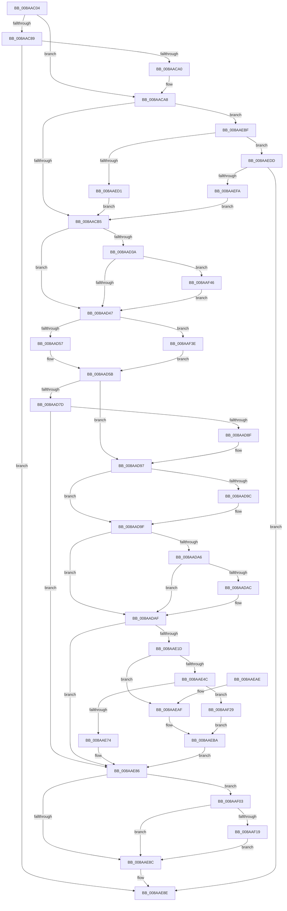

# IopOpenLinkOrRenameTarget

- RVA: `0x008AAC04`–`0x008AAF52` (길이 `846` bytes)
- VA: `0x00000001408AAC04`
- 실행 섹션: `PAGE`
- PDB 이름 있음: `예`; PDB Function 태그: `아니요`
- unwind 정보 RVA: `0x0007F654`
- 디코드: `221`개 명령, `846/846` bytes 표시
- 미해석 바이트: `0` (있으면 어셈블리에 `.byte`로 보존)

> 이 문서는 커널 이미지의 기계어와 PDB 기호를 분석해 생성했습니다. 4번과 5번은 함수 원형과 자료형을 바이너리 사용 방식에서 추정한 C 해석이며 원본 소스 복구 결과는 아닙니다.

## 1. Dependencies

- 직접 호출 지점: **12**; 고유 호출 대상: **9**
- 직접 호출자로 확인된 함수: **2**
- RIP 상대 이미지 참조: **2**

### Outgoing calls
- `0x008AAC90` → [IopGetBasicInformationFile](IopGetBasicInformationFile_function_008AC038.md) (function, `0x008AC038`)
- `0x008AAD7D` → [FsRtlpPrepareExtraCreateParametersForCreate](FsRtlpPrepareExtraCreateParametersForCreate_function_008AC120.md) (function, `0x008AC120`)
- `0x008AAE0F` → [IopCreateFile](IopCreateFile_function_008AB298.md) (function, `0x008AB298`)
- `0x008AAE41` → [ObReferenceObjectByHandle](../86/ObReferenceObjectByHandle_function_00868DB0.md) (function, `0x00868DB0`)
- `0x008AAE53` → [ObfDereferenceObject](../../text/2F/ObfDereferenceObject_function_002F9350.md) (function, `0x002F9350`)
- `0x008AAE5B` → [IoGetRelatedDeviceObject](../../text/29/IoGetRelatedDeviceObject_function_0029B120.md) (function, `0x0029B120`)
- `0x008AAE66` → [IoGetRelatedDeviceObject](../../text/29/IoGetRelatedDeviceObject_function_0029B120.md) (function, `0x0029B120`)
- `0x008AAE95` → [_security_check_cookie](../../text/6A/_security_check_cookie_function_006AC640.md) (function, `0x006AC640`)
- `0x008AAEB5` → [ObCloseHandle](ObCloseHandle_function_008A1870.md) (function, `0x008A1870`)
- `0x008AAEEE` → [IoConvertFileHandleToKernelHandle](../A8/IoConvertFileHandleToKernelHandle_function_00A85680.md) (function, `0x00A85680`)
- `0x008AAF1F` → [ObCloseHandle](ObCloseHandle_function_008A1870.md) (function, `0x008A1870`)
- `0x008AAF2F` → [ObCloseHandle](ObCloseHandle_function_008A1870.md) (function, `0x008A1870`)

### Direct callers
- [NtSetInformationFile](../../text/29/NtSetInformationFile_function_0029C5E0.md) at `0x0029D140`
- [IoSetInformation](../71/IoSetInformation_function_0071DBF0.md) at `0x0071DEBA`

### Static image references
- `0x008AAC1D` → RVA `0x00E0A740` (`.data`; read)
- `0x008AAE1D` → RVA `0x00FC6AE0` (`ALMOSTRO`; read)

## 2. Other-region calls and transfers

- 다른 실행 섹션으로 향하는 call: **4**
  - `0x008AAE53` → [ObfDereferenceObject](../../text/2F/ObfDereferenceObject_function_002F9350.md) (`PAGE` → `.text`)
  - `0x008AAE5B` → [IoGetRelatedDeviceObject](../../text/29/IoGetRelatedDeviceObject_function_0029B120.md) (`PAGE` → `.text`)
  - `0x008AAE66` → [IoGetRelatedDeviceObject](../../text/29/IoGetRelatedDeviceObject_function_0029B120.md) (`PAGE` → `.text`)
  - `0x008AAE95` → [_security_check_cookie](../../text/6A/_security_check_cookie_function_006AC640.md) (`PAGE` → `.text`)
- 별도 외부 분기/꼬리 이동을 확인하지 못했습니다.

## 3. Assembly (complete function range)

```asm
008AAC04  40 55                           push rbp
008AAC06  53                              push rbx
008AAC07  56                              push rsi
008AAC08  57                              push rdi
008AAC09  41 54                           push r12
008AAC0B  41 55                           push r13
008AAC0D  41 56                           push r14
008AAC0F  41 57                           push r15
008AAC11  48 8D 6C 24 A8                  lea rbp, [rsp - 0x58]
008AAC16  48 81 EC 58 01 00 00            sub rsp, 0x158
008AAC1D  48 8B 05 1C FB 55 00            mov rax, qword ptr [rip + 0x55fb1c]
008AAC24  48 33 C4                        xor rax, rsp
008AAC27  48 89 45 40                     mov qword ptr [rbp + 0x40], rax
008AAC2B  0F 57 C0                        xorps xmm0, xmm0
008AAC2E  33 C0                           xor eax, eax
008AAC30  4D 8B F9                        mov r15, r9
008AAC33  48 89 45 38                     mov qword ptr [rbp + 0x38], rax
008AAC37  45 33 C9                        xor r9d, r9d
008AAC3A  49 8B F8                        mov rdi, r8
008AAC3D  41 8B D9                        mov ebx, r9d
008AAC40  4C 89 4D 80                     mov qword ptr [rbp - 0x80], r9
008AAC44  4C 8B EA                        mov r13, rdx
008AAC47  48 89 5D 88                     mov qword ptr [rbp - 0x78], rbx
008AAC4B  41 F7 47 50 00 08 00 00         test dword ptr [r15 + 0x50], 0x800
008AAC53  8D 70 04                        lea esi, [rax + 4]
008AAC56  45 8D 71 02                     lea r14d, [r9 + 2]
008AAC5A  44 89 4D DC                     mov dword ptr [rbp - 0x24], r9d
008AAC5E  4C 8B E1                        mov r12, rcx
008AAC61  44 89 4D F4                     mov dword ptr [rbp - 0xc], r9d
008AAC65  0F 11 45 08                     movups xmmword ptr [rbp + 8], xmm0
008AAC69  44 89 4D C4                     mov dword ptr [rbp - 0x3c], r9d
008AAC6D  4C 89 4D D0                     mov qword ptr [rbp - 0x30], r9
008AAC71  0F 11 45 18                     movups xmmword ptr [rbp + 0x18], xmm0
008AAC75  44 89 4D A2                     mov dword ptr [rbp - 0x5e], r9d
008AAC79  0F 11 45 28                     movups xmmword ptr [rbp + 0x28], xmm0
008AAC7D  66 44 89 4D A6                  mov word ptr [rbp - 0x5a], r9w
008AAC82  F3 0F 7F 45 92                  movdqu xmmword ptr [rbp - 0x6e], xmm0
008AAC87  75 1F                           jne 0x1408aaca8
008AAC89  48 8D 55 18                     lea rdx, [rbp + 0x18]
008AAC8D  49 8B CF                        mov rcx, r15
008AAC90  E8 A3 13 00 00                  call 0x1408ac038
008AAC95  45 33 C9                        xor r9d, r9d
008AAC98  85 C0                           test eax, eax
008AAC9A  0F 88 EE 01 00 00               js 0x1408aae8e
008AACA0  F6 45 38 10                     test byte ptr [rbp + 0x38], 0x10
008AACA4  44 0F 45 F6                     cmovne r14d, esi
008AACA8  48 8B 4F 08                     mov rcx, qword ptr [rdi + 8]
008AACAC  48 85 C9                        test rcx, rcx
008AACAF  0F 85 0A 02 00 00               jne 0x1408aaebf
008AACB5  0F B7 47 10                     movzx eax, word ptr [rdi + 0x10]
008AACB9  0F 57 C0                        xorps xmm0, xmm0
008AACBC  4D 8B AD B8 00 00 00            mov r13, qword ptr [r13 + 0xb8]
008AACC3  0F 57 C9                        xorps xmm1, xmm1
008AACC6  66 89 45 C0                     mov word ptr [rbp - 0x40], ax
008AACCA  BA 28 00 00 00                  mov edx, 0x28
008AACCF  66 89 45 C2                     mov word ptr [rbp - 0x3e], ax
008AACD3  48 8D 47 14                     lea rax, [rdi + 0x14]
008AACD7  48 89 45 C8                     mov qword ptr [rbp - 0x38], rax
008AACDB  41 8B 47 50                     mov eax, dword ptr [r15 + 0x50]
008AACDF  C1 E8 0B                        shr eax, 0xb
008AACE2  F7 D0                           not eax
008AACE4  C7 45 D8 30 00 00 00            mov dword ptr [rbp - 0x28], 0x30
008AACEB  83 E0 40                        and eax, 0x40
008AACEE  48 89 5D E0                     mov qword ptr [rbp - 0x20], rbx
008AACF2  41 8A 4D BA                     mov cl, byte ptr [r13 - 0x46]
008AACF6  F6 D1                           not cl
008AACF8  44 89 4D A2                     mov dword ptr [rbp - 0x5e], r9d
008AACFC  83 E1 01                        and ecx, 1
008AACFF  66 44 89 4D A6                  mov word ptr [rbp - 0x5a], r9w
008AAD04  C1 E1 0A                        shl ecx, 0xa
008AAD07  0B C8                           or ecx, eax
008AAD09  66 89 55 90                     mov word ptr [rbp - 0x70], dx
008AAD0D  48 8D 45 C0                     lea rax, [rbp - 0x40]
008AAD11  48 C7 45 B0 01 00 00 00         mov qword ptr [rbp - 0x50], 1
008AAD19  0F BA E9 09                     bts ecx, 9
008AAD1D  48 89 45 E8                     mov qword ptr [rbp - 0x18], rax
008AAD21  49 8B 87 D0 00 00 00            mov rax, qword ptr [r15 + 0xd0]
008AAD28  89 4D F0                        mov dword ptr [rbp - 0x10], ecx
008AAD2B  F3 0F 7F 45 F8                  movdqu xmmword ptr [rbp - 8], xmm0
008AAD30  F3 0F 7F 4D 92                  movdqu xmmword ptr [rbp - 0x6e], xmm1
008AAD35  48 85 C0                        test rax, rax
008AAD38  74 0D                           je 0x1408aad47
008AAD3A  48 8B 40 10                     mov rax, qword ptr [rax + 0x10]
008AAD3E  48 85 C0                        test rax, rax
008AAD41  0F 85 FF 01 00 00               jne 0x1408aaf46
008AAD47  49 8B 87 D0 00 00 00            mov rax, qword ptr [r15 + 0xd0]
008AAD4E  48 85 C0                        test rax, rax
008AAD51  0F 84 E7 01 00 00               je 0x1408aaf3e
008AAD57  48 8B 40 08                     mov rax, qword ptr [rax + 8]
008AAD5B  48 8B 4D 98                     mov rcx, qword ptr [rbp - 0x68]
008AAD5F  41 8B F9                        mov edi, r9d
008AAD62  48 89 45 A8                     mov qword ptr [rbp - 0x58], rax
008AAD66  41 8A 75 BA                     mov sil, byte ptr [r13 - 0x46]
008AAD6A  40 F6 D6                        not sil
008AAD6D  83 E6 01                        and esi, 1
008AAD70  4C 39 4D A0                     cmp qword ptr [rbp - 0x60], r9
008AAD74  40 0F 95 C7                     setne dil
008AAD78  48 85 C9                        test rcx, rcx
008AAD7B  74 1A                           je 0x1408aad97
008AAD7D  E8 9E 13 00 00                  call 0x1408ac120
008AAD82  45 33 C9                        xor r9d, r9d
008AAD85  8B D8                           mov ebx, eax
008AAD87  85 C0                           test eax, eax
008AAD89  0F 88 F7 00 00 00               js 0x1408aae86
008AAD8F  48 8B 45 A8                     mov rax, qword ptr [rbp - 0x58]
008AAD93  41 8D 51 28                     lea edx, [r9 + 0x28]
008AAD97  48 85 C0                        test rax, rax
008AAD9A  74 03                           je 0x1408aad9f
008AAD9C  83 CF 04                        or edi, 4
008AAD9F  48 83 7D B0 01                  cmp qword ptr [rbp - 0x50], 1
008AADA4  74 09                           je 0x1408aadaf
008AADA6  66 39 55 90                     cmp word ptr [rbp - 0x70], dx
008AADAA  72 03                           jb 0x1408aadaf
008AADAC  83 CF 40                        or edi, 0x40
008AADAF  48 8D 45 90                     lea rax, [rbp - 0x70]
008AADB3  41 8B D6                        mov edx, r14d
008AADB6  48 89 44 24 78                  mov qword ptr [rsp + 0x78], rax
008AADBB  4C 8D 45 D8                     lea r8, [rbp - 0x28]
008AADBF  89 7C 24 70                     mov dword ptr [rsp + 0x70], edi
008AADC3  48 8D 4D 80                     lea rcx, [rbp - 0x80]
008AADC7  81 CE 04 01 00 00               or esi, 0x104
008AADCD  0F BA EA 14                     bts edx, 0x14
008AADD1  89 74 24 68                     mov dword ptr [rsp + 0x68], esi
008AADD5  4C 89 4C 24 60                  mov qword ptr [rsp + 0x60], r9
008AADDA  44 89 4C 24 58                  mov dword ptr [rsp + 0x58], r9d
008AADDF  44 89 4C 24 50                  mov dword ptr [rsp + 0x50], r9d
008AADE4  4C 89 4C 24 48                  mov qword ptr [rsp + 0x48], r9
008AADE9  C7 44 24 40 00 40 00 00         mov dword ptr [rsp + 0x40], 0x4000
008AADF1  C7 44 24 38 01 00 00 00         mov dword ptr [rsp + 0x38], 1
008AADF9  C7 44 24 30 07 00 00 00         mov dword ptr [rsp + 0x30], 7
008AAE01  44 89 4C 24 28                  mov dword ptr [rsp + 0x28], r9d
008AAE06  4C 89 4C 24 20                  mov qword ptr [rsp + 0x20], r9
008AAE0B  4C 8D 4D 08                     lea r9, [rbp + 8]
008AAE0F  E8 84 04 00 00                  call 0x1408ab298
008AAE14  45 33 C9                        xor r9d, r9d
008AAE17  8B D8                           mov ebx, eax
008AAE19  85 C0                           test eax, eax
008AAE1B  78 69                           js 0x1408aae86
008AAE1D  4C 8B 05 BC BC 71 00            mov r8, qword ptr [rip + 0x71bcbc]
008AAE24  48 8D 45 D0                     lea rax, [rbp - 0x30]
008AAE28  48 8B 4D 80                     mov rcx, qword ptr [rbp - 0x80]
008AAE2C  41 8B D6                        mov edx, r14d
008AAE2F  48 89 44 24 28                  mov qword ptr [rsp + 0x28], rax
008AAE34  48 8D 45 B8                     lea rax, [rbp - 0x48]
008AAE38  48 89 44 24 20                  mov qword ptr [rsp + 0x20], rax
008AAE3D  4C 89 4D B8                     mov qword ptr [rbp - 0x48], r9
008AAE41  E8 6A DF FB FF                  call 0x140868db0
008AAE46  8B D8                           mov ebx, eax
008AAE48  85 C0                           test eax, eax
008AAE4A  78 63                           js 0x1408aaeaf
008AAE4C  48 8B 7D B8                     mov rdi, qword ptr [rbp - 0x48]
008AAE50  48 8B CF                        mov rcx, rdi
008AAE53  E8 F8 E4 A4 FF                  call 0x1402f9350
008AAE58  49 8B CF                        mov rcx, r15
008AAE5B  E8 C0 02 9F FF                  call 0x14029b120
008AAE60  48 8B CF                        mov rcx, rdi
008AAE63  48 8B D8                        mov rbx, rax
008AAE66  E8 B5 02 9F FF                  call 0x14029b120
008AAE6B  48 3B C3                        cmp rax, rbx
008AAE6E  0F 85 B5 00 00 00               jne 0x1408aaf29
008AAE74  49 89 7D D0                     mov qword ptr [r13 - 0x30], rdi
008AAE78  45 33 C9                        xor r9d, r9d
008AAE7B  48 8B 45 80                     mov rax, qword ptr [rbp - 0x80]
008AAE7F  41 8B D9                        mov ebx, r9d
008AAE82  49 89 04 24                     mov qword ptr [r12], rax
008AAE86  4C 39 4D 88                     cmp qword ptr [rbp - 0x78], r9
008AAE8A  75 77                           jne 0x1408aaf03
008AAE8C  8B C3                           mov eax, ebx
008AAE8E  48 8B 4D 40                     mov rcx, qword ptr [rbp + 0x40]
008AAE92  48 33 CC                        xor rcx, rsp
008AAE95  E8 A6 17 E0 FF                  call 0x1406ac640
008AAE9A  48 81 C4 58 01 00 00            add rsp, 0x158
008AAEA1  41 5F                           pop r15
008AAEA3  41 5E                           pop r14
008AAEA5  41 5D                           pop r13
008AAEA7  41 5C                           pop r12
008AAEA9  5F                              pop rdi
008AAEAA  5E                              pop rsi
008AAEAB  5B                              pop rbx
008AAEAC  5D                              pop rbp
008AAEAD  C3                              ret
008AAEAE  CC                              int3
008AAEAF  48 8B 4D 80                     mov rcx, qword ptr [rbp - 0x80]
008AAEB3  33 D2                           xor edx, edx
008AAEB5  E8 B6 69 FF FF                  call 0x1408a1870
008AAEBA  45 33 C9                        xor r9d, r9d
008AAEBD  EB C7                           jmp 0x1408aae86
008AAEBF  65 48 8B 04 25 88 01 00 00      mov rax, qword ptr gs:[0x188]
008AAEC8  80 B8 32 02 00 00 01            cmp byte ptr [rax + 0x232], 1
008AAECF  74 0C                           je 0x1408aaedd
008AAED1  48 8B D9                        mov rbx, rcx
008AAED4  48 89 4D 88                     mov qword ptr [rbp - 0x78], rcx
008AAED8  E9 D8 FD FF FF                  jmp 0x1408aacb5
008AAEDD  48 8D 45 88                     lea rax, [rbp - 0x78]
008AAEE1  45 33 C9                        xor r9d, r9d
008AAEE4  45 33 C0                        xor r8d, r8d
008AAEE7  48 89 44 24 20                  mov qword ptr [rsp + 0x20], rax
008AAEEC  B2 01                           mov dl, 1
008AAEEE  E8 8D A7 1D 00                  call 0x140a85680
008AAEF3  45 33 C9                        xor r9d, r9d
008AAEF6  85 C0                           test eax, eax
008AAEF8  78 94                           js 0x1408aae8e
008AAEFA  48 8B 5D 88                     mov rbx, qword ptr [rbp - 0x78]
008AAEFE  E9 B2 FD FF FF                  jmp 0x1408aacb5
008AAF03  65 48 8B 0C 25 88 01 00 00      mov rcx, qword ptr gs:[0x188]
008AAF0C  80 B9 32 02 00 00 01            cmp byte ptr [rcx + 0x232], 1
008AAF13  0F 85 73 FF FF FF               jne 0x1408aae8c
008AAF19  48 8B 4D 88                     mov rcx, qword ptr [rbp - 0x78]
008AAF1D  33 D2                           xor edx, edx
008AAF1F  E8 4C 69 FF FF                  call 0x1408a1870
008AAF24  E9 63 FF FF FF                  jmp 0x1408aae8c
008AAF29  48 8B 4D 80                     mov rcx, qword ptr [rbp - 0x80]
008AAF2D  33 D2                           xor edx, edx
008AAF2F  E8 3C 69 FF FF                  call 0x1408a1870
008AAF34  BB D4 00 00 C0                  mov ebx, 0xc00000d4
008AAF39  E9 7C FF FF FF                  jmp 0x1408aaeba
008AAF3E  49 8B C1                        mov rax, r9
008AAF41  E9 15 FE FF FF                  jmp 0x1408aad5b
008AAF46  48 8B 00                        mov rax, qword ptr [rax]
008AAF49  48 89 45 A0                     mov qword ptr [rbp - 0x60], rax
008AAF4D  E9 F5 FD FF FF                  jmp 0x1408aad47
```

## 4. C-style interpretation (structured pseudocode)

```c
__int64 __fastcall IopOpenLinkOrRenameTarget(__int64 a1, __int64 a2, __int64 a3, __int64 a4)
{
    __int64 result;
    __int64 v_r14;
    __int64 v_rdi;
    __int64 v_rsi;
    __int64 v_rsp;
    unsigned __int64 v_stack_m100;
    unsigned __int64 v_stack_m106;
    unsigned __int16 v_stack_m108;
    unsigned __int64 v_stack_m110;
    unsigned __int64 v_stack_m118;
    unsigned __int64 v_stack_m120;
    unsigned int v_stack_m128;
    unsigned int v_stack_m130;
    unsigned __int64 v_stack_m138;
    unsigned int v_stack_m140;
    unsigned int v_stack_m148;
    unsigned __int64 v_stack_m150;
    unsigned int v_stack_m158;
    unsigned int v_stack_m160;
    unsigned int v_stack_m168;
    unsigned int v_stack_m170;
    unsigned __int64 v_stack_m178;
    unsigned __int64 v_stack_m58;
    unsigned __int64 v_stack_m60;
    unsigned __int64 v_stack_m70;
    unsigned __int64 v_stack_m80;
    unsigned __int64 v_stack_m90;
    unsigned __int64 v_stack_m98;
    unsigned __int64 v_stack_mA0;
    unsigned int v_stack_mA4;
    unsigned int v_stack_mA8;
    unsigned __int64 v_stack_mB0;
    unsigned __int64 v_stack_mB8;
    unsigned int v_stack_mBC;
    unsigned int v_stack_mC0;
    unsigned __int64 v_stack_mC8;
    unsigned __int64 v_stack_mD0;
    unsigned int v_stack_mD4;
    unsigned __int16 v_stack_mD6;
    unsigned __int16 v_stack_mD8;
    unsigned __int64 v_stack_mE0;
    unsigned __int64 v_stack_mE8;
    unsigned __int64 v_stack_mF0;
    unsigned __int16 v_stack_mF2;
    unsigned int v_stack_mF6;
    unsigned __int64 v_stack_mF8;
    unsigned __int64 v_stack_p20;

    v_rsp = (v_rsp) - (344);
    result = (*(unsigned __int64 *)(v_rip + 5634844)) ^ (v_rsp);
    v_stack_m58 = result;
    result = 0;
    v_stack_m60 = 0;
    a4 = 0;
    v_stack_m118 = 0;
    v_stack_m110 = 0;
    v_stack_mBC = 0;
    v_stack_mA4 = 0;
    v_stack_m90 = v_xmm0;
    v_stack_mD4 = 0;
    v_stack_mC8 = 0;
    v_stack_m80 = v_xmm0;
    v_stack_mF6 = 0;
    v_stack_m70 = v_xmm0;
    v_stack_mF2 = 0;
    v_stack_m106 = v_xmm0;
    if (((*(unsigned int *)(a4 + 80)) & (0x800ULL)) != 0) goto loc_008AACA8;
    result = IopGetBasicInformationFile(0, v_stack_m80, a3, a4);
    a4 = 0;
    if (sign_flag) goto loc_008AAE8E;
    v_r14 = a4 + 2;
    if (((v_stack_m60) & (16)) != 0) { v_r14 = (unsigned int)(result + 4); }
loc_008AACA8:
    if (*(unsigned __int64 *)(a3 + 8) != 0) goto loc_008AAEBF;
loc_008AACB5:
    v_stack_mD8 = (unsigned __int16)(*(unsigned __int16 *)(a3 + 16));
    v_stack_mD6 = (unsigned __int16)(*(unsigned __int16 *)(a3 + 16));
    v_stack_mD0 = a3 + 20;
    result = (unsigned int)(((unsigned int)(*(unsigned int *)(a4 + 80))) >> (11));
    result = (unsigned int)(~(result));
    v_stack_mC0 = 48;
    result = (unsigned int)((result) & (64));
    v_stack_mB8 = 0;
    a1 = (unsigned __int8)(~(*(unsigned __int8 *)(*(unsigned __int64 *)(a2 + 184) - 70)));
    v_stack_mF6 = 0;
    a1 = (unsigned int)((a1) & (1));
    v_stack_mF2 = 0;
    a1 = (unsigned int)((a1) << (10));
    a1 = (unsigned int)((a1) | ((unsigned int)(result)));
    v_stack_m108 = 40;
    v_stack_mE8 = 1;
    v_stack_mB0 = v_stack_mD8;
    v_stack_mA8 = (unsigned int)(a1);
    v_stack_mA0 = v_xmm0;
    v_stack_m106 = v_xmm1;
    if (*(unsigned __int64 *)(a4 + 208) == 0) goto loc_008AAD47;
    if (*(unsigned __int64 *)(*(unsigned __int64 *)(a4 + 208) + 16) != 0) goto loc_008AAF46;
loc_008AAD47:
    if (*(unsigned __int64 *)(a4 + 208) == 0) goto loc_008AAF3E;
loc_008AAD5B:
    v_stack_mF0 = *(unsigned __int64 *)(*(unsigned __int64 *)(a4 + 208) + 8);
    v_rsi = (unsigned __int8)(~(*(unsigned __int8 *)(*(unsigned __int64 *)(a2 + 184) - 70)));
    v_rsi = (unsigned int)((v_rsi) & (1));
    v_rdi = (v_stack_mF8 != 0) ? 1 : 0;
    if (v_stack_m100 == 0) goto loc_008AAD97;
    result = FsRtlpPrepareExtraCreateParametersForCreate(v_stack_m100, 40, a3, a4);
    a4 = 0;
    if (sign_flag) goto loc_008AAE86;
loc_008AAD97:
    if (v_stack_mF0 != 0) {
        v_rdi = (unsigned int)((v_rdi) | (4));
    }
    if (v_stack_mE8 == 1) goto loc_008AADAF;
    if (v_stack_m108 >= ((unsigned __int16)(a4 + 40))) {
        v_rdi = (unsigned int)((v_rdi) | (64));
    }
    v_stack_m120 = v_stack_m108;
    v_stack_m128 = (unsigned int)(v_rdi);
    v_rsi = (unsigned int)((v_rsi) | (260));
    v_stack_m130 = (unsigned int)(v_rsi);
    v_stack_m138 = 0;
    v_stack_m140 = 0;
    v_stack_m148 = 0;
    v_stack_m150 = 0;
    v_stack_m158 = 0x4000ULL;
    v_stack_m160 = 1;
    v_stack_m168 = 7;
    v_stack_m170 = 0;
    v_stack_m178 = 0;
    result = IopCreateFile(v_stack_m118, (unsigned int)((unsigned int)(v_r14)), v_stack_mC0, v_stack_m90);
    a4 = 0;
    if (sign_flag) goto loc_008AAE86;
    v_stack_m170 = v_stack_mC8;
    v_stack_m178 = v_stack_mE0;
    v_stack_mE0 = 0;
    result = ObReferenceObjectByHandle(v_stack_m118, (unsigned int)((unsigned int)(v_r14)), *(unsigned __int64 *)(v_rip + 7453884), a4);
    if (sign_flag) goto loc_008AAEAF;
    result = ObfDereferenceObject(v_stack_mE0, (unsigned int)((unsigned int)(v_r14)), *(unsigned __int64 *)(v_rip + 7453884), a4);
    result = IoGetRelatedDeviceObject(0, (unsigned int)((unsigned int)(v_r14)), *(unsigned __int64 *)(v_rip + 7453884), a4);
    result = IoGetRelatedDeviceObject(v_stack_mE0, (unsigned int)((unsigned int)(v_r14)), *(unsigned __int64 *)(v_rip + 7453884), a4);
    if (result != result) goto loc_008AAF29;
    *(unsigned __int64 *)(*(unsigned __int64 *)(a2 + 184) - 48) = v_stack_mE0;
    a4 = 0;
    *(unsigned __int64 *)(a1) = v_stack_m118;
loc_008AAE86:
    if (v_stack_m110 != 0) goto loc_008AAF03;
loc_008AAE8C:
loc_008AAE8E:
    a1 = (v_stack_m58) ^ (v_rsp);
    result = _security_check_cookie(a1, (unsigned int)((unsigned int)(v_r14)), *(unsigned __int64 *)(v_rip + 7453884), a4);
    v_rsp = (v_rsp) + (344);
    return result;
loc_008AAEAF:
    a2 = 0;
    result = ObCloseHandle(v_stack_m118, a2, *(unsigned __int64 *)(v_rip + 7453884), a4);
loc_008AAEBA:
    a4 = 0;
    goto loc_008AAE86;
loc_008AAEBF:
    if ((*(unsigned __int8 *)(*(unsigned __int64 *)(gs_base + (0 + 392)) + 562)) == 1) goto loc_008AAEDD;
    v_stack_m110 = v_stack_m118;
    goto loc_008AACB5;
loc_008AAEDD:
    a4 = 0;
    a3 = 0;
    v_stack_p20 = v_stack_m110;
    result = IoConvertFileHandleToKernelHandle(v_stack_m118, 1, a3, a4);
    a4 = 0;
    if (sign_flag) goto loc_008AAE8E;
    goto loc_008AACB5;
loc_008AAF03:
    if ((*(unsigned __int8 *)(*(unsigned __int64 *)(gs_base + (0 + 392)) + 562)) != 1) goto loc_008AAE8C;
    a2 = 0;
    result = ObCloseHandle(v_stack_m110, a2, a3, a4);
    goto loc_008AAE8C;
loc_008AAF29:
    a2 = 0;
    result = ObCloseHandle(v_stack_m118, a2, a3, a4);
    goto loc_008AAEBA;
loc_008AAF3E:
    goto loc_008AAD5B;
loc_008AAF46:
    v_stack_mF8 = *(unsigned __int64 *)(0);
    goto loc_008AAD47;
}
```

## 5. (Beta) C Style

```c
int64_t IopOpenLinkOrRenameTarget(void *Arg1, void *Arg2, void *Arg3, void *Arg4)
{
    uint8_t *arg1 = (uint8_t *)Arg1;
    uint8_t *arg2 = (uint8_t *)Arg2;
    uint8_t *arg3 = (uint8_t *)Arg3;
    uint8_t *arg4 = (uint8_t *)Arg4;

    int64_t result;
    int64_t local_r14;
    int64_t local_rdi;
    int64_t local_rsi;
    int64_t local_rsp;
    uint64_t v_stack_m100;
    uint64_t v_stack_m106;
    uint16_t v_stack_m108;
    uint64_t v_stack_m110;
    uint64_t v_stack_m118;
    uint64_t v_stack_m120;
    uint32_t v_stack_m128;
    uint32_t v_stack_m130;
    uint64_t v_stack_m138;
    uint32_t v_stack_m140;
    uint32_t v_stack_m148;
    uint64_t v_stack_m150;
    uint32_t v_stack_m158;
    uint32_t v_stack_m160;
    uint32_t v_stack_m168;
    uint32_t v_stack_m170;
    uint64_t v_stack_m178;
    uint64_t v_stack_m58;
    uint64_t v_stack_m60;
    uint64_t v_stack_m70;
    uint64_t v_stack_m80;
    uint64_t v_stack_m90;
    uint64_t v_stack_m98;
    uint64_t v_stack_mA0;
    uint32_t v_stack_mA4;
    uint32_t v_stack_mA8;
    uint64_t v_stack_mB0;
    uint64_t v_stack_mB8;
    uint32_t v_stack_mBC;
    uint32_t v_stack_mC0;
    uint64_t v_stack_mC8;
    uint64_t v_stack_mD0;
    uint32_t v_stack_mD4;
    uint16_t v_stack_mD6;
    uint16_t v_stack_mD8;
    uint64_t v_stack_mE0;
    uint64_t v_stack_mE8;
    uint64_t v_stack_mF0;
    uint16_t v_stack_mF2;
    uint32_t v_stack_mF6;
    uint64_t v_stack_mF8;
    uint64_t v_stack_p20;

    local_rsp = (local_rsp) - (344);
    result = (*(uint64_t *)(v_rip + 0x55FB1C)) ^ (local_rsp);
    v_stack_m58 = result;
    result = 0;
    v_stack_m60 = 0;
    Arg4 = 0;
    v_stack_m118 = 0;
    v_stack_m110 = 0;
    v_stack_mBC = 0;
    v_stack_mA4 = 0;
    v_stack_m90 = v_xmm0;
    v_stack_mD4 = 0;
    v_stack_mC8 = 0;
    v_stack_m80 = v_xmm0;
    v_stack_mF6 = 0;
    v_stack_m70 = v_xmm0;
    v_stack_mF2 = 0;
    v_stack_m106 = v_xmm0;
    if (((*(uint32_t *)(arg4 + 0x50)) & (0x800ULL)) != 0) goto loc_008AACA8;
    result = IopGetBasicInformationFile(0, v_stack_m80, Arg3, Arg4);
    Arg4 = 0;
    if (sign_flag) goto loc_008AAE8E;
    local_r14 = Arg4 + 2;
    if (((v_stack_m60) & (16)) != 0) { local_r14 = (uint32_t)(result + 4); }
loc_008AACA8:
    if (*(uint64_t *)(arg3 + 0x8) != 0) goto loc_008AAEBF;
loc_008AACB5:
    v_stack_mD8 = (uint16_t)(*(uint16_t *)(arg3 + 0x10));
    v_stack_mD6 = (uint16_t)(*(uint16_t *)(arg3 + 0x10));
    v_stack_mD0 = Arg3 + 20;
    result = (uint32_t)(((uint32_t)(*(uint32_t *)(arg4 + 0x50))) >> (11));
    result = (uint32_t)(~(result));
    v_stack_mC0 = 48;
    result = (uint32_t)((result) & (64));
    v_stack_mB8 = 0;
    Arg1 = (uint8_t)(~(*(uint8_t *)(*(uint64_t *)(arg2 + 0xB8) - 0x46)));
    v_stack_mF6 = 0;
    Arg1 = (uint32_t)((Arg1) & (1));
    v_stack_mF2 = 0;
    Arg1 = (uint32_t)((Arg1) << (10));
    Arg1 = (uint32_t)((Arg1) | ((uint32_t)(result)));
    v_stack_m108 = 40;
    v_stack_mE8 = 1;
    v_stack_mB0 = v_stack_mD8;
    v_stack_mA8 = (uint32_t)(Arg1);
    v_stack_mA0 = v_xmm0;
    v_stack_m106 = v_xmm1;
    if (*(uint64_t *)(arg4 + 0xD0) == 0) goto loc_008AAD47;
    if (*(uint64_t *)(*(uint64_t *)(arg4 + 0xD0) + 0x10) != 0) goto loc_008AAF46;
loc_008AAD47:
    if (*(uint64_t *)(arg4 + 0xD0) == 0) goto loc_008AAF3E;
loc_008AAD5B:
    v_stack_mF0 = *(uint64_t *)(*(uint64_t *)(arg4 + 0xD0) + 0x8);
    local_rsi = (uint8_t)(~(*(uint8_t *)(*(uint64_t *)(arg2 + 0xB8) - 0x46)));
    local_rsi = (uint32_t)((local_rsi) & (1));
    local_rdi = (v_stack_mF8 != 0) ? 1 : 0;
    if (v_stack_m100 == 0) goto loc_008AAD97;
    result = FsRtlpPrepareExtraCreateParametersForCreate(v_stack_m100, 40, Arg3, Arg4);
    Arg4 = 0;
    if (sign_flag) goto loc_008AAE86;
loc_008AAD97:
    if (v_stack_mF0 != 0) {
        local_rdi = (uint32_t)((local_rdi) | (4));
    }
    if (v_stack_mE8 == 1) goto loc_008AADAF;
    if (v_stack_m108 >= ((uint16_t)(Arg4 + 40))) {
        local_rdi = (uint32_t)((local_rdi) | (64));
    }
    v_stack_m120 = v_stack_m108;
    v_stack_m128 = (uint32_t)(local_rdi);
    local_rsi = (uint32_t)((local_rsi) | (260));
    v_stack_m130 = (uint32_t)(local_rsi);
    v_stack_m138 = 0;
    v_stack_m140 = 0;
    v_stack_m148 = 0;
    v_stack_m150 = 0;
    v_stack_m158 = 0x4000ULL;
    v_stack_m160 = 1;
    v_stack_m168 = 7;
    v_stack_m170 = 0;
    v_stack_m178 = 0;
    result = IopCreateFile(v_stack_m118, (uint32_t)((uint32_t)(local_r14)), v_stack_mC0, v_stack_m90);
    Arg4 = 0;
    if (sign_flag) goto loc_008AAE86;
    v_stack_m170 = v_stack_mC8;
    v_stack_m178 = v_stack_mE0;
    v_stack_mE0 = 0;
    result = ObReferenceObjectByHandle(v_stack_m118, (uint32_t)((uint32_t)(local_r14)), *(uint64_t *)(v_rip + 0x71BCBC), Arg4);
    if (sign_flag) goto loc_008AAEAF;
    result = ObfDereferenceObject(v_stack_mE0, (uint32_t)((uint32_t)(local_r14)), *(uint64_t *)(v_rip + 0x71BCBC), Arg4);
    result = IoGetRelatedDeviceObject(0, (uint32_t)((uint32_t)(local_r14)), *(uint64_t *)(v_rip + 0x71BCBC), Arg4);
    result = IoGetRelatedDeviceObject(v_stack_mE0, (uint32_t)((uint32_t)(local_r14)), *(uint64_t *)(v_rip + 0x71BCBC), Arg4);
    if (result != result) goto loc_008AAF29;
    *(uint64_t *)(*(uint64_t *)(arg2 + 0xB8) - 0x30) = v_stack_mE0;
    Arg4 = 0;
    *(uint64_t *)(arg1) = v_stack_m118;
loc_008AAE86:
    if (v_stack_m110 != 0) goto loc_008AAF03;
loc_008AAE8C:
loc_008AAE8E:
    Arg1 = (v_stack_m58) ^ (local_rsp);
    result = _security_check_cookie(Arg1, (uint32_t)((uint32_t)(local_r14)), *(uint64_t *)(v_rip + 0x71BCBC), Arg4);
    local_rsp = (local_rsp) + (344);
    return result;
loc_008AAEAF:
    Arg2 = 0;
    result = ObCloseHandle(v_stack_m118, Arg2, *(uint64_t *)(v_rip + 0x71BCBC), Arg4);
loc_008AAEBA:
    Arg4 = 0;
    goto loc_008AAE86;
loc_008AAEBF:
    if ((*(uint8_t *)(*(uint64_t *)(gs_base + (0 + 0x188)) + 0x232)) == 1) goto loc_008AAEDD;
    v_stack_m110 = v_stack_m118;
    goto loc_008AACB5;
loc_008AAEDD:
    Arg4 = 0;
    Arg3 = 0;
    v_stack_p20 = v_stack_m110;
    result = IoConvertFileHandleToKernelHandle(v_stack_m118, 1, Arg3, Arg4);
    Arg4 = 0;
    if (sign_flag) goto loc_008AAE8E;
    goto loc_008AACB5;
loc_008AAF03:
    if ((*(uint8_t *)(*(uint64_t *)(gs_base + (0 + 0x188)) + 0x232)) != 1) goto loc_008AAE8C;
    Arg2 = 0;
    result = ObCloseHandle(v_stack_m110, Arg2, Arg3, Arg4);
    goto loc_008AAE8C;
loc_008AAF29:
    Arg2 = 0;
    result = ObCloseHandle(v_stack_m118, Arg2, Arg3, Arg4);
    goto loc_008AAEBA;
loc_008AAF3E:
    goto loc_008AAD5B;
loc_008AAF46:
    v_stack_mF8 = *(uint64_t *)(0);
    goto loc_008AAD47;
}
```

### 관측된 메모리 오프셋

구조체 형식이 확인되지 않은 접근은 인자 기준의 오프셋으로만 기록했습니다.

| 기준 인자 | 오프셋 표현 | 폭 (bit) | 접근 |
|---|---:|---:|---|
| `Arg1` | `+ 0x0` | `64` | `W` |
| `Arg2` | `+ 0xB8` | `64` | `R` |
| `Arg3` | `+ 0x8` | `64` | `R` |
| `Arg3` | `+ 0x10` | `16` | `R` |
| `Arg3` | `+ 0x14` | `64` | `R` |
| `Arg4` | `+ 0x50` | `32` | `R` |
| `Arg4` | `+ 0xD0` | `64` | `R` |

## 6. Execution-region graph

[열기: 2D/3D 그래프와 함수 탐색 컨트롤 패널](../../../control-panel.html?section=page&rva=0x008AAC04&view=graph)

- 2D 그래프는 위에서 아래로 흐르고, 3D 그래프는 빈 공간을 드래그해 회전합니다. Shift+드래그는 이동, 휠은 확대·축소, 함수 노드 선택은 대상 보고서 이동입니다.

### Static fallback


