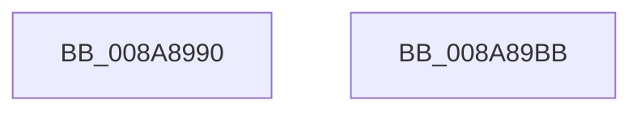

# IopQueryName

- RVA: `0x008A8990`–`0x008A89BC` (길이 `44` bytes)
- VA: `0x00000001408A8990`
- 실행 섹션: `PAGE`
- PDB 이름 있음: `예`; PDB Function 태그: `아니요`
- unwind 정보 RVA: `0x00063458`
- 디코드: `12`개 명령, `44/44` bytes 표시
- 미해석 바이트: `0` (있으면 어셈블리에 `.byte`로 보존)

> 이 문서는 커널 이미지의 기계어와 PDB 기호를 분석해 생성했습니다. 4번과 5번은 함수 원형과 자료형을 바이너리 사용 방식에서 추정한 C 해석이며 원본 소스 복구 결과는 아닙니다.

## 1. Dependencies

- 직접 호출 지점: **1**; 고유 호출 대상: **1**
- 직접 호출자로 확인된 함수: **1**
- RIP 상대 이미지 참조: **0**

### Outgoing calls
- `0x008A89B1` → [IopQueryNameInternal](IopQueryNameInternal_function_008A6770.md) (function, `0x008A6770`)

### Direct callers
- [ObQueryNameStringMode](ObQueryNameStringMode_function_008A7ED0.md) at `0x008A8028`

### Static image references
- 디코드된 RIP-relative 메모리 참조가 없습니다.

## 2. Other-region calls and transfers

- 다른 실행 섹션으로 향하는 call: **0**
- 별도 외부 분기/꼬리 이동을 확인하지 못했습니다.

## 3. Assembly (complete function range)

```asm
008A8990  48 83 EC 48                     sub rsp, 0x48
008A8994  8A 44 24 78                     mov al, byte ptr [rsp + 0x78]
008A8998  88 44 24 30                     mov byte ptr [rsp + 0x30], al
008A899C  48 8B 44 24 70                  mov rax, qword ptr [rsp + 0x70]
008A89A1  48 89 44 24 28                  mov qword ptr [rsp + 0x28], rax
008A89A6  44 89 4C 24 20                  mov dword ptr [rsp + 0x20], r9d
008A89AB  4D 8B C8                        mov r9, r8
008A89AE  45 33 C0                        xor r8d, r8d
008A89B1  E8 BA DD FF FF                  call 0x1408a6770
008A89B6  48 83 C4 48                     add rsp, 0x48
008A89BA  C3                              ret
008A89BB  CC                              int3
```

## 4. C-style interpretation (structured pseudocode)

```c
__int64 __fastcall IopQueryName(__int64 a1, __int64 a2, __int64 a3, int a4, __int64 a5, unsigned __int8 a6)
{
    __int64 result;
    __int64 v_rsp;
    unsigned __int8 v_stack_m18;
    unsigned __int64 v_stack_m20;
    unsigned int v_stack_m28;

    v_rsp = (v_rsp) - (72);
    v_stack_m18 = a6;
    v_stack_m20 = a5;
    v_stack_m28 = a4;
    a3 = 0;
    result = IopQueryNameInternal(a1, a2, a3, a3);
    v_rsp = (v_rsp) + (72);
    return result;
}
```

## 5. (Beta) C Style

```c
int64_t IopQueryName(int64_t Arg1, int64_t Arg2, int64_t Arg3, int32_t Arg4, int64_t Arg5, uint8_t Arg6)
{
    int64_t result;
    int64_t local_rsp;
    uint8_t v_stack_m18;
    uint64_t v_stack_m20;
    uint32_t v_stack_m28;

    local_rsp = (local_rsp) - (72);
    v_stack_m18 = Arg6;
    v_stack_m20 = Arg5;
    v_stack_m28 = Arg4;
    Arg3 = 0;
    result = IopQueryNameInternal(Arg1, Arg2, Arg3, Arg3);
    local_rsp = (local_rsp) + (72);
    return result;
}
```

## 6. Execution-region graph

[열기: 2D/3D 그래프와 함수 탐색 컨트롤 패널](../../../control-panel.html?section=page&rva=0x008A8990&view=graph)

- 2D 그래프는 위에서 아래로 흐르고, 3D 그래프는 빈 공간을 드래그해 회전합니다. Shift+드래그는 이동, 휠은 확대·축소, 함수 노드 선택은 대상 보고서 이동입니다.

### Static fallback


