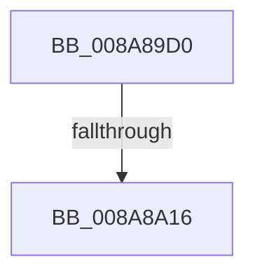

# IopQueryXxxInformation

- RVA: `0x008A89D0`–`0x008A8A27` (길이 `87` bytes)
- VA: `0x00000001408A89D0`
- 실행 섹션: `PAGE`
- PDB 이름 있음: `예`; PDB Function 태그: `아니요`
- unwind 정보 RVA: `0x0007F34C`
- 디코드: `25`개 명령, `87/87` bytes 표시
- 미해석 바이트: `0` (있으면 어셈블리에 `.byte`로 보존)

> 이 문서는 커널 이미지의 기계어와 PDB 기호를 분석해 생성했습니다. 4번과 5번은 함수 원형과 자료형을 바이너리 사용 방식에서 추정한 C 해석이며 원본 소스 복구 결과는 아닙니다.

## 1. Dependencies

- 직접 호출 지점: **2**; 고유 호출 대상: **2**
- 직접 호출자로 확인된 함수: **10**
- RIP 상대 이미지 참조: **0**

### Outgoing calls
- `0x008A8A02` → [ObfReferenceObject](../../text/20/ObfReferenceObject_function_0020FA20.md) (function, `0x0020FA20`)
- `0x008A8A1F` → [KeInitializeEvent](../../text/40/KeInitializeEvent_function_0040DD10.md) (function, `0x0040DD10`)

### Direct callers
- [IopValidateJunctionTarget](../71/IopValidateJunctionTarget_function_0071C808.md) at `0x0071CB0D`
- [MiAttemptPageFileExtension](../7F/MiAttemptPageFileExtension_function_007FEA2C.md) at `0x007FEAAB`
- [MiCreatePagingFile](../7F/MiCreatePagingFile_function_007FEFF4.md) at `0x007FF65C`
- [IopParseDevice](../89/IopParseDevice_function_0089E510.md) at `0x0089EEC0`
- [IopParseDevice](../89/IopParseDevice_function_0089E510.md) at `0x0089F0A3`
- [IopParseDevice](../89/IopParseDevice_function_0089E510.md) at `0x0089F10B`
- [IopQueryNameInternal](IopQueryNameInternal_function_008A6770.md) at `0x008A6A40`
- [IoQueryFileInformation](IoQueryFileInformation_function_008A8C80.md) at `0x008A8C9B`
- [PfSnGetSectionObject](PfSnGetSectionObject_function_008A9448.md) at `0x008A95CF`
- [IoQueryVolumeInformation](IoQueryVolumeInformation_function_008AA480.md) at `0x008AA49B`
- [PfpPrefetchEntireDirectory](../93/PfpPrefetchEntireDirectory_function_0093B0FC.md) at `0x0093B1BF`
- [IopGetNetworkOpenInformation](../AC/IopGetNetworkOpenInformation_function_00AC8264.md) at `0x00AC82C8`
- [IopGetNetworkOpenInformation](../AC/IopGetNetworkOpenInformation_function_00AC8264.md) at `0x00AC82FC`

### Static image references
- 디코드된 RIP-relative 메모리 참조가 없습니다.

## 2. Other-region calls and transfers

- 다른 실행 섹션으로 향하는 call: **2**
  - `0x008A8A02` → [ObfReferenceObject](../../text/20/ObfReferenceObject_function_0020FA20.md) (`PAGE` → `.text`)
  - `0x008A8A1F` → [KeInitializeEvent](../../text/40/KeInitializeEvent_function_0040DD10.md) (`PAGE` → `.text`)
- call이 아닌 외부 분기/꼬리 이동: **1**
  - `0x008A8A10` → [sub_008A8B60 + 0x16](Unknown_function_008A8B60.md) (`tail-transfer`)

## 3. Assembly (complete function range)

```asm
008A89D0  48 89 5C 24 20                  mov qword ptr [rsp + 0x20], rbx
008A89D5  55                              push rbp
008A89D6  57                              push rdi
008A89D7  41 54                           push r12
008A89D9  41 55                           push r13
008A89DB  41 56                           push r14
008A89DD  48 83 EC 60                     sub rsp, 0x60
008A89E1  0F 57 C0                        xorps xmm0, xmm0
008A89E4  33 C0                           xor eax, eax
008A89E6  0F 11 44 24 40                  movups xmmword ptr [rsp + 0x40], xmm0
008A89EB  48 89 44 24 50                  mov qword ptr [rsp + 0x50], rax
008A89F0  45 0F B6 E1                     movzx r12d, r9b
008A89F4  0F 11 44 24 30                  movups xmmword ptr [rsp + 0x30], xmm0
008A89F9  45 8B E8                        mov r13d, r8d
008A89FC  44 8B F2                        mov r14d, edx
008A89FF  48 8B F9                        mov rdi, rcx
008A8A02  E8 19 70 96 FF                  call 0x14020fa20
008A8A07  8B 5F 50                        mov ebx, dword ptr [rdi + 0x50]
008A8A0A  45 33 C0                        xor r8d, r8d
008A8A0D  F6 C3 02                        test bl, 2
008A8A10  0F 85 60 01 00 00               jne 0x1408a8b76
008A8A16  41 8D 50 01                     lea edx, [r8 + 1]
008A8A1A  48 8D 4C 24 40                  lea rcx, [rsp + 0x40]
008A8A1F  E8 EC 52 B6 FF                  call 0x14040dd10
008A8A24  40 32 ED                        xor bpl, bpl
```

## 4. C-style interpretation (structured pseudocode)

```c
__int64 __fastcall IopQueryXxxInformation(__int64 a1, int a2, int a3, unsigned __int8 a4)
{
    __int64 result;
    __int64 v_rbp;
    __int64 v_rsp;
    unsigned __int64 v_stack_m38;
    unsigned __int64 v_stack_m48;
    unsigned __int64 v_stack_m58;
    unsigned __int64 v_stack_p20;

    v_stack_p20 = v_rbx;
    v_rsp = (v_rsp) - (96);
    result = 0;
    v_stack_m48 = v_xmm0;
    v_stack_m38 = 0;
    v_stack_m58 = v_xmm0;
    result = ObfReferenceObject(a1, a2, a3, a4);
    a3 = 0;
    result = KeInitializeEvent(v_stack_m48, a3 + 1, a3, a4);
    v_rbp = 0;
    return result;
}
```

## 5. (Beta) C Style

```c
int64_t IopQueryXxxInformation(void *Arg1, int32_t Arg2, int32_t Arg3, uint8_t Arg4)
{
    uint8_t *arg1 = (uint8_t *)Arg1;

    int64_t result;
    int64_t local_rbp;
    int64_t local_rsp;
    uint64_t v_stack_m38;
    uint64_t v_stack_m48;
    uint64_t v_stack_m58;
    uint64_t v_stack_p20;

    v_stack_p20 = local_rbx;
    local_rsp = (local_rsp) - (96);
    result = 0;
    v_stack_m48 = v_xmm0;
    v_stack_m38 = 0;
    v_stack_m58 = v_xmm0;
    result = ObfReferenceObject(Arg1, Arg2, Arg3, Arg4);
    Arg3 = 0;
    result = KeInitializeEvent(v_stack_m48, Arg3 + 1, Arg3, Arg4);
    local_rbp = 0;
    return result;
}
```

### 관측된 메모리 오프셋

구조체 형식이 확인되지 않은 접근은 인자 기준의 오프셋으로만 기록했습니다.

| 기준 인자 | 오프셋 표현 | 폭 (bit) | 접근 |
|---|---:|---:|---|
| `Arg1` | `+ 0x50` | `32` | `R` |

## 6. Execution-region graph

[열기: 2D/3D 그래프와 함수 탐색 컨트롤 패널](../../../control-panel.html?section=page&rva=0x008A89D0&view=graph)

- 2D 그래프는 위에서 아래로 흐르고, 3D 그래프는 빈 공간을 드래그해 회전합니다. Shift+드래그는 이동, 휠은 확대·축소, 함수 노드 선택은 대상 보고서 이동입니다.

### Static fallback


