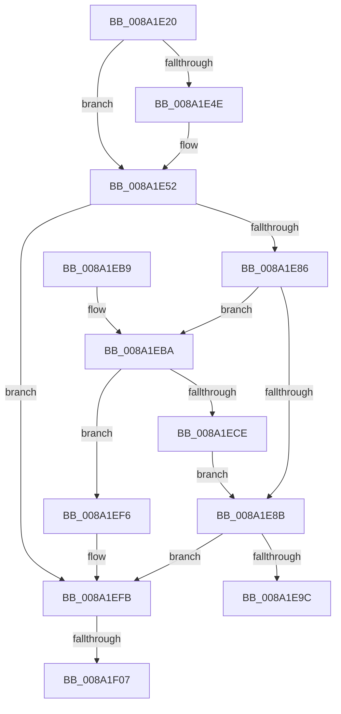

# IopSymlinkAllocateAndAddECP

- RVA: `0x008A1E20`–`0x008A1F1D` (길이 `253` bytes)
- VA: `0x00000001408A1E20`
- 실행 섹션: `PAGE`
- PDB 이름 있음: `예`; PDB Function 태그: `예`
- unwind 정보 RVA: `0x0007EC80`
- 디코드: `69`개 명령, `253/253` bytes 표시
- 미해석 바이트: `0` (있으면 어셈블리에 `.byte`로 보존)

> 이 문서는 커널 이미지의 기계어와 PDB 기호를 분석해 생성했습니다. 4번과 5번은 함수 원형과 자료형을 바이너리 사용 방식에서 추정한 C 해석이며 원본 소스 복구 결과는 아닙니다.

## 1. Dependencies

- 직접 호출 지점: **5**; 고유 호출 대상: **5**
- 직접 호출자로 확인된 함수: **4**
- RIP 상대 이미지 참조: **4**

### Outgoing calls
- `0x008A1E7B` → [FsRtlAllocateExtraCreateParameterFromLookasideList](FsRtlAllocateExtraCreateParameterFromLookasideList_function_008A1CD0.md) (function, `0x008A1CD0`)
- `0x008A1E91` → [FsRtlInsertExtraCreateParameter](FsRtlInsertExtraCreateParameter_function_008A1F30.md) (function, `0x008A1F30`)
- `0x008A1EC1` → [ExAllocateFromPagedLookasideList](../../text/3F/ExAllocateFromPagedLookasideList_function_003FB730.md) (function, `0x003FB730`)
- `0x008A1EEC` → [IoSetIrpExtraCreateParameter](../9E/IoSetIrpExtraCreateParameter_function_009EB900.md) (function, `0x009EB900`)
- `0x008A1F0F` → [FsRtlFreeExtraCreateParameter](FsRtlFreeExtraCreateParameter_function_008A1760.md) (function, `0x008A1760`)

### Direct callers
- [IopSymlinkCreateECP](IopSymlinkCreateECP_function_008A1F90.md) at `0x008A200D`
- [IopSymlinkUpdateECP](IopSymlinkUpdateECP_function_008A20CC.md) at `0x008A219B`
- [sub_00B19BFE](../B1/Unknown_function_00B19BFE.md) at `0x00B19C0D`
- [sub_00B19BFE](../B1/Unknown_function_00B19BFE.md) at `0x00B19C83`
- [sub_00B39C68](../B3/Unknown_function_00B39C68.md) at `0x00B39EA1`

### Static image references
- `0x008A1E56` → RVA `0x00E12380` (`.data`; read)
- `0x008A1E65` → RVA `0x008A2270` (`IopSymlinkCleanupECP`; read)
- `0x008A1E74` → RVA `0x00B4B100` (`IopSymlinkECPGuid`; read)
- `0x008A1EBA` → RVA `0x00E11D00` (`.data`; read)

## 2. Other-region calls and transfers

- 다른 실행 섹션으로 향하는 call: **1**
  - `0x008A1EC1` → [ExAllocateFromPagedLookasideList](../../text/3F/ExAllocateFromPagedLookasideList_function_003FB730.md) (`PAGE` → `.text`)
- call이 아닌 외부 분기/꼬리 이동: **2**
  - `0x008A1F01` → [sub_00B19BDE](../B1/Unknown_function_00B19BDE.md) (`tail-transfer`)
  - `0x008A1F18` → [sub_00B19BDE](../B1/Unknown_function_00B19BDE.md) (`tail-transfer`)

## 3. Assembly (complete function range)

```asm
008A1E20  48 8B C4                        mov rax, rsp
008A1E23  48 89 58 08                     mov qword ptr [rax + 8], rbx
008A1E27  48 89 68 10                     mov qword ptr [rax + 0x10], rbp
008A1E2B  48 89 70 18                     mov qword ptr [rax + 0x18], rsi
008A1E2F  48 89 78 20                     mov qword ptr [rax + 0x20], rdi
008A1E33  41 56                           push r14
008A1E35  48 83 EC 30                     sub rsp, 0x30
008A1E39  33 DB                           xor ebx, ebx
008A1E3B  45 32 F6                        xor r14b, r14b
008A1E3E  48 21 1A                        and qword ptr [rdx], rbx
008A1E41  48 8B FA                        mov rdi, rdx
008A1E44  8B 41 10                        mov eax, dword ptr [rcx + 0x10]
008A1E47  48 8B E9                        mov rbp, rcx
008A1E4A  84 C0                           test al, al
008A1E4C  79 04                           jns 0x1408a1e52
008A1E4E  48 8B 59 70                     mov rbx, qword ptr [rcx + 0x70]
008A1E52  41 0F B7 D0                     movzx edx, r8w
008A1E56  48 8D 05 23 05 57 00            lea rax, [rip + 0x570523]
008A1E5D  83 C2 20                        add edx, 0x20
008A1E60  48 89 7C 24 28                  mov qword ptr [rsp + 0x28], rdi
008A1E65  4C 8D 0D 04 04 00 00            lea r9, [rip + 0x404]
008A1E6C  48 89 44 24 20                  mov qword ptr [rsp + 0x20], rax
008A1E71  45 33 C0                        xor r8d, r8d
008A1E74  48 8D 0D 85 92 2A 00            lea rcx, [rip + 0x2a9285]
008A1E7B  E8 50 FE FF FF                  call 0x1408a1cd0
008A1E80  8B F0                           mov esi, eax
008A1E82  85 C0                           test eax, eax
008A1E84  78 75                           js 0x1408a1efb
008A1E86  48 85 DB                        test rbx, rbx
008A1E89  74 2F                           je 0x1408a1eba
008A1E8B  48 8B 17                        mov rdx, qword ptr [rdi]
008A1E8E  48 8B CB                        mov rcx, rbx
008A1E91  E8 9A 00 00 00                  call 0x1408a1f30
008A1E96  8B F0                           mov esi, eax
008A1E98  85 C0                           test eax, eax
008A1E9A  78 5F                           js 0x1408a1efb
008A1E9C  48 8B 5C 24 40                  mov rbx, qword ptr [rsp + 0x40]
008A1EA1  8B C6                           mov eax, esi
008A1EA3  48 8B 74 24 50                  mov rsi, qword ptr [rsp + 0x50]
008A1EA8  48 8B 6C 24 48                  mov rbp, qword ptr [rsp + 0x48]
008A1EAD  48 8B 7C 24 58                  mov rdi, qword ptr [rsp + 0x58]
008A1EB2  48 83 C4 30                     add rsp, 0x30
008A1EB6  41 5E                           pop r14
008A1EB8  C3                              ret
008A1EB9  CC                              int3
008A1EBA  48 8D 0D 3F FE 56 00            lea rcx, [rip + 0x56fe3f]
008A1EC1  E8 6A 98 B5 FF                  call 0x1403fb730
008A1EC6  48 8B D0                        mov rdx, rax
008A1EC9  48 85 C0                        test rax, rax
008A1ECC  74 28                           je 0x1408a1ef6
008A1ECE  48 83 C0 08                     add rax, 8
008A1ED2  48 8B CD                        mov rcx, rbp
008A1ED5  48 8B DA                        mov rbx, rdx
008A1ED8  48 89 40 08                     mov qword ptr [rax + 8], rax
008A1EDC  48 89 00                        mov qword ptr [rax], rax
008A1EDF  C7 42 04 06 00 00 00            mov dword ptr [rdx + 4], 6
008A1EE6  C7 02 45 63 70 4C               mov dword ptr [rdx], 0x4c706345
008A1EEC  E8 0F 9A 14 00                  call 0x1409eb900
008A1EF1  41 B6 01                        mov r14b, 1
008A1EF4  EB 95                           jmp 0x1408a1e8b
008A1EF6  BE 9A 00 00 C0                  mov esi, 0xc000009a
008A1EFB  48 8B 07                        mov rax, qword ptr [rdi]
008A1EFE  48 85 C0                        test rax, rax
008A1F01  0F 84 D7 7C 27 00               je 0x140b19bde
008A1F07  48 83 60 08 00                  and qword ptr [rax + 8], 0
008A1F0C  48 8B 0F                        mov rcx, qword ptr [rdi]
008A1F0F  E8 4C F8 FF FF                  call 0x1408a1760
008A1F14  48 83 27 00                     and qword ptr [rdi], 0
008A1F18  E9 C1 7C 27 00                  jmp 0x140b19bde
```

## 4. C-style interpretation (structured pseudocode)

```c
__int64 __fastcall IopSymlinkAllocateAndAddECP(__int64 a1, __int64 a2, int a3)
{
    __int64 result;
    __int64 v_r14;
    __int64 v_rbx;
    __int64 v_rsp;
    unsigned __int64 v_stack_m10;
    unsigned __int64 v_stack_m18;
    unsigned __int64 v_stack_p10;
    unsigned __int64 v_stack_p18;
    unsigned __int64 v_stack_p20;
    unsigned __int64 v_stack_p8;

    *(unsigned __int64 *)(v_rsp + 8) = v_rbx;
    *(unsigned __int64 *)(v_rsp + 16) = v_rbp;
    *(unsigned __int64 *)(v_rsp + 24) = v_rsi;
    *(unsigned __int64 *)(v_rsp + 32) = v_rdi;
    v_rsp = (v_rsp) - (48);
    v_rbx = 0;
    v_r14 = 0;
    if (sign_flag) {
        v_rbx = *(unsigned __int64 *)(a1 + 112);
    }
    a2 = (unsigned int)(((unsigned __int16)(a3)) + (32));
    v_stack_m10 = a2;
    v_stack_m18 = v_rip + 5702947;
    a3 = 0;
    result = FsRtlAllocateExtraCreateParameterFromLookasideList(v_rip + 2790021, a2, a3, v_rip + 1028);
    if (sign_flag) goto loc_008A1EFB;
    if (v_rbx == 0) goto loc_008A1EBA;
loc_008A1E8B:
    result = FsRtlInsertExtraCreateParameter(v_rbx, *(unsigned __int64 *)(a2), a3, v_rip + 1028);
    if (sign_flag) goto loc_008A1EFB;
    v_rsp = (v_rsp) + (48);
    return (unsigned int)((unsigned int)((unsigned int)((unsigned int)(result))));
loc_008A1EBA:
    result = ExAllocateFromPagedLookasideList(v_rip + 5701183, *(unsigned __int64 *)(a2), a3, v_rip + 1028);
    if (result == 0) goto loc_008A1EF6;
    result = (result) + (8);
    *(unsigned __int64 *)(result + 8) = result;
    *(unsigned __int64 *)(result) = result;
    *(unsigned int *)(result + 4) = 6;
    *(unsigned int *)(result) = 0x4C706345ULL;
    result = IoSetIrpExtraCreateParameter(v_stack_p10, result, a3, v_rip + 1028);
    goto loc_008A1E8B;
loc_008A1EF6:
loc_008A1EFB:
    result = FsRtlFreeExtraCreateParameter(*(unsigned __int64 *)(v_stack_p20), result, a3, v_rip + 1028);
}
```

## 5. (Beta) C Style

```c
int64_t IopSymlinkAllocateAndAddECP(void *Arg1, void *Arg2, int32_t Arg3)
{
    uint8_t *arg1 = (uint8_t *)Arg1;
    uint8_t *arg2 = (uint8_t *)Arg2;

    int64_t result;
    int64_t local_r14;
    int64_t local_rbx;
    int64_t local_rsp;
    uint64_t v_stack_m10;
    uint64_t v_stack_m18;
    uint64_t v_stack_p10;
    uint64_t v_stack_p18;
    uint64_t v_stack_p20;
    uint64_t v_stack_p8;

    *(uint64_t *)(local_rsp + 0x8) = local_rbx;
    *(uint64_t *)(local_rsp + 0x10) = local_rbp;
    *(uint64_t *)(local_rsp + 0x18) = local_rsi;
    *(uint64_t *)(local_rsp + 0x20) = local_rdi;
    local_rsp = (local_rsp) - (48);
    local_rbx = 0;
    local_r14 = 0;
    if (sign_flag) {
        local_rbx = *(uint64_t *)(arg1 + 0x70);
    }
    Arg2 = (uint32_t)(((uint16_t)(Arg3)) + (32));
    v_stack_m10 = Arg2;
    v_stack_m18 = v_rip + 5702947;
    Arg3 = 0;
    result = FsRtlAllocateExtraCreateParameterFromLookasideList(v_rip + 2790021, Arg2, Arg3, v_rip + 1028);
    if (sign_flag) goto loc_008A1EFB;
    if (local_rbx == 0) goto loc_008A1EBA;
loc_008A1E8B:
    result = FsRtlInsertExtraCreateParameter(local_rbx, *(uint64_t *)(arg2), Arg3, v_rip + 1028);
    if (sign_flag) goto loc_008A1EFB;
    local_rsp = (local_rsp) + (48);
    return (uint32_t)((uint32_t)((uint32_t)((uint32_t)(result))));
loc_008A1EBA:
    result = ExAllocateFromPagedLookasideList(v_rip + 5701183, *(uint64_t *)(arg2), Arg3, v_rip + 1028);
    if (result == 0) goto loc_008A1EF6;
    result = (result) + (8);
    *(uint64_t *)(result + 0x8) = result;
    *(uint64_t *)(result) = result;
    *(uint32_t *)(result + 0x4) = 6;
    *(uint32_t *)(result) = 0x4C706345ULL;
    result = IoSetIrpExtraCreateParameter(v_stack_p10, result, Arg3, v_rip + 1028);
    goto loc_008A1E8B;
loc_008A1EF6:
loc_008A1EFB:
    result = FsRtlFreeExtraCreateParameter(*(uint64_t *)(v_stack_p20), result, Arg3, v_rip + 1028);
}
```

### 관측된 메모리 오프셋

구조체 형식이 확인되지 않은 접근은 인자 기준의 오프셋으로만 기록했습니다.

| 기준 인자 | 오프셋 표현 | 폭 (bit) | 접근 |
|---|---:|---:|---|
| `Arg1` | `+ 0x10` | `32` | `R` |
| `Arg1` | `+ 0x70` | `64` | `R` |
| `Arg2` | `+ 0x0` | `64` | `R` |
| `Arg2` | `+ 0x0` | `64` | `R/W` |

## 6. Execution-region graph

[열기: 2D/3D 그래프와 함수 탐색 컨트롤 패널](../../../control-panel.html?section=page&rva=0x008A1E20&view=graph)

- 2D 그래프는 위에서 아래로 흐르고, 3D 그래프는 빈 공간을 드래그해 회전합니다. Shift+드래그는 이동, 휠은 확대·축소, 함수 노드 선택은 대상 보고서 이동입니다.

### Static fallback


