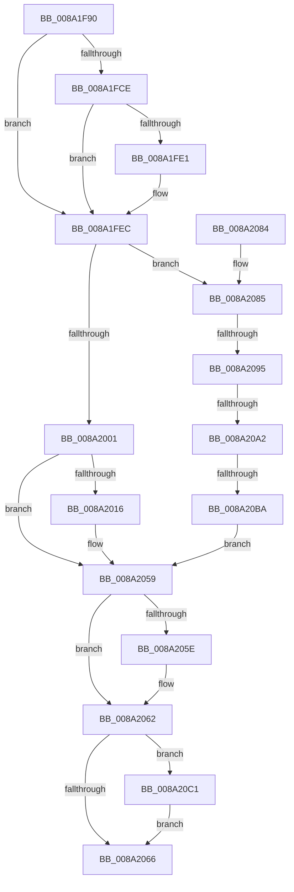

# IopSymlinkCreateECP

- RVA: `0x008A1F90`–`0x008A20C6` (길이 `310` bytes)
- VA: `0x00000001408A1F90`
- 실행 섹션: `PAGE`
- PDB 이름 있음: `예`; PDB Function 태그: `예`
- unwind 정보 RVA: `0x0007ECAC`
- 디코드: `86`개 명령, `310/310` bytes 표시
- 미해석 바이트: `0` (있으면 어셈블리에 `.byte`로 보존)

> 이 문서는 커널 이미지의 기계어와 PDB 기호를 분석해 생성했습니다. 4번과 5번은 함수 원형과 자료형을 바이너리 사용 방식에서 추정한 C 해석이며 원본 소스 복구 결과는 아닙니다.

## 1. Dependencies

- 직접 호출 지점: **2**; 고유 호출 대상: **2**
- 직접 호출자로 확인된 함수: **1**
- RIP 상대 이미지 참조: **0**

### Outgoing calls
- `0x008A200D` → [IopSymlinkAllocateAndAddECP](IopSymlinkAllocateAndAddECP_function_008A1E20.md) (function, `0x008A1E20`)
- `0x008A204A` → [memcpy](../../text/6C/memcpy_function_006C6840.md) (function, `0x006C6840`)

### Direct callers
- [IopParseDevice](../89/IopParseDevice_function_0089E510.md) at `0x0089FEDA`

### Static image references
- 디코드된 RIP-relative 메모리 참조가 없습니다.

## 2. Other-region calls and transfers

- 다른 실행 섹션으로 향하는 call: **1**
  - `0x008A204A` → [memcpy](../../text/6C/memcpy_function_006C6840.md) (`PAGE` → `.text`)
- call이 아닌 외부 분기/꼬리 이동: **3**
  - `0x008A208F` → [sub_00B19BFE + 0x79](../B1/Unknown_function_00B19BFE.md) (`tail-transfer`)
  - `0x008A209C` → [sub_00B19BFE + 0x79](../B1/Unknown_function_00B19BFE.md) (`tail-transfer`)
  - `0x008A20B4` → [sub_00B19BFE](../B1/Unknown_function_00B19BFE.md) (`tail-transfer`)

## 3. Assembly (complete function range)

```asm
008A1F90  48 8B C4                        mov rax, rsp
008A1F93  48 89 58 08                     mov qword ptr [rax + 8], rbx
008A1F97  48 89 68 18                     mov qword ptr [rax + 0x18], rbp
008A1F9B  48 89 70 20                     mov qword ptr [rax + 0x20], rsi
008A1F9F  57                              push rdi
008A1FA0  41 54                           push r12
008A1FA2  41 55                           push r13
008A1FA4  41 56                           push r14
008A1FA6  41 57                           push r15
008A1FA8  48 83 EC 50                     sub rsp, 0x50
008A1FAC  45 0F B7 18                     movzx r11d, word ptr [r8]
008A1FB0  45 33 ED                        xor r13d, r13d
008A1FB3  4C 89 68 10                     mov qword ptr [rax + 0x10], r13
008A1FB7  45 0F B7 E1                     movzx r12d, r9w
008A1FBB  49 8B F8                        mov rdi, r8
008A1FBE  48 8B E9                        mov rbp, rcx
008A1FC1  45 8A FD                        mov r15b, r13b
008A1FC4  45 0F B7 D3                     movzx r10d, r11w
008A1FC8  41 83 FB 02                     cmp r11d, 2
008A1FCC  76 1E                           jbe 0x1408a1fec
008A1FCE  48 8B 47 08                     mov rax, qword ptr [rdi + 8]
008A1FD2  45 8B C3                        mov r8d, r11d
008A1FD5  49 D1 E8                        shr r8, 1
008A1FD8  66 42 83 7C 40 FE 5C            cmp word ptr [rax + r8*2 - 2], 0x5c
008A1FDF  75 0B                           jne 0x1408a1fec
008A1FE1  45 8D 53 FE                     lea r10d, [r11 - 2]
008A1FE5  41 B7 01                        mov r15b, 1
008A1FE8  66 44 89 17                     mov word ptr [rdi], r10w
008A1FEC  48 8B 42 40                     mov rax, qword ptr [rdx + 0x40]
008A1FF0  4C 8B B4 24 A0 00 00 00         mov r14, qword ptr [rsp + 0xa0]
008A1FF8  48 85 C0                        test rax, rax
008A1FFB  0F 85 84 00 00 00               jne 0x1408a2085
008A2001  45 0F B7 C2                     movzx r8d, r10w
008A2005  48 8D 94 24 88 00 00 00         lea rdx, [rsp + 0x88]
008A200D  E8 0E FE FF FF                  call 0x1408a1e20
008A2012  85 C0                           test eax, eax
008A2014  78 43                           js 0x1408a2059
008A2016  0F B7 1F                        movzx ebx, word ptr [rdi]
008A2019  48 8B B4 24 88 00 00 00         mov rsi, qword ptr [rsp + 0x88]
008A2021  44 8B C3                        mov r8d, ebx
008A2024  48 8B 57 08                     mov rdx, qword ptr [rdi + 8]
008A2028  48 8D 4E 20                     lea rcx, [rsi + 0x20]
008A202C  66 44 89 6E 06                  mov word ptr [rsi + 6], r13w
008A2031  48 89 4E 18                     mov qword ptr [rsi + 0x18], rcx
008A2035  66 44 89 66 04                  mov word ptr [rsi + 4], r12w
008A203A  66 44 89 6E 10                  mov word ptr [rsi + 0x10], r13w
008A203F  66 89 5E 12                     mov word ptr [rsi + 0x12], bx
008A2043  44 89 2E                        mov dword ptr [rsi], r13d
008A2046  4C 89 6E 08                     mov qword ptr [rsi + 8], r13
008A204A  E8 F1 47 E2 FF                  call 0x1406c6840
008A204F  66 01 5E 10                     add word ptr [rsi + 0x10], bx
008A2053  49 89 36                        mov qword ptr [r14], rsi
008A2056  41 8B C5                        mov eax, r13d
008A2059  45 84 FF                        test r15b, r15b
008A205C  74 04                           je 0x1408a2062
008A205E  66 83 07 02                     add word ptr [rdi], 2
008A2062  85 C0                           test eax, eax
008A2064  78 5B                           js 0x1408a20c1
008A2066  4C 8D 5C 24 50                  lea r11, [rsp + 0x50]
008A206B  49 8B 5B 30                     mov rbx, qword ptr [r11 + 0x30]
008A206F  49 8B 6B 40                     mov rbp, qword ptr [r11 + 0x40]
008A2073  49 8B 73 48                     mov rsi, qword ptr [r11 + 0x48]
008A2077  49 8B E3                        mov rsp, r11
008A207A  41 5F                           pop r15
008A207C  41 5E                           pop r14
008A207E  41 5D                           pop r13
008A2080  41 5C                           pop r12
008A2082  5F                              pop rdi
008A2083  C3                              ret
008A2084  CC                              int3
008A2085  48 8B 98 D0 00 00 00            mov rbx, qword ptr [rax + 0xd0]
008A208C  48 85 DB                        test rbx, rbx
008A208F  0F 84 E2 7B 27 00               je 0x140b19c77
008A2095  48 8B 5B 30                     mov rbx, qword ptr [rbx + 0x30]
008A2099  48 85 DB                        test rbx, rbx
008A209C  0F 84 D5 7B 27 00               je 0x140b19c77
008A20A2  0F B7 0F                        movzx ecx, word ptr [rdi]
008A20A5  0F B7 73 10                     movzx esi, word ptr [rbx + 0x10]
008A20A9  83 C1 02                        add ecx, 2
008A20AC  03 F1                           add esi, ecx
008A20AE  81 FE FF FF 00 00               cmp esi, 0xffff
008A20B4  0F 82 44 7B 27 00               jb 0x140b19bfe
008A20BA  B8 06 01 00 C0                  mov eax, 0xc0000106
008A20BF  EB 98                           jmp 0x1408a2059
008A20C1  4D 89 2E                        mov qword ptr [r14], r13
008A20C4  EB A0                           jmp 0x1408a2066
```

## 4. C-style interpretation (structured pseudocode)

```c
__int64 __fastcall IopSymlinkCreateECP(__int64 a1, __int64 a2, __int64 a3, unsigned __int16 a4, __int64 a5)
{
    __int64 result;
    __int64 v_r10;
    __int64 v_r13;
    __int64 v_r15;
    __int64 v_rbx;
    __int64 v_rsi;
    __int64 v_rsp;
    unsigned __int64 v_stack_m28;
    unsigned __int64 v_stack_p10;

    *(unsigned __int64 *)(v_rsp + 8) = v_rbx;
    *(unsigned __int64 *)(v_rsp + 24) = v_rbp;
    *(unsigned __int64 *)(v_rsp + 32) = v_rsi;
    v_rsp = (v_rsp) - (80);
    v_r13 = 0;
    *(unsigned __int64 *)(v_rsp + 16) = 0;
    if (((unsigned int)(*(unsigned __int16 *)(a3))) <= 2) goto loc_008A1FEC;
    a3 = ((unsigned int)((unsigned int)(*(unsigned __int16 *)(a3)))) >> (1);
    v_r10 = (unsigned __int16)(*(unsigned __int16 *)(a3));
    v_r15 = 0;
    if ((*(unsigned __int16 *)(*(unsigned __int64 *)(a3 + 8) + a3 * 2 - 2)) == 92) {
        v_r10 = *(unsigned __int16 *)(a3) - 2;
        v_r15 = 1;
        *(unsigned __int16 *)(a3) = (unsigned __int16)(v_r10);
    }
    if (*(unsigned __int64 *)(a2 + 64) != 0) goto loc_008A2085;
    result = IopSymlinkAllocateAndAddECP(a1, v_stack_p10, (unsigned __int16)(v_r10), a4);
    if (!(sign_flag)) {
        v_rbx = *(unsigned __int16 *)(a3);
        v_rsi = v_stack_p10;
        a3 = (unsigned int)(v_rbx);
        a2 = *(unsigned __int64 *)(a3 + 8);
        a1 = v_rsi + 32;
        *(unsigned __int16 *)(v_rsi + 6) = 0;
        *(unsigned __int64 *)(v_rsi + 24) = a1;
        *(unsigned __int16 *)(v_rsi + 4) = a4;
        *(unsigned __int16 *)(v_rsi + 16) = 0;
        *(unsigned __int16 *)(v_rsi + 18) = (unsigned __int16)(v_rbx);
        *(unsigned int *)(v_rsi) = 0;
        *(unsigned __int64 *)(v_rsi + 8) = 0;
        result = memcpy(a1, a2, a3, a4);
        *(unsigned __int64 *)(a5) = v_rsi;
        result = 0;
    }
    if ((unsigned __int8)(v_r15) != 0) {
    }
    if (sign_flag) goto loc_008A20C1;
loc_008A2066:
    return result;
loc_008A2085:
    a1 = (unsigned int)((*(unsigned __int16 *)(a3)) + (2));
    v_rsi = (unsigned int)((*(unsigned __int16 *)(*(unsigned __int64 *)(*(unsigned __int64 *)(result + 208) + 48) + 16)) + ((unsigned int)(a1)));
    goto loc_008A2059;
loc_008A20C1:
    *(unsigned __int64 *)(a5) = 0;
    goto loc_008A2066;
}
```

## 5. (Beta) C Style

```c
int64_t IopSymlinkCreateECP(int64_t Arg1, void *Arg2, void *Arg3, uint16_t Arg4, void *Arg5)
{
    uint8_t *arg2 = (uint8_t *)Arg2;
    uint8_t *arg3 = (uint8_t *)Arg3;
    uint8_t *arg5 = (uint8_t *)Arg5;

    int64_t result;
    int64_t local_r10;
    int64_t local_r13;
    int64_t local_r15;
    int64_t local_rbx;
    int64_t local_rsi;
    int64_t local_rsp;
    uint64_t v_stack_m28;
    uint64_t v_stack_p10;

    *(uint64_t *)(local_rsp + 0x8) = local_rbx;
    *(uint64_t *)(local_rsp + 0x18) = local_rbp;
    *(uint64_t *)(local_rsp + 0x20) = local_rsi;
    local_rsp = (local_rsp) - (80);
    local_r13 = 0;
    *(uint64_t *)(local_rsp + 0x10) = 0;
    if (((uint32_t)(*(uint16_t *)(arg3))) <= 2) goto loc_008A1FEC;
    Arg3 = ((uint32_t)((uint32_t)(*(uint16_t *)(arg3)))) >> (1);
    local_r10 = (uint16_t)(*(uint16_t *)(arg3));
    local_r15 = 0;
    if ((*(uint16_t *)(*(uint64_t *)(arg3 + 0x8) + arg3 * 2 - 0x2)) == 92) {
        local_r10 = *(uint16_t *)(arg3) - 2;
        local_r15 = 1;
        *(uint16_t *)(arg3) = (uint16_t)(local_r10);
    }
    if (*(uint64_t *)(arg2 + 0x40) != 0) goto loc_008A2085;
    result = IopSymlinkAllocateAndAddECP(Arg1, v_stack_p10, (uint16_t)(local_r10), Arg4);
    if (!(sign_flag)) {
        local_rbx = *(uint16_t *)(arg3);
        local_rsi = v_stack_p10;
        Arg3 = (uint32_t)(local_rbx);
        Arg2 = *(uint64_t *)(arg3 + 0x8);
        Arg1 = local_rsi + 32;
        *(uint16_t *)(local_rsi + 0x6) = 0;
        *(uint64_t *)(local_rsi + 0x18) = Arg1;
        *(uint16_t *)(local_rsi + 0x4) = Arg4;
        *(uint16_t *)(local_rsi + 0x10) = 0;
        *(uint16_t *)(local_rsi + 0x12) = (uint16_t)(local_rbx);
        *(uint32_t *)(local_rsi) = 0;
        *(uint64_t *)(local_rsi + 0x8) = 0;
        result = memcpy(Arg1, Arg2, Arg3, Arg4);
        *(uint64_t *)(arg5) = local_rsi;
        result = 0;
    }
    if ((uint8_t)(local_r15) != 0) {
    }
    if (sign_flag) goto loc_008A20C1;
loc_008A2066:
    return result;
loc_008A2085:
    Arg1 = (uint32_t)((*(uint16_t *)(arg3)) + (2));
    local_rsi = (uint32_t)((*(uint16_t *)(*(uint64_t *)(*(uint64_t *)(result + 0xD0) + 0x30) + 0x10)) + ((uint32_t)(Arg1)));
    goto loc_008A2059;
loc_008A20C1:
    *(uint64_t *)(arg5) = 0;
    goto loc_008A2066;
}
```

### 관측된 메모리 오프셋

구조체 형식이 확인되지 않은 접근은 인자 기준의 오프셋으로만 기록했습니다.

| 기준 인자 | 오프셋 표현 | 폭 (bit) | 접근 |
|---|---:|---:|---|
| `Arg2` | `+ 0x40` | `64` | `R` |
| `Arg3` | `+ 0x0` | `16` | `R` |
| `Arg3` | `+ 0x0` | `16` | `R/W` |
| `Arg3` | `+ 0x0` | `16` | `W` |
| `Arg3` | `+ 0x8` | `64` | `R` |
| `Arg5` | `+ 0x0` | `64` | `W` |

## 6. Execution-region graph

[열기: 2D/3D 그래프와 함수 탐색 컨트롤 패널](../../../control-panel.html?section=page&rva=0x008A1F90&view=graph)

- 2D 그래프는 위에서 아래로 흐르고, 3D 그래프는 빈 공간을 드래그해 회전합니다. Shift+드래그는 이동, 휠은 확대·축소, 함수 노드 선택은 대상 보고서 이동입니다.

### Static fallback


