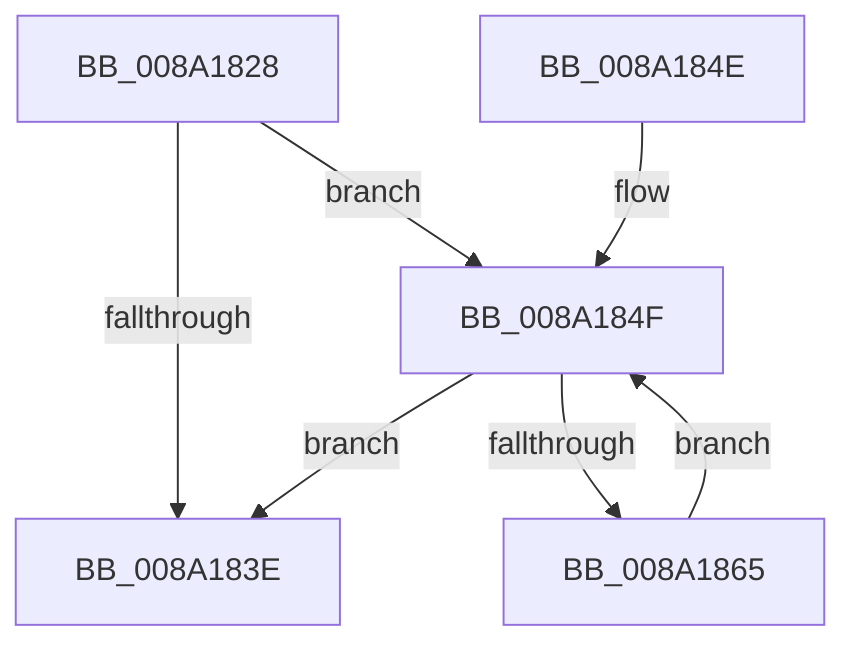

# IopSymlinkFreeRelatedMountPointChain

- RVA: `0x008A1828`–`0x008A1867` (길이 `63` bytes)
- VA: `0x00000001408A1828`
- 실행 섹션: `PAGE`
- PDB 이름 있음: `예`; PDB Function 태그: `아니요`
- unwind 정보 RVA: `0x0007EC14`
- 디코드: `20`개 명령, `63/63` bytes 표시
- 미해석 바이트: `0` (있으면 어셈블리에 `.byte`로 보존)

> 이 문서는 커널 이미지의 기계어와 PDB 기호를 분석해 생성했습니다. 4번과 5번은 함수 원형과 자료형을 바이너리 사용 방식에서 추정한 C 해석이며 원본 소스 복구 결과는 아닙니다.

## 1. Dependencies

- 직접 호출 지점: **1**; 고유 호출 대상: **1**
- 직접 호출자로 확인된 함수: **7**
- RIP 상대 이미지 참조: **0**

### Outgoing calls
- `0x008A1858` → [ExFreePoolWithTag](../../poolcode/B8/ExFreePoolWithTag_function_00B82870.md) (function, `0x00B82870`)

### Direct callers
- [sub_008A1237](Unknown_function_008A1237.md) at `0x008A12B8`
- [FsRtlFreeExtraCreateParameterList](FsRtlFreeExtraCreateParameterList_function_008A1420.md) at `0x008A149B`
- [IopSymlinkPropagateToExtensionIfNeeded](IopSymlinkPropagateToExtensionIfNeeded_function_008A1580.md) at `0x008A1688`
- [FsRtlFreeExtraCreateParameter](FsRtlFreeExtraCreateParameter_function_008A1760.md) at `0x008A1790`
- [IopSymlinkUpdateECP](IopSymlinkUpdateECP_function_008A20CC.md) at `0x008A2152`
- [IopSymlinkCleanupECP](IopSymlinkCleanupECP_function_008A2270.md) at `0x008A2274`
- [IopSymlinkRememberJunction](../A3/IopSymlinkRememberJunction_function_00A33524.md) at `0x00A3360E`

### Static image references
- 디코드된 RIP-relative 메모리 참조가 없습니다.

## 2. Other-region calls and transfers

- 다른 실행 섹션으로 향하는 call: **1**
  - `0x008A1858` → [ExFreePoolWithTag](../../poolcode/B8/ExFreePoolWithTag_function_00B82870.md) (`PAGE` → `POOLCODE`)
- 별도 외부 분기/꼬리 이동을 확인하지 못했습니다.

## 3. Assembly (complete function range)

```asm
008A1828  48 89 5C 24 08                  mov qword ptr [rsp + 8], rbx
008A182D  57                              push rdi
008A182E  48 83 EC 20                     sub rsp, 0x20
008A1832  48 8B F9                        mov rdi, rcx
008A1835  48 8B 49 08                     mov rcx, qword ptr [rcx + 8]
008A1839  48 85 C9                        test rcx, rcx
008A183C  75 11                           jne 0x1408a184f
008A183E  48 83 67 08 00                  and qword ptr [rdi + 8], 0
008A1843  48 8B 5C 24 30                  mov rbx, qword ptr [rsp + 0x30]
008A1848  48 83 C4 20                     add rsp, 0x20
008A184C  5F                              pop rdi
008A184D  C3                              ret
008A184E  CC                              int3
008A184F  48 8B 59 08                     mov rbx, qword ptr [rcx + 8]
008A1853  BA 49 6F 53 69                  mov edx, 0x69536f49
008A1858  E8 13 10 2E 00                  call 0x140b82870
008A185D  48 8B CB                        mov rcx, rbx
008A1860  48 85 DB                        test rbx, rbx
008A1863  74 D9                           je 0x1408a183e
008A1865  EB E8                           jmp 0x1408a184f
```

## 4. C-style interpretation (structured pseudocode)

```c
__int64 __fastcall IopSymlinkFreeRelatedMountPointChain(__int64 a1)
{
    __int64 result;
    __int64 v_rsp;
    unsigned __int64 v_stack_p8;

    v_stack_p8 = v_rbx;
    v_rsp = (v_rsp) - (32);
    if (*(unsigned __int64 *)(a1 + 8) != 0) goto loc_008A184F;
loc_008A183E:
    v_rsp = (v_rsp) + (32);
    return result;
loc_008A184F:
    result = ExFreePoolWithTag(*(unsigned __int64 *)(a1 + 8), (unsigned int)(0x69536F49ULL), a3, a4);
    if (*(unsigned __int64 *)(*(unsigned __int64 *)(a1 + 8) + 8) == 0) goto loc_008A183E;
    goto loc_008A184F;
}
```

## 5. (Beta) C Style

```c
int64_t IopSymlinkFreeRelatedMountPointChain(void *Arg1)
{
    uint8_t *arg1 = (uint8_t *)Arg1;

    int64_t result;
    int64_t local_rsp;
    uint64_t v_stack_p8;

    v_stack_p8 = local_rbx;
    local_rsp = (local_rsp) - (32);
    if (*(uint64_t *)(arg1 + 0x8) != 0) goto loc_008A184F;
loc_008A183E:
    local_rsp = (local_rsp) + (32);
    return result;
loc_008A184F:
    result = ExFreePoolWithTag(*(uint64_t *)(arg1 + 0x8), (uint32_t)(0x69536F49ULL), a3, a4);
    if (*(uint64_t *)(*(uint64_t *)(arg1 + 0x8) + 0x8) == 0) goto loc_008A183E;
    goto loc_008A184F;
}
```

### 관측된 메모리 오프셋

구조체 형식이 확인되지 않은 접근은 인자 기준의 오프셋으로만 기록했습니다.

| 기준 인자 | 오프셋 표현 | 폭 (bit) | 접근 |
|---|---:|---:|---|
| `Arg1` | `+ 0x8` | `64` | `R` |
| `Arg1` | `+ 0x8` | `64` | `R/W` |

## 6. Execution-region graph

[열기: 2D/3D 그래프와 함수 탐색 컨트롤 패널](../../../control-panel.html?section=page&rva=0x008A1828&view=graph)

- 2D 그래프는 위에서 아래로 흐르고, 3D 그래프는 빈 공간을 드래그해 회전합니다. Shift+드래그는 이동, 휠은 확대·축소, 함수 노드 선택은 대상 보고서 이동입니다.

### Static fallback


