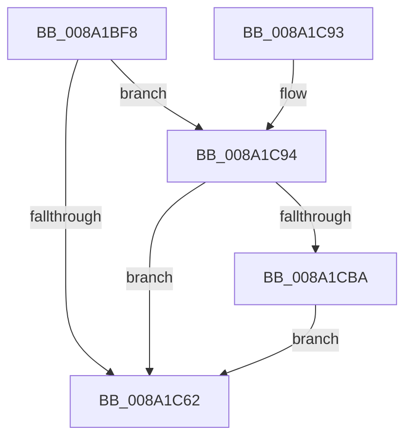

# IopSymlinkInitializeSymlinkInfo

- RVA: `0x008A1BF8`–`0x008A1CC9` (길이 `209` bytes)
- VA: `0x00000001408A1BF8`
- 실행 섹션: `PAGE`
- PDB 이름 있음: `예`; PDB Function 태그: `아니요`
- unwind 정보 RVA: `0x0007EC48`
- 디코드: `56`개 명령, `209/209` bytes 표시
- 미해석 바이트: `0` (있으면 어셈블리에 `.byte`로 보존)

> 이 문서는 커널 이미지의 기계어와 PDB 기호를 분석해 생성했습니다. 4번과 5번은 함수 원형과 자료형을 바이너리 사용 방식에서 추정한 C 해석이며 원본 소스 복구 결과는 아닙니다.

## 1. Dependencies

- 직접 호출 지점: **2**; 고유 호출 대상: **1**
- 직접 호출자로 확인된 함수: **3**
- RIP 상대 이미지 참조: **0**

### Outgoing calls
- `0x008A1C6F` → [memcpy](../../text/6C/memcpy_function_006C6840.md) (function, `0x006C6840`)
- `0x008A1C9E` → [memcpy](../../text/6C/memcpy_function_006C6840.md) (function, `0x006C6840`)

### Direct callers
- [IopSymlinkPropagateToExtensionIfNeeded](IopSymlinkPropagateToExtensionIfNeeded_function_008A1580.md) at `0x008A1725`
- [sub_00B19BFE](../B1/Unknown_function_00B19BFE.md) at `0x00B19C5F`
- [sub_00B19BFE](../B1/Unknown_function_00B19BFE.md) at `0x00B19CC9`
- [sub_00B39C68](../B3/Unknown_function_00B39C68.md) at `0x00B39EF6`

### Static image references
- 디코드된 RIP-relative 메모리 참조가 없습니다.

## 2. Other-region calls and transfers

- 다른 실행 섹션으로 향하는 call: **2**
  - `0x008A1C6F` → [memcpy](../../text/6C/memcpy_function_006C6840.md) (`PAGE` → `.text`)
  - `0x008A1C9E` → [memcpy](../../text/6C/memcpy_function_006C6840.md) (`PAGE` → `.text`)
- 별도 외부 분기/꼬리 이동을 확인하지 못했습니다.

## 3. Assembly (complete function range)

```asm
008A1BF8  48 8B C4                        mov rax, rsp
008A1BFB  48 89 58 08                     mov qword ptr [rax + 8], rbx
008A1BFF  48 89 68 10                     mov qword ptr [rax + 0x10], rbp
008A1C03  48 89 70 18                     mov qword ptr [rax + 0x18], rsi
008A1C07  48 89 78 20                     mov qword ptr [rax + 0x20], rdi
008A1C0B  41 56                           push r14
008A1C0D  48 83 EC 20                     sub rsp, 0x20
008A1C11  0F B7 44 24 68                  movzx eax, word ptr [rsp + 0x68]
008A1C16  48 8B F9                        mov rdi, rcx
008A1C19  66 89 41 04                     mov word ptr [rcx + 4], ax
008A1C1D  33 DB                           xor ebx, ebx
008A1C1F  0F B7 44 24 50                  movzx eax, word ptr [rsp + 0x50]
008A1C24  66 83 EA 20                     sub dx, 0x20
008A1C28  66 89 51 12                     mov word ptr [rcx + 0x12], dx
008A1C2C  4D 8B F0                        mov r14, r8
008A1C2F  48 8B 54 24 58                  mov rdx, qword ptr [rsp + 0x58]
008A1C34  66 89 07                        mov word ptr [rdi], ax
008A1C37  0F B7 44 24 70                  movzx eax, word ptr [rsp + 0x70]
008A1C3C  66 89 59 06                     mov word ptr [rcx + 6], bx
008A1C40  66 89 59 10                     mov word ptr [rcx + 0x10], bx
008A1C44  48 83 C1 20                     add rcx, 0x20
008A1C48  66 89 47 02                     mov word ptr [rdi + 2], ax
008A1C4C  48 8B 44 24 78                  mov rax, qword ptr [rsp + 0x78]
008A1C51  48 89 47 08                     mov qword ptr [rdi + 8], rax
008A1C55  41 0F B7 E9                     movzx ebp, r9w
008A1C59  48 89 4F 18                     mov qword ptr [rdi + 0x18], rcx
008A1C5D  48 85 D2                        test rdx, rdx
008A1C60  75 32                           jne 0x1408a1c94
008A1C62  0F B7 CB                        movzx ecx, bx
008A1C65  4C 8B C5                        mov r8, rbp
008A1C68  48 03 4F 18                     add rcx, qword ptr [rdi + 0x18]
008A1C6C  49 8B D6                        mov rdx, r14
008A1C6F  E8 CC 4B E2 FF                  call 0x1406c6840
008A1C74  66 01 6F 10                     add word ptr [rdi + 0x10], bp
008A1C78  48 8B 6C 24 38                  mov rbp, qword ptr [rsp + 0x38]
008A1C7D  48 8B 7C 24 48                  mov rdi, qword ptr [rsp + 0x48]
008A1C82  48 8B 5C 24 30                  mov rbx, qword ptr [rsp + 0x30]
008A1C87  48 8B 74 24 40                  mov rsi, qword ptr [rsp + 0x40]
008A1C8C  48 83 C4 20                     add rsp, 0x20
008A1C90  41 5E                           pop r14
008A1C92  C3                              ret
008A1C93  CC                              int3
008A1C94  0F B7 5C 24 60                  movzx ebx, word ptr [rsp + 0x60]
008A1C99  44 8B C3                        mov r8d, ebx
008A1C9C  8B F3                           mov esi, ebx
008A1C9E  E8 9D 4B E2 FF                  call 0x1406c6840
008A1CA3  48 8B 47 18                     mov rax, qword ptr [rdi + 0x18]
008A1CA7  B9 5C 00 00 00                  mov ecx, 0x5c
008A1CAC  48 D1 EE                        shr rsi, 1
008A1CAF  66 89 5F 10                     mov word ptr [rdi + 0x10], bx
008A1CB3  66 39 4C 70 FE                  cmp word ptr [rax + rsi*2 - 2], cx
008A1CB8  74 A8                           je 0x1408a1c62
008A1CBA  66 89 0C 70                     mov word ptr [rax + rsi*2], cx
008A1CBE  66 83 47 10 02                  add word ptr [rdi + 0x10], 2
008A1CC3  0F B7 5F 10                     movzx ebx, word ptr [rdi + 0x10]
008A1CC7  EB 99                           jmp 0x1408a1c62
```

## 4. C-style interpretation (structured pseudocode)

```c
__int64 __fastcall IopSymlinkInitializeSymlinkInfo(__int64 a1, unsigned __int16 a2, __int64 a3, unsigned __int16 a4, unsigned __int16 a5, __int64 a6, unsigned __int16 a7, unsigned __int16 a8, unsigned __int16 a9, __int64 a10)
{
    __int64 result;
    __int64 v_rbx;
    __int64 v_rsi;
    __int64 v_rsp;
    unsigned __int64 v_stack_p10;
    unsigned __int64 v_stack_p18;
    unsigned __int64 v_stack_p20;
    unsigned __int64 v_stack_p8;

    *(unsigned __int64 *)(v_rsp + 8) = v_rbx;
    *(unsigned __int64 *)(v_rsp + 16) = v_rbp;
    *(unsigned __int64 *)(v_rsp + 24) = v_rsi;
    *(unsigned __int64 *)(v_rsp + 32) = v_rdi;
    v_rsp = (v_rsp) - (32);
    *(unsigned __int16 *)(a1 + 4) = a8;
    v_rbx = 0;
    a2 = (unsigned __int16)((a2) - (32));
    *(unsigned __int16 *)(a1 + 18) = a2;
    *(unsigned __int16 *)(a1) = a5;
    *(unsigned __int16 *)(a1 + 6) = 0;
    *(unsigned __int16 *)(a1 + 16) = 0;
    a1 = (a1) + (32);
    *(unsigned __int16 *)(a1 + 2) = a9;
    *(unsigned __int64 *)(a1 + 8) = a10;
    *(unsigned __int64 *)(a1 + 24) = a1;
    if (a6 != 0) goto loc_008A1C94;
loc_008A1C62:
    a1 = (0) + (*(unsigned __int64 *)(a1 + 24));
    result = memcpy(a1, a3, a4, a4);
    v_rsp = (v_rsp) + (32);
    return result;
loc_008A1C94:
    result = memcpy(a1, a3, (unsigned int)(a7), a4);
    v_rsi = ((unsigned int)(a7)) >> (1);
    *(unsigned __int16 *)(v_stack_p20 + 16) = a7;
    if ((*(unsigned __int16 *)(*(unsigned __int64 *)(v_stack_p20 + 24) + v_rsi * 2 - 2)) == 92) goto loc_008A1C62;
    *(unsigned __int16 *)(*(unsigned __int64 *)(v_stack_p20 + 24) + v_rsi * 2) = 92;
    goto loc_008A1C62;
}
```

## 5. (Beta) C Style

```c
int64_t IopSymlinkInitializeSymlinkInfo(void *Arg1, uint16_t Arg2, int64_t Arg3, uint16_t Arg4, uint16_t Arg5, int64_t Arg6, uint16_t Arg7, uint16_t Arg8, uint16_t Arg9, int64_t Arg10)
{
    uint8_t *arg1 = (uint8_t *)Arg1;

    int64_t result;
    int64_t local_rbx;
    int64_t local_rsi;
    int64_t local_rsp;
    uint64_t v_stack_p10;
    uint64_t v_stack_p18;
    uint64_t v_stack_p20;
    uint64_t v_stack_p8;

    *(uint64_t *)(local_rsp + 0x8) = local_rbx;
    *(uint64_t *)(local_rsp + 0x10) = local_rbp;
    *(uint64_t *)(local_rsp + 0x18) = local_rsi;
    *(uint64_t *)(local_rsp + 0x20) = local_rdi;
    local_rsp = (local_rsp) - (32);
    *(uint16_t *)(arg1 + 0x4) = Arg8;
    local_rbx = 0;
    Arg2 = (uint16_t)((Arg2) - (32));
    *(uint16_t *)(arg1 + 0x12) = Arg2;
    *(uint16_t *)(arg1) = Arg5;
    *(uint16_t *)(arg1 + 0x6) = 0;
    *(uint16_t *)(arg1 + 0x10) = 0;
    Arg1 = (Arg1) + (32);
    *(uint16_t *)(arg1 + 0x2) = Arg9;
    *(uint64_t *)(arg1 + 0x8) = Arg10;
    *(void **)(arg1 + 0x18) = Arg1;
    if (Arg6 != 0) goto loc_008A1C94;
loc_008A1C62:
    Arg1 = (0) + (*(uint64_t *)(arg1 + 0x18));
    result = memcpy(Arg1, Arg3, Arg4, Arg4);
    local_rsp = (local_rsp) + (32);
    return result;
loc_008A1C94:
    result = memcpy(Arg1, Arg3, (uint32_t)(Arg7), Arg4);
    local_rsi = ((uint32_t)(Arg7)) >> (1);
    *(uint16_t *)(v_stack_p20 + 0x10) = Arg7;
    if ((*(uint16_t *)(*(uint64_t *)(v_stack_p20 + 0x18) + local_rsi * 2 - 0x2)) == 92) goto loc_008A1C62;
    *(uint16_t *)(*(uint64_t *)(v_stack_p20 + 0x18) + local_rsi * 2) = 92;
    goto loc_008A1C62;
}
```

### 관측된 메모리 오프셋

구조체 형식이 확인되지 않은 접근은 인자 기준의 오프셋으로만 기록했습니다.

| 기준 인자 | 오프셋 표현 | 폭 (bit) | 접근 |
|---|---:|---:|---|
| `Arg1` | `+ 0x0` | `16` | `W` |
| `Arg1` | `+ 0x2` | `16` | `W` |
| `Arg1` | `+ 0x4` | `16` | `W` |
| `Arg1` | `+ 0x6` | `16` | `W` |
| `Arg1` | `+ 0x8` | `64` | `W` |
| `Arg1` | `+ 0x10` | `16` | `R` |
| `Arg1` | `+ 0x10` | `16` | `R/W` |
| `Arg1` | `+ 0x10` | `16` | `W` |
| `Arg1` | `+ 0x12` | `16` | `W` |
| `Arg1` | `+ 0x18` | `64` | `R` |
| `Arg1` | `+ 0x18` | `64` | `W` |

## 6. Execution-region graph

[열기: 2D/3D 그래프와 함수 탐색 컨트롤 패널](../../../control-panel.html?section=page&rva=0x008A1BF8&view=graph)

- 2D 그래프는 위에서 아래로 흐르고, 3D 그래프는 빈 공간을 드래그해 회전합니다. Shift+드래그는 이동, 휠은 확대·축소, 함수 노드 선택은 대상 보고서 이동입니다.

### Static fallback


