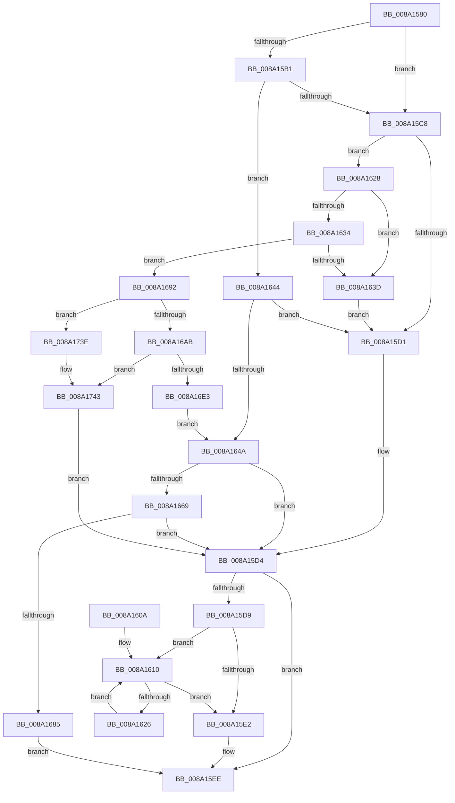

# IopSymlinkPropagateToExtensionIfNeeded

- RVA: `0x008A1580`–`0x008A174D` (길이 `461` bytes)
- VA: `0x00000001408A1580`
- 실행 섹션: `PAGE`
- PDB 이름 있음: `예`; PDB Function 태그: `아니요`
- unwind 정보 RVA: `0x0007EBF8`
- 디코드: `123`개 명령, `461/461` bytes 표시
- 미해석 바이트: `0` (있으면 어셈블리에 `.byte`로 보존)

> 이 문서는 커널 이미지의 기계어와 PDB 기호를 분석해 생성했습니다. 4번과 5번은 함수 원형과 자료형을 바이너리 사용 방식에서 추정한 C 해석이며 원본 소스 복구 결과는 아닙니다.

## 1. Dependencies

- 직접 호출 지점: **8**; 고유 호출 대상: **8**
- 직접 호출자로 확인된 함수: **1**
- RIP 상대 이미지 참조: **3**

### Outgoing calls
- `0x008A15B9` → [IopSymlinkRemoveECP](../../text/44/IopSymlinkRemoveECP_function_00446480.md) (function, `0x00446480`)
- `0x008A15E9` → [FsRtlFreeExtraCreateParameter](FsRtlFreeExtraCreateParameter_function_008A1760.md) (function, `0x008A1760`)
- `0x008A1619` → [ExFreePoolWithTag](../../poolcode/B8/ExFreePoolWithTag_function_00B82870.md) (function, `0x00B82870`)
- `0x008A165A` → [IopAllocateFileObjectExtension](../../text/41/IopAllocateFileObjectExtension_function_00418FB0.md) (function, `0x00418FB0`)
- `0x008A1676` → [IopSetTypeSpecificFoExtension](../../text/45/IopSetTypeSpecificFoExtension_function_00452B50.md) (function, `0x00452B50`)
- `0x008A1688` → [IopSymlinkFreeRelatedMountPointChain](IopSymlinkFreeRelatedMountPointChain_function_008A1828.md) (function, `0x008A1828`)
- `0x008A16D8` → [FsRtlAllocateExtraCreateParameterFromLookasideList](FsRtlAllocateExtraCreateParameterFromLookasideList_function_008A1CD0.md) (function, `0x008A1CD0`)
- `0x008A1725` → [IopSymlinkInitializeSymlinkInfo](IopSymlinkInitializeSymlinkInfo_function_008A1BF8.md) (function, `0x008A1BF8`)

### Direct callers
- [IopParseDevice](../89/IopParseDevice_function_0089E510.md) at `0x0089ECC9`

### Static image references
- `0x008A16B8` → RVA `0x008A2270` (`IopSymlinkCleanupECP`; read)
- `0x008A16BF` → RVA `0x00E12380` (`.data`; read)
- `0x008A16D1` → RVA `0x00B4B100` (`IopSymlinkECPGuid`; read)

## 2. Other-region calls and transfers

- 다른 실행 섹션으로 향하는 call: **4**
  - `0x008A15B9` → [IopSymlinkRemoveECP](../../text/44/IopSymlinkRemoveECP_function_00446480.md) (`PAGE` → `.text`)
  - `0x008A1619` → [ExFreePoolWithTag](../../poolcode/B8/ExFreePoolWithTag_function_00B82870.md) (`PAGE` → `POOLCODE`)
  - `0x008A165A` → [IopAllocateFileObjectExtension](../../text/41/IopAllocateFileObjectExtension_function_00418FB0.md) (`PAGE` → `.text`)
  - `0x008A1676` → [IopSetTypeSpecificFoExtension](../../text/45/IopSetTypeSpecificFoExtension_function_00452B50.md) (`PAGE` → `.text`)
- 별도 외부 분기/꼬리 이동을 확인하지 못했습니다.

## 3. Assembly (complete function range)

```asm
008A1580  48 89 5C 24 08                  mov qword ptr [rsp + 8], rbx
008A1585  48 89 6C 24 18                  mov qword ptr [rsp + 0x18], rbp
008A158A  48 89 74 24 20                  mov qword ptr [rsp + 0x20], rsi
008A158F  57                              push rdi
008A1590  41 56                           push r14
008A1592  41 57                           push r15
008A1594  48 83 EC 50                     sub rsp, 0x50
008A1598  45 33 FF                        xor r15d, r15d
008A159B  4D 8B F0                        mov r14, r8
008A159E  4C 89 7C 24 78                  mov qword ptr [rsp + 0x78], r15
008A15A3  48 8B C2                        mov rax, rdx
008A15A6  48 8B D9                        mov rbx, rcx
008A15A9  41 8B FF                        mov edi, r15d
008A15AC  48 85 D2                        test rdx, rdx
008A15AF  74 17                           je 0x1408a15c8
008A15B1  48 8D 54 24 78                  lea rdx, [rsp + 0x78]
008A15B6  48 8B C8                        mov rcx, rax
008A15B9  E8 C2 4E BA FF                  call 0x140446480
008A15BE  48 8B 7C 24 78                  mov rdi, qword ptr [rsp + 0x78]
008A15C3  48 85 FF                        test rdi, rdi
008A15C6  75 7C                           jne 0x1408a1644
008A15C8  48 8B 43 40                     mov rax, qword ptr [rbx + 0x40]
008A15CC  48 85 C0                        test rax, rax
008A15CF  75 57                           jne 0x1408a1628
008A15D1  41 8B F7                        mov esi, r15d
008A15D4  48 85 FF                        test rdi, rdi
008A15D7  74 15                           je 0x1408a15ee
008A15D9  48 8B 4F 08                     mov rcx, qword ptr [rdi + 8]
008A15DD  48 85 C9                        test rcx, rcx
008A15E0  75 2E                           jne 0x1408a1610
008A15E2  48 8B CF                        mov rcx, rdi
008A15E5  4C 89 7F 08                     mov qword ptr [rdi + 8], r15
008A15E9  E8 72 01 00 00                  call 0x1408a1760
008A15EE  4C 8D 5C 24 50                  lea r11, [rsp + 0x50]
008A15F3  8B C6                           mov eax, esi
008A15F5  49 8B 5B 20                     mov rbx, qword ptr [r11 + 0x20]
008A15F9  49 8B 6B 30                     mov rbp, qword ptr [r11 + 0x30]
008A15FD  49 8B 73 38                     mov rsi, qword ptr [r11 + 0x38]
008A1601  49 8B E3                        mov rsp, r11
008A1604  41 5F                           pop r15
008A1606  41 5E                           pop r14
008A1608  5F                              pop rdi
008A1609  C3                              ret
008A160A  CC                              int3
008A160B  0F 1F 44 00 00                  nop dword ptr [rax + rax]
008A1610  48 8B 59 08                     mov rbx, qword ptr [rcx + 8]
008A1614  BA 49 6F 53 69                  mov edx, 0x69536f49
008A1619  E8 52 12 2E 00                  call 0x140b82870
008A161E  48 8B CB                        mov rcx, rbx
008A1621  48 85 DB                        test rbx, rbx
008A1624  74 BC                           je 0x1408a15e2
008A1626  EB E8                           jmp 0x1408a1610
008A1628  48 8B 88 D0 00 00 00            mov rcx, qword ptr [rax + 0xd0]
008A162F  48 85 C9                        test rcx, rcx
008A1632  74 09                           je 0x1408a163d
008A1634  48 8B 69 30                     mov rbp, qword ptr [rcx + 0x30]
008A1638  48 85 ED                        test rbp, rbp
008A163B  75 55                           jne 0x1408a1692
008A163D  48 8B 7C 24 78                  mov rdi, qword ptr [rsp + 0x78]
008A1642  EB 8D                           jmp 0x1408a15d1
008A1644  F6 47 02 01                     test byte ptr [rdi + 2], 1
008A1648  74 87                           je 0x1408a15d1
008A164A  45 33 C0                        xor r8d, r8d
008A164D  4C 89 7C 24 78                  mov qword ptr [rsp + 0x78], r15
008A1652  48 8D 54 24 78                  lea rdx, [rsp + 0x78]
008A1657  48 8B CB                        mov rcx, rbx
008A165A  E8 51 79 B7 FF                  call 0x140418fb0
008A165F  8B F0                           mov esi, eax
008A1661  85 C0                           test eax, eax
008A1663  0F 88 6B FF FF FF               js 0x1408a15d4
008A1669  48 8B 4C 24 78                  mov rcx, qword ptr [rsp + 0x78]
008A166E  4C 8B C7                        mov r8, rdi
008A1671  BA 05 00 00 00                  mov edx, 5
008A1676  E8 D5 14 BB FF                  call 0x140452b50
008A167B  8B F0                           mov esi, eax
008A167D  85 C0                           test eax, eax
008A167F  0F 88 4F FF FF FF               js 0x1408a15d4
008A1685  48 8B CF                        mov rcx, rdi
008A1688  E8 9B 01 00 00                  call 0x1408a1828
008A168D  E9 5C FF FF FF                  jmp 0x1408a15ee
008A1692  41 0F B7 3E                     movzx edi, word ptr [r14]
008A1696  0F B7 4D 10                     movzx ecx, word ptr [rbp + 0x10]
008A169A  83 C7 02                        add edi, 2
008A169D  03 F9                           add edi, ecx
008A169F  81 FF FF FF 00 00               cmp edi, 0xffff
008A16A5  0F 83 93 00 00 00               jae 0x1408a173e
008A16AB  48 8D 44 24 78                  lea rax, [rsp + 0x78]
008A16B0  0F B7 D7                        movzx edx, di
008A16B3  48 89 44 24 28                  mov qword ptr [rsp + 0x28], rax
008A16B8  4C 8D 0D B1 0B 00 00            lea r9, [rip + 0xbb1]
008A16BF  48 8D 05 BA 0C 57 00            lea rax, [rip + 0x570cba]
008A16C6  83 C2 20                        add edx, 0x20
008A16C9  45 33 C0                        xor r8d, r8d
008A16CC  48 89 44 24 20                  mov qword ptr [rsp + 0x20], rax
008A16D1  48 8D 0D 28 9A 2A 00            lea rcx, [rip + 0x2a9a28]
008A16D8  E8 F3 05 00 00                  call 0x1408a1cd0
008A16DD  8B F0                           mov esi, eax
008A16DF  85 C0                           test eax, eax
008A16E1  78 60                           js 0x1408a1743
008A16E3  0F B7 45 02                     movzx eax, word ptr [rbp + 2]
008A16E7  8D 57 20                        lea edx, [rdi + 0x20]
008A16EA  48 8B 7C 24 78                  mov rdi, qword ptr [rsp + 0x78]
008A16EF  45 0F B7 0E                     movzx r9d, word ptr [r14]
008A16F3  48 8B CF                        mov rcx, rdi
008A16F6  4D 8B 46 08                     mov r8, qword ptr [r14 + 8]
008A16FA  4C 89 7C 24 48                  mov qword ptr [rsp + 0x48], r15
008A16FF  66 89 44 24 40                  mov word ptr [rsp + 0x40], ax
008A1704  0F B7 45 04                     movzx eax, word ptr [rbp + 4]
008A1708  66 89 44 24 38                  mov word ptr [rsp + 0x38], ax
008A170D  0F B7 45 10                     movzx eax, word ptr [rbp + 0x10]
008A1711  66 89 44 24 30                  mov word ptr [rsp + 0x30], ax
008A1716  48 8B 45 18                     mov rax, qword ptr [rbp + 0x18]
008A171A  48 89 44 24 28                  mov qword ptr [rsp + 0x28], rax
008A171F  66 44 89 7C 24 20               mov word ptr [rsp + 0x20], r15w
008A1725  E8 CE 04 00 00                  call 0x1408a1bf8
008A172A  0F B7 4F 10                     movzx ecx, word ptr [rdi + 0x10]
008A172E  66 2B 4D 10                     sub cx, word ptr [rbp + 0x10]
008A1732  66 03 4D 00                     add cx, word ptr [rbp]
008A1736  66 89 0F                        mov word ptr [rdi], cx
008A1739  E9 0C FF FF FF                  jmp 0x1408a164a
008A173E  BE 06 01 00 C0                  mov esi, 0xc0000106
008A1743  48 8B 7C 24 78                  mov rdi, qword ptr [rsp + 0x78]
008A1748  E9 87 FE FF FF                  jmp 0x1408a15d4
```

## 4. C-style interpretation (structured pseudocode)

```c
__int64 __fastcall IopSymlinkPropagateToExtensionIfNeeded(__int64 a1, __int64 a2, __int64 a3)
{
    __int64 result;
    __int64 v_r15;
    __int64 v_rdi;
    __int64 v_rsp;
    unsigned __int16 v_stack_m10;
    unsigned __int64 v_stack_m18;
    unsigned __int16 v_stack_m20;
    unsigned __int64 v_stack_m28;
    unsigned __int64 v_stack_m30;
    unsigned __int64 v_stack_m8;
    unsigned __int64 v_stack_p10;
    unsigned __int64 v_stack_p18;
    unsigned __int64 v_stack_p20;
    unsigned __int64 v_stack_p28;
    unsigned __int64 v_stack_p8;

    v_stack_p8 = v_rbx;
    v_stack_p18 = v_rbp;
    v_stack_p20 = v_rsi;
    v_rsp = (v_rsp) - (80);
    v_r15 = 0;
    v_stack_p10 = 0;
    if (a2 == 0) goto loc_008A15C8;
    result = IopSymlinkRemoveECP(a2, v_stack_p10, a3, a4);
    if (v_stack_p10 != 0) goto loc_008A1644;
loc_008A15C8:
    if (*(unsigned __int64 *)(a1 + 64) != 0) goto loc_008A1628;
loc_008A15D1:
loc_008A15D4:
    if (v_stack_p10 == 0) goto loc_008A15EE;
    if (*(unsigned __int64 *)(v_stack_p10 + 8) != 0) goto loc_008A1610;
loc_008A15E2:
    *(unsigned __int64 *)(v_stack_p10 + 8) = 0;
    result = FsRtlFreeExtraCreateParameter(v_stack_p10, v_stack_p10, a3, a4);
loc_008A15EE:
    return 0;
loc_008A1610:
    result = ExFreePoolWithTag(v_stack_p10, (unsigned int)(0x69536F49ULL), a3, a4);
    if (*(unsigned __int64 *)(v_stack_p10 + 8) == 0) goto loc_008A15E2;
    goto loc_008A1610;
loc_008A1628:
    if (*(unsigned __int64 *)(result + 208) == 0) goto loc_008A163D;
    if (*(unsigned __int64 *)(*(unsigned __int64 *)(result + 208) + 48) != 0) goto loc_008A1692;
loc_008A163D:
    goto loc_008A15D1;
loc_008A1644:
    if (((*(unsigned __int8 *)(v_stack_p28 + 2)) & (1)) == 0) goto loc_008A15D1;
loc_008A164A:
    a3 = 0;
    v_stack_p28 = 0;
    result = IopAllocateFileObjectExtension(*(unsigned __int64 *)(v_stack_p10 + 8), v_stack_p28, a3, a4);
    if (sign_flag) goto loc_008A15D4;
    result = IopSetTypeSpecificFoExtension(v_stack_p28, 5, v_stack_p28, a4);
    if (sign_flag) goto loc_008A15D4;
    result = IopSymlinkFreeRelatedMountPointChain(v_stack_p28, 5, v_stack_p28, a4);
    goto loc_008A15EE;
loc_008A1692:
    v_rdi = (unsigned int)((*(unsigned __int16 *)(a3)) + (2));
    v_rdi = (unsigned int)((v_rdi) + ((unsigned int)(*(unsigned __int16 *)(*(unsigned __int64 *)(*(unsigned __int64 *)(result + 208) + 48) + 16))));
    if (((unsigned int)(v_rdi)) >= 0xFFFFULL) goto loc_008A173E;
    v_stack_m28 = v_stack_p28;
    a2 = (unsigned int)(((unsigned __int16)(v_rdi)) + (32));
    a3 = 0;
    v_stack_m30 = v_rip + 5704890;
    result = FsRtlAllocateExtraCreateParameterFromLookasideList(v_rip + 2791976, a2, a3, v_rip + 2993);
    if (sign_flag) goto loc_008A1743;
    v_stack_m8 = 0;
    v_stack_m10 = (unsigned __int16)(*(unsigned __int16 *)(*(unsigned __int64 *)(*(unsigned __int64 *)(result + 208) + 48) + 2));
    v_stack_m18 = (unsigned __int16)(*(unsigned __int16 *)(*(unsigned __int64 *)(*(unsigned __int64 *)(result + 208) + 48) + 4));
    v_stack_m20 = (unsigned __int16)(*(unsigned __int16 *)(*(unsigned __int64 *)(*(unsigned __int64 *)(result + 208) + 48) + 16));
    v_stack_m28 = *(unsigned __int64 *)(*(unsigned __int64 *)(*(unsigned __int64 *)(result + 208) + 48) + 24);
    v_stack_m30 = 0;
    result = IopSymlinkInitializeSymlinkInfo(v_stack_p28, v_rdi + 32, *(unsigned __int64 *)(a3 + 8), *(unsigned __int16 *)(a3));
    a1 = (unsigned __int16)((*(unsigned __int16 *)(v_stack_p28 + 16)) - (*(unsigned __int16 *)(*(unsigned __int64 *)(*(unsigned __int64 *)(result + 208) + 48) + 16)));
    a1 = (unsigned __int16)((a1) + (*(unsigned __int16 *)(*(unsigned __int64 *)(*(unsigned __int64 *)(result + 208) + 48))));
    *(unsigned __int16 *)(v_stack_p28) = (unsigned __int16)(a1);
    goto loc_008A164A;
loc_008A173E:
loc_008A1743:
    goto loc_008A15D4;
}
```

## 5. (Beta) C Style

```c
int64_t IopSymlinkPropagateToExtensionIfNeeded(void *Arg1, int64_t Arg2, void *Arg3)
{
    uint8_t *arg1 = (uint8_t *)Arg1;
    uint8_t *arg3 = (uint8_t *)Arg3;

    int64_t result;
    int64_t local_r15;
    int64_t local_rdi;
    int64_t local_rsp;
    uint16_t v_stack_m10;
    uint64_t v_stack_m18;
    uint16_t v_stack_m20;
    uint64_t v_stack_m28;
    uint64_t v_stack_m30;
    uint64_t v_stack_m8;
    uint64_t v_stack_p10;
    uint64_t v_stack_p18;
    uint64_t v_stack_p20;
    uint64_t v_stack_p28;
    uint64_t v_stack_p8;

    v_stack_p8 = local_rbx;
    v_stack_p18 = local_rbp;
    v_stack_p20 = local_rsi;
    local_rsp = (local_rsp) - (80);
    local_r15 = 0;
    v_stack_p10 = 0;
    if (Arg2 == 0) goto loc_008A15C8;
    result = IopSymlinkRemoveECP(Arg2, v_stack_p10, Arg3, a4);
    if (v_stack_p10 != 0) goto loc_008A1644;
loc_008A15C8:
    if (*(uint64_t *)(arg1 + 0x40) != 0) goto loc_008A1628;
loc_008A15D1:
loc_008A15D4:
    if (v_stack_p10 == 0) goto loc_008A15EE;
    if (*(uint64_t *)(v_stack_p10 + 0x8) != 0) goto loc_008A1610;
loc_008A15E2:
    *(uint64_t *)(v_stack_p10 + 0x8) = 0;
    result = FsRtlFreeExtraCreateParameter(v_stack_p10, v_stack_p10, Arg3, a4);
loc_008A15EE:
    return 0;
loc_008A1610:
    result = ExFreePoolWithTag(v_stack_p10, (uint32_t)(0x69536F49ULL), Arg3, a4);
    if (*(uint64_t *)(v_stack_p10 + 0x8) == 0) goto loc_008A15E2;
    goto loc_008A1610;
loc_008A1628:
    if (*(uint64_t *)(result + 0xD0) == 0) goto loc_008A163D;
    if (*(uint64_t *)(*(uint64_t *)(result + 0xD0) + 0x30) != 0) goto loc_008A1692;
loc_008A163D:
    goto loc_008A15D1;
loc_008A1644:
    if (((*(uint8_t *)(v_stack_p28 + 0x2)) & (1)) == 0) goto loc_008A15D1;
loc_008A164A:
    Arg3 = 0;
    v_stack_p28 = 0;
    result = IopAllocateFileObjectExtension(*(uint64_t *)(v_stack_p10 + 0x8), v_stack_p28, Arg3, a4);
    if (sign_flag) goto loc_008A15D4;
    result = IopSetTypeSpecificFoExtension(v_stack_p28, 5, v_stack_p28, a4);
    if (sign_flag) goto loc_008A15D4;
    result = IopSymlinkFreeRelatedMountPointChain(v_stack_p28, 5, v_stack_p28, a4);
    goto loc_008A15EE;
loc_008A1692:
    local_rdi = (uint32_t)((*(uint16_t *)(arg3)) + (2));
    local_rdi = (uint32_t)((local_rdi) + ((uint32_t)(*(uint16_t *)(*(uint64_t *)(*(uint64_t *)(result + 0xD0) + 0x30) + 0x10))));
    if (((uint32_t)(local_rdi)) >= 0xFFFFULL) goto loc_008A173E;
    v_stack_m28 = v_stack_p28;
    Arg2 = (uint32_t)(((uint16_t)(local_rdi)) + (32));
    Arg3 = 0;
    v_stack_m30 = v_rip + 5704890;
    result = FsRtlAllocateExtraCreateParameterFromLookasideList(v_rip + 2791976, Arg2, Arg3, v_rip + 2993);
    if (sign_flag) goto loc_008A1743;
    v_stack_m8 = 0;
    v_stack_m10 = (uint16_t)(*(uint16_t *)(*(uint64_t *)(*(uint64_t *)(result + 0xD0) + 0x30) + 0x2));
    v_stack_m18 = (uint16_t)(*(uint16_t *)(*(uint64_t *)(*(uint64_t *)(result + 0xD0) + 0x30) + 0x4));
    v_stack_m20 = (uint16_t)(*(uint16_t *)(*(uint64_t *)(*(uint64_t *)(result + 0xD0) + 0x30) + 0x10));
    v_stack_m28 = *(uint64_t *)(*(uint64_t *)(*(uint64_t *)(result + 0xD0) + 0x30) + 0x18);
    v_stack_m30 = 0;
    result = IopSymlinkInitializeSymlinkInfo(v_stack_p28, local_rdi + 32, *(uint64_t *)(arg3 + 0x8), *(uint16_t *)(arg3));
    Arg1 = (uint16_t)((*(uint16_t *)(v_stack_p28 + 0x10)) - (*(uint16_t *)(*(uint64_t *)(*(uint64_t *)(result + 0xD0) + 0x30) + 0x10)));
    Arg1 = (uint16_t)((Arg1) + (*(uint16_t *)(*(uint64_t *)(*(uint64_t *)(result + 0xD0) + 0x30))));
    *(uint16_t *)(v_stack_p28) = (uint16_t)(Arg1);
    goto loc_008A164A;
loc_008A173E:
loc_008A1743:
    goto loc_008A15D4;
}
```

### 관측된 메모리 오프셋

구조체 형식이 확인되지 않은 접근은 인자 기준의 오프셋으로만 기록했습니다.

| 기준 인자 | 오프셋 표현 | 폭 (bit) | 접근 |
|---|---:|---:|---|
| `Arg1` | `+ 0x40` | `64` | `R` |
| `Arg3` | `+ 0x0` | `16` | `R` |
| `Arg3` | `+ 0x8` | `64` | `R` |

## 6. Execution-region graph

[열기: 2D/3D 그래프와 함수 탐색 컨트롤 패널](../../../control-panel.html?section=page&rva=0x008A1580&view=graph)

- 2D 그래프는 위에서 아래로 흐르고, 3D 그래프는 빈 공간을 드래그해 회전합니다. Shift+드래그는 이동, 휠은 확대·축소, 함수 노드 선택은 대상 보고서 이동입니다.

### Static fallback


