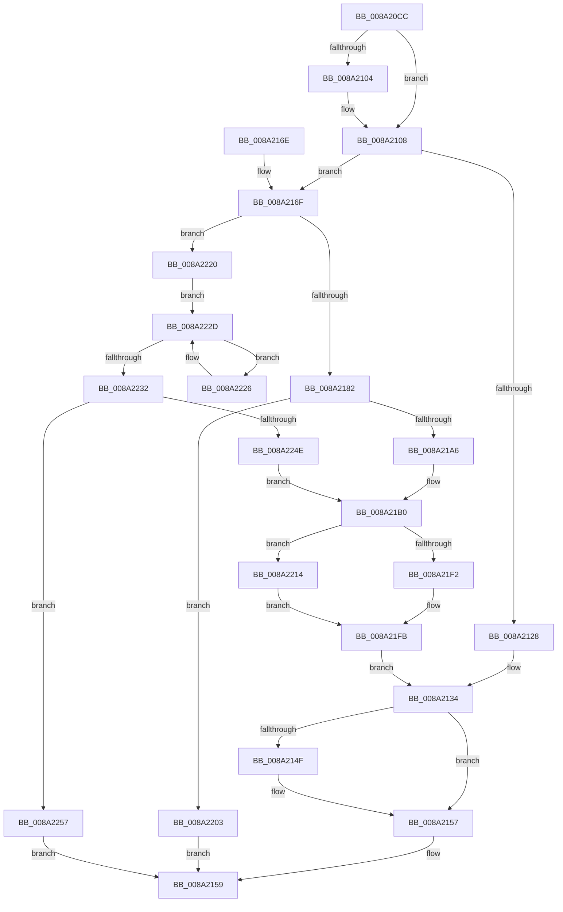

# IopSymlinkUpdateECP

- RVA: `0x008A20CC`–`0x008A2261` (길이 `405` bytes)
- VA: `0x00000001408A20CC`
- 실행 섹션: `PAGE`
- PDB 이름 있음: `예`; PDB Function 태그: `아니요`
- unwind 정보 RVA: `0x0007ECDC`
- 디코드: `112`개 명령, `405/405` bytes 표시
- 미해석 바이트: `0` (있으면 어셈블리에 `.byte`로 보존)

> 이 문서는 커널 이미지의 기계어와 PDB 기호를 분석해 생성했습니다. 4번과 5번은 함수 원형과 자료형을 바이너리 사용 방식에서 추정한 C 해석이며 원본 소스 복구 결과는 아닙니다.

## 1. Dependencies

- 직접 호출 지점: **10**; 고유 호출 대상: **9**
- 직접 호출자로 확인된 함수: **4**
- RIP 상대 이미지 참조: **0**

### Outgoing calls
- `0x008A2110` → [IopSymlinkGetECP](../../text/45/IopSymlinkGetECP_function_00458288.md) (function, `0x00458288`)
- `0x008A212F` → [RtlCopyUnicodeString](../../text/3F/RtlCopyUnicodeString_function_003FEF30.md) (function, `0x003FEF30`)
- `0x008A2152` → [IopSymlinkFreeRelatedMountPointChain](IopSymlinkFreeRelatedMountPointChain_function_008A1828.md) (function, `0x008A1828`)
- `0x008A218A` → [IopSymlinkRemoveECP](../../text/44/IopSymlinkRemoveECP_function_00446480.md) (function, `0x00446480`)
- `0x008A219B` → [IopSymlinkAllocateAndAddECP](IopSymlinkAllocateAndAddECP_function_008A1E20.md) (function, `0x008A1E20`)
- `0x008A21E1` → [memcpy](../../text/6C/memcpy_function_006C6840.md) (function, `0x006C6840`)
- `0x008A21F6` → [FsRtlFreeExtraCreateParameter](FsRtlFreeExtraCreateParameter_function_008A1760.md) (function, `0x008A1760`)
- `0x008A2208` → [FsRtlFreeExtraCreateParameter](FsRtlFreeExtraCreateParameter_function_008A1760.md) (function, `0x008A1760`)
- `0x008A2219` → [ExFreePoolWithTag](../../poolcode/B8/ExFreePoolWithTag_function_00B82870.md) (function, `0x00B82870`)
- `0x008A2241` → [ExAllocatePool2](../../poolcode/B8/ExAllocatePool2_function_00B820F0.md) (function, `0x00B820F0`)

### Direct callers
- [IopParseDevice](../89/IopParseDevice_function_0089E510.md) at `0x0089F95E`
- [IopSymlinkApplyToOpenedName](../9D/IopSymlinkApplyToOpenedName_function_009DBCF8.md) at `0x009DBE05`
- [IopGraftName](../A3/IopGraftName_function_00A33160.md) at `0x00A3341F`
- [sub_00B39F44](../B3/Unknown_function_00B39F44.md) at `0x00B39FB2`

### Static image references
- 디코드된 RIP-relative 메모리 참조가 없습니다.

## 2. Other-region calls and transfers

- 다른 실행 섹션으로 향하는 call: **6**
  - `0x008A2110` → [IopSymlinkGetECP](../../text/45/IopSymlinkGetECP_function_00458288.md) (`PAGE` → `.text`)
  - `0x008A212F` → [RtlCopyUnicodeString](../../text/3F/RtlCopyUnicodeString_function_003FEF30.md) (`PAGE` → `.text`)
  - `0x008A218A` → [IopSymlinkRemoveECP](../../text/44/IopSymlinkRemoveECP_function_00446480.md) (`PAGE` → `.text`)
  - `0x008A21E1` → [memcpy](../../text/6C/memcpy_function_006C6840.md) (`PAGE` → `.text`)
  - `0x008A2219` → [ExFreePoolWithTag](../../poolcode/B8/ExFreePoolWithTag_function_00B82870.md) (`PAGE` → `POOLCODE`)
  - `0x008A2241` → [ExAllocatePool2](../../poolcode/B8/ExAllocatePool2_function_00B820F0.md) (`PAGE` → `POOLCODE`)
- 별도 외부 분기/꼬리 이동을 확인하지 못했습니다.

## 3. Assembly (complete function range)

```asm
008A20CC  48 89 5C 24 18                  mov qword ptr [rsp + 0x18], rbx
008A20D1  48 89 54 24 10                  mov qword ptr [rsp + 0x10], rdx
008A20D6  55                              push rbp
008A20D7  56                              push rsi
008A20D8  57                              push rdi
008A20D9  41 54                           push r12
008A20DB  41 55                           push r13
008A20DD  41 56                           push r14
008A20DF  41 57                           push r15
008A20E1  48 83 EC 20                     sub rsp, 0x20
008A20E5  8B 41 10                        mov eax, dword ptr [rcx + 0x10]
008A20E8  45 33 ED                        xor r13d, r13d
008A20EB  4C 89 6C 24 60                  mov qword ptr [rsp + 0x60], r13
008A20F0  4D 8B F1                        mov r14, r9
008A20F3  45 0F B7 E0                     movzx r12d, r8w
008A20F7  48 8B FA                        mov rdi, rdx
008A20FA  48 8B F1                        mov rsi, rcx
008A20FD  41 8B DD                        mov ebx, r13d
008A2100  84 C0                           test al, al
008A2102  79 04                           jns 0x1408a2108
008A2104  48 8B 59 70                     mov rbx, qword ptr [rcx + 0x70]
008A2108  48 8D 54 24 60                  lea rdx, [rsp + 0x60]
008A210D  48 8B CB                        mov rcx, rbx
008A2110  E8 73 61 BB FF                  call 0x140458288
008A2115  41 0F B7 0E                     movzx ecx, word ptr [r14]
008A2119  44 0F B7 BC 24 88 00 00 00      movzx r15d, word ptr [rsp + 0x88]
008A2122  66 39 4F 12                     cmp word ptr [rdi + 0x12], cx
008A2126  72 47                           jb 0x1408a216f
008A2128  48 8D 4F 10                     lea rcx, [rdi + 0x10]
008A212C  49 8B D6                        mov rdx, r14
008A212F  E8 FC CD B5 FF                  call 0x1403fef30
008A2134  0F B7 84 24 80 00 00 00         movzx eax, word ptr [rsp + 0x80]
008A213C  66 44 89 7F 02                  mov word ptr [rdi + 2], r15w
008A2141  66 89 47 04                     mov word ptr [rdi + 4], ax
008A2145  66 44 89 27                     mov word ptr [rdi], r12w
008A2149  F6 47 02 01                     test byte ptr [rdi + 2], 1
008A214D  75 08                           jne 0x1408a2157
008A214F  48 8B CF                        mov rcx, rdi
008A2152  E8 D1 F6 FF FF                  call 0x1408a1828
008A2157  33 C0                           xor eax, eax
008A2159  48 8B 5C 24 70                  mov rbx, qword ptr [rsp + 0x70]
008A215E  48 83 C4 20                     add rsp, 0x20
008A2162  41 5F                           pop r15
008A2164  41 5E                           pop r14
008A2166  41 5D                           pop r13
008A2168  41 5C                           pop r12
008A216A  5F                              pop rdi
008A216B  5E                              pop rsi
008A216C  5D                              pop rbp
008A216D  C3                              ret
008A216E  CC                              int3
008A216F  48 8B 6C 24 60                  mov rbp, qword ptr [rsp + 0x60]
008A2174  4C 89 6C 24 78                  mov qword ptr [rsp + 0x78], r13
008A2179  48 3B EF                        cmp rbp, rdi
008A217C  0F 85 9E 00 00 00               jne 0x1408a2220
008A2182  48 8D 54 24 68                  lea rdx, [rsp + 0x68]
008A2187  48 8B CB                        mov rcx, rbx
008A218A  E8 F1 42 BA FF                  call 0x140446480
008A218F  45 0F B7 06                     movzx r8d, word ptr [r14]
008A2193  48 8D 54 24 78                  lea rdx, [rsp + 0x78]
008A2198  48 8B CE                        mov rcx, rsi
008A219B  E8 80 FC FF FF                  call 0x1408a1e20
008A21A0  8B D8                           mov ebx, eax
008A21A2  85 C0                           test eax, eax
008A21A4  78 5D                           js 0x1408a2203
008A21A6  48 8B 7C 24 68                  mov rdi, qword ptr [rsp + 0x68]
008A21AB  48 8B 74 24 78                  mov rsi, qword ptr [rsp + 0x78]
008A21B0  41 0F B7 1E                     movzx ebx, word ptr [r14]
008A21B4  48 8D 4E 20                     lea rcx, [rsi + 0x20]
008A21B8  48 8B 47 08                     mov rax, qword ptr [rdi + 8]
008A21BC  44 8B C3                        mov r8d, ebx
008A21BF  49 8B 56 08                     mov rdx, qword ptr [r14 + 8]
008A21C3  44 89 6E 04                     mov dword ptr [rsi + 4], r13d
008A21C7  66 44 89 6E 10                  mov word ptr [rsi + 0x10], r13w
008A21CC  66 89 5E 12                     mov word ptr [rsi + 0x12], bx
008A21D0  48 89 4E 18                     mov qword ptr [rsi + 0x18], rcx
008A21D4  66 44 89 26                     mov word ptr [rsi], r12w
008A21D8  66 44 89 7E 02                  mov word ptr [rsi + 2], r15w
008A21DD  48 89 46 08                     mov qword ptr [rsi + 8], rax
008A21E1  E8 5A 46 E2 FF                  call 0x1406c6840
008A21E6  66 01 5E 10                     add word ptr [rsi + 0x10], bx
008A21EA  48 8B CF                        mov rcx, rdi
008A21ED  48 3B FD                        cmp rdi, rbp
008A21F0  75 22                           jne 0x1408a2214
008A21F2  4C 89 6F 08                     mov qword ptr [rdi + 8], r13
008A21F6  E8 65 F5 FF FF                  call 0x1408a1760
008A21FB  48 8B FE                        mov rdi, rsi
008A21FE  E9 31 FF FF FF                  jmp 0x1408a2134
008A2203  48 8B 4C 24 68                  mov rcx, qword ptr [rsp + 0x68]
008A2208  E8 53 F5 FF FF                  call 0x1408a1760
008A220D  8B C3                           mov eax, ebx
008A220F  E9 45 FF FF FF                  jmp 0x1408a2159
008A2214  BA 49 6F 53 69                  mov edx, 0x69536f49
008A2219  E8 52 06 2E 00                  call 0x140b82870
008A221E  EB DB                           jmp 0x1408a21fb
008A2220  48 8B 45 08                     mov rax, qword ptr [rbp + 8]
008A2224  EB 07                           jmp 0x1408a222d
008A2226  48 8B E8                        mov rbp, rax
008A2229  48 8B 40 08                     mov rax, qword ptr [rax + 8]
008A222D  48 3B C7                        cmp rax, rdi
008A2230  75 F4                           jne 0x1408a2226
008A2232  48 8D 51 20                     lea rdx, [rcx + 0x20]
008A2236  41 B8 49 6F 53 69               mov r8d, 0x69536f49
008A223C  B9 00 01 00 00                  mov ecx, 0x100
008A2241  E8 AA FE 2D 00                  call 0x140b820f0
008A2246  48 8B F0                        mov rsi, rax
008A2249  48 85 C0                        test rax, rax
008A224C  74 09                           je 0x1408a2257
008A224E  48 89 45 08                     mov qword ptr [rbp + 8], rax
008A2252  E9 59 FF FF FF                  jmp 0x1408a21b0
008A2257  B8 9A 00 00 C0                  mov eax, 0xc000009a
008A225C  E9 F8 FE FF FF                  jmp 0x1408a2159
```

## 4. C-style interpretation (structured pseudocode)

```c
__int64 __fastcall IopSymlinkUpdateECP(__int64 a1, __int64 a2, unsigned __int16 a3, __int64 a4, unsigned __int16 a5, unsigned __int16 a6)
{
    __int64 result;
    __int64 v_r13;
    __int64 v_rbx;
    __int64 v_rsp;
    unsigned __int64 v_stack_p10;
    unsigned __int64 v_stack_p18;
    unsigned __int64 v_stack_p60;
    unsigned __int64 v_stack_p68;
    unsigned __int64 v_stack_p78;
    unsigned __int64 v_stack_p8;

    v_stack_p18 = v_rbx;
    v_stack_p10 = a2;
    v_rsp = (v_rsp) - (32);
    v_r13 = 0;
    v_stack_p8 = 0;
    v_rbx = 0;
    if (sign_flag) {
        v_rbx = *(unsigned __int64 *)(a1 + 112);
    }
    result = IopSymlinkGetECP(v_rbx, v_stack_p8, a3, a4);
    if ((*(unsigned __int16 *)(a2 + 18)) < ((unsigned __int16)(*(unsigned __int16 *)(a4)))) goto loc_008A216F;
    result = RtlCopyUnicodeString(a2 + 16, a4, a3, a4);
loc_008A2134:
    *(unsigned __int16 *)(a2 + 2) = a6;
    *(unsigned __int16 *)(a2 + 4) = a5;
    *(unsigned __int16 *)(a2) = a3;
    result = a5;
    if (((*(unsigned __int8 *)(a2 + 2)) & (1)) == 0) {
        a1 = a2;
        result = IopSymlinkFreeRelatedMountPointChain(a1, a4, a3, a4);
    }
    result = 0;
loc_008A2159:
    v_rsp = (v_rsp) + (32);
    return result;
loc_008A216F:
    v_stack_p78 = 0;
    if (v_stack_p60 != a2) goto loc_008A2220;
    result = IopSymlinkRemoveECP(v_stack_p18, v_stack_p68, a3, a4);
    result = IopSymlinkAllocateAndAddECP(a1, v_stack_p78, *(unsigned __int16 *)(a4), a4);
    if (sign_flag) goto loc_008A2203;
loc_008A21B0:
    *(unsigned int *)(v_stack_p78 + 4) = 0;
    *(unsigned __int16 *)(v_stack_p78 + 16) = 0;
    *(unsigned __int16 *)(v_stack_p78 + 18) = (unsigned __int16)(*(unsigned __int16 *)(a4));
    *(unsigned __int64 *)(v_stack_p78 + 24) = v_stack_p78 + 32;
    *(unsigned __int16 *)(v_stack_p78) = a3;
    *(unsigned __int16 *)(v_stack_p78 + 2) = a6;
    *(unsigned __int64 *)(v_stack_p78 + 8) = *(unsigned __int64 *)(v_stack_p68 + 8);
    result = memcpy(v_stack_p78 + 32, *(unsigned __int64 *)(a4 + 8), (unsigned int)((unsigned int)(*(unsigned __int16 *)(a4))), a4);
    if (v_stack_p68 != v_stack_p60) goto loc_008A2214;
    *(unsigned __int64 *)(v_stack_p68 + 8) = 0;
    result = FsRtlFreeExtraCreateParameter(v_stack_p68, *(unsigned __int64 *)(a4 + 8), (unsigned int)((unsigned int)(*(unsigned __int16 *)(a4))), a4);
loc_008A21FB:
    goto loc_008A2134;
loc_008A2203:
    result = FsRtlFreeExtraCreateParameter(v_stack_p68, *(unsigned __int64 *)(a4 + 8), (unsigned int)((unsigned int)(*(unsigned __int16 *)(a4))), a4);
    goto loc_008A2159;
loc_008A2214:
    result = ExFreePoolWithTag(v_stack_p68, (unsigned int)(0x69536F49ULL), (unsigned int)((unsigned int)(*(unsigned __int16 *)(a4))), a4);
    goto loc_008A21FB;
loc_008A2220:
    goto loc_008A222D;
loc_008A2226:
loc_008A222D:
    if ((*(unsigned __int64 *)(*(unsigned __int64 *)(v_stack_p60 + 8) + 8)) != v_stack_p78) goto loc_008A2226;
    result = ExAllocatePool2(256, v_stack_p68 + 32, (unsigned int)(0x69536F49ULL), a4);
    if (result == 0) goto loc_008A2257;
    *(unsigned __int64 *)(*(unsigned __int64 *)(v_stack_p60 + 8) + 8) = result;
    goto loc_008A21B0;
loc_008A2257:
    goto loc_008A2159;
}
```

## 5. (Beta) C Style

```c
int64_t IopSymlinkUpdateECP(void *Arg1, void *Arg2, uint16_t Arg3, void *Arg4, uint16_t Arg5, uint16_t Arg6)
{
    uint8_t *arg1 = (uint8_t *)Arg1;
    uint8_t *arg2 = (uint8_t *)Arg2;
    uint8_t *arg4 = (uint8_t *)Arg4;

    int64_t result;
    int64_t local_r13;
    int64_t local_rbx;
    int64_t local_rsp;
    uint64_t v_stack_p10;
    uint64_t v_stack_p18;
    uint64_t v_stack_p60;
    uint64_t v_stack_p68;
    uint64_t v_stack_p78;
    uint64_t v_stack_p8;

    v_stack_p18 = local_rbx;
    v_stack_p10 = Arg2;
    local_rsp = (local_rsp) - (32);
    local_r13 = 0;
    v_stack_p8 = 0;
    local_rbx = 0;
    if (sign_flag) {
        local_rbx = *(uint64_t *)(arg1 + 0x70);
    }
    result = IopSymlinkGetECP(local_rbx, v_stack_p8, Arg3, Arg4);
    if ((*(uint16_t *)(arg2 + 0x12)) < ((uint16_t)(*(uint16_t *)(arg4)))) goto loc_008A216F;
    result = RtlCopyUnicodeString(Arg2 + 16, Arg4, Arg3, Arg4);
loc_008A2134:
    *(uint16_t *)(arg2 + 0x2) = Arg6;
    *(uint16_t *)(arg2 + 0x4) = Arg5;
    *(uint16_t *)(arg2) = Arg3;
    result = Arg5;
    if (((*(uint8_t *)(arg2 + 0x2)) & (1)) == 0) {
        Arg1 = Arg2;
        result = IopSymlinkFreeRelatedMountPointChain(Arg1, Arg4, Arg3, Arg4);
    }
    result = 0;
loc_008A2159:
    local_rsp = (local_rsp) + (32);
    return result;
loc_008A216F:
    v_stack_p78 = 0;
    if (v_stack_p60 != Arg2) goto loc_008A2220;
    result = IopSymlinkRemoveECP(v_stack_p18, v_stack_p68, Arg3, Arg4);
    result = IopSymlinkAllocateAndAddECP(Arg1, v_stack_p78, *(uint16_t *)(arg4), Arg4);
    if (sign_flag) goto loc_008A2203;
loc_008A21B0:
    *(uint32_t *)(v_stack_p78 + 0x4) = 0;
    *(uint16_t *)(v_stack_p78 + 0x10) = 0;
    *(uint16_t *)(v_stack_p78 + 0x12) = (uint16_t)(*(uint16_t *)(arg4));
    *(uint64_t *)(v_stack_p78 + 0x18) = v_stack_p78 + 32;
    *(uint16_t *)(v_stack_p78) = Arg3;
    *(uint16_t *)(v_stack_p78 + 0x2) = Arg6;
    *(uint64_t *)(v_stack_p78 + 0x8) = *(uint64_t *)(v_stack_p68 + 0x8);
    result = memcpy(v_stack_p78 + 32, *(uint64_t *)(arg4 + 0x8), (uint32_t)((uint32_t)(*(uint16_t *)(arg4))), Arg4);
    if (v_stack_p68 != v_stack_p60) goto loc_008A2214;
    *(uint64_t *)(v_stack_p68 + 0x8) = 0;
    result = FsRtlFreeExtraCreateParameter(v_stack_p68, *(uint64_t *)(arg4 + 0x8), (uint32_t)((uint32_t)(*(uint16_t *)(arg4))), Arg4);
loc_008A21FB:
    goto loc_008A2134;
loc_008A2203:
    result = FsRtlFreeExtraCreateParameter(v_stack_p68, *(uint64_t *)(arg4 + 0x8), (uint32_t)((uint32_t)(*(uint16_t *)(arg4))), Arg4);
    goto loc_008A2159;
loc_008A2214:
    result = ExFreePoolWithTag(v_stack_p68, (uint32_t)(0x69536F49ULL), (uint32_t)((uint32_t)(*(uint16_t *)(arg4))), Arg4);
    goto loc_008A21FB;
loc_008A2220:
    goto loc_008A222D;
loc_008A2226:
loc_008A222D:
    if ((*(uint64_t *)(*(uint64_t *)(v_stack_p60 + 0x8) + 0x8)) != v_stack_p78) goto loc_008A2226;
    result = ExAllocatePool2(256, v_stack_p68 + 32, (uint32_t)(0x69536F49ULL), Arg4);
    if (result == 0) goto loc_008A2257;
    *(uint64_t *)(*(uint64_t *)(v_stack_p60 + 0x8) + 0x8) = result;
    goto loc_008A21B0;
loc_008A2257:
    goto loc_008A2159;
}
```

### 관측된 메모리 오프셋

구조체 형식이 확인되지 않은 접근은 인자 기준의 오프셋으로만 기록했습니다.

| 기준 인자 | 오프셋 표현 | 폭 (bit) | 접근 |
|---|---:|---:|---|
| `Arg1` | `+ 0x10` | `32` | `R` |
| `Arg1` | `+ 0x70` | `64` | `R` |
| `Arg2` | `+ 0x10` | `64` | `R` |
| `Arg2` | `+ 0x12` | `16` | `R` |
| `Arg4` | `+ 0x0` | `16` | `R` |
| `Arg4` | `+ 0x8` | `64` | `R` |

## 6. Execution-region graph

[열기: 2D/3D 그래프와 함수 탐색 컨트롤 패널](../../../control-panel.html?section=page&rva=0x008A20CC&view=graph)

- 2D 그래프는 위에서 아래로 흐르고, 3D 그래프는 빈 공간을 드래그해 회전합니다. Shift+드래그는 이동, 휠은 확대·축소, 함수 노드 선택은 대상 보고서 이동입니다.

### Static fallback


