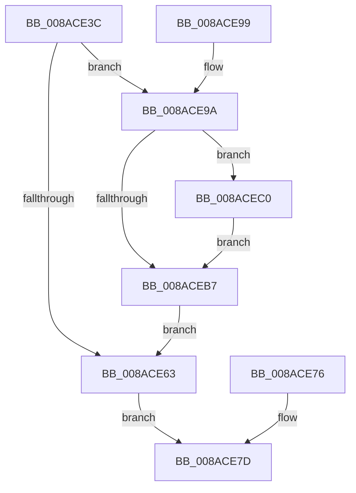

# IopSynchronousApiServiceTail

- RVA: `0x008ACE3C`–`0x008ACECD` (길이 `145` bytes)
- VA: `0x00000001408ACE3C`
- 실행 섹션: `PAGE`
- PDB 이름 있음: `예`; PDB Function 태그: `아니요`
- unwind 정보 RVA: `0x0007F810`
- 디코드: `43`개 명령, `145/145` bytes 표시
- 미해석 바이트: `0` (있으면 어셈블리에 `.byte`로 보존)

> 이 문서는 커널 이미지의 기계어와 PDB 기호를 분석해 생성했습니다. 4번과 5번은 함수 원형과 자료형을 바이너리 사용 방식에서 추정한 C 해석이며 원본 소스 복구 결과는 아닙니다.

## 1. Dependencies

- 직접 호출 지점: **3**; 고유 호출 대상: **3**
- 직접 호출자로 확인된 함수: **8**
- RIP 상대 이미지 참조: **0**

### Outgoing calls
- `0x008ACE82` → [ExFreePoolWithTag](../../poolcode/B8/ExFreePoolWithTag_function_00B82870.md) (function, `0x00B82870`)
- `0x008ACEAB` → [KeWaitForSingleObject](../../text/20/KeWaitForSingleObject_function_0020E6B0.md) (function, `0x0020E6B0`)
- `0x008ACEC6` → [IopCancelAlertedRequest](../A9/IopCancelAlertedRequest_function_00A948F8.md) (function, `0x00A948F8`)

### Direct callers
- [IopSetEaOrQuotaInformationFile](../71/IopSetEaOrQuotaInformationFile_function_0071BD70.md) at `0x0071C19E`
- [NtQueryQuotaInformationFile](../72/NtQueryQuotaInformationFile_function_00720FE0.md) at `0x00721711`
- [NtSetVolumeInformationFile](../72/NtSetVolumeInformationFile_function_00721750.md) at `0x00721BDC`
- [NtQueryEaFile](NtQueryEaFile_function_008AC1B0.md) at `0x008AC669`
- [NtQueryVolumeInformationFile](NtQueryVolumeInformationFile_function_008AC8C0.md) at `0x008ACC22`
- [IopFlushBuffersFile](IopFlushBuffersFile_function_008ACFA4.md) at `0x008AD2E1`
- [NtUnlockFile](../9E/NtUnlockFile_function_009E5DA0.md) at `0x009E61A5`
- [NtSetEaFile](../A7/NtSetEaFile_function_00A788A0.md) at `0x00A78BAE`

### Static image references
- 디코드된 RIP-relative 메모리 참조가 없습니다.

## 2. Other-region calls and transfers

- 다른 실행 섹션으로 향하는 call: **2**
  - `0x008ACE82` → [ExFreePoolWithTag](../../poolcode/B8/ExFreePoolWithTag_function_00B82870.md) (`PAGE` → `POOLCODE`)
  - `0x008ACEAB` → [KeWaitForSingleObject](../../text/20/KeWaitForSingleObject_function_0020E6B0.md) (`PAGE` → `.text`)
- 별도 외부 분기/꼬리 이동을 확인하지 못했습니다.

## 3. Assembly (complete function range)

```asm
008ACE3C  48 89 5C 24 08                  mov qword ptr [rsp + 8], rbx
008ACE41  48 89 74 24 18                  mov qword ptr [rsp + 0x18], rsi
008ACE46  48 89 54 24 10                  mov qword ptr [rsp + 0x10], rdx
008ACE4B  57                              push rdi
008ACE4C  48 83 EC 30                     sub rsp, 0x30
008ACE50  41 8A C1                        mov al, r9b
008ACE53  49 8B F0                        mov rsi, r8
008ACE56  48 8B DA                        mov rbx, rdx
008ACE59  8B F9                           mov edi, ecx
008ACE5B  81 F9 03 01 00 00               cmp ecx, 0x103
008ACE61  74 37                           je 0x1408ace9a
008ACE63  48 8B 44 24 60                  mov rax, qword ptr [rsp + 0x60]
008ACE68  0F 10 00                        movups xmm0, xmmword ptr [rax]
008ACE6B  48 8B 44 24 68                  mov rax, qword ptr [rsp + 0x68]
008ACE70  F3 0F 7F 00                     movdqu xmmword ptr [rax], xmm0
008ACE74  EB 07                           jmp 0x1408ace7d
008ACE76  8B F8                           mov edi, eax
008ACE78  48 8B 5C 24 48                  mov rbx, qword ptr [rsp + 0x48]
008ACE7D  33 D2                           xor edx, edx
008ACE7F  48 8B CB                        mov rcx, rbx
008ACE82  E8 E9 59 2D 00                  call 0x140b82870
008ACE87  8B C7                           mov eax, edi
008ACE89  48 8B 5C 24 40                  mov rbx, qword ptr [rsp + 0x40]
008ACE8E  48 8B 74 24 50                  mov rsi, qword ptr [rsp + 0x50]
008ACE93  48 83 C4 30                     add rsp, 0x30
008ACE97  5F                              pop rdi
008ACE98  C3                              ret
008ACE99  CC                              int3
008ACE9A  48 83 64 24 20 00               and qword ptr [rsp + 0x20], 0
008ACEA0  45 33 C9                        xor r9d, r9d
008ACEA3  44 8A C0                        mov r8b, al
008ACEA6  33 D2                           xor edx, edx
008ACEA8  48 8B CB                        mov rcx, rbx
008ACEAB  E8 00 18 96 FF                  call 0x14020e6b0
008ACEB0  3D C0 00 00 00                  cmp eax, 0xc0
008ACEB5  74 09                           je 0x1408acec0
008ACEB7  48 8B 44 24 60                  mov rax, qword ptr [rsp + 0x60]
008ACEBC  8B 38                           mov edi, dword ptr [rax]
008ACEBE  EB A3                           jmp 0x1408ace63
008ACEC0  48 8B D6                        mov rdx, rsi
008ACEC3  48 8B CB                        mov rcx, rbx
008ACEC6  E8 2D 7A 1E 00                  call 0x140a948f8
008ACECB  EB EA                           jmp 0x1408aceb7
```

## 4. C-style interpretation (structured pseudocode)

```c
__int64 __fastcall IopSynchronousApiServiceTail(int a1, __int64 a2, __int64 a3, int a4, __int64 a5, __int64 a6)
{
    __int64 result;
    __int64 v_rsp;
    unsigned __int64 v_stack_p10;
    unsigned __int64 v_stack_p18;
    unsigned __int64 v_stack_p20;
    unsigned __int64 v_stack_p8;

    v_stack_p8 = v_rbx;
    v_stack_p18 = v_rsi;
    v_stack_p10 = a2;
    v_rsp = (v_rsp) - (48);
    if (a1 == 259) goto loc_008ACE9A;
loc_008ACE63:
    *(unsigned __int64 *)(a6) = v_xmm0;
    goto loc_008ACE7D;
loc_008ACE7D:
    a2 = 0;
    result = ExFreePoolWithTag(0, a2, a3, a4);
    v_rsp = (v_rsp) + (48);
    return (unsigned int)((unsigned int)((unsigned int)(a1)));
loc_008ACE9A:
    a4 = 0;
    a2 = 0;
    result = KeWaitForSingleObject(v_stack_p8, a2, (unsigned __int8)((unsigned int)((unsigned int)((unsigned int)(a1)))), a4);
    if (((unsigned int)(result)) == 192) goto loc_008ACEC0;
loc_008ACEB7:
    goto loc_008ACE63;
loc_008ACEC0:
    result = IopCancelAlertedRequest(v_stack_p8, v_stack_p18, (unsigned __int8)((unsigned int)((unsigned int)((unsigned int)(a1)))), a4);
    goto loc_008ACEB7;
}
```

## 5. (Beta) C Style

```c
int64_t IopSynchronousApiServiceTail(int32_t Arg1, int64_t Arg2, int64_t Arg3, int32_t Arg4, void *Arg5, void *Arg6)
{
    uint8_t *arg5 = (uint8_t *)Arg5;
    uint8_t *arg6 = (uint8_t *)Arg6;

    int64_t result;
    int64_t local_rsp;
    uint64_t v_stack_p10;
    uint64_t v_stack_p18;
    uint64_t v_stack_p20;
    uint64_t v_stack_p8;

    v_stack_p8 = local_rbx;
    v_stack_p18 = local_rsi;
    v_stack_p10 = Arg2;
    local_rsp = (local_rsp) - (48);
    if (Arg1 == 259) goto loc_008ACE9A;
loc_008ACE63:
    *(uint64_t *)(arg6) = v_xmm0;
    goto loc_008ACE7D;
loc_008ACE7D:
    Arg2 = 0;
    result = ExFreePoolWithTag(0, Arg2, Arg3, Arg4);
    local_rsp = (local_rsp) + (48);
    return (uint32_t)((uint32_t)((uint32_t)(Arg1)));
loc_008ACE9A:
    Arg4 = 0;
    Arg2 = 0;
    result = KeWaitForSingleObject(v_stack_p8, Arg2, (uint8_t)((uint32_t)((uint32_t)((uint32_t)(Arg1)))), Arg4);
    if (((uint32_t)(result)) == 192) goto loc_008ACEC0;
loc_008ACEB7:
    goto loc_008ACE63;
loc_008ACEC0:
    result = IopCancelAlertedRequest(v_stack_p8, v_stack_p18, (uint8_t)((uint32_t)((uint32_t)((uint32_t)(Arg1)))), Arg4);
    goto loc_008ACEB7;
}
```

### 관측된 메모리 오프셋

구조체 형식이 확인되지 않은 접근은 인자 기준의 오프셋으로만 기록했습니다.

| 기준 인자 | 오프셋 표현 | 폭 (bit) | 접근 |
|---|---:|---:|---|
| `Arg5` | `+ 0x0` | `32` | `R` |
| `Arg5` | `+ 0x0` | `128` | `R` |
| `Arg6` | `+ 0x0` | `128` | `W` |

## 6. Execution-region graph

[열기: 2D/3D 그래프와 함수 탐색 컨트롤 패널](../../../control-panel.html?section=page&rva=0x008ACE3C&view=graph)

- 2D 그래프는 위에서 아래로 흐르고, 3D 그래프는 빈 공간을 드래그해 회전합니다. Shift+드래그는 이동, 휠은 확대·축소, 함수 노드 선택은 대상 보고서 이동입니다.

### Static fallback


