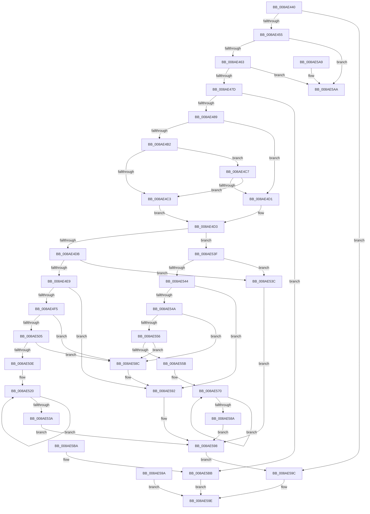

# IopValidateQueryInformationParameters

- RVA: `0x008AE440`–`0x008AE5C2` (길이 `386` bytes)
- VA: `0x00000001408AE440`
- 실행 섹션: `PAGE`
- PDB 이름 있음: `예`; PDB Function 태그: `아니요`
- unwind 정보 RVA: `0x0007F9A4`
- 디코드: `103`개 명령, `386/386` bytes 표시
- 미해석 바이트: `0` (있으면 어셈블리에 `.byte`로 보존)

> 이 문서는 커널 이미지의 기계어와 PDB 기호를 분석해 생성했습니다. 4번과 5번은 함수 원형과 자료형을 바이너리 사용 방식에서 추정한 C 해석이며 원본 소스 복구 결과는 아닙니다.

## 1. Dependencies

- 직접 호출 지점: **2**; 고유 호출 대상: **2**
- 직접 호출자로 확인된 함수: **2**
- RIP 상대 이미지 참조: **1**

### Outgoing calls
- `0x008AE58C` → [ExRaiseAccessViolation](../8E/ExRaiseAccessViolation_function_008E9240.md) (function, `0x008E9240`)
- `0x008AE592` → [ExRaiseDatatypeMisalignment](../89/ExRaiseDatatypeMisalignment_function_00899FD0.md) (function, `0x00899FD0`)

### Direct callers
- [NtQueryInformationFile](NtQueryInformationFile_function_008AD630.md) at `0x008AD6FE`
- [IoQueryInformationByName](IoQueryInformationByName_function_008AE840.md) at `0x008AE8E3`

### Static image references
- `0x008AE466` → RVA `0x00000000` (`image boundary/outside`; read)

## 2. Other-region calls and transfers

- 다른 실행 섹션으로 향하는 call: **0**
- 별도 외부 분기/꼬리 이동을 확인하지 못했습니다.

## 3. Assembly (complete function range)

```asm
008AE440  48 89 5C 24 10                  mov qword ptr [rsp + 0x10], rbx
008AE445  57                              push rdi
008AE446  48 83 EC 20                     sub rsp, 0x20
008AE44A  4C 8B DA                        mov r11, rdx
008AE44D  84 C9                           test cl, cl
008AE44F  0F 84 47 01 00 00               je 0x1408ae59c
008AE455  48 63 44 24 58                  movsxd rax, dword ptr [rsp + 0x58]
008AE45A  83 F8 54                        cmp eax, 0x54
008AE45D  0F 83 47 01 00 00               jae 0x1408ae5aa
008AE463  4C 8B D0                        mov r10, rax
008AE466  48 8D 3D 93 1B 75 FF            lea rdi, [rip - 0x8ae46d]
008AE46D  0F B6 84 38 80 C8 B4 00         movzx eax, byte ptr [rax + rdi + 0xb4c880]
008AE475  84 C0                           test al, al
008AE477  0F 84 2D 01 00 00               je 0x1408ae5aa
008AE47D  8B 54 24 50                     mov edx, dword ptr [rsp + 0x50]
008AE481  3B D0                           cmp edx, eax
008AE483  0F 82 32 01 00 00               jb 0x1408ae5bb
008AE489  48 BB 00 00 FF FF FF 7F 00 00   movabs rbx, 0x7fffffff0000
008AE493  48 8B CB                        mov rcx, rbx
008AE496  4C 3B C3                        cmp r8, rbx
008AE499  49 0F 42 C8                     cmovb rcx, r8
008AE49D  8B 01                           mov eax, dword ptr [rcx]
008AE49F  89 01                           mov dword ptr [rcx], eax
008AE4A1  49 8B 83 B8 00 00 00            mov rax, qword ptr [r11 + 0xb8]
008AE4A8  48 83 B8 10 03 00 00 00         cmp qword ptr [rax + 0x310], 0
008AE4B0  74 1F                           je 0x1408ae4d1
008AE4B2  0F B7 88 EC 06 00 00            movzx ecx, word ptr [rax + 0x6ec]
008AE4B9  B8 4C 01 00 00                  mov eax, 0x14c
008AE4BE  66 3B C8                        cmp cx, ax
008AE4C1  75 04                           jne 0x1408ae4c7
008AE4C3  B0 01                           mov al, 1
008AE4C5  EB 0C                           jmp 0x1408ae4d3
008AE4C7  B8 C4 01 00 00                  mov eax, 0x1c4
008AE4CC  66 3B C8                        cmp cx, ax
008AE4CF  74 F2                           je 0x1408ae4c3
008AE4D1  32 C0                           xor al, al
008AE4D3  88 44 24 30                     mov byte ptr [rsp + 0x30], al
008AE4D7  84 C0                           test al, al
008AE4D9  75 64                           jne 0x1408ae53f
008AE4DB  41 0F B6 84 3A 20 C8 B4 00      movzx eax, byte ptr [r10 + rdi + 0xb4c820]
008AE4E4  48 85 D2                        test rdx, rdx
008AE4E7  74 53                           je 0x1408ae53c
008AE4E9  8D 48 FF                        lea ecx, [rax - 1]
008AE4EC  49 85 C9                        test r9, rcx
008AE4EF  0F 85 9D 00 00 00               jne 0x1408ae592
008AE4F5  49 8D 49 FF                     lea rcx, [r9 - 1]
008AE4F9  48 03 CA                        add rcx, rdx
008AE4FC  4C 3B C9                        cmp r9, rcx
008AE4FF  0F 87 87 00 00 00               ja 0x1408ae58c
008AE505  48 3B CB                        cmp rcx, rbx
008AE508  0F 83 7E 00 00 00               jae 0x1408ae58c
008AE50E  48 81 E1 00 F0 FF FF            and rcx, 0xfffffffffffff000
008AE515  48 81 C1 00 10 00 00            add rcx, 0x1000
008AE51C  0F 1F 40 00                     nop dword ptr [rax]
008AE520  41 0F B6 01                     movzx eax, byte ptr [r9]
008AE524  41 88 01                        mov byte ptr [r9], al
008AE527  49 81 E1 00 F0 FF FF            and r9, 0xfffffffffffff000
008AE52E  49 81 C1 00 10 00 00            add r9, 0x1000
008AE535  4C 3B C9                        cmp r9, rcx
008AE538  75 E6                           jne 0x1408ae520
008AE53A  EB 5C                           jmp 0x1408ae598
008AE53C  90                              nop
008AE53D  EB 59                           jmp 0x1408ae598
008AE53F  48 85 D2                        test rdx, rdx
008AE542  74 F8                           je 0x1408ae53c
008AE544  41 F6 C1 03                     test r9b, 3
008AE548  75 48                           jne 0x1408ae592
008AE54A  49 8D 49 FF                     lea rcx, [r9 - 1]
008AE54E  48 03 CA                        add rcx, rdx
008AE551  4C 3B C9                        cmp r9, rcx
008AE554  77 36                           ja 0x1408ae58c
008AE556  48 3B CB                        cmp rcx, rbx
008AE559  73 31                           jae 0x1408ae58c
008AE55B  48 81 E1 00 F0 FF FF            and rcx, 0xfffffffffffff000
008AE562  48 81 C1 00 10 00 00            add rcx, 0x1000
008AE569  0F 1F 80 00 00 00 00            nop dword ptr [rax]
008AE570  41 0F B6 01                     movzx eax, byte ptr [r9]
008AE574  41 88 01                        mov byte ptr [r9], al
008AE577  49 81 E1 00 F0 FF FF            and r9, 0xfffffffffffff000
008AE57E  49 81 C1 00 10 00 00            add r9, 0x1000
008AE585  4C 3B C9                        cmp r9, rcx
008AE588  75 E6                           jne 0x1408ae570
008AE58A  EB 0C                           jmp 0x1408ae598
008AE58C  E8 AF AC 03 00                  call 0x1408e9240
008AE591  CC                              int3
008AE592  E8 39 BA FE FF                  call 0x140899fd0
008AE597  CC                              int3
008AE598  EB 02                           jmp 0x1408ae59c
008AE59A  EB 02                           jmp 0x1408ae59e
008AE59C  33 C0                           xor eax, eax
008AE59E  48 8B 5C 24 38                  mov rbx, qword ptr [rsp + 0x38]
008AE5A3  48 83 C4 20                     add rsp, 0x20
008AE5A7  5F                              pop rdi
008AE5A8  C3                              ret
008AE5A9  CC                              int3
008AE5AA  B8 03 00 00 C0                  mov eax, 0xc0000003
008AE5AF  48 8B 5C 24 38                  mov rbx, qword ptr [rsp + 0x38]
008AE5B4  48 83 C4 20                     add rsp, 0x20
008AE5B8  5F                              pop rdi
008AE5B9  C3                              ret
008AE5BA  CC                              int3
008AE5BB  B8 04 00 00 C0                  mov eax, 0xc0000004
008AE5C0  EB DC                           jmp 0x1408ae59e
```

## 4. C-style interpretation (structured pseudocode)

```c
__int64 __fastcall IopValidateQueryInformationParameters(unsigned __int8 a1, __int64 a2, __int64 a3, __int64 a4, unsigned int a5, unsigned int a6)
{
    __int64 result;
    __int64 v_rsp;
    unsigned __int64 v_stack_p10;
    unsigned __int64 v_stack_p38;
    unsigned __int8 v_stack_p8;

    v_stack_p10 = v_rbx;
    v_rsp = (v_rsp) - (32);
    if (a1 == 0) goto loc_008AE59C;
    if (((unsigned int)((int)(a6))) >= 84) goto loc_008AE5AA;
    if ((unsigned __int8)(*(unsigned __int8 *)((int)(a6) + v_rip - 9102445 * 1 + 11847808)) == 0) goto loc_008AE5AA;
    if (((unsigned int)((unsigned int)(a5))) < ((unsigned int)(*(unsigned __int8 *)((int)(a6) + v_rip - 9102445 * 1 + 11847808)))) goto loc_008AE5BB;
    a1 = v_rbx;
    if (a3 < v_rbx) { a1 = a3; }
    *(unsigned int *)(a1) = (unsigned int)((unsigned int)(*(unsigned int *)(a1)));
    if ((*(unsigned __int64 *)(*(unsigned __int64 *)(a2 + 184) + 784)) == 0) goto loc_008AE4D1;
    if (((unsigned __int16)(*(unsigned __int16 *)(*(unsigned __int64 *)(a2 + 184) + 1772))) != 332) goto loc_008AE4C7;
loc_008AE4C3:
    goto loc_008AE4D3;
loc_008AE4C7:
    if (((unsigned __int16)(*(unsigned __int16 *)(*(unsigned __int64 *)(a2 + 184) + 1772))) == 452) goto loc_008AE4C3;
loc_008AE4D1:
    result = 0;
loc_008AE4D3:
    v_stack_p8 = 0;
    if (0 != 0) goto loc_008AE53F;
    if ((unsigned int)(a5) == 0) goto loc_008AE53C;
    if (((a4) & (*(unsigned __int8 *)((int)(a6) + v_rip - 9102445 * 1 + 11847712) - 1)) != 0) goto loc_008AE592;
    a1 = (a4 - 1) + ((unsigned int)(a5));
    if (a4 > a1) goto loc_008AE58C;
    if (a1 >= v_rbx) goto loc_008AE58C;
    a1 = (a1) & (0xFFFFFFFFFFFFF000ULL);
    a1 = (a1) + (0x1000ULL);
loc_008AE520:
    *(unsigned __int8 *)(a4) = (unsigned __int8)(*(unsigned __int8 *)(a4));
    a4 = (a4) & (0xFFFFFFFFFFFFF000ULL);
    a4 = (a4) + (0x1000ULL);
    if (a4 != a1) goto loc_008AE520;
    goto loc_008AE598;
loc_008AE53C:
    goto loc_008AE598;
loc_008AE53F:
    if ((unsigned int)(a5) == 0) goto loc_008AE53C;
    if ((((unsigned __int8)(a4)) & (3)) != 0) goto loc_008AE592;
    a1 = (a4 - 1) + ((unsigned int)(a5));
    if (a4 > a1) goto loc_008AE58C;
    if (a1 >= v_rbx) goto loc_008AE58C;
    a1 = (a1) & (0xFFFFFFFFFFFFF000ULL);
    a1 = (a1) + (0x1000ULL);
loc_008AE570:
    *(unsigned __int8 *)(a4) = (unsigned __int8)(*(unsigned __int8 *)(a4));
    a4 = (a4) & (0xFFFFFFFFFFFFF000ULL);
    a4 = (a4) + (0x1000ULL);
    if (a4 != a1) goto loc_008AE570;
    goto loc_008AE598;
loc_008AE58C:
    result = ExRaiseAccessViolation(a1, (unsigned int)(a5), a3, a4);
loc_008AE592:
    result = ExRaiseDatatypeMisalignment(a1, (unsigned int)(a5), a3, a4);
loc_008AE598:
    goto loc_008AE59C;
loc_008AE59C:
    result = 0;
loc_008AE59E:
    v_rsp = (v_rsp) + (32);
    return result;
loc_008AE5AA:
    v_rsp = (v_rsp) + (32);
    return (unsigned int)(0xC0000003ULL);
loc_008AE5BB:
    goto loc_008AE59E;
}
```

## 5. (Beta) C Style

```c
int64_t IopValidateQueryInformationParameters(uint8_t Arg1, void *Arg2, int64_t Arg3, int64_t Arg4, uint32_t Arg5, uint32_t Arg6)
{
    uint8_t *arg2 = (uint8_t *)Arg2;

    int64_t result;
    int64_t local_rsp;
    uint64_t v_stack_p10;
    uint64_t v_stack_p38;
    uint8_t v_stack_p8;

    v_stack_p10 = local_rbx;
    local_rsp = (local_rsp) - (32);
    if (Arg1 == 0) goto loc_008AE59C;
    if (((uint32_t)((int32_t)(Arg6))) >= 84) goto loc_008AE5AA;
    if ((uint8_t)(*(uint8_t *)((int32_t)(Arg6) + v_rip - 0x8AE46D * 1 + 0xB4C880)) == 0) goto loc_008AE5AA;
    if (((uint32_t)((uint32_t)(Arg5))) < ((uint32_t)(*(uint8_t *)((int32_t)(Arg6) + v_rip - 0x8AE46D * 1 + 0xB4C880)))) goto loc_008AE5BB;
    Arg1 = local_rbx;
    if (Arg3 < local_rbx) { Arg1 = Arg3; }
    *(uint32_t *)(Arg1) = (uint32_t)((uint32_t)(*(uint32_t *)(Arg1)));
    if ((*(uint64_t *)(*(uint64_t *)(arg2 + 0xB8) + 0x310)) == 0) goto loc_008AE4D1;
    if (((uint16_t)(*(uint16_t *)(*(uint64_t *)(arg2 + 0xB8) + 0x6EC))) != 332) goto loc_008AE4C7;
loc_008AE4C3:
    goto loc_008AE4D3;
loc_008AE4C7:
    if (((uint16_t)(*(uint16_t *)(*(uint64_t *)(arg2 + 0xB8) + 0x6EC))) == 452) goto loc_008AE4C3;
loc_008AE4D1:
    result = 0;
loc_008AE4D3:
    v_stack_p8 = 0;
    if (0 != 0) goto loc_008AE53F;
    if ((uint32_t)(Arg5) == 0) goto loc_008AE53C;
    if (((Arg4) & (*(uint8_t *)((int32_t)(Arg6) + v_rip - 0x8AE46D * 1 + 0xB4C820) - 1)) != 0) goto loc_008AE592;
    Arg1 = (Arg4 - 1) + ((uint32_t)(Arg5));
    if (Arg4 > Arg1) goto loc_008AE58C;
    if (Arg1 >= local_rbx) goto loc_008AE58C;
    Arg1 = (Arg1) & (0xFFFFFFFFFFFFF000ULL);
    Arg1 = (Arg1) + (0x1000ULL);
loc_008AE520:
    *(uint8_t *)(Arg4) = (uint8_t)(*(uint8_t *)(Arg4));
    Arg4 = (Arg4) & (0xFFFFFFFFFFFFF000ULL);
    Arg4 = (Arg4) + (0x1000ULL);
    if (Arg4 != Arg1) goto loc_008AE520;
    goto loc_008AE598;
loc_008AE53C:
    goto loc_008AE598;
loc_008AE53F:
    if ((uint32_t)(Arg5) == 0) goto loc_008AE53C;
    if ((((uint8_t)(Arg4)) & (3)) != 0) goto loc_008AE592;
    Arg1 = (Arg4 - 1) + ((uint32_t)(Arg5));
    if (Arg4 > Arg1) goto loc_008AE58C;
    if (Arg1 >= local_rbx) goto loc_008AE58C;
    Arg1 = (Arg1) & (0xFFFFFFFFFFFFF000ULL);
    Arg1 = (Arg1) + (0x1000ULL);
loc_008AE570:
    *(uint8_t *)(Arg4) = (uint8_t)(*(uint8_t *)(Arg4));
    Arg4 = (Arg4) & (0xFFFFFFFFFFFFF000ULL);
    Arg4 = (Arg4) + (0x1000ULL);
    if (Arg4 != Arg1) goto loc_008AE570;
    goto loc_008AE598;
loc_008AE58C:
    result = ExRaiseAccessViolation(Arg1, (uint32_t)(Arg5), Arg3, Arg4);
loc_008AE592:
    result = ExRaiseDatatypeMisalignment(Arg1, (uint32_t)(Arg5), Arg3, Arg4);
loc_008AE598:
    goto loc_008AE59C;
loc_008AE59C:
    result = 0;
loc_008AE59E:
    local_rsp = (local_rsp) + (32);
    return result;
loc_008AE5AA:
    local_rsp = (local_rsp) + (32);
    return (uint32_t)(0xC0000003ULL);
loc_008AE5BB:
    goto loc_008AE59E;
}
```

### 관측된 메모리 오프셋

구조체 형식이 확인되지 않은 접근은 인자 기준의 오프셋으로만 기록했습니다.

| 기준 인자 | 오프셋 표현 | 폭 (bit) | 접근 |
|---|---:|---:|---|
| `Arg2` | `+ 0xB8` | `64` | `R` |

## 6. Execution-region graph

[열기: 2D/3D 그래프와 함수 탐색 컨트롤 패널](../../../control-panel.html?section=page&rva=0x008AE440&view=graph)

- 2D 그래프는 위에서 아래로 흐르고, 3D 그래프는 빈 공간을 드래그해 회전합니다. Shift+드래그는 이동, 휠은 확대·축소, 함수 노드 선택은 대상 보고서 이동입니다.

### Static fallback


