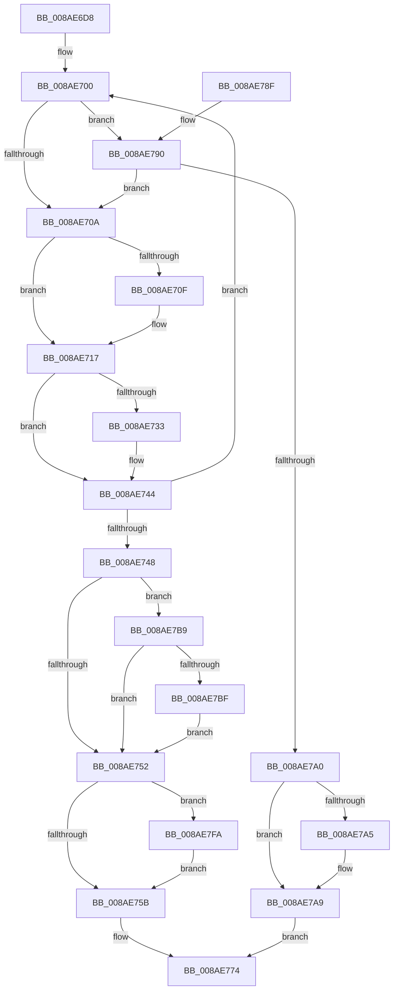

# IopWaitAndAcquireFileObjectLock

- RVA: `0x008AE6D8`–`0x008AE80A` (길이 `306` bytes)
- VA: `0x00000001408AE6D8`
- 실행 섹션: `PAGE`
- PDB 이름 있음: `예`; PDB Function 태그: `아니요`
- unwind 정보 RVA: `0x0007F9D0`
- 디코드: `81`개 명령, `306/306` bytes 표시
- 미해석 바이트: `0` (있으면 어셈블리에 `.byte`로 보존)

> 이 문서는 커널 이미지의 기계어와 PDB 기호를 분석해 생성했습니다. 4번과 5번은 함수 원형과 자료형을 바이너리 사용 방식에서 추정한 C 해석이며 원본 소스 복구 결과는 아닙니다.

## 1. Dependencies

- 직접 호출 지점: **7**; 고유 호출 대상: **7**
- 직접 호출자로 확인된 함수: **21**
- RIP 상대 이미지 참조: **0**

### Outgoing calls
- `0x008AE712` → [KeAbPreWait](../../text/20/KeAbPreWait_function_0020E560.md) (function, `0x0020E560`)
- `0x008AE727` → [IopWaitForLockAlertable](../../text/47/IopWaitForLockAlertable_function_0047A684.md) (function, `0x0047A684`)
- `0x008AE73C` → [KeAbPreAcquire](../../text/21/KeAbPreAcquire_function_00210230.md) (function, `0x00210230`)
- `0x008AE76F` → [KeLeaveCriticalRegionThread](../../text/25/KeLeaveCriticalRegionThread_function_0025EFF0.md) (function, `0x0025EFF0`)
- `0x008AE7AC` → [ObfReferenceObject](../../text/20/ObfReferenceObject_function_0020FA20.md) (function, `0x0020FA20`)
- `0x008AE7F0` → [KeSetEventBoostPriorityEx](../../text/35/KeSetEventBoostPriorityEx_function_00350148.md) (function, `0x00350148`)
- `0x008AE800` → [KeAbPostReleaseEx](../../text/26/KeAbPostReleaseEx_function_00262210.md) (function, `0x00262210`)

### Direct callers
- [NtSetInformationFile](../../text/29/NtSetInformationFile_function_0029C5E0.md) at `0x0029D04B`
- [IopValidateAndGetWriteParameters](../../text/40/IopValidateAndGetWriteParameters_function_00400C30.md) at `0x0040107F`
- [IopSetEaOrQuotaInformationFile](../71/IopSetEaOrQuotaInformationFile_function_0071BD70.md) at `0x0071BEC8`
- [IoSetInformation](../71/IoSetInformation_function_0071DBF0.md) at `0x0071DCB3`
- [NtQueryQuotaInformationFile](../72/NtQueryQuotaInformationFile_function_00720FE0.md) at `0x007213D3`
- [NtSetVolumeInformationFile](../72/NtSetVolumeInformationFile_function_00721750.md) at `0x00721999`
- [IopCloseFile](../86/IopCloseFile_function_008640C0.md) at `0x00864339`
- [IopGetSetSecurityObject](../87/IopGetSetSecurityObject_function_00873A80.md) at `0x00873F75`
- [sub_008A8C05](Unknown_function_008A8C05.md) at `0x008A8C20`
- [NtQueryEaFile](NtQueryEaFile_function_008AC1B0.md) at `0x008AC798`
- [NtQueryVolumeInformationFile](NtQueryVolumeInformationFile_function_008AC8C0.md) at `0x008ACDCD`
- [IopFlushBuffersFile](IopFlushBuffersFile_function_008ACFA4.md) at `0x008AD31A`
- [NtQueryInformationFile](NtQueryInformationFile_function_008AD630.md) at `0x008AE0CF`
- [IopReadFile](IopReadFile_function_008AEFF0.md) at `0x008AF3B4`
- [IopXxxControlFile](../8E/IopXxxControlFile_function_008E9AD0.md) at `0x008EB065`
- [BuildQueryDirectoryIrp](../8E/BuildQueryDirectoryIrp_function_008EC770.md) at `0x008ECDB0`
- [NtLockFile](../9D/NtLockFile_function_009D86D0.md) at `0x009D8CDD`
- [NtUnlockFile](../9E/NtUnlockFile_function_009E5DA0.md) at `0x009E622E`
- [NtNotifyChangeDirectoryFileEx](../A1/NtNotifyChangeDirectoryFileEx_function_00A1DEA0.md) at `0x00A1E282`
- [NtSetEaFile](../A7/NtSetEaFile_function_00A788A0.md) at `0x00A78B54`
- [sub_00B174A6](../B1/Unknown_function_00B174A6.md) at `0x00B1751A`

### Static image references
- 디코드된 RIP-relative 메모리 참조가 없습니다.

## 2. Other-region calls and transfers

- 다른 실행 섹션으로 향하는 call: **7**
  - `0x008AE712` → [KeAbPreWait](../../text/20/KeAbPreWait_function_0020E560.md) (`PAGE` → `.text`)
  - `0x008AE727` → [IopWaitForLockAlertable](../../text/47/IopWaitForLockAlertable_function_0047A684.md) (`PAGE` → `.text`)
  - `0x008AE73C` → [KeAbPreAcquire](../../text/21/KeAbPreAcquire_function_00210230.md) (`PAGE` → `.text`)
  - `0x008AE76F` → [KeLeaveCriticalRegionThread](../../text/25/KeLeaveCriticalRegionThread_function_0025EFF0.md) (`PAGE` → `.text`)
  - `0x008AE7AC` → [ObfReferenceObject](../../text/20/ObfReferenceObject_function_0020FA20.md) (`PAGE` → `.text`)
  - `0x008AE7F0` → [KeSetEventBoostPriorityEx](../../text/35/KeSetEventBoostPriorityEx_function_00350148.md) (`PAGE` → `.text`)
  - `0x008AE800` → [KeAbPostReleaseEx](../../text/26/KeAbPostReleaseEx_function_00262210.md) (`PAGE` → `.text`)
- 별도 외부 분기/꼬리 이동을 확인하지 못했습니다.

## 3. Assembly (complete function range)

```asm
008AE6D8  48 89 5C 24 10                  mov qword ptr [rsp + 0x10], rbx
008AE6DD  48 89 6C 24 18                  mov qword ptr [rsp + 0x18], rbp
008AE6E2  48 89 74 24 20                  mov qword ptr [rsp + 0x20], rsi
008AE6E7  57                              push rdi
008AE6E8  41 56                           push r14
008AE6EA  41 57                           push r15
008AE6EC  48 83 EC 40                     sub rsp, 0x40
008AE6F0  49 8B F9                        mov rdi, r9
008AE6F3  45 8A F0                        mov r14b, r8b
008AE6F6  44 8A FA                        mov r15b, dl
008AE6F9  48 8B D9                        mov rbx, rcx
008AE6FC  F0 FF 41 70                     lock inc dword ptr [rcx + 0x70]
008AE700  83 7B 74 00                     cmp dword ptr [rbx + 0x74], 0
008AE704  0F 84 86 00 00 00               je 0x1408ae790
008AE70A  48 85 FF                        test rdi, rdi
008AE70D  74 08                           je 0x1408ae717
008AE70F  48 8B CF                        mov rcx, rdi
008AE712  E8 49 FE 95 FF                  call 0x14020e560
008AE717  48 8D B3 80 00 00 00            lea rsi, [rbx + 0x80]
008AE71E  45 8A C6                        mov r8b, r14b
008AE721  48 8B CE                        mov rcx, rsi
008AE724  41 8A D7                        mov dl, r15b
008AE727  E8 58 BF BC FF                  call 0x14047a684
008AE72C  8B E8                           mov ebp, eax
008AE72E  48 85 FF                        test rdi, rdi
008AE731  74 11                           je 0x1408ae744
008AE733  45 33 C0                        xor r8d, r8d
008AE736  48 8B D7                        mov rdx, rdi
008AE739  48 8B CE                        mov rcx, rsi
008AE73C  E8 EF 1A 96 FF                  call 0x140210230
008AE741  48 8B F8                        mov rdi, rax
008AE744  85 ED                           test ebp, ebp
008AE746  79 B8                           jns 0x1408ae700
008AE748  F0 FF 4B 70                     lock dec dword ptr [rbx + 0x70]
008AE74C  83 7B 74 00                     cmp dword ptr [rbx + 0x74], 0
008AE750  74 67                           je 0x1408ae7b9
008AE752  48 85 FF                        test rdi, rdi
008AE755  0F 85 9F 00 00 00               jne 0x1408ae7fa
008AE75B  48 8B 84 24 80 00 00 00         mov rax, qword ptr [rsp + 0x80]
008AE763  C6 00 01                        mov byte ptr [rax], 1
008AE766  65 48 8B 0C 25 88 01 00 00      mov rcx, qword ptr gs:[0x188]
008AE76F  E8 7C 08 9B FF                  call 0x14025eff0
008AE774  48 8B 5C 24 68                  mov rbx, qword ptr [rsp + 0x68]
008AE779  8B C5                           mov eax, ebp
008AE77B  48 8B 6C 24 70                  mov rbp, qword ptr [rsp + 0x70]
008AE780  48 8B 74 24 78                  mov rsi, qword ptr [rsp + 0x78]
008AE785  48 83 C4 40                     add rsp, 0x40
008AE789  41 5F                           pop r15
008AE78B  41 5E                           pop r14
008AE78D  5F                              pop rdi
008AE78E  C3                              ret
008AE78F  CC                              int3
008AE790  B8 01 00 00 00                  mov eax, 1
008AE795  87 43 74                        xchg dword ptr [rbx + 0x74], eax
008AE798  85 C0                           test eax, eax
008AE79A  0F 85 6A FF FF FF               jne 0x1408ae70a
008AE7A0  48 85 FF                        test rdi, rdi
008AE7A3  74 04                           je 0x1408ae7a9
008AE7A5  C6 47 0A 01                     mov byte ptr [rdi + 0xa], 1
008AE7A9  48 8B CB                        mov rcx, rbx
008AE7AC  E8 6F 12 96 FF                  call 0x14020fa20
008AE7B1  F0 FF 4B 70                     lock dec dword ptr [rbx + 0x70]
008AE7B5  33 ED                           xor ebp, ebp
008AE7B7  EB BB                           jmp 0x1408ae774
008AE7B9  83 7B 70 00                     cmp dword ptr [rbx + 0x70], 0
008AE7BD  74 93                           je 0x1408ae752
008AE7BF  65 48 8B 04 25 88 01 00 00      mov rax, qword ptr gs:[0x188]
008AE7C8  4C 8D 44 24 60                  lea r8, [rsp + 0x60]
008AE7CD  C7 44 24 28 01 00 00 00         mov dword ptr [rsp + 0x28], 1
008AE7D5  48 8D 54 24 30                  lea rdx, [rsp + 0x30]
008AE7DA  4C 8B CE                        mov r9, rsi
008AE7DD  C6 44 24 20 00                  mov byte ptr [rsp + 0x20], 0
008AE7E2  0F BE 88 C3 00 00 00            movsx ecx, byte ptr [rax + 0xc3]
008AE7E9  89 4C 24 60                     mov dword ptr [rsp + 0x60], ecx
008AE7ED  48 8B CE                        mov rcx, rsi
008AE7F0  E8 53 19 AA FF                  call 0x140350148
008AE7F5  E9 58 FF FF FF                  jmp 0x1408ae752
008AE7FA  48 8B D7                        mov rdx, rdi
008AE7FD  48 8B CE                        mov rcx, rsi
008AE800  E8 0B 3A 9B FF                  call 0x140262210
008AE805  E9 51 FF FF FF                  jmp 0x1408ae75b
```

## 4. C-style interpretation (structured pseudocode)

```c
__int64 __fastcall IopWaitAndAcquireFileObjectLock(__int64 a1, unsigned __int8 a2, unsigned __int8 a3, __int64 a4, __int64 a5)
{
    __int64 result;
    __int64 v_rbp;
    __int64 v_rdi;
    __int64 v_rsp;
    unsigned __int64 v_stack_p10;
    unsigned __int64 v_stack_p18;
    unsigned __int64 v_stack_p20;
    unsigned int v_stack_p28;
    unsigned __int64 v_stack_p30;
    unsigned __int64 v_stack_p60;

    v_stack_p10 = v_rbx;
    v_stack_p18 = v_rbp;
    v_stack_p20 = v_rsi;
    v_rsp = (v_rsp) - (64);
loc_008AE700:
    if ((*(unsigned int *)(a1 + 116)) == 0) goto loc_008AE790;
loc_008AE70A:
    if (a4 != 0) {
        a1 = a4;
        result = KeAbPreWait(a1, a2, a3, a4);
    }
    result = IopWaitForLockAlertable(a1 + 128, a2, a3, a4);
    v_rdi = a4;
    if (a4 != 0) {
        a3 = 0;
        a2 = a4;
        a1 = a1 + 128;
        result = KeAbPreAcquire(a1, a2, a3, a4);
        v_rdi = result;
    }
    if (!sign_flag) goto loc_008AE700;
    if ((*(unsigned int *)(a1 + 116)) == 0) goto loc_008AE7B9;
loc_008AE752:
    if (v_rdi != 0) goto loc_008AE7FA;
loc_008AE75B:
    *(unsigned __int8 *)(a5) = 1;
    result = KeLeaveCriticalRegionThread(*(unsigned __int64 *)(gs_base + (0 + 392)), a2, a3, a4);
loc_008AE774:
    v_rsp = (v_rsp) + (64);
    return (unsigned int)((unsigned int)((unsigned int)((unsigned int)(result))));
loc_008AE790:
    if (1 != 0) goto loc_008AE70A;
    if (v_rdi != 0) {
        *(unsigned __int8 *)(v_rdi + 10) = 1;
    }
    result = ObfReferenceObject(v_stack_p10, a2, a3, a4);
    v_rbp = 0;
    goto loc_008AE774;
loc_008AE7B9:
    if ((*(unsigned int *)(v_stack_p10 + 112)) == 0) goto loc_008AE752;
    v_stack_p28 = 1;
    v_stack_p20 = 0;
    v_stack_p60 = (unsigned int)((__int8)(*(unsigned __int8 *)(*(unsigned __int64 *)(gs_base + (0 + 392)) + 195)));
    result = KeSetEventBoostPriorityEx(v_stack_p20, v_stack_p30, v_stack_p60, v_stack_p20);
    goto loc_008AE752;
loc_008AE7FA:
    result = KeAbPostReleaseEx(v_stack_p20, v_rdi, v_stack_p60, v_stack_p20);
    goto loc_008AE75B;
}
```

## 5. (Beta) C Style

```c
int64_t IopWaitAndAcquireFileObjectLock(void *Arg1, uint8_t Arg2, uint8_t Arg3, int64_t Arg4, void *Arg5)
{
    uint8_t *arg1 = (uint8_t *)Arg1;
    uint8_t *arg5 = (uint8_t *)Arg5;

    int64_t result;
    int64_t local_rbp;
    int64_t local_rdi;
    int64_t local_rsp;
    uint64_t v_stack_p10;
    uint64_t v_stack_p18;
    uint64_t v_stack_p20;
    uint32_t v_stack_p28;
    uint64_t v_stack_p30;
    uint64_t v_stack_p60;

    v_stack_p10 = local_rbx;
    v_stack_p18 = local_rbp;
    v_stack_p20 = local_rsi;
    local_rsp = (local_rsp) - (64);
loc_008AE700:
    if ((*(uint32_t *)(arg1 + 0x74)) == 0) goto loc_008AE790;
loc_008AE70A:
    if (Arg4 != 0) {
        Arg1 = Arg4;
        result = KeAbPreWait(Arg1, Arg2, Arg3, Arg4);
    }
    result = IopWaitForLockAlertable(Arg1 + 128, Arg2, Arg3, Arg4);
    local_rdi = Arg4;
    if (Arg4 != 0) {
        Arg3 = 0;
        Arg2 = Arg4;
        Arg1 = Arg1 + 128;
        result = KeAbPreAcquire(Arg1, Arg2, Arg3, Arg4);
        local_rdi = result;
    }
    if (!sign_flag) goto loc_008AE700;
    if ((*(uint32_t *)(arg1 + 0x74)) == 0) goto loc_008AE7B9;
loc_008AE752:
    if (local_rdi != 0) goto loc_008AE7FA;
loc_008AE75B:
    *(uint8_t *)(arg5) = 1;
    result = KeLeaveCriticalRegionThread(*(uint64_t *)(gs_base + (0 + 0x188)), Arg2, Arg3, Arg4);
loc_008AE774:
    local_rsp = (local_rsp) + (64);
    return (uint32_t)((uint32_t)((uint32_t)((uint32_t)(result))));
loc_008AE790:
    if (1 != 0) goto loc_008AE70A;
    if (local_rdi != 0) {
        *(uint8_t *)(local_rdi + 0xA) = 1;
    }
    result = ObfReferenceObject(v_stack_p10, Arg2, Arg3, Arg4);
    local_rbp = 0;
    goto loc_008AE774;
loc_008AE7B9:
    if ((*(uint32_t *)(v_stack_p10 + 0x70)) == 0) goto loc_008AE752;
    v_stack_p28 = 1;
    v_stack_p20 = 0;
    v_stack_p60 = (uint32_t)((int8_t)(*(uint8_t *)(*(uint64_t *)(gs_base + (0 + 0x188)) + 0xC3)));
    result = KeSetEventBoostPriorityEx(v_stack_p20, v_stack_p30, v_stack_p60, v_stack_p20);
    goto loc_008AE752;
loc_008AE7FA:
    result = KeAbPostReleaseEx(v_stack_p20, local_rdi, v_stack_p60, v_stack_p20);
    goto loc_008AE75B;
}
```

### 관측된 메모리 오프셋

구조체 형식이 확인되지 않은 접근은 인자 기준의 오프셋으로만 기록했습니다.

| 기준 인자 | 오프셋 표현 | 폭 (bit) | 접근 |
|---|---:|---:|---|
| `Arg1` | `+ 0x70` | `32` | `R` |
| `Arg1` | `+ 0x70` | `32` | `R/W` |
| `Arg1` | `+ 0x74` | `32` | `R` |
| `Arg1` | `+ 0x74` | `32` | `R/W` |
| `Arg1` | `+ 0x80` | `64` | `R` |
| `Arg5` | `+ 0x0` | `8` | `W` |

## 6. Execution-region graph

[열기: 2D/3D 그래프와 함수 탐색 컨트롤 패널](../../../control-panel.html?section=page&rva=0x008AE6D8&view=graph)

- 2D 그래프는 위에서 아래로 흐르고, 3D 그래프는 빈 공간을 드래그해 회전합니다. Shift+드래그는 이동, 휠은 확대·축소, 함수 노드 선택은 대상 보고서 이동입니다.

### Static fallback


