# MiCreateSectionCommon

- RVA: `0x008A9AA4`–`0x008A9E6E` (길이 `970` bytes)
- VA: `0x00000001408A9AA4`
- 실행 섹션: `PAGE`
- PDB 이름 있음: `예`; PDB Function 태그: `아니요`
- unwind 정보 RVA: `0x0007F510`
- 디코드: `228`개 명령, `970/970` bytes 표시
- 미해석 바이트: `0` (있으면 어셈블리에 `.byte`로 보존)

> 이 문서는 커널 이미지의 기계어와 PDB 기호를 분석해 생성했습니다. 4번과 5번은 함수 원형과 자료형을 바이너리 사용 방식에서 추정한 C 해석이며 원본 소스 복구 결과는 아닙니다.

## 1. Dependencies

- 직접 호출 지점: **12**; 고유 호출 대상: **12**
- 직접 호출자로 확인된 함수: **5**
- RIP 상대 이미지 참조: **1**

### Outgoing calls
- `0x008A9BD4` → [MiCaptureSectionCreateExtendedParameters](../98/MiCaptureSectionCreateExtendedParameters_function_00983958.md) (function, `0x00983958`)
- `0x008A9C1D` → [PsReferencePrimaryTokenWithTag](../../text/20/PsReferencePrimaryTokenWithTag_function_0020FF80.md) (function, `0x0020FF80`)
- `0x008A9C3D` → [PsGetProcessSessionIdEx](../../text/22/PsGetProcessSessionIdEx_function_0022F8F0.md) (function, `0x0022F8F0`)
- `0x008A9CA4` → [MiCreateSection](../98/MiCreateSection_function_00983EC0.md) (function, `0x00983EC0`)
- `0x008A9CC1` → [KeDelayExecutionThread](../../text/20/KeDelayExecutionThread_function_00209550.md) (function, `0x00209550`)
- `0x008A9CF2` → [ExRaiseDatatypeMisalignment](../89/ExRaiseDatatypeMisalignment_function_00899FD0.md) (function, `0x00899FD0`)
- `0x008A9D8C` → [MiSectionControlArea](../../text/29/MiSectionControlArea_function_00294CB0.md) (function, `0x00294CB0`)
- `0x008A9DA2` → [MiReferenceControlAreaFile](../../text/43/MiReferenceControlAreaFile_function_00431554.md) (function, `0x00431554`)
- `0x008A9DAD` → [CcZeroEndOfLastPage](../../text/45/CcZeroEndOfLastPage_function_00453584.md) (function, `0x00453584`)
- `0x008A9DB8` → [MiDereferenceControlAreaFile](../../text/43/MiDereferenceControlAreaFile_function_004345E0.md) (function, `0x004345E0`)
- `0x008A9DE6` → [ObInsertObjectEx](../8B/ObInsertObjectEx_function_008B97A0.md) (function, `0x008B97A0`)
- `0x008A9E21` → [ObfDereferenceObject](../../text/2F/ObfDereferenceObject_function_002F9350.md) (function, `0x002F9350`)

### Direct callers
- [NtCreateSectionEx](../7F/NtCreateSectionEx_function_007FCF80.md) at `0x007FCFD9`
- [MmCreateSectionForHotpatch](../80/MmCreateSectionForHotpatch_function_00807360.md) at `0x008073CD`
- [PfSnGetSectionObject](PfSnGetSectionObject_function_008A9448.md) at `0x008A96C5`
- [NtCreateSection](NtCreateSection_function_008AA3D0.md) at `0x008AA440`
- [PfpFileBuildReadSupport](../93/PfpFileBuildReadSupport_function_0093B504.md) at `0x0093B745`

### Static image references
- `0x008A9CB6` → RVA `0x00014A38` (`.rdata`; read)

## 2. Other-region calls and transfers

- 다른 실행 섹션으로 향하는 call: **8**
  - `0x008A9C1D` → [PsReferencePrimaryTokenWithTag](../../text/20/PsReferencePrimaryTokenWithTag_function_0020FF80.md) (`PAGE` → `.text`)
  - `0x008A9C3D` → [PsGetProcessSessionIdEx](../../text/22/PsGetProcessSessionIdEx_function_0022F8F0.md) (`PAGE` → `.text`)
  - `0x008A9CC1` → [KeDelayExecutionThread](../../text/20/KeDelayExecutionThread_function_00209550.md) (`PAGE` → `.text`)
  - `0x008A9D8C` → [MiSectionControlArea](../../text/29/MiSectionControlArea_function_00294CB0.md) (`PAGE` → `.text`)
  - `0x008A9DA2` → [MiReferenceControlAreaFile](../../text/43/MiReferenceControlAreaFile_function_00431554.md) (`PAGE` → `.text`)
  - `0x008A9DAD` → [CcZeroEndOfLastPage](../../text/45/CcZeroEndOfLastPage_function_00453584.md) (`PAGE` → `.text`)
  - `0x008A9DB8` → [MiDereferenceControlAreaFile](../../text/43/MiDereferenceControlAreaFile_function_004345E0.md) (`PAGE` → `.text`)
  - `0x008A9E21` → [ObfDereferenceObject](../../text/2F/ObfDereferenceObject_function_002F9350.md) (`PAGE` → `.text`)
- 별도 외부 분기/꼬리 이동을 확인하지 못했습니다.

## 3. Assembly (complete function range)

```asm
008A9AA4  4C 8B DC                        mov r11, rsp
008A9AA7  4D 89 43 18                     mov qword ptr [r11 + 0x18], r8
008A9AAB  89 54 24 10                     mov dword ptr [rsp + 0x10], edx
008A9AAF  49 89 4B 08                     mov qword ptr [r11 + 8], rcx
008A9AB3  53                              push rbx
008A9AB4  56                              push rsi
008A9AB5  57                              push rdi
008A9AB6  41 54                           push r12
008A9AB8  41 55                           push r13
008A9ABA  41 56                           push r14
008A9ABC  41 57                           push r15
008A9ABE  48 81 EC A0 00 00 00            sub rsp, 0xa0
008A9AC5  4C 8B D1                        mov r10, rcx
008A9AC8  33 FF                           xor edi, edi
008A9ACA  49 89 7B A0                     mov qword ptr [r11 - 0x60], rdi
008A9ACE  49 89 7B A8                     mov qword ptr [r11 - 0x58], rdi
008A9AD2  33 C0                           xor eax, eax
008A9AD4  0F 57 C0                        xorps xmm0, xmm0
008A9AD7  41 0F 11 43 B0                  movups xmmword ptr [r11 - 0x50], xmm0
008A9ADC  41 89 43 C0                     mov dword ptr [r11 - 0x40], eax
008A9AE0  41 88 43 C4                     mov byte ptr [r11 - 0x3c], al
008A9AE4  49 89 7B 98                     mov qword ptr [r11 - 0x68], rdi
008A9AE8  8B 9C 24 08 01 00 00            mov ebx, dword ptr [rsp + 0x108]
008A9AEF  8B C3                           mov eax, ebx
008A9AF1  B9 00 00 00 03                  mov ecx, 0x3000000
008A9AF6  23 C1                           and eax, ecx
008A9AF8  3B C1                           cmp eax, ecx
008A9AFA  0F 84 37 02 00 00               je 0x1408a9d37
008A9B00  8B C3                           mov eax, ebx
008A9B02  B9 00 00 10 01                  mov ecx, 0x1100000
008A9B07  23 C1                           and eax, ecx
008A9B09  8B D3                           mov edx, ebx
008A9B0B  81 E2 00 00 10 02               and edx, 0x2100000
008A9B11  0F 85 14 03 00 00               jne 0x1408a9e2b
008A9B17  44 8B C7                        mov r8d, edi
008A9B1A  F7 C3 FF FF 80 20               test ebx, 0x2080ffff
008A9B20  0F 85 11 02 00 00               jne 0x1408a9d37
008A9B26  F7 C3 00 00 10 0F               test ebx, 0xf100000
008A9B2C  0F 84 05 02 00 00               je 0x1408a9d37
008A9B32  F7 C3 00 00 10 03               test ebx, 0x3100000
008A9B38  0F 85 D6 01 00 00               jne 0x1408a9d14
008A9B3E  8B C3                           mov eax, ebx
008A9B40  B9 00 00 00 0C                  mov ecx, 0xc000000
008A9B45  23 C1                           and eax, ecx
008A9B47  3B C1                           cmp eax, ecx
008A9B49  0F 84 E8 01 00 00               je 0x1408a9d37
008A9B4F  85 DB                           test ebx, ebx
008A9B51  0F 88 E7 02 00 00               js 0x1408a9e3e
008A9B57  8B C3                           mov eax, ebx
008A9B59  B9 00 00 0A 00                  mov ecx, 0xa0000
008A9B5E  23 C1                           and eax, ecx
008A9B60  3B C1                           cmp eax, ecx
008A9B62  0F 84 CF 01 00 00               je 0x1408a9d37
008A9B68  8B C3                           mov eax, ebx
008A9B6A  25 00 00 03 00                  and eax, 0x30000
008A9B6F  3D 00 00 01 00                  cmp eax, 0x10000
008A9B74  0F 84 BD 01 00 00               je 0x1408a9d37
008A9B7A  F7 84 24 00 01 00 00 01 07 00 00  test dword ptr [rsp + 0x100], 0x701
008A9B85  0F 85 D9 02 00 00               jne 0x1408a9e64
008A9B8B  44 0F B6 BC 24 30 01 00 00      movzx r15d, byte ptr [rsp + 0x130]
008A9B94  45 84 FF                        test r15b, r15b
008A9B97  0F 85 2B 01 00 00               jne 0x1408a9cc8
008A9B9D  4D 85 C9                        test r9, r9
008A9BA0  0F 85 B1 02 00 00               jne 0x1408a9e57
008A9BA6  8B B4 24 28 01 00 00            mov esi, dword ptr [rsp + 0x128]
008A9BAD  40 F6 C6 01                     test sil, 1
008A9BB1  44 8B CF                        mov r9d, edi
008A9BB4  45 0F 44 CF                     cmove r9d, r15d
008A9BB8  48 8D 84 24 88 00 00 00         lea rax, [rsp + 0x88]
008A9BC0  48 89 44 24 20                  mov qword ptr [rsp + 0x20], rax
008A9BC5  8B 94 24 20 01 00 00            mov edx, dword ptr [rsp + 0x120]
008A9BCC  48 8B 8C 24 18 01 00 00         mov rcx, qword ptr [rsp + 0x118]
008A9BD4  E8 7F 9D 0D 00                  call 0x140983958
008A9BD9  85 C0                           test eax, eax
008A9BDB  79 14                           jns 0x1408a9bf1
008A9BDD  48 81 C4 A0 00 00 00            add rsp, 0xa0
008A9BE4  41 5F                           pop r15
008A9BE6  41 5E                           pop r14
008A9BE8  41 5D                           pop r13
008A9BEA  41 5C                           pop r12
008A9BEC  5F                              pop rdi
008A9BED  5E                              pop rsi
008A9BEE  5B                              pop rbx
008A9BEF  C3                              ret
008A9BF0  CC                              int3
008A9BF1  44 8B E7                        mov r12d, edi
008A9BF4  65 48 8B 04 25 88 01 00 00      mov rax, qword ptr gs:[0x188]
008A9BFD  4C 8B A8 B8 00 00 00            mov r13, qword ptr [rax + 0xb8]
008A9C04  41 80 FF 01                     cmp r15b, 1
008A9C08  0F 85 33 01 00 00               jne 0x1408a9d41
008A9C0E  45 8A B5 F9 05 00 00            mov r14b, byte ptr [r13 + 0x5f9]
008A9C15  BA 44 66 6C 74                  mov edx, 0x746c6644
008A9C1A  49 8B CD                        mov rcx, r13
008A9C1D  E8 5E 63 96 FF                  call 0x14020ff80
008A9C22  48 8B F8                        mov rdi, rax
008A9C25  41 8B C4                        mov eax, r12d
008A9C28  83 C8 40                        or eax, 0x40
008A9C2B  40 F6 C6 04                     test sil, 4
008A9C2F  41 0F 44 C4                     cmove eax, r12d
008A9C33  89 84 24 08 01 00 00            mov dword ptr [rsp + 0x108], eax
008A9C3A  49 8B CD                        mov rcx, r13
008A9C3D  E8 AE 5C 98 FF                  call 0x14022f8f0
008A9C42  44 8B E8                        mov r13d, eax
008A9C45  44 8B A4 24 08 01 00 00         mov r12d, dword ptr [rsp + 0x108]
008A9C4D  48 8D 84 24 88 00 00 00         lea rax, [rsp + 0x88]
008A9C55  48 89 44 24 60                  mov qword ptr [rsp + 0x60], rax
008A9C5A  44 89 6C 24 58                  mov dword ptr [rsp + 0x58], r13d
008A9C5F  44 88 7C 24 50                  mov byte ptr [rsp + 0x50], r15b
008A9C64  48 83 64 24 48 00               and qword ptr [rsp + 0x48], 0
008A9C6A  48 8B 84 24 10 01 00 00         mov rax, qword ptr [rsp + 0x110]
008A9C72  48 89 44 24 40                  mov qword ptr [rsp + 0x40], rax
008A9C77  44 88 74 24 38                  mov byte ptr [rsp + 0x38], r14b
008A9C7C  48 89 7C 24 30                  mov qword ptr [rsp + 0x30], rdi
008A9C81  44 89 64 24 28                  mov dword ptr [rsp + 0x28], r12d
008A9C86  89 5C 24 20                     mov dword ptr [rsp + 0x20], ebx
008A9C8A  44 8B 8C 24 00 01 00 00         mov r9d, dword ptr [rsp + 0x100]
008A9C92  4C 8B 44 24 70                  mov r8, qword ptr [rsp + 0x70]
008A9C97  48 8B 94 24 F0 00 00 00         mov rdx, qword ptr [rsp + 0xf0]
008A9C9F  48 8D 4C 24 78                  lea rcx, [rsp + 0x78]
008A9CA4  E8 17 A2 0D 00                  call 0x140983ec0
008A9CA9  3D 54 00 00 C0                  cmp eax, 0xc0000054
008A9CAE  8B F0                           mov esi, eax
008A9CB0  0F 85 BA 00 00 00               jne 0x1408a9d70
008A9CB6  4C 8D 05 7B AD 76 FF            lea r8, [rip - 0x895285]
008A9CBD  33 D2                           xor edx, edx
008A9CBF  33 C9                           xor ecx, ecx
008A9CC1  E8 8A F8 95 FF                  call 0x140209550
008A9CC6  EB 85                           jmp 0x1408a9c4d
008A9CC8  45 85 C0                        test r8d, r8d
008A9CCB  75 6A                           jne 0x1408a9d37
008A9CCD  48 BA 00 00 FF FF FF 7F 00 00   movabs rdx, 0x7fffffff0000
008A9CD7  48 8B CA                        mov rcx, rdx
008A9CDA  4C 3B D2                        cmp r10, rdx
008A9CDD  49 0F 42 CA                     cmovb rcx, r10
008A9CE1  48 8B 01                        mov rax, qword ptr [rcx]
008A9CE4  48 89 01                        mov qword ptr [rcx], rax
008A9CE7  4D 85 C9                        test r9, r9
008A9CEA  74 1E                           je 0x1408a9d0a
008A9CEC  41 F6 C1 03                     test r9b, 3
008A9CF0  74 06                           je 0x1408a9cf8
008A9CF2  E8 D9 02 FF FF                  call 0x140899fd0
008A9CF7  CC                              int3
008A9CF8  4C 3B CA                        cmp r9, rdx
008A9CFB  49 0F 42 D1                     cmovb rdx, r9
008A9CFF  90                              nop
008A9D00  8A 02                           mov al, byte ptr [rdx]
008A9D02  49 8B 01                        mov rax, qword ptr [r9]
008A9D05  48 89 44 24 70                  mov qword ptr [rsp + 0x70], rax
008A9D0A  E9 97 FE FF FF                  jmp 0x1408a9ba6
008A9D0F  E9 C9 FE FF FF                  jmp 0x1408a9bdd
008A9D14  8B CB                           mov ecx, ebx
008A9D16  81 E1 00 00 10 00               and ecx, 0x100000
008A9D1C  81 C9 00 80 23 E6               or ecx, 0xe6238000
008A9D22  03 C9                           add ecx, ecx
008A9D24  8B C1                           mov eax, ecx
008A9D26  0F BA F0 16                     btr eax, 0x16
008A9D2A  85 D2                           test edx, edx
008A9D2C  0F 44 C1                        cmove eax, ecx
008A9D2F  85 C3                           test ebx, eax
008A9D31  0F 84 07 FE FF FF               je 0x1408a9b3e
008A9D37  B8 F4 00 00 C0                  mov eax, 0xc00000f4
008A9D3C  E9 9C FE FF FF                  jmp 0x1408a9bdd
008A9D41  40 F6 C6 02                     test sil, 2
008A9D45  0F 85 C3 FE FF FF               jne 0x1408a9c0e
008A9D4B  F6 84 24 98 00 00 00 08         test byte ptr [rsp + 0x98], 8
008A9D53  74 13                           je 0x1408a9d68
008A9D55  44 8A B4 24 94 00 00 00         mov r14b, byte ptr [rsp + 0x94]
008A9D5D  41 BC 10 00 00 00               mov r12d, 0x10
008A9D63  E9 BD FE FF FF                  jmp 0x1408a9c25
008A9D68  44 8A F7                        mov r14b, dil
008A9D6B  E9 B5 FE FF FF                  jmp 0x1408a9c25
008A9D70  45 33 F6                        xor r14d, r14d
008A9D73  48 85 FF                        test rdi, rdi
008A9D76  0F 85 A2 00 00 00               jne 0x1408a9e1e
008A9D7C  85 F6                           test esi, esi
008A9D7E  79 07                           jns 0x1408a9d87
008A9D80  8B C6                           mov eax, esi
008A9D82  E9 56 FE FF FF                  jmp 0x1408a9bdd
008A9D87  48 8B 4C 24 78                  mov rcx, qword ptr [rsp + 0x78]
008A9D8C  E8 1F AF 9E FF                  call 0x140294cb0
008A9D91  48 8B F8                        mov rdi, rax
008A9D94  48 85 C0                        test rax, rax
008A9D97  74 24                           je 0x1408a9dbd
008A9D99  4C 39 70 40                     cmp qword ptr [rax + 0x40], r14
008A9D9D  74 1E                           je 0x1408a9dbd
008A9D9F  48 8B C8                        mov rcx, rax
008A9DA2  E8 AD 77 B8 FF                  call 0x140431554
008A9DA7  48 8B D8                        mov rbx, rax
008A9DAA  48 8B C8                        mov rcx, rax
008A9DAD  E8 D2 97 BA FF                  call 0x140453584
008A9DB2  48 8B D3                        mov rdx, rbx
008A9DB5  48 8B CF                        mov rcx, rdi
008A9DB8  E8 23 A8 B8 FF                  call 0x1404345e0
008A9DBD  48 8D 84 24 80 00 00 00         lea rax, [rsp + 0x80]
008A9DC5  48 89 44 24 30                  mov qword ptr [rsp + 0x30], rax
008A9DCA  4C 89 74 24 28                  mov qword ptr [rsp + 0x28], r14
008A9DCF  44 89 74 24 20                  mov dword ptr [rsp + 0x20], r14d
008A9DD4  45 33 C9                        xor r9d, r9d
008A9DD7  44 8B 84 24 E8 00 00 00         mov r8d, dword ptr [rsp + 0xe8]
008A9DDF  33 D2                           xor edx, edx
008A9DE1  48 8B 4C 24 78                  mov rcx, qword ptr [rsp + 0x78]
008A9DE6  E8 B5 F9 00 00                  call 0x1408b97a0
008A9DEB  89 84 24 08 01 00 00            mov dword ptr [rsp + 0x108], eax
008A9DF2  85 C0                           test eax, eax
008A9DF4  0F 88 E3 FD FF FF               js 0x1408a9bdd
008A9DFA  48 8B 8C 24 80 00 00 00         mov rcx, qword ptr [rsp + 0x80]
008A9E02  48 8B 94 24 E0 00 00 00         mov rdx, qword ptr [rsp + 0xe0]
008A9E0A  48 89 0A                        mov qword ptr [rdx], rcx
008A9E0D  E9 CB FD FF FF                  jmp 0x1408a9bdd
008A9E12  8B 84 24 08 01 00 00            mov eax, dword ptr [rsp + 0x108]
008A9E19  E9 BF FD FF FF                  jmp 0x1408a9bdd
008A9E1E  48 8B CF                        mov rcx, rdi
008A9E21  E8 2A F5 A4 FF                  call 0x1402f9350
008A9E26  E9 51 FF FF FF                  jmp 0x1408a9d7c
008A9E2B  3B C1                           cmp eax, ecx
008A9E2D  41 B8 01 00 00 00               mov r8d, 1
008A9E33  0F 85 E1 FC FF FF               jne 0x1408a9b1a
008A9E39  E9 D9 FC FF FF                  jmp 0x1408a9b17
008A9E3E  0F BA E3 13                     bt ebx, 0x13
008A9E42  0F 82 EF FE FF FF               jb 0x1408a9d37
008A9E48  0F BA E3 11                     bt ebx, 0x11
008A9E4C  0F 82 E5 FE FF FF               jb 0x1408a9d37
008A9E52  E9 11 FD FF FF                  jmp 0x1408a9b68
008A9E57  49 8B 01                        mov rax, qword ptr [r9]
008A9E5A  48 89 44 24 70                  mov qword ptr [rsp + 0x70], rax
008A9E5F  E9 42 FD FF FF                  jmp 0x1408a9ba6
008A9E64  B8 45 00 00 C0                  mov eax, 0xc0000045
008A9E69  E9 6F FD FF FF                  jmp 0x1408a9bdd
```

## 4. C-style interpretation (structured pseudocode)

```c
__int64 __fastcall MiCreateSectionCommon(__int64 a1, int a2, __int64 a3, __int64 a4, unsigned int a5, unsigned int a6, __int64 a7, __int64 a8, unsigned int a9, unsigned int a10, unsigned __int8 a11)
{
    __int64 result;
    __int64 v_r14;
    __int64 v_rbx;
    __int64 v_rdi;
    __int64 v_rsp;
    unsigned __int64 v_stack_m50;
    unsigned __int64 v_stack_mB8;
    unsigned int v_stack_p10;
    unsigned int v_stack_p108;
    unsigned int v_stack_p20;
    unsigned int v_stack_p28;
    unsigned __int64 v_stack_p30;
    unsigned __int8 v_stack_p38;
    unsigned __int64 v_stack_p40;
    unsigned __int64 v_stack_p48;
    unsigned __int8 v_stack_p50;
    unsigned int v_stack_p58;
    unsigned __int64 v_stack_p60;
    unsigned __int64 v_stack_p70;
    unsigned __int64 v_stack_p78;
    unsigned __int64 v_stack_p80;
    unsigned __int64 v_stack_p88;
    unsigned __int8 v_stack_p94;
    unsigned __int8 v_stack_p98;
    unsigned __int64 v_stack_pE0;
    unsigned int v_stack_pE8;
    unsigned __int64 v_stack_pF0;

    *(unsigned __int64 *)(v_rsp + 24) = a3;
    v_stack_p10 = a2;
    *(unsigned __int64 *)(v_rsp + 8) = a1;
    v_rsp = (v_rsp) - (160);
    v_rdi = 0;
    *(unsigned __int64 *)(v_rsp - 96) = 0;
    *(unsigned __int64 *)(v_rsp - 88) = 0;
    result = 0;
    *(unsigned __int64 *)(v_rsp - 80) = v_xmm0;
    *(unsigned int *)(v_rsp - 64) = 0;
    *(unsigned __int8 *)(v_rsp - 60) = 0;
    *(unsigned __int64 *)(v_rsp - 104) = 0;
    result = (unsigned int)(((unsigned int)((unsigned int)((unsigned int)(a6)))) & ((unsigned int)((unsigned int)(0x3000000ULL))));
    if (((unsigned int)(result)) == ((unsigned int)((unsigned int)(0x3000000ULL)))) goto loc_008A9D37;
    result = (unsigned int)(((unsigned int)((unsigned int)((unsigned int)(a6)))) & ((unsigned int)((unsigned int)(0x1100000ULL))));
    a2 = (unsigned int)(((unsigned int)((unsigned int)((unsigned int)(a6)))) & (0x2100000ULL));
    if (condition_is_not_equal) goto loc_008A9E2B;
loc_008A9B17:
loc_008A9B1A:
    if ((((unsigned int)((unsigned int)(a6))) & (0x2080FFFFULL)) != 0) goto loc_008A9D37;
    if ((((unsigned int)((unsigned int)(a6))) & (0xF100000ULL)) == 0) goto loc_008A9D37;
    if ((((unsigned int)((unsigned int)(a6))) & (0x3100000ULL)) != 0) goto loc_008A9D14;
loc_008A9B3E:
    result = (unsigned int)(((unsigned int)((unsigned int)((unsigned int)(a6)))) & ((unsigned int)((unsigned int)(0xC000000ULL))));
    if (((unsigned int)(result)) == ((unsigned int)((unsigned int)(0xC000000ULL)))) goto loc_008A9D37;
    if (sign_flag) goto loc_008A9E3E;
    result = (unsigned int)(((unsigned int)((unsigned int)((unsigned int)(a6)))) & ((unsigned int)((unsigned int)(0xA0000ULL))));
    if (((unsigned int)(result)) == ((unsigned int)((unsigned int)(0xA0000ULL)))) goto loc_008A9D37;
loc_008A9B68:
    result = (unsigned int)(((unsigned int)((unsigned int)((unsigned int)(a6)))) & (0x30000ULL));
    if (((unsigned int)(result)) == 0x10000ULL) goto loc_008A9D37;
    if (((a5) & (0x701ULL)) != 0) goto loc_008A9E64;
    if (a11 != 0) goto loc_008A9CC8;
    if (a4 != 0) goto loc_008A9E57;
loc_008A9BA6:
    a4 = 0;
    if ((((unsigned __int8)((unsigned int)(a10))) & (1)) == 0) { a4 = a11; }
    v_stack_mB8 = v_stack_m50;
    result = MiCaptureSectionCreateExtendedParameters(a8, (unsigned int)(a9), 0, a4);
    if (!sign_flag) goto loc_008A9BF1;
loc_008A9BDD:
    v_rsp = (v_rsp) + (160);
    return result;
loc_008A9BF1:
    if (a11 != 1) goto loc_008A9D41;
loc_008A9C0E:
    result = PsReferencePrimaryTokenWithTag(*(unsigned __int64 *)(*(unsigned __int64 *)(gs_base + (0 + 392)) + 184), (unsigned int)(0x746C6644ULL), 0, a4);
loc_008A9C25:
    result = (unsigned int)((0) | (64));
    if ((((unsigned __int8)((unsigned int)(a10))) & (4)) == 0) { result = 0; }
    v_stack_p108 = (unsigned int)(result);
    result = PsGetProcessSessionIdEx(*(unsigned __int64 *)(*(unsigned __int64 *)(gs_base + (0 + 392)) + 184), (unsigned int)(0x746C6644ULL), 0, a4);
loc_008A9C4D:
    v_stack_p60 = v_stack_p88;
    v_stack_p58 = (unsigned int)((unsigned int)((unsigned int)(result)));
    v_stack_p50 = a11;
    v_stack_p40 = a7;
    v_stack_p38 = (unsigned __int8)(*(unsigned __int8 *)(*(unsigned __int64 *)(*(unsigned __int64 *)(gs_base + (0 + 392)) + 184) + 1529));
    v_stack_p30 = result;
    v_stack_p28 = (unsigned int)((unsigned int)(a6));
    v_stack_p20 = (unsigned int)((unsigned int)(a6));
    result = MiCreateSection(v_stack_p78, v_stack_pF0, v_stack_p70, (unsigned int)(a5));
    if (((unsigned int)(result)) != 0xC0000054ULL) goto loc_008A9D70;
    a2 = 0;
    a1 = 0;
    result = KeDelayExecutionThread(a1, a2, v_rip - 8999557, (unsigned int)(a5));
    goto loc_008A9C4D;
loc_008A9CC8:
    if ((unsigned int)(v_rip - 8999557) != 0) goto loc_008A9D37;
    a1 = 0;
    if (0 < 0) { a1 = 0; }
    *(unsigned __int64 *)(a1) = *(unsigned __int64 *)(a1);
    if ((unsigned int)(a5) == 0) goto loc_008A9D0A;
    result = *(unsigned __int64 *)(a1);
    if ((((unsigned __int8)((unsigned int)(a5))) & (3)) != 0) {
        result = ExRaiseDatatypeMisalignment(a1, a2, v_rip - 8999557, (unsigned int)(a5));
    }
    if (((unsigned int)(a5)) < 0) { a2 = (unsigned int)(a5); }
    v_stack_p70 = *(unsigned __int64 *)((unsigned int)(a5));
loc_008A9D0A:
    goto loc_008A9BA6;
loc_008A9D14:
    a1 = (unsigned int)(((unsigned int)((unsigned int)((unsigned int)(a6)))) & (0x100000ULL));
    a1 = (unsigned int)((a1) | (0xE6238000ULL));
    a1 = (unsigned int)((a1) + ((unsigned int)(a1)));
    result = (unsigned int)((unsigned int)(a1));
    if (a2 == 0) { result = (unsigned int)(a1); }
    if ((((unsigned int)((unsigned int)(a6))) & ((unsigned int)(result))) == 0) goto loc_008A9B3E;
loc_008A9D37:
    goto loc_008A9BDD;
loc_008A9D41:
    if ((((unsigned __int8)((unsigned int)((unsigned int)(result)))) & (2)) != 0) goto loc_008A9C0E;
    if (((v_stack_p98) & (8)) == 0) goto loc_008A9D68;
    goto loc_008A9C25;
loc_008A9D68:
    goto loc_008A9C25;
loc_008A9D70:
    v_r14 = 0;
    if (result != 0) goto loc_008A9E1E;
loc_008A9D7C:
    if (!sign_flag) goto loc_008A9D87;
    goto loc_008A9BDD;
loc_008A9D87:
    result = MiSectionControlArea(v_stack_p78, a2, v_rip - 8999557, (unsigned int)(a5));
    if (result == 0) goto loc_008A9DBD;
    v_rbx = (unsigned int)(a6);
    if ((*(unsigned __int64 *)(result + 64)) != 0) {
        a1 = result;
        result = MiReferenceControlAreaFile(a1, a2, v_rip - 8999557, (unsigned int)(a5));
        v_rbx = result;
        a1 = result;
        result = CcZeroEndOfLastPage(a1, a2, v_rip - 8999557, (unsigned int)(a5));
        a2 = v_rbx;
        a1 = result;
        result = MiDereferenceControlAreaFile(a1, a2, v_rip - 8999557, (unsigned int)(a5));
    }
    v_stack_p30 = v_stack_p80;
    v_stack_p28 = 0;
    v_stack_p20 = 0;
    a4 = 0;
    a2 = 0;
    result = ObInsertObjectEx(v_stack_p78, a2, (unsigned int)(v_stack_pE8), a4);
    v_stack_p108 = (unsigned int)(result);
    if (sign_flag) goto loc_008A9BDD;
    *(unsigned __int64 *)(v_stack_pE0) = v_stack_p80;
    goto loc_008A9BDD;
loc_008A9E1E:
    result = ObfDereferenceObject(result, v_stack_pE0, (unsigned int)(v_stack_pE8), a4);
    goto loc_008A9D7C;
loc_008A9E2B:
    if (((unsigned int)(result)) != ((unsigned int)(result))) goto loc_008A9B1A;
    goto loc_008A9B17;
loc_008A9E3E:
    if (((unsigned int)(result)) < ((unsigned int)(result))) goto loc_008A9D37;
    if (((unsigned int)(result)) < ((unsigned int)(result))) goto loc_008A9D37;
    goto loc_008A9B68;
loc_008A9E57:
    v_stack_p70 = *(unsigned __int64 *)(a4);
    goto loc_008A9BA6;
loc_008A9E64:
    goto loc_008A9BDD;
}
```

## 5. (Beta) C Style

```c
int64_t MiCreateSectionCommon(int64_t Arg1, int32_t Arg2, int64_t Arg3, int64_t Arg4, uint32_t Arg5, uint32_t Arg6, int64_t Arg7, int64_t Arg8, uint32_t Arg9, uint32_t Arg10, uint8_t Arg11)
{
    int64_t result;
    int64_t local_r14;
    int64_t local_rbx;
    int64_t local_rdi;
    int64_t local_rsp;
    uint64_t v_stack_m50;
    uint64_t v_stack_mB8;
    uint32_t v_stack_p10;
    uint32_t v_stack_p108;
    uint32_t v_stack_p20;
    uint32_t v_stack_p28;
    uint64_t v_stack_p30;
    uint8_t v_stack_p38;
    uint64_t v_stack_p40;
    uint64_t v_stack_p48;
    uint8_t v_stack_p50;
    uint32_t v_stack_p58;
    uint64_t v_stack_p60;
    uint64_t v_stack_p70;
    uint64_t v_stack_p78;
    uint64_t v_stack_p80;
    uint64_t v_stack_p88;
    uint8_t v_stack_p94;
    uint8_t v_stack_p98;
    uint64_t v_stack_pE0;
    uint32_t v_stack_pE8;
    uint64_t v_stack_pF0;

    *(uint64_t *)(local_rsp + 0x18) = Arg3;
    v_stack_p10 = Arg2;
    *(uint64_t *)(local_rsp + 0x8) = Arg1;
    local_rsp = (local_rsp) - (160);
    local_rdi = 0;
    *(uint64_t *)(local_rsp - 0x60) = 0;
    *(uint64_t *)(local_rsp - 0x58) = 0;
    result = 0;
    *(uint64_t *)(local_rsp - 0x50) = v_xmm0;
    *(uint32_t *)(local_rsp - 0x40) = 0;
    *(uint8_t *)(local_rsp - 0x3C) = 0;
    *(uint64_t *)(local_rsp - 0x68) = 0;
    result = (uint32_t)(((uint32_t)((uint32_t)((uint32_t)(Arg6)))) & ((uint32_t)((uint32_t)(0x3000000ULL))));
    if (((uint32_t)(result)) == ((uint32_t)((uint32_t)(0x3000000ULL)))) goto loc_008A9D37;
    result = (uint32_t)(((uint32_t)((uint32_t)((uint32_t)(Arg6)))) & ((uint32_t)((uint32_t)(0x1100000ULL))));
    Arg2 = (uint32_t)(((uint32_t)((uint32_t)((uint32_t)(Arg6)))) & (0x2100000ULL));
    if (condition_is_not_equal) goto loc_008A9E2B;
loc_008A9B17:
loc_008A9B1A:
    if ((((uint32_t)((uint32_t)(Arg6))) & (0x2080FFFFULL)) != 0) goto loc_008A9D37;
    if ((((uint32_t)((uint32_t)(Arg6))) & (0xF100000ULL)) == 0) goto loc_008A9D37;
    if ((((uint32_t)((uint32_t)(Arg6))) & (0x3100000ULL)) != 0) goto loc_008A9D14;
loc_008A9B3E:
    result = (uint32_t)(((uint32_t)((uint32_t)((uint32_t)(Arg6)))) & ((uint32_t)((uint32_t)(0xC000000ULL))));
    if (((uint32_t)(result)) == ((uint32_t)((uint32_t)(0xC000000ULL)))) goto loc_008A9D37;
    if (sign_flag) goto loc_008A9E3E;
    result = (uint32_t)(((uint32_t)((uint32_t)((uint32_t)(Arg6)))) & ((uint32_t)((uint32_t)(0xA0000ULL))));
    if (((uint32_t)(result)) == ((uint32_t)((uint32_t)(0xA0000ULL)))) goto loc_008A9D37;
loc_008A9B68:
    result = (uint32_t)(((uint32_t)((uint32_t)((uint32_t)(Arg6)))) & (0x30000ULL));
    if (((uint32_t)(result)) == 0x10000ULL) goto loc_008A9D37;
    if (((Arg5) & (0x701ULL)) != 0) goto loc_008A9E64;
    if (Arg11 != 0) goto loc_008A9CC8;
    if (Arg4 != 0) goto loc_008A9E57;
loc_008A9BA6:
    Arg4 = 0;
    if ((((uint8_t)((uint32_t)(Arg10))) & (1)) == 0) { Arg4 = Arg11; }
    v_stack_mB8 = v_stack_m50;
    result = MiCaptureSectionCreateExtendedParameters(Arg8, (uint32_t)(Arg9), 0, Arg4);
    if (!sign_flag) goto loc_008A9BF1;
loc_008A9BDD:
    local_rsp = (local_rsp) + (160);
    return result;
loc_008A9BF1:
    if (Arg11 != 1) goto loc_008A9D41;
loc_008A9C0E:
    result = PsReferencePrimaryTokenWithTag(*(uint64_t *)(*(uint64_t *)(gs_base + (0 + 0x188)) + 0xB8), (uint32_t)(0x746C6644ULL), 0, Arg4);
loc_008A9C25:
    result = (uint32_t)((0) | (64));
    if ((((uint8_t)((uint32_t)(Arg10))) & (4)) == 0) { result = 0; }
    v_stack_p108 = (uint32_t)(result);
    result = PsGetProcessSessionIdEx(*(uint64_t *)(*(uint64_t *)(gs_base + (0 + 0x188)) + 0xB8), (uint32_t)(0x746C6644ULL), 0, Arg4);
loc_008A9C4D:
    v_stack_p60 = v_stack_p88;
    v_stack_p58 = (uint32_t)((uint32_t)((uint32_t)(result)));
    v_stack_p50 = Arg11;
    v_stack_p40 = Arg7;
    v_stack_p38 = (uint8_t)(*(uint8_t *)(*(uint64_t *)(*(uint64_t *)(gs_base + (0 + 0x188)) + 0xB8) + 0x5F9));
    v_stack_p30 = result;
    v_stack_p28 = (uint32_t)((uint32_t)(Arg6));
    v_stack_p20 = (uint32_t)((uint32_t)(Arg6));
    result = MiCreateSection(v_stack_p78, v_stack_pF0, v_stack_p70, (uint32_t)(Arg5));
    if (((uint32_t)(result)) != 0xC0000054ULL) goto loc_008A9D70;
    Arg2 = 0;
    Arg1 = 0;
    result = KeDelayExecutionThread(Arg1, Arg2, v_rip - 8999557, (uint32_t)(Arg5));
    goto loc_008A9C4D;
loc_008A9CC8:
    if ((uint32_t)(v_rip - 8999557) != 0) goto loc_008A9D37;
    Arg1 = 0;
    if (0 < 0) { Arg1 = 0; }
    *(uint64_t *)(Arg1) = *(uint64_t *)(Arg1);
    if ((uint32_t)(Arg5) == 0) goto loc_008A9D0A;
    result = *(uint64_t *)(Arg1);
    if ((((uint8_t)((uint32_t)(Arg5))) & (3)) != 0) {
        result = ExRaiseDatatypeMisalignment(Arg1, Arg2, v_rip - 8999557, (uint32_t)(Arg5));
    }
    if (((uint32_t)(Arg5)) < 0) { Arg2 = (uint32_t)(Arg5); }
    v_stack_p70 = *(uint64_t *)((uint32_t)(Arg5));
loc_008A9D0A:
    goto loc_008A9BA6;
loc_008A9D14:
    Arg1 = (uint32_t)(((uint32_t)((uint32_t)((uint32_t)(Arg6)))) & (0x100000ULL));
    Arg1 = (uint32_t)((Arg1) | (0xE6238000ULL));
    Arg1 = (uint32_t)((Arg1) + ((uint32_t)(Arg1)));
    result = (uint32_t)((uint32_t)(Arg1));
    if (Arg2 == 0) { result = (uint32_t)(Arg1); }
    if ((((uint32_t)((uint32_t)(Arg6))) & ((uint32_t)(result))) == 0) goto loc_008A9B3E;
loc_008A9D37:
    goto loc_008A9BDD;
loc_008A9D41:
    if ((((uint8_t)((uint32_t)((uint32_t)(result)))) & (2)) != 0) goto loc_008A9C0E;
    if (((v_stack_p98) & (8)) == 0) goto loc_008A9D68;
    goto loc_008A9C25;
loc_008A9D68:
    goto loc_008A9C25;
loc_008A9D70:
    local_r14 = 0;
    if (result != 0) goto loc_008A9E1E;
loc_008A9D7C:
    if (!sign_flag) goto loc_008A9D87;
    goto loc_008A9BDD;
loc_008A9D87:
    result = MiSectionControlArea(v_stack_p78, Arg2, v_rip - 8999557, (uint32_t)(Arg5));
    if (result == 0) goto loc_008A9DBD;
    local_rbx = (uint32_t)(Arg6);
    if ((*(uint64_t *)(result + 0x40)) != 0) {
        Arg1 = result;
        result = MiReferenceControlAreaFile(Arg1, Arg2, v_rip - 8999557, (uint32_t)(Arg5));
        local_rbx = result;
        Arg1 = result;
        result = CcZeroEndOfLastPage(Arg1, Arg2, v_rip - 8999557, (uint32_t)(Arg5));
        Arg2 = local_rbx;
        Arg1 = result;
        result = MiDereferenceControlAreaFile(Arg1, Arg2, v_rip - 8999557, (uint32_t)(Arg5));
    }
    v_stack_p30 = v_stack_p80;
    v_stack_p28 = 0;
    v_stack_p20 = 0;
    Arg4 = 0;
    Arg2 = 0;
    result = ObInsertObjectEx(v_stack_p78, Arg2, (uint32_t)(v_stack_pE8), Arg4);
    v_stack_p108 = (uint32_t)(result);
    if (sign_flag) goto loc_008A9BDD;
    *(uint64_t *)(v_stack_pE0) = v_stack_p80;
    goto loc_008A9BDD;
loc_008A9E1E:
    result = ObfDereferenceObject(result, v_stack_pE0, (uint32_t)(v_stack_pE8), Arg4);
    goto loc_008A9D7C;
loc_008A9E2B:
    if (((uint32_t)(result)) != ((uint32_t)(result))) goto loc_008A9B1A;
    goto loc_008A9B17;
loc_008A9E3E:
    if (((uint32_t)(result)) < ((uint32_t)(result))) goto loc_008A9D37;
    if (((uint32_t)(result)) < ((uint32_t)(result))) goto loc_008A9D37;
    goto loc_008A9B68;
loc_008A9E57:
    v_stack_p70 = *(uint64_t *)(Arg4);
    goto loc_008A9BA6;
loc_008A9E64:
    goto loc_008A9BDD;
}
```

## 6. Execution-region graph

[열기: 2D/3D 그래프와 함수 탐색 컨트롤 패널](../../../control-panel.html?section=page&rva=0x008A9AA4&view=graph)

- 2D 그래프는 위에서 아래로 흐르고, 3D 그래프는 빈 공간을 드래그해 회전합니다. Shift+드래그는 이동, 휠은 확대·축소, 함수 노드 선택은 대상 보고서 이동입니다.

### Static fallback

```mermaid
flowchart TD
  bb_008A9AA4[BB_008A9AA4]
  bb_008A9B00[BB_008A9B00]
  bb_008A9B17[BB_008A9B17]
  bb_008A9B1A[BB_008A9B1A]
  bb_008A9B26[BB_008A9B26]
  bb_008A9B32[BB_008A9B32]
  bb_008A9B3E[BB_008A9B3E]
  bb_008A9B4F[BB_008A9B4F]
  bb_008A9B57[BB_008A9B57]
  bb_008A9B68[BB_008A9B68]
  bb_008A9B7A[BB_008A9B7A]
  bb_008A9B8B[BB_008A9B8B]
  bb_008A9B9D[BB_008A9B9D]
  bb_008A9BA6[BB_008A9BA6]
  bb_008A9BDD[BB_008A9BDD]
  bb_008A9BF0[BB_008A9BF0]
  bb_008A9BF1[BB_008A9BF1]
  bb_008A9C0E[BB_008A9C0E]
  bb_008A9C25[BB_008A9C25]
  bb_008A9C4D[BB_008A9C4D]
  bb_008A9CB6[BB_008A9CB6]
  bb_008A9CC8[BB_008A9CC8]
  bb_008A9CCD[BB_008A9CCD]
  bb_008A9CEC[BB_008A9CEC]
  bb_008A9CF2[BB_008A9CF2]
  bb_008A9CF8[BB_008A9CF8]
  bb_008A9D0A[BB_008A9D0A]
  bb_008A9D0F[BB_008A9D0F]
  bb_008A9D14[BB_008A9D14]
  bb_008A9D37[BB_008A9D37]
  bb_008A9D41[BB_008A9D41]
  bb_008A9D4B[BB_008A9D4B]
  bb_008A9D55[BB_008A9D55]
  bb_008A9D68[BB_008A9D68]
  bb_008A9D70[BB_008A9D70]
  bb_008A9D7C[BB_008A9D7C]
  bb_008A9D80[BB_008A9D80]
  bb_008A9D87[BB_008A9D87]
  bb_008A9D99[BB_008A9D99]
  bb_008A9D9F[BB_008A9D9F]
  bb_008A9DBD[BB_008A9DBD]
  bb_008A9DFA[BB_008A9DFA]
  bb_008A9E12[BB_008A9E12]
  bb_008A9E1E[BB_008A9E1E]
  bb_008A9E2B[BB_008A9E2B]
  bb_008A9E39[BB_008A9E39]
  bb_008A9E3E[BB_008A9E3E]
  bb_008A9E48[BB_008A9E48]
  bb_008A9E52[BB_008A9E52]
  bb_008A9E57[BB_008A9E57]
  bb_008A9E64[BB_008A9E64]
  bb_008A9AA4 -->|branch| bb_008A9D37
  bb_008A9AA4 -->|fallthrough| bb_008A9B00
  bb_008A9B00 -->|branch| bb_008A9E2B
  bb_008A9B00 -->|fallthrough| bb_008A9B17
  bb_008A9B17 -->|flow| bb_008A9B1A
  bb_008A9B1A -->|branch| bb_008A9D37
  bb_008A9B1A -->|fallthrough| bb_008A9B26
  bb_008A9B26 -->|branch| bb_008A9D37
  bb_008A9B26 -->|fallthrough| bb_008A9B32
  bb_008A9B32 -->|branch| bb_008A9D14
  bb_008A9B32 -->|fallthrough| bb_008A9B3E
  bb_008A9B3E -->|branch| bb_008A9D37
  bb_008A9B3E -->|fallthrough| bb_008A9B4F
  bb_008A9B4F -->|branch| bb_008A9E3E
  bb_008A9B4F -->|fallthrough| bb_008A9B57
  bb_008A9B57 -->|branch| bb_008A9D37
  bb_008A9B57 -->|fallthrough| bb_008A9B68
  bb_008A9B68 -->|branch| bb_008A9D37
  bb_008A9B68 -->|fallthrough| bb_008A9B7A
  bb_008A9B7A -->|branch| bb_008A9E64
  bb_008A9B7A -->|fallthrough| bb_008A9B8B
  bb_008A9B8B -->|branch| bb_008A9CC8
  bb_008A9B8B -->|fallthrough| bb_008A9B9D
  bb_008A9B9D -->|branch| bb_008A9E57
  bb_008A9B9D -->|fallthrough| bb_008A9BA6
  bb_008A9BA6 -->|branch| bb_008A9BF1
  bb_008A9BA6 -->|fallthrough| bb_008A9BDD
  bb_008A9BF0 -->|flow| bb_008A9BF1
  bb_008A9BF1 -->|branch| bb_008A9D41
  bb_008A9BF1 -->|fallthrough| bb_008A9C0E
  bb_008A9C0E -->|flow| bb_008A9C25
  bb_008A9C25 -->|flow| bb_008A9C4D
  bb_008A9C4D -->|branch| bb_008A9D70
  bb_008A9C4D -->|fallthrough| bb_008A9CB6
  bb_008A9CB6 -->|branch| bb_008A9C4D
  bb_008A9CC8 -->|branch| bb_008A9D37
  bb_008A9CC8 -->|fallthrough| bb_008A9CCD
  bb_008A9CCD -->|branch| bb_008A9D0A
  bb_008A9CCD -->|fallthrough| bb_008A9CEC
  bb_008A9CEC -->|branch| bb_008A9CF8
  bb_008A9CEC -->|fallthrough| bb_008A9CF2
  bb_008A9CF2 -->|flow| bb_008A9CF8
  bb_008A9CF8 -->|flow| bb_008A9D0A
  bb_008A9D0A -->|branch| bb_008A9BA6
  bb_008A9D0F -->|branch| bb_008A9BDD
  bb_008A9D14 -->|branch| bb_008A9B3E
  bb_008A9D14 -->|fallthrough| bb_008A9D37
  bb_008A9D37 -->|branch| bb_008A9BDD
  bb_008A9D41 -->|branch| bb_008A9C0E
  bb_008A9D41 -->|fallthrough| bb_008A9D4B
  bb_008A9D4B -->|branch| bb_008A9D68
  bb_008A9D4B -->|fallthrough| bb_008A9D55
  bb_008A9D55 -->|branch| bb_008A9C25
  bb_008A9D68 -->|branch| bb_008A9C25
  bb_008A9D70 -->|branch| bb_008A9E1E
  bb_008A9D70 -->|fallthrough| bb_008A9D7C
  bb_008A9D7C -->|branch| bb_008A9D87
  bb_008A9D7C -->|fallthrough| bb_008A9D80
  bb_008A9D80 -->|branch| bb_008A9BDD
  bb_008A9D87 -->|branch| bb_008A9DBD
  bb_008A9D87 -->|fallthrough| bb_008A9D99
  bb_008A9D99 -->|branch| bb_008A9DBD
  bb_008A9D99 -->|fallthrough| bb_008A9D9F
  bb_008A9D9F -->|flow| bb_008A9DBD
  bb_008A9DBD -->|branch| bb_008A9BDD
  bb_008A9DBD -->|fallthrough| bb_008A9DFA
  bb_008A9DFA -->|branch| bb_008A9BDD
  bb_008A9E12 -->|branch| bb_008A9BDD
  bb_008A9E1E -->|branch| bb_008A9D7C
  bb_008A9E2B -->|branch| bb_008A9B1A
  bb_008A9E2B -->|fallthrough| bb_008A9E39
  bb_008A9E39 -->|branch| bb_008A9B17
  bb_008A9E3E -->|branch| bb_008A9D37
  bb_008A9E3E -->|fallthrough| bb_008A9E48
  bb_008A9E48 -->|branch| bb_008A9D37
  bb_008A9E48 -->|fallthrough| bb_008A9E52
  bb_008A9E52 -->|branch| bb_008A9B68
  bb_008A9E57 -->|branch| bb_008A9BA6
  bb_008A9E64 -->|branch| bb_008A9BDD
```


