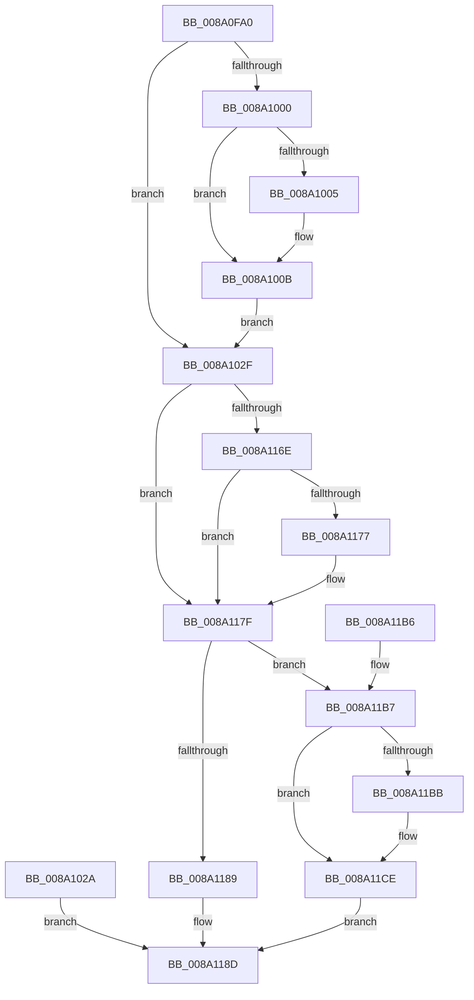

# NtQueryAttributesFile

- RVA: `0x008A0FA0`–`0x008A11D2` (길이 `562` bytes)
- VA: `0x00000001408A0FA0`
- 실행 섹션: `PAGE`
- PDB 이름 있음: `예`; PDB Function 태그: `아니요`
- unwind 정보 RVA: `0x0007EAF8`
- 디코드: `111`개 명령, `562/562` bytes 표시
- 미해석 바이트: `0` (있으면 어셈블리에 `.byte`로 보존)

> 이 문서는 커널 이미지의 기계어와 PDB 기호를 분석해 생성했습니다. 4번과 5번은 함수 원형과 자료형을 바이너리 사용 방식에서 추정한 C 해석이며 원본 소스 복구 결과는 아닙니다.

## 1. Dependencies

- 직접 호출 지점: **8**; 고유 호출 대상: **7**
- 직접 호출자로 확인된 함수: **0**
- RIP 상대 이미지 참조: **2**

### Outgoing calls
- `0x008A0FDE` → [memset](../../text/6C/memset_function_006C6C40.md) (function, `0x006C6C40`)
- `0x008A1005` → [ExRaiseDatatypeMisalignment](../89/ExRaiseDatatypeMisalignment_function_00899FD0.md) (function, `0x00899FD0`)
- `0x008A103C` → [memset](../../text/6C/memset_function_006C6C40.md) (function, `0x006C6C40`)
- `0x008A10FB` → [PsGetCurrentSilo](../../text/40/PsGetCurrentSilo_function_004094A0.md) (function, `0x004094A0`)
- `0x008A115A` → [ObOpenObjectByNameEx](../89/ObOpenObjectByNameEx_function_0089A8A0.md) (function, `0x0089A8A0`)
- `0x008A116E` → [FsRtlpCleanupEcps](FsRtlpCleanupEcps_function_008A1220.md) (function, `0x008A1220`)
- `0x008A1198` → [_security_check_cookie](../../text/6A/_security_check_cookie_function_006AC640.md) (function, `0x006AC640`)
- `0x008A11C4` → [ObCloseHandle](ObCloseHandle_function_008A1870.md) (function, `0x008A1870`)

### Direct callers
- 이 함수 시작 RVA로 연결되는 직접 call은 확인되지 않았습니다. 간접 호출은 완전히 역산할 수 없습니다.

### Static image references
- `0x008A0FB6` → RVA `0x00E0A740` (`.data`; read)
- `0x008A1150` → RVA `0x00FC6AE0` (`ALMOSTRO`; read)

## 2. Other-region calls and transfers

- 다른 실행 섹션으로 향하는 call: **4**
  - `0x008A0FDE` → [memset](../../text/6C/memset_function_006C6C40.md) (`PAGE` → `.text`)
  - `0x008A103C` → [memset](../../text/6C/memset_function_006C6C40.md) (`PAGE` → `.text`)
  - `0x008A10FB` → [PsGetCurrentSilo](../../text/40/PsGetCurrentSilo_function_004094A0.md) (`PAGE` → `.text`)
  - `0x008A1198` → [_security_check_cookie](../../text/6A/_security_check_cookie_function_006AC640.md) (`PAGE` → `.text`)
- 별도 외부 분기/꼬리 이동을 확인하지 못했습니다.

## 3. Assembly (complete function range)

```asm
008A0FA0  48 89 5C 24 18                  mov qword ptr [rsp + 0x18], rbx
008A0FA5  48 89 74 24 20                  mov qword ptr [rsp + 0x20], rsi
008A0FAA  57                              push rdi
008A0FAB  41 56                           push r14
008A0FAD  41 57                           push r15
008A0FAF  48 81 EC 90 02 00 00            sub rsp, 0x290
008A0FB6  48 8B 05 83 97 56 00            mov rax, qword ptr [rip + 0x569783]
008A0FBD  48 33 C4                        xor rax, rsp
008A0FC0  48 89 84 24 80 02 00 00         mov qword ptr [rsp + 0x280], rax
008A0FC8  48 8B DA                        mov rbx, rdx
008A0FCB  48 8B F1                        mov rsi, rcx
008A0FCE  33 D2                           xor edx, edx
008A0FD0  41 B8 10 01 00 00               mov r8d, 0x110
008A0FD6  48 8D 8C 24 70 01 00 00         lea rcx, [rsp + 0x170]
008A0FDE  E8 5D 5C E2 FF                  call 0x1406c6c40
008A0FE3  45 33 FF                        xor r15d, r15d
008A0FE6  4C 89 7C 24 40                  mov qword ptr [rsp + 0x40], r15
008A0FEB  65 48 8B 04 25 88 01 00 00      mov rax, qword ptr gs:[0x188]
008A0FF4  0F B6 B8 32 02 00 00            movzx edi, byte ptr [rax + 0x232]
008A0FFB  40 84 FF                        test dil, dil
008A0FFE  74 2F                           je 0x1408a102f
008A1000  F6 C3 07                        test bl, 7
008A1003  74 06                           je 0x1408a100b
008A1005  E8 C6 8F FF FF                  call 0x140899fd0
008A100A  CC                              int3
008A100B  48 B9 00 00 FF FF FF 7F 00 00   movabs rcx, 0x7fffffff0000
008A1015  48 3B D9                        cmp rbx, rcx
008A1018  48 0F 42 CB                     cmovb rcx, rbx
008A101C  0F B6 01                        movzx eax, byte ptr [rcx]
008A101F  88 01                           mov byte ptr [rcx], al
008A1021  0F B6 41 27                     movzx eax, byte ptr [rcx + 0x27]
008A1025  88 41 27                        mov byte ptr [rcx + 0x27], al
008A1028  EB 05                           jmp 0x1408a102f
008A102A  E9 5E 01 00 00                  jmp 0x1408a118d
008A102F  33 D2                           xor edx, edx
008A1031  41 B8 E0 00 00 00               mov r8d, 0xe0
008A1037  48 8D 4C 24 50                  lea rcx, [rsp + 0x50]
008A103C  E8 FF 5B E2 FF                  call 0x1406c6c40
008A1041  0F 57 C0                        xorps xmm0, xmm0
008A1044  33 C0                           xor eax, eax
008A1046  0F 11 84 24 30 01 00 00         movups xmmword ptr [rsp + 0x130], xmm0
008A104E  0F 11 84 24 40 01 00 00         movups xmmword ptr [rsp + 0x140], xmm0
008A1056  0F 11 84 24 50 01 00 00         movups xmmword ptr [rsp + 0x150], xmm0
008A105E  48 89 84 24 60 01 00 00         mov qword ptr [rsp + 0x160], rax
008A1066  C7 44 24 50 08 00 E0 00         mov dword ptr [rsp + 0x50], 0xe00008
008A106E  B8 07 00 00 00                  mov eax, 7
008A1073  66 89 84 24 96 00 00 00         mov word ptr [rsp + 0x96], ax
008A107B  C7 84 24 A8 00 00 00 01 00 00 00  mov dword ptr [rsp + 0xa8], 1
008A1086  C7 84 24 90 00 00 00 00 40 20 00  mov dword ptr [rsp + 0x90], 0x204000
008A1091  48 89 9C 24 B0 00 00 00         mov qword ptr [rsp + 0xb0], rbx
008A1099  48 8D 84 24 30 01 00 00         lea rax, [rsp + 0x130]
008A10A1  48 89 84 24 B8 00 00 00         mov qword ptr [rsp + 0xb8], rax
008A10A9  C6 84 24 D9 00 00 00 01         mov byte ptr [rsp + 0xd9], 1
008A10B1  48 8D 84 24 70 01 00 00         lea rax, [rsp + 0x170]
008A10B9  48 89 84 24 E0 00 00 00         mov qword ptr [rsp + 0xe0], rax
008A10C1  48 89 B4 24 80 00 00 00         mov qword ptr [rsp + 0x80], rsi
008A10C9  C7 84 24 E8 00 00 00 20 00 00 00  mov dword ptr [rsp + 0xe8], 0x20
008A10D4  33 C0                           xor eax, eax
008A10D6  0F 11 84 24 F0 00 00 00         movups xmmword ptr [rsp + 0xf0], xmm0
008A10DE  0F 11 84 24 00 01 00 00         movups xmmword ptr [rsp + 0x100], xmm0
008A10E6  48 89 84 24 10 01 00 00         mov qword ptr [rsp + 0x110], rax
008A10EE  B8 28 00 00 00                  mov eax, 0x28
008A10F3  66 89 84 24 F0 00 00 00         mov word ptr [rsp + 0xf0], ax
008A10FB  E8 A0 83 B6 FF                  call 0x1404094a0
008A1100  48 89 84 24 10 01 00 00         mov qword ptr [rsp + 0x110], rax
008A1108  65 48 8B 04 25 88 01 00 00      mov rax, qword ptr gs:[0x188]
008A1111  48 FF 80 90 03 00 00            inc qword ptr [rax + 0x390]
008A1118  65 FF 04 25 E4 2E 00 00         inc dword ptr gs:[0x2ee4]
008A1120  48 8D 44 24 40                  lea rax, [rsp + 0x40]
008A1125  48 89 44 24 38                  mov qword ptr [rsp + 0x38], rax
008A112A  48 8B 84 24 10 01 00 00         mov rax, qword ptr [rsp + 0x110]
008A1132  48 89 44 24 30                  mov qword ptr [rsp + 0x30], rax
008A1137  48 8D 44 24 50                  lea rax, [rsp + 0x50]
008A113C  48 89 44 24 28                  mov qword ptr [rsp + 0x28], rax
008A1141  C7 44 24 20 80 00 00 00         mov dword ptr [rsp + 0x20], 0x80
008A1149  45 33 C9                        xor r9d, r9d
008A114C  44 0F B6 C7                     movzx r8d, dil
008A1150  48 8B 15 89 59 72 00            mov rdx, qword ptr [rip + 0x725989]
008A1157  48 8B CE                        mov rcx, rsi
008A115A  E8 41 97 FF FF                  call 0x14089a8a0
008A115F  8B D8                           mov ebx, eax
008A1161  48 8B 8C 24 F8 00 00 00         mov rcx, qword ptr [rsp + 0xf8]
008A1169  48 85 C9                        test rcx, rcx
008A116C  74 11                           je 0x1408a117f
008A116E  E8 AD 00 00 00                  call 0x1408a1220
008A1173  84 C0                           test al, al
008A1175  74 08                           je 0x1408a117f
008A1177  4C 89 BC 24 F8 00 00 00         mov qword ptr [rsp + 0xf8], r15
008A117F  81 7C 24 70 51 02 AA BE         cmp dword ptr [rsp + 0x70], 0xbeaa0251
008A1187  75 2E                           jne 0x1408a11b7
008A1189  8B 44 24 60                     mov eax, dword ptr [rsp + 0x60]
008A118D  48 8B 8C 24 80 02 00 00         mov rcx, qword ptr [rsp + 0x280]
008A1195  48 33 CC                        xor rcx, rsp
008A1198  E8 A3 B4 E0 FF                  call 0x1406ac640
008A119D  4C 8D 9C 24 90 02 00 00         lea r11, [rsp + 0x290]
008A11A5  49 8B 5B 30                     mov rbx, qword ptr [r11 + 0x30]
008A11A9  49 8B 73 38                     mov rsi, qword ptr [r11 + 0x38]
008A11AD  49 8B E3                        mov rsp, r11
008A11B0  41 5F                           pop r15
008A11B2  41 5E                           pop r14
008A11B4  5F                              pop rdi
008A11B5  C3                              ret
008A11B6  CC                              int3
008A11B7  85 DB                           test ebx, ebx
008A11B9  78 13                           js 0x1408a11ce
008A11BB  40 0F B6 D7                     movzx edx, dil
008A11BF  48 8B 4C 24 40                  mov rcx, qword ptr [rsp + 0x40]
008A11C4  E8 A7 06 00 00                  call 0x1408a1870
008A11C9  BB 24 00 00 C0                  mov ebx, 0xc0000024
008A11CE  8B C3                           mov eax, ebx
008A11D0  EB BB                           jmp 0x1408a118d
```

## 4. C-style interpretation (structured pseudocode)

```c
__int64 __fastcall NtQueryAttributesFile(__int64 a1, __int64 a2, __int64 a3, int a4)
{
    __int64 result;
    __int64 v_r15;
    __int64 v_rbx;
    __int64 v_rsp;
    unsigned __int64 v_stack_m138;
    unsigned __int64 v_stack_m148;
    unsigned __int64 v_stack_m158;
    unsigned __int64 v_stack_m168;
    unsigned __int64 v_stack_m178;
    unsigned __int64 v_stack_m18;
    unsigned __int64 v_stack_m198;
    unsigned __int64 v_stack_m1A8;
    unsigned __int64 v_stack_m1B0;
    unsigned __int64 v_stack_m1B8;
    unsigned int v_stack_m1C0;
    unsigned __int64 v_stack_m1C8;
    unsigned __int8 v_stack_m1CF;
    unsigned __int64 v_stack_m1F0;
    unsigned __int64 v_stack_m1F8;
    unsigned int v_stack_m200;
    unsigned __int16 v_stack_m212;
    unsigned int v_stack_m218;
    unsigned __int64 v_stack_m228;
    unsigned int v_stack_m238;
    unsigned int v_stack_m248;
    unsigned __int64 v_stack_m250;
    unsigned __int64 v_stack_m258;
    unsigned __int64 v_stack_m268;
    unsigned __int64 v_stack_m270;
    unsigned __int64 v_stack_m278;
    unsigned __int64 v_stack_m28;
    unsigned __int64 v_stack_m280;
    unsigned int v_stack_m288;
    unsigned __int64 v_stack_p18;
    unsigned __int64 v_stack_p20;

    v_stack_p18 = v_rbx;
    v_stack_p20 = v_rsi;
    v_rsp = (v_rsp) - (656);
    result = (*(unsigned __int64 *)(v_rip + 5674883)) ^ (v_rsp);
    v_stack_m28 = result;
    a2 = 0;
    result = memset(v_stack_m138, a2, 272, a4);
    v_r15 = 0;
    v_stack_m268 = 0;
    if ((unsigned __int8)(*(unsigned __int8 *)(*(unsigned __int64 *)(gs_base + (0 + 392)) + 562)) == 0) goto loc_008A102F;
    result = *(unsigned __int64 *)(gs_base + (0 + 392));
    if (((0) & (7)) != 0) {
        result = ExRaiseDatatypeMisalignment(v_stack_m138, a2, 272, a4);
    }
    a1 = v_stack_m138;
    if (0 < v_stack_m138) { a1 = 0; }
    *(unsigned __int8 *)(a1) = (unsigned __int8)(*(unsigned __int8 *)(a1));
    *(unsigned __int8 *)(a1 + 39) = (unsigned __int8)(*(unsigned __int8 *)(a1 + 39));
    goto loc_008A102F;
loc_008A102F:
    a2 = 0;
    result = memset(v_stack_m258, a2, 224, a4);
    result = 0;
    v_stack_m178 = v_xmm0;
    v_stack_m168 = v_xmm0;
    v_stack_m158 = v_xmm0;
    v_stack_m148 = 0;
    v_stack_m258 = 0xE00008ULL;
    v_stack_m212 = 7;
    v_stack_m200 = 1;
    v_stack_m218 = 0x204000ULL;
    v_stack_m1F8 = 0;
    v_stack_m1F0 = v_stack_m178;
    v_stack_m1CF = 1;
    v_stack_m1C8 = v_stack_m138;
    v_stack_m228 = a1;
    v_stack_m1C0 = 32;
    result = 0;
    v_stack_m1B8 = v_xmm0;
    v_stack_m1A8 = v_xmm0;
    v_stack_m198 = 0;
    v_stack_m1B8 = 40;
    result = PsGetCurrentSilo(v_stack_m258, a2, 224, a4);
    v_stack_m198 = result;
    v_stack_m270 = v_stack_m268;
    v_stack_m278 = v_stack_m198;
    v_stack_m280 = v_stack_m258;
    v_stack_m288 = 128;
    a4 = 0;
    result = ObOpenObjectByNameEx(a1, *(unsigned __int64 *)(v_rip + 7494025), (unsigned __int8)(*(unsigned __int8 *)(*(unsigned __int64 *)(gs_base + (0 + 392)) + 562)), a4);
    if (v_stack_m1B0 == 0) goto loc_008A117F;
    result = FsRtlpCleanupEcps(v_stack_m1B0, *(unsigned __int64 *)(v_rip + 7494025), (unsigned __int8)(*(unsigned __int8 *)(*(unsigned __int64 *)(gs_base + (0 + 392)) + 562)), a4);
    if ((unsigned __int8)(result) != 0) {
        v_stack_m1B0 = 0;
    }
    if (v_stack_m238 != 0xBEAA0251ULL) goto loc_008A11B7;
loc_008A118D:
    a1 = (v_stack_m28) ^ (v_rsp);
    result = _security_check_cookie(a1, *(unsigned __int64 *)(v_rip + 7494025), (unsigned __int8)(*(unsigned __int8 *)(*(unsigned __int64 *)(gs_base + (0 + 392)) + 562)), a4);
    return result;
loc_008A11B7:
    v_rbx = *(unsigned __int64 *)(v_stack_m18 + 48);
    if (!(sign_flag)) {
        a2 = (unsigned __int8)(*(unsigned __int8 *)(*(unsigned __int64 *)(gs_base + (0 + 392)) + 562));
        a1 = v_stack_m250;
        result = ObCloseHandle(a1, a2, (unsigned __int8)(*(unsigned __int8 *)(*(unsigned __int64 *)(gs_base + (0 + 392)) + 562)), a4);
        v_rbx = 0xC0000024ULL;
    }
    goto loc_008A118D;
}
```

## 5. (Beta) C Style

```c
int64_t NtQueryAttributesFile(int64_t Arg1, int64_t Arg2, int64_t Arg3, int32_t Arg4)
{
    int64_t result;
    int64_t local_r15;
    int64_t local_rbx;
    int64_t local_rsp;
    uint64_t v_stack_m138;
    uint64_t v_stack_m148;
    uint64_t v_stack_m158;
    uint64_t v_stack_m168;
    uint64_t v_stack_m178;
    uint64_t v_stack_m18;
    uint64_t v_stack_m198;
    uint64_t v_stack_m1A8;
    uint64_t v_stack_m1B0;
    uint64_t v_stack_m1B8;
    uint32_t v_stack_m1C0;
    uint64_t v_stack_m1C8;
    uint8_t v_stack_m1CF;
    uint64_t v_stack_m1F0;
    uint64_t v_stack_m1F8;
    uint32_t v_stack_m200;
    uint16_t v_stack_m212;
    uint32_t v_stack_m218;
    uint64_t v_stack_m228;
    uint32_t v_stack_m238;
    uint32_t v_stack_m248;
    uint64_t v_stack_m250;
    uint64_t v_stack_m258;
    uint64_t v_stack_m268;
    uint64_t v_stack_m270;
    uint64_t v_stack_m278;
    uint64_t v_stack_m28;
    uint64_t v_stack_m280;
    uint32_t v_stack_m288;
    uint64_t v_stack_p18;
    uint64_t v_stack_p20;

    v_stack_p18 = local_rbx;
    v_stack_p20 = local_rsi;
    local_rsp = (local_rsp) - (656);
    result = (*(uint64_t *)(v_rip + 0x569783)) ^ (local_rsp);
    v_stack_m28 = result;
    Arg2 = 0;
    result = memset(v_stack_m138, Arg2, 272, Arg4);
    local_r15 = 0;
    v_stack_m268 = 0;
    if ((uint8_t)(*(uint8_t *)(*(uint64_t *)(gs_base + (0 + 0x188)) + 0x232)) == 0) goto loc_008A102F;
    result = *(uint64_t *)(gs_base + (0 + 0x188));
    if (((0) & (7)) != 0) {
        result = ExRaiseDatatypeMisalignment(v_stack_m138, Arg2, 272, Arg4);
    }
    Arg1 = v_stack_m138;
    if (0 < v_stack_m138) { Arg1 = 0; }
    *(uint8_t *)(Arg1) = (uint8_t)(*(uint8_t *)(Arg1));
    *(uint8_t *)(Arg1 + 0x27) = (uint8_t)(*(uint8_t *)(Arg1 + 0x27));
    goto loc_008A102F;
loc_008A102F:
    Arg2 = 0;
    result = memset(v_stack_m258, Arg2, 224, Arg4);
    result = 0;
    v_stack_m178 = v_xmm0;
    v_stack_m168 = v_xmm0;
    v_stack_m158 = v_xmm0;
    v_stack_m148 = 0;
    v_stack_m258 = 0xE00008ULL;
    v_stack_m212 = 7;
    v_stack_m200 = 1;
    v_stack_m218 = 0x204000ULL;
    v_stack_m1F8 = 0;
    v_stack_m1F0 = v_stack_m178;
    v_stack_m1CF = 1;
    v_stack_m1C8 = v_stack_m138;
    v_stack_m228 = Arg1;
    v_stack_m1C0 = 32;
    result = 0;
    v_stack_m1B8 = v_xmm0;
    v_stack_m1A8 = v_xmm0;
    v_stack_m198 = 0;
    v_stack_m1B8 = 40;
    result = PsGetCurrentSilo(v_stack_m258, Arg2, 224, Arg4);
    v_stack_m198 = result;
    v_stack_m270 = v_stack_m268;
    v_stack_m278 = v_stack_m198;
    v_stack_m280 = v_stack_m258;
    v_stack_m288 = 128;
    Arg4 = 0;
    result = ObOpenObjectByNameEx(Arg1, *(uint64_t *)(v_rip + 0x725989), (uint8_t)(*(uint8_t *)(*(uint64_t *)(gs_base + (0 + 0x188)) + 0x232)), Arg4);
    if (v_stack_m1B0 == 0) goto loc_008A117F;
    result = FsRtlpCleanupEcps(v_stack_m1B0, *(uint64_t *)(v_rip + 0x725989), (uint8_t)(*(uint8_t *)(*(uint64_t *)(gs_base + (0 + 0x188)) + 0x232)), Arg4);
    if ((uint8_t)(result) != 0) {
        v_stack_m1B0 = 0;
    }
    if (v_stack_m238 != 0xBEAA0251ULL) goto loc_008A11B7;
loc_008A118D:
    Arg1 = (v_stack_m28) ^ (local_rsp);
    result = _security_check_cookie(Arg1, *(uint64_t *)(v_rip + 0x725989), (uint8_t)(*(uint8_t *)(*(uint64_t *)(gs_base + (0 + 0x188)) + 0x232)), Arg4);
    return result;
loc_008A11B7:
    local_rbx = *(uint64_t *)(v_stack_m18 + 0x30);
    if (!(sign_flag)) {
        Arg2 = (uint8_t)(*(uint8_t *)(*(uint64_t *)(gs_base + (0 + 0x188)) + 0x232));
        Arg1 = v_stack_m250;
        result = ObCloseHandle(Arg1, Arg2, (uint8_t)(*(uint8_t *)(*(uint64_t *)(gs_base + (0 + 0x188)) + 0x232)), Arg4);
        local_rbx = 0xC0000024ULL;
    }
    goto loc_008A118D;
}
```

## 6. Execution-region graph

[열기: 2D/3D 그래프와 함수 탐색 컨트롤 패널](../../../control-panel.html?section=page&rva=0x008A0FA0&view=graph)

- 2D 그래프는 위에서 아래로 흐르고, 3D 그래프는 빈 공간을 드래그해 회전합니다. Shift+드래그는 이동, 휠은 확대·축소, 함수 노드 선택은 대상 보고서 이동입니다.

### Static fallback


