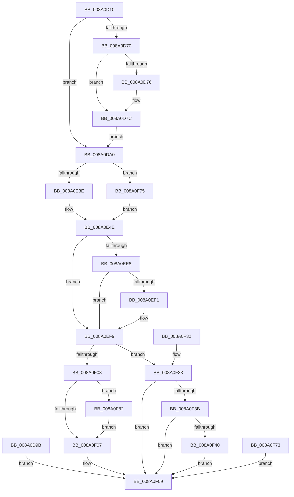

# NtQueryFullAttributesFile

- RVA: `0x008A0D10`–`0x008A0F9A` (길이 `650` bytes)
- VA: `0x00000001408A0D10`
- 실행 섹션: `PAGE`
- PDB 이름 있음: `예`; PDB Function 태그: `아니요`
- unwind 정보 RVA: `0x0007EAB0`
- 디코드: `129`개 명령, `650/650` bytes 표시
- 미해석 바이트: `0` (있으면 어셈블리에 `.byte`로 보존)

> 이 문서는 커널 이미지의 기계어와 PDB 기호를 분석해 생성했습니다. 4번과 5번은 함수 원형과 자료형을 바이너리 사용 방식에서 추정한 C 해석이며 원본 소스 복구 결과는 아닙니다.

## 1. Dependencies

- 직접 호출 지점: **8**; 고유 호출 대상: **7**
- 직접 호출자로 확인된 함수: **0**
- RIP 상대 이미지 참조: **2**

### Outgoing calls
- `0x008A0D4E` → [memset](../../text/6C/memset_function_006C6C40.md) (function, `0x006C6C40`)
- `0x008A0D76` → [ExRaiseDatatypeMisalignment](../89/ExRaiseDatatypeMisalignment_function_00899FD0.md) (function, `0x00899FD0`)
- `0x008A0DAD` → [memset](../../text/6C/memset_function_006C6C40.md) (function, `0x006C6C40`)
- `0x008A0E75` → [PsGetCurrentSilo](../../text/40/PsGetCurrentSilo_function_004094A0.md) (function, `0x004094A0`)
- `0x008A0ED4` → [ObOpenObjectByNameEx](../89/ObOpenObjectByNameEx_function_0089A8A0.md) (function, `0x0089A8A0`)
- `0x008A0EE8` → [FsRtlpCleanupEcps](FsRtlpCleanupEcps_function_008A1220.md) (function, `0x008A1220`)
- `0x008A0F14` → [_security_check_cookie](../../text/6A/_security_check_cookie_function_006AC640.md) (function, `0x006AC640`)
- `0x008A0F8B` → [ObCloseHandle](ObCloseHandle_function_008A1870.md) (function, `0x008A1870`)

### Direct callers
- 이 함수 시작 RVA로 연결되는 직접 call은 확인되지 않았습니다. 간접 호출은 완전히 역산할 수 없습니다.

### Static image references
- `0x008A0D26` → RVA `0x00E0A740` (`.data`; read)
- `0x008A0ECA` → RVA `0x00FC6AE0` (`ALMOSTRO`; read)

## 2. Other-region calls and transfers

- 다른 실행 섹션으로 향하는 call: **4**
  - `0x008A0D4E` → [memset](../../text/6C/memset_function_006C6C40.md) (`PAGE` → `.text`)
  - `0x008A0DAD` → [memset](../../text/6C/memset_function_006C6C40.md) (`PAGE` → `.text`)
  - `0x008A0E75` → [PsGetCurrentSilo](../../text/40/PsGetCurrentSilo_function_004094A0.md) (`PAGE` → `.text`)
  - `0x008A0F14` → [_security_check_cookie](../../text/6A/_security_check_cookie_function_006AC640.md) (`PAGE` → `.text`)
- 별도 외부 분기/꼬리 이동을 확인하지 못했습니다.

## 3. Assembly (complete function range)

```asm
008A0D10  48 89 5C 24 18                  mov qword ptr [rsp + 0x18], rbx
008A0D15  48 89 74 24 20                  mov qword ptr [rsp + 0x20], rsi
008A0D1A  57                              push rdi
008A0D1B  41 56                           push r14
008A0D1D  41 57                           push r15
008A0D1F  48 81 EC 90 02 00 00            sub rsp, 0x290
008A0D26  48 8B 05 13 9A 56 00            mov rax, qword ptr [rip + 0x569a13]
008A0D2D  48 33 C4                        xor rax, rsp
008A0D30  48 89 84 24 80 02 00 00         mov qword ptr [rsp + 0x280], rax
008A0D38  48 8B FA                        mov rdi, rdx
008A0D3B  48 8B D9                        mov rbx, rcx
008A0D3E  33 D2                           xor edx, edx
008A0D40  41 B8 10 01 00 00               mov r8d, 0x110
008A0D46  48 8D 8C 24 70 01 00 00         lea rcx, [rsp + 0x170]
008A0D4E  E8 ED 5E E2 FF                  call 0x1406c6c40
008A0D53  45 33 FF                        xor r15d, r15d
008A0D56  4C 89 7C 24 40                  mov qword ptr [rsp + 0x40], r15
008A0D5B  65 48 8B 04 25 88 01 00 00      mov rax, qword ptr gs:[0x188]
008A0D64  0F B6 B0 32 02 00 00            movzx esi, byte ptr [rax + 0x232]
008A0D6B  40 84 F6                        test sil, sil
008A0D6E  74 30                           je 0x1408a0da0
008A0D70  40 F6 C7 07                     test dil, 7
008A0D74  74 06                           je 0x1408a0d7c
008A0D76  E8 55 92 FF FF                  call 0x140899fd0
008A0D7B  CC                              int3
008A0D7C  48 B9 00 00 FF FF FF 7F 00 00   movabs rcx, 0x7fffffff0000
008A0D86  48 3B F9                        cmp rdi, rcx
008A0D89  48 0F 42 CF                     cmovb rcx, rdi
008A0D8D  0F B6 01                        movzx eax, byte ptr [rcx]
008A0D90  88 01                           mov byte ptr [rcx], al
008A0D92  0F B6 41 37                     movzx eax, byte ptr [rcx + 0x37]
008A0D96  88 41 37                        mov byte ptr [rcx + 0x37], al
008A0D99  EB 05                           jmp 0x1408a0da0
008A0D9B  E9 69 01 00 00                  jmp 0x1408a0f09
008A0DA0  33 D2                           xor edx, edx
008A0DA2  41 B8 E0 00 00 00               mov r8d, 0xe0
008A0DA8  48 8D 4C 24 50                  lea rcx, [rsp + 0x50]
008A0DAD  E8 8E 5E E2 FF                  call 0x1406c6c40
008A0DB2  0F 57 C0                        xorps xmm0, xmm0
008A0DB5  33 C0                           xor eax, eax
008A0DB7  0F 11 84 24 30 01 00 00         movups xmmword ptr [rsp + 0x130], xmm0
008A0DBF  0F 11 84 24 40 01 00 00         movups xmmword ptr [rsp + 0x140], xmm0
008A0DC7  0F 11 84 24 50 01 00 00         movups xmmword ptr [rsp + 0x150], xmm0
008A0DCF  48 89 84 24 60 01 00 00         mov qword ptr [rsp + 0x160], rax
008A0DD7  C7 44 24 50 08 00 E0 00         mov dword ptr [rsp + 0x50], 0xe00008
008A0DDF  B8 07 00 00 00                  mov eax, 7
008A0DE4  66 89 84 24 96 00 00 00         mov word ptr [rsp + 0x96], ax
008A0DEC  C7 84 24 A8 00 00 00 01 00 00 00  mov dword ptr [rsp + 0xa8], 1
008A0DF7  C7 84 24 90 00 00 00 00 40 20 00  mov dword ptr [rsp + 0x90], 0x204000
008A0E02  C6 84 24 D9 00 00 00 01         mov byte ptr [rsp + 0xd9], 1
008A0E0A  C6 84 24 DB 00 00 00 01         mov byte ptr [rsp + 0xdb], 1
008A0E12  48 8D 84 24 70 01 00 00         lea rax, [rsp + 0x170]
008A0E1A  48 89 84 24 E0 00 00 00         mov qword ptr [rsp + 0xe0], rax
008A0E22  48 89 9C 24 80 00 00 00         mov qword ptr [rsp + 0x80], rbx
008A0E2A  C7 84 24 E8 00 00 00 20 00 00 00  mov dword ptr [rsp + 0xe8], 0x20
008A0E35  40 84 F6                        test sil, sil
008A0E38  0F 84 37 01 00 00               je 0x1408a0f75
008A0E3E  48 8D 84 24 30 01 00 00         lea rax, [rsp + 0x130]
008A0E46  48 89 84 24 B8 00 00 00         mov qword ptr [rsp + 0xb8], rax
008A0E4E  33 C0                           xor eax, eax
008A0E50  0F 11 84 24 F0 00 00 00         movups xmmword ptr [rsp + 0xf0], xmm0
008A0E58  0F 11 84 24 00 01 00 00         movups xmmword ptr [rsp + 0x100], xmm0
008A0E60  48 89 84 24 10 01 00 00         mov qword ptr [rsp + 0x110], rax
008A0E68  B8 28 00 00 00                  mov eax, 0x28
008A0E6D  66 89 84 24 F0 00 00 00         mov word ptr [rsp + 0xf0], ax
008A0E75  E8 26 86 B6 FF                  call 0x1404094a0
008A0E7A  48 89 84 24 10 01 00 00         mov qword ptr [rsp + 0x110], rax
008A0E82  65 48 8B 04 25 88 01 00 00      mov rax, qword ptr gs:[0x188]
008A0E8B  48 FF 80 90 03 00 00            inc qword ptr [rax + 0x390]
008A0E92  65 FF 04 25 E4 2E 00 00         inc dword ptr gs:[0x2ee4]
008A0E9A  48 8D 44 24 40                  lea rax, [rsp + 0x40]
008A0E9F  48 89 44 24 38                  mov qword ptr [rsp + 0x38], rax
008A0EA4  48 8B 84 24 10 01 00 00         mov rax, qword ptr [rsp + 0x110]
008A0EAC  48 89 44 24 30                  mov qword ptr [rsp + 0x30], rax
008A0EB1  48 8D 44 24 50                  lea rax, [rsp + 0x50]
008A0EB6  48 89 44 24 28                  mov qword ptr [rsp + 0x28], rax
008A0EBB  C7 44 24 20 80 00 00 00         mov dword ptr [rsp + 0x20], 0x80
008A0EC3  45 33 C9                        xor r9d, r9d
008A0EC6  44 0F B6 C6                     movzx r8d, sil
008A0ECA  48 8B 15 0F 5C 72 00            mov rdx, qword ptr [rip + 0x725c0f]
008A0ED1  48 8B CB                        mov rcx, rbx
008A0ED4  E8 C7 99 FF FF                  call 0x14089a8a0
008A0ED9  8B D8                           mov ebx, eax
008A0EDB  48 8B 8C 24 F8 00 00 00         mov rcx, qword ptr [rsp + 0xf8]
008A0EE3  48 85 C9                        test rcx, rcx
008A0EE6  74 11                           je 0x1408a0ef9
008A0EE8  E8 33 03 00 00                  call 0x1408a1220
008A0EED  84 C0                           test al, al
008A0EEF  74 08                           je 0x1408a0ef9
008A0EF1  4C 89 BC 24 F8 00 00 00         mov qword ptr [rsp + 0xf8], r15
008A0EF9  81 7C 24 70 51 02 AA BE         cmp dword ptr [rsp + 0x70], 0xbeaa0251
008A0F01  74 30                           je 0x1408a0f33
008A0F03  85 DB                           test ebx, ebx
008A0F05  79 7B                           jns 0x1408a0f82
008A0F07  8B C3                           mov eax, ebx
008A0F09  48 8B 8C 24 80 02 00 00         mov rcx, qword ptr [rsp + 0x280]
008A0F11  48 33 CC                        xor rcx, rsp
008A0F14  E8 27 B7 E0 FF                  call 0x1406ac640
008A0F19  4C 8D 9C 24 90 02 00 00         lea r11, [rsp + 0x290]
008A0F21  49 8B 5B 30                     mov rbx, qword ptr [r11 + 0x30]
008A0F25  49 8B 73 38                     mov rsi, qword ptr [r11 + 0x38]
008A0F29  49 8B E3                        mov rsp, r11
008A0F2C  41 5F                           pop r15
008A0F2E  41 5E                           pop r14
008A0F30  5F                              pop rdi
008A0F31  C3                              ret
008A0F32  CC                              int3
008A0F33  8B 44 24 60                     mov eax, dword ptr [rsp + 0x60]
008A0F37  85 C0                           test eax, eax
008A0F39  78 CE                           js 0x1408a0f09
008A0F3B  40 84 F6                        test sil, sil
008A0F3E  74 C9                           je 0x1408a0f09
008A0F40  0F 10 84 24 30 01 00 00         movups xmm0, xmmword ptr [rsp + 0x130]
008A0F48  0F 11 07                        movups xmmword ptr [rdi], xmm0
008A0F4B  0F 10 8C 24 40 01 00 00         movups xmm1, xmmword ptr [rsp + 0x140]
008A0F53  0F 11 4F 10                     movups xmmword ptr [rdi + 0x10], xmm1
008A0F57  0F 10 84 24 50 01 00 00         movups xmm0, xmmword ptr [rsp + 0x150]
008A0F5F  0F 11 47 20                     movups xmmword ptr [rdi + 0x20], xmm0
008A0F63  F2 0F 10 8C 24 60 01 00 00      movsd xmm1, qword ptr [rsp + 0x160]
008A0F6C  F2 0F 11 4F 30                  movsd qword ptr [rdi + 0x30], xmm1
008A0F71  EB 96                           jmp 0x1408a0f09
008A0F73  EB 94                           jmp 0x1408a0f09
008A0F75  48 89 BC 24 B8 00 00 00         mov qword ptr [rsp + 0xb8], rdi
008A0F7D  E9 CC FE FF FF                  jmp 0x1408a0e4e
008A0F82  40 0F B6 D6                     movzx edx, sil
008A0F86  48 8B 4C 24 40                  mov rcx, qword ptr [rsp + 0x40]
008A0F8B  E8 E0 08 00 00                  call 0x1408a1870
008A0F90  BB 24 00 00 C0                  mov ebx, 0xc0000024
008A0F95  E9 6D FF FF FF                  jmp 0x1408a0f07
```

## 4. C-style interpretation (structured pseudocode)

```c
__int64 __fastcall NtQueryFullAttributesFile(__int64 a1, __int64 a2, __int64 a3, int a4)
{
    __int64 result;
    __int64 v_r15;
    __int64 v_rsp;
    unsigned __int64 v_stack_m130;
    unsigned __int64 v_stack_m138;
    unsigned __int64 v_stack_m140;
    unsigned __int64 v_stack_m148;
    unsigned __int64 v_stack_m150;
    unsigned __int64 v_stack_m158;
    unsigned __int64 v_stack_m160;
    unsigned __int64 v_stack_m168;
    unsigned __int64 v_stack_m178;
    unsigned __int64 v_stack_m18;
    unsigned __int64 v_stack_m198;
    unsigned __int64 v_stack_m1A8;
    unsigned __int64 v_stack_m1B0;
    unsigned __int64 v_stack_m1B8;
    unsigned int v_stack_m1C0;
    unsigned __int64 v_stack_m1C8;
    unsigned __int8 v_stack_m1CD;
    unsigned __int8 v_stack_m1CF;
    unsigned __int64 v_stack_m1D8;
    unsigned __int64 v_stack_m1F0;
    unsigned int v_stack_m200;
    unsigned __int16 v_stack_m212;
    unsigned int v_stack_m218;
    unsigned __int64 v_stack_m228;
    unsigned int v_stack_m230;
    unsigned int v_stack_m238;
    unsigned __int64 v_stack_m250;
    unsigned __int64 v_stack_m258;
    unsigned __int64 v_stack_m268;
    unsigned __int64 v_stack_m270;
    unsigned __int64 v_stack_m278;
    unsigned __int64 v_stack_m28;
    unsigned __int64 v_stack_m280;
    unsigned int v_stack_m288;
    unsigned __int64 v_stack_p18;
    unsigned __int64 v_stack_p20;

    v_stack_p18 = v_rbx;
    v_stack_p20 = v_rsi;
    v_rsp = (v_rsp) - (656);
    result = (*(unsigned __int64 *)(v_rip + 5675539)) ^ (v_rsp);
    v_stack_m28 = result;
    a2 = 0;
    result = memset(v_stack_m138, a2, 272, a4);
    v_r15 = 0;
    v_stack_m268 = 0;
    if ((unsigned __int8)(*(unsigned __int8 *)(*(unsigned __int64 *)(gs_base + (0 + 392)) + 562)) == 0) goto loc_008A0DA0;
    result = *(unsigned __int64 *)(gs_base + (0 + 392));
    if (((0) & (7)) != 0) {
        result = ExRaiseDatatypeMisalignment(v_stack_m138, a2, 272, a4);
    }
    a1 = v_stack_m138;
    if (0 < v_stack_m138) { a1 = 0; }
    *(unsigned __int8 *)(a1) = (unsigned __int8)(*(unsigned __int8 *)(a1));
    *(unsigned __int8 *)(a1 + 55) = (unsigned __int8)(*(unsigned __int8 *)(a1 + 55));
    goto loc_008A0DA0;
loc_008A0DA0:
    a2 = 0;
    result = memset(v_stack_m258, a2, 224, a4);
    result = 0;
    v_stack_m178 = v_xmm0;
    v_stack_m168 = v_xmm0;
    v_stack_m158 = v_xmm0;
    v_stack_m148 = 0;
    v_stack_m258 = 0xE00008ULL;
    v_stack_m212 = 7;
    v_stack_m200 = 1;
    v_stack_m218 = 0x204000ULL;
    v_stack_m1CF = 1;
    v_stack_m1CD = 1;
    v_stack_m1C8 = v_stack_m138;
    v_stack_m228 = a1;
    v_stack_m1C0 = 32;
    if ((unsigned __int8)(*(unsigned __int8 *)(*(unsigned __int64 *)(gs_base + (0 + 392)) + 562)) == 0) goto loc_008A0F75;
    v_stack_m1F0 = v_stack_m178;
loc_008A0E4E:
    result = 0;
    v_stack_m1B8 = v_xmm0;
    v_stack_m1A8 = v_xmm0;
    v_stack_m198 = 0;
    v_stack_m1B8 = 40;
    result = PsGetCurrentSilo(v_stack_m258, a2, 224, a4);
    v_stack_m198 = result;
    v_stack_m270 = v_stack_m268;
    v_stack_m278 = v_stack_m198;
    v_stack_m280 = v_stack_m258;
    v_stack_m288 = 128;
    a4 = 0;
    result = ObOpenObjectByNameEx(a1, *(unsigned __int64 *)(v_rip + 7494671), (unsigned __int8)(*(unsigned __int8 *)(*(unsigned __int64 *)(gs_base + (0 + 392)) + 562)), a4);
    if (v_stack_m1B0 == 0) goto loc_008A0EF9;
    result = FsRtlpCleanupEcps(v_stack_m1B0, *(unsigned __int64 *)(v_rip + 7494671), (unsigned __int8)(*(unsigned __int8 *)(*(unsigned __int64 *)(gs_base + (0 + 392)) + 562)), a4);
    if ((unsigned __int8)(result) != 0) {
        v_stack_m1B0 = 0;
    }
    if (v_stack_m238 == 0xBEAA0251ULL) goto loc_008A0F33;
    if (!sign_flag) goto loc_008A0F82;
loc_008A0F07:
loc_008A0F09:
    a1 = (v_stack_m28) ^ (v_rsp);
    result = _security_check_cookie(a1, *(unsigned __int64 *)(v_rip + 7494671), (unsigned __int8)(*(unsigned __int8 *)(*(unsigned __int64 *)(gs_base + (0 + 392)) + 562)), a4);
    return result;
loc_008A0F33:
    if (sign_flag) goto loc_008A0F09;
    if ((unsigned __int8)(*(unsigned __int64 *)(v_stack_m18 + 56)) == 0) goto loc_008A0F09;
    *(unsigned __int64 *)(a2) = v_xmm0;
    *(unsigned __int64 *)(a2 + 16) = v_xmm1;
    *(unsigned __int64 *)(a2 + 32) = v_xmm0;
    *(unsigned __int64 *)(a2 + 48) = v_xmm1;
    goto loc_008A0F09;
loc_008A0F75:
    v_stack_m1D8 = 0;
    goto loc_008A0E4E;
loc_008A0F82:
    result = ObCloseHandle(v_stack_m250, (unsigned __int8)(*(unsigned __int64 *)(v_stack_m18 + 56)), (unsigned __int8)(*(unsigned __int8 *)(*(unsigned __int64 *)(gs_base + (0 + 392)) + 562)), a4);
    goto loc_008A0F07;
}
```

## 5. (Beta) C Style

```c
int64_t NtQueryFullAttributesFile(int64_t Arg1, int64_t Arg2, int64_t Arg3, int32_t Arg4)
{
    int64_t result;
    int64_t local_r15;
    int64_t local_rsp;
    uint64_t v_stack_m130;
    uint64_t v_stack_m138;
    uint64_t v_stack_m140;
    uint64_t v_stack_m148;
    uint64_t v_stack_m150;
    uint64_t v_stack_m158;
    uint64_t v_stack_m160;
    uint64_t v_stack_m168;
    uint64_t v_stack_m178;
    uint64_t v_stack_m18;
    uint64_t v_stack_m198;
    uint64_t v_stack_m1A8;
    uint64_t v_stack_m1B0;
    uint64_t v_stack_m1B8;
    uint32_t v_stack_m1C0;
    uint64_t v_stack_m1C8;
    uint8_t v_stack_m1CD;
    uint8_t v_stack_m1CF;
    uint64_t v_stack_m1D8;
    uint64_t v_stack_m1F0;
    uint32_t v_stack_m200;
    uint16_t v_stack_m212;
    uint32_t v_stack_m218;
    uint64_t v_stack_m228;
    uint32_t v_stack_m230;
    uint32_t v_stack_m238;
    uint64_t v_stack_m250;
    uint64_t v_stack_m258;
    uint64_t v_stack_m268;
    uint64_t v_stack_m270;
    uint64_t v_stack_m278;
    uint64_t v_stack_m28;
    uint64_t v_stack_m280;
    uint32_t v_stack_m288;
    uint64_t v_stack_p18;
    uint64_t v_stack_p20;

    v_stack_p18 = local_rbx;
    v_stack_p20 = local_rsi;
    local_rsp = (local_rsp) - (656);
    result = (*(uint64_t *)(v_rip + 0x569A13)) ^ (local_rsp);
    v_stack_m28 = result;
    Arg2 = 0;
    result = memset(v_stack_m138, Arg2, 272, Arg4);
    local_r15 = 0;
    v_stack_m268 = 0;
    if ((uint8_t)(*(uint8_t *)(*(uint64_t *)(gs_base + (0 + 0x188)) + 0x232)) == 0) goto loc_008A0DA0;
    result = *(uint64_t *)(gs_base + (0 + 0x188));
    if (((0) & (7)) != 0) {
        result = ExRaiseDatatypeMisalignment(v_stack_m138, Arg2, 272, Arg4);
    }
    Arg1 = v_stack_m138;
    if (0 < v_stack_m138) { Arg1 = 0; }
    *(uint8_t *)(Arg1) = (uint8_t)(*(uint8_t *)(Arg1));
    *(uint8_t *)(Arg1 + 0x37) = (uint8_t)(*(uint8_t *)(Arg1 + 0x37));
    goto loc_008A0DA0;
loc_008A0DA0:
    Arg2 = 0;
    result = memset(v_stack_m258, Arg2, 224, Arg4);
    result = 0;
    v_stack_m178 = v_xmm0;
    v_stack_m168 = v_xmm0;
    v_stack_m158 = v_xmm0;
    v_stack_m148 = 0;
    v_stack_m258 = 0xE00008ULL;
    v_stack_m212 = 7;
    v_stack_m200 = 1;
    v_stack_m218 = 0x204000ULL;
    v_stack_m1CF = 1;
    v_stack_m1CD = 1;
    v_stack_m1C8 = v_stack_m138;
    v_stack_m228 = Arg1;
    v_stack_m1C0 = 32;
    if ((uint8_t)(*(uint8_t *)(*(uint64_t *)(gs_base + (0 + 0x188)) + 0x232)) == 0) goto loc_008A0F75;
    v_stack_m1F0 = v_stack_m178;
loc_008A0E4E:
    result = 0;
    v_stack_m1B8 = v_xmm0;
    v_stack_m1A8 = v_xmm0;
    v_stack_m198 = 0;
    v_stack_m1B8 = 40;
    result = PsGetCurrentSilo(v_stack_m258, Arg2, 224, Arg4);
    v_stack_m198 = result;
    v_stack_m270 = v_stack_m268;
    v_stack_m278 = v_stack_m198;
    v_stack_m280 = v_stack_m258;
    v_stack_m288 = 128;
    Arg4 = 0;
    result = ObOpenObjectByNameEx(Arg1, *(uint64_t *)(v_rip + 0x725C0F), (uint8_t)(*(uint8_t *)(*(uint64_t *)(gs_base + (0 + 0x188)) + 0x232)), Arg4);
    if (v_stack_m1B0 == 0) goto loc_008A0EF9;
    result = FsRtlpCleanupEcps(v_stack_m1B0, *(uint64_t *)(v_rip + 0x725C0F), (uint8_t)(*(uint8_t *)(*(uint64_t *)(gs_base + (0 + 0x188)) + 0x232)), Arg4);
    if ((uint8_t)(result) != 0) {
        v_stack_m1B0 = 0;
    }
    if (v_stack_m238 == 0xBEAA0251ULL) goto loc_008A0F33;
    if (!sign_flag) goto loc_008A0F82;
loc_008A0F07:
loc_008A0F09:
    Arg1 = (v_stack_m28) ^ (local_rsp);
    result = _security_check_cookie(Arg1, *(uint64_t *)(v_rip + 0x725C0F), (uint8_t)(*(uint8_t *)(*(uint64_t *)(gs_base + (0 + 0x188)) + 0x232)), Arg4);
    return result;
loc_008A0F33:
    if (sign_flag) goto loc_008A0F09;
    if ((uint8_t)(*(uint64_t *)(v_stack_m18 + 0x38)) == 0) goto loc_008A0F09;
    *(uint64_t *)(Arg2) = v_xmm0;
    *(uint64_t *)(Arg2 + 0x10) = v_xmm1;
    *(uint64_t *)(Arg2 + 0x20) = v_xmm0;
    *(uint64_t *)(Arg2 + 0x30) = v_xmm1;
    goto loc_008A0F09;
loc_008A0F75:
    v_stack_m1D8 = 0;
    goto loc_008A0E4E;
loc_008A0F82:
    result = ObCloseHandle(v_stack_m250, (uint8_t)(*(uint64_t *)(v_stack_m18 + 0x38)), (uint8_t)(*(uint8_t *)(*(uint64_t *)(gs_base + (0 + 0x188)) + 0x232)), Arg4);
    goto loc_008A0F07;
}
```

## 6. Execution-region graph

[열기: 2D/3D 그래프와 함수 탐색 컨트롤 패널](../../../control-panel.html?section=page&rva=0x008A0D10&view=graph)

- 2D 그래프는 위에서 아래로 흐르고, 3D 그래프는 빈 공간을 드래그해 회전합니다. Shift+드래그는 이동, 휠은 확대·축소, 함수 노드 선택은 대상 보고서 이동입니다.

### Static fallback


