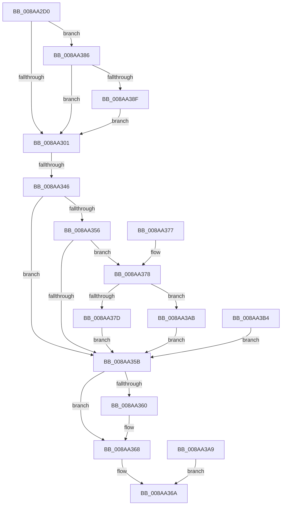

# NtResetEvent

- RVA: `0x008AA2D0`–`0x008AA3BF` (길이 `239` bytes)
- VA: `0x00000001408AA2D0`
- 실행 섹션: `PAGE`
- PDB 이름 있음: `예`; PDB Function 태그: `예`
- unwind 정보 RVA: `0x0007F5C0`
- 디코드: `68`개 명령, `239/239` bytes 표시
- 미해석 바이트: `0` (있으면 어셈블리에 `.byte`로 보존)

> 이 문서는 커널 이미지의 기계어와 PDB 기호를 분석해 생성했습니다. 4번과 5번은 함수 원형과 자료형을 바이너리 사용 방식에서 추정한 C 해석이며 원본 소스 복구 결과는 아닙니다.

## 1. Dependencies

- 직접 호출 지점: **3**; 고유 호출 대상: **3**
- 직접 호출자로 확인된 함수: **3**
- RIP 상대 이미지 참조: **1**

### Outgoing calls
- `0x008AA329` → [ObReferenceObjectByHandle](../86/ObReferenceObjectByHandle_function_00868DB0.md) (function, `0x00868DB0`)
- `0x008AA349` → [KeResetEvent](../../text/24/KeResetEvent_function_00248350.md) (function, `0x00248350`)
- `0x008AA363` → [ObfDereferenceObject](../../text/2F/ObfDereferenceObject_function_002F9350.md) (function, `0x002F9350`)

### Direct callers
- [PfSnGetSectionObject](PfSnGetSectionObject_function_008A9448.md) at `0x008A98B8`
- [PfSnPrefetchFileMetadata](PfSnPrefetchFileMetadata_function_008AA178.md) at `0x008AA213`
- [sub_00B19EB2](../B1/Unknown_function_00B19EB2.md) at `0x00B19EF6`

### Static image references
- `0x008AA301` → RVA `0x00FC6B80` (`ALMOSTRO`; read)

## 2. Other-region calls and transfers

- 다른 실행 섹션으로 향하는 call: **2**
  - `0x008AA349` → [KeResetEvent](../../text/24/KeResetEvent_function_00248350.md) (`PAGE` → `.text`)
  - `0x008AA363` → [ObfDereferenceObject](../../text/2F/ObfDereferenceObject_function_002F9350.md) (`PAGE` → `.text`)
- call이 아닌 외부 분기/꼬리 이동: **1**
  - `0x008AA340` → [sub_00B19F84](../B1/Unknown_function_00B19F84.md) (`tail-transfer`)

## 3. Assembly (complete function range)

```asm
008AA2D0  40 56                           push rsi
008AA2D2  57                              push rdi
008AA2D3  41 54                           push r12
008AA2D5  41 56                           push r14
008AA2D7  41 57                           push r15
008AA2D9  48 83 EC 30                     sub rsp, 0x30
008AA2DD  4C 8B F2                        mov r14, rdx
008AA2E0  4C 8B E1                        mov r12, rcx
008AA2E3  83 64 24 68 00                  and dword ptr [rsp + 0x68], 0
008AA2E8  65 48 8B 04 25 88 01 00 00      mov rax, qword ptr gs:[0x188]
008AA2F1  44 8A B8 32 02 00 00            mov r15b, byte ptr [rax + 0x232]
008AA2F8  48 85 D2                        test rdx, rdx
008AA2FB  0F 85 85 00 00 00               jne 0x1408aa386
008AA301  4C 8B 05 78 C8 71 00            mov r8, qword ptr [rip + 0x71c878]
008AA308  48 83 64 24 70 00               and qword ptr [rsp + 0x70], 0
008AA30E  48 83 64 24 28 00               and qword ptr [rsp + 0x28], 0
008AA314  48 8D 44 24 70                  lea rax, [rsp + 0x70]
008AA319  48 89 44 24 20                  mov qword ptr [rsp + 0x20], rax
008AA31E  45 8A CF                        mov r9b, r15b
008AA321  BA 02 00 00 00                  mov edx, 2
008AA326  49 8B CC                        mov rcx, r12
008AA329  E8 82 EA FB FF                  call 0x140868db0
008AA32E  8B F8                           mov edi, eax
008AA330  48 8B 74 24 70                  mov rsi, qword ptr [rsp + 0x70]
008AA335  48 89 74 24 78                  mov qword ptr [rsp + 0x78], rsi
008AA33A  89 44 24 70                     mov dword ptr [rsp + 0x70], eax
008AA33E  85 C0                           test eax, eax
008AA340  0F 88 3E FC 26 00               js 0x140b19f84
008AA346  48 8B CE                        mov rcx, rsi
008AA349  E8 02 E0 99 FF                  call 0x140248350
008AA34E  89 44 24 68                     mov dword ptr [rsp + 0x68], eax
008AA352  85 FF                           test edi, edi
008AA354  78 05                           js 0x1408aa35b
008AA356  4D 85 F6                        test r14, r14
008AA359  75 1D                           jne 0x1408aa378
008AA35B  48 85 F6                        test rsi, rsi
008AA35E  74 08                           je 0x1408aa368
008AA360  48 8B CE                        mov rcx, rsi
008AA363  E8 E8 EF A4 FF                  call 0x1402f9350
008AA368  8B C7                           mov eax, edi
008AA36A  48 83 C4 30                     add rsp, 0x30
008AA36E  41 5F                           pop r15
008AA370  41 5E                           pop r14
008AA372  41 5C                           pop r12
008AA374  5F                              pop rdi
008AA375  5E                              pop rsi
008AA376  C3                              ret
008AA377  CC                              int3
008AA378  45 84 FF                        test r15b, r15b
008AA37B  75 2E                           jne 0x1408aa3ab
008AA37D  8B 44 24 68                     mov eax, dword ptr [rsp + 0x68]
008AA381  41 89 06                        mov dword ptr [r14], eax
008AA384  EB D5                           jmp 0x1408aa35b
008AA386  45 84 FF                        test r15b, r15b
008AA389  0F 84 72 FF FF FF               je 0x1408aa301
008AA38F  48 B9 00 00 FF FF FF 7F 00 00   movabs rcx, 0x7fffffff0000
008AA399  4C 3B F1                        cmp r14, rcx
008AA39C  49 0F 42 CE                     cmovb rcx, r14
008AA3A0  8B 01                           mov eax, dword ptr [rcx]
008AA3A2  89 01                           mov dword ptr [rcx], eax
008AA3A4  E9 58 FF FF FF                  jmp 0x1408aa301
008AA3A9  EB BF                           jmp 0x1408aa36a
008AA3AB  8B 44 24 68                     mov eax, dword ptr [rsp + 0x68]
008AA3AF  41 89 06                        mov dword ptr [r14], eax
008AA3B2  EB A7                           jmp 0x1408aa35b
008AA3B4  48 8B 74 24 78                  mov rsi, qword ptr [rsp + 0x78]
008AA3B9  8B 7C 24 70                     mov edi, dword ptr [rsp + 0x70]
008AA3BD  EB 9C                           jmp 0x1408aa35b
```

## 4. C-style interpretation (structured pseudocode)

```c
__int64 __fastcall NtResetEvent(__int64 a1, __int64 a2)
{
    __int64 result;
    __int64 v_rsp;
    unsigned __int64 v_stack_m30;
    unsigned __int64 v_stack_m38;
    unsigned int v_stack_p10;
    unsigned __int64 v_stack_p18;
    unsigned __int64 v_stack_p20;
    unsigned int v_stack_p68;
    unsigned int v_stack_p70;
    unsigned __int64 v_stack_p78;

    v_rsp = (v_rsp) - (48);
    if (a2 != 0) goto loc_008AA386;
loc_008AA301:
    v_stack_m38 = v_stack_p18;
    result = ObReferenceObjectByHandle(a1, 2, *(unsigned __int64 *)(v_rip + 7456888), (unsigned __int8)(*(unsigned __int8 *)(*(unsigned __int64 *)(gs_base + (0 + 392)) + 562)));
    v_stack_p20 = v_stack_p18;
    v_stack_p18 = (unsigned int)(result);
    result = KeResetEvent(v_stack_p18, 2, *(unsigned __int64 *)(v_rip + 7456888), (unsigned __int8)(*(unsigned __int8 *)(*(unsigned __int64 *)(gs_base + (0 + 392)) + 562)));
    v_stack_p10 = (unsigned int)(result);
    if (sign_flag) goto loc_008AA35B;
    if (a2 != 0) goto loc_008AA378;
loc_008AA35B:
    if (v_stack_p18 != 0) {
        a1 = v_stack_p18;
        result = ObfDereferenceObject(a1, 2, *(unsigned __int64 *)(v_rip + 7456888), (unsigned __int8)(*(unsigned __int8 *)(*(unsigned __int64 *)(gs_base + (0 + 392)) + 562)));
    }
loc_008AA36A:
    v_rsp = (v_rsp) + (48);
    return (unsigned int)((unsigned int)((unsigned int)((unsigned int)(result))));
loc_008AA378:
    if ((unsigned __int8)(*(unsigned __int8 *)(*(unsigned __int64 *)(gs_base + (0 + 392)) + 562)) != 0) goto loc_008AA3AB;
    *(unsigned int *)(a2) = (unsigned int)((unsigned int)(v_stack_p68));
    goto loc_008AA35B;
loc_008AA386:
    if ((unsigned __int8)(*(unsigned __int8 *)(*(unsigned __int64 *)(gs_base + (0 + 392)) + 562)) == 0) goto loc_008AA301;
    if (a2 < a1) { a1 = a2; }
    *(unsigned int *)(a1) = (unsigned int)((unsigned int)(*(unsigned int *)(a1)));
    goto loc_008AA301;
loc_008AA3AB:
    *(unsigned int *)(a2) = (unsigned int)((unsigned int)(v_stack_p68));
    goto loc_008AA35B;
}
```

## 5. (Beta) C Style

```c
int64_t NtResetEvent(int64_t Arg1, int64_t Arg2)
{
    int64_t result;
    int64_t local_rsp;
    uint64_t v_stack_m30;
    uint64_t v_stack_m38;
    uint32_t v_stack_p10;
    uint64_t v_stack_p18;
    uint64_t v_stack_p20;
    uint32_t v_stack_p68;
    uint32_t v_stack_p70;
    uint64_t v_stack_p78;

    local_rsp = (local_rsp) - (48);
    if (Arg2 != 0) goto loc_008AA386;
loc_008AA301:
    v_stack_m38 = v_stack_p18;
    result = ObReferenceObjectByHandle(Arg1, 2, *(uint64_t *)(v_rip + 0x71C878), (uint8_t)(*(uint8_t *)(*(uint64_t *)(gs_base + (0 + 0x188)) + 0x232)));
    v_stack_p20 = v_stack_p18;
    v_stack_p18 = (uint32_t)(result);
    result = KeResetEvent(v_stack_p18, 2, *(uint64_t *)(v_rip + 0x71C878), (uint8_t)(*(uint8_t *)(*(uint64_t *)(gs_base + (0 + 0x188)) + 0x232)));
    v_stack_p10 = (uint32_t)(result);
    if (sign_flag) goto loc_008AA35B;
    if (Arg2 != 0) goto loc_008AA378;
loc_008AA35B:
    if (v_stack_p18 != 0) {
        Arg1 = v_stack_p18;
        result = ObfDereferenceObject(Arg1, 2, *(uint64_t *)(v_rip + 0x71C878), (uint8_t)(*(uint8_t *)(*(uint64_t *)(gs_base + (0 + 0x188)) + 0x232)));
    }
loc_008AA36A:
    local_rsp = (local_rsp) + (48);
    return (uint32_t)((uint32_t)((uint32_t)((uint32_t)(result))));
loc_008AA378:
    if ((uint8_t)(*(uint8_t *)(*(uint64_t *)(gs_base + (0 + 0x188)) + 0x232)) != 0) goto loc_008AA3AB;
    *(uint32_t *)(Arg2) = (uint32_t)((uint32_t)(v_stack_p68));
    goto loc_008AA35B;
loc_008AA386:
    if ((uint8_t)(*(uint8_t *)(*(uint64_t *)(gs_base + (0 + 0x188)) + 0x232)) == 0) goto loc_008AA301;
    if (Arg2 < Arg1) { Arg1 = Arg2; }
    *(uint32_t *)(Arg1) = (uint32_t)((uint32_t)(*(uint32_t *)(Arg1)));
    goto loc_008AA301;
loc_008AA3AB:
    *(uint32_t *)(Arg2) = (uint32_t)((uint32_t)(v_stack_p68));
    goto loc_008AA35B;
}
```

## 6. Execution-region graph

[열기: 2D/3D 그래프와 함수 탐색 컨트롤 패널](../../../control-panel.html?section=page&rva=0x008AA2D0&view=graph)

- 2D 그래프는 위에서 아래로 흐르고, 3D 그래프는 빈 공간을 드래그해 회전합니다. Shift+드래그는 이동, 휠은 확대·축소, 함수 노드 선택은 대상 보고서 이동입니다.

### Static fallback


