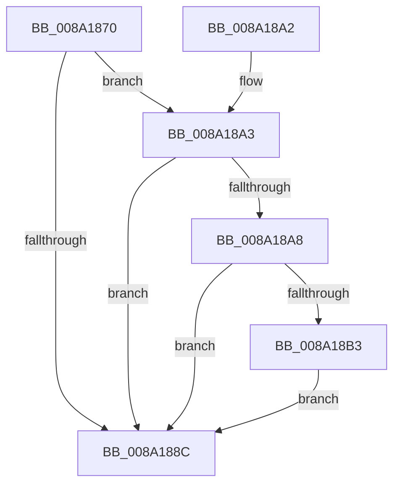

# ObCloseHandle

- RVA: `0x008A1870`–`0x008A18BA` (길이 `74` bytes)
- VA: `0x00000001408A1870`
- 실행 섹션: `PAGE`
- PDB 이름 있음: `예`; PDB Function 태그: `아니요`
- unwind 정보 RVA: `0x0007918C`
- 디코드: `23`개 명령, `74/74` bytes 표시
- 미해석 바이트: `0` (있으면 어셈블리에 `.byte`로 보존)

> 이 문서는 커널 이미지의 기계어와 PDB 기호를 분석해 생성했습니다. 4번과 5번은 함수 원형과 자료형을 바이너리 사용 방식에서 추정한 C 해석이며 원본 소스 복구 결과는 아닙니다.

## 1. Dependencies

- 직접 호출 지점: **3**; 고유 호출 대상: **3**
- 직접 호출자로 확인된 함수: **114**
- RIP 상대 이미지 참조: **1**

### Outgoing calls
- `0x008A1892` → [ObpCloseHandle](../86/ObpCloseHandle_function_008685B0.md) (function, `0x008685B0`)
- `0x008A18AA` → [ObpIsKernelHandle](../../text/41/ObpIsKernelHandle_function_00416D00.md) (function, `0x00416D00`)
- `0x008A18B3` → [VfCheckUserHandle](../../pagevrfy/BB/VfCheckUserHandle_function_00BB9218.md) (function, `0x00BB9218`)

### Direct callers
- [NtSetInformationFile](../../text/29/NtSetInformationFile_function_0029C5E0.md) at `0x0029CE3C`
- [ExpWorkerFactoryCreateThread](../../text/34/ExpWorkerFactoryCreateThread_function_0034B620.md) at `0x0034B77F`
- [SmKmStoreHelperStart](../../text/3B/SmKmStoreHelperStart_function_003B1ACC.md) at `0x003B1B59`
- [SMKM_STORE&lt;SM_TRAITS&gt;::SmStWorkerThreadStartThread](../../text/3B/SMKM_STORE_SM_TRAITS_SmStWorkerThreadStartThread_function_003B200C.md) at `0x003B20EA`
- [SMKM_STORE&lt;SM_TRAITS&gt;::SmStWorkerThreadStartThread](../../text/3B/SMKM_STORE_SM_TRAITS_SmStWorkerThreadStartThread_function_003B200C.md) at `0x003B213F`
- [SMKM_STORE_MGR&lt;SM_TRAITS&gt;::SmCompressCtxCreateThread](../../text/3B/SMKM_STORE_MGR_SM_TRAITS_SmCompressCtxCreateThread_function_003B2400.md) at `0x003B24AF`
- [ExpDeleteWorkerFactory](../../text/48/ExpDeleteWorkerFactory_function_00486880.md) at `0x004868E0`
- [DbgkPostModuleMessage](../../text/49/DbgkPostModuleMessage_function_004913C4.md) at `0x00491522`
- [SepCreateAppContainerToken](../../text/4F/SepCreateAppContainerToken_function_004F43AC.md) at `0x004F461D`
- [IopInitializeOfflineCrashDump](../../text/59/IopInitializeOfflineCrashDump_function_00595A24.md) at `0x00595C10`
- [IopIsBitlockerOn](../../text/59/IopIsBitlockerOn_function_00595C3C.md) at `0x00595CC6`
- [IopReadDumpRegistry](../../text/59/IopReadDumpRegistry_function_00595CE0.md) at `0x00595E53`
- [IoInitializeLiveDump](../../text/59/IoInitializeLiveDump_function_00598B14.md) at `0x00598BB8`
- [IopLiveDumpInitRegistrySettings](../../text/59/IopLiveDumpInitRegistrySettings_function_0059C8A4.md) at `0x0059CA42`
- [IopLiveDumpReleaseResources](../../text/59/IopLiveDumpReleaseResources_function_0059DF1C.md) at `0x0059E0ED`
- [SecureDump_ReadRegistry](../../text/5A/SecureDump_ReadRegistry_function_005A3668.md) at `0x005A374B`
- [KcsanInitSystem](../../text/5A/KcsanInitSystem_function_005AF2A0.md) at `0x005AF337`
- [MiInsertNewZeroThread](../../text/69/MiInsertNewZeroThread_function_00696140.md) at `0x006962C3`
- [MiZeroPageThread](../../text/69/MiZeroPageThread_function_00696D80.md) at `0x00696F1F`
- [sub_006F88AE](../../text/6F/Unknown_function_006F88AE.md) at `0x006F8FFA`
- [ExpWatchProductTypeWork](../6F/ExpWatchProductTypeWork_function_006FFCA0.md) at `0x00700382`
- [DbgkUserReportWorkRoutine](../71/DbgkUserReportWorkRoutine_function_00710D10.md) at `0x00710F8E`
- [DbgkpDeleteErrorPort](../71/DbgkpDeleteErrorPort_function_0071100C.md) at `0x0071101B`
- [IopInitializeDumpPolicySettings](../71/IopInitializeDumpPolicySettings_function_0071A444.md) at `0x0071A55D`
- [IopInitializeDumpPolicySettings](../71/IopInitializeDumpPolicySettings_function_0071A444.md) at `0x0071A623`
- [IoCreateController](../71/IoCreateController_function_0071D190.md) at `0x0071D24A`
- [IoSetInformation](../71/IoSetInformation_function_0071DBF0.md) at `0x0071DF68`
- [NtCreateIoRing](../72/NtCreateIoRing_function_00720530.md) at `0x007209BF`
- [ObpDeleteDeviceMap](../74/ObpDeleteDeviceMap_function_0074F2F0.md) at `0x0074F31E`
- [PfTStart](../75/PfTStart_function_007517AC.md) at `0x00751963`
- [PfTStart](../75/PfTStart_function_007517AC.md) at `0x00751A02`
- [PsBootPhaseComplete](../77/PsBootPhaseComplete_function_0077EA18.md) at `0x0077EBE6`
- [PsBootPhaseComplete](../77/PsBootPhaseComplete_function_0077EA18.md) at `0x0077ED22`
- [PspLocateSystemDll](../77/PspLocateSystemDll_function_0077F0D0.md) at `0x0077F1E7`
- [PspLocateSystemDll](../77/PspLocateSystemDll_function_0077F0D0.md) at `0x0077F239`
- [NtCreateCpuPartition](../78/NtCreateCpuPartition_function_00782E30.md) at `0x0078307B`
- [PsCheckProcessFileSigningLevel](../78/PsCheckProcessFileSigningLevel_function_00783800.md) at `0x00783A35`
- [PsCheckProcessFileSigningLevel](../78/PsCheckProcessFileSigningLevel_function_00783800.md) at `0x00783A45`
- [PsCreateCpuPartition](../78/PsCreateCpuPartition_function_00783A8C.md) at `0x00783C80`
- [NtOpenPartition](../78/NtOpenPartition_function_00787DF0.md) at `0x00787E92`
- [PsCreatePartition](../78/PsCreatePartition_function_00787EB0.md) at `0x00787FDF`
- [PspCreatePartitionSystemProcess](../78/PspCreatePartitionSystemProcess_function_007882F8.md) at `0x007883C4`
- [PspTeardownPartition](../78/PspTeardownPartition_function_00788480.md) at `0x007885AF`
- [PspDereferenceSessionFinal](../78/PspDereferenceSessionFinal_function_00788F5C.md) at `0x00788FEC`
- [SmGetRegistrationInfo](../7A/SmGetRegistrationInfo_function_007A5AC4.md) at `0x007A5BDF`
- [EtwpCovSampCaptureContextStart](../7C/EtwpCovSampCaptureContextStart_function_007C14AC.md) at `0x007C1968`
- [CmOpenKeyForBugCheckRecovery](../7D/CmOpenKeyForBugCheckRecovery_function_007DF3C0.md) at `0x007DF537`
- [MmZeroPageFileAtShutdown](../7F/MmZeroPageFileAtShutdown_function_007F9164.md) at `0x007F9226`
- [MiCreatePagingFile](../7F/MiCreatePagingFile_function_007FEFF4.md) at `0x007FFA10`
- [MiDeletePagefile](../7F/MiDeletePagefile_function_007FFB88.md) at `0x007FFCD0`
- [MiInsertPageFileInList](../7F/MiInsertPageFileInList_function_007FFF80.md) at `0x0080020E`
- [MiApplyImageHotPatchRequest](../80/MiApplyImageHotPatchRequest_function_008025AC.md) at `0x0080299F`
- [MiApplyImageHotPatchRequest](../80/MiApplyImageHotPatchRequest_function_008025AC.md) at `0x00802AF9`
- [MiCreatePatchSectionRequest](../80/MiCreatePatchSectionRequest_function_008031E0.md) at `0x00803253`
- [MiCreatePatchSectionRequest](../80/MiCreatePatchSectionRequest_function_008031E0.md) at `0x00803264`
- [MiDeletePartitionResources](../80/MiDeletePartitionResources_function_0080D074.md) at `0x0080D0E5`
- [MiDeletePartitionResources](../80/MiDeletePartitionResources_function_0080D074.md) at `0x0080D1E3`
- [MiDeletePartitionResources](../80/MiDeletePartitionResources_function_0080D074.md) at `0x0080D223`
- [MiDeletePartitionResources](../80/MiDeletePartitionResources_function_0080D074.md) at `0x0080D236`
- [MmStoreRegister](../80/MmStoreRegister_function_0080E6D8.md) at `0x0080E9E2`
- [MiCreateMemoryEvent](../81/MiCreateMemoryEvent_function_00810D98.md) at `0x00810ED5`
- [MiCreateMemoryEvent](../81/MiCreateMemoryEvent_function_00810D98.md) at `0x00810F0B`
- [CmCreateKey](../87/CmCreateKey_function_00875020.md) at `0x00875441`
- [DbgkMapViewOfSection](../89/DbgkMapViewOfSection_function_00897460.md) at `0x008975D9`
- [NtQueryFullAttributesFile](NtQueryFullAttributesFile_function_008A0D10.md) at `0x008A0F8B`
- [NtQueryAttributesFile](NtQueryAttributesFile_function_008A0FA0.md) at `0x008A11C4`
- [PspCombineSecurityDomains](PspCombineSecurityDomains_function_008A18C0.md) at `0x008A1A49`
- [PspCombineSecurityDomains](PspCombineSecurityDomains_function_008A18C0.md) at `0x008A1A5A`
- [PspOneDirectionSecurityDomainCombine](PspOneDirectionSecurityDomainCombine_function_008A23BC.md) at `0x008A2536`
- [IopOpenLinkOrRenameTarget](IopOpenLinkOrRenameTarget_function_008AAC04.md) at `0x008AAEB5`
- [IopOpenLinkOrRenameTarget](IopOpenLinkOrRenameTarget_function_008AAC04.md) at `0x008AAF1F`
- [IopOpenLinkOrRenameTarget](IopOpenLinkOrRenameTarget_function_008AAC04.md) at `0x008AAF2F`
- [IopCreateFile](IopCreateFile_function_008AB298.md) at `0x008ABFB8`
- [MmManagePartitionGetMemoryEvents](../90/MmManagePartitionGetMemoryEvents_function_00901AB4.md) at `0x00901BC8`
- [MmManagePartitionGetMemoryEvents](../90/MmManagePartitionGetMemoryEvents_function_00901AB4.md) at `0x00901BD8`
- [MmManagePartitionGetMemoryEvents](../90/MmManagePartitionGetMemoryEvents_function_00901AB4.md) at `0x00901BE8`
- [PspExitThread](../90/PspExitThread_function_00905F60.md) at `0x0090636F`
- [ExGetNextProcess](../91/ExGetNextProcess_function_0091CAD0.md) at `0x0091CC87`
- [NtCopyFileChunk](../94/NtCopyFileChunk_function_0094B600.md) at `0x0094BD84`
- [PiCMOpenClassKey](../96/PiCMOpenClassKey_function_009617A8.md) at `0x00961A2A`
- [PiCMOpenDeviceInterfaceKey](../96/PiCMOpenDeviceInterfaceKey_function_00961A3C.md) at `0x00961BC3`
- [PiCMOpenDeviceKey](../96/PiCMOpenDeviceKey_function_00961C00.md) at `0x00961D92`
- [PiCMOpenObjectKey](../96/PiCMOpenObjectKey_function_00961E08.md) at `0x009620F5`
- [IopLoadDriver](../99/IopLoadDriver_function_00997B54.md) at `0x00997FB4`
- [IoCreateDevice](../9A/IoCreateDevice_function_009A4B00.md) at `0x009A4E7C`
- [sub_009A5B88](../9A/Unknown_function_009A5B88.md) at `0x009A5BB1`
- [sub_009A5BCF](../9A/Unknown_function_009A5BCF.md) at `0x009A5C2E`
- [NtCreateWorkerFactory](../9A/NtCreateWorkerFactory_function_009A7E10.md) at `0x009A8196`
- [NtQueryInformationProcess](../9A/NtQueryInformationProcess_function_009AA250.md) at `0x009AD428`
- [PspDeleteCreateProcessContext](../9E/PspDeleteCreateProcessContext_function_009EF4C4.md) at `0x009EF5F8`
- [PspDeleteCreateProcessContext](../9E/PspDeleteCreateProcessContext_function_009EF4C4.md) at `0x009EF627`
- [PspDeleteCreateProcessContext](../9E/PspDeleteCreateProcessContext_function_009EF4C4.md) at `0x009EF633`
- [PspInsertThread](../9F/PspInsertThread_function_009F0314.md) at `0x009F0C6E`
- [DbgkpFreeDebugEvent](../A1/DbgkpFreeDebugEvent_function_00A10718.md) at `0x00A1073F`
- [DbgkSendSystemDllMessages](../A1/DbgkSendSystemDllMessages_function_00A10C04.md) at `0x00A10EF9`
- [DbgkSendSystemDllMessages](../A1/DbgkSendSystemDllMessages_function_00A10C04.md) at `0x00A10F12`
- [PspAllocateProcess](../A1/PspAllocateProcess_function_00A13B3C.md) at `0x00A147EC`
- [PspAllocateProcess](../A1/PspAllocateProcess_function_00A13B3C.md) at `0x00A149AA`
- [MiCreateSectionForDriver](../A2/MiCreateSectionForDriver_function_00A2477C.md) at `0x00A24A29`
- [CmQueryFeatureConfigurationSections](../A3/CmQueryFeatureConfigurationSections_function_00A300C4.md) at `0x00A30230`
- [CmFcManagerQueryFeatureConfigurationSectionInformation](../A3/CmFcManagerQueryFeatureConfigurationSectionInformation_function_00A30240.md) at `0x00A30474`
- [DbgkpOpenHandles](../A4/DbgkpOpenHandles_function_00A4681C.md) at `0x00A468A6`
- [IoConvertFileHandleToKernelHandle](../A8/IoConvertFileHandleToKernelHandle_function_00A85680.md) at `0x00A857B5`
- [IoConvertFileHandleToKernelHandle](../A8/IoConvertFileHandleToKernelHandle_function_00A85680.md) at `0x00A857C6`
- [VrpPreLoadKey](../A8/VrpPreLoadKey_function_00A8A43C.md) at `0x00A8A85E`
- [VrpPreLoadKey](../A8/VrpPreLoadKey_function_00A8A43C.md) at `0x00A8A86A`
- [VrpPreLoadKey](../A8/VrpPreLoadKey_function_00A8A43C.md) at `0x00A8A876`
- [VrpPreLoadKey](../A8/VrpPreLoadKey_function_00A8A43C.md) at `0x00A8A882`
- [VrpPreLoadKey](../A8/VrpPreLoadKey_function_00A8A43C.md) at `0x00A8A88E`
- [PopEtEnergyTrackerQueryDxgProcessEnergyValues](../A9/PopEtEnergyTrackerQueryDxgProcessEnergyValues_function_00A9FBD4.md) at `0x00A9FD7B`
- [MiLoadHotPatchForUserSid](../AB/MiLoadHotPatchForUserSid_function_00AB4F08.md) at `0x00AB51E1`
- [MiLoadHotPatch](../AB/MiLoadHotPatch_function_00AB521C.md) at `0x00AB5637`
- [MiOpenHotPatchFile](../AB/MiOpenHotPatchFile_function_00AB5684.md) at `0x00AB5B61`
- [NtCreateLowBoxToken](../AB/NtCreateLowBoxToken_function_00AB9880.md) at `0x00ABA396`
- [IopFastQueryNetworkAttributes](../AB/IopFastQueryNetworkAttributes_function_00ABDDD0.md) at `0x00ABDF03`
- [IopUnloadDriver](../AB/IopUnloadDriver_function_00ABF868.md) at `0x00ABFA2C`
- [IopUnloadDriver](../AB/IopUnloadDriver_function_00ABF868.md) at `0x00ABFAE4`
- [TtmCleanupCurrentSession](../AC/TtmCleanupCurrentSession_function_00AC54DC.md) at `0x00AC5549`
- [MiForceCrashForInvalidAccess](../AC/MiForceCrashForInvalidAccess_function_00ACEFA4.md) at `0x00ACF188`
- [IopSafebootDriverLoad](../AD/IopSafebootDriverLoad_function_00AD2880.md) at `0x00AD29A4`
- [IopSafebootDriverLoad](../AD/IopSafebootDriverLoad_function_00AD2880.md) at `0x00AD29F5`
- [PfSetSuperfetchInformation](../AD/PfSetSuperfetchInformation_function_00ADE6E8.md) at `0x00ADF285`
- [NtSetInformationProcess](../AE/NtSetInformationProcess_function_00AE5370.md) at `0x00AE9F77`
- [NtCreateUserProcess](../AE/NtCreateUserProcess_function_00AEA680.md) at `0x00AEAFFB`
- [NtCreateUserProcess](../AE/NtCreateUserProcess_function_00AEA680.md) at `0x00AEB796`
- [NtCreateUserProcess](../AE/NtCreateUserProcess_function_00AEA680.md) at `0x00AEB7D2`
- [PspUpdateCreateInfo](../AE/PspUpdateCreateInfo_function_00AEC060.md) at `0x00AEC2E5`
- [NtQueryInformationToken](../AE/NtQueryInformationToken_function_00AECDD0.md) at `0x00AEE659`
- [sub_00B1BA80](../B1/Unknown_function_00B1BA80.md) at `0x00B1BB84`
- [sub_00B2CB5C](../B2/Unknown_function_00B2CB5C.md) at `0x00B2CC1F`
- [sub_00B36B22](../B3/Unknown_function_00B36B22.md) at `0x00B36C1B`
- [ExShutdownSystem](../../pagelk/B7/ExShutdownSystem_function_00B7290C.md) at `0x00B729ED`
- [ExShutdownSystem](../../pagelk/B7/ExShutdownSystem_function_00B7290C.md) at `0x00B72A07`
- [IoInitSystemPreDrivers](../../init/C2/IoInitSystemPreDrivers_function_00C2AC3C.md) at `0x00C2B19B`
- [IoInitSystemPreDrivers](../../init/C2/IoInitSystemPreDrivers_function_00C2AC3C.md) at `0x00C2B452`
- [IopCreateRootDirectories](../../init/C2/IopCreateRootDirectories_function_00C2C728.md) at `0x00C2C795`
- [IopCreateRootDirectories](../../init/C2/IopCreateRootDirectories_function_00C2C728.md) at `0x00C2C7C6`
- [IopCreateRootDirectories](../../init/C2/IopCreateRootDirectories_function_00C2C728.md) at `0x00C2C7F7`
- [IopCreateUmdfDirectory](../../init/C2/IopCreateUmdfDirectory_function_00C2C818.md) at `0x00C2C9ED`
- [IopMarkBootPartition](../../init/C2/IopMarkBootPartition_function_00C2CFA0.md) at `0x00C2D144`
- [IopReassignSystemRoot](../../init/C2/IopReassignSystemRoot_function_00C2D1D0.md) at `0x00C2D2BD`
- [IopReassignSystemRoot](../../init/C2/IopReassignSystemRoot_function_00C2D1D0.md) at `0x00C2D365`
- [IopReassignSystemRoot](../../init/C2/IopReassignSystemRoot_function_00C2D1D0.md) at `0x00C2D3B2`
- [IopStoreSystemPartitionInformation](../../init/C2/IopStoreSystemPartitionInformation_function_00C2D780.md) at `0x00C2D874`
- [IopStoreSystemPartitionInformation](../../init/C2/IopStoreSystemPartitionInformation_function_00C2D780.md) at `0x00C2D8FC`
- [IopStoreSystemPartitionInformation](../../init/C2/IopStoreSystemPartitionInformation_function_00C2D780.md) at `0x00C2D9BA`
- [sub_00C36AE9](../../init/C3/Unknown_function_00C36AE9.md) at `0x00C36BEE`
- [CmpCreateRegistryRoot](../../init/C5/CmpCreateRegistryRoot_function_00C57880.md) at `0x00C57A4E`
- [MiInitSystem](../../init/C5/MiInitSystem_function_00C5E6C0.md) at `0x00C5ECC5`
- [MiSectionInitialization](../../init/C6/MiSectionInitialization_function_00C644A4.md) at `0x00C646F6`
- [CompositefsBootIsEnabled](../../init/C6/CompositefsBootIsEnabled_function_00C6F254.md) at `0x00C6F2F5`
- [PspInitPhase0](../../init/C7/PspInitPhase0_function_00C77E2C.md) at `0x00C789F8`

### Static image references
- `0x008A187A` → RVA `0x00F04A20` (`.data`; read)

## 2. Other-region calls and transfers

- 다른 실행 섹션으로 향하는 call: **2**
  - `0x008A18AA` → [ObpIsKernelHandle](../../text/41/ObpIsKernelHandle_function_00416D00.md) (`PAGE` → `.text`)
  - `0x008A18B3` → [VfCheckUserHandle](../../pagevrfy/BB/VfCheckUserHandle_function_00BB9218.md) (`PAGE` → `PAGEVRFY`)
- 별도 외부 분기/꼬리 이동을 확인하지 못했습니다.

## 3. Assembly (complete function range)

```asm
008A1870  48 89 5C 24 08                  mov qword ptr [rsp + 8], rbx
008A1875  57                              push rdi
008A1876  48 83 EC 20                     sub rsp, 0x20
008A187A  F7 05 9C 31 66 00 00 01 00 00   test dword ptr [rip + 0x66319c], 0x100
008A1884  40 8A FA                        mov dil, dl
008A1887  48 8B D9                        mov rbx, rcx
008A188A  75 17                           jne 0x1408a18a3
008A188C  40 8A D7                        mov dl, dil
008A188F  48 8B CB                        mov rcx, rbx
008A1892  E8 19 6D FC FF                  call 0x1408685b0
008A1897  48 8B 5C 24 30                  mov rbx, qword ptr [rsp + 0x30]
008A189C  48 83 C4 20                     add rsp, 0x20
008A18A0  5F                              pop rdi
008A18A1  C3                              ret
008A18A2  CC                              int3
008A18A3  40 84 FF                        test dil, dil
008A18A6  75 E4                           jne 0x1408a188c
008A18A8  33 D2                           xor edx, edx
008A18AA  E8 51 54 B7 FF                  call 0x140416d00
008A18AF  84 C0                           test al, al
008A18B1  75 D9                           jne 0x1408a188c
008A18B3  E8 60 79 31 00                  call 0x140bb9218
008A18B8  EB D2                           jmp 0x1408a188c
```

## 4. C-style interpretation (structured pseudocode)

```c
__int64 __fastcall ObCloseHandle(__int64 a1, unsigned __int8 a2)
{
    __int64 result;
    __int64 v_rsp;
    unsigned __int64 v_stack_p8;

    v_stack_p8 = v_rbx;
    v_rsp = (v_rsp) - (32);
    if (((*(unsigned int *)(v_rip + 6697372)) & (256)) != 0) goto loc_008A18A3;
loc_008A188C:
    result = ObpCloseHandle(a1, a2, a3, a4);
    v_rsp = (v_rsp) + (32);
    return result;
loc_008A18A3:
    if (a2 != 0) goto loc_008A188C;
    a2 = 0;
    result = ObpIsKernelHandle(a1, a2, a3, a4);
    if ((unsigned __int8)(result) != 0) goto loc_008A188C;
    result = VfCheckUserHandle(a1, a2, a3, a4);
    goto loc_008A188C;
}
```

## 5. (Beta) C Style

```c
int64_t ObCloseHandle(int64_t Arg1, uint8_t Arg2)
{
    int64_t result;
    int64_t local_rsp;
    uint64_t v_stack_p8;

    v_stack_p8 = local_rbx;
    local_rsp = (local_rsp) - (32);
    if (((*(uint32_t *)(v_rip + 0x66319C)) & (256)) != 0) goto loc_008A18A3;
loc_008A188C:
    result = ObpCloseHandle(Arg1, Arg2, a3, a4);
    local_rsp = (local_rsp) + (32);
    return result;
loc_008A18A3:
    if (Arg2 != 0) goto loc_008A188C;
    Arg2 = 0;
    result = ObpIsKernelHandle(Arg1, Arg2, a3, a4);
    if ((uint8_t)(result) != 0) goto loc_008A188C;
    result = VfCheckUserHandle(Arg1, Arg2, a3, a4);
    goto loc_008A188C;
}
```

## 6. Execution-region graph

[열기: 2D/3D 그래프와 함수 탐색 컨트롤 패널](../../../control-panel.html?section=page&rva=0x008A1870&view=graph)

- 2D 그래프는 위에서 아래로 흐르고, 3D 그래프는 빈 공간을 드래그해 회전합니다. Shift+드래그는 이동, 휠은 확대·축소, 함수 노드 선택은 대상 보고서 이동입니다.

### Static fallback


