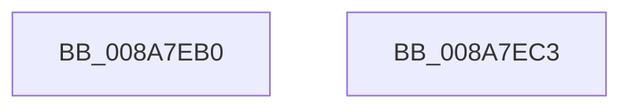

# ObQueryNameString

- RVA: `0x008A7EB0`–`0x008A7EC4` (길이 `20` bytes)
- VA: `0x00000001408A7EB0`
- 실행 섹션: `PAGE`
- PDB 이름 있음: `예`; PDB Function 태그: `아니요`
- unwind 정보 RVA: `0x0005D2F4`
- 디코드: `6`개 명령, `20/20` bytes 표시
- 미해석 바이트: `0` (있으면 어셈블리에 `.byte`로 보존)

> 이 문서는 커널 이미지의 기계어와 PDB 기호를 분석해 생성했습니다. 4번과 5번은 함수 원형과 자료형을 바이너리 사용 방식에서 추정한 C 해석이며 원본 소스 복구 결과는 아닙니다.

## 1. Dependencies

- 직접 호출 지점: **1**; 고유 호출 대상: **1**
- 직접 호출자로 확인된 함수: **8**
- RIP 상대 이미지 참조: **0**

### Outgoing calls
- `0x008A7EB9` → [ObQueryNameStringMode](ObQueryNameStringMode_function_008A7ED0.md) (function, `0x008A7ED0`)

### Direct callers
- [IoDeleteDevice](../../text/26/IoDeleteDevice_function_0026FE90.md) at `0x0026FF6E`
- [IoDeleteDevice](../../text/26/IoDeleteDevice_function_0026FE90.md) at `0x0026FFAE`
- [IopGetFileVolumeNameInformation](../../text/4A/IopGetFileVolumeNameInformation_function_004A5EB4.md) at `0x004A5EF2`
- [SeSetLearningModeObjectInformation](../../text/4C/SeSetLearningModeObjectInformation_function_004C7098.md) at `0x004C71B2`
- [SeSetLearningModeObjectInformation](../../text/4C/SeSetLearningModeObjectInformation_function_004C7098.md) at `0x004C71F3`
- [SmKmEtwAppendObjectName](../../text/60/SmKmEtwAppendObjectName_function_0060F6D8.md) at `0x0060F788`
- [sub_006ECEEA](../../text/6E/Unknown_function_006ECEEA.md) at `0x006ECF84`
- [sub_006ECEEA](../../text/6E/Unknown_function_006ECEEA.md) at `0x006ECFBF`
- [IopCaptureObjectName](../../pagelk/B7/IopCaptureObjectName_function_00B791A0.md) at `0x00B791D7`
- [PopFlushVolumeWorker](../../pagelk/B7/PopFlushVolumeWorker_function_00B7AEB0.md) at `0x00B7AFC5`
- [VfIrpLogRetrieveWmiData](../../pagevrfy/BA/VfIrpLogRetrieveWmiData_function_00BAB864.md) at `0x00BAB945`
- [VfIrpLogRetrieveWmiData](../../pagevrfy/BA/VfIrpLogRetrieveWmiData_function_00BAB864.md) at `0x00BAB993`

### Static image references
- 디코드된 RIP-relative 메모리 참조가 없습니다.

## 2. Other-region calls and transfers

- 다른 실행 섹션으로 향하는 call: **0**
- 별도 외부 분기/꼬리 이동을 확인하지 못했습니다.

## 3. Assembly (complete function range)

```asm
008A7EB0  48 83 EC 38                     sub rsp, 0x38
008A7EB4  C6 44 24 20 00                  mov byte ptr [rsp + 0x20], 0
008A7EB9  E8 12 00 00 00                  call 0x1408a7ed0
008A7EBE  48 83 C4 38                     add rsp, 0x38
008A7EC2  C3                              ret
008A7EC3  CC                              int3
```

## 4. C-style interpretation (structured pseudocode)

```c
__int64 __fastcall ObQueryNameString(void)
{
    __int64 result;
    __int64 v_rsp;
    unsigned __int8 v_stack_m18;

    v_rsp = (v_rsp) - (56);
    v_stack_m18 = 0;
    result = ObQueryNameStringMode(a1, a2, a3, a4);
    v_rsp = (v_rsp) + (56);
    return result;
}
```

## 5. (Beta) C Style

```c
void ObQueryNameString(void)
{
    int64_t result;
    int64_t local_rsp;
    uint8_t v_stack_m18;

    local_rsp = (local_rsp) - (56);
    v_stack_m18 = 0;
    result = ObQueryNameStringMode(a1, a2, a3, a4);
    local_rsp = (local_rsp) + (56);
    return result;
}
```

## 6. Execution-region graph

[열기: 2D/3D 그래프와 함수 탐색 컨트롤 패널](../../../control-panel.html?section=page&rva=0x008A7EB0&view=graph)

- 2D 그래프는 위에서 아래로 흐르고, 3D 그래프는 빈 공간을 드래그해 회전합니다. Shift+드래그는 이동, 휠은 확대·축소, 함수 노드 선택은 대상 보고서 이동입니다.

### Static fallback


