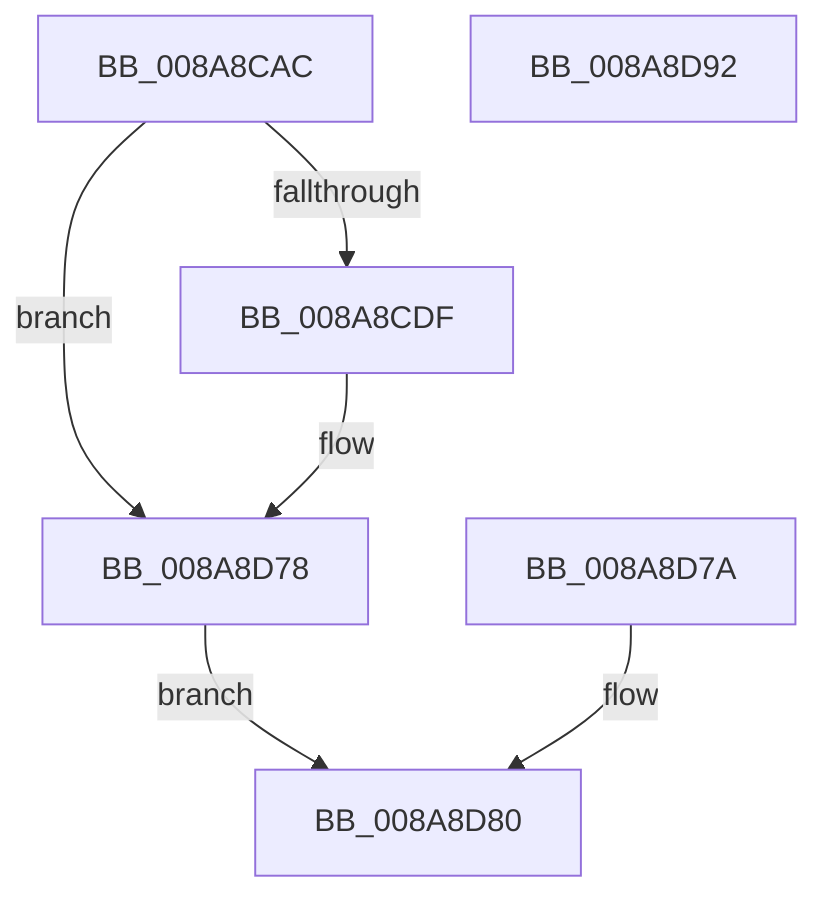

# ObQueryTypeInfo

- RVA: `0x008A8CAC`–`0x008A8D93` (길이 `231` bytes)
- VA: `0x00000001408A8CAC`
- 실행 섹션: `PAGE`
- PDB 이름 있음: `예`; PDB Function 태그: `아니요`
- unwind 정보 RVA: `0x0007F3CC`
- 디코드: `70`개 명령, `231/231` bytes 표시
- 미해석 바이트: `0` (있으면 어셈블리에 `.byte`로 보존)

> 이 문서는 커널 이미지의 기계어와 PDB 기호를 분석해 생성했습니다. 4번과 5번은 함수 원형과 자료형을 바이너리 사용 방식에서 추정한 C 해석이며 원본 소스 복구 결과는 아닙니다.

## 1. Dependencies

- 직접 호출 지점: **1**; 고유 호출 대상: **1**
- 직접 호출자로 확인된 함수: **2**
- RIP 상대 이미지 참조: **0**

### Outgoing calls
- `0x008A8D63` → [memcpy](../../text/6C/memcpy_function_006C6840.md) (function, `0x006C6840`)

### Direct callers
- [NtQueryObject](NtQueryObject_function_008A6DB0.md) at `0x008A7057`
- [sub_00B19DBE](../B1/Unknown_function_00B19DBE.md) at `0x00B19E5F`

### Static image references
- 디코드된 RIP-relative 메모리 참조가 없습니다.

## 2. Other-region calls and transfers

- 다른 실행 섹션으로 향하는 call: **1**
  - `0x008A8D63` → [memcpy](../../text/6C/memcpy_function_006C6840.md) (`PAGE` → `.text`)
- 별도 외부 분기/꼬리 이동을 확인하지 못했습니다.

## 3. Assembly (complete function range)

```asm
008A8CAC  48 89 5C 24 08                  mov qword ptr [rsp + 8], rbx
008A8CB1  48 89 74 24 10                  mov qword ptr [rsp + 0x10], rsi
008A8CB6  57                              push rdi
008A8CB7  48 83 EC 30                     sub rsp, 0x30
008A8CBB  48 8B F2                        mov rsi, rdx
008A8CBE  48 8B F9                        mov rdi, rcx
008A8CC1  BB 04 00 00 C0                  mov ebx, 0xc0000004
008A8CC6  0F B7 41 10                     movzx eax, word ptr [rcx + 0x10]
008A8CCA  83 C0 09                        add eax, 9
008A8CCD  83 E0 F8                        and eax, 0xfffffff8
008A8CD0  83 C0 68                        add eax, 0x68
008A8CD3  41 01 01                        add dword ptr [r9], eax
008A8CD6  45 3B 01                        cmp r8d, dword ptr [r9]
008A8CD9  0F 82 99 00 00 00               jb 0x1408a8d78
008A8CDF  8B 41 2C                        mov eax, dword ptr [rcx + 0x2c]
008A8CE2  89 42 10                        mov dword ptr [rdx + 0x10], eax
008A8CE5  8B 41 30                        mov eax, dword ptr [rcx + 0x30]
008A8CE8  89 42 14                        mov dword ptr [rdx + 0x14], eax
008A8CEB  8B 41 34                        mov eax, dword ptr [rcx + 0x34]
008A8CEE  89 42 28                        mov dword ptr [rdx + 0x28], eax
008A8CF1  8B 41 38                        mov eax, dword ptr [rcx + 0x38]
008A8CF4  89 42 2C                        mov dword ptr [rdx + 0x2c], eax
008A8CF7  8B 41 48                        mov eax, dword ptr [rcx + 0x48]
008A8CFA  89 42 40                        mov dword ptr [rdx + 0x40], eax
008A8CFD  0F 10 41 4C                     movups xmm0, xmmword ptr [rcx + 0x4c]
008A8D01  F3 0F 7F 42 44                  movdqu xmmword ptr [rdx + 0x44], xmm0
008A8D06  8B 41 5C                        mov eax, dword ptr [rcx + 0x5c]
008A8D09  89 42 54                        mov dword ptr [rdx + 0x54], eax
008A8D0C  8A 41 42                        mov al, byte ptr [rcx + 0x42]
008A8D0F  C0 E8 03                        shr al, 3
008A8D12  24 01                           and al, 1
008A8D14  88 42 58                        mov byte ptr [rdx + 0x58], al
008A8D17  8A 41 42                        mov al, byte ptr [rcx + 0x42]
008A8D1A  C0 E8 04                        shr al, 4
008A8D1D  24 01                           and al, 1
008A8D1F  88 42 59                        mov byte ptr [rdx + 0x59], al
008A8D22  8B 41 64                        mov eax, dword ptr [rcx + 0x64]
008A8D25  89 42 5C                        mov dword ptr [rdx + 0x5c], eax
008A8D28  8B 41 68                        mov eax, dword ptr [rcx + 0x68]
008A8D2B  89 42 60                        mov dword ptr [rdx + 0x60], eax
008A8D2E  8B 41 6C                        mov eax, dword ptr [rcx + 0x6c]
008A8D31  89 42 64                        mov dword ptr [rdx + 0x64], eax
008A8D34  8A 41 28                        mov al, byte ptr [rcx + 0x28]
008A8D37  88 42 5A                        mov byte ptr [rdx + 0x5a], al
008A8D3A  33 DB                           xor ebx, ebx
008A8D3C  88 5A 5B                        mov byte ptr [rdx + 0x5b], bl
008A8D3F  48 8D 4A 68                     lea rcx, [rdx + 0x68]
008A8D43  48 89 4A 08                     mov qword ptr [rdx + 8], rcx
008A8D47  0F B7 47 10                     movzx eax, word ptr [rdi + 0x10]
008A8D4B  66 89 02                        mov word ptr [rdx], ax
008A8D4E  0F B7 47 10                     movzx eax, word ptr [rdi + 0x10]
008A8D52  66 83 C0 02                     add ax, 2
008A8D56  66 89 42 02                     mov word ptr [rdx + 2], ax
008A8D5A  44 0F B7 47 10                  movzx r8d, word ptr [rdi + 0x10]
008A8D5F  48 8B 57 18                     mov rdx, qword ptr [rdi + 0x18]
008A8D63  E8 D8 DA E1 FF                  call 0x1406c6840
008A8D68  0F B7 47 10                     movzx eax, word ptr [rdi + 0x10]
008A8D6C  48 D1 E8                        shr rax, 1
008A8D6F  66 89 5C 46 68                  mov word ptr [rsi + rax*2 + 0x68], bx
008A8D74  89 5C 24 20                     mov dword ptr [rsp + 0x20], ebx
008A8D78  EB 06                           jmp 0x1408a8d80
008A8D7A  8B D8                           mov ebx, eax
008A8D7C  89 44 24 20                     mov dword ptr [rsp + 0x20], eax
008A8D80  8B C3                           mov eax, ebx
008A8D82  48 8B 5C 24 40                  mov rbx, qword ptr [rsp + 0x40]
008A8D87  48 8B 74 24 48                  mov rsi, qword ptr [rsp + 0x48]
008A8D8C  48 83 C4 30                     add rsp, 0x30
008A8D90  5F                              pop rdi
008A8D91  C3                              ret
008A8D92  CC                              int3
```

## 4. C-style interpretation (structured pseudocode)

```c
__int64 __fastcall ObQueryTypeInfo(__int64 a1, __int64 a2, int a3, __int64 a4)
{
    __int64 result;
    __int64 v_rbx;
    __int64 v_rsp;
    unsigned int v_stack_m18;
    unsigned __int64 v_stack_p10;
    unsigned __int64 v_stack_p8;

    v_stack_p8 = v_rbx;
    v_stack_p10 = v_rsi;
    v_rsp = (v_rsp) - (48);
    result = (unsigned int)((*(unsigned __int16 *)(a1 + 16)) + (9));
    result = (unsigned int)((result) & (0xFFFFFFF8ULL));
    result = (unsigned int)((result) + (104));
    v_rbx = (unsigned int)(0xC0000004ULL);
    if (a3 >= (*(unsigned int *)(a4))) {
        result = *(unsigned int *)(a1 + 44);
        *(unsigned int *)(a2 + 16) = (unsigned int)(result);
        result = *(unsigned int *)(a1 + 48);
        *(unsigned int *)(a2 + 20) = (unsigned int)(result);
        result = *(unsigned int *)(a1 + 52);
        *(unsigned int *)(a2 + 40) = (unsigned int)(result);
        result = *(unsigned int *)(a1 + 56);
        *(unsigned int *)(a2 + 44) = (unsigned int)(result);
        result = *(unsigned int *)(a1 + 72);
        *(unsigned int *)(a2 + 64) = (unsigned int)(result);
        *(unsigned __int64 *)(a2 + 68) = v_xmm0;
        result = *(unsigned int *)(a1 + 92);
        *(unsigned int *)(a2 + 84) = (unsigned int)(result);
        result = *(unsigned __int8 *)(a1 + 66);
        result = (unsigned __int8)((result) >> (3));
        result = (unsigned __int8)((result) & (1));
        *(unsigned __int8 *)(a2 + 88) = (unsigned __int8)(result);
        result = *(unsigned __int8 *)(a1 + 66);
        result = (unsigned __int8)((result) >> (4));
        result = (unsigned __int8)((result) & (1));
        *(unsigned __int8 *)(a2 + 89) = (unsigned __int8)(result);
        result = *(unsigned int *)(a1 + 100);
        *(unsigned int *)(a2 + 92) = (unsigned int)(result);
        result = *(unsigned int *)(a1 + 104);
        *(unsigned int *)(a2 + 96) = (unsigned int)(result);
        result = *(unsigned int *)(a1 + 108);
        *(unsigned int *)(a2 + 100) = (unsigned int)(result);
        result = *(unsigned __int8 *)(a1 + 40);
        *(unsigned __int8 *)(a2 + 90) = (unsigned __int8)(result);
        v_rbx = 0;
        *(unsigned __int8 *)(a2 + 91) = 0;
        a1 = a2 + 104;
        *(unsigned __int64 *)(a2 + 8) = a1;
        result = *(unsigned __int16 *)(a1 + 16);
        *(unsigned __int16 *)(a2) = (unsigned __int16)(result);
        result = *(unsigned __int16 *)(a1 + 16);
        result = (unsigned __int16)((result) + (2));
        *(unsigned __int16 *)(a2 + 2) = (unsigned __int16)(result);
        a3 = *(unsigned __int16 *)(a1 + 16);
        a2 = *(unsigned __int64 *)(a1 + 24);
        result = memcpy(a1, a2, a3, a4);
        result = *(unsigned __int16 *)(a1 + 16);
        result = (result) >> (1);
        *(unsigned __int16 *)(a2 + result * 2 + 104) = 0;
        v_stack_m18 = 0;
    }
    goto loc_008A8D80;
loc_008A8D80:
    v_rsp = (v_rsp) + (48);
    return 0;
}
```

## 5. (Beta) C Style

```c
int64_t ObQueryTypeInfo(void *Arg1, void *Arg2, int32_t Arg3, void *Arg4)
{
    uint8_t *arg1 = (uint8_t *)Arg1;
    uint8_t *arg2 = (uint8_t *)Arg2;
    uint8_t *arg4 = (uint8_t *)Arg4;

    int64_t result;
    int64_t local_rbx;
    int64_t local_rsp;
    uint32_t v_stack_m18;
    uint64_t v_stack_p10;
    uint64_t v_stack_p8;

    v_stack_p8 = local_rbx;
    v_stack_p10 = local_rsi;
    local_rsp = (local_rsp) - (48);
    result = (uint32_t)((*(uint16_t *)(arg1 + 0x10)) + (9));
    result = (uint32_t)((result) & (0xFFFFFFF8ULL));
    result = (uint32_t)((result) + (104));
    local_rbx = (uint32_t)(0xC0000004ULL);
    if (Arg3 >= (*(uint32_t *)(arg4))) {
        result = *(uint32_t *)(arg1 + 0x2C);
        *(uint32_t *)(arg2 + 0x10) = (uint32_t)(result);
        result = *(uint32_t *)(arg1 + 0x30);
        *(uint32_t *)(arg2 + 0x14) = (uint32_t)(result);
        result = *(uint32_t *)(arg1 + 0x34);
        *(uint32_t *)(arg2 + 0x28) = (uint32_t)(result);
        result = *(uint32_t *)(arg1 + 0x38);
        *(uint32_t *)(arg2 + 0x2C) = (uint32_t)(result);
        result = *(uint32_t *)(arg1 + 0x48);
        *(uint32_t *)(arg2 + 0x40) = (uint32_t)(result);
        *(uint64_t *)(arg2 + 0x44) = v_xmm0;
        result = *(uint32_t *)(arg1 + 0x5C);
        *(uint32_t *)(arg2 + 0x54) = (uint32_t)(result);
        result = *(uint8_t *)(arg1 + 0x42);
        result = (uint8_t)((result) >> (3));
        result = (uint8_t)((result) & (1));
        *(uint8_t *)(arg2 + 0x58) = (uint8_t)(result);
        result = *(uint8_t *)(arg1 + 0x42);
        result = (uint8_t)((result) >> (4));
        result = (uint8_t)((result) & (1));
        *(uint8_t *)(arg2 + 0x59) = (uint8_t)(result);
        result = *(uint32_t *)(arg1 + 0x64);
        *(uint32_t *)(arg2 + 0x5C) = (uint32_t)(result);
        result = *(uint32_t *)(arg1 + 0x68);
        *(uint32_t *)(arg2 + 0x60) = (uint32_t)(result);
        result = *(uint32_t *)(arg1 + 0x6C);
        *(uint32_t *)(arg2 + 0x64) = (uint32_t)(result);
        result = *(uint8_t *)(arg1 + 0x28);
        *(uint8_t *)(arg2 + 0x5A) = (uint8_t)(result);
        local_rbx = 0;
        *(uint8_t *)(arg2 + 0x5B) = 0;
        Arg1 = Arg2 + 104;
        *(void **)(arg2 + 0x8) = Arg1;
        result = *(uint16_t *)(arg1 + 0x10);
        *(uint16_t *)(arg2) = (uint16_t)(result);
        result = *(uint16_t *)(arg1 + 0x10);
        result = (uint16_t)((result) + (2));
        *(uint16_t *)(arg2 + 0x2) = (uint16_t)(result);
        Arg3 = *(uint16_t *)(arg1 + 0x10);
        Arg2 = *(uint64_t *)(arg1 + 0x18);
        result = memcpy(Arg1, Arg2, Arg3, Arg4);
        result = *(uint16_t *)(arg1 + 0x10);
        result = (result) >> (1);
        *(uint16_t *)(arg2 + result * 2 + 0x68) = 0;
        v_stack_m18 = 0;
    }
    goto loc_008A8D80;
loc_008A8D80:
    local_rsp = (local_rsp) + (48);
    return 0;
}
```

### 관측된 메모리 오프셋

구조체 형식이 확인되지 않은 접근은 인자 기준의 오프셋으로만 기록했습니다.

| 기준 인자 | 오프셋 표현 | 폭 (bit) | 접근 |
|---|---:|---:|---|
| `Arg1` | `+ 0x10` | `16` | `R` |
| `Arg1` | `+ 0x18` | `64` | `R` |
| `Arg1` | `+ 0x28` | `8` | `R` |
| `Arg1` | `+ 0x2C` | `32` | `R` |
| `Arg1` | `+ 0x30` | `32` | `R` |
| `Arg1` | `+ 0x34` | `32` | `R` |
| `Arg1` | `+ 0x38` | `32` | `R` |
| `Arg1` | `+ 0x42` | `8` | `R` |
| `Arg1` | `+ 0x48` | `32` | `R` |
| `Arg1` | `+ 0x4C` | `128` | `R` |
| `Arg1` | `+ 0x5C` | `32` | `R` |
| `Arg1` | `+ 0x64` | `32` | `R` |
| `Arg1` | `+ 0x68` | `32` | `R` |
| `Arg1` | `+ 0x6C` | `32` | `R` |
| `Arg2` | `+ 0x0` | `16` | `W` |
| `Arg2` | `+ 0x2` | `16` | `W` |
| `Arg2` | `+ 0x8` | `64` | `W` |
| `Arg2` | `+ 0x10` | `32` | `W` |
| `Arg2` | `+ 0x14` | `32` | `W` |
| `Arg2` | `+ 0x28` | `32` | `W` |
| `Arg2` | `+ 0x2C` | `32` | `W` |
| `Arg2` | `+ 0x40` | `32` | `W` |
| `Arg2` | `+ 0x44` | `128` | `W` |
| `Arg2` | `+ 0x54` | `32` | `W` |
| `Arg2` | `+ 0x58` | `8` | `W` |
| `Arg2` | `+ 0x59` | `8` | `W` |
| `Arg2` | `+ 0x5A` | `8` | `W` |
| `Arg2` | `+ 0x5B` | `8` | `W` |
| `Arg2` | `+ 0x5C` | `32` | `W` |
| `Arg2` | `+ 0x60` | `32` | `W` |
| `Arg2` | `+ 0x64` | `32` | `W` |
| `Arg2` | `+ 0x68` | `64` | `R` |

추가 오프셋 3개는 표에서 생략했습니다.

## 6. Execution-region graph

[열기: 2D/3D 그래프와 함수 탐색 컨트롤 패널](../../../control-panel.html?section=page&rva=0x008A8CAC&view=graph)

- 2D 그래프는 위에서 아래로 흐르고, 3D 그래프는 빈 공간을 드래그해 회전합니다. Shift+드래그는 이동, 휠은 확대·축소, 함수 노드 선택은 대상 보고서 이동입니다.

### Static fallback


