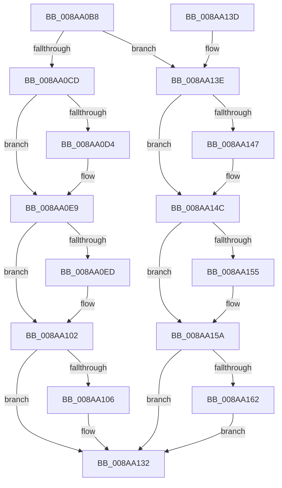

# PfSnCleanupPrefetchSectionInfo

- RVA: `0x008AA0B8`–`0x008AA170` (길이 `184` bytes)
- VA: `0x00000001408AA0B8`
- 실행 섹션: `PAGE`
- PDB 이름 있음: `예`; PDB Function 태그: `아니요`
- unwind 정보 RVA: `0x0007F584`
- 디코드: `52`개 명령, `184/184` bytes 표시
- 미해석 바이트: `0` (있으면 어셈블리에 `.byte`로 보존)

> 이 문서는 커널 이미지의 기계어와 PDB 기호를 분석해 생성했습니다. 4번과 5번은 함수 원형과 자료형을 바이너리 사용 방식에서 추정한 C 해석이며 원본 소스 복구 결과는 아닙니다.

## 1. Dependencies

- 직접 호출 지점: **6**; 고유 호출 대상: **2**
- 직접 호출자로 확인된 함수: **2**
- RIP 상대 이미지 참조: **0**

### Outgoing calls
- `0x008AA0D8` → [ObfDereferenceObject](../../text/2F/ObfDereferenceObject_function_002F9350.md) (function, `0x002F9350`)
- `0x008AA0F1` → [ObfDereferenceObject](../../text/2F/ObfDereferenceObject_function_002F9350.md) (function, `0x002F9350`)
- `0x008AA10D` → [PfpOpenHandleClose](PfpOpenHandleClose_function_008A9E74.md) (function, `0x008A9E74`)
- `0x008AA147` → [ObfDereferenceObject](../../text/2F/ObfDereferenceObject_function_002F9350.md) (function, `0x002F9350`)
- `0x008AA155` → [ObfDereferenceObject](../../text/2F/ObfDereferenceObject_function_002F9350.md) (function, `0x002F9350`)
- `0x008AA169` → [PfpOpenHandleClose](PfpOpenHandleClose_function_008A9E74.md) (function, `0x008A9E74`)

### Direct callers
- [PfSnSectionInfoCleanupWorkItem](PfSnSectionInfoCleanupWorkItem_function_008A8DA0.md) at `0x008A8E0B`
- [sub_008A9416](Unknown_function_008A9416.md) at `0x008A9427`

### Static image references
- 디코드된 RIP-relative 메모리 참조가 없습니다.

## 2. Other-region calls and transfers

- 다른 실행 섹션으로 향하는 call: **4**
  - `0x008AA0D8` → [ObfDereferenceObject](../../text/2F/ObfDereferenceObject_function_002F9350.md) (`PAGE` → `.text`)
  - `0x008AA0F1` → [ObfDereferenceObject](../../text/2F/ObfDereferenceObject_function_002F9350.md) (`PAGE` → `.text`)
  - `0x008AA147` → [ObfDereferenceObject](../../text/2F/ObfDereferenceObject_function_002F9350.md) (`PAGE` → `.text`)
  - `0x008AA155` → [ObfDereferenceObject](../../text/2F/ObfDereferenceObject_function_002F9350.md) (`PAGE` → `.text`)
- 별도 외부 분기/꼬리 이동을 확인하지 못했습니다.

## 3. Assembly (complete function range)

```asm
008AA0B8  48 89 5C 24 08                  mov qword ptr [rsp + 8], rbx
008AA0BD  57                              push rdi
008AA0BE  48 83 EC 20                     sub rsp, 0x20
008AA0C2  48 8B FA                        mov rdi, rdx
008AA0C5  48 8B D9                        mov rbx, rcx
008AA0C8  45 84 C0                        test r8b, r8b
008AA0CB  74 71                           je 0x1408aa13e
008AA0CD  8B 41 30                        mov eax, dword ptr [rcx + 0x30]
008AA0D0  A8 01                           test al, 1
008AA0D2  74 15                           je 0x1408aa0e9
008AA0D4  48 8B 49 20                     mov rcx, qword ptr [rcx + 0x20]
008AA0D8  E8 73 F2 A4 FF                  call 0x1402f9350
008AA0DD  48 83 63 20 00                  and qword ptr [rbx + 0x20], 0
008AA0E2  83 63 30 FE                     and dword ptr [rbx + 0x30], 0xfffffffe
008AA0E6  8B 43 30                        mov eax, dword ptr [rbx + 0x30]
008AA0E9  A8 02                           test al, 2
008AA0EB  74 15                           je 0x1408aa102
008AA0ED  48 8B 4B 28                     mov rcx, qword ptr [rbx + 0x28]
008AA0F1  E8 5A F2 A4 FF                  call 0x1402f9350
008AA0F6  48 83 63 28 00                  and qword ptr [rbx + 0x28], 0
008AA0FB  83 63 30 FD                     and dword ptr [rbx + 0x30], 0xfffffffd
008AA0FF  8B 43 30                        mov eax, dword ptr [rbx + 0x30]
008AA102  A8 04                           test al, 4
008AA104  74 2C                           je 0x1408aa132
008AA106  48 8B 57 08                     mov rdx, qword ptr [rdi + 8]
008AA10A  48 8B CB                        mov rcx, rbx
008AA10D  E8 62 FD FF FF                  call 0x1408a9e74
008AA112  48 83 23 00                     and qword ptr [rbx], 0
008AA116  48 B8 00 00 00 00 02 00 00 00   movabs rax, 0x200000000
008AA120  48 83 63 08 00                  and qword ptr [rbx + 8], 0
008AA125  48 83 63 10 00                  and qword ptr [rbx + 0x10], 0
008AA12A  48 89 43 18                     mov qword ptr [rbx + 0x18], rax
008AA12E  83 63 30 FB                     and dword ptr [rbx + 0x30], 0xfffffffb
008AA132  48 8B 5C 24 30                  mov rbx, qword ptr [rsp + 0x30]
008AA137  48 83 C4 20                     add rsp, 0x20
008AA13B  5F                              pop rdi
008AA13C  C3                              ret
008AA13D  CC                              int3
008AA13E  48 8B 49 20                     mov rcx, qword ptr [rcx + 0x20]
008AA142  48 85 C9                        test rcx, rcx
008AA145  74 05                           je 0x1408aa14c
008AA147  E8 04 F2 A4 FF                  call 0x1402f9350
008AA14C  48 8B 4B 28                     mov rcx, qword ptr [rbx + 0x28]
008AA150  48 85 C9                        test rcx, rcx
008AA153  74 05                           je 0x1408aa15a
008AA155  E8 F6 F1 A4 FF                  call 0x1402f9350
008AA15A  48 0F BA 63 18 22               bt qword ptr [rbx + 0x18], 0x22
008AA160  73 D0                           jae 0x1408aa132
008AA162  48 8B 57 08                     mov rdx, qword ptr [rdi + 8]
008AA166  48 8B CB                        mov rcx, rbx
008AA169  E8 06 FD FF FF                  call 0x1408a9e74
008AA16E  EB C2                           jmp 0x1408aa132
```

## 4. C-style interpretation (structured pseudocode)

```c
__int64 __fastcall PfSnCleanupPrefetchSectionInfo(__int64 a1, __int64 a2, unsigned __int8 a3)
{
    __int64 result;
    __int64 v_rsp;
    unsigned __int64 v_stack_p8;

    v_stack_p8 = v_rbx;
    v_rsp = (v_rsp) - (32);
    if (a3 == 0) goto loc_008AA13E;
    result = (unsigned int)(*(unsigned int *)(a1 + 48));
    if ((((unsigned __int8)((unsigned int)(*(unsigned int *)(a1 + 48)))) & (1)) != 0) {
        a1 = *(unsigned __int64 *)(a1 + 32);
        result = ObfDereferenceObject(a1, a2, a3, a4);
        result = *(unsigned int *)(a1 + 48);
    }
    if ((((unsigned __int8)(result)) & (2)) != 0) {
        a1 = *(unsigned __int64 *)(a1 + 40);
        result = ObfDereferenceObject(a1, a2, a3, a4);
        result = *(unsigned int *)(a1 + 48);
    }
    if ((((unsigned __int8)(result)) & (4)) != 0) {
        a2 = *(unsigned __int64 *)(a2 + 8);
        a1 = a1;
        result = PfpOpenHandleClose(a1, a2, a3, a4);
        *(unsigned __int64 *)(a1 + 24) = result;
    }
    v_rsp = (v_rsp) + (32);
    return result;
loc_008AA13E:
    if (*(unsigned __int64 *)(a1 + 32) != 0) {
        result = ObfDereferenceObject(*(unsigned __int64 *)(a1 + 32), a2, a3, a4);
    }
    if (*(unsigned __int64 *)(v_stack_p8 + 40) != 0) {
        result = ObfDereferenceObject(*(unsigned __int64 *)(v_stack_p8 + 40), a2, a3, a4);
    }
    if (condition_is_above_or_equal) goto loc_008AA132;
    result = PfpOpenHandleClose(v_stack_p8, *(unsigned __int64 *)(a2 + 8), a3, a4);
    goto loc_008AA132;
}
```

## 5. (Beta) C Style

```c
int64_t PfSnCleanupPrefetchSectionInfo(void *Arg1, void *Arg2, uint8_t Arg3)
{
    uint8_t *arg1 = (uint8_t *)Arg1;
    uint8_t *arg2 = (uint8_t *)Arg2;

    int64_t result;
    int64_t local_rsp;
    uint64_t v_stack_p8;

    v_stack_p8 = local_rbx;
    local_rsp = (local_rsp) - (32);
    if (Arg3 == 0) goto loc_008AA13E;
    result = (uint32_t)(*(uint32_t *)(arg1 + 0x30));
    if ((((uint8_t)((uint32_t)(*(uint32_t *)(arg1 + 0x30)))) & (1)) != 0) {
        Arg1 = *(uint64_t *)(arg1 + 0x20);
        result = ObfDereferenceObject(Arg1, Arg2, Arg3, a4);
        result = *(uint32_t *)(arg1 + 0x30);
    }
    if ((((uint8_t)(result)) & (2)) != 0) {
        Arg1 = *(uint64_t *)(arg1 + 0x28);
        result = ObfDereferenceObject(Arg1, Arg2, Arg3, a4);
        result = *(uint32_t *)(arg1 + 0x30);
    }
    if ((((uint8_t)(result)) & (4)) != 0) {
        Arg2 = *(uint64_t *)(arg2 + 0x8);
        Arg1 = Arg1;
        result = PfpOpenHandleClose(Arg1, Arg2, Arg3, a4);
        *(uint64_t *)(arg1 + 0x18) = result;
    }
    local_rsp = (local_rsp) + (32);
    return result;
loc_008AA13E:
    if (*(uint64_t *)(arg1 + 0x20) != 0) {
        result = ObfDereferenceObject(*(uint64_t *)(arg1 + 0x20), Arg2, Arg3, a4);
    }
    if (*(uint64_t *)(v_stack_p8 + 0x28) != 0) {
        result = ObfDereferenceObject(*(uint64_t *)(v_stack_p8 + 0x28), Arg2, Arg3, a4);
    }
    if (condition_is_above_or_equal) goto loc_008AA132;
    result = PfpOpenHandleClose(v_stack_p8, *(uint64_t *)(arg2 + 0x8), Arg3, a4);
    goto loc_008AA132;
}
```

### 관측된 메모리 오프셋

구조체 형식이 확인되지 않은 접근은 인자 기준의 오프셋으로만 기록했습니다.

| 기준 인자 | 오프셋 표현 | 폭 (bit) | 접근 |
|---|---:|---:|---|
| `Arg1` | `+ 0x0` | `64` | `R/W` |
| `Arg1` | `+ 0x8` | `64` | `R/W` |
| `Arg1` | `+ 0x10` | `64` | `R/W` |
| `Arg1` | `+ 0x18` | `64` | `R` |
| `Arg1` | `+ 0x18` | `64` | `W` |
| `Arg1` | `+ 0x20` | `64` | `R` |
| `Arg1` | `+ 0x20` | `64` | `R/W` |
| `Arg1` | `+ 0x28` | `64` | `R` |
| `Arg1` | `+ 0x28` | `64` | `R/W` |
| `Arg1` | `+ 0x30` | `32` | `R` |
| `Arg1` | `+ 0x30` | `32` | `R/W` |
| `Arg2` | `+ 0x8` | `64` | `R` |

## 6. Execution-region graph

[열기: 2D/3D 그래프와 함수 탐색 컨트롤 패널](../../../control-panel.html?section=page&rva=0x008AA0B8&view=graph)

- 2D 그래프는 위에서 아래로 흐르고, 3D 그래프는 빈 공간을 드래그해 회전합니다. Shift+드래그는 이동, 휠은 확대·축소, 함수 노드 선택은 대상 보고서 이동입니다.

### Static fallback


