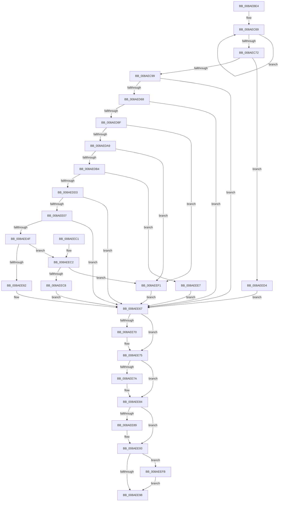

# PfSnGetPrefetchInstructions

- RVA: `0x008AEBE4`–`0x008AEF07` (길이 `803` bytes)
- VA: `0x00000001408AEBE4`
- 실행 섹션: `PAGE`
- PDB 이름 있음: `예`; PDB Function 태그: `아니요`
- unwind 정보 RVA: `0x0007FA34`
- 디코드: `206`개 명령, `803/803` bytes 표시
- 미해석 바이트: `0` (있으면 어셈블리에 `.byte`로 보존)

> 이 문서는 커널 이미지의 기계어와 PDB 기호를 분석해 생성했습니다. 4번과 5번은 함수 원형과 자료형을 바이너리 사용 방식에서 추정한 C 해석이며 원본 소스 복구 결과는 아닙니다.

## 1. Dependencies

- 직접 호출 지점: **17**; 고유 호출 대상: **13**
- 직접 호출자로 확인된 함수: **1**
- RIP 상대 이미지 참조: **7**

### Outgoing calls
- `0x008AEC59` → [FsRtlAcquirePushLockShared](../../text/48/FsRtlAcquirePushLockShared_function_0048B034.md) (function, `0x0048B034`)
- `0x008AEC88` → [ExAllocatePool2](../../poolcode/B8/ExAllocatePool2_function_00B820F0.md) (function, `0x00B820F0`)
- `0x008AECC5` → [RtlStringCbPrintfW](../../text/40/RtlStringCbPrintfW_function_0040FB40.md) (function, `0x0040FB40`)
- `0x008AECD1` → [PfLockSharedRelease](../../text/48/PfLockSharedRelease_function_0048DF24.md) (function, `0x0048DF24`)
- `0x008AECDD` → [RtlInitUnicodeString](../../text/42/RtlInitUnicodeString_function_0042A780.md) (function, `0x0042A780`)
- `0x008AED59` → [IopCreateFile](IopCreateFile_function_008AB298.md) (function, `0x008AB298`)
- `0x008AED80` → [NtQueryInformationFile](NtQueryInformationFile_function_008AD630.md) (function, `0x008AD630`)
- `0x008AEDC2` → [ExAllocatePool2](../../poolcode/B8/ExAllocatePool2_function_00B820F0.md) (function, `0x00B820F0`)
- `0x008AEDFC` → [NtReadFile](NtReadFile_function_008AEF10.md) (function, `0x008AEF10`)
- `0x008AEE3D` → [SmDecompressBuffer](../../text/3A/SmDecompressBuffer_function_003A4978.md) (function, `0x003A4978`)
- `0x008AEE59` → [PfVerifyScenarioBuffer](PfVerifyScenarioBuffer_function_008AF9A0.md) (function, `0x008AF9A0`)
- `0x008AEE70` → [NtClose](../86/NtClose_function_00868870.md) (function, `0x00868870`)
- `0x008AEE7F` → [ExFreePoolWithTag](../../poolcode/B8/ExFreePoolWithTag_function_00B82870.md) (function, `0x00B82870`)
- `0x008AEE8E` → [ExFreePoolWithTag](../../poolcode/B8/ExFreePoolWithTag_function_00B82870.md) (function, `0x00B82870`)
- `0x008AEEA1` → [_security_check_cookie](../../text/6A/_security_check_cookie_function_006AC640.md) (function, `0x006AC640`)
- `0x008AEEE0` → [PfLockSharedRelease](../../text/48/PfLockSharedRelease_function_0048DF24.md) (function, `0x0048DF24`)
- `0x008AEF00` → [ExFreePoolWithTag](../../poolcode/B8/ExFreePoolWithTag_function_00B82870.md) (function, `0x00B82870`)

### Direct callers
- [PfSnBeginScenario](../95/PfSnBeginScenario_function_0095EFC0.md) at `0x0095F1F3`

### Static image references
- `0x008AEC00` → RVA `0x00E0A740` (`.data`; read)
- `0x008AEC25` → RVA `0x00E670A8` (`.data`; read)
- `0x008AEC5E` → RVA `0x00E66F40` (`.data`; read)
- `0x008AEC99` → RVA `0x00B01560` (` ?? ::NNGAKEGL::`string'`; read)
- `0x008AECB2` → RVA `0x00B01540` (` ?? ::NNGAKEGL::`string'`; read)
- `0x008AEE07` → RVA `0x00A7E510` (`PfSnScenarioAlloc`; read)
- `0x008AEE19` → RVA `0x009071C0` (`AlpcpFreeBuffer`; read)

## 2. Other-region calls and transfers

- 다른 실행 섹션으로 향하는 call: **12**
  - `0x008AEC59` → [FsRtlAcquirePushLockShared](../../text/48/FsRtlAcquirePushLockShared_function_0048B034.md) (`PAGE` → `.text`)
  - `0x008AEC88` → [ExAllocatePool2](../../poolcode/B8/ExAllocatePool2_function_00B820F0.md) (`PAGE` → `POOLCODE`)
  - `0x008AECC5` → [RtlStringCbPrintfW](../../text/40/RtlStringCbPrintfW_function_0040FB40.md) (`PAGE` → `.text`)
  - `0x008AECD1` → [PfLockSharedRelease](../../text/48/PfLockSharedRelease_function_0048DF24.md) (`PAGE` → `.text`)
  - `0x008AECDD` → [RtlInitUnicodeString](../../text/42/RtlInitUnicodeString_function_0042A780.md) (`PAGE` → `.text`)
  - `0x008AEDC2` → [ExAllocatePool2](../../poolcode/B8/ExAllocatePool2_function_00B820F0.md) (`PAGE` → `POOLCODE`)
  - `0x008AEE3D` → [SmDecompressBuffer](../../text/3A/SmDecompressBuffer_function_003A4978.md) (`PAGE` → `.text`)
  - `0x008AEE7F` → [ExFreePoolWithTag](../../poolcode/B8/ExFreePoolWithTag_function_00B82870.md) (`PAGE` → `POOLCODE`)
  - `0x008AEE8E` → [ExFreePoolWithTag](../../poolcode/B8/ExFreePoolWithTag_function_00B82870.md) (`PAGE` → `POOLCODE`)
  - `0x008AEEA1` → [_security_check_cookie](../../text/6A/_security_check_cookie_function_006AC640.md) (`PAGE` → `.text`)
  - `0x008AEEE0` → [PfLockSharedRelease](../../text/48/PfLockSharedRelease_function_0048DF24.md) (`PAGE` → `.text`)
  - `0x008AEF00` → [ExFreePoolWithTag](../../poolcode/B8/ExFreePoolWithTag_function_00B82870.md) (`PAGE` → `POOLCODE`)
- 별도 외부 분기/꼬리 이동을 확인하지 못했습니다.

## 3. Assembly (complete function range)

```asm
008AEBE4  48 89 5C 24 10                  mov qword ptr [rsp + 0x10], rbx
008AEBE9  55                              push rbp
008AEBEA  56                              push rsi
008AEBEB  57                              push rdi
008AEBEC  41 54                           push r12
008AEBEE  41 55                           push r13
008AEBF0  41 56                           push r14
008AEBF2  41 57                           push r15
008AEBF4  48 8D 6C 24 E0                  lea rbp, [rsp - 0x20]
008AEBF9  48 81 EC 20 01 00 00            sub rsp, 0x120
008AEC00  48 8B 05 39 BB 55 00            mov rax, qword ptr [rip + 0x55bb39]
008AEC07  48 33 C4                        xor rax, rsp
008AEC0A  48 89 45 18                     mov qword ptr [rbp + 0x18], rax
008AEC0E  33 DB                           xor ebx, ebx
008AEC10  0F 57 C0                        xorps xmm0, xmm0
008AEC13  33 C0                           xor eax, eax
008AEC15  89 5D 80                        mov dword ptr [rbp - 0x80], ebx
008AEC18  4C 8B F1                        mov r14, rcx
008AEC1B  48 89 45 D0                     mov qword ptr [rbp - 0x30], rax
008AEC1F  0F 57 C9                        xorps xmm1, xmm1
008AEC22  89 45 D8                        mov dword ptr [rbp - 0x28], eax
008AEC25  48 8D 0D 7C 84 5B 00            lea rcx, [rip + 0x5b847c]
008AEC2C  48 89 45 10                     mov qword ptr [rbp + 0x10], rax
008AEC30  0F 11 45 E0                     movups xmmword ptr [rbp - 0x20], xmm0
008AEC34  89 5D 94                        mov dword ptr [rbp - 0x6c], ebx
008AEC37  8B FB                           mov edi, ebx
008AEC39  0F 11 45 B0                     movups xmmword ptr [rbp - 0x50], xmm0
008AEC3D  48 89 5D 98                     mov qword ptr [rbp - 0x68], rbx
008AEC41  8B F3                           mov esi, ebx
008AEC43  0F 11 45 C0                     movups xmmword ptr [rbp - 0x40], xmm0
008AEC47  48 89 5D 88                     mov qword ptr [rbp - 0x78], rbx
008AEC4B  4D 8B E8                        mov r13, r8
008AEC4E  0F 11 45 A0                     movups xmmword ptr [rbp - 0x60], xmm0
008AEC52  44 8B E2                        mov r12d, edx
008AEC55  0F 11 4D 00                     movups xmmword ptr [rbp], xmm1
008AEC59  E8 D6 C3 BD FF                  call 0x14048b034
008AEC5E  48 8D 0D DB 82 5B 00            lea rcx, [rip + 0x5b82db]
008AEC65  48 83 C8 FF                     or rax, 0xffffffffffffffff
008AEC69  48 FF C0                        inc rax
008AEC6C  66 39 1C 41                     cmp word ptr [rcx + rax*2], bx
008AEC70  75 F7                           jne 0x1408aec69
008AEC72  8D 04 45 66 00 00 00            lea eax, [rax*2 + 0x66]
008AEC79  41 B8 43 63 50 46               mov r8d, 0x46506343
008AEC7F  8B D0                           mov edx, eax
008AEC81  B9 00 01 00 00                  mov ecx, 0x100
008AEC86  8B D8                           mov ebx, eax
008AEC88  E8 63 34 2D 00                  call 0x140b820f0
008AEC8D  4C 8B F8                        mov r15, rax
008AEC90  48 85 C0                        test rax, rax
008AEC93  0F 84 3B 02 00 00               je 0x1408aeed4
008AEC99  48 8D 05 C0 28 25 00            lea rax, [rip + 0x2528c0]
008AECA0  8B D3                           mov edx, ebx
008AECA2  48 89 44 24 30                  mov qword ptr [rsp + 0x30], rax
008AECA7  4C 8D 0D 92 82 5B 00            lea r9, [rip + 0x5b8292]
008AECAE  41 8B 46 3C                     mov eax, dword ptr [r14 + 0x3c]
008AECB2  4C 8D 05 87 28 25 00            lea r8, [rip + 0x252887]
008AECB9  89 44 24 28                     mov dword ptr [rsp + 0x28], eax
008AECBD  49 8B CF                        mov rcx, r15
008AECC0  4C 89 74 24 20                  mov qword ptr [rsp + 0x20], r14
008AECC5  E8 76 0E B6 FF                  call 0x14040fb40
008AECCA  48 8D 0D D7 83 5B 00            lea rcx, [rip + 0x5b83d7]
008AECD1  E8 4E F2 BD FF                  call 0x14048df24
008AECD6  49 8B D7                        mov rdx, r15
008AECD9  48 8D 4D E0                     lea rcx, [rbp - 0x20]
008AECDD  E8 9E BA B7 FF                  call 0x14042a780
008AECE2  45 33 F6                        xor r14d, r14d
008AECE5  C7 45 B0 30 00 00 00            mov dword ptr [rbp - 0x50], 0x30
008AECEC  4C 89 74 24 78                  mov qword ptr [rsp + 0x78], r14
008AECF1  48 8D 45 E0                     lea rax, [rbp - 0x20]
008AECF5  48 89 45 C0                     mov qword ptr [rbp - 0x40], rax
008AECF9  4C 8D 4D A0                     lea r9, [rbp - 0x60]
008AECFD  0F 57 C0                        xorps xmm0, xmm0
008AED00  4C 89 75 B8                     mov qword ptr [rbp - 0x48], r14
008AED04  41 8D 46 20                     lea eax, [r14 + 0x20]
008AED08  C7 45 C8 40 02 00 00            mov dword ptr [rbp - 0x38], 0x240
008AED0F  89 44 24 70                     mov dword ptr [rsp + 0x70], eax
008AED13  4C 8D 45 B0                     lea r8, [rbp - 0x50]
008AED17  44 89 74 24 68                  mov dword ptr [rsp + 0x68], r14d
008AED1C  48 8D 4D 88                     lea rcx, [rbp - 0x78]
008AED20  4C 89 74 24 60                  mov qword ptr [rsp + 0x60], r14
008AED25  BA 00 00 10 80                  mov edx, 0x80100000
008AED2A  44 89 74 24 58                  mov dword ptr [rsp + 0x58], r14d
008AED2F  44 89 74 24 50                  mov dword ptr [rsp + 0x50], r14d
008AED34  4C 89 74 24 48                  mov qword ptr [rsp + 0x48], r14
008AED39  89 44 24 40                     mov dword ptr [rsp + 0x40], eax
008AED3D  C7 44 24 38 01 00 00 00         mov dword ptr [rsp + 0x38], 1
008AED45  44 89 74 24 30                  mov dword ptr [rsp + 0x30], r14d
008AED4A  44 89 74 24 28                  mov dword ptr [rsp + 0x28], r14d
008AED4F  4C 89 74 24 20                  mov qword ptr [rsp + 0x20], r14
008AED54  F3 0F 7F 45 D0                  movdqu xmmword ptr [rbp - 0x30], xmm0
008AED59  E8 3A C5 FF FF                  call 0x1408ab298
008AED5E  8B D8                           mov ebx, eax
008AED60  85 C0                           test eax, eax
008AED62  0F 88 FF 00 00 00               js 0x1408aee67
008AED68  48 8B 4D 88                     mov rcx, qword ptr [rbp - 0x78]
008AED6C  45 8D 4E 18                     lea r9d, [r14 + 0x18]
008AED70  4C 8D 45 00                     lea r8, [rbp]
008AED74  C7 44 24 20 05 00 00 00         mov dword ptr [rsp + 0x20], 5
008AED7C  48 8D 55 A0                     lea rdx, [rbp - 0x60]
008AED80  E8 AB E8 FF FF                  call 0x1408ad630
008AED85  8B D8                           mov ebx, eax
008AED87  85 C0                           test eax, eax
008AED89  0F 88 D8 00 00 00               js 0x1408aee67
008AED8F  44 8B 75 08                     mov r14d, dword ptr [rbp + 8]
008AED93  C7 45 90 00 00 00 10            mov dword ptr [rbp - 0x70], 0x10000000
008AED9A  41 8D 46 FF                     lea eax, [r14 - 1]
008AED9E  3D FF FF FF 0F                  cmp eax, 0xfffffff
008AEDA3  0F 87 48 01 00 00               ja 0x1408aeef1
008AEDA9  33 DB                           xor ebx, ebx
008AEDAB  39 5D 0C                        cmp dword ptr [rbp + 0xc], ebx
008AEDAE  0F 85 3D 01 00 00               jne 0x1408aeef1
008AEDB4  41 8B D6                        mov edx, r14d
008AEDB7  B9 00 01 00 00                  mov ecx, 0x100
008AEDBC  41 B8 43 63 50 70               mov r8d, 0x70506343
008AEDC2  E8 29 33 2D 00                  call 0x140b820f0
008AEDC7  48 8B F0                        mov rsi, rax
008AEDCA  48 85 C0                        test rax, rax
008AEDCD  0F 84 14 01 00 00               je 0x1408aeee7
008AEDD3  48 8B 4D 88                     mov rcx, qword ptr [rbp - 0x78]
008AEDD7  45 33 C9                        xor r9d, r9d
008AEDDA  48 89 5C 24 40                  mov qword ptr [rsp + 0x40], rbx
008AEDDF  45 33 C0                        xor r8d, r8d
008AEDE2  48 89 5C 24 38                  mov qword ptr [rsp + 0x38], rbx
008AEDE7  33 D2                           xor edx, edx
008AEDE9  44 89 74 24 30                  mov dword ptr [rsp + 0x30], r14d
008AEDEE  48 89 44 24 28                  mov qword ptr [rsp + 0x28], rax
008AEDF3  48 8D 45 A0                     lea rax, [rbp - 0x60]
008AEDF7  48 89 44 24 20                  mov qword ptr [rsp + 0x20], rax
008AEDFC  E8 0F 01 00 00                  call 0x1408aef10
008AEE01  8B D8                           mov ebx, eax
008AEE03  85 C0                           test eax, eax
008AEE05  78 60                           js 0x1408aee67
008AEE07  48 8D 05 02 F7 1C 00            lea rax, [rip + 0x1cf702]
008AEE0E  41 8B D6                        mov edx, r14d
008AEE11  48 89 45 F0                     mov qword ptr [rbp - 0x10], rax
008AEE15  4C 8D 4D 80                     lea r9, [rbp - 0x80]
008AEE19  48 8D 05 A0 83 05 00            lea rax, [rip + 0x583a0]
008AEE20  48 8B CE                        mov rcx, rsi
008AEE23  48 89 45 F8                     mov qword ptr [rbp - 8], rax
008AEE27  4C 8D 45 98                     lea r8, [rbp - 0x68]
008AEE2B  48 8D 45 F0                     lea rax, [rbp - 0x10]
008AEE2F  48 89 44 24 28                  mov qword ptr [rsp + 0x28], rax
008AEE34  48 8D 45 90                     lea rax, [rbp - 0x70]
008AEE38  48 89 44 24 20                  mov qword ptr [rsp + 0x20], rax
008AEE3D  E8 36 5B AF FF                  call 0x1403a4978
008AEE42  48 8B 7D 98                     mov rdi, qword ptr [rbp - 0x68]
008AEE46  45 33 F6                        xor r14d, r14d
008AEE49  8B D8                           mov ebx, eax
008AEE4B  85 C0                           test eax, eax
008AEE4D  78 18                           js 0x1408aee67
008AEE4F  8B 55 80                        mov edx, dword ptr [rbp - 0x80]
008AEE52  4C 8D 45 94                     lea r8, [rbp - 0x6c]
008AEE56  48 8B CF                        mov rcx, rdi
008AEE59  E8 42 0B 00 00                  call 0x1408af9a0
008AEE5E  84 C0                           test al, al
008AEE60  75 60                           jne 0x1408aeec2
008AEE62  BB 7B 00 00 C0                  mov ebx, 0xc000007b
008AEE67  48 8B 4D 88                     mov rcx, qword ptr [rbp - 0x78]
008AEE6B  48 85 C9                        test rcx, rcx
008AEE6E  74 05                           je 0x1408aee75
008AEE70  E8 FB 99 FB FF                  call 0x140868870
008AEE75  4D 85 FF                        test r15, r15
008AEE78  74 0A                           je 0x1408aee84
008AEE7A  33 D2                           xor edx, edx
008AEE7C  49 8B CF                        mov rcx, r15
008AEE7F  E8 EC 39 2D 00                  call 0x140b82870
008AEE84  48 85 F6                        test rsi, rsi
008AEE87  74 0A                           je 0x1408aee93
008AEE89  33 D2                           xor edx, edx
008AEE8B  48 8B CE                        mov rcx, rsi
008AEE8E  E8 DD 39 2D 00                  call 0x140b82870
008AEE93  48 85 FF                        test rdi, rdi
008AEE96  75 63                           jne 0x1408aeefb
008AEE98  8B C3                           mov eax, ebx
008AEE9A  48 8B 4D 18                     mov rcx, qword ptr [rbp + 0x18]
008AEE9E  48 33 CC                        xor rcx, rsp
008AEEA1  E8 9A D7 DF FF                  call 0x1406ac640
008AEEA6  48 8B 9C 24 68 01 00 00         mov rbx, qword ptr [rsp + 0x168]
008AEEAE  48 81 C4 20 01 00 00            add rsp, 0x120
008AEEB5  41 5F                           pop r15
008AEEB7  41 5E                           pop r14
008AEEB9  41 5D                           pop r13
008AEEBB  41 5C                           pop r12
008AEEBD  5F                              pop rdi
008AEEBE  5E                              pop rsi
008AEEBF  5D                              pop rbp
008AEEC0  C3                              ret
008AEEC1  CC                              int3
008AEEC2  44 39 67 50                     cmp dword ptr [rdi + 0x50], r12d
008AEEC6  75 29                           jne 0x1408aeef1
008AEEC8  49 89 7D 00                     mov qword ptr [r13], rdi
008AEECC  41 8B DE                        mov ebx, r14d
008AEECF  49 8B FE                        mov rdi, r14
008AEED2  EB 93                           jmp 0x1408aee67
008AEED4  48 8D 0D CD 81 5B 00            lea rcx, [rip + 0x5b81cd]
008AEEDB  BB 9A 00 00 C0                  mov ebx, 0xc000009a
008AEEE0  E8 3F F0 BD FF                  call 0x14048df24
008AEEE5  EB 80                           jmp 0x1408aee67
008AEEE7  BB 9A 00 00 C0                  mov ebx, 0xc000009a
008AEEEC  E9 76 FF FF FF                  jmp 0x1408aee67
008AEEF1  BB 01 00 00 C0                  mov ebx, 0xc0000001
008AEEF6  E9 6C FF FF FF                  jmp 0x1408aee67
008AEEFB  33 D2                           xor edx, edx
008AEEFD  48 8B CF                        mov rcx, rdi
008AEF00  E8 6B 39 2D 00                  call 0x140b82870
008AEF05  EB 91                           jmp 0x1408aee98
```

## 4. C-style interpretation (structured pseudocode)

```c
__int64 __fastcall PfSnGetPrefetchInstructions(__int64 a1, int a2, __int64 a3)
{
    __int64 result;
    __int64 v_r14;
    __int64 v_rbx;
    __int64 v_rsp;
    unsigned int v_stack_m100;
    unsigned int v_stack_m108;
    unsigned __int64 v_stack_m110;
    unsigned int v_stack_m118;
    unsigned int v_stack_m120;
    unsigned __int64 v_stack_m128;
    unsigned int v_stack_m130;
    unsigned __int64 v_stack_m138;
    unsigned __int64 v_stack_m40;
    unsigned __int64 v_stack_m48;
    unsigned int v_stack_m4C;
    unsigned int v_stack_m50;
    unsigned __int64 v_stack_m58;
    unsigned __int64 v_stack_m60;
    unsigned __int64 v_stack_m68;
    unsigned __int64 v_stack_m78;
    unsigned int v_stack_m80;
    unsigned __int64 v_stack_m88;
    unsigned int v_stack_m90;
    unsigned __int64 v_stack_m98;
    unsigned __int64 v_stack_mA0;
    unsigned __int64 v_stack_mA8;
    unsigned __int64 v_stack_mB8;
    unsigned __int64 v_stack_mC0;
    unsigned int v_stack_mC4;
    unsigned int v_stack_mC8;
    unsigned __int64 v_stack_mD0;
    unsigned int v_stack_mD8;
    unsigned __int64 v_stack_mE0;
    unsigned int v_stack_mE8;
    unsigned int v_stack_mF0;
    unsigned __int64 v_stack_mF8;
    unsigned __int64 v_stack_p10;

    v_stack_p10 = v_rbx;
    v_rsp = (v_rsp) - (288);
    result = (*(unsigned __int64 *)(v_rip + 5618489)) ^ (v_rsp);
    v_stack_m40 = result;
    v_rbx = 0;
    result = 0;
    v_stack_mD8 = 0;
    v_stack_m88 = 0;
    v_stack_m80 = 0;
    v_stack_m48 = 0;
    v_stack_m78 = v_xmm0;
    v_stack_mC4 = 0;
    v_stack_mA8 = v_xmm0;
    v_stack_mC0 = 0;
    v_stack_m98 = v_xmm0;
    v_stack_mD0 = 0;
    v_stack_mB8 = v_xmm0;
    v_stack_m58 = v_xmm1;
    result = FsRtlAcquirePushLockShared(v_rip + 5997692, a2, a3, a4);
    result = (result) | (-1);
loc_008AEC69:
    result = (result) + 1;
    if ((*(unsigned __int16 *)(v_rip + 5997275 + result * 2)) != 0) goto loc_008AEC69;
    result = ExAllocatePool2(256, (unsigned int)((unsigned int)(result * 2 + 102)), (unsigned int)(0x46506343ULL), a4);
    if (result == 0) goto loc_008AEED4;
    v_stack_m128 = v_rip + 2435264;
    v_stack_m130 = (unsigned int)((unsigned int)(*(unsigned int *)(a1 + 60)));
    v_stack_m138 = a1;
    result = RtlStringCbPrintfW(result, (unsigned int)((unsigned int)((unsigned int)((unsigned int)(result * 2 + 102)))), v_rip + 2435207, v_rip + 5997202);
    result = PfLockSharedRelease(v_rip + 5997527, (unsigned int)((unsigned int)((unsigned int)((unsigned int)(result * 2 + 102)))), v_rip + 2435207, v_rip + 5997202);
    result = RtlInitUnicodeString(v_stack_m78, result, v_rip + 2435207, v_rip + 5997202);
    v_r14 = 0;
    v_stack_mA8 = 48;
    v_stack_mE0 = 0;
    v_stack_m98 = v_stack_m78;
    v_stack_mA0 = 0;
    v_stack_m90 = 576;
    v_stack_mE8 = (unsigned int)(v_r14 + 32);
    v_stack_mF0 = 0;
    v_stack_mF8 = 0;
    v_stack_m100 = 0;
    v_stack_m108 = 0;
    v_stack_m110 = 0;
    v_stack_m118 = (unsigned int)(v_r14 + 32);
    v_stack_m120 = 1;
    v_stack_m128 = 0;
    v_stack_m130 = 0;
    v_stack_m138 = 0;
    v_stack_m88 = v_xmm0;
    result = IopCreateFile(v_stack_mD0, (unsigned int)(0x80100000ULL), v_stack_mA8, v_stack_mB8);
    if (sign_flag) goto loc_008AEE67;
    v_stack_m138 = 5;
    result = NtQueryInformationFile(v_stack_mD0, v_stack_mB8, v_stack_m58, v_r14 + 24);
    if (sign_flag) goto loc_008AEE67;
    v_stack_mC8 = 0x10000000ULL;
    if (((unsigned int)((unsigned int)(v_stack_m50) - 1)) > 0xFFFFFFFULL) goto loc_008AEEF1;
    v_rbx = 0;
    if (v_stack_m4C != 0) goto loc_008AEEF1;
    result = ExAllocatePool2(256, (unsigned int)((unsigned int)((unsigned int)(v_stack_m50))), (unsigned int)(0x70506343ULL), v_r14 + 24);
    if (result == 0) goto loc_008AEEE7;
    a4 = 0;
    v_stack_m118 = 0;
    a3 = 0;
    v_stack_m120 = 0;
    a2 = 0;
    v_stack_m128 = (unsigned int)((unsigned int)(v_stack_m50));
    v_stack_m130 = result;
    v_stack_m138 = v_stack_mB8;
    result = NtReadFile(v_stack_mD0, a2, a3, a4);
    if (sign_flag) goto loc_008AEE67;
    v_stack_m68 = v_rip + 1898242;
    v_stack_m60 = v_rip + 361376;
    v_stack_m130 = v_stack_m68;
    v_stack_m138 = v_stack_mC8;
    result = SmDecompressBuffer(result, (unsigned int)((unsigned int)((unsigned int)(v_stack_m50))), v_stack_mC0, v_stack_mD8);
    v_r14 = 0;
    if (sign_flag) goto loc_008AEE67;
    result = PfVerifyScenarioBuffer(v_stack_mC0, (unsigned int)(v_stack_mD8), v_stack_mC4, v_stack_mD8);
    if ((unsigned __int8)(result) != 0) goto loc_008AEEC2;
loc_008AEE67:
    if (v_stack_mD0 != 0) {
        result = NtClose(v_stack_mD0, (unsigned int)(v_stack_mD8), v_stack_mC4, v_stack_mD8);
    }
    if (result != 0) {
        a2 = 0;
        a1 = result;
        result = ExFreePoolWithTag(a1, a2, v_stack_mC4, v_stack_mD8);
    }
    if (result != 0) {
        a2 = 0;
        a1 = result;
        result = ExFreePoolWithTag(a1, a2, v_stack_mC4, v_stack_mD8);
    }
    if (v_stack_mC0 != 0) goto loc_008AEEFB;
loc_008AEE98:
    a1 = (v_stack_m40) ^ (v_rsp);
    result = _security_check_cookie(a1, a2, v_stack_mC4, v_stack_mD8);
    v_rsp = (v_rsp) + (288);
    return result;
loc_008AEEC2:
    if ((*(unsigned int *)(v_stack_mC0 + 80)) != ((unsigned int)((unsigned int)(a2)))) goto loc_008AEEF1;
    *(unsigned __int64 *)(a3) = v_stack_mC0;
    goto loc_008AEE67;
loc_008AEED4:
    result = PfLockSharedRelease(v_rip + 5997005, a2, v_stack_mC4, v_stack_mD8);
    goto loc_008AEE67;
loc_008AEEE7:
    goto loc_008AEE67;
loc_008AEEF1:
    goto loc_008AEE67;
loc_008AEEFB:
    a2 = 0;
    result = ExFreePoolWithTag(0, a2, v_stack_mC4, v_stack_mD8);
    goto loc_008AEE98;
}
```

## 5. (Beta) C Style

```c
int64_t PfSnGetPrefetchInstructions(void *Arg1, int32_t Arg2, void *Arg3)
{
    uint8_t *arg1 = (uint8_t *)Arg1;
    uint8_t *arg3 = (uint8_t *)Arg3;

    int64_t result;
    int64_t local_r14;
    int64_t local_rbx;
    int64_t local_rsp;
    uint32_t v_stack_m100;
    uint32_t v_stack_m108;
    uint64_t v_stack_m110;
    uint32_t v_stack_m118;
    uint32_t v_stack_m120;
    uint64_t v_stack_m128;
    uint32_t v_stack_m130;
    uint64_t v_stack_m138;
    uint64_t v_stack_m40;
    uint64_t v_stack_m48;
    uint32_t v_stack_m4C;
    uint32_t v_stack_m50;
    uint64_t v_stack_m58;
    uint64_t v_stack_m60;
    uint64_t v_stack_m68;
    uint64_t v_stack_m78;
    uint32_t v_stack_m80;
    uint64_t v_stack_m88;
    uint32_t v_stack_m90;
    uint64_t v_stack_m98;
    uint64_t v_stack_mA0;
    uint64_t v_stack_mA8;
    uint64_t v_stack_mB8;
    uint64_t v_stack_mC0;
    uint32_t v_stack_mC4;
    uint32_t v_stack_mC8;
    uint64_t v_stack_mD0;
    uint32_t v_stack_mD8;
    uint64_t v_stack_mE0;
    uint32_t v_stack_mE8;
    uint32_t v_stack_mF0;
    uint64_t v_stack_mF8;
    uint64_t v_stack_p10;

    v_stack_p10 = local_rbx;
    local_rsp = (local_rsp) - (288);
    result = (*(uint64_t *)(v_rip + 0x55BB39)) ^ (local_rsp);
    v_stack_m40 = result;
    local_rbx = 0;
    result = 0;
    v_stack_mD8 = 0;
    v_stack_m88 = 0;
    v_stack_m80 = 0;
    v_stack_m48 = 0;
    v_stack_m78 = v_xmm0;
    v_stack_mC4 = 0;
    v_stack_mA8 = v_xmm0;
    v_stack_mC0 = 0;
    v_stack_m98 = v_xmm0;
    v_stack_mD0 = 0;
    v_stack_mB8 = v_xmm0;
    v_stack_m58 = v_xmm1;
    result = FsRtlAcquirePushLockShared(v_rip + 5997692, Arg2, Arg3, a4);
    result = (result) | (-1);
loc_008AEC69:
    result = (result) + 1;
    if ((*(uint16_t *)(v_rip + 0x5B82DB + result * 2)) != 0) goto loc_008AEC69;
    result = ExAllocatePool2(256, (uint32_t)((uint32_t)(result * 2 + 102)), (uint32_t)(0x46506343ULL), a4);
    if (result == 0) goto loc_008AEED4;
    v_stack_m128 = v_rip + 2435264;
    v_stack_m130 = (uint32_t)((uint32_t)(*(uint32_t *)(arg1 + 0x3C)));
    v_stack_m138 = Arg1;
    result = RtlStringCbPrintfW(result, (uint32_t)((uint32_t)((uint32_t)((uint32_t)(result * 2 + 102)))), v_rip + 2435207, v_rip + 5997202);
    result = PfLockSharedRelease(v_rip + 5997527, (uint32_t)((uint32_t)((uint32_t)((uint32_t)(result * 2 + 102)))), v_rip + 2435207, v_rip + 5997202);
    result = RtlInitUnicodeString(v_stack_m78, result, v_rip + 2435207, v_rip + 5997202);
    local_r14 = 0;
    v_stack_mA8 = 48;
    v_stack_mE0 = 0;
    v_stack_m98 = v_stack_m78;
    v_stack_mA0 = 0;
    v_stack_m90 = 576;
    v_stack_mE8 = (uint32_t)(local_r14 + 32);
    v_stack_mF0 = 0;
    v_stack_mF8 = 0;
    v_stack_m100 = 0;
    v_stack_m108 = 0;
    v_stack_m110 = 0;
    v_stack_m118 = (uint32_t)(local_r14 + 32);
    v_stack_m120 = 1;
    v_stack_m128 = 0;
    v_stack_m130 = 0;
    v_stack_m138 = 0;
    v_stack_m88 = v_xmm0;
    result = IopCreateFile(v_stack_mD0, (uint32_t)(0x80100000ULL), v_stack_mA8, v_stack_mB8);
    if (sign_flag) goto loc_008AEE67;
    v_stack_m138 = 5;
    result = NtQueryInformationFile(v_stack_mD0, v_stack_mB8, v_stack_m58, local_r14 + 24);
    if (sign_flag) goto loc_008AEE67;
    v_stack_mC8 = 0x10000000ULL;
    if (((uint32_t)((uint32_t)(v_stack_m50) - 1)) > 0xFFFFFFFULL) goto loc_008AEEF1;
    local_rbx = 0;
    if (v_stack_m4C != 0) goto loc_008AEEF1;
    result = ExAllocatePool2(256, (uint32_t)((uint32_t)((uint32_t)(v_stack_m50))), (uint32_t)(0x70506343ULL), local_r14 + 24);
    if (result == 0) goto loc_008AEEE7;
    a4 = 0;
    v_stack_m118 = 0;
    Arg3 = 0;
    v_stack_m120 = 0;
    Arg2 = 0;
    v_stack_m128 = (uint32_t)((uint32_t)(v_stack_m50));
    v_stack_m130 = result;
    v_stack_m138 = v_stack_mB8;
    result = NtReadFile(v_stack_mD0, Arg2, Arg3, a4);
    if (sign_flag) goto loc_008AEE67;
    v_stack_m68 = v_rip + 1898242;
    v_stack_m60 = v_rip + 361376;
    v_stack_m130 = v_stack_m68;
    v_stack_m138 = v_stack_mC8;
    result = SmDecompressBuffer(result, (uint32_t)((uint32_t)((uint32_t)(v_stack_m50))), v_stack_mC0, v_stack_mD8);
    local_r14 = 0;
    if (sign_flag) goto loc_008AEE67;
    result = PfVerifyScenarioBuffer(v_stack_mC0, (uint32_t)(v_stack_mD8), v_stack_mC4, v_stack_mD8);
    if ((uint8_t)(result) != 0) goto loc_008AEEC2;
loc_008AEE67:
    if (v_stack_mD0 != 0) {
        result = NtClose(v_stack_mD0, (uint32_t)(v_stack_mD8), v_stack_mC4, v_stack_mD8);
    }
    if (result != 0) {
        Arg2 = 0;
        Arg1 = result;
        result = ExFreePoolWithTag(Arg1, Arg2, v_stack_mC4, v_stack_mD8);
    }
    if (result != 0) {
        Arg2 = 0;
        Arg1 = result;
        result = ExFreePoolWithTag(Arg1, Arg2, v_stack_mC4, v_stack_mD8);
    }
    if (v_stack_mC0 != 0) goto loc_008AEEFB;
loc_008AEE98:
    Arg1 = (v_stack_m40) ^ (local_rsp);
    result = _security_check_cookie(Arg1, Arg2, v_stack_mC4, v_stack_mD8);
    local_rsp = (local_rsp) + (288);
    return result;
loc_008AEEC2:
    if ((*(uint32_t *)(v_stack_mC0 + 0x50)) != ((uint32_t)((uint32_t)(Arg2)))) goto loc_008AEEF1;
    *(uint64_t *)(arg3) = v_stack_mC0;
    goto loc_008AEE67;
loc_008AEED4:
    result = PfLockSharedRelease(v_rip + 5997005, Arg2, v_stack_mC4, v_stack_mD8);
    goto loc_008AEE67;
loc_008AEEE7:
    goto loc_008AEE67;
loc_008AEEF1:
    goto loc_008AEE67;
loc_008AEEFB:
    Arg2 = 0;
    result = ExFreePoolWithTag(0, Arg2, v_stack_mC4, v_stack_mD8);
    goto loc_008AEE98;
}
```

### 관측된 메모리 오프셋

구조체 형식이 확인되지 않은 접근은 인자 기준의 오프셋으로만 기록했습니다.

| 기준 인자 | 오프셋 표현 | 폭 (bit) | 접근 |
|---|---:|---:|---|
| `Arg1` | `+ 0x3C` | `32` | `R` |
| `Arg3` | `+ 0x0` | `64` | `W` |

## 6. Execution-region graph

[열기: 2D/3D 그래프와 함수 탐색 컨트롤 패널](../../../control-panel.html?section=page&rva=0x008AEBE4&view=graph)

- 2D 그래프는 위에서 아래로 흐르고, 3D 그래프는 빈 공간을 드래그해 회전합니다. Shift+드래그는 이동, 휠은 확대·축소, 함수 노드 선택은 대상 보고서 이동입니다.

### Static fallback


