# PfSnGetSectionObject

- RVA: `0x008A9448`–`0x008A9A34` (길이 `1,516` bytes)
- VA: `0x00000001408A9448`
- 실행 섹션: `PAGE`
- PDB 이름 있음: `예`; PDB Function 태그: `아니요`
- unwind 정보 RVA: `0x0007F4EC`
- 디코드: `377`개 명령, `1,516/1,516` bytes 표시
- 미해석 바이트: `0` (있으면 어셈블리에 `.byte`로 보존)

> 이 문서는 커널 이미지의 기계어와 PDB 기호를 분석해 생성했습니다. 4번과 5번은 함수 원형과 자료형을 바이너리 사용 방식에서 추정한 C 해석이며 원본 소스 복구 결과는 아닙니다.

## 1. Dependencies

- 직접 호출 지점: **13**; 고유 호출 대상: **13**
- 직접 호출자로 확인된 함수: **1**
- RIP 상대 이미지 참조: **4**

### Outgoing calls
- `0x008A9562` → [PfpOpenHandleCreate](PfpOpenHandleCreate_function_008A9EDC.md) (function, `0x008A9EDC`)
- `0x008A9590` → [PfpFileCheckAttributesForPrefetch](../../text/47/PfpFileCheckAttributesForPrefetch_function_0047AF1C.md) (function, `0x0047AF1C`)
- `0x008A95CF` → [IopQueryXxxInformation](IopQueryXxxInformation_function_008A89D0.md) (function, `0x008A89D0`)
- `0x008A96C5` → [MiCreateSectionCommon](MiCreateSectionCommon_function_008A9AA4.md) (function, `0x008A9AA4`)
- `0x008A96FC` → [ObReferenceObjectByHandle](../86/ObReferenceObjectByHandle_function_00868DB0.md) (function, `0x00868DB0`)
- `0x008A97E3` → [NtClose](../86/NtClose_function_00868870.md) (function, `0x00868870`)
- `0x008A9840` → [guard_dispatch_icall](../../text/6B/guard_dispatch_icall_function_006BAAD0.md) (function, `0x006BAAD0`)
- `0x008A984E` → [_security_check_cookie](../../text/6A/_security_check_cookie_function_006AC640.md) (function, `0x006AC640`)
- `0x008A98B8` → [NtResetEvent](NtResetEvent_function_008AA2D0.md) (function, `0x008AA2D0`)
- `0x008A9903` → [IopXxxControlFile](../8E/IopXxxControlFile_function_008E9AD0.md) (function, `0x008E9AD0`)
- `0x008A9917` → [NtWaitForSingleObject](../86/NtWaitForSingleObject_function_00868BD0.md) (function, `0x00868BD0`)
- `0x008A9A11` → [PfSnIsSectionPrefetchedAfterPhase](../A2/PfSnIsSectionPrefetchedAfterPhase_function_00A21EE4.md) (function, `0x00A21EE4`)
- `0x008A9A2A` → [ObfDereferenceObject](../../text/2F/ObfDereferenceObject_function_002F9350.md) (function, `0x002F9350`)

### Direct callers
- [sub_008A8E86](Unknown_function_008A8E86.md) at `0x008A90CC`

### Static image references
- `0x008A9461` → RVA `0x00E0A740` (`.data`; read)
- `0x008A9574` → RVA `0x00E670A0` (`.data`; read)
- `0x008A96D4` → RVA `0x00FC6BD8` (`ALMOSTRO`; read)
- `0x008A9831` → RVA `0x00E671E8` (`.data`; read)

## 2. Other-region calls and transfers

- 다른 실행 섹션으로 향하는 call: **4**
  - `0x008A9590` → [PfpFileCheckAttributesForPrefetch](../../text/47/PfpFileCheckAttributesForPrefetch_function_0047AF1C.md) (`PAGE` → `.text`)
  - `0x008A9840` → [guard_dispatch_icall](../../text/6B/guard_dispatch_icall_function_006BAAD0.md) (`PAGE` → `.text`)
  - `0x008A984E` → [_security_check_cookie](../../text/6A/_security_check_cookie_function_006AC640.md) (`PAGE` → `.text`)
  - `0x008A9A2A` → [ObfDereferenceObject](../../text/2F/ObfDereferenceObject_function_002F9350.md) (`PAGE` → `.text`)
- 별도 외부 분기/꼬리 이동을 확인하지 못했습니다.

## 3. Assembly (complete function range)

```asm
008A9448  40 55                           push rbp
008A944A  53                              push rbx
008A944B  56                              push rsi
008A944C  57                              push rdi
008A944D  41 54                           push r12
008A944F  41 55                           push r13
008A9451  41 56                           push r14
008A9453  41 57                           push r15
008A9455  48 8D 6C 24 98                  lea rbp, [rsp - 0x68]
008A945A  48 81 EC 68 01 00 00            sub rsp, 0x168
008A9461  48 8B 05 D8 12 56 00            mov rax, qword ptr [rip + 0x5612d8]
008A9468  48 33 C4                        xor rax, rsp
008A946B  48 89 45 50                     mov qword ptr [rbp + 0x50], rax
008A946F  48 8B 85 F0 00 00 00            mov rax, qword ptr [rbp + 0xf0]
008A9476  0F 57 C0                        xorps xmm0, xmm0
008A9479  4C 8B A5 F8 00 00 00            mov r12, qword ptr [rbp + 0xf8]
008A9480  4D 8B F9                        mov r15, r9
008A9483  48 89 45 C0                     mov qword ptr [rbp - 0x40], rax
008A9487  4C 8B F1                        mov r14, rcx
008A948A  8B 8D D8 00 00 00               mov ecx, dword ptr [rbp + 0xd8]
008A9490  4C 8B EA                        mov r13, rdx
008A9493  33 D2                           xor edx, edx
008A9495  4C 89 45 D0                     mov qword ptr [rbp - 0x30], r8
008A9499  4C 8B 85 E8 00 00 00            mov r8, qword ptr [rbp + 0xe8]
008A94A0  8B F2                           mov esi, edx
008A94A2  48 89 10                        mov qword ptr [rax], rdx
008A94A5  48 B8 00 00 00 00 02 00 00 00   movabs rax, 0x200000000
008A94AF  48 89 45 90                     mov qword ptr [rbp - 0x70], rax
008A94B3  8B 85 E0 00 00 00               mov eax, dword ptr [rbp + 0xe0]
008A94B9  F7 D8                           neg eax
008A94BB  41 88 14 24                     mov byte ptr [r12], dl
008A94BF  49 8B 06                        mov rax, qword ptr [r14]
008A94C2  45 1B C9                        sbb r9d, r9d
008A94C5  48 89 55 48                     mov qword ptr [rbp + 0x48], rdx
008A94C9  41 81 E1 00 00 00 0D            and r9d, 0xd000000
008A94D0  48 89 55 F8                     mov qword ptr [rbp - 8], rdx
008A94D4  41 81 C1 00 00 00 04            add r9d, 0x4000000
008A94DB  89 55 00                        mov dword ptr [rbp], edx
008A94DE  0F 11 45 38                     movups xmmword ptr [rbp + 0x38], xmm0
008A94E2  48 89 55 C8                     mov qword ptr [rbp - 0x38], rdx
008A94E6  0F 11 45 D8                     movups xmmword ptr [rbp - 0x28], xmm0
008A94EA  4C 89 44 24 70                  mov qword ptr [rsp + 0x70], r8
008A94EF  0F 11 45 E8                     movups xmmword ptr [rbp - 0x18], xmm0
008A94F3  48 89 54 24 78                  mov qword ptr [rsp + 0x78], rdx
008A94F8  F3 0F 7F 45 80                  movdqu xmmword ptr [rbp - 0x80], xmm0
008A94FD  48 89 54 24 68                  mov qword ptr [rsp + 0x68], rdx
008A9502  44 89 4C 24 60                  mov dword ptr [rsp + 0x60], r9d
008A9507  3B 48 58                        cmp ecx, dword ptr [rax + 0x58]
008A950A  0F 83 E8 04 00 00               jae 0x1408a99f8
008A9510  48 6B F9 38                     imul rdi, rcx, 0x38
008A9514  49 03 7E 38                     add rdi, qword ptr [r14 + 0x38]
008A9518  48 0F BA 67 18 22               bt qword ptr [rdi + 0x18], 0x22
008A951E  0F 82 7F 04 00 00               jb 0x1408a99a3
008A9524  41 8B 45 6C                     mov eax, dword ptr [r13 + 0x6c]
008A9528  A8 01                           test al, 1
008A952A  0F 84 38 03 00 00               je 0x1408a9868
008A9530  4D 8B 4D 40                     mov r9, qword ptr [r13 + 0x40]
008A9534  49 8D 45 20                     lea rax, [r13 + 0x20]
008A9538  4C 8B 45 D0                     mov r8, qword ptr [rbp - 0x30]
008A953C  48 8D 4C 24 78                  lea rcx, [rsp + 0x78]
008A9541  49 8B 56 08                     mov rdx, qword ptr [r14 + 8]
008A9545  48 89 44 24 38                  mov qword ptr [rsp + 0x38], rax
008A954A  C7 44 24 30 80 00 00 00         mov dword ptr [rsp + 0x30], 0x80
008A9552  C7 44 24 28 40 00 00 00         mov dword ptr [rsp + 0x28], 0x40
008A955A  C7 44 24 20 A1 00 00 00         mov dword ptr [rsp + 0x20], 0xa1
008A9562  E8 75 09 00 00                  call 0x1408a9edc
008A9567  45 33 ED                        xor r13d, r13d
008A956A  8B D8                           mov ebx, eax
008A956C  85 C0                           test eax, eax
008A956E  0F 88 74 02 00 00               js 0x1408a97e8
008A9574  8B 15 26 DB 5B 00               mov edx, dword ptr [rip + 0x5bdb26]
008A957A  48 8B 4C 24 78                  mov rcx, qword ptr [rsp + 0x78]
008A957F  C1 EA 04                        shr edx, 4
008A9582  F7 D2                           not edx
008A9584  83 E2 01                        and edx, 1
008A9587  C1 E2 0E                        shl edx, 0xe
008A958A  81 C2 00 13 00 00               add edx, 0x1300
008A9590  E8 87 19 BD FF                  call 0x14047af1c
008A9595  8B D8                           mov ebx, eax
008A9597  85 C0                           test eax, eax
008A9599  0F 88 49 02 00 00               js 0x1408a97e8
008A959F  41 8B 46 78                     mov eax, dword ptr [r14 + 0x78]
008A95A3  41 3B 46 7C                     cmp eax, dword ptr [r14 + 0x7c]
008A95A7  73 65                           jae 0x1408a960e
008A95A9  48 8B 4D 80                     mov rcx, qword ptr [rbp - 0x80]
008A95AD  48 8D 45 D0                     lea rax, [rbp - 0x30]
008A95B1  C6 44 24 30 01                  mov byte ptr [rsp + 0x30], 1
008A95B6  41 8D 55 06                     lea edx, [r13 + 6]
008A95BA  48 89 44 24 28                  mov qword ptr [rsp + 0x28], rax
008A95BF  45 8D 45 08                     lea r8d, [r13 + 8]
008A95C3  48 8D 45 C8                     lea rax, [rbp - 0x38]
008A95C7  45 33 C9                        xor r9d, r9d
008A95CA  48 89 44 24 20                  mov qword ptr [rsp + 0x20], rax
008A95CF  E8 FC F3 FF FF                  call 0x1408a89d0
008A95D4  85 C0                           test eax, eax
008A95D6  78 36                           js 0x1408a960e
008A95D8  41 8D 45 01                     lea eax, [r13 + 1]
008A95DC  F0 41 0F C1 46 78               lock xadd dword ptr [r14 + 0x78], eax
008A95E2  49 8B 56 70                     mov rdx, qword ptr [r14 + 0x70]
008A95E6  4C 8D 04 40                     lea r8, [rax + rax*2]
008A95EA  8B 45 C8                        mov eax, dword ptr [rbp - 0x38]
008A95ED  42 89 44 C2 0C                  mov dword ptr [rdx + r8*8 + 0xc], eax
008A95F2  8B 45 CC                        mov eax, dword ptr [rbp - 0x34]
008A95F5  42 89 44 C2 10                  mov dword ptr [rdx + r8*8 + 0x10], eax
008A95FA  48 8B 45 80                     mov rax, qword ptr [rbp - 0x80]
008A95FE  48 8B 48 18                     mov rcx, qword ptr [rax + 0x18]
008A9602  8B 45 90                        mov eax, dword ptr [rbp - 0x70]
008A9605  4A 89 0C C2                     mov qword ptr [rdx + r8*8], rcx
008A9609  42 89 44 C2 08                  mov dword ptr [rdx + r8*8 + 8], eax
008A960E  0F 10 44 24 78                  movups xmm0, xmmword ptr [rsp + 0x78]
008A9613  48 8B 74 24 68                  mov rsi, qword ptr [rsp + 0x68]
008A9618  48 B8 00 00 00 00 02 00 00 00   movabs rax, 0x200000000
008A9622  0F 10 4D 88                     movups xmm1, xmmword ptr [rbp - 0x78]
008A9626  44 8B 4C 24 60                  mov r9d, dword ptr [rsp + 0x60]
008A962B  0F 11 07                        movups xmmword ptr [rdi], xmm0
008A962E  4C 89 6C 24 78                  mov qword ptr [rsp + 0x78], r13
008A9633  0F 57 C0                        xorps xmm0, xmm0
008A9636  48 89 45 90                     mov qword ptr [rbp - 0x70], rax
008A963A  F3 0F 7F 45 80                  movdqu xmmword ptr [rbp - 0x80], xmm0
008A963F  0F 11 4F 10                     movups xmmword ptr [rdi + 0x10], xmm1
008A9643  44 39 AD E0 00 00 00            cmp dword ptr [rbp + 0xe0], r13d
008A964A  0F 84 D8 02 00 00               je 0x1408a9928
008A9650  4C 39 6F 20                     cmp qword ptr [rdi + 0x20], r13
008A9654  0F 85 A8 03 00 00               jne 0x1408a9a02
008A965A  C7 45 D8 30 00 00 00            mov dword ptr [rbp - 0x28], 0x30
008A9661  4C 8D 45 D8                     lea r8, [rbp - 0x28]
008A9665  4C 89 6D E0                     mov qword ptr [rbp - 0x20], r13
008A9669  C7 45 F0 40 02 00 00            mov dword ptr [rbp - 0x10], 0x240
008A9670  4C 89 6D E8                     mov qword ptr [rbp - 0x18], r13
008A9674  F3 0F 7F 45 F8                  movdqu xmmword ptr [rbp - 8], xmm0
008A9679  48 8B 17                        mov rdx, qword ptr [rdi]
008A967C  0F 11 45 08                     movups xmmword ptr [rbp + 8], xmm0
008A9680  65 48 8B 04 25 88 01 00 00      mov rax, qword ptr gs:[0x188]
008A9689  8A 88 32 02 00 00               mov cl, byte ptr [rax + 0x232]
008A968F  88 4C 24 50                     mov byte ptr [rsp + 0x50], cl
008A9693  48 8D 4C 24 68                  lea rcx, [rsp + 0x68]
008A9698  C7 44 24 48 01 00 00 00         mov dword ptr [rsp + 0x48], 1
008A96A0  44 89 6C 24 40                  mov dword ptr [rsp + 0x40], r13d
008A96A5  4C 89 6C 24 38                  mov qword ptr [rsp + 0x38], r13
008A96AA  48 89 54 24 30                  mov qword ptr [rsp + 0x30], rdx
008A96AF  44 89 4C 24 28                  mov dword ptr [rsp + 0x28], r9d
008A96B4  45 33 C9                        xor r9d, r9d
008A96B7  C7 44 24 20 02 00 00 00         mov dword ptr [rsp + 0x20], 2
008A96BF  41 8D 71 05                     lea esi, [r9 + 5]
008A96C3  8B D6                           mov edx, esi
008A96C5  E8 DA 03 00 00                  call 0x1408a9aa4
008A96CA  8B D8                           mov ebx, eax
008A96CC  85 C0                           test eax, eax
008A96CE  0F 88 D7 02 00 00               js 0x1408a99ab
008A96D4  4C 8B 05 FD D4 71 00            mov r8, qword ptr [rip + 0x71d4fd]
008A96DB  48 8D 44 24 70                  lea rax, [rsp + 0x70]
008A96E0  8B D6                           mov edx, esi
008A96E2  4C 89 6C 24 28                  mov qword ptr [rsp + 0x28], r13
008A96E7  48 8B 74 24 68                  mov rsi, qword ptr [rsp + 0x68]
008A96EC  45 33 C9                        xor r9d, r9d
008A96EF  48 8B CE                        mov rcx, rsi
008A96F2  4C 89 6C 24 70                  mov qword ptr [rsp + 0x70], r13
008A96F7  48 89 44 24 20                  mov qword ptr [rsp + 0x20], rax
008A96FC  E8 AF F6 FB FF                  call 0x140868db0
008A9701  48 8B 4C 24 70                  mov rcx, qword ptr [rsp + 0x70]
008A9706  8B D8                           mov ebx, eax
008A9708  85 C0                           test eax, eax
008A970A  0F 88 C2 00 00 00               js 0x1408a97d2
008A9710  44 8B 85 D0 00 00 00            mov r8d, dword ptr [rbp + 0xd0]
008A9717  44 39 AD E0 00 00 00            cmp dword ptr [rbp + 0xe0], r13d
008A971E  0F 85 48 02 00 00               jne 0x1408a996c
008A9724  48 89 4F 28                     mov qword ptr [rdi + 0x28], rcx
008A9728  41 8B 4F 14                     mov ecx, dword ptr [r15 + 0x14]
008A972C  8B C1                           mov eax, ecx
008A972E  D1 E8                           shr eax, 1
008A9730  83 E0 7F                        and eax, 0x7f
008A9733  44 89 6D A8                     mov dword ptr [rbp - 0x58], r13d
008A9737  0F BD D0                        bsr edx, eax
008A973A  89 55 A4                        mov dword ptr [rbp - 0x5c], edx
008A973D  0F 95 C0                        setne al
008A9740  84 C0                           test al, al
008A9742  74 0F                           je 0x1408a9753
008A9744  41 0F BD C0                     bsr eax, r8d
008A9748  89 45 A8                        mov dword ptr [rbp - 0x58], eax
008A974B  3B D0                           cmp edx, eax
008A974D  0F 87 62 02 00 00               ja 0x1408a99b5
008A9753  83 4F 30 02                     or dword ptr [rdi + 0x30], 2
008A9757  41 C6 04 24 01                  mov byte ptr [r12], 1
008A975C  48 8B 4D C0                     mov rcx, qword ptr [rbp - 0x40]
008A9760  48 8B 47 08                     mov rax, qword ptr [rdi + 8]
008A9764  44 89 6D B8                     mov dword ptr [rbp - 0x48], r13d
008A9768  48 89 01                        mov qword ptr [rcx], rax
008A976B  41 8B 57 14                     mov edx, dword ptr [r15 + 0x14]
008A976F  8B CA                           mov ecx, edx
008A9771  C1 E9 08                        shr ecx, 8
008A9774  8B C1                           mov eax, ecx
008A9776  83 E0 7F                        and eax, 0x7f
008A9779  44 0F BD C8                     bsr r9d, eax
008A977D  44 89 4D B4                     mov dword ptr [rbp - 0x4c], r9d
008A9781  0F 95 C0                        setne al
008A9784  84 C0                           test al, al
008A9786  74 0C                           je 0x1408a9794
008A9788  41 0F BD C0                     bsr eax, r8d
008A978C  89 45 B8                        mov dword ptr [rbp - 0x48], eax
008A978F  44 3B C8                        cmp r9d, eax
008A9792  77 39                           ja 0x1408a97cd
008A9794  D1 EA                           shr edx, 1
008A9796  83 E2 7F                        and edx, 0x7f
008A9799  44 89 6D C0                     mov dword ptr [rbp - 0x40], r13d
008A979D  44 0F BD CA                     bsr r9d, edx
008A97A1  44 89 4D BC                     mov dword ptr [rbp - 0x44], r9d
008A97A5  0F 95 C0                        setne al
008A97A8  84 C0                           test al, al
008A97AA  74 0C                           je 0x1408a97b8
008A97AC  41 0F BD C0                     bsr eax, r8d
008A97B0  89 45 C0                        mov dword ptr [rbp - 0x40], eax
008A97B3  44 3B C8                        cmp r9d, eax
008A97B6  77 15                           ja 0x1408a97cd
008A97B8  41 23 C8                        and ecx, r8d
008A97BB  F6 C1 7F                        test cl, 0x7f
008A97BE  74 09                           je 0x1408a97c9
008A97C0  44 39 AD E0 00 00 00            cmp dword ptr [rbp + 0xe0], r13d
008A97C7  74 04                           je 0x1408a97cd
008A97C9  83 4F 30 04                     or dword ptr [rdi + 0x30], 4
008A97CD  41 8B DD                        mov ebx, r13d
008A97D0  EB 09                           jmp 0x1408a97db
008A97D2  48 85 C9                        test rcx, rcx
008A97D5  0F 85 4F 02 00 00               jne 0x1408a9a2a
008A97DB  48 85 F6                        test rsi, rsi
008A97DE  74 08                           je 0x1408a97e8
008A97E0  48 8B CE                        mov rcx, rsi
008A97E3  E8 88 F0 FB FF                  call 0x140868870
008A97E8  48 B8 00 00 00 00 04 00 00 00   movabs rax, 0x400000000
008A97F2  48 85 45 90                     test qword ptr [rbp - 0x70], rax
008A97F6  74 4D                           je 0x1408a9845
008A97F8  49 8B 4E 08                     mov rcx, qword ptr [r14 + 8]
008A97FC  48 B8 00 00 00 00 10 00 00 00   movabs rax, 0x1000000000
008A9806  48 85 45 90                     test qword ptr [rbp - 0x70], rax
008A980A  75 39                           jne 0x1408a9845
008A980C  48 8B 44 24 78                  mov rax, qword ptr [rsp + 0x78]
008A9811  48 89 45 10                     mov qword ptr [rbp + 0x10], rax
008A9815  48 8B 45 80                     mov rax, qword ptr [rbp - 0x80]
008A9819  48 89 45 18                     mov qword ptr [rbp + 0x18], rax
008A981D  48 8B 45 88                     mov rax, qword ptr [rbp - 0x78]
008A9821  48 89 45 20                     mov qword ptr [rbp + 0x20], rax
008A9825  48 8D 41 28                     lea rax, [rcx + 0x28]
008A9829  48 89 45 08                     mov qword ptr [rbp + 8], rax
008A982D  F0 FF 41 54                     lock inc dword ptr [rcx + 0x54]
008A9831  48 8B 05 B0 D9 5B 00            mov rax, qword ptr [rip + 0x5bd9b0]
008A9838  48 8D 4D 08                     lea rcx, [rbp + 8]
008A983C  48 8B 40 08                     mov rax, qword ptr [rax + 8]
008A9840  E8 8B 12 E1 FF                  call 0x1406baad0
008A9845  8B C3                           mov eax, ebx
008A9847  48 8B 4D 50                     mov rcx, qword ptr [rbp + 0x50]
008A984B  48 33 CC                        xor rcx, rsp
008A984E  E8 ED 2D E0 FF                  call 0x1406ac640
008A9853  48 81 C4 68 01 00 00            add rsp, 0x168
008A985A  41 5F                           pop r15
008A985C  41 5E                           pop r14
008A985E  41 5D                           pop r13
008A9860  41 5C                           pop r12
008A9862  5F                              pop rdi
008A9863  5E                              pop rsi
008A9864  5B                              pop rbx
008A9865  5D                              pop rbp
008A9866  C3                              ret
008A9867  CC                              int3
008A9868  41 8B 4F 1C                     mov ecx, dword ptr [r15 + 0x1c]
008A986C  41 8B 47 18                     mov eax, dword ptr [r15 + 0x18]
008A9870  48 C1 E1 20                     shl rcx, 0x20
008A9874  48 0B C8                        or rcx, rax
008A9877  48 89 55 40                     mov qword ptr [rbp + 0x40], rdx
008A987B  48 89 4D 48                     mov qword ptr [rbp + 0x48], rcx
008A987F  C7 45 38 03 00 00 00            mov dword ptr [rbp + 0x38], 3
008A9886  C7 45 3C 01 00 00 00            mov dword ptr [rbp + 0x3c], 1
008A988D  0F 84 9D FC FF FF               je 0x1408a9530
008A9893  41 8B 4E 60                     mov ecx, dword ptr [r14 + 0x60]
008A9897  41 8B 46 64                     mov eax, dword ptr [r14 + 0x64]
008A989B  83 E1 07                        and ecx, 7
008A989E  49 8B 5D 20                     mov rbx, qword ptr [r13 + 0x20]
008A98A2  83 E0 07                        and eax, 7
008A98A5  83 C8 08                        or eax, 8
008A98A8  C1 E0 03                        shl eax, 3
008A98AB  0B C8                           or ecx, eax
008A98AD  48 89 4D 40                     mov qword ptr [rbp + 0x40], rcx
008A98B1  49 8B C8                        mov rcx, r8
008A98B4  0F 11 45 28                     movups xmmword ptr [rbp + 0x28], xmm0
008A98B8  E8 13 0A 00 00                  call 0x1408aa2d0
008A98BD  48 8B 74 24 70                  mov rsi, qword ptr [rsp + 0x70]
008A98C2  33 C0                           xor eax, eax
008A98C4  89 44 24 58                     mov dword ptr [rsp + 0x58], eax
008A98C8  45 33 C9                        xor r9d, r9d
008A98CB  88 44 24 50                     mov byte ptr [rsp + 0x50], al
008A98CF  45 33 C0                        xor r8d, r8d
008A98D2  89 44 24 48                     mov dword ptr [rsp + 0x48], eax
008A98D6  48 8B D6                        mov rdx, rsi
008A98D9  48 89 44 24 40                  mov qword ptr [rsp + 0x40], rax
008A98DE  48 8B CB                        mov rcx, rbx
008A98E1  C7 44 24 38 18 00 00 00         mov dword ptr [rsp + 0x38], 0x18
008A98E9  48 8D 45 38                     lea rax, [rbp + 0x38]
008A98ED  48 89 44 24 30                  mov qword ptr [rsp + 0x30], rax
008A98F2  48 8D 45 28                     lea rax, [rbp + 0x28]
008A98F6  C7 44 24 28 20 01 09 00         mov dword ptr [rsp + 0x28], 0x90120
008A98FE  48 89 44 24 20                  mov qword ptr [rsp + 0x20], rax
008A9903  E8 C8 01 04 00                  call 0x1408e9ad0
008A9908  3D 03 01 00 00                  cmp eax, 0x103
008A990D  75 0D                           jne 0x1408a991c
008A990F  45 33 C0                        xor r8d, r8d
008A9912  33 D2                           xor edx, edx
008A9914  48 8B CE                        mov rcx, rsi
008A9917  E8 B4 F2 FB FF                  call 0x140868bd0
008A991C  C7 45 3C 01 00 00 00            mov dword ptr [rbp + 0x3c], 1
008A9923  E9 08 FC FF FF                  jmp 0x1408a9530
008A9928  4C 39 6F 28                     cmp qword ptr [rdi + 0x28], r13
008A992C  0F 84 28 FD FF FF               je 0x1408a965a
008A9932  41 8B 47 14                     mov eax, dword ptr [r15 + 0x14]
008A9936  44 8B 85 D0 00 00 00            mov r8d, dword ptr [rbp + 0xd0]
008A993D  D1 E8                           shr eax, 1
008A993F  83 E0 7F                        and eax, 0x7f
008A9942  44 89 6D 98                     mov dword ptr [rbp - 0x68], r13d
008A9946  0F BD C8                        bsr ecx, eax
008A9949  89 4C 24 60                     mov dword ptr [rsp + 0x60], ecx
008A994D  0F 95 C0                        setne al
008A9950  84 C0                           test al, al
008A9952  0F 84 FB FD FF FF               je 0x1408a9753
008A9958  41 0F BD C0                     bsr eax, r8d
008A995C  89 45 98                        mov dword ptr [rbp - 0x68], eax
008A995F  3B C8                           cmp ecx, eax
008A9961  0F 86 EC FD FF FF               jbe 0x1408a9753
008A9967  E9 F0 FD FF FF                  jmp 0x1408a975c
008A996C  48 89 4F 20                     mov qword ptr [rdi + 0x20], rcx
008A9970  41 8B 47 14                     mov eax, dword ptr [r15 + 0x14]
008A9974  C1 E8 08                        shr eax, 8
008A9977  83 E0 7F                        and eax, 0x7f
008A997A  44 89 6D A0                     mov dword ptr [rbp - 0x60], r13d
008A997E  0F BD C8                        bsr ecx, eax
008A9981  89 4D 9C                        mov dword ptr [rbp - 0x64], ecx
008A9984  0F 95 C0                        setne al
008A9987  84 C0                           test al, al
008A9989  74 0F                           je 0x1408a999a
008A998B  41 0F BD C0                     bsr eax, r8d
008A998F  89 45 A0                        mov dword ptr [rbp - 0x60], eax
008A9992  3B C8                           cmp ecx, eax
008A9994  0F 87 C2 FD FF FF               ja 0x1408a975c
008A999A  83 4F 30 01                     or dword ptr [rdi + 0x30], 1
008A999E  E9 B4 FD FF FF                  jmp 0x1408a9757
008A99A3  45 33 ED                        xor r13d, r13d
008A99A6  E9 98 FC FF FF                  jmp 0x1408a9643
008A99AB  48 8B 74 24 68                  mov rsi, qword ptr [rsp + 0x68]
008A99B0  E9 26 FE FF FF                  jmp 0x1408a97db
008A99B5  4C 39 6F 20                     cmp qword ptr [rdi + 0x20], r13
008A99B9  0F 85 9D FD FF FF               jne 0x1408a975c
008A99BF  C1 E9 08                        shr ecx, 8
008A99C2  8B C1                           mov eax, ecx
008A99C4  44 89 6D B0                     mov dword ptr [rbp - 0x50], r13d
008A99C8  83 E0 7F                        and eax, 0x7f
008A99CB  0F BD D0                        bsr edx, eax
008A99CE  89 55 AC                        mov dword ptr [rbp - 0x54], edx
008A99D1  0F 95 C0                        setne al
008A99D4  84 C0                           test al, al
008A99D6  74 0F                           je 0x1408a99e7
008A99D8  41 0F BD C0                     bsr eax, r8d
008A99DC  89 45 B0                        mov dword ptr [rbp - 0x50], eax
008A99DF  3B D0                           cmp edx, eax
008A99E1  0F 87 6C FD FF FF               ja 0x1408a9753
008A99E7  41 23 C8                        and ecx, r8d
008A99EA  F6 C1 7F                        test cl, 0x7f
008A99ED  0F 85 60 FD FF FF               jne 0x1408a9753
008A99F3  E9 64 FD FF FF                  jmp 0x1408a975c
008A99F8  BB 0D 00 00 C0                  mov ebx, 0xc000000d
008A99FD  E9 E6 FD FF FF                  jmp 0x1408a97e8
008A9A02  44 8B 85 D0 00 00 00            mov r8d, dword ptr [rbp + 0xd0]
008A9A09  BA 01 00 00 00                  mov edx, 1
008A9A0E  49 8B CF                        mov rcx, r15
008A9A11  E8 CE 84 17 00                  call 0x140a21ee4
008A9A16  84 C0                           test al, al
008A9A18  0F 85 3E FD FF FF               jne 0x1408a975c
008A9A1E  09 57 30                        or dword ptr [rdi + 0x30], edx
008A9A21  41 88 14 24                     mov byte ptr [r12], dl
008A9A25  E9 32 FD FF FF                  jmp 0x1408a975c
008A9A2A  E8 21 F9 A4 FF                  call 0x1402f9350
008A9A2F  E9 A7 FD FF FF                  jmp 0x1408a97db
```

## 4. C-style interpretation (structured pseudocode)

```c
__int64 __fastcall PfSnGetSectionObject(__int64 a1, __int64 a2, __int64 a3, __int64 a4, unsigned int a5, unsigned int a6, unsigned int a7, __int64 a8, __int64 a9, __int64 a10)
{
    __int64 result;
    __int64 v_r13;
    __int64 v_rdi;
    __int64 v_rsp;
    unsigned int v_stack_m100;
    unsigned int v_stack_m104;
    unsigned int v_stack_m108;
    unsigned int v_stack_m10C;
    unsigned int v_stack_m110;
    unsigned __int64 v_stack_m118;
    unsigned __int64 v_stack_m120;
    unsigned __int64 v_stack_m128;
    unsigned __int64 v_stack_m130;
    unsigned __int64 v_stack_m138;
    unsigned __int64 v_stack_m140;
    unsigned int v_stack_m148;
    unsigned __int8 v_stack_m158;
    unsigned int v_stack_m160;
    unsigned int v_stack_m168;
    unsigned __int64 v_stack_m170;
    unsigned int v_stack_m178;
    unsigned int v_stack_m180;
    unsigned int v_stack_m188;
    unsigned __int64 v_stack_m58;
    unsigned __int64 v_stack_m60;
    unsigned __int64 v_stack_m68;
    unsigned int v_stack_m6C;
    unsigned __int64 v_stack_m70;
    unsigned __int64 v_stack_m80;
    unsigned __int64 v_stack_m88;
    unsigned __int64 v_stack_m90;
    unsigned __int64 v_stack_m98;
    unsigned __int64 v_stack_mA0;
    unsigned __int64 v_stack_mA8;
    unsigned __int64 v_stack_mB0;
    unsigned int v_stack_mB8;
    unsigned __int64 v_stack_mC0;
    unsigned __int64 v_stack_mC8;
    unsigned __int64 v_stack_mD0;
    unsigned __int64 v_stack_mD8;
    unsigned int v_stack_mDC;
    unsigned __int64 v_stack_mE0;
    unsigned __int64 v_stack_mE8;
    unsigned int v_stack_mEC;
    unsigned int v_stack_mF0;
    unsigned int v_stack_mF4;
    unsigned int v_stack_mF8;
    unsigned int v_stack_mFC;
    unsigned __int64 v_stack_p20;
    unsigned int v_stack_p28;
    unsigned __int64 v_stack_p30;
    unsigned int v_stack_p38;
    unsigned __int64 v_stack_p40;
    unsigned int v_stack_p48;
    unsigned __int8 v_stack_p50;
    unsigned int v_stack_p58;
    unsigned int v_stack_p60;
    unsigned __int64 v_stack_p68;
    unsigned __int64 v_stack_p70;

    v_rsp = (v_rsp) - (360);
    result = (*(unsigned __int64 *)(v_rip + 5640920)) ^ (v_rsp);
    v_stack_m58 = result;
    v_stack_mE8 = a9;
    a2 = 0;
    v_stack_mD8 = a3;
    *(unsigned __int64 *)(a9) = 0;
    v_stack_m118 = a9;
    result = (unsigned int)(-((unsigned int)(a7)));
    *(unsigned __int8 *)(a10) = 0;
    v_stack_m60 = 0;
    a4 = (unsigned int)((a4) & (0xD000000ULL));
    v_stack_mB0 = 0;
    a4 = (unsigned int)((a4) + (0x4000000ULL));
    v_stack_mA8 = 0;
    v_stack_m70 = v_xmm0;
    v_stack_mE0 = 0;
    v_stack_mD0 = v_xmm0;
    v_stack_m138 = a8;
    v_stack_mC0 = v_xmm0;
    v_stack_m130 = 0;
    v_stack_m128 = v_xmm0;
    v_stack_m140 = 0;
    v_stack_m148 = (unsigned int)(a4);
    if (((unsigned int)((unsigned int)(a6))) >= (*(unsigned int *)(*(unsigned __int64 *)(a1) + 88))) goto loc_008A99F8;
    v_rdi = (v_rdi) * ((unsigned int)(a6));
    v_rdi = (v_rdi) + (*(unsigned __int64 *)(a1 + 56));
    if (condition_is_below) goto loc_008A99A3;
    if ((((unsigned __int8)((unsigned int)(*(unsigned int *)(a2 + 108)))) & (1)) == 0) goto loc_008A9868;
loc_008A9530:
    v_stack_m170 = a2 + 32;
    v_stack_m178 = 128;
    v_stack_m180 = 64;
    v_stack_m188 = 161;
    result = PfpOpenHandleCreate(v_stack_m130, *(unsigned __int64 *)(a1 + 8), v_stack_mD8, *(unsigned __int64 *)(a2 + 64));
    v_r13 = 0;
    if (sign_flag) goto loc_008A97E8;
    a2 = (unsigned int)(((unsigned int)(*(unsigned int *)(v_rip + 6019878))) >> (4));
    a2 = (unsigned int)(~(a2));
    a2 = (unsigned int)((a2) & (1));
    a2 = (unsigned int)((a2) << (14));
    a2 = (unsigned int)((a2) + (0x1300ULL));
    result = PfpFileCheckAttributesForPrefetch(v_stack_m130, a2, v_stack_mD8, *(unsigned __int64 *)(a2 + 64));
    if (sign_flag) goto loc_008A97E8;
    if (((unsigned int)((unsigned int)(*(unsigned int *)(a1 + 120)))) >= (*(unsigned int *)(a1 + 124))) goto loc_008A960E;
    v_stack_m178 = 1;
    v_stack_m180 = v_stack_mD8;
    a4 = 0;
    v_stack_m188 = v_stack_mE0;
    result = IopQueryXxxInformation(v_stack_m128, v_r13 + 6, v_r13 + 8, a4);
    if (!(sign_flag)) {
        result = v_r13 + 1;
        a2 = *(unsigned __int64 *)(a1 + 112);
        a3 = result + result * 2;
        result = v_stack_mE0;
        *(unsigned int *)(a2 + a3 * 8 + 12) = (unsigned int)(result);
        result = v_stack_mDC;
        *(unsigned int *)(a2 + a3 * 8 + 16) = (unsigned int)(result);
        result = v_stack_m128;
        a1 = *(unsigned __int64 *)(result + 24);
        result = v_stack_m118;
        *(unsigned __int64 *)(a2 + a3 * 8) = a1;
        *(unsigned int *)(a2 + a3 * 8 + 8) = (unsigned int)(result);
    }
    *(unsigned __int64 *)(v_rdi) = v_xmm0;
    v_stack_m130 = 0;
    v_stack_m118 = result;
    v_stack_m128 = v_xmm0;
    *(unsigned __int64 *)(v_rdi + 16) = v_xmm1;
loc_008A9643:
    if (a7 == 0) goto loc_008A9928;
    if ((*(unsigned __int64 *)(v_rdi + 32)) != 0) goto loc_008A9A02;
loc_008A965A:
    v_stack_mD0 = 48;
    v_stack_mC8 = 0;
    v_stack_mB8 = 576;
    v_stack_mC0 = 0;
    v_stack_mB0 = v_xmm0;
    v_stack_mA0 = v_xmm0;
    v_stack_m158 = (unsigned __int8)(*(unsigned __int8 *)(*(unsigned __int64 *)(gs_base + (0 + 392)) + 562));
    v_stack_m160 = 1;
    v_stack_m168 = 0;
    v_stack_m170 = 0;
    v_stack_m178 = *(unsigned __int64 *)(v_rdi);
    v_stack_m180 = (unsigned int)((unsigned int)(v_stack_m148));
    a4 = 0;
    v_stack_m188 = 2;
    result = MiCreateSectionCommon(v_stack_m140, (unsigned int)((unsigned int)(a4 + 5)), v_stack_mD0, a4);
    if (sign_flag) goto loc_008A99AB;
    v_stack_m180 = 0;
    a4 = 0;
    v_stack_m138 = 0;
    v_stack_m188 = v_stack_m138;
    result = ObReferenceObjectByHandle(v_stack_m140, (unsigned int)((unsigned int)(a4 + 5)), *(unsigned __int64 *)(v_rip + 7460093), a4);
    if (sign_flag) goto loc_008A97D2;
    if (a7 != 0) goto loc_008A996C;
    *(unsigned __int64 *)(v_rdi + 40) = v_stack_m138;
    result = (unsigned int)(((unsigned int)((unsigned int)((unsigned int)(*(unsigned int *)(a4 + 20))))) >> (1));
    result = (unsigned int)((result) & (127));
    v_stack_m100 = 0;
    v_stack_m104 = (unsigned int)((unsigned int)((unsigned int)(a4 + 5)));
    result = (condition_is_not_equal) ? 1 : 0;
    if ((unsigned __int8)(result) == 0) goto loc_008A9753;
    v_stack_m100 = (unsigned int)(result);
    if (((unsigned int)((unsigned int)((unsigned int)(a4 + 5)))) > ((unsigned int)(result))) goto loc_008A99B5;
loc_008A9753:
loc_008A9757:
    *(unsigned __int8 *)(a10) = 1;
loc_008A975C:
    v_stack_mF0 = 0;
    *(unsigned __int64 *)(v_stack_mE8) = *(unsigned __int64 *)(v_rdi + 8);
    a1 = (unsigned int)(((unsigned int)((unsigned int)((unsigned int)(*(unsigned int *)(a4 + 20))))) >> (8));
    result = (unsigned int)(((unsigned int)((unsigned int)(a1))) & (127));
    v_stack_mF4 = 0;
    result = (condition_is_not_equal) ? 1 : 0;
    if ((unsigned __int8)(result) == 0) goto loc_008A9794;
    v_stack_mF0 = (unsigned int)(result);
    if (0 > ((unsigned int)(result))) goto loc_008A97CD;
loc_008A9794:
    a2 = (unsigned int)(((unsigned int)(*(unsigned int *)(a4 + 20))) >> (1));
    a2 = (unsigned int)((a2) & (127));
    v_stack_mE8 = 0;
    v_stack_mEC = 0;
    result = (condition_is_not_equal) ? 1 : 0;
    if ((unsigned __int8)(result) == 0) goto loc_008A97B8;
    v_stack_mE8 = (unsigned int)(result);
    if (0 > ((unsigned int)(result))) goto loc_008A97CD;
loc_008A97B8:
    a1 = (unsigned int)((a1) & ((unsigned int)((unsigned int)(a5))));
    if ((((unsigned __int8)(a1)) & (127)) == 0) goto loc_008A97C9;
    if (a7 != 0) {
    }
    goto loc_008A97DB;
loc_008A97D2:
    if (a1 != 0) goto loc_008A9A2A;
loc_008A97DB:
    if (v_stack_m140 != 0) {
        a1 = v_stack_m140;
        result = NtClose(a1, a2, (unsigned int)(a5), a4);
    }
    if (((v_stack_m118) & (result)) == 0) goto loc_008A9845;
    if (((v_stack_m118) & (result)) == 0) {
        result = v_stack_m130;
        v_stack_m98 = result;
        result = v_stack_m128;
        v_stack_m90 = result;
        result = v_stack_m120;
        v_stack_m88 = result;
        result = *(unsigned __int64 *)(a1 + 8) + 40;
        v_stack_mA0 = result;
        result = *(unsigned __int64 *)(v_rip + 6019504);
        a1 = v_stack_mA0;
        result = *(unsigned __int64 *)(result + 8);
        result = guard_dispatch_icall(a1, a2, (unsigned int)(a5), a4);
    }
    a1 = (v_stack_m58) ^ (v_rsp);
    result = _security_check_cookie(a1, a2, (unsigned int)(a5), a4);
    v_rsp = (v_rsp) + (360);
    return result;
loc_008A9868:
    a1 = ((unsigned int)(*(unsigned int *)(a4 + 28))) << (32);
    a1 = (a1) | ((unsigned int)(*(unsigned int *)(a4 + 24)));
    v_stack_m68 = a2;
    v_stack_m60 = a1;
    v_stack_m70 = 3;
    v_stack_m6C = 1;
    if (condition_is_equal) goto loc_008A9530;
    a1 = (unsigned int)(((unsigned int)(*(unsigned int *)(a1 + 96))) & (7));
    result = (unsigned int)(((unsigned int)(*(unsigned int *)(a1 + 100))) & (7));
    result = (unsigned int)((result) | (8));
    result = (unsigned int)((result) << (3));
    a1 = (unsigned int)((a1) | ((unsigned int)(result)));
    v_stack_m68 = a1;
    v_stack_m80 = v_xmm0;
    result = NtResetEvent((unsigned int)(a5), a2, (unsigned int)(a5), a4);
    result = 0;
    v_stack_p58 = 0;
    a4 = 0;
    v_stack_p50 = 0;
    a3 = 0;
    v_stack_p48 = 0;
    v_stack_p40 = 0;
    v_stack_p38 = 24;
    v_stack_p30 = v_stack_m70;
    v_stack_p28 = 0x90120ULL;
    v_stack_p20 = v_stack_m80;
    result = IopXxxControlFile(*(unsigned __int64 *)(v_r13 + 32), v_stack_p70, a3, a4);
    if (((unsigned int)(result)) == 259) {
        a3 = 0;
        a2 = 0;
        a1 = v_stack_p70;
        result = NtWaitForSingleObject(a1, a2, a3, a4);
    }
    v_stack_m6C = 1;
    goto loc_008A9530;
loc_008A9928:
    if ((*(unsigned __int64 *)(v_rdi + 40)) == 0) goto loc_008A965A;
    result = (unsigned int)(((unsigned int)(*(unsigned int *)(a4 + 20))) >> (1));
    result = (unsigned int)((result) & (127));
    v_stack_m110 = 0;
    v_stack_p60 = (unsigned int)(a1);
    result = (condition_is_not_equal) ? 1 : 0;
    if ((unsigned __int8)(result) == 0) goto loc_008A9753;
    v_stack_m110 = (unsigned int)(result);
    if (((unsigned int)(a1)) <= ((unsigned int)(result))) goto loc_008A9753;
    goto loc_008A975C;
loc_008A996C:
    *(unsigned __int64 *)(v_rdi + 32) = a1;
    result = (unsigned int)(((unsigned int)(*(unsigned int *)(a4 + 20))) >> (8));
    result = (unsigned int)((result) & (127));
    v_stack_m108 = 0;
    v_stack_m10C = (unsigned int)(a1);
    result = (condition_is_not_equal) ? 1 : 0;
    if ((unsigned __int8)(result) == 0) goto loc_008A999A;
    v_stack_m108 = (unsigned int)(result);
    if (((unsigned int)(a1)) > ((unsigned int)(result))) goto loc_008A975C;
loc_008A999A:
    goto loc_008A9757;
loc_008A99A3:
    v_r13 = 0;
    goto loc_008A9643;
loc_008A99AB:
    goto loc_008A97DB;
loc_008A99B5:
    if ((*(unsigned __int64 *)(v_rdi + 32)) != 0) goto loc_008A975C;
    a1 = (unsigned int)((a1) >> (8));
    v_stack_mF8 = 0;
    result = (unsigned int)(((unsigned int)((unsigned int)(a1))) & (127));
    v_stack_mFC = 0;
    result = (condition_is_not_equal) ? 1 : 0;
    if ((unsigned __int8)(result) == 0) goto loc_008A99E7;
    v_stack_mF8 = (unsigned int)(result);
    if (0 > ((unsigned int)(result))) goto loc_008A9753;
loc_008A99E7:
    a1 = (unsigned int)((a1) & ((unsigned int)((unsigned int)(a5))));
    if ((((unsigned __int8)(a1)) & (127)) != 0) goto loc_008A9753;
    goto loc_008A975C;
loc_008A99F8:
    goto loc_008A97E8;
loc_008A9A02:
    result = PfSnIsSectionPrefetchedAfterPhase(0, 1, (unsigned int)(a5), a4);
    if ((unsigned __int8)(result) != 0) goto loc_008A975C;
    *(unsigned __int8 *)(a10) = 1;
    goto loc_008A975C;
loc_008A9A2A:
    result = ObfDereferenceObject(0, 1, (unsigned int)(a5), a4);
    goto loc_008A97DB;
}
```

## 5. (Beta) C Style

```c
int64_t PfSnGetSectionObject(void *Arg1, void *Arg2, int64_t Arg3, void *Arg4, uint32_t Arg5, uint32_t Arg6, uint32_t Arg7, int64_t Arg8, void *Arg9, void *Arg10)
{
    uint8_t *arg1 = (uint8_t *)Arg1;
    uint8_t *arg2 = (uint8_t *)Arg2;
    uint8_t *arg4 = (uint8_t *)Arg4;
    uint8_t *arg9 = (uint8_t *)Arg9;
    uint8_t *arg10 = (uint8_t *)Arg10;

    int64_t result;
    int64_t local_r13;
    int64_t local_rdi;
    int64_t local_rsp;
    uint32_t v_stack_m100;
    uint32_t v_stack_m104;
    uint32_t v_stack_m108;
    uint32_t v_stack_m10C;
    uint32_t v_stack_m110;
    uint64_t v_stack_m118;
    uint64_t v_stack_m120;
    uint64_t v_stack_m128;
    uint64_t v_stack_m130;
    uint64_t v_stack_m138;
    uint64_t v_stack_m140;
    uint32_t v_stack_m148;
    uint8_t v_stack_m158;
    uint32_t v_stack_m160;
    uint32_t v_stack_m168;
    uint64_t v_stack_m170;
    uint32_t v_stack_m178;
    uint32_t v_stack_m180;
    uint32_t v_stack_m188;
    uint64_t v_stack_m58;
    uint64_t v_stack_m60;
    uint64_t v_stack_m68;
    uint32_t v_stack_m6C;
    uint64_t v_stack_m70;
    uint64_t v_stack_m80;
    uint64_t v_stack_m88;
    uint64_t v_stack_m90;
    uint64_t v_stack_m98;
    uint64_t v_stack_mA0;
    uint64_t v_stack_mA8;
    uint64_t v_stack_mB0;
    uint32_t v_stack_mB8;
    uint64_t v_stack_mC0;
    uint64_t v_stack_mC8;
    uint64_t v_stack_mD0;
    uint64_t v_stack_mD8;
    uint32_t v_stack_mDC;
    uint64_t v_stack_mE0;
    uint64_t v_stack_mE8;
    uint32_t v_stack_mEC;
    uint32_t v_stack_mF0;
    uint32_t v_stack_mF4;
    uint32_t v_stack_mF8;
    uint32_t v_stack_mFC;
    uint64_t v_stack_p20;
    uint32_t v_stack_p28;
    uint64_t v_stack_p30;
    uint32_t v_stack_p38;
    uint64_t v_stack_p40;
    uint32_t v_stack_p48;
    uint8_t v_stack_p50;
    uint32_t v_stack_p58;
    uint32_t v_stack_p60;
    uint64_t v_stack_p68;
    uint64_t v_stack_p70;

    local_rsp = (local_rsp) - (360);
    result = (*(uint64_t *)(v_rip + 0x5612D8)) ^ (local_rsp);
    v_stack_m58 = result;
    v_stack_mE8 = Arg9;
    Arg2 = 0;
    v_stack_mD8 = Arg3;
    *(uint64_t *)(arg9) = 0;
    v_stack_m118 = Arg9;
    result = (uint32_t)(-((uint32_t)(Arg7)));
    *(uint8_t *)(arg10) = 0;
    v_stack_m60 = 0;
    Arg4 = (uint32_t)((Arg4) & (0xD000000ULL));
    v_stack_mB0 = 0;
    Arg4 = (uint32_t)((Arg4) + (0x4000000ULL));
    v_stack_mA8 = 0;
    v_stack_m70 = v_xmm0;
    v_stack_mE0 = 0;
    v_stack_mD0 = v_xmm0;
    v_stack_m138 = Arg8;
    v_stack_mC0 = v_xmm0;
    v_stack_m130 = 0;
    v_stack_m128 = v_xmm0;
    v_stack_m140 = 0;
    v_stack_m148 = (uint32_t)(Arg4);
    if (((uint32_t)((uint32_t)(Arg6))) >= (*(uint32_t *)(*(uint64_t *)(arg1) + 0x58))) goto loc_008A99F8;
    local_rdi = (local_rdi) * ((uint32_t)(Arg6));
    local_rdi = (local_rdi) + (*(uint64_t *)(arg1 + 0x38));
    if (condition_is_below) goto loc_008A99A3;
    if ((((uint8_t)((uint32_t)(*(uint32_t *)(arg2 + 0x6C)))) & (1)) == 0) goto loc_008A9868;
loc_008A9530:
    v_stack_m170 = Arg2 + 32;
    v_stack_m178 = 128;
    v_stack_m180 = 64;
    v_stack_m188 = 161;
    result = PfpOpenHandleCreate(v_stack_m130, *(uint64_t *)(arg1 + 0x8), v_stack_mD8, *(uint64_t *)(arg2 + 0x40));
    local_r13 = 0;
    if (sign_flag) goto loc_008A97E8;
    Arg2 = (uint32_t)(((uint32_t)(*(uint32_t *)(v_rip + 0x5BDB26))) >> (4));
    Arg2 = (uint32_t)(~(Arg2));
    Arg2 = (uint32_t)((Arg2) & (1));
    Arg2 = (uint32_t)((Arg2) << (14));
    Arg2 = (uint32_t)((Arg2) + (0x1300ULL));
    result = PfpFileCheckAttributesForPrefetch(v_stack_m130, Arg2, v_stack_mD8, *(uint64_t *)(arg2 + 0x40));
    if (sign_flag) goto loc_008A97E8;
    if (((uint32_t)((uint32_t)(*(uint32_t *)(arg1 + 0x78)))) >= (*(uint32_t *)(arg1 + 0x7C))) goto loc_008A960E;
    v_stack_m178 = 1;
    v_stack_m180 = v_stack_mD8;
    Arg4 = 0;
    v_stack_m188 = v_stack_mE0;
    result = IopQueryXxxInformation(v_stack_m128, local_r13 + 6, local_r13 + 8, Arg4);
    if (!(sign_flag)) {
        result = local_r13 + 1;
        Arg2 = *(uint64_t *)(arg1 + 0x70);
        Arg3 = result + result * 2;
        result = v_stack_mE0;
        *(uint32_t *)(arg2 + Arg3 * 8 + 0xC) = (uint32_t)(result);
        result = v_stack_mDC;
        *(uint32_t *)(arg2 + Arg3 * 8 + 0x10) = (uint32_t)(result);
        result = v_stack_m128;
        Arg1 = *(uint64_t *)(result + 0x18);
        result = v_stack_m118;
        *(void **)(arg2 + Arg3 * 8) = Arg1;
        *(uint32_t *)(arg2 + Arg3 * 8 + 0x8) = (uint32_t)(result);
    }
    *(uint64_t *)(local_rdi) = v_xmm0;
    v_stack_m130 = 0;
    v_stack_m118 = result;
    v_stack_m128 = v_xmm0;
    *(uint64_t *)(local_rdi + 0x10) = v_xmm1;
loc_008A9643:
    if (Arg7 == 0) goto loc_008A9928;
    if ((*(uint64_t *)(local_rdi + 0x20)) != 0) goto loc_008A9A02;
loc_008A965A:
    v_stack_mD0 = 48;
    v_stack_mC8 = 0;
    v_stack_mB8 = 576;
    v_stack_mC0 = 0;
    v_stack_mB0 = v_xmm0;
    v_stack_mA0 = v_xmm0;
    v_stack_m158 = (uint8_t)(*(uint8_t *)(*(uint64_t *)(gs_base + (0 + 0x188)) + 0x232));
    v_stack_m160 = 1;
    v_stack_m168 = 0;
    v_stack_m170 = 0;
    v_stack_m178 = *(uint64_t *)(local_rdi);
    v_stack_m180 = (uint32_t)((uint32_t)(v_stack_m148));
    Arg4 = 0;
    v_stack_m188 = 2;
    result = MiCreateSectionCommon(v_stack_m140, (uint32_t)((uint32_t)(Arg4 + 5)), v_stack_mD0, Arg4);
    if (sign_flag) goto loc_008A99AB;
    v_stack_m180 = 0;
    Arg4 = 0;
    v_stack_m138 = 0;
    v_stack_m188 = v_stack_m138;
    result = ObReferenceObjectByHandle(v_stack_m140, (uint32_t)((uint32_t)(Arg4 + 5)), *(uint64_t *)(v_rip + 0x71D4FD), Arg4);
    if (sign_flag) goto loc_008A97D2;
    if (Arg7 != 0) goto loc_008A996C;
    *(uint64_t *)(local_rdi + 0x28) = v_stack_m138;
    result = (uint32_t)(((uint32_t)((uint32_t)((uint32_t)(*(uint32_t *)(arg4 + 0x14))))) >> (1));
    result = (uint32_t)((result) & (127));
    v_stack_m100 = 0;
    v_stack_m104 = (uint32_t)((uint32_t)((uint32_t)(Arg4 + 5)));
    result = (condition_is_not_equal) ? 1 : 0;
    if ((uint8_t)(result) == 0) goto loc_008A9753;
    v_stack_m100 = (uint32_t)(result);
    if (((uint32_t)((uint32_t)((uint32_t)(Arg4 + 5)))) > ((uint32_t)(result))) goto loc_008A99B5;
loc_008A9753:
loc_008A9757:
    *(uint8_t *)(arg10) = 1;
loc_008A975C:
    v_stack_mF0 = 0;
    *(uint64_t *)(v_stack_mE8) = *(uint64_t *)(local_rdi + 0x8);
    Arg1 = (uint32_t)(((uint32_t)((uint32_t)((uint32_t)(*(uint32_t *)(arg4 + 0x14))))) >> (8));
    result = (uint32_t)(((uint32_t)((uint32_t)(Arg1))) & (127));
    v_stack_mF4 = 0;
    result = (condition_is_not_equal) ? 1 : 0;
    if ((uint8_t)(result) == 0) goto loc_008A9794;
    v_stack_mF0 = (uint32_t)(result);
    if (0 > ((uint32_t)(result))) goto loc_008A97CD;
loc_008A9794:
    Arg2 = (uint32_t)(((uint32_t)(*(uint32_t *)(arg4 + 0x14))) >> (1));
    Arg2 = (uint32_t)((Arg2) & (127));
    v_stack_mE8 = 0;
    v_stack_mEC = 0;
    result = (condition_is_not_equal) ? 1 : 0;
    if ((uint8_t)(result) == 0) goto loc_008A97B8;
    v_stack_mE8 = (uint32_t)(result);
    if (0 > ((uint32_t)(result))) goto loc_008A97CD;
loc_008A97B8:
    Arg1 = (uint32_t)((Arg1) & ((uint32_t)((uint32_t)(Arg5))));
    if ((((uint8_t)(Arg1)) & (127)) == 0) goto loc_008A97C9;
    if (Arg7 != 0) {
    }
    goto loc_008A97DB;
loc_008A97D2:
    if (Arg1 != NULL) goto loc_008A9A2A;
loc_008A97DB:
    if (v_stack_m140 != 0) {
        Arg1 = v_stack_m140;
        result = NtClose(Arg1, Arg2, (uint32_t)(Arg5), Arg4);
    }
    if (((v_stack_m118) & (result)) == 0) goto loc_008A9845;
    if (((v_stack_m118) & (result)) == 0) {
        result = v_stack_m130;
        v_stack_m98 = result;
        result = v_stack_m128;
        v_stack_m90 = result;
        result = v_stack_m120;
        v_stack_m88 = result;
        result = *(uint64_t *)(arg1 + 0x8) + 40;
        v_stack_mA0 = result;
        result = *(uint64_t *)(v_rip + 0x5BD9B0);
        Arg1 = v_stack_mA0;
        result = *(uint64_t *)(result + 0x8);
        result = guard_dispatch_icall(Arg1, Arg2, (uint32_t)(Arg5), Arg4);
    }
    Arg1 = (v_stack_m58) ^ (local_rsp);
    result = _security_check_cookie(Arg1, Arg2, (uint32_t)(Arg5), Arg4);
    local_rsp = (local_rsp) + (360);
    return result;
loc_008A9868:
    Arg1 = ((uint32_t)(*(uint32_t *)(arg4 + 0x1C))) << (32);
    Arg1 = (Arg1) | ((uint32_t)(*(uint32_t *)(arg4 + 0x18)));
    v_stack_m68 = Arg2;
    v_stack_m60 = Arg1;
    v_stack_m70 = 3;
    v_stack_m6C = 1;
    if (condition_is_equal) goto loc_008A9530;
    Arg1 = (uint32_t)(((uint32_t)(*(uint32_t *)(arg1 + 0x60))) & (7));
    result = (uint32_t)(((uint32_t)(*(uint32_t *)(arg1 + 0x64))) & (7));
    result = (uint32_t)((result) | (8));
    result = (uint32_t)((result) << (3));
    Arg1 = (uint32_t)((Arg1) | ((uint32_t)(result)));
    v_stack_m68 = Arg1;
    v_stack_m80 = v_xmm0;
    result = NtResetEvent((uint32_t)(Arg5), Arg2, (uint32_t)(Arg5), Arg4);
    result = 0;
    v_stack_p58 = 0;
    Arg4 = 0;
    v_stack_p50 = 0;
    Arg3 = 0;
    v_stack_p48 = 0;
    v_stack_p40 = 0;
    v_stack_p38 = 24;
    v_stack_p30 = v_stack_m70;
    v_stack_p28 = 0x90120ULL;
    v_stack_p20 = v_stack_m80;
    result = IopXxxControlFile(*(uint64_t *)(local_r13 + 0x20), v_stack_p70, Arg3, Arg4);
    if (((uint32_t)(result)) == 259) {
        Arg3 = 0;
        Arg2 = 0;
        Arg1 = v_stack_p70;
        result = NtWaitForSingleObject(Arg1, Arg2, Arg3, Arg4);
    }
    v_stack_m6C = 1;
    goto loc_008A9530;
loc_008A9928:
    if ((*(uint64_t *)(local_rdi + 0x28)) == 0) goto loc_008A965A;
    result = (uint32_t)(((uint32_t)(*(uint32_t *)(arg4 + 0x14))) >> (1));
    result = (uint32_t)((result) & (127));
    v_stack_m110 = 0;
    v_stack_p60 = (uint32_t)(Arg1);
    result = (condition_is_not_equal) ? 1 : 0;
    if ((uint8_t)(result) == 0) goto loc_008A9753;
    v_stack_m110 = (uint32_t)(result);
    if (((uint32_t)(Arg1)) <= ((uint32_t)(result))) goto loc_008A9753;
    goto loc_008A975C;
loc_008A996C:
    *(void **)(local_rdi + 0x20) = Arg1;
    result = (uint32_t)(((uint32_t)(*(uint32_t *)(arg4 + 0x14))) >> (8));
    result = (uint32_t)((result) & (127));
    v_stack_m108 = 0;
    v_stack_m10C = (uint32_t)(Arg1);
    result = (condition_is_not_equal) ? 1 : 0;
    if ((uint8_t)(result) == 0) goto loc_008A999A;
    v_stack_m108 = (uint32_t)(result);
    if (((uint32_t)(Arg1)) > ((uint32_t)(result))) goto loc_008A975C;
loc_008A999A:
    goto loc_008A9757;
loc_008A99A3:
    local_r13 = 0;
    goto loc_008A9643;
loc_008A99AB:
    goto loc_008A97DB;
loc_008A99B5:
    if ((*(uint64_t *)(local_rdi + 0x20)) != 0) goto loc_008A975C;
    Arg1 = (uint32_t)((Arg1) >> (8));
    v_stack_mF8 = 0;
    result = (uint32_t)(((uint32_t)((uint32_t)(Arg1))) & (127));
    v_stack_mFC = 0;
    result = (condition_is_not_equal) ? 1 : 0;
    if ((uint8_t)(result) == 0) goto loc_008A99E7;
    v_stack_mF8 = (uint32_t)(result);
    if (0 > ((uint32_t)(result))) goto loc_008A9753;
loc_008A99E7:
    Arg1 = (uint32_t)((Arg1) & ((uint32_t)((uint32_t)(Arg5))));
    if ((((uint8_t)(Arg1)) & (127)) != 0) goto loc_008A9753;
    goto loc_008A975C;
loc_008A99F8:
    goto loc_008A97E8;
loc_008A9A02:
    result = PfSnIsSectionPrefetchedAfterPhase(0, 1, (uint32_t)(Arg5), Arg4);
    if ((uint8_t)(result) != 0) goto loc_008A975C;
    *(uint8_t *)(arg10) = 1;
    goto loc_008A975C;
loc_008A9A2A:
    result = ObfDereferenceObject(0, 1, (uint32_t)(Arg5), Arg4);
    goto loc_008A97DB;
}
```

### 관측된 메모리 오프셋

구조체 형식이 확인되지 않은 접근은 인자 기준의 오프셋으로만 기록했습니다.

| 기준 인자 | 오프셋 표현 | 폭 (bit) | 접근 |
|---|---:|---:|---|
| `Arg1` | `+ 0x0` | `64` | `R` |
| `Arg1` | `+ 0x8` | `64` | `R` |
| `Arg1` | `+ 0x38` | `64` | `R` |
| `Arg1` | `+ 0x60` | `32` | `R` |
| `Arg1` | `+ 0x64` | `32` | `R` |
| `Arg1` | `+ 0x70` | `64` | `R` |
| `Arg1` | `+ 0x78` | `32` | `R` |
| `Arg1` | `+ 0x78` | `32` | `R/W` |
| `Arg1` | `+ 0x7C` | `32` | `R` |
| `Arg2` | `+ 0x20` | `64` | `R` |
| `Arg2` | `+ 0x40` | `64` | `R` |
| `Arg2` | `+ 0x6C` | `32` | `R` |
| `Arg4` | `+ 0x14` | `32` | `R` |
| `Arg4` | `+ 0x18` | `32` | `R` |
| `Arg4` | `+ 0x1C` | `32` | `R` |
| `Arg9` | `+ 0x0` | `64` | `W` |
| `Arg10` | `+ 0x0` | `8` | `W` |

## 6. Execution-region graph

[열기: 2D/3D 그래프와 함수 탐색 컨트롤 패널](../../../control-panel.html?section=page&rva=0x008A9448&view=graph)

- 2D 그래프는 위에서 아래로 흐르고, 3D 그래프는 빈 공간을 드래그해 회전합니다. Shift+드래그는 이동, 휠은 확대·축소, 함수 노드 선택은 대상 보고서 이동입니다.

### Static fallback

```mermaid
flowchart TD
  bb_008A9448[BB_008A9448]
  bb_008A9510[BB_008A9510]
  bb_008A9524[BB_008A9524]
  bb_008A9530[BB_008A9530]
  bb_008A9574[BB_008A9574]
  bb_008A959F[BB_008A959F]
  bb_008A95A9[BB_008A95A9]
  bb_008A95D8[BB_008A95D8]
  bb_008A960E[BB_008A960E]
  bb_008A9643[BB_008A9643]
  bb_008A9650[BB_008A9650]
  bb_008A965A[BB_008A965A]
  bb_008A96D4[BB_008A96D4]
  bb_008A9710[BB_008A9710]
  bb_008A9724[BB_008A9724]
  bb_008A9744[BB_008A9744]
  bb_008A9753[BB_008A9753]
  bb_008A9757[BB_008A9757]
  bb_008A975C[BB_008A975C]
  bb_008A9788[BB_008A9788]
  bb_008A9794[BB_008A9794]
  bb_008A97AC[BB_008A97AC]
  bb_008A97B8[BB_008A97B8]
  bb_008A97C0[BB_008A97C0]
  bb_008A97C9[BB_008A97C9]
  bb_008A97CD[BB_008A97CD]
  bb_008A97D2[BB_008A97D2]
  bb_008A97DB[BB_008A97DB]
  bb_008A97E0[BB_008A97E0]
  bb_008A97E8[BB_008A97E8]
  bb_008A97F8[BB_008A97F8]
  bb_008A980C[BB_008A980C]
  bb_008A9845[BB_008A9845]
  bb_008A9867[BB_008A9867]
  bb_008A9868[BB_008A9868]
  bb_008A9893[BB_008A9893]
  bb_008A990F[BB_008A990F]
  bb_008A991C[BB_008A991C]
  bb_008A9928[BB_008A9928]
  bb_008A9932[BB_008A9932]
  bb_008A9958[BB_008A9958]
  bb_008A9967[BB_008A9967]
  bb_008A996C[BB_008A996C]
  bb_008A998B[BB_008A998B]
  bb_008A999A[BB_008A999A]
  bb_008A99A3[BB_008A99A3]
  bb_008A99AB[BB_008A99AB]
  bb_008A99B5[BB_008A99B5]
  bb_008A99BF[BB_008A99BF]
  bb_008A99D8[BB_008A99D8]
  bb_008A99E7[BB_008A99E7]
  bb_008A99F3[BB_008A99F3]
  bb_008A99F8[BB_008A99F8]
  bb_008A9A02[BB_008A9A02]
  bb_008A9A1E[BB_008A9A1E]
  bb_008A9A2A[BB_008A9A2A]
  bb_008A9448 -->|branch| bb_008A99F8
  bb_008A9448 -->|fallthrough| bb_008A9510
  bb_008A9510 -->|branch| bb_008A99A3
  bb_008A9510 -->|fallthrough| bb_008A9524
  bb_008A9524 -->|branch| bb_008A9868
  bb_008A9524 -->|fallthrough| bb_008A9530
  bb_008A9530 -->|branch| bb_008A97E8
  bb_008A9530 -->|fallthrough| bb_008A9574
  bb_008A9574 -->|branch| bb_008A97E8
  bb_008A9574 -->|fallthrough| bb_008A959F
  bb_008A959F -->|branch| bb_008A960E
  bb_008A959F -->|fallthrough| bb_008A95A9
  bb_008A95A9 -->|branch| bb_008A960E
  bb_008A95A9 -->|fallthrough| bb_008A95D8
  bb_008A95D8 -->|flow| bb_008A960E
  bb_008A960E -->|flow| bb_008A9643
  bb_008A9643 -->|branch| bb_008A9928
  bb_008A9643 -->|fallthrough| bb_008A9650
  bb_008A9650 -->|branch| bb_008A9A02
  bb_008A9650 -->|fallthrough| bb_008A965A
  bb_008A965A -->|branch| bb_008A99AB
  bb_008A965A -->|fallthrough| bb_008A96D4
  bb_008A96D4 -->|branch| bb_008A97D2
  bb_008A96D4 -->|fallthrough| bb_008A9710
  bb_008A9710 -->|branch| bb_008A996C
  bb_008A9710 -->|fallthrough| bb_008A9724
  bb_008A9724 -->|branch| bb_008A9753
  bb_008A9724 -->|fallthrough| bb_008A9744
  bb_008A9744 -->|branch| bb_008A99B5
  bb_008A9744 -->|fallthrough| bb_008A9753
  bb_008A9753 -->|flow| bb_008A9757
  bb_008A9757 -->|flow| bb_008A975C
  bb_008A975C -->|branch| bb_008A9794
  bb_008A975C -->|fallthrough| bb_008A9788
  bb_008A9788 -->|branch| bb_008A97CD
  bb_008A9788 -->|fallthrough| bb_008A9794
  bb_008A9794 -->|branch| bb_008A97B8
  bb_008A9794 -->|fallthrough| bb_008A97AC
  bb_008A97AC -->|branch| bb_008A97CD
  bb_008A97AC -->|fallthrough| bb_008A97B8
  bb_008A97B8 -->|branch| bb_008A97C9
  bb_008A97B8 -->|fallthrough| bb_008A97C0
  bb_008A97C0 -->|branch| bb_008A97CD
  bb_008A97C0 -->|fallthrough| bb_008A97C9
  bb_008A97C9 -->|flow| bb_008A97CD
  bb_008A97CD -->|branch| bb_008A97DB
  bb_008A97D2 -->|branch| bb_008A9A2A
  bb_008A97D2 -->|fallthrough| bb_008A97DB
  bb_008A97DB -->|branch| bb_008A97E8
  bb_008A97DB -->|fallthrough| bb_008A97E0
  bb_008A97E0 -->|flow| bb_008A97E8
  bb_008A97E8 -->|branch| bb_008A9845
  bb_008A97E8 -->|fallthrough| bb_008A97F8
  bb_008A97F8 -->|branch| bb_008A9845
  bb_008A97F8 -->|fallthrough| bb_008A980C
  bb_008A980C -->|flow| bb_008A9845
  bb_008A9867 -->|flow| bb_008A9868
  bb_008A9868 -->|branch| bb_008A9530
  bb_008A9868 -->|fallthrough| bb_008A9893
  bb_008A9893 -->|branch| bb_008A991C
  bb_008A9893 -->|fallthrough| bb_008A990F
  bb_008A990F -->|flow| bb_008A991C
  bb_008A991C -->|branch| bb_008A9530
  bb_008A9928 -->|branch| bb_008A965A
  bb_008A9928 -->|fallthrough| bb_008A9932
  bb_008A9932 -->|branch| bb_008A9753
  bb_008A9932 -->|fallthrough| bb_008A9958
  bb_008A9958 -->|branch| bb_008A9753
  bb_008A9958 -->|fallthrough| bb_008A9967
  bb_008A9967 -->|branch| bb_008A975C
  bb_008A996C -->|branch| bb_008A999A
  bb_008A996C -->|fallthrough| bb_008A998B
  bb_008A998B -->|branch| bb_008A975C
  bb_008A998B -->|fallthrough| bb_008A999A
  bb_008A999A -->|branch| bb_008A9757
  bb_008A99A3 -->|branch| bb_008A9643
  bb_008A99AB -->|branch| bb_008A97DB
  bb_008A99B5 -->|branch| bb_008A975C
  bb_008A99B5 -->|fallthrough| bb_008A99BF
  bb_008A99BF -->|branch| bb_008A99E7
  bb_008A99BF -->|fallthrough| bb_008A99D8
  bb_008A99D8 -->|branch| bb_008A9753
  bb_008A99D8 -->|fallthrough| bb_008A99E7
  bb_008A99E7 -->|branch| bb_008A9753
  bb_008A99E7 -->|fallthrough| bb_008A99F3
  bb_008A99F3 -->|branch| bb_008A975C
  bb_008A99F8 -->|branch| bb_008A97E8
  bb_008A9A02 -->|branch| bb_008A975C
  bb_008A9A02 -->|fallthrough| bb_008A9A1E
  bb_008A9A1E -->|branch| bb_008A975C
  bb_008A9A2A -->|branch| bb_008A97DB
```


