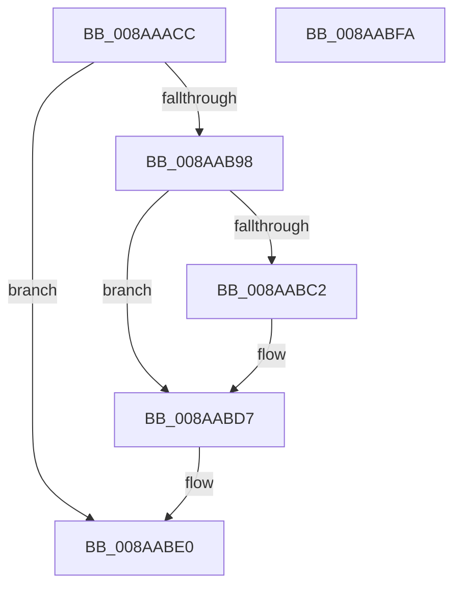

# PfSnIsVolumeMounted

- RVA: `0x008AAACC`–`0x008AABFB` (길이 `303` bytes)
- VA: `0x00000001408AAACC`
- 실행 섹션: `PAGE`
- PDB 이름 있음: `예`; PDB Function 태그: `아니요`
- unwind 정보 RVA: `0x0007F638`
- 디코드: `79`개 명령, `303/303` bytes 표시
- 미해석 바이트: `0` (있으면 어셈블리에 `.byte`로 보존)

> 이 문서는 커널 이미지의 기계어와 PDB 기호를 분석해 생성했습니다. 4번과 5번은 함수 원형과 자료형을 바이너리 사용 방식에서 추정한 C 해석이며 원본 소스 복구 결과는 아닙니다.

## 1. Dependencies

- 직접 호출 지점: **4**; 고유 호출 대상: **4**
- 직접 호출자로 확인된 함수: **1**
- RIP 상대 이미지 참조: **0**

### Outgoing calls
- `0x008AAB11` → [RtlInitUnicodeString](../../text/42/RtlInitUnicodeString_function_0042A780.md) (function, `0x0042A780`)
- `0x008AAB8D` → [IopCreateFile](IopCreateFile_function_008AB298.md) (function, `0x008AB298`)
- `0x008AABB0` → [NtQueryVolumeInformationFile](NtQueryVolumeInformationFile_function_008AC8C0.md) (function, `0x008AC8C0`)
- `0x008AABDB` → [NtClose](../86/NtClose_function_00868870.md) (function, `0x00868870`)

### Direct callers
- [PfSnOpenVolumesForPrefetch](PfSnOpenVolumesForPrefetch_function_008AA4AC.md) at `0x008AA666`

### Static image references
- 디코드된 RIP-relative 메모리 참조가 없습니다.

## 2. Other-region calls and transfers

- 다른 실행 섹션으로 향하는 call: **1**
  - `0x008AAB11` → [RtlInitUnicodeString](../../text/42/RtlInitUnicodeString_function_0042A780.md) (`PAGE` → `.text`)
- 별도 외부 분기/꼬리 이동을 확인하지 못했습니다.

## 3. Assembly (complete function range)

```asm
008AAACC  48 89 5C 24 08                  mov qword ptr [rsp + 8], rbx
008AAAD1  48 89 74 24 10                  mov qword ptr [rsp + 0x10], rsi
008AAAD6  55                              push rbp
008AAAD7  57                              push rdi
008AAAD8  41 56                           push r14
008AAADA  48 8D 6C 24 B9                  lea rbp, [rsp - 0x47]
008AAADF  48 81 EC E0 00 00 00            sub rsp, 0xe0
008AAAE6  45 33 F6                        xor r14d, r14d
008AAAE9  0F 57 C0                        xorps xmm0, xmm0
008AAAEC  48 8B F2                        mov rsi, rdx
008AAAEF  4C 89 75 7F                     mov qword ptr [rbp + 0x7f], r14
008AAAF3  48 8B D1                        mov rdx, rcx
008AAAF6  4C 89 75 E7                     mov qword ptr [rbp - 0x19], r14
008AAAFA  48 8D 4D EF                     lea rcx, [rbp - 0x11]
008AAAFE  44 89 75 13                     mov dword ptr [rbp + 0x13], r14d
008AAB02  49 8B F8                        mov rdi, r8
008AAB05  44 89 75 2B                     mov dword ptr [rbp + 0x2b], r14d
008AAB09  0F 11 45 EF                     movups xmmword ptr [rbp - 0x11], xmm0
008AAB0D  0F 11 45 FF                     movups xmmword ptr [rbp - 1], xmm0
008AAB11  E8 6A FC B7 FF                  call 0x14042a780
008AAB16  4C 89 74 24 78                  mov qword ptr [rsp + 0x78], r14
008AAB1B  48 8D 45 EF                     lea rax, [rbp - 0x11]
008AAB1F  48 89 45 1F                     mov qword ptr [rbp + 0x1f], rax
008AAB23  4C 8D 4D FF                     lea r9, [rbp - 1]
008AAB27  41 8D 46 20                     lea eax, [r14 + 0x20]
008AAB2B  C7 45 0F 30 00 00 00            mov dword ptr [rbp + 0xf], 0x30
008AAB32  89 44 24 70                     mov dword ptr [rsp + 0x70], eax
008AAB36  4C 8D 45 0F                     lea r8, [rbp + 0xf]
008AAB3A  44 89 74 24 68                  mov dword ptr [rsp + 0x68], r14d
008AAB3F  48 8D 4D 7F                     lea rcx, [rbp + 0x7f]
008AAB43  4C 89 74 24 60                  mov qword ptr [rsp + 0x60], r14
008AAB48  0F 57 C0                        xorps xmm0, xmm0
008AAB4B  44 89 74 24 58                  mov dword ptr [rsp + 0x58], r14d
008AAB50  BA 80 00 10 00                  mov edx, 0x100080
008AAB55  44 89 74 24 50                  mov dword ptr [rsp + 0x50], r14d
008AAB5A  4C 89 74 24 48                  mov qword ptr [rsp + 0x48], r14
008AAB5F  89 44 24 40                     mov dword ptr [rsp + 0x40], eax
008AAB63  C7 44 24 38 01 00 00 00         mov dword ptr [rsp + 0x38], 1
008AAB6B  C7 44 24 30 07 00 00 00         mov dword ptr [rsp + 0x30], 7
008AAB73  44 89 74 24 28                  mov dword ptr [rsp + 0x28], r14d
008AAB78  4C 89 74 24 20                  mov qword ptr [rsp + 0x20], r14
008AAB7D  4C 89 75 17                     mov qword ptr [rbp + 0x17], r14
008AAB81  C7 45 27 40 02 00 00            mov dword ptr [rbp + 0x27], 0x240
008AAB88  F3 0F 7F 45 2F                  movdqu xmmword ptr [rbp + 0x2f], xmm0
008AAB8D  E8 06 07 00 00                  call 0x1408ab298
008AAB92  8B D8                           mov ebx, eax
008AAB94  85 C0                           test eax, eax
008AAB96  78 48                           js 0x1408aabe0
008AAB98  48 8B 4D 7F                     mov rcx, qword ptr [rbp + 0x7f]
008AAB9C  45 8D 4E 08                     lea r9d, [r14 + 8]
008AABA0  4C 8D 45 E7                     lea r8, [rbp - 0x19]
008AABA4  C7 44 24 20 04 00 00 00         mov dword ptr [rsp + 0x20], 4
008AABAC  48 8D 55 FF                     lea rdx, [rbp - 1]
008AABB0  E8 0B 1D 00 00                  call 0x1408ac8c0
008AABB5  B9 00 00 00 C0                  mov ecx, 0xc0000000
008AABBA  8B D8                           mov ebx, eax
008AABBC  23 C1                           and eax, ecx
008AABBE  3B C1                           cmp eax, ecx
008AABC0  74 15                           je 0x1408aabd7
008AABC2  8B 4D EB                        mov ecx, dword ptr [rbp - 0x15]
008AABC5  41 8B DE                        mov ebx, r14d
008AABC8  8B C1                           mov eax, ecx
008AABCA  C1 E8 05                        shr eax, 5
008AABCD  83 E0 01                        and eax, 1
008AABD0  83 E1 01                        and ecx, 1
008AABD3  89 06                           mov dword ptr [rsi], eax
008AABD5  89 0F                           mov dword ptr [rdi], ecx
008AABD7  48 8B 4D 7F                     mov rcx, qword ptr [rbp + 0x7f]
008AABDB  E8 90 DC FB FF                  call 0x140868870
008AABE0  4C 8D 9C 24 E0 00 00 00         lea r11, [rsp + 0xe0]
008AABE8  8B C3                           mov eax, ebx
008AABEA  49 8B 5B 20                     mov rbx, qword ptr [r11 + 0x20]
008AABEE  49 8B 73 28                     mov rsi, qword ptr [r11 + 0x28]
008AABF2  49 8B E3                        mov rsp, r11
008AABF5  41 5E                           pop r14
008AABF7  5F                              pop rdi
008AABF8  5D                              pop rbp
008AABF9  C3                              ret
008AABFA  CC                              int3
```

## 4. C-style interpretation (structured pseudocode)

```c
__int64 __fastcall PfSnIsVolumeMounted(__int64 a1, __int64 a2, __int64 a3)
{
    __int64 result;
    __int64 v_r14;
    __int64 v_rbx;
    __int64 v_rsp;
    unsigned __int64 v_stack_m18;
    unsigned __int64 v_stack_m30;
    unsigned int v_stack_m34;
    unsigned int v_stack_m38;
    unsigned __int64 v_stack_m40;
    unsigned __int64 v_stack_m48;
    unsigned int v_stack_m4C;
    unsigned int v_stack_m50;
    unsigned __int64 v_stack_m5F;
    unsigned __int64 v_stack_m60;
    unsigned __int64 v_stack_m70;
    unsigned int v_stack_m74;
    unsigned __int64 v_stack_m78;
    unsigned __int64 v_stack_m80;
    unsigned int v_stack_m88;
    unsigned int v_stack_m90;
    unsigned __int64 v_stack_m98;
    unsigned int v_stack_mA0;
    unsigned int v_stack_mA8;
    unsigned __int64 v_stack_mB0;
    unsigned int v_stack_mB8;
    unsigned int v_stack_mC0;
    unsigned int v_stack_mC8;
    unsigned int v_stack_mD0;
    unsigned __int64 v_stack_mD8;
    unsigned __int64 v_stack_p10;
    unsigned __int64 v_stack_p20;
    unsigned __int64 v_stack_p8;

    v_stack_p8 = v_rbx;
    v_stack_p10 = v_rsi;
    v_rsp = (v_rsp) - (224);
    v_r14 = 0;
    v_stack_p20 = 0;
    v_stack_m78 = 0;
    v_stack_m4C = 0;
    v_stack_m34 = 0;
    v_stack_m70 = v_xmm0;
    v_stack_m60 = v_xmm0;
    result = RtlInitUnicodeString(v_stack_m70, a1, a3, a4);
    v_stack_m80 = 0;
    v_stack_m40 = v_stack_m70;
    v_stack_m50 = 48;
    v_stack_m88 = (unsigned int)(v_r14 + 32);
    v_stack_m90 = 0;
    v_stack_m98 = 0;
    v_stack_mA0 = 0;
    v_stack_mA8 = 0;
    v_stack_mB0 = 0;
    v_stack_mB8 = (unsigned int)(v_r14 + 32);
    v_stack_mC0 = 1;
    v_stack_mC8 = 7;
    v_stack_mD0 = 0;
    v_stack_mD8 = 0;
    v_stack_m48 = 0;
    v_stack_m38 = 576;
    v_stack_m30 = v_xmm0;
    result = IopCreateFile(v_stack_p20, (unsigned int)(0x100080ULL), v_stack_m50, v_stack_m60);
    if (sign_flag) goto loc_008AABE0;
    v_stack_mD8 = 4;
    result = NtQueryVolumeInformationFile(v_stack_p20, v_stack_m60, v_stack_m78, v_r14 + 8);
    result = (unsigned int)((result) & ((unsigned int)((unsigned int)(0xC0000000ULL))));
    v_rbx = (unsigned int)((unsigned int)(result));
    if (((unsigned int)(result)) != ((unsigned int)((unsigned int)(0xC0000000ULL)))) {
        a1 = v_stack_m74;
        v_rbx = 0;
        result = (unsigned int)(a1);
        result = (unsigned int)((result) >> (5));
        result = (unsigned int)((result) & (1));
        a1 = (unsigned int)((a1) & (1));
        *(unsigned int *)(a2) = (unsigned int)(result);
        *(unsigned int *)(a3) = (unsigned int)(a1);
    }
    result = NtClose(v_stack_p20, v_stack_m60, v_stack_m78, v_r14 + 8);
loc_008AABE0:
    return (unsigned int)((unsigned int)(v_rbx));
}
```

## 5. (Beta) C Style

```c
int64_t PfSnIsVolumeMounted(int64_t Arg1, void *Arg2, void *Arg3)
{
    uint8_t *arg2 = (uint8_t *)Arg2;
    uint8_t *arg3 = (uint8_t *)Arg3;

    int64_t result;
    int64_t local_r14;
    int64_t local_rbx;
    int64_t local_rsp;
    uint64_t v_stack_m18;
    uint64_t v_stack_m30;
    uint32_t v_stack_m34;
    uint32_t v_stack_m38;
    uint64_t v_stack_m40;
    uint64_t v_stack_m48;
    uint32_t v_stack_m4C;
    uint32_t v_stack_m50;
    uint64_t v_stack_m5F;
    uint64_t v_stack_m60;
    uint64_t v_stack_m70;
    uint32_t v_stack_m74;
    uint64_t v_stack_m78;
    uint64_t v_stack_m80;
    uint32_t v_stack_m88;
    uint32_t v_stack_m90;
    uint64_t v_stack_m98;
    uint32_t v_stack_mA0;
    uint32_t v_stack_mA8;
    uint64_t v_stack_mB0;
    uint32_t v_stack_mB8;
    uint32_t v_stack_mC0;
    uint32_t v_stack_mC8;
    uint32_t v_stack_mD0;
    uint64_t v_stack_mD8;
    uint64_t v_stack_p10;
    uint64_t v_stack_p20;
    uint64_t v_stack_p8;

    v_stack_p8 = local_rbx;
    v_stack_p10 = local_rsi;
    local_rsp = (local_rsp) - (224);
    local_r14 = 0;
    v_stack_p20 = 0;
    v_stack_m78 = 0;
    v_stack_m4C = 0;
    v_stack_m34 = 0;
    v_stack_m70 = v_xmm0;
    v_stack_m60 = v_xmm0;
    result = RtlInitUnicodeString(v_stack_m70, Arg1, Arg3, a4);
    v_stack_m80 = 0;
    v_stack_m40 = v_stack_m70;
    v_stack_m50 = 48;
    v_stack_m88 = (uint32_t)(local_r14 + 32);
    v_stack_m90 = 0;
    v_stack_m98 = 0;
    v_stack_mA0 = 0;
    v_stack_mA8 = 0;
    v_stack_mB0 = 0;
    v_stack_mB8 = (uint32_t)(local_r14 + 32);
    v_stack_mC0 = 1;
    v_stack_mC8 = 7;
    v_stack_mD0 = 0;
    v_stack_mD8 = 0;
    v_stack_m48 = 0;
    v_stack_m38 = 576;
    v_stack_m30 = v_xmm0;
    result = IopCreateFile(v_stack_p20, (uint32_t)(0x100080ULL), v_stack_m50, v_stack_m60);
    if (sign_flag) goto loc_008AABE0;
    v_stack_mD8 = 4;
    result = NtQueryVolumeInformationFile(v_stack_p20, v_stack_m60, v_stack_m78, local_r14 + 8);
    result = (uint32_t)((result) & ((uint32_t)((uint32_t)(0xC0000000ULL))));
    local_rbx = (uint32_t)((uint32_t)(result));
    if (((uint32_t)(result)) != ((uint32_t)((uint32_t)(0xC0000000ULL)))) {
        Arg1 = v_stack_m74;
        local_rbx = 0;
        result = (uint32_t)(Arg1);
        result = (uint32_t)((result) >> (5));
        result = (uint32_t)((result) & (1));
        Arg1 = (uint32_t)((Arg1) & (1));
        *(uint32_t *)(arg2) = (uint32_t)(result);
        *(uint32_t *)(arg3) = (uint32_t)(Arg1);
    }
    result = NtClose(v_stack_p20, v_stack_m60, v_stack_m78, local_r14 + 8);
loc_008AABE0:
    return (uint32_t)((uint32_t)(local_rbx));
}
```

### 관측된 메모리 오프셋

구조체 형식이 확인되지 않은 접근은 인자 기준의 오프셋으로만 기록했습니다.

| 기준 인자 | 오프셋 표현 | 폭 (bit) | 접근 |
|---|---:|---:|---|
| `Arg2` | `+ 0x0` | `32` | `W` |
| `Arg3` | `+ 0x0` | `32` | `W` |

## 6. Execution-region graph

[열기: 2D/3D 그래프와 함수 탐색 컨트롤 패널](../../../control-panel.html?section=page&rva=0x008AAACC&view=graph)

- 2D 그래프는 위에서 아래로 흐르고, 3D 그래프는 빈 공간을 드래그해 회전합니다. Shift+드래그는 이동, 휠은 확대·축소, 함수 노드 선택은 대상 보고서 이동입니다.

### Static fallback


