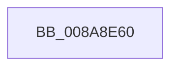

# PfSnPopulateReadList

- RVA: `0x008A8E60`–`0x008A8E86` (길이 `38` bytes)
- VA: `0x00000001408A8E60`
- 실행 섹션: `PAGE`
- PDB 이름 있음: `예`; PDB Function 태그: `아니요`
- unwind 정보 RVA: `0x0007F414`
- 디코드: `10`개 명령, `38/38` bytes 표시
- 미해석 바이트: `0` (있으면 어셈블리에 `.byte`로 보존)

> 이 문서는 커널 이미지의 기계어와 PDB 기호를 분석해 생성했습니다. 4번과 5번은 함수 원형과 자료형을 바이너리 사용 방식에서 추정한 C 해석이며 원본 소스 복구 결과는 아닙니다.

## 1. Dependencies

- 직접 호출 지점: **0**; 고유 호출 대상: **0**
- 직접 호출자로 확인된 함수: **0**
- RIP 상대 이미지 참조: **1**

### Outgoing calls
- 직접 디코드된 call 명령이 없습니다.

### Direct callers
- 이 함수 시작 RVA로 연결되는 직접 call은 확인되지 않았습니다. 간접 호출은 완전히 역산할 수 없습니다.

### Static image references
- `0x008A8E70` → RVA `0x00E0A740` (`.data`; read)

## 2. Other-region calls and transfers

- 다른 실행 섹션으로 향하는 call: **0**
- 별도 외부 분기/꼬리 이동을 확인하지 못했습니다.

## 3. Assembly (complete function range)

```asm
008A8E60  4C 8B DC                        mov r11, rsp
008A8E63  55                              push rbp
008A8E64  57                              push rdi
008A8E65  49 8D 6B A8                     lea rbp, [r11 - 0x58]
008A8E69  48 81 EC 48 01 00 00            sub rsp, 0x148
008A8E70  48 8B 05 C9 18 56 00            mov rax, qword ptr [rip + 0x5618c9]
008A8E77  48 33 C4                        xor rax, rsp
008A8E7A  48 89 45 20                     mov qword ptr [rbp + 0x20], rax
008A8E7E  48 8B 79 20                     mov rdi, qword ptr [rcx + 0x20]
008A8E82  4C 8D 45 F0                     lea r8, [rbp - 0x10]
```

## 4. C-style interpretation (structured pseudocode)

```c
__int64 __fastcall PfSnPopulateReadList(__int64 a1)
{
    __int64 result;
    __int64 v_rsp;

    v_rsp = (v_rsp) - (328);
    result = (*(unsigned __int64 *)(v_rip + 5642441)) ^ (v_rsp);
    *(unsigned __int64 *)(v_rsp - 88 + 32) = result;
    return result;
}
```

## 5. (Beta) C Style

```c
int64_t PfSnPopulateReadList(void *Arg1)
{
    uint8_t *arg1 = (uint8_t *)Arg1;

    int64_t result;
    int64_t local_rsp;

    local_rsp = (local_rsp) - (328);
    result = (*(uint64_t *)(v_rip + 0x5618C9)) ^ (local_rsp);
    *(uint64_t *)(local_rsp - 0x58 + 0x20) = result;
    return result;
}
```

### 관측된 메모리 오프셋

구조체 형식이 확인되지 않은 접근은 인자 기준의 오프셋으로만 기록했습니다.

| 기준 인자 | 오프셋 표현 | 폭 (bit) | 접근 |
|---|---:|---:|---|
| `Arg1` | `+ 0x20` | `64` | `R` |

## 6. Execution-region graph

[열기: 2D/3D 그래프와 함수 탐색 컨트롤 패널](../../../control-panel.html?section=page&rva=0x008A8E60&view=graph)

- 2D 그래프는 위에서 아래로 흐르고, 3D 그래프는 빈 공간을 드래그해 회전합니다. Shift+드래그는 이동, 휠은 확대·축소, 함수 노드 선택은 대상 보고서 이동입니다.

### Static fallback


