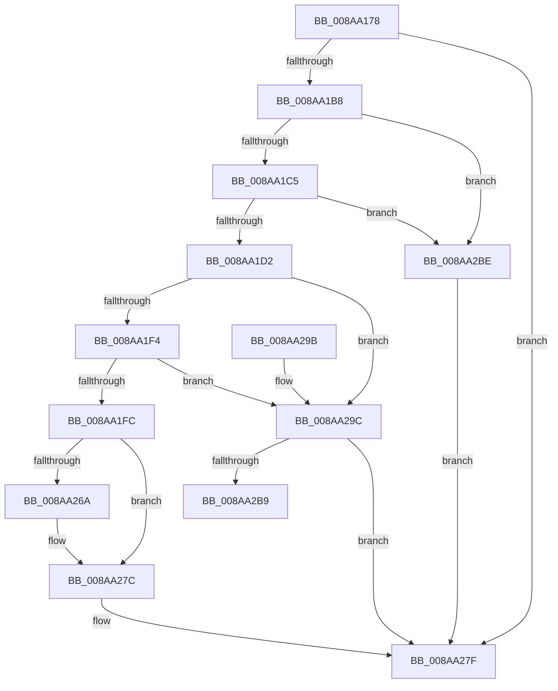

# PfSnPrefetchFileMetadata

- RVA: `0x008AA178`–`0x008AA2C6` (길이 `334` bytes)
- VA: `0x00000001408AA178`
- 실행 섹션: `PAGE`
- PDB 이름 있음: `예`; PDB Function 태그: `예`
- unwind 정보 RVA: `0x0007F594`
- 디코드: `93`개 명령, `334/334` bytes 표시
- 미해석 바이트: `0` (있으면 어셈블리에 `.byte`로 보존)

> 이 문서는 커널 이미지의 기계어와 PDB 기호를 분석해 생성했습니다. 4번과 5번은 함수 원형과 자료형을 바이너리 사용 방식에서 추정한 C 해석이며 원본 소스 복구 결과는 아닙니다.

## 1. Dependencies

- 직접 호출 지점: **3**; 고유 호출 대상: **3**
- 직접 호출자로 확인된 함수: **1**
- RIP 상대 이미지 참조: **0**

### Outgoing calls
- `0x008AA213` → [NtResetEvent](NtResetEvent_function_008AA2D0.md) (function, `0x008AA2D0`)
- `0x008AA25B` → [IopXxxControlFile](../8E/IopXxxControlFile_function_008E9AD0.md) (function, `0x008E9AD0`)
- `0x008AA272` → [NtWaitForSingleObject](../86/NtWaitForSingleObject_function_00868BD0.md) (function, `0x00868BD0`)

### Direct callers
- [PfSnPrefetchMetadata](../93/PfSnPrefetchMetadata_function_0093B9B4.md) at `0x0093BAD8`

### Static image references
- 디코드된 RIP-relative 메모리 참조가 없습니다.

## 2. Other-region calls and transfers

- 다른 실행 섹션으로 향하는 call: **0**
- call이 아닌 외부 분기/꼬리 이동: **1**
  - `0x008AA2B9` → [sub_00B19EB2](../B1/Unknown_function_00B19EB2.md) (`tail-transfer`)

## 3. Assembly (complete function range)

```asm
008AA178  48 8B C4                        mov rax, rsp
008AA17B  48 89 58 08                     mov qword ptr [rax + 8], rbx
008AA17F  48 89 68 18                     mov qword ptr [rax + 0x18], rbp
008AA183  48 89 50 10                     mov qword ptr [rax + 0x10], rdx
008AA187  56                              push rsi
008AA188  57                              push rdi
008AA189  41 55                           push r13
008AA18B  41 56                           push r14
008AA18D  41 57                           push r15
008AA18F  48 83 EC 70                     sub rsp, 0x70
008AA193  8B BC 24 C0 00 00 00            mov edi, dword ptr [rsp + 0xc0]
008AA19A  45 33 D2                        xor r10d, r10d
008AA19D  0F 57 C0                        xorps xmm0, xmm0
008AA1A0  41 8B E9                        mov ebp, r9d
008AA1A3  49 8B F0                        mov rsi, r8
008AA1A6  4C 8B F2                        mov r14, rdx
008AA1A9  4C 8B F9                        mov r15, rcx
008AA1AC  0F 11 40 C8                     movups xmmword ptr [rax - 0x38], xmm0
008AA1B0  85 FF                           test edi, edi
008AA1B2  0F 84 C7 00 00 00               je 0x1408aa27f
008AA1B8  41 8B 58 04                     mov ebx, dword ptr [r8 + 4]
008AA1BC  41 3B D9                        cmp ebx, r9d
008AA1BF  0F 86 F9 00 00 00               jbe 0x1408aa2be
008AA1C5  8B C3                           mov eax, ebx
008AA1C7  41 2B C1                        sub eax, r9d
008AA1CA  3B C7                           cmp eax, edi
008AA1CC  0F 82 EC 00 00 00               jb 0x1408aa2be
008AA1D2  8B 41 64                        mov eax, dword ptr [rcx + 0x64]
008AA1D5  BA 00 03 00 00                  mov edx, 0x300
008AA1DA  8B 49 60                        mov ecx, dword ptr [rcx + 0x60]
008AA1DD  83 E0 07                        and eax, 7
008AA1E0  83 C8 08                        or eax, 8
008AA1E3  83 E1 07                        and ecx, 7
008AA1E6  C1 E0 03                        shl eax, 3
008AA1E9  0B C1                           or eax, ecx
008AA1EB  45 85 C9                        test r9d, r9d
008AA1EE  0F 85 A8 00 00 00               jne 0x1408aa29c
008AA1F4  3B FA                           cmp edi, edx
008AA1F6  0F 87 A0 00 00 00               ja 0x1408aa29c
008AA1FC  48 8B AC 24 C8 00 00 00         mov rbp, qword ptr [rsp + 0xc8]
008AA204  33 D2                           xor edx, edx
008AA206  8B C8                           mov ecx, eax
008AA208  49 89 48 08                     mov qword ptr [r8 + 8], rcx
008AA20C  48 8B CD                        mov rcx, rbp
008AA20F  41 89 78 04                     mov dword ptr [r8 + 4], edi
008AA213  E8 B8 00 00 00                  call 0x1408aa2d0
008AA218  83 64 24 58 00                  and dword ptr [rsp + 0x58], 0
008AA21D  8D 04 FD 10 00 00 00            lea eax, [rdi*8 + 0x10]
008AA224  C6 44 24 50 00                  mov byte ptr [rsp + 0x50], 0
008AA229  45 33 C9                        xor r9d, r9d
008AA22C  83 64 24 48 00                  and dword ptr [rsp + 0x48], 0
008AA231  45 33 C0                        xor r8d, r8d
008AA234  48 83 64 24 40 00               and qword ptr [rsp + 0x40], 0
008AA23A  48 8B D5                        mov rdx, rbp
008AA23D  89 44 24 38                     mov dword ptr [rsp + 0x38], eax
008AA241  49 8B CE                        mov rcx, r14
008AA244  48 89 74 24 30                  mov qword ptr [rsp + 0x30], rsi
008AA249  48 8D 44 24 60                  lea rax, [rsp + 0x60]
008AA24E  C7 44 24 28 20 01 09 00         mov dword ptr [rsp + 0x28], 0x90120
008AA256  48 89 44 24 20                  mov qword ptr [rsp + 0x20], rax
008AA25B  E8 70 F8 03 00                  call 0x1408e9ad0
008AA260  44 8B D0                        mov r10d, eax
008AA263  3D 03 01 00 00                  cmp eax, 0x103
008AA268  75 12                           jne 0x1408aa27c
008AA26A  45 33 C0                        xor r8d, r8d
008AA26D  33 D2                           xor edx, edx
008AA26F  48 8B CD                        mov rcx, rbp
008AA272  E8 59 E9 FB FF                  call 0x140868bd0
008AA277  44 8B 54 24 60                  mov r10d, dword ptr [rsp + 0x60]
008AA27C  89 5E 04                        mov dword ptr [rsi + 4], ebx
008AA27F  4C 8D 5C 24 70                  lea r11, [rsp + 0x70]
008AA284  41 8B C2                        mov eax, r10d
008AA287  49 8B 5B 30                     mov rbx, qword ptr [r11 + 0x30]
008AA28B  49 8B 6B 40                     mov rbp, qword ptr [r11 + 0x40]
008AA28F  49 8B E3                        mov rsp, r11
008AA292  41 5F                           pop r15
008AA294  41 5E                           pop r14
008AA296  41 5D                           pop r13
008AA298  5F                              pop rdi
008AA299  5E                              pop rsi
008AA29A  C3                              ret
008AA29B  CC                              int3
008AA29C  4D 8B 7F 50                     mov r15, qword ptr [r15 + 0x50]
008AA2A0  8B C8                           mov ecx, eax
008AA2A2  45 21 57 04                     and dword ptr [r15 + 4], r10d
008AA2A6  45 33 F6                        xor r14d, r14d
008AA2A9  41 C7 07 03 00 00 00            mov dword ptr [r15], 3
008AA2B0  49 89 4F 08                     mov qword ptr [r15 + 8], rcx
008AA2B4  44 3B F7                        cmp r14d, edi
008AA2B7  73 C6                           jae 0x1408aa27f
008AA2B9  E9 F4 FB 26 00                  jmp 0x140b19eb2
008AA2BE  41 BA 7B 00 00 C0               mov r10d, 0xc000007b
008AA2C4  EB B9                           jmp 0x1408aa27f
```

## 4. C-style interpretation (structured pseudocode)

```c
__int64 __fastcall PfSnPrefetchFileMetadata(__int64 a1, __int64 a2, __int64 a3, int a4, unsigned int a5, __int64 a6)
{
    __int64 result;
    __int64 v_r10;
    __int64 v_r14;
    __int64 v_rsp;
    unsigned __int64 v_stack_m28;
    unsigned __int64 v_stack_m38;
    unsigned int v_stack_m40;
    unsigned __int8 v_stack_m48;
    unsigned int v_stack_m50;
    unsigned __int64 v_stack_m58;
    unsigned int v_stack_m60;
    unsigned __int64 v_stack_m68;
    unsigned int v_stack_m70;
    unsigned __int64 v_stack_m78;

    *(unsigned __int64 *)(v_rsp + 8) = v_rbx;
    *(unsigned __int64 *)(v_rsp + 24) = v_rbp;
    *(unsigned __int64 *)(v_rsp + 16) = a2;
    v_rsp = (v_rsp) - (112);
    v_r10 = 0;
    *(unsigned __int64 *)(v_rsp - 56) = v_xmm0;
    if ((unsigned int)((unsigned int)(a5)) == 0) goto loc_008AA27F;
    if (((unsigned int)((unsigned int)(*(unsigned int *)(a3 + 4)))) <= a4) goto loc_008AA2BE;
    result = (unsigned int)(((unsigned int)((unsigned int)((unsigned int)(*(unsigned int *)(a3 + 4))))) - (a4));
    if (((unsigned int)(result)) < ((unsigned int)((unsigned int)(a5)))) goto loc_008AA2BE;
    result = (unsigned int)(((unsigned int)(*(unsigned int *)(a1 + 100))) & (7));
    result = (unsigned int)((result) | (8));
    a1 = (unsigned int)(((unsigned int)(*(unsigned int *)(a1 + 96))) & (7));
    result = (unsigned int)((result) << (3));
    result = (unsigned int)((result) | ((unsigned int)(a1)));
    if (a4 != 0) goto loc_008AA29C;
    if (((unsigned int)((unsigned int)(a5))) > 768) goto loc_008AA29C;
    a2 = 0;
    *(unsigned __int64 *)(a3 + 8) = (unsigned int)((unsigned int)(result));
    *(unsigned int *)(a3 + 4) = (unsigned int)((unsigned int)(a5));
    result = NtResetEvent(a6, a2, a3, a4);
    v_stack_m48 = 0;
    a4 = 0;
    a3 = 0;
    v_stack_m60 = (unsigned int)((unsigned int)(a5) * 8 + 16);
    v_stack_m68 = 0;
    v_stack_m70 = 0x90120ULL;
    v_stack_m78 = v_stack_m38;
    result = IopXxxControlFile(0, a6, a3, a4);
    v_r10 = (unsigned int)((unsigned int)(result));
    if (((unsigned int)(result)) == 259) {
        a3 = 0;
        a2 = 0;
        a1 = a6;
        result = NtWaitForSingleObject(a1, a2, a3, a4);
        v_r10 = v_stack_m38;
    }
    *(unsigned int *)(a3 + 4) = (unsigned int)((unsigned int)(*(unsigned int *)(a3 + 4)));
loc_008AA27F:
    return (unsigned int)((unsigned int)(v_r10));
loc_008AA29C:
    v_r14 = 0;
    *(unsigned int *)(*(unsigned __int64 *)(a1 + 80)) = 3;
    *(unsigned __int64 *)(*(unsigned __int64 *)(a1 + 80) + 8) = (unsigned int)((unsigned int)((unsigned int)((unsigned int)(v_r10))));
    if (0 >= ((unsigned int)((unsigned int)(a5)))) goto loc_008AA27F;
loc_008AA2BE:
    goto loc_008AA27F;
}
```

## 5. (Beta) C Style

```c
int64_t PfSnPrefetchFileMetadata(void *Arg1, int64_t Arg2, void *Arg3, int32_t Arg4, uint32_t Arg5, int64_t Arg6)
{
    uint8_t *arg1 = (uint8_t *)Arg1;
    uint8_t *arg3 = (uint8_t *)Arg3;

    int64_t result;
    int64_t local_r10;
    int64_t local_r14;
    int64_t local_rsp;
    uint64_t v_stack_m28;
    uint64_t v_stack_m38;
    uint32_t v_stack_m40;
    uint8_t v_stack_m48;
    uint32_t v_stack_m50;
    uint64_t v_stack_m58;
    uint32_t v_stack_m60;
    uint64_t v_stack_m68;
    uint32_t v_stack_m70;
    uint64_t v_stack_m78;

    *(uint64_t *)(local_rsp + 0x8) = local_rbx;
    *(uint64_t *)(local_rsp + 0x18) = local_rbp;
    *(uint64_t *)(local_rsp + 0x10) = Arg2;
    local_rsp = (local_rsp) - (112);
    local_r10 = 0;
    *(uint64_t *)(local_rsp - 0x38) = v_xmm0;
    if ((uint32_t)((uint32_t)(Arg5)) == 0) goto loc_008AA27F;
    if (((uint32_t)((uint32_t)(*(uint32_t *)(arg3 + 0x4)))) <= Arg4) goto loc_008AA2BE;
    result = (uint32_t)(((uint32_t)((uint32_t)((uint32_t)(*(uint32_t *)(arg3 + 0x4))))) - (Arg4));
    if (((uint32_t)(result)) < ((uint32_t)((uint32_t)(Arg5)))) goto loc_008AA2BE;
    result = (uint32_t)(((uint32_t)(*(uint32_t *)(arg1 + 0x64))) & (7));
    result = (uint32_t)((result) | (8));
    Arg1 = (uint32_t)(((uint32_t)(*(uint32_t *)(arg1 + 0x60))) & (7));
    result = (uint32_t)((result) << (3));
    result = (uint32_t)((result) | ((uint32_t)(Arg1)));
    if (Arg4 != 0) goto loc_008AA29C;
    if (((uint32_t)((uint32_t)(Arg5))) > 768) goto loc_008AA29C;
    Arg2 = 0;
    *(uint64_t *)(arg3 + 0x8) = (uint32_t)((uint32_t)(result));
    *(uint32_t *)(arg3 + 0x4) = (uint32_t)((uint32_t)(Arg5));
    result = NtResetEvent(Arg6, Arg2, Arg3, Arg4);
    v_stack_m48 = 0;
    Arg4 = 0;
    Arg3 = 0;
    v_stack_m60 = (uint32_t)((uint32_t)(Arg5) * 8 + 16);
    v_stack_m68 = 0;
    v_stack_m70 = 0x90120ULL;
    v_stack_m78 = v_stack_m38;
    result = IopXxxControlFile(0, Arg6, Arg3, Arg4);
    local_r10 = (uint32_t)((uint32_t)(result));
    if (((uint32_t)(result)) == 259) {
        Arg3 = 0;
        Arg2 = 0;
        Arg1 = Arg6;
        result = NtWaitForSingleObject(Arg1, Arg2, Arg3, Arg4);
        local_r10 = v_stack_m38;
    }
    *(uint32_t *)(arg3 + 0x4) = (uint32_t)((uint32_t)(*(uint32_t *)(arg3 + 0x4)));
loc_008AA27F:
    return (uint32_t)((uint32_t)(local_r10));
loc_008AA29C:
    local_r14 = 0;
    *(uint32_t *)(*(uint64_t *)(arg1 + 0x50)) = 3;
    *(uint64_t *)(*(uint64_t *)(arg1 + 0x50) + 0x8) = (uint32_t)((uint32_t)((uint32_t)((uint32_t)(local_r10))));
    if (0 >= ((uint32_t)((uint32_t)(Arg5)))) goto loc_008AA27F;
loc_008AA2BE:
    goto loc_008AA27F;
}
```

### 관측된 메모리 오프셋

구조체 형식이 확인되지 않은 접근은 인자 기준의 오프셋으로만 기록했습니다.

| 기준 인자 | 오프셋 표현 | 폭 (bit) | 접근 |
|---|---:|---:|---|
| `Arg1` | `+ 0x50` | `64` | `R` |
| `Arg1` | `+ 0x60` | `32` | `R` |
| `Arg1` | `+ 0x64` | `32` | `R` |
| `Arg3` | `+ 0x4` | `32` | `R` |
| `Arg3` | `+ 0x4` | `32` | `W` |
| `Arg3` | `+ 0x8` | `64` | `W` |

## 6. Execution-region graph

[열기: 2D/3D 그래프와 함수 탐색 컨트롤 패널](../../../control-panel.html?section=page&rva=0x008AA178&view=graph)

- 2D 그래프는 위에서 아래로 흐르고, 3D 그래프는 빈 공간을 드래그해 회전합니다. Shift+드래그는 이동, 휠은 확대·축소, 함수 노드 선택은 대상 보고서 이동입니다.

### Static fallback


